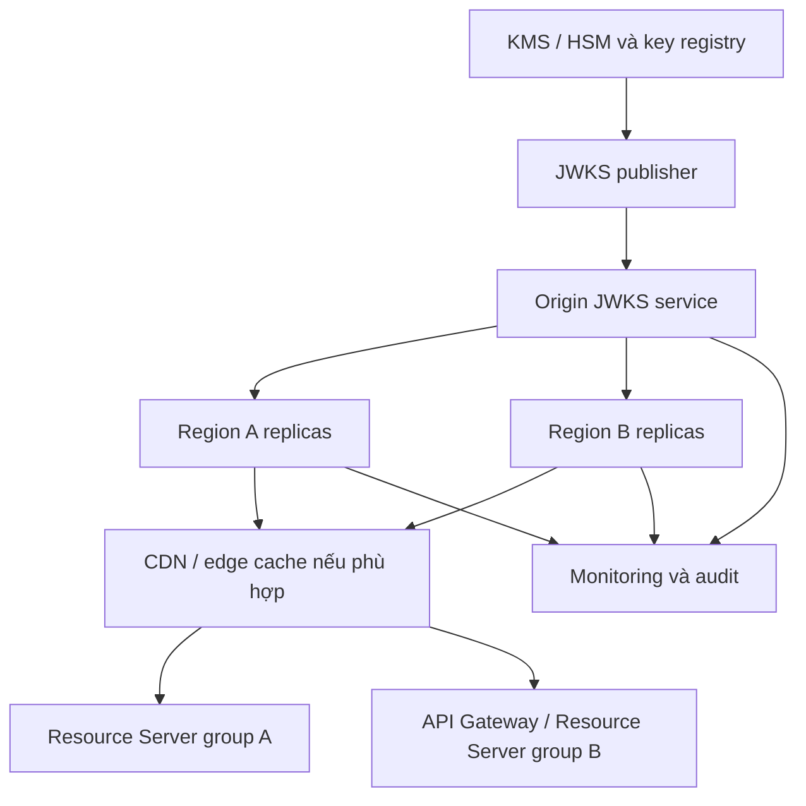
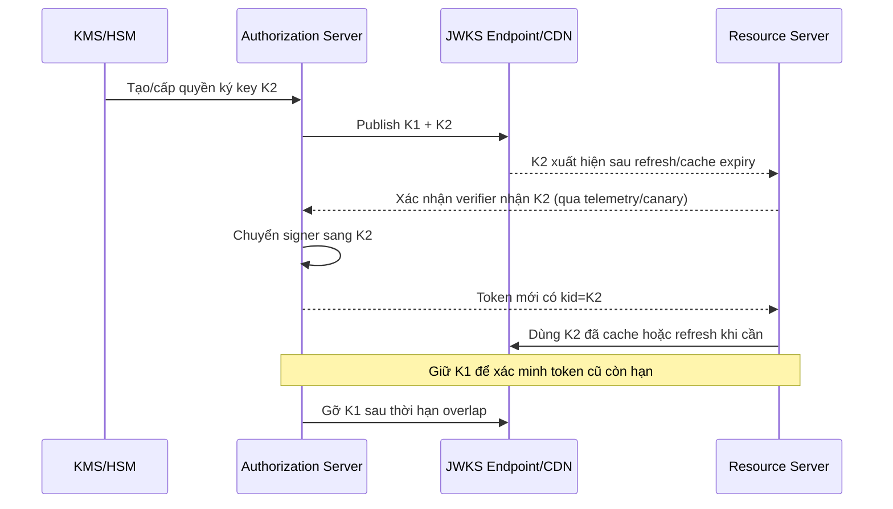

# Đảm bảo tính sẵn sàng của Key Endpoint (JWKS)

## 1. Vai trò của Key Endpoint trong hệ thống token

Trong OAuth 2.0/OIDC, Authorization Server có thể phát hành access token dạng JWT được ký bằng private key. Resource Server cần public key tương ứng để xác minh chữ ký trước khi tin các claims như `iss`, `aud`, `exp` và `scope`. Public key thường được công bố qua **JSON Web Key Set (JWKS)** tại một endpoint HTTPS, được tham chiếu bởi metadata của Authorization Server hoặc OpenID Provider qua thuộc tính `jwks_uri`.

**Key Endpoint Availability** là khả năng các hệ thống tiêu thụ khóa có thể truy cập và nhận được bộ public key đáng tin cậy, đúng phiên bản, trong thời gian đáp ứng yêu cầu vận hành. Nếu endpoint không khả dụng, Resource Server có thể không tải được key mới, không xác minh được token mới sau rotation hoặc mất khả năng khởi động khi cache chưa được tạo. Nếu endpoint trả dữ liệu sai hoặc stale, token hợp lệ có thể bị từ chối hoặc key đã thu hồi vẫn được tin cậy.

Key Endpoint thường phục vụ public key, không phải nơi cấp token và cũng không phải endpoint introspection. Cần phân biệt:

| Endpoint | Mục đích | Ảnh hưởng khi không khả dụng |
| --- | --- | --- |
| Authorization Server metadata / OIDC discovery | Công bố issuer, endpoint và `jwks_uri` | Consumer mới hoặc consumer cần refresh metadata có thể không tìm được endpoint khóa. |
| JWKS (`jwks_uri`) | Cung cấp public keys để xác minh chữ ký | Token có `kid` chưa được cache có thể không xác minh được; rotation có thể bị gián đoạn. |
| Token endpoint | Xác thực client/grant và phát hành token | Client không lấy được token mới. |
| Introspection endpoint | Trả trạng thái và thuộc tính của opaque token hoặc token cần kiểm tra trực tuyến | Resource Server không thể xác minh trạng thái theo cách introspection. |

Bài học tập trung vào vận hành endpoint công bố public key trong vòng đời token bảo mật: thiết kế HA, cache, HTTP semantics, rollout khi xoay khóa, xử lý lỗi, giám sát và kiểm thử. Các nguyên tắc cũng áp dụng cho endpoint khóa tương đương do hệ thống tự triển khai, miễn là nguồn tin cậy và định dạng được xác định rõ.

## 2. Hợp đồng cơ bản của JWKS endpoint

JWKS là một JSON object có thuộc tính `keys`, chứa một mảng JWK. Mỗi JWK mô tả một khóa; với xác minh chữ ký, endpoint thường chỉ công bố public parameters.

Ví dụ response rút gọn:

```http
HTTP/1.1 200 OK
Content-Type: application/jwk-set+json
Cache-Control: public, max-age=300, must-revalidate
ETag: "jwks-version-42"

{
  "keys": [
    {
      "kty": "RSA",
      "use": "sig",
      "alg": "RS256",
      "kid": "issuer-signing-2026-03",
      "n": "<public-modulus-base64url>",
      "e": "AQAB"
    }
  ]
}
```

Đây là ví dụ minh họa. Header và cache directive thực tế cần được chọn theo chính sách triển khai; `application/jwk-set+json` là media type được đăng ký cho JWK Set. Không đưa private key material như RSA `d`, `p`, `q` hoặc các thành phần bí mật tương đương vào JWKS public.

Consumer phải lấy JWKS từ `jwks_uri` được cấu hình hoặc metadata gắn với issuer đã tin cậy. Không được tin URL `jku`/`x5u` tùy ý trong JWT header để tải key. Sau khi lấy được key, verifier vẫn phải kiểm tra chữ ký, thuật toán allowlist, issuer, audience, thời gian hiệu lực và profile token.

### Các thuộc tính cần thống nhất

- **Issuer identity:** một JWKS URI phải gắn với issuer đã xác định. Không dùng chung một key set cho các issuer khác nhau nếu policy không cho phép rõ ràng.
- **Key identifier:** mỗi khóa ký có `kid` để consumer chọn key phù hợp. `kid` không phải bí mật và không tự chứng minh nguồn gốc.
- **Key usage/algorithm:** `use`, `key_ops`, `alg` và `kty` cần tương thích với cách dùng thực tế. Consumer không được bỏ qua allowlist thuật toán.
- **TLS và HTTP:** endpoint dùng HTTPS với chứng thư hợp lệ, response có content type phù hợp, cache header và status code rõ ràng.
- **Versioning:** thay đổi key set phải có cách nhận biết, ví dụ ETag hoặc Last-Modified, để consumer có thể revalidate.
- **Backward compatibility:** trong planned rotation, key set thường công bố cả key cũ và key mới trong giai đoạn overlap.

## 3. SLI và SLO cho Key Endpoint

Không nên đánh giá availability chỉ bằng việc một health check nhận HTTP 200. Một endpoint có thể trả 200 nhưng JSON không hợp lệ, thiếu key đang được dùng để ký, trả dữ liệu stale hoặc có latency quá cao.

Các chỉ số dịch vụ hữu ích:

| SLI | Cách đo | Ý nghĩa |
| --- | --- | --- |
| Request availability | Tỷ lệ request JWKS hợp lệ nhận response thành công và parse được | Khả năng phục vụ key set cho consumer. |
| Latency | p50/p95/p99 thời gian GET/conditional GET | Tốc độ tải hoặc revalidate key set. |
| Freshness / propagation | Thời gian từ lúc publish key mới tới khi các vùng/consumer nhìn thấy key | Khả năng hỗ trợ key rotation đúng hạn. |
| Content validity | Tỷ lệ response có JSON/JWKS hợp lệ, key metadata đúng | Tính đúng đắn của dữ liệu, không chỉ uptime HTTP. |
| Consumer verification success | Tỷ lệ token hợp lệ được verifier xác minh thành công | Tác động thực tế tới API, bao gồm cache và key selection. |
| Unknown `kid` rate | Số lần verifier gặp key ID chưa biết | Có thể chỉ ra rotation chưa hội tụ, cấu hình sai hoặc token giả. |

Ví dụ mục tiêu vận hành (cần hiệu chỉnh theo hệ thống):

- Request availability của JWKS endpoint đạt 99,9% theo tháng.
- p95 latency dưới 300 ms ở các vùng phục vụ chính.
- Key mới được phân phối tới các verifier được quản lý trong tối đa 5 phút trước khi signer bắt đầu sử dụng key đó.
- Sau khi publish, mọi consumer quan trọng xác minh được token ký bằng key mới trước cutover.

Các giá trị này là ví dụ để xây dựng SLO, không phải yêu cầu bắt buộc từ OAuth/OIDC hay RFC. Với consumer bên thứ ba, không thể bảo đảm propagation nếu không có thỏa thuận hoặc telemetry từ phía họ; cần định nghĩa phạm vi đo và cách xác nhận riêng.

## 4. Kiến trúc tăng tính sẵn sàng

JWKS là dữ liệu public và thường có tần suất đọc cao hơn tần suất cập nhật. Có thể phục vụ từ nhiều instance, region hoặc CDN, miễn là dữ liệu nhất quán và đường phân phối giữ đúng TLS/issuer.



Một số nguyên tắc thiết kế:

1. **Không để một instance là điểm lỗi duy nhất:** chạy nhiều replica stateless hoặc có khả năng phục vụ key set từ nguồn dữ liệu có HA.
2. **Tách signer khỏi public key delivery:** Resource Server chỉ cần public key; lỗi KMS/HSM dùng để ký không nhất thiết phải làm endpoint JWKS ngừng phục vụ public key đã publish.
3. **Phân phối dữ liệu có kiểm soát:** dùng registry hoặc pipeline publish có version, validation và audit; tránh mỗi instance tự sinh JWKS khác nhau.
4. **Giữ issuer/JWKS URI ổn định:** thay đổi hostname, DNS, certificate hoặc path có thể ảnh hưởng nhiều consumer; cần migration plan nếu bắt buộc thay đổi.
5. **Dùng CDN/proxy khi phù hợp:** có thể giảm tải và tăng phân phối đa vùng, nhưng cần purge/invalidation hoặc TTL phù hợp khi rotation hay emergency revocation.
6. **Có capacity và rate limit hợp lý:** chống request burst, scraping hoặc `kid`-triggered refresh storm; không chặn nhầm traffic hợp lệ từ các verifier.
7. **Có fallback dữ liệu tin cậy:** consumer có thể dùng key đã cache trong giới hạn freshness policy khi endpoint tạm lỗi; không dùng key chưa xác minh hoặc nguồn thay thế không được quản trị.

Không nên phụ thuộc duy nhất vào CDN nếu không có cách xác nhận cache đã nhận version mới. Cũng không nên cache response vô thời hạn chỉ để tăng availability; stale key set có thể làm rotation và revocation mất hiệu lực.

## 5. HTTP caching, ETag và freshness

Vì JWKS thay đổi tương đối ít, HTTP caching giúp giảm tải và làm consumer ít phụ thuộc vào origin. Tuy nhiên, cache policy phải cân bằng giữa availability, tốc độ phân phối key mới và tốc độ thu hồi key cũ.

Ví dụ response có cache TTL 300 giây:

```http
Cache-Control: public, max-age=300, must-revalidate
ETag: "jwks-version-42"
```

Sau khi TTL hết hạn, consumer có thể gửi conditional request:

```http
GET /.well-known/jwks.json HTTP/1.1
Host: auth.example.test
If-None-Match: "jwks-version-42"
```

Nếu nội dung không đổi, server có thể trả `304 Not Modified`; consumer tiếp tục dùng representation đã cache và cập nhật freshness theo HTTP semantics. Nếu key set thay đổi, server trả `200 OK` với nội dung và ETag mới.

Lưu ý vận hành:

- Chọn `max-age` dựa trên SLO rotation/revocation và năng lực origin; TTL quá dài làm key mới đến chậm, TTL quá ngắn tăng tải và phụ thuộc mạng.
- ETag phải thay đổi khi representation JWKS thay đổi. Không tái sử dụng ETag cũ cho key set mới.
- Kiểm tra cache ở CDN, reverse proxy, service mesh và thư viện verifier; mỗi tầng có thể có TTL riêng.
- Với emergency key revocation, TTL bình thường có thể quá dài. Cần cơ chế purge/invalidation, refresh chủ động hoặc cập nhật verifier theo incident plan.
- Không cấu hình `stale-if-error` hoặc stale serving một cách vô hạn. Giới hạn tuổi dữ liệu cũ và xác định hành vi khi vượt ngưỡng.
- Không giả định mọi thư viện JWT tôn trọng mọi header HTTP giống nhau; xác minh bằng integration test với phiên bản thư viện thực tế.

## 6. Hành vi Resource Server khi Key Endpoint lỗi

Resource Server nên có cache public key đã xác minh để tiếp tục xử lý token đã biết khi JWKS endpoint tạm thời gián đoạn. Nhưng khi gặp `kid` mới, verifier cần tải key set mới theo cách có giới hạn.

| Tình huống | Hành vi đề xuất |
| --- | --- |
| JWKS endpoint hoạt động, key đã có trong cache | Xác minh bằng public key đã cache, trong giới hạn freshness policy. |
| Endpoint tạm lỗi, token dùng key đã cache còn trong giới hạn | Có thể tiếp tục xác minh bằng cached key theo chính sách availability/risk đã phê duyệt. |
| Token có `kid` mới chưa biết, endpoint hoạt động | Refresh JWKS có giới hạn, tìm key, xác minh lại; nếu không có key thì từ chối token. |
| Token có `kid` mới, endpoint timeout/5xx | Không thể xác minh chữ ký; trả lỗi phù hợp và thử lại theo retry/backoff có giới hạn. Không tin token chưa xác minh. |
| JWKS trả JSON sai hoặc key metadata không hợp lệ | Không cập nhật cache bằng dữ liệu lỗi; giữ last-known-good trong giới hạn policy và báo động. |
| JWKS trả key set hợp lệ nhưng thiếu key đang active ngoài kế hoạch | Phát hiện bất thường, không tự chọn key khác; kiểm tra rollout/publisher. |
| `kid` ngẫu nhiên liên tục gây refresh | Coalesce refresh, rate limit theo issuer và áp dụng cooldown; từ chối token không xác minh được. |
| Cache vượt tuổi tối đa cho phép | Không tiếp tục tin key cũ vô thời hạn; chuyển sang trạng thái lỗi theo policy, nhất là khi có incident thu hồi. |

Đây là điểm cân bằng giữa **fail closed** và khả năng chịu lỗi. Fail closed có nghĩa không chấp nhận token khi không xác minh được chữ ký. Dùng cached public key đã tin cậy trong một cửa sổ có giới hạn vẫn là xác minh chữ ký; chấp nhận một JWT chưa xác minh vì JWKS endpoint down là fail open và không an toàn.

## 7. Unknown `kid` và chống refresh storm

Khi verifier nhận JWT có `kid` chưa có trong cache, nó có thể refresh JWKS một lần để nhận key mới. Tuy nhiên, kẻ tấn công có thể tạo nhiều JWT giả với `kid` ngẫu nhiên để buộc Resource Server gọi JWKS liên tục.

Biện pháp bảo vệ:

- Coalesce các yêu cầu refresh đồng thời theo issuer: nhiều request unknown `kid` cùng lúc chỉ kích hoạt một lần fetch.
- Giới hạn tần suất refresh và đặt cooldown khi lần tải trước vừa thất bại hoặc không tìm thấy key.
- Đặt timeout, retry có backoff và giới hạn số lần thử; không retry liên tục trên từng API request.
- Cache kết quả “unknown key” trong một khoảng ngắn có kiểm soát để giảm fetch lặp, nhưng vẫn cho phép key mới được nhận sau TTL/cơ chế refresh.
- Giới hạn số lượng key và kích thước response JWKS; từ chối JSON quá lớn hoặc có cấu trúc bất thường.
- Không dùng `kid` do client gửi trực tiếp làm nhãn metric không giới hạn; chuẩn hóa thành `known`/`unknown` hoặc nhóm lỗi.
- Không bỏ qua xác minh chữ ký hoặc chọn key đầu tiên trong JWKS khi không tìm thấy `kid`.

Pseudocode minh họa:

```java
VerificationKey resolveKey(String issuer, String kid) {
    validateTrustedIssuer(issuer);

    VerificationKey cached = keyCache.find(issuer, kid);
    if (cached != null && cached.isWithinFreshnessPolicy()) {
        return cached;
    }

    // Refresh có coalescing, timeout, rate limit và cooldown theo issuer.
    JwksResult result = jwksRefresher.refreshOncePerIssuer(issuer);
    if (!result.isValid()) {
        throw new KeyResolutionUnavailableException();
    }

    VerificationKey refreshed = result.findKey(kid);
    if (refreshed == null) {
        throw new UnknownSigningKeyException();
    }
    return refreshed;
}
```

Đây là mã giả; implementation phải kiểm tra thêm `kty`, `use`, `key_ops`, `alg`, kích thước khóa và chính sách issuer. Không trả public key chỉ vì `kid` khớp nếu key metadata không tương thích với thuật toán được phép.

## 8. Phối hợp availability với key rotation

Key Endpoint có thể đang hoạt động bình thường nhưng rotation vẫn thất bại nếu consumer chưa nhận key mới trước khi Authorization Server bắt đầu ký bằng key đó. Planned rotation cần thực hiện theo thứ tự:

1. Tạo key pair mới trong KMS/HSM và kiểm tra metadata.
2. Publish public key mới trong JWKS, đồng thời giữ public key cũ.
3. Chờ TTL/cache propagation hoặc chủ động refresh các consumer quan trọng.
4. Xác minh token thử ký bằng key mới tại các Resource Server đại diện.
5. Chuyển signer sang key mới.
6. Giữ key cũ đến khi token cuối cùng ký bằng key cũ hết hạn cộng clock skew và điều kiện cache/consumer.
7. Gỡ key cũ và xác nhận mọi verifier đã cập nhật.



Không dùng một con số TTL mặc định cho mọi hệ thống. Thời gian overlap phải bao gồm TTL token lớn nhất được ký bằng key cũ, clock skew, độ trễ rollout, CDN/cache và consumer bên thứ ba. Emergency revocation có thể yêu cầu gỡ key cũ và buộc refresh ngay, chấp nhận token cũ bị từ chối.

## 9. Kiểm tra sức khỏe và chẩn đoán endpoint

Health check nên kiểm tra cả tầng phục vụ lẫn tính hợp lệ của nội dung. Không nên chỉ kiểm tra process còn sống.

| Kiểm tra | Câu hỏi cần trả lời |
| --- | --- |
| Liveness | JWKS service có đang chạy và xử lý request không? |
| Readiness | Instance có key set hợp lệ, đồng bộ và sẵn sàng phục vụ không? |
| HTTPS/TLS | Certificate còn hạn, chain hợp lệ, hostname đúng và cấu hình TLS đạt yêu cầu không? |
| HTTP response | Status, content type, cache header, ETag và kích thước response có hợp lệ không? |
| JSON/JWK validation | `keys` là mảng hợp lệ; từng JWK có `kty`, `kid`, usage/algorithm phù hợp không? |
| Key inventory | Key đang active để ký có public counterpart được công bố không? |
| Multi-region | Các region/CDN trả cùng version key set theo thời hạn không? |
| Consumer check | Resource Server có thể xác minh token canary với key mới và cũ theo kế hoạch không? |

Health endpoint nội bộ có thể báo trạng thái tổng hợp và version/ETag của key set; không cần công bố private metadata hoặc key operation nhạy cảm. Nếu endpoint public có thể được gọi từ Internet, giới hạn thông tin health chi tiết để tránh lộ topology.

Khi điều tra sự cố, kiểm tra theo thứ tự: DNS và TLS; network/CDN/proxy; origin health; status code và response body; ETag/cache headers; thời điểm publish key; `kid` của token; cache tại verifier; và telemetry signature validation. So sánh cùng một issuer từ nhiều vùng để phân biệt lỗi origin với lỗi propagation.

## 10. Metrics, logs và alerts

Các metric sau là tên minh họa, cần chuẩn hóa theo hệ thống quan sát hiện có:

| Metric | Loại | Mục đích |
| --- | --- | --- |
| `jwks_http_requests_total` | Counter | Tổng request tới JWKS endpoint theo status class và region. |
| `jwks_http_request_duration_seconds` | Histogram | Độ trễ phục vụ JWKS. |
| `jwks_response_validation_failures_total` | Counter | Response JSON/JWK không hợp lệ hoặc key inventory sai. |
| `jwks_cache_age_seconds` | Gauge | Tuổi của key set đang được phục vụ/cache. |
| `jwks_keyset_version` | Gauge/info metric | Phiên bản hoặc generation đã publish, nếu mô hình metrics hỗ trợ. |
| `jwks_refresh_total` | Counter | Lượt refresh từ consumer hoặc edge, phân loại outcome/trigger. |
| `jwt_unknown_kid_total` | Counter | Token có `kid` không tìm thấy, phân loại known/unknown và issuer class. |
| `jwt_signature_validation_failures_total` | Counter | Lỗi xác minh chữ ký ở Resource Server. |

Label nên là danh mục nhỏ như `region`, `status_class`, `issuer_class`, `outcome`, `trigger` và `verifier_class`. Không dùng raw token, raw `kid` tùy ý, subject, tenant ID, IP, request ID hoặc URL do request gửi làm label. Log có thể ghi correlation ID và key alias đã chuẩn hóa; tuyệt đối không log private key hay JWT thô.

Alert nên tập trung vào:

- JWKS endpoint có tỷ lệ 5xx/timeout vượt ngưỡng.
- p95 latency tăng hoặc readiness fail ở một region.
- Key set version giữa các region không hội tụ sau thời gian cho phép.
- `jwks_response_validation_failures_total` tăng.
- Unknown `kid` hoặc signature validation failure tăng sau rotation.
- Cache age vượt max-stale policy.
- KMS/HSM không cung cấp key mới hoặc signer dùng key không nằm trong inventory được phép.

Khi một cảnh báo kích hoạt, dashboard cần chỉ rõ issuer class, region, keyset version, thời điểm rotation và nhóm verifier chịu ảnh hưởng. Tránh đưa `kid` không giới hạn hoặc token vào alert payload.

## 11. Kiểm thử availability và failure handling

Integration test phải xác minh hành vi của JWKS origin, cache/CDN và Resource Server trong các điều kiện thành công lẫn lỗi.

| Kịch bản | Kết quả mong đợi |
| --- | --- |
| GET JWKS bình thường | HTTP 200, TLS hợp lệ, JSON/JWK parse được và chứa public key đang active. |
| Conditional GET với ETag không đổi | HTTP 304 hoặc hành vi revalidation phù hợp; consumer tiếp tục dùng cache hợp lệ. |
| Key set thay đổi | ETag/version đổi; consumer nhận key mới trong SLO propagation. |
| Origin trả 500/timeout, verifier có key cache hợp lệ | Token dùng key đã cache có thể được xác minh theo freshness policy. |
| Origin lỗi, token có `kid` mới chưa cache | Không xác minh được thì từ chối; có retry/backoff giới hạn và telemetry. |
| JWKS trả JSON sai hoặc thiếu `keys` | Không ghi đè last-known-good cache bằng response lỗi; báo lỗi. |
| JWK chứa private parameter trong public endpoint | Validation/security test thất bại; không publish dữ liệu bí mật. |
| Unknown `kid` lặp nhiều lần | Refresh được coalesce/rate limit; không tạo request storm. |
| Planned rotation K1 → K2 | K2 được phân phối trước cutover; K1 còn xác minh token cũ trong overlap. |
| Emergency removal K1 | Consumer được invalidate/refresh theo incident plan; token K1 bị từ chối sau khi thu hồi hội tụ. |
| Một region mất kết nối origin | Region khác tiếp tục phục vụ; cache/HA hoạt động theo thiết kế và có alert. |
| TLS certificate hết hạn/sai hostname | Consumer từ chối kết nối; không bỏ xác minh TLS để khắc phục tạm thời. |

### Kiểm thử hợp đồng response

Ví dụ test theo phong cách pseudocode:

```java
@Test
void jwksEndpointPublishesOnlyValidPublicSigningKeys() {
    JwksResponse response = jwksClient.get(trustedJwksUri);

    assertEquals(200, response.status());
    assertNotNull(response.etag());
    assertTrue(response.cacheMaxAgeSeconds() > 0);
    assertFalse(response.keys().isEmpty());

    for (Jwk key : response.keys()) {
        assertNotNull(key.kid());
        assertEquals("sig", key.use());
        assertTrue(allowedAlgorithms.contains(key.alg()));
        assertTrue(key.isPublicOnly());
    }
}
```

Đây là mã giả; helper `isPublicOnly()` phải kiểm tra theo loại JWK cụ thể. Một RSA JWK public có `n` và `e`, không có private `d`; EC public key có `x`, `y` và curve, không có private scalar `d`. Một số trường có thể được lược bỏ tùy key type/profile, vì vậy test phải kiểm tra theo schema chứ không ép mọi JWK có cùng trường.

### Kiểm thử consumer khi endpoint tạm lỗi

```java
@Test
void verifierUsesTrustedCachedKeyDuringShortJwksOutage() {
    jwksStub.publish(keySetWith("key-1"));
    verifier.warmUp();

    jwksStub.returnServiceUnavailable();
    String token = signTestToken("key-1");

    assertTrue(verifier.verify(token).isValid());
}

@Test
void verifierRejectsUnknownKeyWhenJwksCannotBeFetched() {
    jwksStub.returnServiceUnavailable();
    String token = signTestToken("unknown-key");

    assertThrows(KeyResolutionUnavailableException.class,
        () -> verifier.verify(token));
}
```

Hai test trên cần chạy với verifier và cache policy thật của ứng dụng. Test đầu chỉ PASS khi key đã được lấy từ issuer tin cậy, chữ ký token đúng, cache chưa vượt max-stale và policy cho phép dùng cached key khi outage. Test thứ hai chứng minh hệ thống không bỏ qua xác minh khi chưa có public key.

## 12. Runbook xử lý sự cố Key Endpoint

Khi Resource Server báo không xác minh được JWT, thực hiện theo trình tự:

1. Xác định issuer, region, endpoint `jwks_uri`, thời điểm bắt đầu lỗi và phạm vi API bị ảnh hưởng.
2. Kiểm tra DNS, TLS certificate, kết nối mạng, CDN/proxy và HTTP status của origin.
3. Lấy response JWKS từ nguồn tin cậy, kiểm tra JSON, ETag, key count, `kid` và public-only parameters.
4. Đối chiếu `kid` trong token với key set đã publish và cache tại verifier; không gửi JWT thô vào công cụ công cộng.
5. Kiểm tra lần rotation gần nhất: key mới đã publish trước khi signer chuyển chưa; key cũ có bị gỡ sớm không; ETag/TTL có cập nhật không.
6. Nếu endpoint lỗi tạm thời, khôi phục origin/region hoặc route dự phòng; dùng cached key chỉ trong max-stale policy đã phê duyệt.
7. Nếu key set sai hoặc key bị compromise, kích hoạt incident rotation/revocation; buộc refresh/invalidate cache theo phạm vi.
8. Xác minh lại bằng token canary, theo dõi unknown `kid`, signature failure và consumer convergence trước khi kết thúc incident.

Không giải quyết sự cố bằng cách tắt xác minh chữ ký, chấp nhận `alg=none`, bỏ kiểm tra issuer/audience hoặc tải key từ URL không tin cậy. Những thao tác này biến lỗi availability thành lỗ hổng xác thực.

## 13. Checklist vận hành

- [ ] `jwks_uri` được lấy từ metadata/cấu hình issuer tin cậy và dùng HTTPS.
- [ ] JWKS chỉ chứa public key; key metadata tương thích với thuật toán allowlist.
- [ ] Có HA cho origin và phân phối đa vùng; signer/KMS được tách khỏi việc phục vụ public key đã publish.
- [ ] HTTP cache TTL, ETag, CDN và max-stale policy được định nghĩa, kiểm thử.
- [ ] Key mới được publish và phân phối trước khi signer dùng; key cũ được giữ theo overlap policy.
- [ ] Unknown `kid` kích hoạt refresh có giới hạn, coalescing và rate limit.
- [ ] Khi endpoint lỗi, verifier chỉ dùng key đã tin cậy trong cửa sổ cho phép; token chưa xác minh luôn bị từ chối.
- [ ] Có SLI/SLO cho availability, latency, content validity và key propagation.
- [ ] Metrics/logs không chứa token, private key, subject hoặc label cardinality cao.
- [ ] Có test outage, invalid JWKS, TLS failure, regional failure, planned rotation và emergency revocation.
- [ ] Runbook xác định owner, escalation, rollback và điều kiện đóng incident.

**Điểm cốt lõi:** Key Endpoint phải cung cấp public key đúng, mới và đáng tin cậy cho các verifier trong giới hạn thời gian vận hành đã cam kết. HA và cache giúp chịu lỗi, nhưng cache phải có giới hạn freshness; rotation cần publish key mới trước cutover; và khi không thể xác minh chữ ký, Resource Server phải từ chối token.

## Tài liệu tham khảo

- IETF, **RFC 7517 — JSON Web Key (JWK)**: cấu trúc JWK và JWKS. <https://www.rfc-editor.org/rfc/rfc7517>
- IETF, **RFC 7515 — JSON Web Signature (JWS)**: JOSE header, chữ ký và tham số `kid`. <https://www.rfc-editor.org/rfc/rfc7515>
- IETF, **RFC 8414 — OAuth 2.0 Authorization Server Metadata**: metadata và endpoint `jwks_uri`. <https://www.rfc-editor.org/rfc/rfc8414>
- IETF, **RFC 8725 — JSON Web Token Best Current Practices**: thực hành xác minh JWT an toàn. <https://www.rfc-editor.org/rfc/rfc8725>
- IETF, **RFC 9110 — HTTP Semantics**: status code, validators và conditional requests. <https://www.rfc-editor.org/rfc/rfc9110>
- IETF, **RFC 9111 — HTTP Caching**: cache semantics và freshness. <https://www.rfc-editor.org/rfc/rfc9111>
