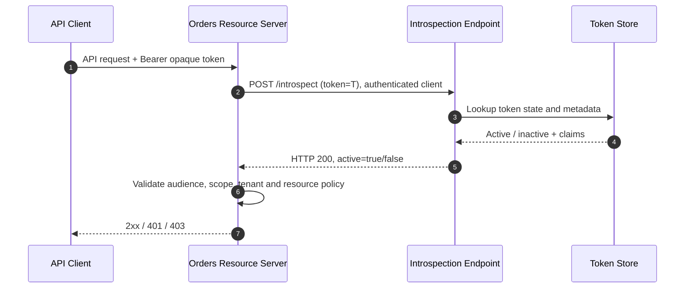
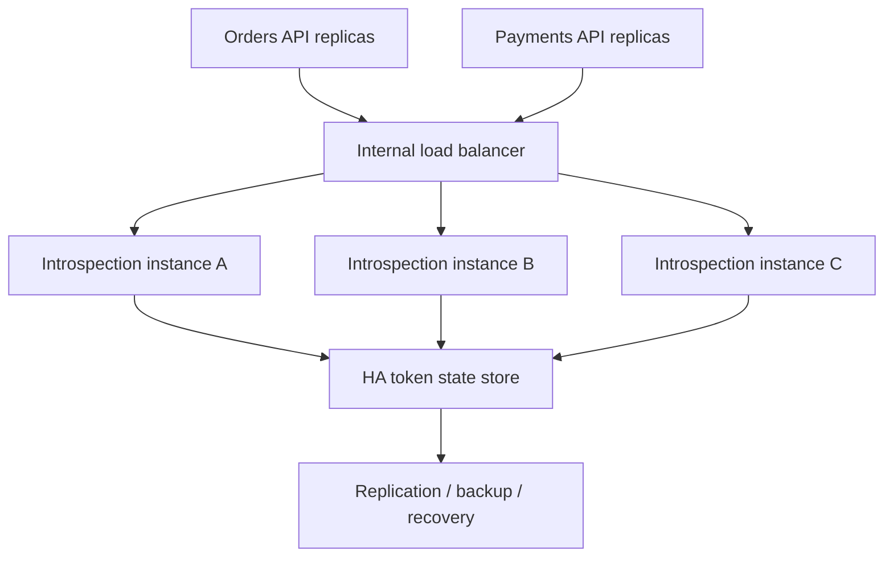

# Introspection endpoint availability

## 1. Vai trò của introspection endpoint

Trong OAuth 2.0, **token introspection endpoint** cho phép một protected resource hỏi Authorization Server về trạng thái và metadata của token. Cơ chế này được định nghĩa trong RFC 7662. Resource Server gửi token tới endpoint introspection qua một request đã xác thực; Authorization Server trả về kết quả cho biết token có đang active hay không và, nếu được phép, các thuộc tính như subject, client, audience, scope và thời hạn.

Introspection thường được dùng với **opaque access token**, vì Resource Server không thể tự giải mã và xác minh token như một JWT có chữ ký. Nó cũng có thể được dùng cho JWT khi kiến trúc cần kiểm tra trạng thái tập trung hoặc hỗ trợ thu hồi nhanh.

Ví dụ: `orders-api` nhận request có `Authorization: Bearer T`. Trước khi xử lý, API gọi `https://auth.example.com/oauth2/introspect` để kiểm tra T. Nếu response hợp lệ cho biết `active=true`, đúng audience và scope, API tiếp tục kiểm tra quyền trên đơn hàng. Nếu `active=false`, API từ chối credential. Nếu endpoint introspection không truy cập được, API không thể biết token còn hợp lệ hay không; đây là **lỗi dependency xác thực**, cần xử lý riêng với trường hợp token inactive.

Chủ đề **Introspection endpoint availability** tập trung vào khả năng phục vụ ổn định của dependency này: kiến trúc high availability, timeout, cache, circuit breaker, tải, giám sát, SLO và xử lý sự cố. Trong module SECURITY_TOKEN_SECURITY_FUNDAMENTALS, availability phải được cân bằng với tính đúng đắn của vòng đời token, đặc biệt là thu hồi, audience, scope và nguy cơ token bị đánh cắp.

**Nguyên tắc vận hành:** chỉ chấp nhận request khi có quyết định xác thực đáng tin cậy. Không biến timeout, lỗi mạng hoặc response hỏng thành `active=true`; đồng thời không báo rằng token người dùng sai khi thực tế Authorization Server đang gặp sự cố.

## 2. Luồng request và các kết quả khác nhau



Có ba lớp kết quả cần phân biệt:

| Tình huống | Kết quả từ introspection | Hành vi Resource Server |
|---|---|---|
| Token không tồn tại, hết hạn hoặc bị thu hồi | HTTP 200 với `active=false` theo RFC 7662 | Từ chối token; API thường trả 401 |
| Token active, đúng audience nhưng thiếu scope | HTTP 200 với `active=true` và metadata phù hợp | Từ chối quyền; API thường trả 403 |
| Introspection endpoint timeout, DNS/TLS lỗi hoặc trả 5xx | Không có quyết định hợp lệ | Fail closed; báo lỗi dependency, thường trả 503/502 theo API contract |
| Resource Server xác thực sai với introspection endpoint | Thường nhận lỗi client authentication, ví dụ 401 từ Authorization Server | Coi là lỗi cấu hình/credential của service, không chuyển nguyên status đó thành 401 của end user |
| Response không đúng schema hoặc thiếu `active` | Không có quyết định hợp lệ | Fail closed và ghi nhận lỗi giao thức/dependency |

**HTTP 200 + `active=false` không phải outage.** Authorization Server đã trả lời hợp lệ và xác nhận token không active. Ngược lại, timeout không có nghĩa token inactive; hệ thống chưa xác định được trạng thái.

Với API nhận request từ người dùng hoặc service khác, mapping status cần rõ:

- 401 cho credential thiếu hoặc không hợp lệ.
- 403 cho principal đã xác thực nhưng không đủ quyền.
- 503/502 cho dependency xác thực không sẵn sàng hoặc response upstream không hợp lệ, theo hợp đồng API.

Nếu mọi lỗi introspection đều bị biến thành 401, client có thể liên tục đăng nhập hoặc refresh token trong khi lỗi thật nằm ở Authorization Server. Nếu biến lỗi dependency thành 200, hệ thống có thể chấp nhận token không được xác minh.

## 3. Endpoint introspection theo RFC 7662

Resource Server gửi HTTP POST tới introspection endpoint bằng `application/x-www-form-urlencoded`. Tham số bắt buộc là `token`; `token_type_hint` có thể được dùng để gợi ý loại token.

Ví dụ:

```http
POST /oauth2/introspect HTTP/1.1
Host: auth.example.com
Authorization: Basic <resource-server-client-credentials>
Content-Type: application/x-www-form-urlencoded

token=<opaque-access-token>&token_type_hint=access_token
```

Đây là ví dụ giao thức với placeholder. Trong production:

- Gọi endpoint qua HTTPS và xác minh hostname/certificate.
- Resource Server phải xác thực với Authorization Server theo phương thức được hỗ trợ, ví dụ client authentication, mTLS hoặc `private_key_jwt`.
- Mỗi API/resource server nên có client identity riêng, quyền tối thiểu và khả năng rotate credential.
- Không đưa token vào URL/query string.
- Không ghi request body, Authorization header hoặc response chứa token metadata vào log.
- Không nhận URL introspection từ request của client; endpoint phải lấy từ cấu hình tin cậy.

Response thành công luôn cần trường boolean `active`. Nếu token active, Authorization Server có thể trả thêm metadata theo quyền truy cập của introspection client:

```json
{
  "active": true,
  "scope": "orders:read",
  "client_id": "web-client",
  "token_type": "Bearer",
  "exp": 1795400300,
  "iat": 1795400000,
  "sub": "user-1842",
  "aud": ["orders-api"],
  "iss": "https://auth.example.com/"
}
```

Ví dụ trên chỉ minh họa response. Không phải mọi server đều trả mọi claim; Resource Server cần xác định trường nào bắt buộc trong contract của mình. Nếu token inactive, RFC 7662 khuyến nghị response chỉ chứa `active=false`, tránh tiết lộ metadata về token không được phép introspect.

Introspection client chỉ nên nhận các metadata cần thiết để xác minh và phân quyền. Không nên trả dữ liệu hồ sơ người dùng, thông tin phiên hoặc claim nhạy cảm không cần thiết cho API.

## 4. Kiến trúc high availability cho introspection

Introspection thường nằm trên đường xử lý đồng bộ của mỗi API request. Nếu endpoint hoặc token store ngừng hoạt động, nhiều Resource Server có thể cùng bị ảnh hưởng. Một kiến trúc HA cần bảo vệ cả lớp HTTP và dữ liệu trạng thái token.

Các lớp nên xem xét:

1. **Nhiều instance introspection:** chạy nhiều replica sau load balancer, trải trên nhiều node/availability zone.
2. **Token state store HA:** database/cache lưu trạng thái token có replication, backup và failover đã kiểm thử.
3. **Connection pool:** giới hạn số kết nối từ Resource Server; tránh tạo TCP/TLS handshake mới cho từng request.
4. **Timeout theo deadline:** đặt connect/read/overall timeout ngắn và có ngân sách rõ trong request API.
5. **Circuit breaker và bulkhead:** ngăn một dependency lỗi làm cạn thread/connection pool của toàn bộ service.
6. **Cache có giới hạn:** giảm tải introspection khi policy cho phép, nhưng không vượt yêu cầu thu hồi.
7. **Multi-region strategy:** xác định cách replication và revocation propagation hoạt động giữa các region.
8. **Graceful deployment:** readiness probe chỉ nhận traffic khi instance đã sẵn sàng phục vụ; rolling deployment không làm mất toàn bộ capacity.

Sơ đồ tham khảo:



Nhiều instance HTTP không đủ nếu tất cả cùng phụ thuộc một database đơn lẻ. Cần theo dõi capacity và failure domain của token store, key service, network, DNS, certificate, secret manager và load balancer.

### 4.1. Stateless endpoint và stateful dependency

Introspection application có thể chạy stateless để dễ scale ngang, nhưng quyết định `active` thường cần truy vấn trạng thái token/session hoặc cache. Vì vậy, điểm nghẽn có thể chuyển từ web server sang database, Redis, revocation store hoặc dịch vụ identity phía sau.

Hãy đo riêng latency và error rate ở từng dependency. Nếu chỉ đo HTTP response tổng, đội vận hành có thể không biết lỗi nằm ở connection pool, token database, replication lag hay KMS.

### 4.2. Readiness, liveness và startup

- **Liveness:** xác nhận process còn sống và có thể tiếp tục chạy; không nên phụ thuộc vào một truy vấn sâu tới token database khiến mọi instance bị restart liên tục khi DB tạm gián đoạn.
- **Readiness:** xác định instance có thể nhận traffic hay không; có thể kiểm tra các dependency thiết yếu với timeout và cache trạng thái phù hợp.
- **Startup probe:** dành cho ứng dụng cần thời gian khởi động, tải cấu hình, key hoặc kết nối pool.

Không dùng một health endpoint công khai để introspect token thật. Health check nên kiểm tra sức khỏe thành phần, không phát hành hoặc tiết lộ credential.

## 5. Timeout, retry và circuit breaker

Introspection là dependency đồng bộ. Timeout quá dài giữ request và connection trong trạng thái chờ; timeout quá ngắn gây false outage khi hệ thống có độ trễ bình thường. Cần chọn timeout dựa trên latency percentile và deadline tổng thể của API.

Ví dụ ngân sách:

```text
API request deadline:             1500 ms
Introspection connect timeout:     150 ms
Introspection response timeout:    350 ms
Policy evaluation budget:          100 ms
Remaining time for business work:  900 ms
```

Các số trên chỉ là ví dụ để minh họa cách chia ngân sách; production phải đo và chọn theo SLO của hệ thống.

**Retry cần thận trọng:**

- Chỉ retry lỗi mạng/5xx/429 được xác định là tạm thời, với số lần rất ít và deadline còn.
- Không retry `active=false` như thể đó là lỗi mạng.
- Không retry `invalid_client`, `invalid_request` hoặc lỗi cấu hình liên tục.
- Tuân thủ `Retry-After` khi hợp lệ nhưng không vượt deadline.
- Dùng exponential backoff và jitter; không retry đồng loạt từ hàng nghìn Resource Server.
- POST introspection có thể được gửi lại về mặt vận hành vì thao tác tra cứu không thay đổi token, nhưng retry vẫn tạo thêm tải; chỉ thực hiện có giới hạn.

**Circuit breaker** mở khi dependency vượt ngưỡng lỗi/latency, ngăn request tiếp tục dồn vào Authorization Server. Khi circuit open, Resource Server không thể xác minh token mới; hành vi mặc định phải fail closed và trả lỗi dependency. Không dùng circuit breaker như lý do tự động chấp nhận token chưa được xác minh.

**Bulkhead** tách pool/giới hạn concurrency cho introspection khỏi các outbound dependency khác. Một outage Authorization Server không nên chiếm hết worker threads hoặc HTTP connections của toàn bộ ứng dụng.

## 6. Cache introspection: availability đổi lấy độ trễ thu hồi

Cache là cách phổ biến để giảm số lần gọi introspection, nhưng cache kết quả `active=true` đồng nghĩa Resource Server có thể tiếp tục chấp nhận token sau khi Authorization Server đã thu hồi token đó.

Ví dụ:

```text
t0: introspection returns active=true
t1: Resource Server caches result for 60 seconds
t2: Authorization Server revokes token
t3: Resource Server receives same token from another request
t4: cached active=true may still be used until cache expires
```

Vì vậy, TTL cache phải gắn với **revocation SLA**. Nếu yêu cầu token bị thu hồi không được dùng quá 20 giây sau khi revoke, cache positive không thể có TTL 5 phút. Cần tính thêm replication delay, clock skew, invalidation propagation và thời gian request đang chạy.

### 6.1. Quy tắc cache gợi ý

- TTL positive không vượt thời gian còn lại tới `exp`.
- TTL positive phải nằm trong giới hạn stale authorization đã được security owner phê duyệt.
- Nếu token có `exp` không rõ hoặc metadata thiếu theo contract, không cache lâu; có thể từ chối token nếu trường đó là bắt buộc.
- Có thể negative-cache `active=false` trong thời gian rất ngắn để giảm lặp lookup, nhưng không được dùng cache key lỏng lẻo làm lẫn token.
- Không cache timeout/5xx thành `active=false`; đó là dependency error, không phải kết quả token.
- Nếu Authorization Server phát revocation event, có thể invalidate cache sớm; vẫn cần TTL tối đa làm hàng rào khi event bị mất.
- Không dùng shared cache key chỉ theo `sub` hoặc `client_id`; trạng thái phải gắn với token cụ thể và trust context.

### 6.2. Không lưu raw token làm cache key có thể quan sát

Cache nội bộ cần phân biệt token nhưng không để raw token xuất hiện trong key logs, metrics hoặc dashboard. Có thể dùng HMAC với secret server-side trên token để tạo fingerprint làm cache key. Không dùng hash không khóa của token có entropy thấp hoặc tự thiết kế cách mã hóa token.

Cache value có thể chứa `active`, audience, scope và expiry; cần bảo vệ quyền đọc, encryption at rest theo yêu cầu, TTL và eviction. Không chia sẻ cache giữa issuer/resource server với chính sách khác nhau nếu key không bao gồm đúng trust context.

### 6.3. JWT local validation và opaque introspection

| Tiêu chí | JWT xác minh local | Opaque token + introspection |
|---|---|---|
| Dependency mỗi request | Thường không cần gọi Authorization Server sau khi cache JWKS | Thường cần introspection nếu cache miss |
| Revocation | Cần denylist/status mechanism hoặc chờ token hết hạn | Có thể kiểm tra trạng thái tập trung |
| Availability | Ít phụ thuộc online introspection | Phụ thuộc endpoint và token store |
| Latency | Thường thấp sau khi có key | Có thêm network round trip |
| Metadata | Claims nằm trong token sau khi verify | Metadata do introspection trả |
| Trade-off chính | Khó thu hồi tức thì | Cần HA, cache và capacity cho introspection |

Không có lựa chọn nào tốt nhất cho mọi hệ thống. JWT có thể phù hợp cho API có lưu lượng lớn và token lifetime ngắn; opaque token có thể phù hợp khi cần kiểm soát trạng thái tập trung. Một hệ thống cũng có thể kết hợp hai cách theo độ nhạy của resource.

## 7. Bảo vệ introspection endpoint

Introspection endpoint là một API nhạy cảm: kẻ tấn công có thể dùng nó để dò token nếu endpoint không được bảo vệ hoặc để gây tải lớn.

Các yêu cầu quan trọng:

- Chỉ Resource Server/authorized client được phép gọi; xác thực client theo cấu hình tin cậy.
- Dùng TLS; cân nhắc mTLS cho service-to-service.
- Phân quyền theo client: mỗi client chỉ introspect token/issuer/resource phù hợp.
- Giới hạn rate và concurrency theo client, IP/network zone và toàn hệ thống.
- Giới hạn request body size, form fields và thời gian xử lý.
- Không tiết lộ metadata token cho client không được phép introspect.
- Không log `token`, `Authorization`, client secret hoặc raw response.
- Dùng endpoint nội bộ/network policy khi phù hợp; vẫn xác thực client dù endpoint nằm trong private network.
- Token endpoint URL phải được cấu hình tĩnh hoặc lấy từ metadata issuer đã tin cậy, không do caller điều khiển.
- Rotate introspection client credentials và TLS certificates theo quy trình.

Introspection client credentials cần được bảo vệ như một credential service. Nếu credential của `orders-api` bị lộ, attacker có thể gọi endpoint để kiểm tra token trong phạm vi quyền client đó. Không dùng chung một client secret cho mọi microservice nếu có thể tách client identity và giới hạn blast radius.

## 8. Response handling và fail-closed semantics

Resource Server cần phân loại response trước khi tạo Authentication object:

| Response/exception | Ý nghĩa | Xử lý |
|---|---|---|
| HTTP 200, `active=true`, response schema hợp lệ | Token được xác nhận active | Tiếp tục kiểm tra issuer/audience/scope/tenant theo contract |
| HTTP 200, `active=false` | Token inactive | 401 |
| HTTP 200 nhưng thiếu `active` hoặc sai kiểu dữ liệu | Response không tuân thủ contract | Fail closed; ghi lỗi introspection protocol |
| HTTP 401 từ introspection do client auth sai | Resource Server credential/config lỗi | Báo dependency/configuration error; không quy cho end user |
| HTTP 429 | Bị rate limit | Tuân thủ retry policy có giới hạn; nếu không có quyết định thì fail closed |
| HTTP 5xx, timeout, DNS/TLS error | Dependency unavailable | 503/502 theo API contract |
| Response `active=true` nhưng sai audience hoặc thiếu metadata bắt buộc | Token không phù hợp resource server hoặc response không đủ | Từ chối; phân loại authn/authz theo policy |
| Response body malformed | Không có quyết định đáng tin | Fail closed |

**Fail closed** nghĩa là không cho request truy cập dữ liệu nếu không xác minh được token. Nó không bắt buộc mọi lỗi dependency phải trả 401; trên thực tế, 503 thường phản ánh đúng hơn vì client có thể thử lại sau khi dịch vụ phục hồi.

Không nên dùng fallback “nếu introspection lỗi thì chấp nhận token đã parse được”. Với opaque token, không có cơ sở xác minh offline. Với JWT, nếu muốn có đường local validation dự phòng, phải thiết kế như một chế độ xác thực riêng với trust key, revocation lag, audience và lifetime được review; không bật như một fallback ngẫu nhiên khi endpoint timeout.

## 9. Spring Security Resource Server với opaque token

Spring Security hỗ trợ opaque token introspection. Một cấu hình minh họa với Spring Boot:

```yaml
spring:
  security:
    oauth2:
      resourceserver:
        opaquetoken:
          introspection-uri: https://auth.example.com/oauth2/introspect
          client-id: orders-api
          client-secret: ${OAUTH_INTROSPECTION_CLIENT_SECRET}
```

Tên property và khả năng cấu hình có thể khác theo phiên bản Spring Boot/Spring Security. Secret nên được inject từ secret manager hoặc cơ chế bảo vệ tương đương, không commit vào YAML.

Resource Server dùng introspector để lấy principal/authorities từ response. Cần xác nhận:

- `active=false` được xem là invalid token.
- `scope` được map thành authorities theo contract.
- `aud`/`iss` và tenant claim được kiểm tra; không mặc định mọi introspector tự enforce đúng audience cho ứng dụng.
- Timeout, connection pool và error mapping được cấu hình.
- Dependency failure không bị biến thành 401 của người dùng nếu hệ thống cần phân biệt 503.
- Logs/traces không chứa form body hoặc Bearer token.

### 9.1. Custom introspector và xử lý lỗi dependency

Nếu cần timeout, retry budget, cache hoặc error mapping tùy chỉnh, có thể bọc `OpaqueTokenIntrospector` bằng adapter riêng. Phải phân biệt:

- Token inactive/invalid → authentication failure.
- Authorization Server không sẵn sàng hoặc response sai giao thức → authentication service/dependency failure.
- Token active nhưng thiếu authority → access denied.

Trong Spring Security, custom `AuthenticationEntryPoint`/exception handling có thể cần để map authentication infrastructure error sang 503 theo API contract. Không bắt mọi exception rồi trả 401 giống nhau. Cách triển khai cụ thể cần kiểm thử qua security filter chain thật của phiên bản đang dùng.

## 10. Capacity planning cho introspection traffic

Nếu mỗi API request đều gọi introspection, số request tới Authorization Server gần bằng số API request cache miss. Với một hệ thống có nhiều microservice, Gateway và service downstream có thể cùng introspect một token; tổng tải có thể tăng nhanh.

Một ước lượng đơn giản:

```text
introspection_RPS =
    API_RPS × fraction_of_requests_requiring_lookup
```

Ví dụ:

```text
API traffic:                         8,000 requests/second
Cache hit ratio:                     90%
Requests needing introspection:        10%
Expected introspection traffic:        800 requests/second
```

Đây chỉ là ví dụ tính tải; production cần tính burst, retry, token exchange, background jobs, cache cold start và nhiều service cùng xác minh.

Capacity planning cần:

1. Đo RPS bình thường và peak theo từng Resource Server client.
2. Đo tỷ lệ cache hit/miss và TTL.
3. Đo latency p50/p95/p99, CPU, memory, connection pool và DB query latency.
4. Kiểm tra tải khi cache cold hoặc toàn bộ Resource Server restart.
5. Thử failover node/AZ và token store.
6. Giới hạn concurrency, request size và per-client rate.
7. Chừa headroom cho key rotation, incident response và traffic surge.
8. Kiểm tra retry amplification khi Authorization Server trả 429/503.

Không scale chỉ theo CPU của introspection web nodes; token database và network có thể bão hòa trước. Cần load test bằng token fixtures hợp lệ và token inactive để đo cả hai nhánh, tránh dùng token thật.

## 11. Observability: metrics, logs và traces

Theo dõi availability của introspection bằng các tín hiệu tổng hợp:

| Metric | Ý nghĩa |
|---|---|
| `oauth_introspection_requests_total` | Số request introspection theo client/outcome/status class |
| `oauth_introspection_duration_seconds` | Latency xử lý request |
| `oauth_introspection_errors_total` | Timeout, 5xx, TLS/DNS, protocol error |
| `oauth_introspection_active_total` | Số kết quả `active=true` |
| `oauth_introspection_inactive_total` | Số kết quả `active=false` |
| `oauth_introspection_client_auth_failures_total` | Lỗi xác thực Resource Server client |
| `oauth_introspection_cache_hits_total` | Số lần dùng cache |
| `oauth_introspection_cache_misses_total` | Số lần phải gọi endpoint |
| `oauth_introspection_cache_staleness_seconds` | Tuổi của metadata cached khi dùng |
| `oauth_token_store_query_duration_seconds` | Độ trễ token state store |
| `oauth_introspection_inflight_requests` | Số request đang xử lý |

Metric labels nên giới hạn ở các giá trị có kiểm soát như `resource_server`, `region`, `outcome`, `status_class`, `error_type` và `token_format`. Không đưa raw token, `jti`, subject, email, session ID hoặc Authorization header vào metric label.

Logs có thể ghi:

```json
{
  "event": "oauth_introspection",
  "resource_server": "orders-api",
  "outcome": "dependency_timeout",
  "status_class": "timeout",
  "duration_ms": 351,
  "region": "ap-southeast",
  "trace_id": "trace-123"
}
```

Đây là event minh họa. Không ghi request body chứa `token`, client secret, response đầy đủ hoặc raw JWT. Nếu cần audit một token cụ thể, sử dụng correlation/audit identifier được thiết kế riêng, hạn chế quyền truy cập và không dùng nó làm credential.

### 11.1. SLI/SLO availability

Một SLI có thể đo tỷ lệ request introspection hợp lệ từ Resource Server được trả về **quyết định giao thức hợp lệ**:

```text
introspection_decision_availability =
    valid_protocol_responses (active=true or active=false)
    / eligible_introspection_requests
```

HTTP 200 với `active=false` là một quyết định thành công về mặt availability; đó không phải lỗi endpoint. HTTP 200 nhưng body malformed, timeout, 5xx hoặc client auth failure không tạo ra quyết định hợp lệ.

Cần tách thêm SLI cho latency và token-store dependency. SLO cụ thể (ví dụ 99.9% theo tháng, p95 dưới một ngưỡng) phải do service owner xác định theo business requirement, không lấy con số ví dụ làm chuẩn chung.

### 11.2. Alerting

Một số alert đáng cân nhắc:

- Tỷ lệ timeout/5xx tăng liên tục.
- p95/p99 introspection latency vượt budget.
- `active=false` tăng đột biến — có thể là token issue/revocation hoặc traffic bất thường, cần điều tra chứ không tự động coi là outage.
- Client authentication failures tăng — thường gợi ý secret/certificate rotation sai.
- JWKS/introspection metadata hoặc token store replication lag tăng.
- Cache hit ratio giảm đột ngột sau deploy.
- Connection pool saturation hoặc inflight requests tăng.
- SLI error-budget burn vượt ngưỡng.

Alert cần có owner, severity, runbook và liên kết dashboard. Không gửi token hoặc thông tin người dùng nhạy cảm vào notification.

## 12. Failure testing và chaos scenarios

Availability phải được kiểm tra bằng failure injection trong môi trường test/staging có kiểm soát.

| Scenario | Kỳ vọng |
|---|---|
| Một introspection replica dừng | Load balancer chuyển traffic sang replica còn khỏe |
| Một availability zone mất kết nối | Service tiếp tục trong capacity còn lại; không mất toàn bộ endpoint |
| Token database chậm | Timeout được giới hạn; pool không cạn vô hạn |
| Token database failover | Request lỗi trong giới hạn; trạng thái revoke/active hội tụ theo SLA |
| DNS introspection lỗi | Resource Server fail closed và báo dependency error |
| TLS certificate hết hạn/sai hostname | Kết nối bị từ chối; không tắt xác minh TLS để chữa cháy |
| Authorization Server trả 429 | Client rate-limit/backoff; không retry storm |
| Endpoint trả 503 | API không chấp nhận token không xác minh; phản hồi dependency error |
| HTTP 200 `active=false` | API trả 401 theo contract, không retry như outage |
| HTTP 200 thiếu `active` | Fail closed, protocol error |
| Resource Server client secret sai | Cảnh báo cấu hình; không biến thành invalid user token |
| Cache cold start | Traffic tăng trong capacity; single-flight/rate limit bảo vệ STS |
| Cache có active cũ sau revoke | Staleness không vượt revocation SLA |
| Một region bị lag revocation | Hành vi phù hợp consistency policy và được đo |
| Metrics exporter ngừng hoạt động | Authentication vẫn hoạt động theo policy; không fail open |

Test nên assert cả HTTP response, latency, retry count, circuit state, token store calls và telemetry. Chỉ xác nhận API trả 503 chưa đủ nếu hệ thống vẫn âm thầm chấp nhận token từ cache quá hạn.

## 13. Runbook xử lý introspection endpoint outage

Khi alert báo introspection unavailable:

1. **Xác định phạm vi:** một Resource Server, một region, toàn bộ Authorization Server hay token store.
2. **Kiểm tra tín hiệu:** HTTP 5xx/timeout, DNS, TLS certificate, load balancer health, connection pool, database latency và replication.
3. **Phân biệt token inactive với dependency error:** xác nhận có HTTP 200 `active=false` hay không; không dùng số 401 của API làm bằng chứng endpoint outage.
4. **Kiểm tra circuit breaker/cache:** trạng thái circuit, cache age, hit ratio và TTL; không kéo dài stale TTL tùy tiện.
5. **Giảm áp lực:** áp dụng rate limit, tạm giảm retry và giới hạn concurrency; không tắt client authentication hoặc TLS.
6. **Khôi phục dependency:** failover replica/store theo runbook, kiểm tra readiness và kết nối từ Resource Server.
7. **Xác nhận token status:** dùng token canary hợp lệ và token đã revoke trong test procedure để xác nhận active/inactive đúng.
8. **Theo dõi phục hồi:** latency, error rate, cache refresh, circuit half-open và 401/403/503 ở API.
9. **Ghi incident:** thời gian bắt đầu/kết thúc, phạm vi, nguyên nhân, staleness tối đa và các hành động đã thực hiện.

Trong outage, không thay đổi policy để “cho mọi request đi qua”. Nếu có degraded mode đã được phê duyệt, nó phải giới hạn theo loại resource, audience, token lifetime, cache age và business risk; phải có audit, expiry và cơ chế tự trở lại normal mode. Mặc định khi không xác minh được token là từ chối truy cập.

## 14. Ví dụ kiểm tra endpoint bằng curl

Trong môi trường test được cấp quyền, có thể kiểm tra response:

```bash
curl --silent --show-error \
  --connect-timeout 2 \
  --max-time 4 \
  --user "orders-api:${INTROSPECTION_CLIENT_SECRET}" \
  --header "Content-Type: application/x-www-form-urlencoded" \
  --data-urlencode "token=${TEST_OPAQUE_ACCESS_TOKEN}" \
  "https://auth.test.example.com/oauth2/introspect"
```

Các biến môi trường là placeholder. Không chạy lệnh bằng token production hoặc in biến secret ra terminal/CI log. Với production, ưu tiên client authentication an toàn và secret manager; ví dụ Basic chỉ minh họa cú pháp, không phải lựa chọn bắt buộc.

Kết quả test cần kiểm tra:

- HTTP status và response schema.
- Trường `active` là boolean.
- Nếu active, audience/scope/expiry phù hợp API.
- Thời gian kết nối và response nằm trong timeout budget.
- Không có token hoặc secret trong output/log capture.
- Token đã revoke trả `active=false` trong revocation SLA.

## 15. Checklist triển khai production

1. **Bảo vệ endpoint:** HTTPS, xác thực Resource Server client, least privilege, rate limit và request-size limit.
2. **Triển khai HA:** nhiều instance/AZ, load balancer, token store HA và recovery đã thử.
3. **Đặt timeout:** connect/read/overall timeout phù hợp deadline; pool và concurrency có giới hạn.
4. **Retry có kiểm soát:** chỉ retry lỗi tạm thời, có jitter/deadline; không retry active=false hoặc invalid_client.
5. **Fail closed:** không có quyết định introspection hợp lệ thì không chấp nhận token.
6. **Phân biệt status:** token inactive → 401; thiếu quyền → 403; dependency outage → 503/502 theo contract.
7. **Cache theo revocation SLA:** TTL không vượt token expiry và stale authorization budget; không cache lỗi thành inactive.
8. **Bảo vệ cache:** key/fingerprint không lộ raw token, phân tách issuer/resource context và kiểm soát truy cập.
9. **Giám sát:** availability, latency, active/inactive, client auth failures, token-store health, cache hit/staleness và saturation.
10. **Kiểm thử sự cố:** replica/AZ outage, DB failover, DNS/TLS, 429/503, cache cold, revocation propagation và secret rotation.
11. **Runbook:** có owner, escalation, rollback, degraded mode approval và xác nhận phục hồi.
12. **Bảo vệ telemetry:** không log token, Authorization header, client secret hoặc raw introspection response.

**Nguyên tắc cốt lõi:** Introspection endpoint là một phần của security control plane. Nó phải đủ sẵn sàng để Resource Server xác minh token, nhưng khi không thể xác minh, hệ thống không được tự biến sự không chắc chắn thành quyền truy cập. HA, timeout, cache và failover phải được thiết kế theo cùng một mục tiêu: **bảo đảm availability mà vẫn giữ đúng trạng thái token và giới hạn độ trễ thu hồi**.

### Tài liệu tiêu chuẩn tham khảo

- [RFC 7662 — OAuth 2.0 Token Introspection](https://www.rfc-editor.org/rfc/rfc7662): giao thức introspection, request, response và `active`.
- [RFC 6749 — The OAuth 2.0 Authorization Framework](https://www.rfc-editor.org/rfc/rfc6749): OAuth client, token endpoint và xác thực client.
- [RFC 6750 — OAuth 2.0 Bearer Token Usage](https://www.rfc-editor.org/rfc/rfc6750): truyền Bearer token và xử lý lỗi.
- [RFC 9110 — HTTP Semantics](https://www.rfc-editor.org/rfc/rfc9110): HTTP status, timeout semantics và response.
- [RFC 9700 — Best Current Practice for OAuth 2.0 Security](https://www.rfc-editor.org/rfc/rfc9700): khuyến nghị bảo mật OAuth 2.0.
- [Spring Security — Opaque Token](https://docs.spring.io/spring-security/reference/servlet/oauth2/resource-server/opaque-token.html): cấu hình opaque token introspection.
- [OpenTelemetry Metrics](https://opentelemetry.io/docs/concepts/signals/metrics/): instrument availability, latency và error rate.
