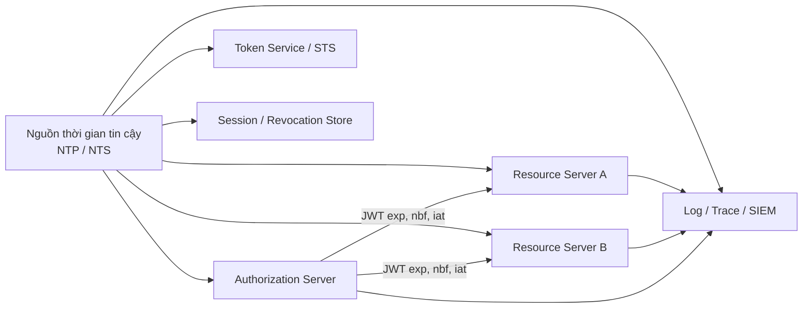

# Clock synchronization trong hệ thống bảo mật token

## 1. Vì sao đồng bộ thời gian quan trọng với token?

Token có vòng đời được xác định bằng thời gian phát hành và thời điểm hiệu lực. Với JWT, các claim thời gian như `iat` (issued at), `nbf` (not before) và `exp` (expiration) được biểu diễn bằng NumericDate. Resource server so sánh các giá trị này với đồng hồ hệ thống để quyết định token đã có hiệu lực, còn hiệu lực hay đã hết hạn.

Nếu đồng hồ của Authorization Server (AS), Security Token Service (STS), resource server, máy chủ introspection và các node chạy cùng dịch vụ lệch nhau, một token hợp lệ có thể bị từ chối hoặc một token hết hạn có thể được chấp nhận lâu hơn dự kiến. Lỗi thời gian cũng ảnh hưởng tới refresh token, rotation, cache, audit log, incident investigation và tương quan sự kiện giữa nhiều dịch vụ.

**Clock synchronization** là quá trình duy trì đồng hồ các máy trong giới hạn sai lệch được xác định so với nguồn thời gian tin cậy. Với bảo mật token, mục tiêu không chỉ là để log có timestamp gần nhau. Mục tiêu là để mọi thành phần đưa ra quyết định xác thực nhất quán, có giới hạn và có thể giám sát.

Sau bài học, người học có thể:

- Giải thích tác động của clock skew tới `iat`, `nbf`, `exp` và vòng đời token.
- Phân biệt wall clock, monotonic clock và thời gian UTC.
- Thiết kế chính sách đồng bộ NTP/NTS cho AS, STS, resource server và hạ tầng.
- Cấu hình và giám sát clock offset, drift, synchronization state và nguồn thời gian.
- Thiết kế clock tolerance có giới hạn, không dùng clock skew để che lỗi đồng bộ.
- Kiểm thử token tại ranh giới thời gian và xử lý khi đồng hồ bị lệch hoặc mất đồng bộ.

## 2. Cách thời gian được dùng trong JWT và OAuth

### 2.1. Các claim thời gian của JWT

| Claim | Ý nghĩa | Quyết định xác minh |
| --- | --- | --- |
| `iat` | Thời điểm token được phát hành | Có thể dùng để kiểm tra token quá cũ hoặc phát hành trong tương lai theo policy |
| `nbf` | Thời điểm trước đó token chưa được chấp nhận | Từ chối token nếu thời điểm hiện tại còn trước `nbf`, có xét tolerance được cấu hình |
| `exp` | Thời điểm sau đó token không còn được chấp nhận | Từ chối token khi token đã hết hạn, có xét tolerance được cấu hình |
| `auth_time` | Thời điểm người dùng được xác thực trong OIDC | Dùng cho yêu cầu xác thực mới, max age hoặc step-up authentication theo OIDC policy |

JWT NumericDate là số giây kể từ Unix epoch 1970-01-01T00:00:00Z theo quy ước của chuẩn; giá trị có thể là số nguyên hoặc số thực. Cần dùng thư viện chuẩn để parse và so sánh, không tự tách chuỗi thời gian hoặc giả định đơn vị là milliseconds.

Ví dụ một token có:

```json
{
  "iss": "https://identity.example.test",
  "sub": "user-42",
  "aud": "orders-api",
  "iat": 1795428000,
  "nbf": 1795428000,
  "exp": 1795428300,
  "scope": "orders.read"
}
```

`iat`, `nbf` và `exp` ở đây là Unix time theo giây. Nếu ứng dụng chuyển đổi nhầm sang milliseconds, hoặc dùng local timezone để diễn giải NumericDate, thời gian token sẽ sai rất lớn.

### 2.2. Vì sao đồng hồ lệch làm sai quyết định

Giả sử AS và resource server có đồng hồ lệch nhau 90 giây:

- AS phát token với `nbf` bằng thời gian AS hiện tại.
- Resource server đang chạy chậm hơn AS 90 giây.
- Khi token vừa được phát, resource server thấy thời gian hiện tại vẫn nhỏ hơn `nbf` và từ chối token.
- Ở chiều ngược lại, token có thể bị coi là hết hạn sớm hoặc muộn hơn thực tế tùy chiều lệch của verifier.

Một token hết hạn lúc 10:00 UTC có thể tiếp tục được chấp nhận nếu resource server chạy chậm và verifier cho phép tolerance quá rộng. Đây là rủi ro bảo mật vì thời gian sử dụng credential bị kéo dài ngoài dự kiến.

### 2.3. Mô hình các thành phần cần cùng thời gian

Các thành phần liên quan không chỉ là AS và API. Toàn bộ đường đi xác thực cần có thời gian nhất quán:



Cần xem xét cả container, VM, node Kubernetes, database, cache, message broker và hệ thống quan sát. Container thường dùng clock của host kernel; cấu hình NTP thường thực hiện ở host hoặc nền tảng, không phải cài một NTP daemon độc lập trong từng container nếu kiến trúc không yêu cầu.

## 3. Phân biệt wall clock và monotonic clock

Không phải mọi phép đo thời gian đều nên dùng cùng một loại clock.

| Loại clock | Đặc điểm | Dùng cho |
| --- | --- | --- |
| Wall clock / realtime clock | Biểu diễn ngày giờ lịch, thường được đồng bộ với UTC; có thể bị step hoặc slew | JWT NumericDate, audit timestamp, thời gian phát hành/hết hạn |
| Monotonic clock | Chỉ tiến về phía trước trong một lần boot, không dùng để biểu diễn ngày giờ tuyệt đối | Đo duration, timeout, elapsed time, latency |
| Process/runtime clock | API thời gian do runtime cung cấp; có thể dựa trên wall hoặc monotonic clock | Phải hiểu rõ semantics trước khi dùng cho bảo mật |

Khi kiểm tra `exp`, verifier phải so sánh với wall clock theo Unix time. Khi đo thời gian gọi introspection hoặc thời gian xử lý request, nên dùng monotonic clock để tránh việc NTP điều chỉnh đồng hồ làm duration âm hoặc tăng đột biến.

Ví dụ Java:

```java
// Wall clock: dùng khi so sánh với JWT NumericDate.
Instant now = clock.instant();

// Monotonic source: dùng để đo thời lượng xử lý.
long started = System.nanoTime();
callTokenIntrospection();
long elapsedNanos = System.nanoTime() - started;
```

Không dùng `System.nanoTime()` để so sánh trực tiếp với `exp` hoặc ghi thành timestamp UTC. Giá trị monotonic không có epoch chung và chỉ có ý nghĩa khi lấy hiệu giữa hai lần đọc trong cùng môi trường runtime.

## 4. NTP, NTS và nguồn thời gian tin cậy

### 4.1. NTP là gì?

Network Time Protocol (NTP) đồng bộ clock qua mạng bằng cách trao đổi timestamp giữa client và time server. NTP client ước lượng offset và delay, sau đó điều chỉnh clock để tiến gần nguồn thời gian tham chiếu.

Trong môi trường production, nên dùng nhiều nguồn thời gian được quản lý, có kiểm tra chất lượng và phân tầng hợp lý. Không để mỗi service tùy ý chọn một máy chủ Internet khác nhau. Hạ tầng nên có nguồn thời gian nội bộ hoặc dịch vụ thời gian của cloud/provider, có cấu hình dự phòng và giám sát trạng thái đồng bộ.

Các yếu tố cần quan tâm:

- Offset: chênh lệch giữa clock của máy và nguồn tham chiếu.
- Frequency drift: tốc độ đồng hồ phần cứng chạy nhanh/chậm so với chuẩn.
- Jitter: biến thiên độ trễ và phép đo offset.
- Stratum: khoảng cách logic tới nguồn tham chiếu trong kiến trúc NTP; stratum thấp hơn không tự động có nghĩa là nguồn tốt hơn trong mọi trường hợp.
- Reachability: khả năng liên lạc với các peer.
- Synchronization state: client có đang đồng bộ với nguồn được chọn không.

### 4.2. NTS bảo vệ việc đồng bộ

NTP truyền thống không tự cung cấp cơ chế xác thực mạnh cho mọi cấu hình. Nếu kẻ tấn công có thể giả mạo hoặc thao túng nguồn thời gian, clock có thể bị dịch chuyển khiến token bị chấp nhận quá lâu hoặc bị từ chối hàng loạt.

Network Time Security (NTS), được mô tả trong RFC 8915, bổ sung cơ chế xác thực cho NTP client/server, sử dụng TLS trong NTS-KE để thiết lập khóa và xác thực phiên NTP. Khi nền tảng hỗ trợ, nên đánh giá NTS hoặc dịch vụ thời gian có cơ chế xác thực tương đương.

Không được xem NTS là thay thế toàn bộ bảo vệ mạng. Vẫn cần quản lý trust anchor, certificate validation, firewall, cấu hình peer, cập nhật phần mềm và giám sát thay đổi nguồn thời gian.

### 4.3. Chọn nguồn thời gian

Một chính sách nguồn thời gian nên trả lời:

- Nguồn nào được tổ chức hoặc cloud provider phê duyệt?
- Có bao nhiêu nguồn độc lập để phát hiện một nguồn sai?
- Nguồn dự phòng được chọn như thế nào khi peer chính mất kết nối?
- NTS hoặc cơ chế xác thực nguồn có được hỗ trợ không?
- Máy chủ có bị chặn truy cập NTP từ Internet tùy ý không?
- Ai được phép thay đổi cấu hình time source?
- Khi nguồn bị nghi ngờ compromise, quy trình chuyển nguồn và điều tra là gì?

Không chọn một nguồn duy nhất không có dự phòng cho toàn bộ hệ thống xác thực. Đồng thời, không thêm quá nhiều nguồn không rõ chất lượng; nguồn thời gian phải được quản lý như một dependency hạ tầng quan trọng.

## 5. Thiết kế chính sách clock tolerance cho JWT

Clock tolerance (còn gọi clock skew allowance hoặc leeway) là khoảng sai lệch verifier chấp nhận khi kiểm tra các claim thời gian. Một tolerance nhỏ có thể giúp hệ thống chịu được sai lệch vài giây giữa các node; tolerance quá lớn có thể kéo dài thời gian sử dụng token hoặc cho phép token có hiệu lực sớm hơn dự kiến.

Ví dụ policy minh họa:

```yaml
token_validation:
  clock_skew_seconds: 30
  max_access_token_lifetime_seconds: 600
  require_exp: true
  require_iss: true
  require_aud: true
  reject_future_iat_beyond_skew: true
```

Giá trị 30 giây chỉ là ví dụ, không phải mặc định phù hợp cho mọi hệ thống. Cần chọn theo SLA đồng bộ thời gian, độ trễ mạng, môi trường triển khai, yêu cầu bảo mật và khả năng quan sát.

### 5.1. Cách tolerance ảnh hưởng tới exp và nbf

Giả sử verifier dùng leeway `L`:

- Kiểm tra `exp` có thể chấp nhận token thêm tối đa `L` sau mốc hết hạn, tùy thư viện và profile.
- Kiểm tra `nbf` có thể chấp nhận token sớm tối đa `L` trước thời điểm bắt đầu hiệu lực.
- Kiểm tra `iat` trong tương lai có thể dùng cùng hoặc một chính sách riêng; không được giả định thư viện tự động kiểm tra `iat` nếu không cấu hình.

Phải xác minh semantics thực tế của thư viện JWT. Một số thư viện áp dụng clock skew cho `exp` và `nbf` nhưng không tự giới hạn tuổi token dựa trên `iat`. Đừng dựa vào tên cấu hình chung mà không đọc hợp đồng của API.

### 5.2. Nguyên tắc đặt tolerance

1. Đo offset thực tế trước khi đặt tolerance.
2. Đặt tolerance nhỏ nhất đủ chịu được sai lệch bình thường.
3. Có ngưỡng cảnh báo khi offset tiến gần tolerance.
4. Từ chối hoặc cô lập node khi clock lệch vượt ngưỡng bảo mật.
5. Không tăng tolerance toàn hệ thống để khắc phục một host bị lỗi.
6. Không dùng tolerance để thay thế NTP/NTS hoặc sửa chữa hạ tầng.
7. Ghi nhận policy version để có thể giải thích quyết định xác minh.

Nếu hệ thống cần tolerance lớn bất thường, cần xem lại time synchronization, network path, VM suspend/resume, host clock và cách ứng dụng chuyển đổi thời gian.

## 6. Vận hành đồng bộ thời gian trên Linux và hạ tầng

### 6.1. Linux với chrony

Chrony là một triển khai NTP phổ biến trên Linux, có thể kiểm tra nguồn đồng bộ và offset qua công cụ quản trị. Các lệnh sau là ví dụ kiểm tra trên máy được cấp quyền:

```bash
timedatectl status
chronyc tracking
chronyc sources -v
chronyc sourcestats -v
```

Ý nghĩa tổng quát:

- `timedatectl status` cho biết trạng thái đồng bộ thời gian của hệ thống và timezone.
- `chronyc tracking` hiển thị nguồn tham chiếu, stratum, offset ước lượng và độ ổn định.
- `chronyc sources -v` liệt kê các nguồn NTP, trạng thái chọn nguồn và reachability.
- `chronyc sourcestats -v` cho biết thống kê đo lường và drift của nguồn.

Cách cài đặt và cấu hình chrony tùy distro. File cấu hình thường có các khai báo server/pool, chính sách step/slew và giới hạn truy cập. Chỉ quản trị viên hạ tầng mới thay đổi cấu hình time source trên production; thay đổi phải được kiểm soát và readback.

### 6.2. systemd-timesyncd

Trên hệ thống dùng systemd-timesyncd, có thể kiểm tra:

```bash
timedatectl timesync-status
timedatectl show-timesync --all
```

Nếu hệ thống dùng chrony hoặc NTP daemon khác, các lệnh timesyncd có thể không phản ánh trạng thái thực. Phải xác định dịch vụ time synchronization thực sự đang chạy trước khi kết luận.

### 6.3. Windows Server

Trên Windows Server, Windows Time Service (W32Time) chịu trách nhiệm đồng bộ thời gian trong nhiều môi trường domain. Các lệnh kiểm tra thường dùng:

```powershell
w32tm /query /status
w32tm /query /source
w32tm /query /configuration
```

Trong Active Directory domain, topology đồng bộ thời gian có quan hệ với domain hierarchy và PDC Emulator. Không cấu hình mọi member server tùy tiện trỏ tới nhiều nguồn bên ngoài; cần theo thiết kế domain time service.

### 6.4. VM, container và Kubernetes

- VM có thể bị suspend/resume, live migration hoặc host clock thay đổi; cần giám sát offset sau các sự kiện này.
- Container thường chia sẻ kernel clock của host; sửa NTP trong container không thay thế đồng bộ host.
- Kubernetes node cần đồng bộ trước khi workload chạy; Pod bị lệch thời gian thường phản ánh vấn đề node hoặc runtime.
- Các service có thể chạy trên nhiều region; latency và time source khác nhau cần được tính vào SLA.
- Database, cache và message broker cũng cần timestamp nhất quán để phục vụ expiry, TTL, session và audit.

## 7. Clock synchronization trong vòng đời token

### 7.1. Phát hành token

AS dùng clock của nó để tạo `iat` và `exp`. Nếu clock AS chạy nhanh, token có thể có `iat` trong tương lai theo góc nhìn resource server. Nếu clock AS chạy chậm, token có thể có thời hạn thực dài hơn hoặc ngắn hơn dự kiến.

Kiểm soát:

- Đồng bộ clock AS và kiểm tra trạng thái trước khi phát hành token.
- Dùng TTL được cấu hình tập trung và giới hạn tối đa.
- Tránh mỗi node tự lấy timezone hoặc format ngày giờ để tính claim.
- Ghi metric phát hành token và clock offset của node.
- Nếu node không đồng bộ vượt ngưỡng, đưa node ra khỏi load balancer hoặc chặn phát hành theo policy.

### 7.2. Xác minh access token

Resource server so sánh thời gian hiện tại với `exp` và `nbf`. Các node cần dùng cùng policy tolerance và nguồn thời gian được quản lý. Nếu một node có clock lệch, cùng một JWT có thể thành công ở node A và thất bại ở node B.

Do đó, integration test nên gửi cùng một token tới nhiều instance có clock fixture được kiểm soát, xác minh kết quả nhất quán trong ngưỡng cho phép.

### 7.3. Refresh token và rotation

Refresh token thường có vòng đời dài hơn access token và được kiểm tra tại AS. Clock sai có thể làm refresh token bị từ chối sớm, hoặc cho phép refresh sau thời hạn chính sách. Rotation và reuse detection cũng dựa vào timestamp hoặc thứ tự sự kiện trong một số triển khai.

Không dùng timestamp đơn lẻ để chứng minh thứ tự tuyệt đối giữa các node. Nếu rotation yêu cầu chống dùng lại, nên dựa vào trạng thái server-side, transaction hoặc version/token family state, không chỉ so sánh `iat` giữa hai request.

### 7.4. Token exchange và introspection

STS có thể xác minh subject token, actor token, trạng thái phiên và thời hạn trước khi cấp token mới. Introspection server trả trạng thái token cùng metadata. Nếu clock giữa AS, STS và resource server lệch:

- STS có thể cho rằng subject token còn hạn trong khi resource server đã từ chối.
- Resource server có thể chấp nhận token mới lâu hơn AS dự kiến.
- Cache introspection có thể giữ trạng thái active quá thời hạn nếu TTL được tính sai.
- Audit timestamp giữa các hệ thống có thể gây nhầm lẫn khi điều tra.

Cần thống nhất time source, tolerance, TTL và semantics expiry giữa các dịch vụ.

## 8. Giám sát clock offset và phát hiện drift

Không chỉ kiểm tra đồng bộ lúc cài đặt. Clock có thể lệch do mất kết nối NTP, host overload, VM migration, cấu hình sai hoặc nguồn thời gian bị thao túng.

Các chỉ số nên theo dõi:

| Metric/Signal | Ý nghĩa | Cảnh báo gợi ý |
| --- | --- | --- |
| Clock offset | Chênh lệch với nguồn tham chiếu | Warning khi vượt ngưỡng vận hành; critical khi tiến gần/vượt JWT tolerance |
| Root dispersion / uncertainty | Mức bất định của thời gian tham chiếu | Cảnh báo nếu vượt budget được phê duyệt |
| NTP peer reachability | Nguồn có thể liên lạc không | Cảnh báo khi mất peer hoặc không có nguồn đủ tin cậy |
| Sync state | Đồng hồ có đang được đồng bộ không | Critical nếu node token service mất đồng bộ |
| Frequency drift | Clock phần cứng chạy nhanh/chậm | Điều tra nếu tăng bất thường |
| Token rejection by time | Tỷ lệ từ chối do expired/not-yet-valid | Cảnh báo tăng đột biến hoặc chênh giữa instance |
| Cross-node validation mismatch | Cùng token có kết quả khác giữa các node | Cảnh báo ngay để kiểm tra clock/configuration |

Ngưỡng phải được định nghĩa theo SLA thực tế. Ví dụ, nếu tolerance JWT là 30 giây thì cảnh báo ở mức offset 10 giây có thể cho thời gian xử lý trước khi node chạm ngưỡng. Đây chỉ là ví dụ về thiết kế cảnh báo; không dùng làm ngưỡng mặc định.

### 8.1. Dashboard vận hành

Một dashboard hữu ích có thể có:

- Clock offset theo host, node, region và service.
- Sync state và nguồn NTP đang chọn.
- Offset percentile/max thay vì chỉ average.
- Số request bị từ chối do `expired` hoặc `not_yet_valid`.
- JWKS/introspection latency cùng time error.
- Sự kiện VM migration, node restart và mất peer.
- So sánh kết quả validate cùng token fixture giữa các instance test.

Không gắn raw token, `jti`, subject hoặc email vào metric label. Dùng instance ID, service, region, reason code và issuer alias có tập giá trị hữu hạn.

## 9. Xử lý khi clock bị lệch hoặc mất đồng bộ

Khi phát hiện clock offset vượt ngưỡng, cần xử lý có kiểm soát để tránh vừa tạo lỗi xác thực vừa làm sai audit timeline.

Quy trình gợi ý:

1. Xác định phạm vi: host, VM, Kubernetes node, region hay toàn bộ time service.
2. Xác minh nguồn tham chiếu và sync state; so sánh nhiều nguồn được phê duyệt.
3. Kiểm tra network, DNS, firewall, NTP daemon, certificate NTS và trạng thái host.
4. Xác định node nào đang phát hành token hoặc xác minh token với thời gian sai.
5. Nếu vượt ngưỡng bảo mật, loại node khỏi traffic hoặc ngăn phát hành token theo runbook.
6. Khôi phục đồng bộ từ nguồn tin cậy và xác nhận offset/dispersion ổn định.
7. Đánh giá token được phát hành trong khoảng thời gian lệch: TTL thực tế, `iat`, `nbf`, `exp`, refresh và session.
8. Đối chiếu log bằng correlation ID và clock offset đã ghi nhận; không tự chỉnh timestamp lịch sử.
9. Chỉ đưa node trở lại sau khi health check và kiểm thử token ranh giới thời gian đạt.
10. Ghi incident/audit event, nguyên nhân gốc và biện pháp phòng ngừa.

Không chỉnh đồng hồ production bằng thao tác step thủ công khi chưa đánh giá tác động. Việc nhảy thời gian có thể ảnh hưởng database, certificate validation, scheduler, distributed lock, cache TTL và audit. Hãy theo runbook của nền tảng, ưu tiên slew/điều chỉnh theo cơ chế đã được kiểm thử khi phù hợp.

## 10. Kiểm thử clock synchronization và token time claims

### 10.1. Unit test với Clock cố định

Inject abstraction `java.time.Clock` vào thành phần phát hành và xác minh token để test không phụ thuộc thời gian thật:

```java
class TokenTimeValidatorTest {
    private final Instant fixedNow =
        Instant.parse("2026-11-23T10:00:00Z");

    private final Clock clock =
        Clock.fixed(fixedNow, ZoneOffset.UTC);

    @Test
    void rejectsTokenThatExpiredBeforeCurrentTime() {
        Instant exp = fixedNow.minusSeconds(1);

        assertThat(isValidAt(exp, clock.instant(), Duration.ZERO))
            .isFalse();
    }

    @Test
    void acceptsTokenWithinConfiguredExpirationLeeway() {
        Instant exp = fixedNow.minusSeconds(10);
        Duration leeway = Duration.ofSeconds(30);

        assertThat(isValidAt(exp, clock.instant(), leeway))
            .isTrue();
    }
}
```

Hàm `isValidAt` là pseudocode minh họa; cần dùng đúng semantics của JWT library trong ứng dụng. Unit test này kiểm tra policy ranh giới, còn integration test cần xác nhận decoder thật được cấu hình với clock/tolerance tương ứng.

### 10.2. Test phát hành và xác minh giữa các clock

Mô hình test có thể giả lập các clock:

| Thành phần | Clock fixture |
| --- | --- |
| AS | UTC chuẩn |
| Resource server A | Lệch +5 giây |
| Resource server B | Lệch -5 giây |
| Resource server C | Lệch +45 giây |
| Policy tolerance | 30 giây |

Với cùng một token:

- A và B phải đưa ra kết quả phù hợp policy trong tolerance.
- C phải bị xem là node có clock bất thường hoặc token decision không đáng tin, tùy kiến trúc test.
- Hệ thống phải phát cảnh báo offset trước khi C tiếp tục phục vụ request.
- Không tăng tolerance lên 60 giây để làm cho C “xanh” nếu SLA hạ tầng là 30 giây.

Các con số trên chỉ minh họa. Test thực tế phải sử dụng clock abstraction của ứng dụng hoặc test container/VM được điều khiển, không chỉnh đồng hồ máy developer hay CI host dùng chung.

### 10.3. Test ranh giới claim

Bộ test tối thiểu:

| Test case | `nbf` | `exp` | Kết quả cần xác minh |
| --- | --- | --- | --- |
| Token đang hiệu lực | Quá khứ | Tương lai | Chấp nhận nếu signature/issuer/audience/quyền đều đạt |
| Token chưa hiệu lực | Tương lai vượt leeway | Tương lai | Từ chối |
| Token vừa hết hạn | Quá khứ | Quá khứ ngoài leeway | Từ chối |
| Token trong leeway | Quá khứ | Vừa quá hạn trong leeway | Kết quả đúng policy thư viện |
| Token thiếu `exp` | Không liên quan | Không có | Từ chối nếu access token profile yêu cầu |
| `iat` trong tương lai | Không liên quan | Tương lai | Từ chối nếu policy yêu cầu kiểm tra future `iat` |
| TTL vượt giới hạn | Quá khứ | Quá xa | Từ chối nếu policy giới hạn max lifetime |

Không test chỉ bằng cách thay clock thật của hệ điều hành. Clock hệ điều hành ảnh hưởng toàn bộ tiến trình, test runner, TLS, file timestamp và các dịch vụ khác; ưu tiên dependency injection hoặc môi trường cô lập.

## 11. Các lỗi thiết kế thường gặp

**Dùng local timezone để tạo JWT NumericDate.** NumericDate dựa trên Unix epoch UTC, không phải chuỗi giờ địa phương. Dùng `Instant` hoặc API epoch chuẩn.

**Dùng wall clock để đo timeout.** NTP có thể điều chỉnh wall clock khiến duration sai. Dùng monotonic clock như `System.nanoTime()` cho elapsed time.

**Đặt clock skew quá rộng.** Điều này kéo dài hiệu lực token hoặc cho phép token bắt đầu hiệu lực sớm. Đo offset và chọn tolerance nhỏ nhất đủ dùng.

**Chỉ đồng bộ AS mà quên resource server.** Mỗi node xác minh token bằng clock riêng. Đồng bộ và giám sát toàn bộ node, không chỉ issuer.

**Tăng tolerance khi gặp lỗi xác thực hàng loạt.** Trước tiên kiểm tra NTP, host clock và claim; không thay đổi policy toàn hệ thống để che một node lỗi.

**Không có monitoring cho trạng thái đồng bộ.** Clock có thể mất sync trong nhiều giờ mà không ai biết. Cần alert theo offset, dispersion, peer reachability và sync state.

**Dùng timestamp để quyết định thứ tự tuyệt đối của sự kiện phân tán.** Clock khác nhau có thể làm hai event trông như đảo thứ tự. Dùng correlation ID, sequence/version hoặc transaction state cho thứ tự nghiệp vụ.

**Step clock đột ngột trên production.** Thay đổi lớn có thể ảnh hưởng token, TLS, scheduler, cache và database. Theo runbook và đánh giá blast radius trước khi điều chỉnh.

## 12. Checklist vận hành clock cho token security

- [ ] AS, STS, introspection server, resource server và node hạ tầng dùng nguồn thời gian được phê duyệt.
- [ ] Có nguồn dự phòng và giám sát reachability/sync state.
- [ ] Đánh giá NTS hoặc cơ chế xác thực nguồn thời gian phù hợp.
- [ ] JWT NumericDate được xử lý theo epoch UTC; không dùng local timezone.
- [ ] `exp`, `nbf` và `iat` được kiểm tra theo policy rõ ràng.
- [ ] Clock tolerance nhỏ, có cơ sở từ offset đo được và có cảnh báo.
- [ ] Dùng wall clock cho timestamp và monotonic clock cho duration/timeout.
- [ ] Container/VM/Kubernetes node được giám sát thông qua host/platform.
- [ ] Có dashboard offset, dispersion, peer health và token time rejection.
- [ ] Có runbook xử lý node lệch giờ và điều kiện đưa node trở lại traffic.
- [ ] Có test clock cố định, ranh giới exp/nbf và nhiều instance có offset khác nhau.
- [ ] Không dùng timestamp đơn lẻ làm bằng chứng thứ tự tuyệt đối trong hệ phân tán.

## 13. Câu hỏi tự kiểm tra

**1. Vì sao resource server cần đồng bộ clock với authorization server?**

Vì resource server dùng thời gian của chính nó để kiểm tra `nbf` và `exp`. Nếu clock lệch, cùng một token có thể bị chấp nhận hoặc từ chối khác nhau giữa các node.

**2. `iat` có tự động làm token hết hạn không?**

Không. `iat` ghi thời điểm phát hành. Việc giới hạn tuổi token hoặc từ chối `iat` trong tương lai cần policy/validator cụ thể; `exp` mới là claim chỉ thời điểm hết hạn.

**3. Khi nào dùng wall clock và khi nào dùng monotonic clock?**

Wall clock dùng cho ngày giờ tuyệt đối và JWT NumericDate. Monotonic clock dùng đo duration, timeout và elapsed time vì không bị nhảy lùi/tiến theo điều chỉnh thời gian lịch.

**4. Có nên tăng clock skew lên vài phút khi các API bắt đầu trả 401 không?**

Không nên làm ngay. Trước tiên kiểm tra offset, NTP source, drift, timezone, claim và cấu hình validator. Tolerance lớn có thể kéo dài thời gian sử dụng token ngoài dự kiến.

**5. Vì sao NTS hữu ích?**

NTS bổ sung xác thực và bảo vệ trao đổi NTP, giảm nguy cơ nguồn thời gian bị giả mạo hoặc thao túng. Nó cần được triển khai cùng quản lý certificate, trust và giám sát mạng.

**6. Có thể dùng timestamp log để kết luận request A chắc chắn xảy ra trước request B ở hai region không?**

Không nếu chưa tính tới clock offset và độ bất định. Dùng trace/correlation ID, sequence hoặc trạng thái transaction để xác định quan hệ nhân quả.

## Tài liệu chuẩn tham khảo

- [RFC 7519 – JSON Web Token (JWT)](https://www.rfc-editor.org/rfc/rfc7519): định nghĩa NumericDate và các claim `iat`, `nbf`, `exp`.
- [RFC 8915 – Network Time Security for the Network Time Protocol](https://www.rfc-editor.org/rfc/rfc8915): bảo vệ NTP bằng NTS.
- [RFC 5905 – Network Time Protocol Version 4](https://www.rfc-editor.org/rfc/rfc5905): kiến trúc và hoạt động NTPv4.
- [RFC 3339 – Date and Time on the Internet](https://www.rfc-editor.org/rfc/rfc3339): định dạng timestamp Internet.
- [RFC 6749 – The OAuth 2.0 Authorization Framework](https://www.rfc-editor.org/rfc/rfc6749): vòng đời access token và refresh token trong OAuth.
- [OpenID Connect Core 1.0](https://openid.net/specs/openid-connect-core-1_0.html): `auth_time`, yêu cầu xác thực và ngữ nghĩa ID token.
- [Java Clock API](https://docs.oracle.com/en/java/javase/21/docs/api/java.base/java/time/Clock.html): abstraction clock có thể inject để kiểm thử.
- [Java System.nanoTime API](https://docs.oracle.com/en/java/javase/21/docs/api/java.base/java/lang/System.html#nanoTime()): nguồn monotonic dùng đo thời lượng.

