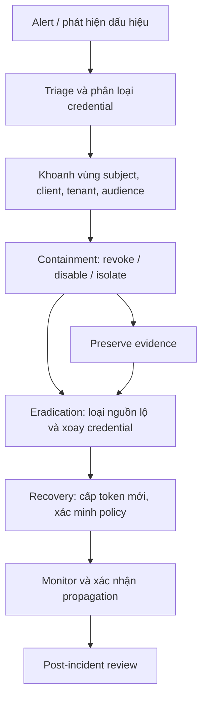

# Incident response cho token compromise

## 1. Mục tiêu và phạm vi

Token là credential mang quyền truy cập. Khi access token, refresh token, client secret hoặc khóa riêng bị lộ, kẻ tấn công có thể hành động dưới danh tính người dùng hoặc workload hợp lệ. Dấu hiệu ban đầu có thể là request API bất thường, refresh token được dùng từ nguồn lạ hoặc một client đột nhiên xin nhiều access token hơn bình thường.

Ứng phó cần trả lời bốn câu hỏi:

1. **Credential nào bị lộ?** Access token, refresh token, client secret, private key, chứng chỉ mTLS, DPoP key, ID token, session cookie hay khóa ký JWT của Authorization Server (AS)?
2. **Ai và phạm vi nào bị ảnh hưởng?** Subject, client/workload, tenant, issuer, audience, scope, tài nguyên và khoảng thời gian token còn hiệu lực.
3. **Làm sao chặn việc sử dụng tiếp?** Revoke token/grant, vô hiệu credential, chặn token ID, xoay khóa, cô lập workload hoặc cập nhật policy.
4. **Làm sao chứng minh đã khôi phục?** Kiểm tra credential cũ bị từ chối, token mới hoạt động đúng quyền, resource server đã nhận trạng thái revoke và audit không còn dấu hiệu truy cập trái phép.

Không phải mọi token compromise đều có cùng cách xử lý. Revoke một bearer access token khác với xoay khóa ký của AS; thu hồi refresh token khác với vô hiệu hóa client secret. Nếu nhầm đối tượng, hệ thống có thể vẫn để attacker hoạt động hoặc gây gián đoạn diện rộng.

Bài học này trình bày runbook xử lý sự cố token compromise trong OAuth 2.0/OIDC, gồm phát hiện, phân loại, khoanh vùng, thu hồi, xoay credential, bảo toàn bằng chứng, phục hồi và diễn tập.

## 2. Phân loại credential và mức độ ảnh hưởng

| Loại bị lộ | Attacker có thể làm gì? | Hành động ưu tiên |
| --- | --- | --- |
| **Bearer access token** | Gọi resource server trong audience/scope còn hiệu lực | Revoke token nếu hỗ trợ; denylist token ID/fingerprint hoặc chặn theo trạng thái; đánh giá request đã thực hiện |
| **Refresh token** | Xin access token mới trong phạm vi grant/client được phép | Revoke refresh token hoặc token family/grant; buộc xác thực/ủy quyền lại khi cần |
| **Client secret** | Giả client để xin access token mới | Disable/rotate secret, kiểm soát client, rà soát token đã phát hành bằng credential đó |
| **Private key dùng private_key_jwt** | Ký client assertion để xác thực với AS | Thu hồi public key/client credential tương ứng, đăng ký khóa mới, điều tra assertion/token issuance |
| **Chứng chỉ mTLS hoặc private key** | Giả workload/client; có thể sử dụng token bound với chứng chỉ nếu sở hữu khóa | Revoke certificate, cập nhật trust/CRL/OCSP theo kiến trúc, thay khóa và đánh giá token bound |
| **DPoP private key** | Tạo proof-of-possession cho token bound với khóa đó | Thu hồi/đổi token bound, vô hiệu khóa và kiểm tra proof replay |
| **AS signing private key** | Ký JWT giả mạo có thể được nhiều resource server tin | Sự cố nghiêm trọng diện rộng: loại khóa khỏi trust, phát hành khóa mới, phối hợp resource server và đánh giá JWT bị ảnh hưởng |
| **ID token** | Giả mạo kết quả xác thực đối với OIDC client nếu client dùng sai hoặc phiên còn hiệu lực | Xử lý phiên/session và client theo OIDC; không coi ID token là access token API |
| **Session cookie** | Chiếm phiên đăng nhập trình duyệt | Revoke session, logout/back-channel theo khả năng, đổi credential liên quan và kiểm tra refresh token |
| **Opaque token** | Dùng token tại resource server nếu AS/introspection vẫn xác nhận active | Revoke tại AS, kiểm tra introspection/cache và lan truyền trạng thái |

Phân biệt **khóa riêng của OAuth client** với **khóa ký token của AS** là đặc biệt quan trọng. Khóa dùng `private_key_jwt` bị lộ cho phép attacker giả client tại token endpoint. Khóa ký JWT access token của AS bị lộ có thể cho phép attacker tự tạo token giả cho nhiều resource server tin issuer đó. Phạm vi và mức độ ảnh hưởng rất khác nhau.

## 3. Nguyên tắc xử lý sự cố

- **Ưu tiên chặn quyền truy cập đang bị lạm dụng:** nếu attacker đang gọi API hoặc thực hiện giao dịch, cô lập nguồn và thu hồi quyền liên quan ngay theo playbook đã phê duyệt.
- **Khoanh vùng theo credential và audience:** revoke đúng token/client/grant/tenant; không vô hiệu hóa toàn bộ issuer nếu chưa có lý do.
- **Giữ bằng chứng an toàn:** lưu metadata, request ID, token fingerprint, token ID, issuer, audience, client, subject, scope và timestamp. Không sao chép token nguyên văn vào ticket, chat hoặc log.
- **Không tin JWT chỉ vì decode được:** mọi claim dùng trong điều tra phải đến từ token đã được xác minh hoặc log phát hành đáng tin cậy.
- **Phân biệt token revoke với credential rotation:** revoke access token không tự làm client secret cũ mất hiệu lực; đổi client secret không nhất thiết vô hiệu hóa access token đã cấp.
- **Đánh giá cả token đã phát hành:** sau khi credential bị lộ, attacker có thể đã xin token trước khi credential bị disable.
- **Thực hiện có kiểm chứng:** không đánh dấu sự cố đã khép lại chỉ vì revocation endpoint trả HTTP 200; kiểm tra resource server thật sự từ chối credential bị ảnh hưởng.
- **Giảm quyền trong thời gian ứng phó:** nếu chưa xác định hết phạm vi, tạm giới hạn audience/scope hoặc disable workload liên quan theo mức độ rủi ro.

## 4. Quy trình ứng phó theo giai đoạn



Các giai đoạn có thể diễn ra song song trong sự cố nghiêm trọng. Bảo toàn bằng chứng không được làm chậm hành động ngăn chặn attacker đang gây thiệt hại.

| Giai đoạn | Mục tiêu | Kết quả cần có |
| --- | --- | --- |
| **Prepare** | Chuẩn bị quyền revoke, liên hệ AS/owner, runbook và telemetry | Có thể hành động nhanh, biết ai có quyền |
| **Detect** | Xác định tín hiệu token compromise | Alert và mốc thời gian ban đầu |
| **Triage** | Xác định loại credential và phạm vi | Incident scope, severity, owner |
| **Contain** | Chặn sử dụng token/credential bị lộ | Token cũ bị từ chối hoặc workload được cô lập |
| **Eradicate** | Loại nguồn lộ, xoay secret/key/cert | Credential mới an toàn, nguyên nhân đã xử lý |
| **Recover** | Khôi phục luồng gọi API với quyền tối thiểu | Token mới hợp lệ, nghiệp vụ hoạt động |
| **Monitor** | Theo dõi replay, token issuance và request bất thường | Không còn dấu hiệu lạm dụng trong cửa sổ theo dõi |
| **Learn** | Rút kinh nghiệm và cập nhật kiểm soát | Action items, owner và thời hạn |

## 5. Phát hiện và thu thập tín hiệu

### 5.1. Nguồn tín hiệu

Các tín hiệu có thể đến từ AS, API Gateway, resource server, secret manager, CI/CD, endpoint security hoặc hệ thống quan sát:

- Một access token được sử dụng từ IP, ASN, vùng địa lý hoặc workload chưa từng thấy.
- Một service account gọi audience/resource không nằm trong hành vi bình thường.
- Tăng đột biến token request, refresh request, `invalid_client`, `invalid_grant` hoặc `invalid_token`.
- Cùng một bearer token xuất hiện đồng thời ở các vị trí không thể hợp lý theo kiến trúc.
- Refresh token cũ được sử dụng lại sau khi rotation.
- Một client xin scope rộng hoặc audience mới bất thường.
- Token ID giống nhau xuất hiện ở nhiều request có dấu hiệu replay; cần phân biệt retry hợp lệ.
- Secret scanning phát hiện client secret/private key trong repository, artifact hoặc log.
- KMS/HSM ghi nhận hoạt động ký hoặc giải mã bất thường.
- Resource server nhận JWT có key identifier lạ, chữ ký sai nhưng issuer tự khai là issuer tin cậy.
- Người dùng báo thiết bị lạ, ứng dụng lạ hoặc hành động họ không thực hiện.

Một tín hiệu riêng lẻ không luôn chứng minh compromise. NAT, proxy, autoscaling hoặc retry có thể làm IP và tần suất request thay đổi. Kết hợp nhiều tín hiệu với identity, audience, scope, tenant và hành vi nghiệp vụ trước khi kết luận.

### 5.2. Metadata nên ghi

| Metadata | Dùng để làm gì? | Lưu ý |
| --- | --- | --- |
| `iss` | Xác định nguồn phát hành | Chỉ tin giá trị sau xác minh |
| `sub` | Xác định principal | Có thể là user hoặc service |
| `client_id` / actor | Xác định client/workload | Phân biệt subject và actor |
| `aud` | Xác định resource nhận token | Giúp khoanh vùng API |
| `scope` / permission | Đánh giá quyền có thể bị lạm dụng | Ghi scope đã xác minh |
| `jti` | Liên kết token cụ thể khi claim được hỗ trợ | Không thay thế chữ ký/token verification |
| `tenant_id` | Khoanh vùng tenant | Canonical tenant đã xác minh |
| `iat`, `exp`, `nbf` | Xác định cửa sổ thời gian | Không dựa vào claim chưa xác thực |
| Request/trace ID | Truy tìm chuỗi request | Không phải credential |
| Token fingerprint | Tương quan sự kiện mà không lưu token nguyên văn | Dùng HMAC/key nội bộ nếu cần |
| Credential/key version | Xác định secret hoặc key generation | Không ghi giá trị secret/key |

Không log `Authorization` header, raw JWT, refresh token, client assertion hoặc private key. Nếu hệ thống đã vô tình ghi token vào log, log đó trở thành một nguồn credential bị lộ: cần hạn chế quyền truy cập, xử lý retention/containment và đánh giá khả năng token đã bị sử dụng.

## 6. Triage và xác định blast radius

### 6.1. Các câu hỏi trong 15 phút đầu

1. Alert phát hiện lúc nào? Thời điểm compromise có thể sớm hơn thời điểm phát hiện bao lâu?
2. Credential thuộc loại nào và được lưu ở đâu?
3. Credential có còn hiệu lực? Có thể xin token mới hoặc gọi API ngay không?
4. Subject/client/tenant nào bị ảnh hưởng?
5. Token có audience và scope nào? Có quyền ghi, xóa, chuyển tiền, quản trị hoặc truy cập dữ liệu nhạy cảm không?
6. Token là bearer hay được ràng buộc DPoP/mTLS?
7. Có dấu hiệu attacker đã dùng token, refresh token hoặc client credential chưa?
8. Những resource server nào chấp nhận token/issuer/client này?
9. Có thể revoke riêng grant/token/client hay phải xoay key rộng hơn?
10. Ai là incident commander, AS owner, service owner và security contact?

### 6.2. Xếp mức độ theo rủi ro

| Mức | Ví dụ | Phản ứng |
| --- | --- | --- |
| **Critical** | AS signing private key bị lộ; token admin/financial bị dùng trái phép; attacker đang có quyền rộng | Kích hoạt incident commander, cô lập và thu hồi ngay, phối hợp mọi resource server |
| **High** | Refresh token/user session hoặc client credential production bị lộ; có khả năng xin token mới | Disable/revoke credential hoặc grant, kiểm tra token issuance và request history |
| **Medium** | Một access token scope hẹp bị lộ, chưa thấy sử dụng trái phép, TTL ngắn | Revoke/denylist token, rà soát audience và resource access, theo dõi |
| **Low / suspected** | Secret test hoặc token giả lập xuất hiện trong tài liệu không truy cập production | Xác minh môi trường, loại bỏ khỏi nơi lưu và ghi nhận theo policy |

Bảng chỉ là gợi ý phân loại; severity cuối cùng dựa trên tác động dữ liệu, phạm vi quyền, khả năng lan truyền, nghĩa vụ thông báo và mức độ hoạt động của attacker.

### 6.3. Xác định blast radius

Tạo danh sách tất cả nơi credential có thể được dùng:

- Token issuer và token endpoint.
- Audience/resource server, API Gateway và downstream services.
- Tenant, user, client/service account liên quan.
- Scope/role và tài nguyên có thể truy cập.
- Các bản sao credential trong secret manager, CI variables, container image, repository, artifact, log và backup.
- Access token/refresh token đã phát hành trong cửa sổ compromise.
- KMS/HSM key usage, signing event và certificate trust chain.

Đừng chỉ tìm theo client ID; một client có thể có nhiều credential version, nhiều audience và nhiều tenant context.

## 7. Containment cho bearer access token

Nếu chỉ một bearer access token bị lộ:

1. Xác định token đã được xác minh thuộc issuer, subject/client, audience và scope nào.
2. Thu thập `jti` hoặc fingerprint an toàn cùng các request liên quan.
3. Gọi revocation endpoint theo RFC 7009 nếu AS hỗ trợ loại token đó và client có quyền revoke.
4. Nếu API dùng JWT offline validation, kích hoạt denylist hoặc trạng thái revoke theo token ID/fingerprint/grant/session; phát sự kiện tới resource server.
5. Nếu dùng opaque token, kiểm tra introspection trả `active=false` và thời gian cache active cũ bị invalidated.
6. Chặn các session/request đang hoạt động nếu cần, và điều tra dữ liệu đã bị đọc hoặc thay đổi.
7. Cấp token mới chỉ khi principal/client và workload đã an toàn; token mới phải có audience/scope tối thiểu.

Ví dụ denylist entry:

```json
{
  "issuer": "https://auth.example.test",
  "token_id": "jti-7f31",
  "revoked_at": "2026-11-23T10:05:00Z",
  "expires_at": "2026-11-23T10:15:00Z",
  "reason": "suspected_token_theft"
}
```

Đây là metadata ví dụ, không chứa token. Denylist key cần namespace theo issuer để tránh trùng token ID giữa các issuer. Resource server chỉ tra token ID sau khi xác minh token và chỉ giữ entry đến khi token hết hạn hoặc theo policy.

**Giới hạn quan trọng:** RFC 7009 HTTP 200 cho biết AS đã xử lý yêu cầu theo semantics của endpoint; nó không chứng minh mọi resource server đã ngừng chấp nhận JWT offline. Nếu API không kiểm revocation state, access token JWT có thể vẫn được chấp nhận đến `exp`. Phải xác minh trực tiếp ở các resource server trọng yếu.

## 8. Containment cho refresh token và consent/grant

Refresh token có khả năng xin access token mới nên thường cần ưu tiên cao hơn một access token TTL ngắn.

Quy trình:

- Xác định grant/session/token family, subject, client, tenant và các resource/scope được phép.
- Revoke refresh token hoặc toàn bộ token family/grant theo khả năng AS.
- Nếu rotation reuse detection đã kích hoạt, xác minh family liên quan đã bị vô hiệu theo policy.
- Từ chối token refresh mới dựa trên grant đã revoke; kiểm tra các request refresh sau thời điểm revoke.
- Nếu compromise có liên quan đến consent, đánh dấu grant revoked và ghi audit actor/reason/time.
- Thu hồi access token liên quan hoặc áp dụng denylist/introspection/event propagation nếu cần.
- Yêu cầu người dùng xác thực/ủy quyền lại sau khi thiết bị, session hoặc client đã được làm sạch.
- Không phục hồi grant cũ tự động chỉ vì người dùng đăng nhập lại; scope/resource cần được chấp thuận theo flow hiện hành.

Với refresh token rotation, attacker có thể đã lấy được token mới trong khi hệ thống chỉ biết token cũ. Cần kiểm tra lịch sử family/reuse event, thời điểm từng lần refresh và client instance. Không dùng lại refresh token cũ sau rotation; tránh hai worker đồng thời đổi cùng một token.

## 9. Containment cho client secret, private key và workload identity

### 9.1. Client secret bị lộ

Client secret compromise có thể cho attacker xin token mới với quyền client đã đăng ký.

- Disable client hoặc credential version bị lộ nếu cần ngăn ngay token issuance.
- Phát hành secret mới qua secret manager; cập nhật workload bằng cơ chế rollout có kiểm soát.
- Xác minh client mới có thể xin token đúng audience/scope và secret cũ bị từ chối.
- Rà soát AS logs để xác định token đã phát hành bằng client trong cửa sổ compromise.
- Revoke token/grant liên quan theo policy; đừng giả định đổi secret tự thu hồi access token cũ.
- Tìm bản sao secret trong Git history, CI logs, build artifacts, container layers, crash dump và observability platform.
- Xóa/rotate secret ở mọi nơi bị lộ, nhưng giữ bằng chứng cần thiết theo quy trình incident.

Không dùng một secret chung cho nhiều service hoặc nhiều môi trường. Nếu secret cũ được nhiều workload dùng, thay đổi có thể gây gián đoạn; cần xác định dependency và ưu tiên containment theo mức độ đang bị lạm dụng.

### 9.2. Private key cho private_key_jwt

Nếu private key của OAuth client bị lộ, attacker có thể ký client assertion để xác thực với AS. Cần:

1. Disable hoặc gỡ public key tương ứng khỏi client registration theo quy trình AS.
2. Đăng ký public key mới và triển khai private key mới được tạo trong KMS/HSM nếu phù hợp.
3. Kiểm assertion issuer, subject, audience, expiry, token ID và replay detection ở AS.
4. Kiểm log token endpoint và các access token đã phát hành bởi client.
5. Thu hồi credential/token liên quan theo policy.

Đổi private key của client không phải là xoay khóa ký JWT access token của AS. Hai bộ khóa có mục đích và blast radius khác nhau.

### 9.3. Workload identity hoặc chứng chỉ mTLS bị lộ

Nếu workload credential bị chiếm, cô lập workload/pod/VM, thu hồi chứng chỉ hoặc federation trust liên quan, kiểm tra subject/audience được phép federation và cấp credential mới từ nền tảng tin cậy. Với mTLS-bound token, API phải kiểm certificate binding; với workload identity, AS cần ngừng tin assertion từ workload/subject bị compromise.

Không chỉ xóa file certificate trong container nếu private key vẫn nằm ở volume, image, node hoặc backup. Xác minh certificate cũ không còn được trust tại AS/resource server và không còn workload nào cần sử dụng.

## 10. Khi AS signing key bị compromise

Đây là trường hợp có blast radius lớn nhất. Nếu private signing key dùng ký JWT access token bị lộ, attacker có thể tự tạo token giả với issuer, audience, subject và scope mà resource server đang tin, tùy khả năng kiểm tra bổ sung của hệ thống.

Runbook khẩn cấp:

1. Kích hoạt severity Critical và thông báo AS owner, security lead, resource server owners.
2. Xác định key identifier, thuật toán, key version, thời điểm nghi vấn và tất cả token/issuer dùng khóa đó.
3. Ngừng ký bằng khóa bị lộ; bảo vệ KMS/HSM và kiểm tra audit signing operations.
4. Loại khóa khỏi JWKS/trust configuration theo quy trình; publish key mới và ký token mới bằng khóa mới.
5. Buộc resource server refresh JWKS/cache và xác nhận không còn chấp nhận chữ ký từ khóa bị compromise.
6. Nếu verifier giữ key cũ trong cache, áp dụng invalidation/restart/policy khẩn cấp theo hệ thống.
7. Xác định JWT nào có thể bị giả mạo trong cửa sổ compromise; kiểm request đã được chấp nhận và hành động trên tài nguyên.
8. Cân nhắc yêu cầu xác minh trạng thái bổ sung, denylist hoặc tạm ngừng một số API cho tới khi mọi verifier cập nhật.
9. Xoay khóa trong KMS/HSM và điều tra đường truy cập private key; không chỉ xóa public key khỏi JWKS mà bỏ qua verifier cache.
10. Theo dõi token dùng key identifier cũ và các request bất thường sau containment.

**Không dùng signing-key rotation như biện pháp mặc định cho một access token bị lộ đơn lẻ.** Nó có thể vô hiệu hóa nhiều token hợp lệ, ảnh hưởng nhiều API và làm gián đoạn toàn hệ thống. Chỉ thực hiện khi khóa ký thực sự bị compromise hoặc policy ứng phó yêu cầu.

## 11. Token DPoP, mTLS và ID token

### 11.1. DPoP-bound access token

DPoP ràng buộc access token với public key; client chứng minh sở hữu private key bằng proof cho request. Nếu private key DPoP bị lộ, attacker có thể tạo proof hợp lệ cho token bound với khóa đó.

- Xác định các token và client/key thumbprint liên quan.
- Revoke token hoặc grant và ngừng tin khóa bị lộ.
- Xóa/rotate key trong secure storage, phát token bound với key mới.
- Kiểm token ID, HTTP method/URI, issued-at, nonce và replay cache theo RFC 9449.
- Không coi DPoP là bảo vệ nếu resource server bỏ qua proof hoặc dùng lại proof không đúng request.

### 11.2. mTLS-bound access token

Nếu chứng chỉ/private key bị lộ, attacker có thể giả client ở những nơi trust certificate đó. Revoke certificate, cập nhật trust store/OCSP/CRL hoặc cơ chế PKI đang dùng, thay key và đánh giá các token bị ràng buộc chứng chỉ. Kiểm tra proxy/TLS termination có làm mất bằng chứng client certificate hay khiến backend tin header không xác thực không.

### 11.3. ID token và phiên OIDC

ID token được cấp cho OIDC client, thường có audience là client ID; nó không phải access token API. Nếu ID token hoặc session cookie bị lộ, xử lý phiên đăng nhập, refresh token, logout/back-channel logout và session store theo khả năng OP/client. Không cho API nhận ID token như Bearer access token chỉ vì chữ ký do cùng issuer ký.

Logout không tự động revoke mọi access token. Hãy kiểm riêng trạng thái session, grant, refresh token và access token.

## 12. Bảo toàn bằng chứng và điều tra hoạt động trái phép

### 12.1. Bằng chứng nên giữ

- Alert gốc, thời điểm phát hiện, người nhận alert và timeline.
- AS token issuance/revocation logs, client authentication failure, refresh/reuse events.
- API Gateway/resource server request metadata, response code, route, audience và scope đã xác minh.
- Token ID/fingerprint, issuer, subject/client, tenant, issued-at và expiry đã xác minh.
- KMS/HSM audit, certificate lifecycle, secret manager access và CI/CD deployment history.
- Thay đổi IAM/client registration, JWKS/key version và policy version.
- Event propagation logs: consumer nào nhận revoke, version nào được áp dụng, latency bao lâu.
- Tài nguyên đã bị đọc/thay đổi, transaction ID và audit nghiệp vụ liên quan.

Không thu thập token nguyên văn chỉ để điều tra. Nếu cần một mẫu token để tái hiện lỗi, phải lưu trong kho bằng chứng mã hóa, giới hạn quyền truy cập, có thời hạn và quy trình phê duyệt; ưu tiên token giả lập/tái tạo trong môi trường cô lập.

### 12.2. Xác định phạm vi hành động

Tìm request sau thời điểm nghi vấn theo các chiều:

- Subject/client/actor và tenant.
- Audience/resource, scope và HTTP method.
- IP/network/workload identity và dấu hiệu thay đổi vị trí.
- Token ID hoặc fingerprint, key identifier và token issuance time.
- Thao tác đọc dữ liệu, export, tạo user, thay đổi quyền, ghi/xóa hoặc giao dịch tài chính.
- Request tới downstream service và queue/event được tạo từ hành động đó.

Nếu token bị dùng để tạo sự kiện hoặc job bất đồng bộ, revoke token không tự hủy công việc đã được enqueue. Phải điều tra downstream event, consumer, transaction và dữ liệu đã thay đổi; rollback hoặc bù trừ theo nghiệp vụ khi được phép.

### 12.3. Chain of custody

Với sự cố cần điều tra chính thức, ghi người thu thập, nguồn, thời điểm, hash của artifact và mọi lần chuyển giao. Giữ bản gốc read-only nếu quy trình yêu cầu; thực hiện phân tích trên bản sao. Quyền đọc bằng chứng nên tách khỏi quyền vận hành AS để giảm khả năng một tài khoản bị compromise có thể xóa dấu vết.

## 13. Recovery: khôi phục service mà không tái mở lỗ hổng

Sau containment và eradication:

1. Triển khai credential/key mới qua secret manager/KMS/HSM hoặc workload identity.
2. Kiểm tra client registration, grant, issuer, audience, scope và tenant policy.
3. Xin access token mới bằng luồng hợp lệ; kiểm token type và thời hạn.
4. Gọi resource server thử nghiệm với token mới và xác minh request được phép đúng phạm vi.
5. Thử lại credential cũ để xác nhận bị từ chối.
6. Kiểm tra mọi resource server, Gateway, introspection cache, denylist và JWKS cache đã cập nhật.
7. Bật lại workload từng phần; theo dõi token issuance, refresh, 401/403 và hành vi API.
8. Rà soát quyền đã cấp; giảm scope/audience nếu client từng có quyền rộng hơn cần thiết.
9. Xác minh secret/key cũ đã bị loại khỏi repository, CI, image, log và hệ thống lưu trữ liên quan.
10. Chỉ đóng incident khi owner xác nhận kiểm soát hoạt động và có bằng chứng.

Không khôi phục bằng cách tắt issuer/audience validation, bỏ qua mTLS/DPoP, chấp nhận token hết hạn hoặc dùng credential admin tạm thời không kiểm soát. Nếu cần emergency access, dùng cơ chế break-glass có TTL, approval, audit và thu hồi sau sự cố.

## 14. Giao tiếp, ownership và cập nhật trạng thái

| Vai trò | Trách nhiệm |
| --- | --- |
| **Incident commander** | Quyết định severity, ưu tiên containment, phân công và cập nhật trạng thái |
| **Identity/AS owner** | Revoke grant/token, disable client, rotate secret/key và cung cấp token issuance evidence |
| **Resource server owner** | Cập nhật denylist/introspection/JWKS cache, xác minh token cũ bị từ chối |
| **Service/workload owner** | Cô lập workload, loại nguồn lộ, triển khai credential mới |
| **Security/SOC** | Phân tích dấu hiệu lạm dụng, blast radius, bằng chứng và threat hunting |
| **Data/business owner** | Đánh giá dữ liệu/giao dịch bị ảnh hưởng, quyết định rollback hoặc thông báo nghiệp vụ |
| **Audit/compliance contact** | Bảo đảm retention, chain of custody và nghĩa vụ báo cáo theo chính sách |

Cập nhật trạng thái nên phân biệt:

- **Detected:** có tín hiệu, chưa xác nhận compromise.
- **Confirmed:** đã xác định credential bị lộ hoặc bị sử dụng trái phép.
- **Contained:** credential/workload bị ảnh hưởng đã bị chặn theo biện pháp hiện tại.
- **Eradicated:** nguồn lộ và credential cũ đã được loại bỏ/rotate.
- **Recovering:** đang khôi phục service và kiểm tra token mới.
- **Monitoring:** hệ thống hoạt động, đang theo dõi dấu hiệu tái diễn.
- **Closed:** owner và incident commander xác nhận tiêu chí đóng incident.

Không báo “đã revoke toàn bộ” khi mới gửi request đến AS. Hãy ghi rõ resource server nào đã xác minh từ chối, hệ thống nào chưa xác nhận và cửa sổ rủi ro còn lại.

## 15. Runbook thao tác nhanh

| Thứ tự | Hành động | Bằng chứng hoàn tất |
| --- | --- | --- |
| 1 | Mở incident, ghi mốc thời gian và owner | Incident ID, severity, commander |
| 2 | Phân loại credential/token bị lộ | Token type, issuer, subject/client, key version |
| 3 | Khoanh audience/scope/tenant và resource server | Danh sách blast radius |
| 4 | Cô lập workload hoặc disable credential nếu attacker còn hoạt động | Client/workload bị chặn |
| 5 | Revoke access/refresh token hoặc grant theo khả năng AS | AS result và grant/token state |
| 6 | Phát denylist/revocation event, invalidate cache | Consumer ack/version và propagation latency |
| 7 | Rotate secret/key/cert phù hợp | Credential version mới được triển khai |
| 8 | Điều tra token issuance và API actions | Timeline, request metadata, tài nguyên ảnh hưởng |
| 9 | Cấp token mới và kiểm đúng audience/scope | Test thành công với credential mới |
| 10 | Thử lại credential cũ và theo dõi | Token cũ bị từ chối ở mọi API trọng yếu |
| 11 | Khôi phục workload theo từng bước | Health/authorization checks pass |
| 12 | Post-incident review và action items | Owner, deadline, control changes |

Ví dụ sự cố: `billing-service` secret bị đưa vào log CI. Hành động không chỉ là xóa dòng log. Cần giới hạn quyền truy cập log, rotate secret tại AS, triển khai secret mới, rà soát token issuance bằng `billing-prod`, đánh giá các token đã cấp cho `api://ledger`, revoke/denylist token liên quan theo policy, kiểm tra request tạo bút toán bất thường, rồi xác nhận secret cũ không thể xin token mới.

## 16. Các lỗi ứng phó thường gặp

| Lỗi | Vì sao nguy hiểm? | Cách xử lý đúng |
| --- | --- | --- |
| Chỉ xóa token khỏi log/repository | Attacker có thể đã sao chép token/secret | Revoke/rotate credential và điều tra bản sao |
| Chỉ đổi client secret | Access token đã cấp có thể còn hiệu lực | Rà soát và revoke/denylist token đã phát hành |
| Revoke refresh token nhưng không kiểm access token | JWT offline có thể tiếp tục được chấp nhận | Kiểm revoke state, introspection, denylist hoặc TTL |
| Gọi RFC 7009 rồi coi sự cố đã đóng | Resource server có thể cache trạng thái cũ | Kiểm từng resource server và propagation SLA |
| Xoay AS signing key cho mọi sự cố access token | Gây gián đoạn diện rộng | Chỉ xoay signing key khi key ký thực sự bị compromise |
| Tin token ID chưa xác thực | Attacker có thể tự khai token ID | Verify chữ ký/issuer/audience trước denylist lookup |
| Gửi token nguyên văn qua chat/ticket | Tạo thêm bản sao credential | Dùng fingerprint/metadata, lưu evidence vault nếu bắt buộc |
| Retry token request vô hạn | Tăng tải AS và che lỗi cấu hình | Backoff, circuit breaker, giới hạn số lần |
| Chỉ kiểm tra Gateway | Request có thể đi thẳng tới backend | Xác minh resource server và đường truy cập bypass |
| Bỏ qua queue/job đã phát sinh | Attacker có thể tiếp tục tác động sau revoke | Điều tra event, consumer và transaction downstream |
| Bật lại service trước khi xoay nguồn lộ | Credential cũ tiếp tục bị sử dụng | Eradicate rồi mới recover |
| Không phân biệt user và service principal | Có thể revoke sai phạm vi hoặc bỏ sót workload | Theo dõi subject, actor, client và tenant riêng |

## 17. Kiểm thử và diễn tập incident response

Một runbook chỉ có giá trị khi các thao tác có thể thực hiện được trong môi trường thực. Diễn tập nên dùng token/credential test riêng và không tạo token production để mô phỏng sự cố.

| Test | Tình huống | Kết quả mong đợi |
| --- | --- | --- |
| T1 | Bearer access token bị đánh dấu compromised | Revoke/denylist và resource server từ chối token cũ |
| T2 | Opaque token bị revoke | Introspection trả inactive; cache cũ bị invalidated trong SLA |
| T3 | Refresh token bị lộ | Grant/family bị revoke; refresh token cũ không xin được token mới |
| T4 | Refresh token cũ bị replay sau rotation | Reuse detection phát hiện và xử lý family theo policy |
| T5 | Client secret bị lộ | Secret cũ bị từ chối; secret mới xin token đúng quyền |
| T6 | private_key_jwt private key bị lộ | Public key cũ bị loại khỏi client trust; assertion mới hợp lệ |
| T7 | mTLS certificate bị lộ | Certificate cũ bị revoke và binding cũ không còn được chấp nhận |
| T8 | DPoP private key bị lộ | Token/key liên quan bị revoke/rotate; proof cũ không dùng được |
| T9 | AS signing key bị compromise giả lập | Verifier ngừng tin key cũ sau quy trình khẩn cấp |
| T10 | JWT còn hạn nhưng đã revoke | API từ chối trong cửa sổ SLA đã công bố |
| T11 | Revocation event bị duplicate | Consumer xử lý idempotent |
| T12 | Revocation event đến sai thứ tự | Version cũ không rollback trạng thái mới |
| T13 | Một resource server offline lúc revoke | Khi reconnect, replay/reconcile và từ chối token trước khi nhận traffic nhạy cảm |
| T14 | Attacker gọi audience khác | API sai audience từ chối token |
| T15 | Token có scope rộng hơn cần thiết | Policy hạn chế hoặc thu hồi đúng grant |
| T16 | Workload bị cô lập nhưng queue còn job | Job được kiểm tra/hold/cancel theo policy |
| T17 | Token nguyên văn xuất hiện trong log test | Detection cảnh báo và log access được hạn chế |
| T18 | Secret mới triển khai một phần replica | Health check phát hiện version không đồng nhất trước khi đóng incident |
| T19 | Resource server đi vòng Gateway | Backend vẫn áp dụng validation/authorization hoặc network policy chặn |
| T20 | Đóng incident | Có bằng chứng token cũ bị từ chối, token mới đúng quyền, propagation và monitoring đạt |

Nên đo các chỉ số:

- Thời gian từ alert đến phân loại credential.
- Thời gian từ xác nhận compromise đến containment.
- Thời gian từ AS revoke đến resource server cuối cùng áp dụng.
- Tỷ lệ resource server xác nhận token cũ bị từ chối.
- Số access token/refresh token được phát hành trong cửa sổ compromise.
- Số request trái phép và tài nguyên bị ảnh hưởng.
- Thời gian xoay credential và khôi phục workload.
- Tỷ lệ log/telemetry bị phát hiện chứa credential nhạy cảm.

Đặt SLA theo rủi ro nghiệp vụ và kiến trúc. Mục tiêu 30 giây cho propagation chỉ là ví dụ; hệ thống phải đo được và chứng minh qua diễn tập dưới tải, khi broker/AS/resource server gặp sự cố.

## 18. Sau sự cố: loại bỏ nguyên nhân gốc

Post-incident review cần xác định credential bị lộ bằng con đường nào: code commit, CI log, secret manager permission quá rộng, container image, developer workstation, browser storage, telemetry, support bundle hay workload compromise.

Action items thường gồm:

- Chuyển secret tĩnh sang workload identity, private key assertion hoặc mTLS khi hạ tầng hỗ trợ.
- Giảm TTL access token và scope/audience theo least privilege.
- Bật refresh-token rotation/reuse detection cho flow phù hợp.
- Bổ sung introspection, denylist, revocation event và đo propagation SLA.
- Che Authorization header và token endpoint response ở logging/tracing.
- Thêm secret scanning cho repository, CI và artifact.
- Giới hạn quyền đọc secret manager/KMS/HSM và kiểm toán key usage.
- Bảo vệ JWKS/key rotation, kiểm tra key identifier và issuer/audience tại mọi resource server.
- Tăng khả năng cô lập workload/tenant và thu hồi riêng từng client/grant.
- Cập nhật runbook, contact list, quyền emergency revoke và diễn tập định kỳ.

Mỗi action cần owner, deadline, tiêu chí nghiệm thu và bằng chứng kiểm tra.

## 19. Ghi nhớ và tài liệu tham khảo

**Token compromise là sự cố về credential và quyền truy cập.** Cần phân loại đúng loại token/khóa bị lộ, xác định blast radius theo issuer, subject/client, tenant, audience và scope, chặn credential cũ, xoay đúng bí mật, kiểm tra propagation và xác minh mọi resource server từ chối token bị ảnh hưởng. Revoke request đã gửi không đồng nghĩa sự cố đã được containment.

Các chuẩn và hướng dẫn nên đối chiếu:

- [RFC 7009 — OAuth 2.0 Token Revocation](https://www.rfc-editor.org/rfc/rfc7009): thu hồi access token/refresh token tại AS.
- [RFC 7662 — OAuth 2.0 Token Introspection](https://www.rfc-editor.org/rfc/rfc7662): xác minh trạng thái token tại resource server.
- [RFC 9700 — Best Current Practice for OAuth 2.0 Security](https://www.rfc-editor.org/rfc/rfc9700): bảo vệ access/refresh token, rotation và replay.
- [RFC 6750 — OAuth 2.0 Bearer Token Usage](https://www.rfc-editor.org/rfc/rfc6750): rủi ro và cách sử dụng bearer token.
- [RFC 8725 — JSON Web Token Best Current Practices](https://www.rfc-editor.org/rfc/rfc8725): xác minh JWT, issuer, audience và thuật toán.
- [RFC 9068 — JWT Profile for OAuth 2.0 Access Tokens](https://www.rfc-editor.org/rfc/rfc9068): validation access token JWT.
- [RFC 8705 — OAuth 2.0 Mutual-TLS Client Authentication and Certificate-Bound Access Tokens](https://www.rfc-editor.org/rfc/rfc8705): client certificate và token binding.
- [RFC 9449 — OAuth 2.0 Demonstrating Proof of Possession (DPoP)](https://www.rfc-editor.org/rfc/rfc9449): proof-of-possession và replay protection.
- [NIST SP 800-61 Rev. 3 — Incident Response Recommendations and Considerations for Cybersecurity Risk Management](https://csrc.nist.gov/pubs/sp/800/61/r3/final): tổ chức hoạt động incident response.
- [OWASP Secrets Management Cheat Sheet](https://cheatsheetseries.owasp.org/cheatsheets/Secrets_Management_Cheat_Sheet.html): lưu trữ, xoay vòng và bảo vệ secret.
