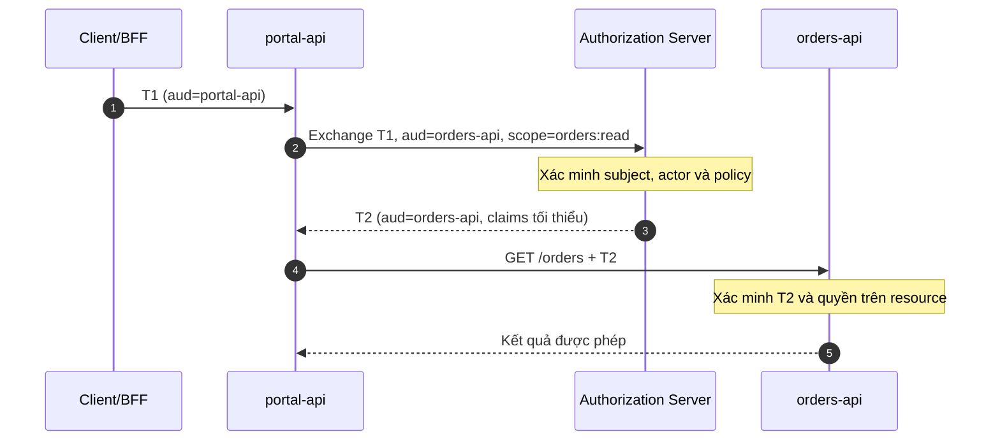

# Data minimization trong token

Access token thường đi qua nhiều thành phần: client, API gateway, service mesh, backend và resource server. Mỗi nơi nhận token đều có thể đọc hoặc sử dụng một phần dữ liệu trong token. Nếu token chứa email, số điện thoại, tên đầy đủ, ngày sinh, địa chỉ, danh sách nhóm lớn hoặc thông tin nghiệp vụ không cần thiết, dữ liệu cá nhân sẽ bị phát tán rộng hơn mục đích xác thực và phân quyền.

**Data minimization trong token** là nguyên tắc chỉ đưa vào token những claim thật sự cần để resource server thực hiện quyết định bảo mật đã xác định. Token phải đủ thông tin để xác minh issuer, audience, thời hạn và quyền cần thiết, đồng thời hạn chế dữ liệu có thể nhận diện, liên kết hoặc tiết lộ người dùng.

Bài học thuộc chương **Compliance** của mô-đun **SECURITY_TOKEN_SECURITY_FUNDAMENTALS**. Chủ đề gắn với mô hình tin cậy và vòng đời token: phân biệt JWT, opaque token, access token và refresh token; hiểu phát hành, kiểm tra claims, scope, audience, lưu trữ, thu hồi và phòng chống token bị đánh cắp hoặc phát lại trong OAuth 2.0/OIDC.

Sau bài này, bạn có thể:

- Xác định dữ liệu nào thực sự cần trong access token và dữ liệu nào nên tra cứu ở backend.
- Phân biệt định danh trực tiếp, định danh giả danh, dữ liệu phân quyền và dữ liệu nghiệp vụ.
- Chọn JWT hoặc opaque token theo nhu cầu xác minh, thu hồi, riêng tư và vận hành.
- Giảm claim thừa, tránh lộ PII qua token, log, trace, URL và cache.
- Dùng audience-specific token, token exchange và scope để giới hạn dữ liệu được tiết lộ.
- Xây dựng quy trình kiểm tra, lưu giữ, thu hồi và bằng chứng tuân thủ cho vòng đời token.

## 1. Vì sao token cần tối thiểu hóa dữ liệu?

Giả sử một ứng dụng phát hành JWT như sau:

```json
{
  "iss": "https://id.example.com",
  "sub": "user-42",
  "aud": ["orders-api", "inventory-api", "payments-api"],
  "email": "alice@example.com",
  "phone_number": "+84901234567",
  "full_name": "Alice Nguyen",
  "date_of_birth": "1995-04-12",
  "home_address": "12 Example Street",
  "groups": ["employee", "finance", "warehouse", "support"],
  "tenant_id": "tenant-acme",
  "scope": "orders:read orders:create inventory:reserve payments:charge",
  "exp": 1795509000
}
```

Nếu token này được gửi đến cả ba API, mỗi API có thể nhận được email, số điện thoại, ngày sinh, địa chỉ và các nhóm không liên quan đến chức năng của nó. Một service chỉ cần kiểm tra quyền giữ hàng vẫn nhìn thấy thông tin cá nhân và quyền tài chính của người dùng.

Các rủi ro gồm:

- **Phơi lộ dữ liệu rộng:** mọi proxy, gateway, middleware hoặc service có thể đọc payload JWT đã ký nhưng không mã hóa.
- **Tăng khả năng liên kết:** cùng một định danh hoặc thuộc tính lặp lại qua nhiều API giúp các hệ thống ghép hành vi của một người.
- **Rò rỉ qua log/trace:** token bị ghi vào header dump, exception, APM hoặc support bundle.
- **Khó thay đổi dữ liệu:** thông tin trong JWT thường là snapshot tại thời điểm phát hành; email, role hoặc membership đổi có thể khiến claim cũ tiếp tục tồn tại đến khi token hết hạn/thu hồi.
- **Tăng phạm vi sự cố:** token bị đánh cắp có thể tiết lộ dữ liệu và quyền vượt quá tác vụ mà attacker cần.
- **Tăng chi phí vận hành:** token lớn làm tăng băng thông, header size, memory, cache và thời gian parse.

Token không phải hồ sơ người dùng thu nhỏ. Nó là chứng cứ truy cập có phạm vi, thời hạn và recipient xác định.

## 2. Data minimization là nguyên tắc thiết kế

Trong các khung bảo vệ dữ liệu, những nguyên tắc thường liên quan trực tiếp đến token gồm:

- **Purpose limitation:** chỉ xử lý dữ liệu cho mục đích đã xác định và hợp pháp.
- **Data minimization:** dữ liệu phải phù hợp, liên quan và giới hạn ở mức cần thiết cho mục đích.
- **Storage limitation:** không giữ dữ liệu lâu hơn thời gian cần thiết.
- **Integrity and confidentiality:** bảo vệ dữ liệu khỏi truy cập, sử dụng hoặc tiết lộ trái phép.
- **Data protection by design/default:** đưa bảo vệ dữ liệu vào thiết kế hệ thống và mặc định chỉ xử lý lượng dữ liệu cần thiết.

Ví dụ, Điều 5(1)(c) GDPR mô tả nguyên tắc data minimisation; Điều 25 đề cập data protection by design and by default; Điều 32 đề cập bảo mật xử lý. Việc áp dụng luật cụ thể còn phụ thuộc vai trò tổ chức, phạm vi xử lý, địa điểm và quy định liên quan. Bài học này trình bày nguyên tắc kỹ thuật, không thay thế đánh giá pháp lý của tổ chức.

Đối với token, cần đặt câu hỏi trước khi thêm claim:

1. Resource server nào sẽ nhận claim?
2. Claim phục vụ quyết định xác thực, phân quyền hay nghiệp vụ nào?
3. Có thể thực hiện quyết định bằng scope, định danh giả danh hoặc tra cứu backend không?
4. Claim có tiết lộ dữ liệu cá nhân hoặc cho phép liên kết người dùng giữa các service không?
5. Claim tồn tại bao lâu, có bị cache/log hay đi qua bên thứ ba không?
6. Khi dữ liệu thay đổi hoặc bị thu hồi, token cũ được xử lý thế nào?

Chỉ khi có câu trả lời rõ ràng mới đưa claim vào token.

## 3. Phân loại dữ liệu trước khi thiết kế claims

Không phải mọi claim đều có cùng mức độ rủi ro. Hãy phân loại theo mục đích và khả năng nhận diện:

| Nhóm dữ liệu | Ví dụ | Có nên đưa vào access token? |
|---|---|---|
| **Thông tin xác minh token** | `iss`, `aud`, `exp`, `iat` | Thường cần theo token profile |
| **Định danh chủ thể** | `sub` | Thường cần, nhưng nên chọn định danh giả danh theo phạm vi |
| **Quyền truy cập** | `scope` | Chỉ đưa quyền cần cho API nhận token |
| **Định danh client** | `client_id` | Có thể cần để resource server áp dụng policy caller |
| **Tenant context** | `tenant_id` | Chỉ đưa nếu API cần và AS đã xác minh membership |
| **Dữ liệu liên hệ** | email, phone | Thường không cần cho authorization; tra cứu qua API chuyên trách |
| **Thông tin nhân khẩu học** | ngày sinh, giới tính, địa chỉ | Không đưa nếu API không có mục đích rõ ràng cần thuộc tính đó |
| **Hồ sơ nghiệp vụ** | số dư, lịch sử đơn hàng, hồ sơ thanh toán | Tra cứu từ service sở hữu dữ liệu |
| **Dữ liệu bí mật** | password, API key, private key | Tuyệt đối không đưa vào token |
| **Danh sách nhóm lớn** | toàn bộ group/role của tổ chức | Tránh; dùng scope/quyền tối thiểu hoặc tra cứu policy |
| **Thông tin vận hành** | debug flag, stack trace, internal hostname | Không đưa vào token người dùng |

Một claim không phải PII trực tiếp vẫn có thể là dữ liệu cá nhân nếu có thể liên kết với người cụ thể. Ví dụ `sub`, `jti`, tenant membership hoặc mã nhân viên có thể là định danh giả danh nhưng vẫn cho phép tổ chức liên kết hoạt động về một người.

### 3.1. Dùng ma trận claim-purpose

Trước khi phát hành token, lập bảng:

| Claim | Mục đích | API nhận | Cần ở mỗi request? | Phương án ít dữ liệu hơn |
|---|---|---|---|---|
| `sub` | Liên kết principal với quyền | `orders-api` | Có, nếu API cần nhận diện chủ thể | Pairwise/pseudonymous subject |
| `aud` | Giới hạn recipient | Một API hoặc tập API được duyệt | Có | Audience riêng theo resource |
| `scope` | Kiểm tra action | API nhận token | Có, nếu policy dùng scope | Chỉ scope của action cần thiết |
| `tenant_id` | Ràng buộc tenant hiện hoạt | API multi-tenant | Có nếu API cần tenant context | Active-tenant token hoặc context server-side |
| `email` | Hiển thị địa chỉ liên hệ | `profile-api` hoặc notification service | Thường không | Tra cứu khi cần qua API có quyền |
| `full_name` | Hiển thị tên | UI/profile service | Thường không | Lấy từ profile service |
| `groups` | Policy nội bộ | API cụ thể | Thường không cần toàn bộ | Scope/action hoặc entitlement tối thiểu |

Nếu một claim không có API nhận cụ thể, mục đích rõ ràng hoặc quyết định bảo mật gắn với nó, hãy bỏ claim đó.

## 4. JWT không đồng nghĩa dữ liệu được mã hóa

JWT thường được truyền dưới dạng JWS ký số. Phần header và payload được Base64URL-encode để vận chuyển; **Base64URL không phải mã hóa bảo mật**. Người có token có thể decode payload và đọc claims mà không cần khóa ký.

```text
JWS compact:
BASE64URL(header).BASE64URL(payload).BASE64URL(signature)

Header và payload: có thể đọc được
Signature: dùng để xác minh tính toàn vẹn/nguồn phát hành
```

Ký số giúp phát hiện việc sửa token và xác minh issuer theo khóa tin cậy; nó không che giấu dữ liệu trong payload. Vì vậy:

- Không đặt email, phone, địa chỉ hoặc dữ liệu nhạy cảm vào JWT chỉ vì token đã ký.
- Không cho rằng HTTPS làm payload JWT trở thành bí mật ở mọi nơi; các endpoint kết thúc TLS, proxy và service vẫn có thể đọc token.
- Không dùng `kid`, `iss` hoặc `aud` từ token làm URL tải khóa tùy ý.
- Không đưa dữ liệu bí mật vào JWT header hoặc custom claim.

JWE có thể mã hóa nội dung JWT cho bên nhận phù hợp, nhưng vẫn cần quản lý khóa, audience, access control, log và lifetime. Mã hóa không loại bỏ nhu cầu tối thiểu hóa: token vẫn có thể bị giải mã ở recipient, bị lưu lâu hoặc bị sử dụng sai mục đích. Ưu tiên không phát hành dữ liệu không cần thiết ngay từ đầu.

## 5. Thiết kế access token tối thiểu

Một access token JWT cho `orders-api` có thể chỉ cần:

```json
{
  "iss": "https://id.example.com",
  "sub": "usr-pairwise-7f2",
  "aud": ["orders-api"],
  "client_id": "web-bff",
  "scope": "orders:read",
  "jti": "at-orders-91a",
  "iat": 1795507200,
  "exp": 1795507500
}
```

Các claim có vai trò rõ:

- `iss`: issuer mà API tin cậy.
- `sub`: định danh subject theo hợp đồng của issuer; không nhất thiết là email hoặc username.
- `aud`: resource server được phép nhận token.
- `client_id`: định danh ứng dụng xin token; claim này bắt buộc nếu áp dụng JWT access token profile RFC 9068, còn profile khác cần xác định theo hợp đồng AS/API.
- `scope`: action được cấp cho API nhận token.
- `iat`, `exp`: thời điểm phát hành và hết hạn.

Nếu dùng JWT access token theo RFC 9068, header cần token type `at+jwt` và claim `jti` là một phần của profile bắt buộc. Với profile khác, chỉ thêm `jti` khi cần định danh token cho audit/replay policy. Claim `cnf` chỉ cần cho sender-constrained token; `tenant_id` chỉ cần khi API multi-tenant cần tenant binding.

### 5.1. Không nhồi toàn bộ role/group vào token

Một người dùng có thể thuộc nhiều group:

```json
{
  "groups": [
    "employees",
    "finance",
    "warehouse",
    "support",
    "regional-approvers",
    "legacy-system-users"
  ]
}
```

Nếu `orders-api` chỉ cần biết người dùng có thể đọc đơn hàng, toàn bộ group là dữ liệu dư thừa và có thể tiết lộ cơ cấu tổ chức. Hãy cấp scope hẹp:

```json
{
  "scope": "orders:read"
}
```

Nếu quyết định phụ thuộc vào quyền thay đổi thường xuyên, policy phức tạp hoặc dữ liệu nhạy cảm, API có thể tra cứu entitlement từ authorization service. Không biến access token thành bản sao của directory hoặc IAM database.

### 5.2. Tránh lặp lại thông tin

Không cần đưa đồng thời các biến thể cùng ý nghĩa nếu resource server không dùng:

```json
{
  "sub": "usr-42",
  "user_id": "usr-42",
  "username": "alice",
  "preferred_username": "alice",
  "email": "alice@example.com",
  "employee_number": "E-1042"
}
```

Chọn một subject claim theo token profile. Nếu API cần hiển thị tên/email, hãy truy vấn profile service bằng quyền riêng. Không tự suy ra `sub` từ email vì email có thể thay đổi và thường là dữ liệu nhận diện trực tiếp.

## 6. Pseudonymous subject và giới hạn liên kết

Resource server thường cần một định danh ổn định để tìm quyền hoặc audit. Tuy nhiên, dùng một global user ID ở mọi hệ thống giúp các service liên kết hoạt động của cùng một người, kể cả khi không cần phối hợp dữ liệu.

Một số lựa chọn:

- **Pairwise subject identifier:** issuer tạo `sub` khác nhau theo client/sector hoặc phạm vi được cấu hình, giảm khả năng liên kết chéo giữa các bên.
- **Opaque internal identifier:** token chứa mã không có ý nghĩa trực tiếp; chỉ service có thẩm quyền mới ánh xạ về hồ sơ gốc.
- **Subject-scoped mapping:** mỗi resource server có mapping riêng nếu nghiệp vụ cho phép.

Ví dụ:

```text
OIDC client A -> sub = pairwise-91a
OIDC client B -> sub = pairwise-4bd

Internal identity service:
pairwise-91a -> user-42
pairwise-4bd -> user-42
```

Mapping này phải được bảo vệ và chỉ dùng khi có mục đích hợp lệ. Pairwise ID không tự động biến dữ liệu thành anonymous: tổ chức có mapping vẫn có thể tái nhận diện. Pseudonymization giảm khả năng liên kết, không thay thế kiểm soát truy cập, retention hoặc nghĩa vụ bảo vệ dữ liệu.

Không dùng email, số điện thoại hoặc mã nhân viên làm `sub` nếu không có lý do tương thích rõ ràng. Các định danh này dễ xuất hiện trong log, URL và hệ thống bên thứ ba.

## 7. Audience-specific token: chỉ tiết lộ cho đúng API

Một token chứa nhiều audience và nhiều claim có thể được gửi đến nhiều resource server. Nếu các API có mục đích khác nhau, nên cấp token riêng:

| Token | Audience | Scope | Claims bổ sung |
|---|---|---|---|
| `T_orders` | `orders-api` | `orders:read` | Subject tối thiểu |
| `T_inventory` | `inventory-api` | `inventory:reserve` | Service/tenant context nếu cần |
| `T_payments` | `payments-api` | `payments:charge` | Actor/transaction context nếu policy cần |
| `T_profile` | `profile-api` | `profile:contact:read` | Subject tối thiểu; profile API trả dữ liệu được phép |

`orders-api` không cần thấy số điện thoại chỉ vì `notification-api` cần gửi thông báo. `inventory-api` không cần biết email người mua để giữ hàng. Mỗi API nhận tập claims tương ứng với chức năng.

Audience riêng còn giảm tác động khi token bị lộ: token dành cho `orders-api` không được chấp nhận ở `payments-api` nếu API kiểm tra `aud` đúng cách.

## 8. Token exchange để thu hẹp claims và quyền

OAuth 2.0 Token Exchange (RFC 8693) có thể giúp một service đổi token đầu vào thành token mới dành cho downstream. AS xác minh token nguồn, client/actor, audience/resource và policy trước khi phát token đích.

Ví dụ `portal-api` nhận token cho chính nó; sau đó cần gọi `orders-api`:



Token đích nên mang đúng subject context, actor context khi cần audit/delegation, audience `orders-api` và scope `orders:read`. Không sao chép toàn bộ claim của T1 sang T2. AS có thể loại bỏ email, profile attributes, group không liên quan và quyền của API nguồn.

Token exchange không phải quyền tăng scope. AS phải cấp quyền theo giao của subject, actor/client, resource và policy. Nếu subject token không có cơ sở ủy quyền `payments:charge`, yêu cầu exchange sang scope đó phải bị từ chối.

### 8.1. Ví dụ yêu cầu exchange

```http
POST /oauth2/token HTTP/1.1
Host: id.example.com
Content-Type: application/x-www-form-urlencoded
Authorization: <client-authentication>

grant_type=urn:ietf:params:oauth:grant-type:token-exchange&subject_token=<T1>&subject_token_type=urn:ietf:params:oauth:token-type:access_token&requested_token_type=urn:ietf:params:oauth:token-type:access_token&audience=orders-api&scope=orders%3Aread
```

Ví dụ chỉ minh họa RFC 8693; AS phải hỗ trợ grant và tham số tương ứng. Client cần xác thực với AS bằng phương thức đã đăng ký. Không gửi token nguồn tới resource server đích và không tự sửa `aud` trong JWT.

## 9. JWT hay opaque token khi cần tối thiểu hóa?

Không có định dạng nào tự động bảo đảm privacy. Cả hai đều có thể mang dữ liệu cá nhân nếu thiết kế không tốt.

| Tiêu chí | JWT access token | Opaque access token |
|---|---|---|
| Nội dung token | Claims thường có thể decode ở phía nhận | Chuỗi tham chiếu không biểu lộ claims theo cách JWT |
| Xác minh | Thường kiểm tra chữ ký và claims offline | Thường gọi introspection hoặc tra cứu trạng thái |
| Dữ liệu lộ khi token bị đọc | Có thể lộ toàn bộ payload | Ít lộ cấu trúc claim từ chuỗi token; AS vẫn nắm dữ liệu |
| Thu hồi | JWT offline có thể còn hiệu lực tới `exp` nếu không có trạng thái bổ sung | Có thể phản ánh trạng thái qua introspection, tùy cache |
| Dependency | JWKS/issuer metadata và key rotation | AS introspection availability/latency |
| Token size | Phụ thuộc số lượng/độ dài claims | Thường nhỏ và ổn định |
| Phù hợp | API cần xác minh phân tán, claims ít và rõ | Muốn che nội dung token khỏi client/resource server và cần trạng thái tập trung |

Opaque token không tự động giải quyết mọi vấn đề riêng tư: resource server được phép introspect có thể nhận claims; AS có thể lưu nhiều dữ liệu; log và database vẫn cần bảo vệ. Ngược lại, JWT tối thiểu với audience hẹp và pseudonymous subject có thể giảm tiết lộ đáng kể.

Chọn dựa trên:

- API nào cần claim nào và có thể tra cứu server-side hay không.
- Mức độ chấp nhận dependency tới AS.
- Yêu cầu thu hồi và thời gian phản ánh thay đổi quyền.
- Khả năng bảo vệ token ở client, proxy, cache và log.
- Kích thước token, latency và mô hình triển khai.

## 10. Access token, ID token và refresh token có mục đích khác nhau

### 10.1. Access token

Access token là chứng cứ để gọi resource server. Claims cần đủ để API xác minh issuer, audience, thời hạn, subject/client và quyền cần thiết. Không nhồi thông tin hồ sơ để UI hiển thị.

### 10.2. ID token

ID token trong OpenID Connect cung cấp thông tin xác thực cho OIDC client. Nó có thể chứa các claims về người dùng theo scope/claim request và cấu hình consent. **Không dùng ID token làm access token gọi API**; audience và mục đích khác nhau.

Ngay cả khi ID token có email hoặc tên để hiển thị, không sao chép toàn bộ các claims đó sang access token nếu resource server không cần.

### 10.3. Refresh token

Refresh token được dùng với AS để xin access token mới theo grant được phép. Nó không cần chứa profile người dùng hoặc scope-readable claims cho resource server. Nên coi refresh token là credential nhạy cảm:

- Chỉ gửi đến token endpoint của AS.
- Lưu ở nơi được bảo vệ, hạn chế quyền đọc.
- Dùng rotation/reuse detection theo khả năng AS.
- Thu hồi khi logout, compromise hoặc thay đổi quyền theo policy.
- Không ghi refresh token vào log, trace, URL hoặc metrics.

Không đưa refresh token vào `Authorization: Bearer` khi gọi API nghiệp vụ.

## 11. Claim động và dữ liệu cần cập nhật thường xuyên

Một claim có thể đúng lúc phát hành nhưng sai sau vài phút:

- Người dùng bị xóa khỏi tenant.
- Role bị hạ từ approver xuống viewer.
- Email hoặc số điện thoại thay đổi.
- Tài khoản bị khóa.
- Merchant bị tạm ngừng.
- Consent hoặc delegation bị thu hồi.

Nếu token chứa nhiều thuộc tính thay đổi nhanh, API có thể dựa vào snapshot cũ cho tới khi token hết hạn. Các lựa chọn:

1. **Không đưa claim động vào token:** tra cứu entitlement/membership tại backend khi cần.
2. **Token lifetime ngắn:** giảm khoảng thời gian dữ liệu cũ được chấp nhận.
3. **Introspection/revocation:** kiểm tra trạng thái token tập trung khi yêu cầu thu hồi nhanh.
4. **Token exchange:** phát hành token ngắn hạn cho resource/action cụ thể.
5. **Version claim hoặc policy version:** chỉ dùng nếu có cơ chế cập nhật/kiểm tra version đáng tin; không thêm version chỉ để làm đẹp payload.

Không cache authorization decision vượt quá expiry hoặc SLA thu hồi. Cache key cần gắn với subject/client, audience, scope và tenant context nếu những yếu tố đó ảnh hưởng quyết định.

## 12. Không để dữ liệu thừa đi vào log và telemetry

Ngay cả access token tối thiểu vẫn có thể là dữ liệu nhạy cảm. Bearer token bị lộ có thể bị dùng lại cho tới khi hết hạn hoặc bị thu hồi. Không ghi:

- Header `Authorization` hoặc cookie chứa token.
- Raw JWT, opaque token, refresh token hoặc ID token.
- Toàn bộ claims trong exception, debug log hoặc trace attribute.
- Email/phone/tenant/user ID vào metric labels có cardinality cao.
- Token vào URL query string hoặc analytics event.

Log audit nên ghi thông tin cần để điều tra mà không lộ credential:

```json
{
  "event": "access_decision",
  "resource_server": "orders-api",
  "action": "orders:read",
  "issuer_alias": "company-idp",
  "subject_ref": "pairwise-7f2",
  "decision": "allow",
  "request_id": "req-8321"
}
```

`subject_ref` vẫn có thể là dữ liệu giả danh có thể liên kết; cần giới hạn người được xem, mục đích sử dụng và thời gian lưu giữ. Nếu không cần nhận diện subject cho loại log đó, chỉ ghi kết quả tổng hợp hoặc correlation ID.

### 12.1. Metric và trace

Metric nên dùng label hữu hạn như `token_format`, `outcome`, `reason`, `issuer_alias`, `resource_server`. Tránh `sub`, `jti`, token fingerprint, email, tenant ID tùy ý và URL có ID động.

Trace có thể mang correlation ID nhưng không nên đính kèm claims đầy đủ. Khi cần liên kết sự kiện, dùng mã tham chiếu được quản lý và lưu mapping ở hệ thống audit có kiểm soát.

## 13. Lưu trữ, truyền tải và retention

Data minimization không kết thúc khi token được phát hành. Phải xét cả nơi token xuất hiện trong suốt vòng đời:

| Nơi | Rủi ro | Kiểm soát |
|---|---|---|
| Browser/client | Token bị lấy bởi script độc hại hoặc extension | Chọn mô hình client phù hợp, bảo vệ session, giảm thời gian sống |
| BFF/server session | Token bị đọc bởi tiến trình hoặc backup trái quyền | Secret/session store, access policy, encryption at rest |
| API gateway/proxy | Header bị log hoặc trace | Redaction Authorization, giới hạn header capture |
| Service-to-service | Token bị relay đến service sai | Audience hẹp, TLS/mTLS, scope tối thiểu |
| Cache | Token cũ tồn tại sau expiry/thu hồi | TTL tuyệt đối, key theo security context, invalidation |
| Database | Refresh token hoặc token reference bị lộ | Mã hóa, hạn chế truy cập, rotation/revocation |
| Logs/backup | Credential còn trong bản lưu dài hạn | Không log token, retention và deletion policy |
| Monitoring/support bundle | Claims/PII bị thu thập ngoài mục đích | Redaction và kiểm soát export |

Access token có lifetime phù hợp rủi ro; refresh token có vòng đời và rotation riêng. Không dùng một thời hạn chung cho mọi loại token. Khi token hết hạn, cache hoặc session store cần xóa/đánh dấu không còn dùng theo policy.

Retention của log/audit không nên tự động bằng lifetime token. Log có thể tồn tại lâu hơn token, vì vậy cần tối thiểu hóa trường ghi nhận, xác định mục đích và thời hạn lưu giữ riêng.

## 14. Quy trình review claim trước khi phát hành

Một quy trình thực tế có thể gồm:

1. **Xác định recipient:** liệt kê từng resource server nhận token.
2. **Xác định action:** lập scope theo API/action; tránh quyền rộng.
3. **Lập danh sách claim:** ghi tên, kiểu, nguồn, mục đích, dữ liệu phân loại và recipient.
4. **Đánh giá cần thiết:** API có thực sự cần claim ở mọi request không? Có thể tra cứu server-side không?
5. **Đánh giá liên kết:** claim có cho phép ghép người dùng qua service/tenant/client không?
6. **Chọn định danh:** ưu tiên subject giả danh theo phạm vi nếu phù hợp; bảo vệ mapping.
7. **Chọn token format:** JWT hoặc opaque dựa trên privacy, latency, revocation và kiến trúc.
8. **Giới hạn lifetime:** thời gian token phản ánh mức độ nhạy cảm và tốc độ thay đổi quyền.
9. **Kiểm tra logging/cache:** xác nhận không có raw token/PII trong log, trace, metric và cache key.
10. **Kiểm thử âm tính:** claim thừa, claim sai audience, claim tenant mismatch, token bị replay, membership bị thu hồi.
11. **Ghi nhận quyết định:** owner của claim, lý do cần thiết, API nhận, retention và ngày review.

### Claim inventory minh họa

| Claim | Nguồn | Mục đích | Recipient | Quyết định |
|---|---|---|---|---|
| `iss` | AS | Xác định issuer | `orders-api` | Giữ |
| `sub` | AS | Định danh subject | `orders-api` | Giữ dạng pairwise |
| `aud` | AS | Giới hạn recipient | `orders-api` | Giữ |
| `exp`, `iat` | AS | Kiểm soát thời gian | `orders-api` | Giữ |
| `scope` | AS/policy | Quyền đọc đơn | `orders-api` | Chỉ `orders:read` |
| `email` | User directory | Hiển thị liên hệ | Không cần ở `orders-api` | Loại |
| `phone_number` | User directory | Liên hệ/SMS | Không cần ở `orders-api` | Loại |
| `groups` | Directory/IAM | Nhóm tổ chức | Không cần toàn bộ | Loại; dùng scope/policy |
| `tenant_id` | AS sau khi kiểm tra membership | Ràng buộc tenant | `orders-api` | Chỉ giữ nếu API cần |

## 15. Kiểm thử data minimization và compliance

Kiểm thử không chỉ xác nhận token hợp lệ; cần chứng minh token không chứa dữ liệu thừa và dữ liệu không rò rỉ qua các kênh phụ.

| Ca kiểm thử | Cách làm | Kết quả mong đợi |
|---|---|---|
| Token tối thiểu | Decode JWT test payload | Chỉ có claims trong allowlist của profile/API |
| PII không cần thiết | Kiểm tra email, phone_number, address, date_of_birth | Không xuất hiện trong access token |
| Group thừa | Phát token cho `orders-api` | Không mang toàn bộ directory groups |
| Audience riêng | Dùng `T_orders` gọi `payments-api` | Bị từ chối |
| Scope hẹp | Token chỉ có `orders:read` gọi action create | Authorization từ chối |
| Subject giả danh | So sánh token ở hai client/sector | Không liên kết chéo nếu policy pairwise yêu cầu |
| Token exchange | Đổi T1 sang audience downstream | T2 chỉ có claim và scope cần cho API đích |
| Tenant binding | Token tenant A truy cập dữ liệu tenant B | Bị từ chối |
| Log redaction | Gửi token marker qua request | Marker không xuất hiện trong log/trace |
| Metric cardinality | Gửi nhiều subject/jti khác nhau | Không tạo label theo từng subject/token |
| Cache isolation | Cùng user nhưng khác audience/scope/tenant | Không dùng nhầm token hoặc decision |
| Token expiry | Dùng fixture hết hạn | Bị từ chối; cache không kéo dài hiệu lực |
| Revocation | Thu hồi token/session/client | Hành vi đúng SLA thu hồi |
| Refresh rotation | Dùng lại refresh token cũ | AS phát hiện/reject theo policy |
| Backup/retention | Kiểm tra token/credential trong bản backup/log | Không có raw token ngoài nơi lưu được phép |

### 15.1. Kiểm tra allowlist claims

Có thể duy trì allowlist theo resource server:

```yaml
accessTokenProfiles:
  orders-api:
    requiredClaims:
      - iss
      - sub
      - aud
      - exp
      - iat
      - scope
    optionalClaims:
      - client_id
      - tenant_id
    forbiddenClaims:
      - email
      - phone_number
      - home_address
      - date_of_birth

  inventory-api:
    requiredClaims:
      - iss
      - sub
      - aud
      - exp
      - scope
    optionalClaims:
      - client_id
      - tenant_id
    forbiddenClaims:
      - email
      - phone_number
      - groups
```

Đây là policy minh họa, không phải schema chuẩn OAuth. Cần phân biệt claim thật sự bị cấm theo policy với claim mở rộng mà API không dùng. Một profile có thể từ chối claim ngoài allowlist để bảo đảm minimization, nhưng cần quản lý version và rollout để không làm hỏng client khi AS bổ sung claim.

### 15.2. Không chỉ kiểm tra payload

Test cần quan sát:

- Header Authorization không bị log.
- Proxy/APM không capture token hoặc request header nhạy cảm.
- Exception không đính kèm toàn bộ JWT.
- Cache không dùng token raw làm key nếu không cần; fingerprint cũng cần bảo vệ.
- Audit chỉ ghi subject reference khi có mục đích.
- Export/backup có retention và access control.

## 16. Sai lầm thường gặp

| Sai lầm | Hậu quả | Cách xử lý |
|---|---|---|
| Coi JWT đã ký là dữ liệu bí mật | Bất kỳ bên nhận token có thể đọc payload | Tối thiểu hóa claims; JWE chỉ khi thực sự cần mã hóa |
| Đưa toàn bộ user profile vào access token | Phơi lộ PII tới mọi service nhận token | Chỉ phát claim cần cho API |
| Dùng email làm `sub` | Dễ nhận diện và liên kết người dùng | Subject giả danh/ổn định theo phạm vi |
| Một token cho mọi API | Audience và claims quá rộng | Token theo resource server |
| Dùng global subject ở mọi service | Tăng khả năng liên kết hành vi | Pairwise subject hoặc mapping có kiểm soát |
| Đưa toàn bộ group/role vào token | Token lớn và tiết lộ cấu trúc tổ chức | Scope/action tối thiểu hoặc policy lookup |
| Đưa số dư/lịch sử đơn vào claim | Snapshot dữ liệu nhanh lỗi thời và lộ nghiệp vụ | Tra cứu từ service sở hữu dữ liệu |
| Dùng claim tenant từ header | Client có thể giả tenant | AS xác minh membership; API đối chiếu tenant |
| Sao chép mọi claim khi token exchange | Downstream nhận dữ liệu không cần thiết | Phát token mới với claim allowlist |
| Cho rằng opaque token không có rủi ro dữ liệu | Introspection/log/store vẫn có thể lộ claims | Bảo vệ AS và tối thiểu hóa response |
| Dùng JWE rồi bỏ qua minimization | Dữ liệu vẫn hiện diện ở recipient và log | Không phát dữ liệu không cần thiết |
| Log token để debug | Credential có thể bị replay | Redaction và reason code |
| Giữ token/claims trong cache vô hạn | Dữ liệu cũ và quyền cũ tồn tại | TTL tuyệt đối, invalidation và retention |
| Không review custom claim mới | PII lan tới nhiều resource server | Claim inventory và approval trước phát hành |

## 17. Checklist vận hành

- Mỗi claim có owner, nguồn, mục đích, recipient và lý do cần thiết.
- Access token chỉ chứa claims cần cho validation và authorization của resource server đích.
- Không chứa password, secret, private key, profile hoặc dữ liệu nghiệp vụ không cần thiết.
- Subject không dùng email/phone nếu có lựa chọn giả danh phù hợp; mapping được bảo vệ.
- Audience và scope được giới hạn theo API/action.
- Token exchange phát hành claims tối thiểu cho downstream, không sao chép toàn bộ token nguồn.
- JWT payload được coi là có thể đọc; JWE không thay thế minimization.
- Opaque token/introspection response cũng chỉ trả claims cần thiết.
- Access token, ID token và refresh token được dùng đúng mục đích, có lifetime và storage riêng.
- Log, trace, metric, cache, backup và support bundle không chứa raw token hoặc PII không cần thiết.
- Membership, role, consent và dữ liệu thay đổi nhanh có cơ chế refresh/revocation phù hợp.
- Có test allowlist/forbidden claims, audience, scope, tenant, replay, log redaction và retention.
- Định kỳ review claim inventory khi thêm API, partner, analytics hoặc service mới.

### Bài tập suy luận

`orders-api` chỉ cần xác minh người gọi, đọc đơn hàng trong tenant đang hoạt động và kiểm tra scope. AS định phát hành token:

```json
{
  "iss": "https://id.example.com",
  "sub": "alice@example.com",
  "aud": ["orders-api", "payments-api", "inventory-api"],
  "email": "alice@example.com",
  "phone_number": "+84901234567",
  "groups": ["employees", "finance", "warehouse", "support"],
  "tenant_id": "tenant-acme",
  "scope": "orders:read orders:create payments:charge inventory:reserve",
  "exp": 1795509000
}
```

**Câu hỏi 1:** Claim nào nên giữ cho `orders-api`?

**Đáp:** Giữ `iss`, subject giả danh phù hợp, `aud=orders-api`, `exp`/`iat`, `scope=orders:read` và `tenant_id` nếu API cần tenant binding. `client_id` chỉ thêm nếu policy cần xác định ứng dụng gọi.

**Câu hỏi 2:** Có cần email, phone và toàn bộ groups không?

**Đáp:** Không, nếu API chỉ đọc đơn hàng. Profile/notification service có thể tra cứu dữ liệu liên hệ theo quyền riêng.

**Câu hỏi 3:** Có nên giữ audience và scope của payments/inventory không?

**Đáp:** Không. Cấp token riêng theo resource server; `orders-api` không cần nhận quyền charge hoặc reserve.

**Câu hỏi 4:** Có thể thay email bằng `sub=usr-42` và coi dữ liệu đã anonymous không?

**Đáp:** Không. Đây là pseudonymous identifier nếu tổ chức vẫn có thể ánh xạ về người dùng. Vẫn cần bảo vệ, giới hạn mục đích và retention.

**Nguyên tắc cốt lõi:** *Token chỉ mang dữ liệu cần để đúng resource server xác minh và thực thi đúng quyền. Mọi thuộc tính khác nên được tra cứu tại service sở hữu dữ liệu theo quyền riêng, thay vì phát tán cùng access token qua toàn bộ hệ thống.*

### Tiêu chuẩn và tài liệu tham khảo

- [Regulation (EU) 2016/679 — GDPR, Article 5](https://eur-lex.europa.eu/eli/reg/2016/679/oj) (principles relating to processing of personal data)
- [GDPR Article 25 — Data protection by design and by default](https://eur-lex.europa.eu/eli/reg/2016/679/oj)
- [GDPR Article 32 — Security of processing](https://eur-lex.europa.eu/eli/reg/2016/679/oj)
- [RFC 7519 — JSON Web Token (JWT)](https://www.rfc-editor.org/rfc/rfc7519)
- [RFC 6749 — The OAuth 2.0 Authorization Framework](https://www.rfc-editor.org/rfc/rfc6749)
- [RFC 6750 — OAuth 2.0 Bearer Token Usage](https://www.rfc-editor.org/rfc/rfc6750)
- [RFC 7662 — OAuth 2.0 Token Introspection](https://www.rfc-editor.org/rfc/rfc7662)
- [RFC 8693 — OAuth 2.0 Token Exchange](https://www.rfc-editor.org/rfc/rfc8693)
- [RFC 9068 — JWT Profile for OAuth 2.0 Access Tokens](https://www.rfc-editor.org/rfc/rfc9068)
- [RFC 9700 — Best Current Practice for OAuth 2.0 Security](https://www.rfc-editor.org/rfc/rfc9700)
- [OpenID Connect Core 1.0 — Pairwise Identifier](https://openid.net/specs/openid-connect-core-1_0.html#PairwiseAlg)
