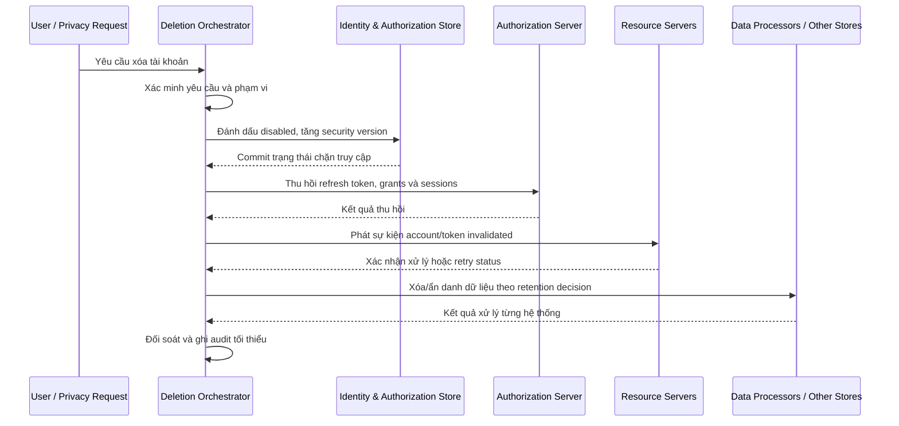

# Xóa người dùng và thu hồi token

## 1. Vì sao xóa user phải đi cùng xử lý token?

Khi một người dùng yêu cầu xóa tài khoản hoặc tổ chức quyết định chấm dứt tài khoản, việc xóa bản ghi user khỏi cơ sở dữ liệu chưa đủ để kết thúc quyền truy cập. Người dùng có thể vẫn giữ access token, refresh token, cookie phiên hoặc token đã được cấp cho một ứng dụng khác. Một số Resource Server có thể tiếp tục chấp nhận JWT cũ vì chữ ký vẫn hợp lệ và `exp` chưa tới.

Quy trình **Delete user và token** phải xử lý đồng thời hai mục tiêu: chấm dứt khả năng xác thực/ủy quyền trong phạm vi cần xóa và xử lý dữ liệu cá nhân theo chính sách lưu giữ hợp lệ. Cần nhận diện mọi credential và phiên liên quan đến user, thu hồi hoặc vô hiệu hóa chúng, lan truyền trạng thái tới các dịch vụ, rồi mới xóa hoặc ẩn danh dữ liệu theo quy định.

Trong hệ thống OAuth 2.0/OIDC, các loại dữ liệu có vòng đời khác nhau:

| Thành phần | Vai trò | Cách xử lý khi xóa user |
| --- | --- | --- |
| User identity/account | Danh tính và trạng thái tài khoản | Khóa đăng nhập ngay, sau đó xóa hoặc ẩn danh theo chính sách và nghĩa vụ lưu giữ. |
| Access token | Credential truy cập API | Thu hồi hoặc làm cho Resource Server từ chối; xử lý khác nhau tùy JWT hay opaque. |
| Refresh token | Credential xin access token mới | Thu hồi token và token family liên quan; ngăn refresh sau thời điểm xóa. |
| Authorization grant/consent | Quyền user đã cấp cho client | Thu hồi grant/consent theo phạm vi tài khoản hoặc client liên quan. |
| Login session/cookie | Duy trì phiên đăng nhập | Hủy session server-side và cookie/session handle nếu hệ thống quản lý. |
| ID token | Mang thông tin xác thực cho OIDC client | Không dùng làm access token; chấm dứt phiên và xử lý dữ liệu/claim theo hợp đồng OIDC và client. |
| Membership/role | Quan hệ user với tenant và quyền | Xóa hoặc vô hiệu hóa membership trong đúng phạm vi; không làm mất quyền ở tenant khác nếu yêu cầu chỉ giới hạn một tenant. |

Bài này tập trung vào mô hình tin cậy và vòng đời token bảo mật: phát hành, lưu trữ, thu hồi, xác minh trạng thái, refresh, logout và chống tái sử dụng token sau khi tài khoản bị xóa.

## 2. Phân biệt xóa tài khoản, vô hiệu hóa và ẩn danh

Ba hành động thường bị gộp nhầm nhưng có mục đích khác nhau:

- **Vô hiệu hóa (disable/deactivate):** ngăn user đăng nhập hoặc thực hiện hành động mới. Dữ liệu tài khoản có thể vẫn được lưu để xử lý yêu cầu, điều tra hoặc khôi phục theo chính sách.
- **Xóa (delete/erase):** loại bỏ dữ liệu cá nhân thuộc phạm vi yêu cầu khi không còn căn cứ hợp lệ để lưu giữ. Xóa có thể diễn ra theo nhiều giai đoạn và qua nhiều hệ thống.
- **Ẩn danh hoặc giả danh (anonymize/pseudonymize):** ẩn danh phải làm dữ liệu không còn nhận diện được cá nhân bằng phương tiện hợp lý; giả danh chỉ thay định danh trực tiếp và vẫn có thể khôi phục danh tính bằng thông tin bổ sung, nên dữ liệu vẫn có thể là dữ liệu cá nhân.

Trong thực tế, bước đầu tiên thường là **khóa tài khoản và thu hồi credential ngay**, sau đó xử lý dữ liệu theo quy trình deletion. Không nên chờ batch xóa dữ liệu hoàn tất mới chặn đăng nhập. Ngược lại, không nên tuyên bố đã xóa hoàn toàn chỉ vì account đã bị đánh dấu `DELETED` trong một bảng.

Yêu cầu xóa có thể chịu ngoại lệ theo luật áp dụng, ví dụ nghĩa vụ lưu trữ, yêu cầu pháp lý, bảo vệ quyền lợi hoặc xử lý tranh chấp. Vì vậy, đội kỹ thuật cần nhận quyết định về phạm vi dữ liệu được xóa, dữ liệu phải giữ lại, căn cứ lưu giữ và thời hạn từ bộ phận có thẩm quyền. Không tự diễn giải rằng mọi dữ liệu đều phải xóa ngay hoặc mọi audit record đều được giữ vô thời hạn.

## 3. Xác định đúng phạm vi user cần xóa

Một người có thể sở hữu nhiều định danh hoặc tham gia nhiều tenant. Trước khi thực hiện, phải xác định yêu cầu là:

1. Xóa toàn bộ tài khoản toàn cục và mọi quan hệ/phiên liên quan.
2. Xóa membership trong một tenant nhưng giữ danh tính và quyền ở tenant khác.
3. Xóa một liên kết đăng nhập hoặc một client grant cụ thể.
4. Chỉ đăng xuất hoặc thu hồi một session/device.

Không được dùng `sub` đơn lẻ để xóa nhầm dữ liệu ở mọi tenant nếu yêu cầu chỉ nhắm một membership. Ngược lại, nếu yêu cầu xóa toàn cục, chỉ xóa một membership không đủ để chấm dứt quyền truy cập qua tenant khác.

Một deletion scope nên ghi rõ:

| Thuộc tính | Ví dụ | Mục đích |
| --- | --- | --- |
| Subject reference | `user-42` | Định danh user nội bộ đã được xác minh. |
| Scope | `global` hoặc `tenant-A` | Xác định phạm vi xóa. |
| Request reference | `deletion-2026-0184` | Theo dõi workflow mà không đưa PII vào metric. |
| Effective time | Thời điểm khóa quyền | Xác định từ lúc nào token/session phải bị từ chối. |
| Legal hold/retention decision | `retain-minimal-audit-until-date` | Chỉ rõ dữ liệu nào được giữ lại và vì sao. |
| Completion criteria | Credential revoked, data stores processed, processors notified | Định nghĩa điều kiện được phép báo hoàn tất. |

Yêu cầu cần được xác minh theo quy trình phù hợp để tránh kẻ tấn công giả danh chủ tài khoản yêu cầu xóa tài khoản của người khác. Tuy nhiên, quá trình xác minh không nên yêu cầu user gửi password, access token hoặc refresh token qua email/chat.

## 4. Thu hồi credential trước khi xóa dữ liệu

Quy trình nên có một bước chặn quyền truy cập đồng bộ hoặc có hiệu lực ngay tại điểm kiểm soát trung tâm. Có thể dùng trạng thái `DELETION_PENDING`/`DISABLED` và một security version tăng lên để mọi lần xác thực tiếp theo nhận biết tài khoản đã bị khóa.

Luồng khái quát:



Các bước có thể chạy bất đồng bộ sau khi đã khóa tài khoản. Dùng transactional outbox hoặc cơ chế tương đương để tránh trường hợp trạng thái user đã commit nhưng sự kiện thu hồi bị mất. Consumer phải idempotent để xử lý được event trùng lặp và có retry/dead-letter cho lỗi tạm thời.

Điểm chốt là thời điểm **access bị chặn** phải được định nghĩa rõ. Không để hệ thống báo user đã bị xóa trong khi refresh endpoint hoặc Resource Server vẫn cấp/nhận token cũ.

## 5. Xử lý access token JWT và opaque token

### 5.1. JWT access token

JWT thường được Resource Server xác minh cục bộ bằng public key. Nếu không có kiểm tra trạng thái bổ sung, JWT đã phát hành có thể tiếp tục được chấp nhận tới `exp`, kể cả khi user đã bị xóa. Chữ ký hợp lệ chỉ chứng minh token do issuer ký và nội dung không bị sửa đổi; nó không tự chứng minh user vẫn active.

Các chiến lược thu hồi thường dùng:

- **Short-lived access token:** đặt TTL ngắn để giới hạn cửa sổ sử dụng token cũ. Đây là giới hạn thời gian, không phải thu hồi tức thời.
- **Denylist theo `jti`:** Resource Server tra trạng thái token cụ thể. Cần lưu tới khi token hết hạn và phân phối trạng thái đủ nhanh.
- **Subject/account version:** token mang security version tại thời điểm cấp; verifier so sánh với version hiện tại hoặc nhận cache invalidation khi account bị xóa.
- **Introspection hoặc authorization state lookup:** kiểm tra trạng thái online cho endpoint nhạy cảm hoặc khi yêu cầu thu hồi nhanh.
- **Event-driven invalidation:** phát sự kiện account disabled/token revoked tới gateway và Resource Server; cần retry, ordering và xác nhận consumer.

Không cần xoay signing key toàn hệ thống chỉ để xóa một user. Việc đổi khóa ký có thể ảnh hưởng tất cả token được ký bằng khóa cũ và thường không phải cơ chế thu hồi theo từng user.

### 5.2. Opaque access token

Opaque token thường được Resource Server kiểm tra bằng introspection hoặc một kho trạng thái đáng tin cậy. Khi user bị xóa, Authorization Server có thể đánh dấu token inactive; Resource Server sẽ từ chối khi introspection tiếp theo trả `active=false`.

Nếu kết quả introspection được cache, TTL cache tạo ra cửa sổ trễ. Ví dụ cache `active=true` trong 2 phút có thể khiến token bị thu hồi vẫn được chấp nhận gần 2 phút nếu không có invalidation. Với thao tác nhạy cảm, dùng TTL ngắn hơn hoặc cơ chế chủ động xóa cache theo event.

### 5.3. So sánh lựa chọn

| Cơ chế | Ưu điểm | Giới hạn cần biết |
| --- | --- | --- |
| JWT ngắn hạn | Ít phụ thuộc truy vấn trạng thái trực tuyến | Token cũ còn dùng được tới `exp`. |
| JWT + denylist `jti` | Thu hồi token cụ thể | Cần lookup/cache phân phối và lưu denylist đúng thời hạn. |
| JWT + account version | Có thể chặn mọi token của account theo phạm vi | Verifier cần trạng thái hiện tại hoặc invalidation đáng tin cậy. |
| Opaque + introspection | Issuer có thể trả active/inactive tập trung | Phụ thuộc mạng, availability và cache policy của introspection. |
| Event invalidation | Giảm lookup trên từng request | Có cửa sổ trễ khi event chưa tới consumer; cần đo propagation. |

Có thể kết hợp access token ngắn hạn, refresh token revocation, account version và event invalidation. Lựa chọn phải dựa trên SLA thu hồi và mức độ nhạy cảm của API.

## 6. Thu hồi refresh token, token family và grant

Refresh token có thể tạo access token mới, nên đây là credential cần xử lý ưu tiên khi user bị xóa. Chỉ chặn access token hiện tại mà để refresh token còn hoạt động sẽ cho phép client xin token mới.

Quy trình cần:

1. Từ chối mọi refresh request thuộc user hoặc deletion scope đã bị khóa.
2. Thu hồi refresh token đang active và toàn bộ token family liên quan theo mô hình rotation.
3. Thu hồi authorization grant/consent hoặc liên kết client-user theo chính sách.
4. Xử lý refresh token reuse detection nếu token đã bị rotate và một token cũ xuất hiện lại.
5. Ghi nhận kết quả thu hồi bằng định danh nội bộ; không log token thô.

RFC 7009 định nghĩa OAuth 2.0 Token Revocation Endpoint. Khi client gửi token để thu hồi, Authorization Server xử lý token và trả response theo chuẩn; client không nên dựa vào response để suy luận token ban đầu có tồn tại hay không. Sau khi thu hồi refresh token, cần xử lý access token đã phát hành theo chính sách của issuer và Resource Server; không giả định refresh token revocation tự động làm mọi JWT access token lập tức mất hiệu lực.

Nếu hệ thống dùng refresh token rotation, lưu quan hệ token family để có thể vô hiệu hóa toàn bộ chuỗi. Khi phát hiện reuse, thu hồi family và đánh giá session/account liên quan. Khi xóa user, phạm vi thu hồi thường rộng hơn một lần rotation: mọi family, client grant và session thuộc deletion scope phải được xử lý.

## 7. Logout, session và OIDC

Xóa user cũng cần chấm dứt các phiên đăng nhập đang tồn tại. Việc xóa cookie ở một browser không chấm dứt các session khác hoặc token đã được cấp cho mobile app, service hay thiết bị khác.

Hãy kiểm tra:

- Server-side session và session handle đã bị vô hiệu hóa.
- Cookie đăng nhập hoặc session cookie được expire theo domain/path phù hợp nếu hệ thống còn quản lý.
- Refresh token family và grant liên quan đã bị thu hồi.
- OIDC RP/client nhận tín hiệu logout nếu hệ thống triển khai RP-Initiated Logout, Front-Channel Logout hoặc Back-Channel Logout.
- Các Resource Server đã nhận invalidation hoặc kiểm tra account status trước khi cho phép request nhạy cảm.

ID token là token mang thông tin xác thực cho OIDC client; nó không phải access token để gọi Resource Server. Tuy vậy, claims trong ID token có thể chứa dữ liệu cá nhân và được client lưu giữ theo hợp đồng. Quy trình deletion cần xác định nghĩa vụ xử lý dữ liệu tại client/Relying Party và bên xử lý liên quan, không chỉ thu hồi access token tại API.

## 8. Xóa dữ liệu theo hệ thống và retention policy

Sau khi chặn truy cập và khởi chạy thu hồi token, orchestrator cần lập danh sách data store và processor có dữ liệu thuộc phạm vi user:

| Nhóm dữ liệu | Hành động thường cần xem xét |
| --- | --- |
| Identity/profile database | Xóa PII hoặc thay bằng định danh không thể liên kết lại nếu được phép. |
| Membership/role/tenant mapping | Xóa membership trong scope; giữ quan hệ khác nếu yêu cầu không phải xóa toàn cục. |
| Session/refresh token store | Xóa hoặc đánh dấu revoked; lưu trạng thái tối thiểu để ngăn tái sử dụng trong thời gian cần thiết. |
| Consent/authorization grant | Thu hồi hoặc xóa theo policy và yêu cầu pháp lý. |
| Application database | Xóa, ẩn danh hoặc giữ dữ liệu giao dịch theo căn cứ lưu giữ. |
| Search index/cache | Xóa document/cache hoặc đánh dấu invalid; xác minh propagation. |
| Analytics/data warehouse | Xóa hoặc ẩn danh theo khả năng truy vết và retention schedule. |
| Logs/security audit | Giảm thiểu dữ liệu cá nhân; giữ phần tối thiểu khi có căn cứ hợp lệ và thời hạn rõ ràng. |
| Backup/archive | Áp dụng lịch hết hạn, crypto-erasure hoặc quy trình restore có reapply deletion tombstone. |
| Third-party processor | Gửi yêu cầu xóa/ẩn danh theo hợp đồng và theo dõi xác nhận. |

### Audit record tối thiểu

Có thể cần lưu bằng chứng rằng yêu cầu đã được xử lý, nhưng không nên giữ lại toàn bộ hồ sơ user để chứng minh việc xóa. Audit record nên giới hạn ở các trường cần thiết như request reference, phạm vi xử lý, timestamp, trạng thái từng hệ thống, policy/retention decision và actor/service thực hiện.

Nếu cần liên kết audit với một user, cân nhắc pseudonymous reference được bảo vệ, quyền truy cập hạn chế và thời hạn lưu cụ thể. Pseudonymization không đồng nghĩa với anonymization. Không lưu access token, refresh token, authorization code, password hoặc private key trong audit.

### Backup và dữ liệu khôi phục

Xóa một record khỏi database chính chưa chắc xóa record trong backup. Backup thường được giữ theo retention schedule và có thể không hỗ trợ sửa từng bản ghi. Một cách kiểm soát là lưu deletion tombstone tối thiểu, sau đó khi restore backup phải áp dụng lại các yêu cầu xóa còn hiệu lực trước khi mở hệ thống cho traffic. Tombstone cũng phải có thời hạn và căn cứ lưu giữ, không trở thành kho PII thứ hai.

## 9. Phân biệt xóa toàn cục và xóa membership tenant

Trong hệ thống multi-tenant, một user có thể là thành viên tenant A và B. Nếu yêu cầu chỉ xóa khỏi tenant A, cần thu hồi token/context của A và xóa membership A; token của B chỉ bị ảnh hưởng nếu policy toàn cục yêu cầu. Nếu yêu cầu xóa toàn bộ user, cần xử lý tất cả tenant membership, session và grant.

Ví dụ token gắn tenant:

```json
{
  "iss": "https://auth.example.test",
  "sub": "user-42",
  "aud": "https://orders.api.example.test",
  "tenant_id": "tenant-A",
  "membership_version": 18,
  "scope": "orders.read",
  "exp": 1900000300
}
```

`tenant_id` và `membership_version` trong ví dụ là claim theo quy ước ứng dụng. Khi membership A bị xóa, tăng version hoặc đánh dấu inactive cho quan hệ `(user-42, tenant-A)` để token cũ không còn được chấp nhận theo cơ chế verifier. Không lấy `tenant_id` từ request body làm căn cứ xác định deletion scope.

## 10. Kiểm thử sau khi xóa user

Kiểm thử phải chứng minh credential cũ không thể tiếp tục tạo phiên hoặc gọi API ngoài SLA thu hồi. Cần chạy trên toàn bộ loại token và client quan trọng.

| Kịch bản | Kết quả mong đợi |
| --- | --- |
| User bị khóa ngay khi deletion bắt đầu | Đăng nhập mới bị từ chối. |
| Refresh token cũ được gửi sau khi user bị khóa | Refresh endpoint từ chối và không phát hành token mới. |
| Refresh token family bị thu hồi | Mọi token thuộc family bị từ chối theo policy. |
| Opaque access token bị thu hồi | Introspection trả inactive; Resource Server từ chối. |
| JWT access token còn hạn nhưng account version đã đổi | Verifier từ chối theo version/denylist/event state hoặc token hết hạn trong giới hạn đã cam kết. |
| JWT access token dùng verifier chỉ kiểm tra chữ ký cục bộ | Test xác nhận giới hạn revocation latency; không tuyên bố thu hồi tức thời nếu chưa có status check. |
| Session cookie cũ được dùng lại | Session server-side không còn hợp lệ. |
| User bị xóa toàn cục nhưng còn membership ở tenant khác | Không thể truy cập tenant khác sau khi deletion scope toàn cục được thực thi. |
| User chỉ bị xóa khỏi tenant A | Token/membership A bị từ chối; tenant B hoạt động theo policy còn hiệu lực. |
| Event invalidation bị lặp hoặc đến sai thứ tự | Consumer idempotent, version không bị lùi. |
| Một data processor timeout | Workflow giữ trạng thái pending, retry và không báo complete sớm. |
| Backup được restore | Deletion tombstone/policy được áp dụng lại trước khi hệ thống phục vụ traffic. |
| Audit log được kiểm tra | Không có token/secret/PII ngoài phạm vi retention đã phê duyệt. |

### Ví dụ integration test dạng mã giả

```java
@Test
void deletedUserCannotRefreshOrAccessProtectedApi() {
    TestUser user = fixtures.createUserWithTenant("tenant-A");
    TokenPair tokens = oauthClient.obtainTokens(user);

    deletionService.requestGlobalDeletion(user.id());
    deletionService.awaitAccessBlock(user.id());

    OAuthError refreshError = oauthClient.refreshAndCaptureError(
        tokens.refreshToken());
    assertEquals("invalid_grant", refreshError.code());

    ApiResponse response = resourceApi.getWithBearer(tokens.accessToken());
    assertTrue(response.isUnauthorizedOrForbidden());
}
```

Đây là mã giả, các helper phụ thuộc test harness. Test cần xác nhận `awaitAccessBlock` dựa trên trạng thái hệ thống thực tế và SLA đã định nghĩa, không chỉ chờ một khoảng thời gian tùy ý. Nếu kiến trúc JWT chỉ có TTL ngắn mà không có revocation lookup, assertion phải phản ánh đúng cửa sổ chấp nhận token cũ đã được phê duyệt.

## 11. Theo dõi workflow deletion và cảnh báo

Workflow xóa user có thể chạy qua nhiều dịch vụ và kéo dài hơn thao tác khóa account. Cần theo dõi trạng thái tổng thể mà không đưa định danh user hoặc token vào metric label.

Metric minh họa:

| Metric | Ý nghĩa |
| --- | --- |
| `account_deletion_requests_total` | Số yêu cầu xóa theo outcome và request class. |
| `account_deletion_duration_seconds` | Thời gian từ chấp nhận yêu cầu tới hoàn tất theo định nghĩa workflow. |
| `account_access_block_latency_seconds` | Thời gian từ yêu cầu được xác minh tới khi account bị chặn ở các điểm truy cập. |
| `token_revocation_operations_total` | Số thao tác thu hồi theo token kind và outcome. |
| `token_revocation_propagation_seconds` | Thời gian từ commit revoke tới khi consumer xác nhận invalidation. |
| `deletion_processor_failures_total` | Số lỗi xử lý tại data store/processor theo nhóm dịch vụ. |
| `deletion_pending_items` | Số mục xử lý còn pending hoặc retry. |

Label nên là enum hữu hạn như `token_kind`, `outcome`, `processor_class`, `scope_class`. Không dùng email, username, subject, tenant ID, deletion request ID hoặc raw `jti` làm label. Nếu cần điều tra một request cụ thể, dùng log có kiểm soát truy cập với request reference đã bảo vệ.

Cảnh báo khi access block latency vượt SLA, refresh token vẫn được chấp nhận sau khi user bị khóa, revocation event bị kẹt, processor retry vượt giới hạn hoặc workflow bị pending quá thời hạn. Báo cáo hoàn tất phải dựa trên checklist và xác nhận từng hệ thống, không chỉ dựa vào việc orchestrator đã gửi event.

## 12. Các lỗi triển khai thường gặp

1. **Xóa user row trước khi khóa phiên:** dữ liệu liên kết bị mất khiến hệ thống không còn tìm được token/session cần thu hồi.
2. **Chỉ revoke refresh token:** access token đã phát hành vẫn có thể được dùng đến `exp` nếu Resource Server không kiểm tra trạng thái.
3. **Giả định JWT tự hết hiệu lực khi xóa user:** JWT không tự biết account đã bị xóa.
4. **Chỉ xóa cookie ở một thiết bị:** các session, mobile token hoặc refresh token khác vẫn hoạt động.
5. **Không thu hồi grant/consent:** client vẫn có thể có quyền lấy token theo một authorization grant còn hiệu lực.
6. **Xóa toàn cục khi chỉ có yêu cầu tenant-scoped:** làm mất quyền hoặc dữ liệu ở tenant không thuộc phạm vi yêu cầu.
7. **Giữ PII vô thời hạn trong audit:** tạo thêm rủi ro và có thể xung đột với retention policy.
8. **Xóa log/backup không có kế hoạch:** làm mất bằng chứng cần thiết hoặc khôi phục dữ liệu đã xóa sau restore.
9. **Không xử lý event failure:** một số Resource Server không nhận invalidation nhưng workflow vẫn báo hoàn tất.
10. **Ghi token vào log để debug:** biến log, trace hoặc ticket thành nơi lưu credential có thể tái sử dụng.

## 13. Checklist triển khai

- [ ] Xác minh yêu cầu và xác định rõ global deletion, tenant membership deletion hay session revocation.
- [ ] Khóa đăng nhập và chặn phát hành token mới trước khi xóa dữ liệu.
- [ ] Thu hồi refresh token family, grant/consent và session liên quan.
- [ ] Có chiến lược access token revocation cho JWT và opaque token, cùng SLA propagation rõ ràng.
- [ ] Resource Server không chấp nhận token cũ sau thời hạn thu hồi đã cam kết.
- [ ] Event/outbox, retry, idempotency và đối soát bảo đảm mọi consumer nhận được thay đổi.
- [ ] Xóa/ẩn danh dữ liệu theo từng store và processor, có retention/legal-hold decision.
- [ ] Backup restore áp dụng lại deletion tombstone còn hiệu lực.
- [ ] Audit lưu tối thiểu, không chứa token/secret và có thời hạn hợp lệ.
- [ ] Test toàn bộ session, refresh, JWT, opaque, multi-tenant và data processor failure.
- [ ] Chỉ báo hoàn tất khi các điều kiện completion đã được xác minh.

**Điểm cốt lõi:** Xóa người dùng phải bắt đầu bằng việc chặn quyền truy cập và xử lý mọi credential có thể tạo hoặc duy trì phiên. Refresh token, access token, session và grant cần được thu hồi theo cơ chế tương ứng; JWT còn hạn không tự mất hiệu lực chỉ vì user record bị xóa. Sau đó dữ liệu được xóa hoặc ẩn danh theo phạm vi, retention và nghĩa vụ pháp lý đã xác định, với bằng chứng hoàn tất tối thiểu và an toàn.

## Tài liệu tham khảo

- IETF, **RFC 7009 — OAuth 2.0 Token Revocation**: thu hồi access token và refresh token. <https://www.rfc-editor.org/rfc/rfc7009>
- IETF, **RFC 6749 — The OAuth 2.0 Authorization Framework**: access token, refresh token, authorization grant và token endpoint. <https://www.rfc-editor.org/rfc/rfc6749>
- IETF, **RFC 7662 — OAuth 2.0 Token Introspection**: kiểm tra trạng thái token tại Resource Server. <https://www.rfc-editor.org/rfc/rfc7662>
- IETF, **RFC 7519 — JSON Web Token (JWT)**: cấu trúc JWT và registered claims. <https://www.rfc-editor.org/rfc/rfc7519>
- IETF, **RFC 9700 — Best Current Practice for OAuth 2.0 Security**: thực hành bảo mật OAuth 2.0 hiện hành. <https://www.rfc-editor.org/rfc/rfc9700>
- European Union, **Regulation (EU) 2016/679 (General Data Protection Regulation), Article 17**: quyền yêu cầu xóa dữ liệu và các trường hợp ngoại lệ. <https://eur-lex.europa.eu/eli/reg/2016/679/oj>
