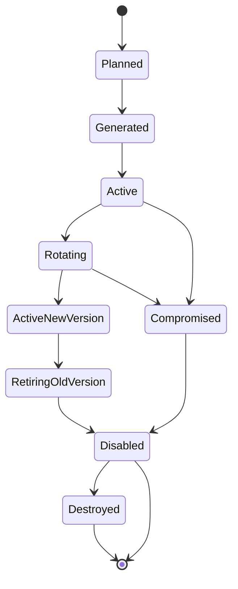

# Key access audit

## 1. Key access audit là gì?

**Key access audit** là hoạt động ghi nhận, giám sát và rà soát việc ai hoặc workload nào đã truy cập, sử dụng hay thay đổi khóa mật mã. Trong hệ thống OAuth 2.0/OIDC, khóa có thể được dùng để ký JWT access token, xác minh chữ ký, mã hóa dữ liệu, bảo vệ kết nối mTLS hoặc chứng minh quyền sở hữu khóa bằng DPoP. Nếu không kiểm soát quyền truy cập và hoạt động với khóa, kẻ tấn công có thể phát hành token giả, giải mã dữ liệu hoặc giả mạo workload.

Một audit trail hữu ích phải trả lời:

- **Ai** yêu cầu thao tác: user, service principal, workload identity hay quản trị viên?
- **Khóa nào** được sử dụng: key ID, version, alias, purpose và môi trường?
- **Thao tác gì** đã diễn ra: ký, giải mã, lấy public key, xoay vòng, thay policy, disable hay lên lịch xóa?
- **Khi nào và từ đâu**: timestamp, workload, nguồn mạng và request/correlation ID?
- **Kết quả nào**: thành công, bị từ chối, lỗi policy hay lỗi dịch vụ?
- **Vì sao**: request thuộc luồng nghiệp vụ nào và policy nào đã cho phép?

Key access audit là một phần của quản trị khóa và giám sát bảo mật. Nó giúp phát hiện sử dụng khóa bất thường, chứng minh việc thực thi chính sách, điều tra sự cố và cung cấp bằng chứng cho kiểm toán.

### Phân biệt key audit với token audit

| Loại audit | Đối tượng quan sát | Ví dụ |
|---|---|---|
| Key access audit | Khóa mật mã và thao tác trên khóa | Workload gọi KMS để ký JWT bằng key version **signing-2026-03** |
| Token issuance audit | Việc phát hành token | AS cấp access token cho client **order-worker** với audience Payment API |
| Token usage audit | Việc Resource Server chấp nhận/từ chối token | Request bị từ chối vì audience sai |
| Identity/admin audit | Thay đổi danh tính và quyền | Admin cấp quyền **kms.sign** cho workload mới |
| Data access audit | Truy cập dữ liệu được bảo vệ | Service giải mã bản ghi chứa thông tin thanh toán |

Các loại audit có thể liên kết với nhau qua timestamp, principal, key ID, token **kid**, request ID và correlation ID. **Không cần ghi raw token hoặc key material** để liên kết sự kiện; metadata đã chuẩn hóa thường đủ cho điều tra.

## 2. Những loại khóa cần được audit

Trong một hệ thống token security có nhiều loại khóa. Mỗi loại có mục đích và mức độ nhạy cảm khác nhau.

| Loại khóa | Mục đích | Sự kiện cần theo dõi |
|---|---|---|
| JWT signing private key | Ký JWT access token hoặc assertion | Sign operation, principal, key version, policy decision, volume |
| JWT verification public key | Xác minh chữ ký token | Public key retrieval, JWKS publication/change, key status |
| Encryption/decryption key | Mã hóa dữ liệu hoặc envelope encryption | Encrypt/decrypt, unwrap, generate data key, key version |
| mTLS private key/certificate | Xác thực workload và ràng buộc token với certificate | Key use, certificate issuance/rotation/revocation |
| DPoP private key | Ký proof cho từng HTTP request | Key creation/use, key binding và lifecycle theo client |
| Client authentication key | **private_key_jwt** hoặc ký client assertion | Assertion signing, client identity, key rotation |
| Backup/archive key | Bảo vệ bản sao lưu hoặc khóa lưu trữ | Restore, export/import nếu được phép, access approval |

Với asymmetric signing, private key phải được bảo vệ nghiêm ngặt; public key có thể được công bố qua JWKS để Resource Server xác minh. Việc tải public key từ JWKS thường không nhạy cảm như thao tác dùng private key để ký, nhưng **thay đổi nội dung JWKS, thay kid, thay nguồn phát hoặc xóa public key** có thể ảnh hưởng trực tiếp đến khả năng xác minh token và cần audit tính toàn vẹn.

Với symmetric key, cùng một bí mật có thể được dùng cho cả ký và xác minh hoặc mã hóa/giải mã tùy thuật toán. Quyền đọc/export key material có thể làm lộ khả năng tạo chữ ký hoặc giải mã. Ưu tiên KMS/HSM và cơ chế không cho ứng dụng lấy raw key nếu use case hỗ trợ.

## 3. Phân biệt metadata khóa và key material

Audit cần ghi đủ thông tin để nhận diện khóa nhưng tuyệt đối không ghi chính khóa hoặc dữ liệu bí mật.

| Dữ liệu | Có nên ghi audit? | Lý do |
|---|---|---|
| Key ID / key version | Có | Định danh khóa đã được sử dụng |
| Alias / purpose / environment | Có, theo policy | Giúp phân loại khóa |
| Algorithm / key type / key size | Có | Đánh giá cấu hình và tương thích |
| Principal / workload identity | Có | Xác định ai thực hiện |
| Operation / result / timestamp | Có | Tạo chuỗi sự kiện điều tra |
| Public key fingerprint/thumbprint | Có thể | Định danh public key mà không lưu private key |
| Raw private key / secret | **Không** | Làm lộ khả năng ký hoặc giải mã |
| Raw symmetric key | **Không** | Làm lộ bí mật mật mã |
| Full access token / refresh token | **Không** | Token có thể là credential dùng được |
| Plaintext sau giải mã | Không, trừ dữ liệu nghiệp vụ đã được phép audit riêng | Tránh rò dữ liệu nhạy cảm |
| Request payload đầy đủ | Chỉ khi có lý do và đã lọc | Có thể chứa PII, token hoặc bí mật |

Không đưa private key, password, API secret, raw token hoặc nội dung đã giải mã vào application log, exception, tracing span, message queue hay audit event. Nếu cần liên kết sự kiện, dùng key ID, token kid, jti, fingerprint hoặc request ID theo chính sách dữ liệu.

## 4. Các thao tác khóa cần ghi nhận

Nên phân loại thao tác theo vòng đời khóa, không chỉ ghi sự kiện ký/giải mã.

### Tạo và cấu hình

- Tạo key hoặc key version mới.
- Import key, nếu quy trình cho phép.
- Tạo alias và ánh xạ alias sang key version.
- Thay đổi purpose, algorithm, key policy, IAM permission hoặc HSM partition.
- Cấp quyền cho principal mới hoặc thu hồi quyền của principal cũ.
- Thay đổi cấu hình rotation, exportability, backup hoặc replication.

### Sử dụng

- Sign JWT, client assertion hoặc DPoP proof.
- Verify signature nếu thao tác diễn ra trong KMS/HSM.
- Encrypt/decrypt, wrap/unwrap key hoặc generate data key.
- Lấy public key hoặc tải JWKS.
- Thực hiện thao tác bằng key version cũ trong thời gian overlap sau rotation.

### Thay đổi và kết thúc

- Rotate key hoặc promote key version mới.
- Disable/enable key.
- Revoke certificate hoặc thu hồi key binding.
- Schedule/cancel deletion và xóa key.
- Restore/import key backup.
- Thay đổi trạng thái key do incident hoặc policy violation.

Các event thất bại cũng cần được ghi nhận. Ví dụ **AccessDenied**, **InvalidKeyState**, **SignatureFailure** hoặc yêu cầu ký từ principal không nằm trong allowlist có thể là dấu hiệu cấu hình sai hoặc hành vi dò quyền. Cần phân biệt lỗi vận hành lặp lại với hành vi bất thường có chủ đích.

## 5. Ai được phép dùng khóa nào?

Key access audit chỉ có ý nghĩa khi policy xác định rõ principal nào được phép thực hiện thao tác nào trên key nào.

| Principal | Key | Quyền được phép | Quyền không nên có |
|---|---|---|---|
| **authorization-server** | JWT signing key | Sign bằng key version active | Export private key, schedule deletion |
| **payment-api** | JWT verification public key | Read public key/JWKS | Sign hoặc decrypt bằng signing key |
| **billing-worker** | Billing data encryption key | Encrypt/decrypt dữ liệu trong phạm vi workload | Sign JWT hoặc quản trị key policy |
| **key-rotation-operator** | Signing key | Promote version, initiate rotation theo approval | Đọc raw private key |
| **security-auditor** | Audit log/key metadata | Read audit evidence | Sign, decrypt hoặc sửa log |
| **break-glass-admin** | Key administration | Quyền khẩn cấp có thời hạn và approval | Quyền thường trực không giám sát |

Áp dụng các nguyên tắc:

1. **Least privilege:** chỉ cấp thao tác cần thiết; quyền sign không đồng nghĩa quyền admin hoặc export.
2. **Separation of duties:** người phê duyệt thay đổi key policy nên độc lập với người thực hiện khi mức rủi ro yêu cầu.
3. **Environment isolation:** khóa production, staging và development phải tách biệt.
4. **Purpose separation:** không dùng một khóa cho nhiều mục đích không liên quan nếu có thể tách.
5. **Workload identity:** gắn quyền với danh tính workload đã xác thực thay vì credential dùng chung.
6. **Time-bound access:** quyền hỗ trợ/khẩn cấp cần thời hạn, lý do và audit.
7. **Deny by default:** principal không được khai báo trong policy không thể sử dụng khóa.

Không cấp quyền đọc private key cho mọi service chỉ vì service đó cần xác minh JWT. Với asymmetric signing, Resource Server chỉ cần public key từ JWKS hoặc nguồn tin cậy tương đương.

## 6. Audit luồng ký JWT và xác minh bằng JWKS

Giả sử Authorization Server ký JWT access token bằng private key trong KMS/HSM. JWT header có thể chứa **kid** để Resource Server tìm public key tương ứng:

```json
{
  "alg": "RS256",
  "typ": "at+jwt",
  "kid": "as-signing-2026-03"
}
```

**kid** là định danh key trong hợp đồng phát hành/xác minh. Nó không phải secret. Resource Server lấy public key từ JWKS đã cấu hình tin cậy rồi xác minh chữ ký và các claims như **iss**, **aud**, **exp**, **scope**.

### Sự kiện cần liên kết

1. AS yêu cầu KMS/HSM ký JWT.
2. KMS/HSM ghi nhận principal, key ID/version, operation và kết quả.
3. AS ghi token issuance event với **client_id**, **jti** hoặc token identifier phù hợp, **kid**, audience, scope và correlation ID.
4. AS phát token cho client.
5. Resource Server ghi kết quả xác minh và quyết định authorization, không ghi raw token.
6. Khi key rotate, audit liên kết key version cũ/mới và thời điểm chuyển đổi.

Ví dụ một audit event ký JWT:

```json
{
  "event_id": "evt-key-501",
  "timestamp": "2026-11-23T10:45:12Z",
  "actor": {
    "type": "workload",
    "id": "authorization-server-prod"
  },
  "key": {
    "key_id": "as-signing-key",
    "version": "v7",
    "kid": "as-signing-2026-03",
    "purpose": "jwt-access-token-signing",
    "algorithm": "RS256"
  },
  "operation": "SIGN",
  "resource": "oauth-access-token",
  "result": "SUCCESS",
  "correlation_id": "corr-82f1",
  "policy_id": "jwt-signing-prod-v4"
}
```

Payload chỉ minh họa metadata; không chứa JWT, private key hoặc claims đầy đủ. Có thể bổ sung **jti** đã chuẩn hóa nếu cần liên kết với token issuance log, nhưng phải đánh giá khả năng liên kết sự kiện với một user hoặc giao dịch.

### Phân biệt sign operation và token issuance

Một lần ký có thể phục vụ token, client assertion hoặc loại message khác. Vì vậy, không suy ra mọi sự kiện **SIGN** là phát hành access token. AS nên có issuance event riêng và liên kết qua correlation ID, key ID và token identifier an toàn. Ngược lại, issuance event mà không có signing operation tương ứng (khi kiến trúc yêu cầu KMS signing) có thể chỉ ra logging gap hoặc đường ký khác cần điều tra.

## 7. Audit truy cập khóa trong KMS/HSM

KMS/HSM thường là nơi thực thi key operation và áp policy. Audit cần kết hợp hai nguồn:

- **Control-plane events:** tạo key, thay policy, đổi alias, rotate, disable, schedule deletion, thay cấu hình replication hoặc quyền truy cập.
- **Data-plane events:** sign, decrypt, encrypt, unwrap, generate data key, verify hoặc export nếu dịch vụ hỗ trợ.

Không phải nhà cung cấp nào cũng ghi mọi thao tác giống nhau. Cần xác nhận event catalog, trường dữ liệu, giới hạn retention và semantics của dịch vụ đang dùng. Nếu KMS chỉ ghi một số thao tác vào audit stream, ứng dụng có thể cần bổ sung application audit để tạo ngữ cảnh nghiệp vụ.

### Câu hỏi khi cấu hình KMS/HSM audit

- Audit đã bật ở tất cả account/project/subscription và region cần thiết chưa?
- Có ghi cả thao tác thành công và thất bại không?
- Principal được ghi là workload identity thực hay chỉ là role trung gian?
- Key ID và key version có đủ để phân biệt các lần rotate không?
- Thay đổi key policy, grant, alias và deletion schedule có được ghi không?
- Audit log có được gửi ra một security account/project độc lập không?
- Principal vận hành KMS có thể sửa hoặc xóa chính audit log không?
- Có cảnh báo khi log pipeline ngừng gửi hoặc bị trễ không?
- Có đối chiếu được KMS event với token issuance, application request và deployment không?

Nếu hệ thống dùng HSM tự quản, cần audit cả đăng nhập quản trị, thay đổi partition/role, backup/restore, firmware/configuration change và thao tác key ceremony theo policy. Log thiết bị phải được đồng bộ thời gian và chuyển đến nơi lưu trữ có kiểm soát.

## 8. Vòng đời khóa và audit evidence

Mỗi key cần có inventory và trạng thái vòng đời rõ ràng:



Tên trạng thái và transitions là mô hình tham khảo; triển khai thực tế cần theo chính sách KMS/HSM và loại khóa.

| Giai đoạn | Bằng chứng audit cần có |
|---|---|
| Plan/approval | Owner, purpose, environment, risk classification, approval |
| Generate/import | Principal, algorithm, key size, key ID/version, origin |
| Activate | Người/phê duyệt, thời điểm, policy và workload được cấp quyền |
| Use | Operation, principal, key version, result, request/correlation ID |
| Rotate | Version cũ/mới, thời điểm cutover, overlap window, người phê duyệt |
| Retire/disable | Lý do, tác động, consumer đã chuyển sang key mới |
| Revoke/compromise | Incident ID, containment, token/certificate liên quan |
| Destroy | Approval, thời điểm, kết quả và xác nhận không còn dependency |

Một inventory tốt cần ghi owner, purpose, algorithm, key size, creation date, activation date, cryptoperiod, rotation policy, environment, dependent services và trạng thái. Không đưa key material vào inventory.

### Rotation và khoảng overlap

Khi xoay JWT signing key:

1. Tạo key version mới trong KMS/HSM.
2. Publish public key mới lên JWKS với **kid** mới.
3. Đợi Resource Server có cơ hội tải và cache public key mới theo chính sách.
4. AS bắt đầu ký token mới bằng key version mới.
5. Giữ public key cũ đủ lâu để xác minh JWT còn hạn đã ký trước cutover.
6. Sau khi token cũ hết hạn và cache/JWKS propagation đã hoàn tất, retire key cũ theo policy.
7. Audit toàn bộ thời điểm, version, **kid**, approval và kết quả kiểm tra.

Không xóa public key cũ ngay khi AS bắt đầu ký bằng key mới; RS có thể vẫn cần xác minh token cũ. Ngược lại, giữ private key cũ có khả năng ký sau cutover quá lâu làm tăng bề mặt tấn công. Có thể disable thao tác ký trên version cũ trong khi vẫn duy trì public key để verify nếu KMS và kiến trúc cho phép.

## 9. Phát hiện truy cập khóa bất thường

Audit chỉ có giá trị vận hành khi có quy tắc phát hiện và người chịu trách nhiệm xử lý.

| Dấu hiệu | Rủi ro có thể có | Hành động kiểm tra |
|---|---|---|
| Principal lạ gọi **Sign** | Workload bị chiếm quyền hoặc policy quá rộng | Xác minh workload, deployment và key policy |
| Tăng đột biến số lần ký | Token issuance bất thường hoặc loop lỗi | Đối chiếu client, audience, scope và request rate |
| **Decrypt** hàng loạt ngoài giờ | Truy xuất dữ liệu trái phép | Kiểm tra principal, tenant, resource và incident |
| Nhiều lần **AccessDenied** trên một key | Dò quyền hoặc cấu hình sai | Xác minh nguồn request và policy change gần nhất |
| Truy cập key production từ workload staging | Ranh giới môi trường bị phá vỡ | Chặn principal, kiểm tra network/identity binding |
| Thay key policy rồi dùng key ngay | Privilege escalation | Đối chiếu approval, actor và change ticket |
| Schedule deletion hoặc disable key ngoài quy trình | Phá hoại hoặc gây outage | Kích hoạt cảnh báo ưu tiên cao và kiểm tra change |
| Public JWKS thay đổi bất thường | Key substitution hoặc cấu hình sai | Kiểm tra issuer, JWKS source, kid, thumbprint |
| Key cũ tiếp tục ký sau cutover | Rotation chưa hoàn tất hoặc có principal giữ quyền | Kiểm tra alias, version và signing policy |
| Audit log ngừng phát sinh | Pipeline lỗi hoặc bị can thiệp | Cảnh báo log silence, kiểm tra collector và nguồn |

Không dùng một ngưỡng cố định cho mọi hệ thống. Baseline cần xét loại workload, chu kỳ phát hành token, giờ vận hành, môi trường và lưu lượng. Cảnh báo nên phân biệt sự kiện high severity như policy change/deletion với biến động lưu lượng có thể do release hoặc batch job.

### Đối chiếu nhiều nguồn

Để điều tra một lần ký JWT đáng ngờ, đối chiếu:

- KMS/HSM audit: ai gọi **Sign**, key version nào và kết quả.
- Authorization Server audit: client nào yêu cầu token, audience/scope nào.
- Workload/deployment audit: service instance, image/version, deployment và identity.
- Resource Server audit: token **kid** nào được chấp nhận, request đến từ đâu.
- IAM/policy audit: ai vừa thay quyền trên key hoặc workload identity.

Nếu KMS ghi **Sign** thành công nhưng AS không có issuance event tương ứng, hãy kiểm tra khả năng ký assertion hoặc đường sử dụng khác. Nếu AS ghi issuance nhưng không có KMS event, xác minh AS có dùng local key, HSM khác hoặc logging pipeline có thiếu sự kiện.

## 10. Bảo vệ audit log và bằng chứng kiểm toán

Audit log là bằng chứng bảo mật; nếu principal có thể sửa/xóa log sau khi sử dụng key trái phép thì giá trị điều tra giảm mạnh.

Các kiểm soát nên có:

- Gửi log đến tài khoản/project/security workspace độc lập với workload sử dụng khóa.
- Quyền ghi và quyền đọc log tách biệt; workload không có quyền sửa/xóa audit evidence.
- Lưu trữ append-only hoặc immutable/WORM khi yêu cầu rủi ro và compliance cần.
- Bảo vệ integrity bằng signing, hash chaining hoặc cơ chế integrity validation của nền tảng nếu phù hợp.
- Đồng bộ thời gian giữa KMS/HSM, AS, RS và log collector.
- Giám sát log delivery, sequence gap, collector outage và retention expiry.
- Mã hóa log khi truyền và lưu; kiểm soát quyền truy cập vì metadata cũng có thể nhạy cảm.
- Đặt retention theo yêu cầu pháp lý, hợp đồng, chính sách nội bộ và khả năng điều tra.
- Ghi nhận truy cập vào chính audit log: ai tìm kiếm, export, thay retention hoặc thay policy.

Không phải mọi hệ thống cần tự xây hash chain; ưu tiên tính năng integrity/immutability được nền tảng hỗ trợ và kiểm tra độc lập. Nếu export evidence cho auditor, cần lưu thời gian truy xuất, phạm vi dữ liệu, người thực hiện và checksum của gói xuất.

## 11. Ví dụ truy vấn audit và điều tra

Một truy vấn giả định trên kho log có thể tìm thao tác ký từ principal không nằm trong allowlist:

```sql
SELECT
    timestamp,
    principal_id,
    key_id,
    key_version,
    operation,
    result,
    source_ip,
    correlation_id
FROM key_audit_events
WHERE operation = 'SIGN'
  AND environment = 'production'
  AND principal_id NOT IN (
      'authorization-server-prod',
      'token-exchange-service-prod'
  )
ORDER BY timestamp DESC;
```

Tên bảng và cột chỉ là ví dụ. Trong production, allowlist phải lấy từ policy/inventory được quản lý, không hard-code rời rạc trong nhiều truy vấn.

Một quy trình điều tra:

1. Xác định event ID, key ID/version, principal và timestamp.
2. Tra policy tại thời điểm event xảy ra, không chỉ policy hiện tại.
3. Đối chiếu deployment/workload identity và request/correlation ID.
4. Kiểm tra AS issuance event và Resource Server usage event liên quan.
5. Xác định token, dữ liệu hoặc service nào có thể bị ảnh hưởng mà không thu thập raw secret.
6. Nếu nghi private key bị lộ, hạn chế quyền ký, chuyển sang key version mới, cập nhật JWKS và thực hiện quy trình revoke/denylist/TTL phù hợp.
7. Lưu evidence, quyết định xử lý, người phê duyệt và kết quả khôi phục.

## 12. Ứng phó khi khóa bị truy cập trái phép

Khi phát hiện principal không được phép dùng key, cần xử lý theo mục đích của khóa và tác động thực tế.

### Signing key bị nghi lộ

- Chặn hoặc thu hồi quyền **Sign** của principal nghi vấn.
- Tạo key version mới trong KMS/HSM theo quy trình khẩn cấp.
- Chuyển AS sang ký bằng key mới và publish public key mới với **kid** mới.
- Đánh giá JWT/assertion đã được ký trong khoảng thời gian nghi compromise.
- Từ chối token đáng ngờ qua denylist, token status check, issuer/key policy hoặc TTL phù hợp.
- Cân nhắc loại bỏ public key cũ khỏi JWKS khi đã xác định cần chặn xác minh token cũ; đánh giá tác động tới token hợp lệ trước khi thực hiện.
- Kiểm tra client, audience, scope, subject và request được phát hành trong thời gian sự cố.
- Giữ audit evidence và ghi rõ thời điểm containment.

Chỉ rotate signing key không tự thu hồi mọi JWT cũ. RS có thể tiếp tục xác minh chữ ký cũ nếu public key cũ vẫn được công bố và token chưa hết hạn. Kế hoạch ứng phó phải kết hợp key rotation với chính sách token status/revocation.

### Encryption key bị nghi lộ

- Hạn chế quyền decrypt và truy cập key.
- Xác định dữ liệu, bản backup và data key phụ thuộc vào key version.
- Rotate key hoặc re-encrypt dữ liệu theo khả năng và yêu cầu.
- Đánh giá việc lộ ciphertext/plaintext, phạm vi dữ liệu và nghĩa vụ thông báo.
- Giữ key cũ ở trạng thái chỉ phục vụ decrypt nếu cần khôi phục dữ liệu và policy cho phép; không tiếp tục encrypt mới bằng key bị nghi compromise.
- Xác minh backup/restore và các ứng dụng downstream đã chuyển đổi.

Không xóa khóa mã hóa cũ trước khi xác nhận dữ liệu và backup cần thiết đã được re-encrypt hoặc có phương án khôi phục hợp lệ. Với khóa bị compromise nghiêm trọng, quyết định giữ hay disable phải theo incident policy và risk owner.

## 13. Ví dụ kiểm thử key access audit

| Test case | Thao tác | Kết quả mong đợi |
|---|---|---|
| Authorized sign | AS prod ký bằng key version active | KMS cho phép và audit có principal/key/version/result |
| Unauthorized sign | Workload không có quyền gọi sign | Bị từ chối và ghi audit failure |
| Public key read | RS tải JWKS/public key | Có thể đọc public key theo policy; không có private key exposure |
| Key policy change | Thay quyền sign/decrypt | Audit ghi actor, before/after hoặc policy version, approval/change ID |
| Key rotation | Tạo version mới và cutover | Có event tạo, publish, activate, retire và thời gian overlap |
| Old key use | Principal tiếp tục sign bằng key version cũ sau cutover | Bị từ chối hoặc được cảnh báo theo overlap policy |
| Disabled key | Gọi sign/decrypt với key disabled | Bị từ chối, có event và alert phù hợp |
| Deletion schedule | Lên lịch xóa key production | Yêu cầu approval, audit và cảnh báo |
| Break-glass access | Admin khẩn cấp dùng key | Có ticket, thời hạn, approval và audit chi tiết |
| Audit tampering | Principal ứng dụng thử xóa/sửa log | Bị từ chối |
| Log pipeline outage | Gián đoạn delivery trong test | Có cảnh báo log gap và cơ chế khôi phục |
| Unexpected sign volume | Tăng request ký bất thường | Alert phát hiện và có correlation tới client/workload |
| Cross-environment | Staging principal truy cập production key | Bị từ chối và ghi nhận |
| Key compromise drill | Mô phỏng signing key compromise | Runbook rotate, token containment và evidence được thực hiện đúng |

Bài test đạt khi không chỉ thấy log xuất hiện mà còn xác nhận log đầy đủ, chính xác, có thể liên kết và không chứa bí mật. Với thao tác bị từ chối, cần kiểm tra không có side effect ký/giải mã và event audit thể hiện đúng principal cùng lý do từ chối.

## 14. Checklist vận hành

- Mỗi key có owner, purpose, environment, algorithm, version và cryptoperiod rõ ràng.
- Private key được giữ trong KMS/HSM hoặc secure boundary phù hợp; application không cần export raw key.
- Quyền sign, decrypt, manage, rotate và delete được tách riêng.
- Audit ghi cả control-plane và data-plane events, thành công lẫn thất bại.
- Event có principal, key ID/version, operation, result, timestamp và correlation ID.
- Không log private/symmetric key, raw token, refresh token hoặc plaintext nhạy cảm.
- KMS/HSM audit được chuyển đến nơi lưu trữ độc lập và có kiểm soát integrity.
- Có cảnh báo cho principal lạ, sign/decrypt spike, policy change, disable và deletion.
- Token issuance audit có thể liên kết với key signing event bằng **kid**/correlation ID.
- Rotation có overlap window, JWKS propagation và retirement plan.
- Có quy trình xử lý key compromise cho signing key và encryption key.
- Có kiểm thử unauthorized access, multi-instance, log pipeline outage và audit tampering.
- Retention và quyền truy cập audit log đáp ứng yêu cầu điều tra/compliance.

## Tài liệu chuẩn để tra cứu

- [NIST SP 800-57 Part 1 Rev. 5 — Recommendation for Key Management](https://csrc.nist.gov/pubs/sp/800/57/pt1/r5/final): quản lý vòng đời, bảo vệ và cryptoperiod của khóa.
- [NIST SP 800-53 Rev. 5 — Security and Privacy Controls](https://csrc.nist.gov/pubs/sp/800/53/r5/upd1/final): các nhóm kiểm soát Audit and Accountability, Access Control và System and Communications Protection.
- [NIST SP 800-92 — Guide to Computer Security Log Management](https://csrc.nist.gov/pubs/sp/800/92/final): thu thập, bảo vệ, phân tích và lưu trữ log.
- [FIPS 140-3 — Security Requirements for Cryptographic Modules](https://csrc.nist.gov/pubs/fips/140-3/final): yêu cầu bảo mật đối với cryptographic module.
- [RFC 7517 — JSON Web Key (JWK)](https://www.rfc-editor.org/rfc/rfc7517): biểu diễn và phân phối public key/JWKS.
- [RFC 7515 — JSON Web Signature (JWS)](https://www.rfc-editor.org/rfc/rfc7515): cấu trúc chữ ký dùng trong JWT/JWS.
- [RFC 9068 — JWT Profile for OAuth 2.0 Access Tokens](https://www.rfc-editor.org/rfc/rfc9068): profile JWT access token và xác minh.
- [RFC 9700 — Best Current Practice for OAuth 2.0 Security](https://www.rfc-editor.org/rfc/rfc9700): khuyến nghị bảo vệ token và hệ sinh thái OAuth.

**Ghi nhớ:** Key access audit phải liên kết được principal, key version, thao tác và kết quả mà không làm lộ key material. Kết hợp audit KMS/HSM, token issuance và Resource Server giúp phát hiện việc dùng khóa sai mục đích, điều tra token bị giả mạo và chứng minh quy trình rotation/revocation được thực hiện đúng.
