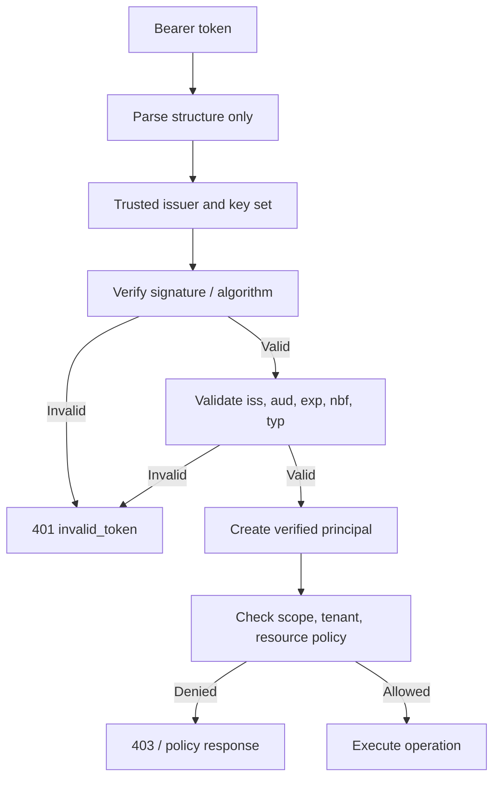

# Tin token chỉ vì decode được

## 1. Lỗi phổ biến: đọc được JWT rồi coi là hợp lệ

Một lỗi bảo mật thường gặp khi làm việc với JSON Web Token (JWT) là **decode được header và payload rồi kết luận token hợp lệ**. JWT compact thường dùng Base64URL để biểu diễn dữ liệu; bất kỳ ai có chuỗi token đều có thể tách và đọc phần header/payload của một JWS mà không cần biết private key ký token.

Ví dụ, một token có thể chứa:

```json
{
  "iss": "https://auth.example.com/",
  "sub": "alice",
  "aud": ["orders-api"],
  "scope": "orders:read",
  "exp": 1795400300,
  "tid": "acme"
}
```

Các claim trên trông có vẻ đáng tin, nhưng attacker cũng có thể tự tạo payload khác với `sub=admin`, `scope=admin:*` hoặc `tid=northwind`. Nếu ứng dụng chỉ decode JSON rồi tin các giá trị đó, attacker có thể tự khai danh tính và quyền.

**Decode chỉ trả lời “token đang chứa dữ liệu gì?”. Verify mới trả lời “dữ liệu có được ký bởi issuer mà ta tin và có còn hợp lệ theo policy không?”.** Sau khi verify chữ ký, Resource Server vẫn phải kiểm tra issuer, audience, thời hạn, token type, scope, tenant và quyền trên tài nguyên.

Trong module **SECURITY_TOKEN_SECURITY_FUNDAMENTALS**, lỗi này liên quan trực tiếp tới mô hình tin cậy và vòng đời token: JWT, opaque token, access token, refresh token, OAuth 2.0/OIDC, claims, scope, audience, thu hồi và phòng chống token bị đánh cắp hoặc phát lại.

## 2. Decode và verify khác nhau thế nào?

| Thao tác | Làm gì? | Có chứng minh token đáng tin không? |
|---|---|---|
| **Decode header/payload** | Base64URL-decode các phần dữ liệu | Không |
| **Parse JWT** | Kiểm tra cấu trúc và đọc claims | Không tự chứng minh chữ ký |
| **Verify signature** | Kiểm tra chữ ký bằng key và thuật toán được tin cậy | Có, nếu key/algorithm/trust chain đúng |
| **Validate claims** | Kiểm tra `iss`, `aud`, `exp`, `nbf`, token profile... | Xác nhận token phù hợp ngữ cảnh |
| **Authorize request** | Kiểm tra scope, role, tenant, ownership và policy nghiệp vụ | Quyết định principal được làm hành động hay không |

Một JWT JWS compact thường có ba phần ngăn bởi dấu chấm:

```text
BASE64URL(protected-header).
BASE64URL(payload).
BASE64URL(signature)
```

Hai phần đầu không được mã hóa bí mật. Base64URL chỉ là encoding. Người nhận không cần khóa để đọc chúng. Chữ ký được tính trên dữ liệu header và payload; sửa bất kỳ claim nào sau khi ký sẽ làm chữ ký không còn khớp.

Ví dụ một payload đã decode có thể hiển thị `"role":"ADMIN"`. Điều đó **không có nghĩa** người gửi có role ADMIN. Chỉ khi chữ ký được xác minh bằng public key/secret thuộc issuer tin cậy, claim mới có thể được xem là do issuer phát hành. Sau đó, ứng dụng còn phải quyết định role đó có được phép cho endpoint và resource hiện tại hay không.

### 2.1. JWS không giống JWE

JWT là một định dạng claims; nó có thể được bảo vệ bằng JWS (chữ ký/MAC) hoặc JWE (mã hóa), và có thể có cấu trúc nested theo profile.

- **JWS compact:** thường có 3 phần; payload có thể đọc sau khi Base64URL-decode.
- **JWE compact:** thường có 5 phần; nội dung được mã hóa và cần decryption key phù hợp mới đọc được.
- **Nested JWT:** một JWT có thể được bọc trong một JWT khác, ví dụ ký rồi mã hóa; phải tuân theo đúng profile và thứ tự xử lý.

Không được suy luận rằng “JWT luôn bí mật”. JWS thông thường bảo vệ tính toàn vẹn và nguồn ký, không che giấu payload. Không đưa password, private key, refresh token hoặc dữ liệu nhạy cảm vào claim chỉ vì payload có chữ ký.

## 3. Minh họa cách attacker lợi dụng decode-only

Giả sử API có đoạn xử lý sai:

```java
// KHÔNG AN TOÀN: pseudocode
Map<String, Object> claims = decodeJwtPayload(token);
String subject = (String) claims.get("sub");
String role = (String) claims.get("role");

if ("ADMIN".equals(role)) {
    allowAdminOperation();
}
```

Attacker không cần lấy signing key. Họ có thể tạo token giả:

```json
{
  "sub": "attacker",
  "role": "ADMIN",
  "aud": "admin-api",
  "exp": 1999999999
}
```

Sau đó encode header/payload thành chuỗi JWT và gửi tới API. Nếu server chỉ đọc claim, nó sẽ tin dữ liệu do attacker tự tạo.

Luồng đúng phải là:

1. Nhận token qua cơ chế truyền được cho phép, thường là `Authorization: Bearer`.
2. Chọn issuer và key set từ cấu hình tin cậy của API.
3. Parse header không tin cậy chỉ để lấy selector như `kid`.
4. Kiểm tra thuật toán được cho phép và key type tương ứng.
5. Verify chữ ký bằng public key/secret đúng.
6. Validate issuer, audience, thời hạn, token type và profile.
7. Chuyển claims đã xác minh thành principal.
8. Kiểm tra scope/authority và policy trên tài nguyên.

**Không dùng claim chưa verify để chọn tenant, mở database connection, chọn key URL hoặc quyết định quyền.**

## 4. Vì sao chữ ký phải được xác minh bằng key đáng tin?

Một chữ ký hợp lệ chỉ có ý nghĩa khi verifier biết **key đó thuộc issuer nào và được phép dùng cho mục đích nào**.

Với chữ ký bất đối xứng như RS256, PS256 hoặc ES256:

- Authorization Server giữ private signing key.
- Resource Server nhận public verification key qua JWKS hoặc key registry tin cậy.
- Resource Server xác minh chữ ký mà không có khả năng ký token mới chỉ từ public key.

Với chữ ký đối xứng như HS256:

- Issuer và verifier cùng giữ secret HMAC.
- Bất kỳ thành phần nào có secret đều có thể tạo chữ ký hợp lệ.
- Nếu nhiều Resource Server cùng chia sẻ secret, một service bị xâm nhập có thể có khả năng ký token giả.

Khi nhiều API chỉ cần xác minh, asymmetric signing thường tạo ranh giới quyền rõ hơn. Lựa chọn thuật toán còn phụ thuộc Authorization Server, thư viện, profile và threat model; điều bắt buộc là **allowlist thuật toán cố định và key tương thích**, không để token tự quyết định thuật toán.

### 4.1. Key phải đến từ trust configuration

Một quy trình an toàn:

- Cấu hình chính xác issuer mà API chấp nhận.
- Lấy JWKS URI từ metadata/configuration của issuer đã tin cậy.
- Cache public keys theo chính sách; xử lý rotation và unknown `kid` có giới hạn.
- Không lấy public key từ URL bất kỳ do token hoặc request cung cấp.
- Không tin key chỉ vì `kid` có tên giống tenant hoặc client.
- Không dùng cùng một key namespace cho các issuer khác nhau nếu không có mapping và validation rõ ràng.

Header JWT là dữ liệu **chưa được xác minh**. `kid` chỉ là gợi ý tìm key trong tập key đã tin cậy, không phải chứng cứ về danh tính.

### 4.2. Không tải jku hoặc x5u tùy ý

JOSE header có thể có các tham số như `jku` hoặc `x5u` trong một số profile. Nếu Resource Server tự động tải URL do token đưa ra, attacker có thể khiến server truy cập host nội bộ (SSRF) hoặc tải public key do attacker kiểm soát rồi dùng nó để xác minh token giả.

Verifier nên dùng JWKS URI được cấu hình hoặc discovery từ issuer đã được tin cậy. Nếu profile có yêu cầu xử lý URL trong header, phải có quy tắc allowlist và kiểm soát chặt chẽ; không được mặc định fetch mọi URL.

### 4.3. Unknown kid và JWKS refresh

Khi `kid` không có trong cache, Resource Server có thể refresh JWKS từ endpoint tin cậy một lần theo cơ chế có giới hạn. Nếu key vẫn không tồn tại, từ chối token. Cần rate limit hoặc single-flight để hàng loạt token giả với `kid` ngẫu nhiên không tạo JWKS refresh storm.

Khi rotation bình thường, issuer publish public key mới trước khi ký token mới; giữ key cũ trong overlap cho tới khi token cũ hết hạn theo policy. Với key compromise, có thể phải loại key cũ nhanh hơn và phối hợp cache invalidation/revocation.

## 5. Các claim cần validate theo token profile

Không có một danh sách claim bắt buộc giống nhau cho mọi JWT. JWT core định nghĩa nhiều registered claims là tùy chọn; OAuth/OIDC profile và hợp đồng của hệ thống có thể yêu cầu một tập cụ thể. Resource Server cần xác định rõ profile mà nó chấp nhận.

| Claim/thuộc tính | Cần kiểm tra | Lỗi thường gặp nếu bỏ qua |
|---|---|---|
| `iss` | Khớp chính xác issuer được cấu hình tin cậy | Chấp nhận token từ issuer khác |
| `aud` | Chứa đúng resource server hiện tại | Token dành cho API khác bị dùng chéo |
| `exp` | Chưa hết hạn, tính clock skew theo policy | Token hết hạn vẫn được chấp nhận |
| `nbf` | Token đã tới thời điểm có hiệu lực | Chấp nhận token chưa được phép sử dụng |
| `iat` | Hợp lý theo policy; không ở tương lai bất thường | Token có thời điểm phát hành không hợp lý |
| `sub` | Đúng ngữ nghĩa subject của issuer/profile | Nhầm user, client hoặc service identity |
| `scope` | Map đúng scope/authority cho endpoint | Có token hợp lệ nhưng quyền bị cấp quá rộng |
| `client_id` | Khớp client semantics khi policy yêu cầu | Nhầm workload/client |
| `jti` | Dùng cho audit/revocation/replay policy nếu được triển khai | Không có định danh token để xử lý một số sự cố |
| `typ` | Phân biệt token profile, ví dụ access token JWT | Nhận nhầm ID token hoặc JWT loại khác |
| Tenant claim | Khớp tenant context đã xác minh | Cross-tenant token substitution |

Không phải claim nào cũng luôn bắt buộc. Ví dụ, `jti` không tự chống replay nếu server không lưu/kiểm tra trạng thái. `iat` không thay thế `exp`. `scope` không tự chứng minh user có quyền với mọi object.

### 5.1. Issuer phải khớp chính xác

Không kiểm tra issuer bằng một phép so chuỗi lỏng lẻo như `contains("auth.example.com")` hoặc chỉ so hostname khi policy yêu cầu issuer URI đầy đủ. Scheme, host, path và dấu slash cuối có thể thuộc định danh issuer theo cấu hình.

Token từ staging, tenant issuer hoặc identity provider khác không được chấp nhận chỉ vì chữ ký dùng cùng thuật toán. Nếu hệ thống chấp nhận nhiều issuer, phải có danh sách rõ ràng và quy tắc mapping issuer → key set → audience/profile.

### 5.2. Audience phải dành cho API đang nhận token

Một access token dành cho `inventory-api` không tự động hợp lệ ở `orders-api`. Chỉ verify signature mà bỏ qua `aud` tạo điều kiện token substitution giữa các resource server.

Nếu `aud` là array, kiểm tra API hiện tại có nằm trong array theo profile. Không dùng substring matching. Không tự thêm audience bằng cách sửa payload; chỉ Authorization Server/STS có quyền phát hành token mới với audience phù hợp.

### 5.3. Thời hạn và clock skew

Kiểm tra `exp` và `nbf` bằng clock được kiểm soát. Cho phép clock skew nhỏ theo policy để tránh lỗi do đồng hồ giữa các máy lệch, nhưng không kéo dài token tùy tiện. Test cần có trường hợp vừa hết hạn, vừa tới `nbf`, clock skew trong giới hạn và ngoài giới hạn.

## 6. Tránh nhầm access token, ID token và refresh token

Một JWT có chữ ký hợp lệ vẫn có thể **sai loại token cho API**.

| Token | Mục đích | Có dùng làm Bearer access token cho Resource Server không? |
|---|---|---|
| OAuth access token | Truy cập resource server | Có, nếu issuer/audience/profile/claims hợp lệ |
| OIDC ID token | Thông báo kết quả xác thực cho OIDC client | Không dùng thay access token |
| Refresh token | Xin access token mới tại Authorization Server | Không |
| Client assertion | Xác thực OAuth client hoặc làm grant theo profile | Không mặc định |
| JWT-SVID/workload assertion | Chứng minh workload theo trust profile riêng | Chỉ nếu API/STS có contract chấp nhận loại đó |

OIDC ID token thường có `aud` là client OIDC nhận kết quả đăng nhập, không phải API resource server. Không chấp nhận ID token làm access token chỉ vì nó được ký bởi cùng issuer.

Với JWT access token theo RFC 9068, token profile có thể sử dụng `typ=at+jwt` cùng các claim được profile quy định. Resource Server nên áp dụng profile cụ thể và không chấp nhận mọi JWT có chữ ký hợp lệ.

Refresh token thường chỉ được gửi tới token endpoint theo grant hợp lệ. Nếu một API nghiệp vụ nhận refresh token, đó là dấu hiệu token type boundary đang bị phá vỡ.

## 7. alg confusion và các lỗi xác minh chữ ký

Một số lỗi triển khai thường gặp:

- Cho phép `alg=none` hoặc thuật toán không nằm trong allowlist.
- Chọn thuật toán dựa hoàn toàn trên header chưa xác minh.
- Dùng HMAC secret như RSA public key hoặc nhầm key type giữa các thuật toán.
- Dùng cùng một key cho nhiều profile token mà không tách issuer/audience/type.
- Chấp nhận token có chữ ký từ key không còn được tin cậy.
- Không kiểm tra key usage/algorithm compatibility theo cấu hình.
- Tự viết hàm crypto hoặc so sánh chữ ký không an toàn thay vì dùng thư viện JOSE được duy trì.

Verifier nên cấu hình thuật toán cho phép ở phía server. Key type, curve/modulus và algorithm phải tương thích. `alg` trong header chỉ là dữ liệu đầu vào để đối chiếu policy; nó không được quyền mở rộng policy.

Ví dụ nguyên tắc:

```text
trusted issuer = https://auth.example.com/
allowed algorithms = { RS256 }
trusted JWKS URI = configured metadata for that issuer

JWT header says alg=RS256, kid=key-2026-01
    -> locate key-2026-01 in trusted JWKS
    -> verify using configured RS256
    -> validate issuer/audience/time/token profile
otherwise reject
```

## 8. Opaque token không thể được xử lý như JWT

Opaque access token thường là chuỗi không mang cấu trúc JWT có thể kiểm tra offline. Không cố tách chuỗi theo dấu chấm hoặc Base64URL-decode rồi tự suy luận claims.

Với opaque token, Resource Server thường gọi introspection endpoint theo RFC 7662:

```http
POST /oauth2/introspect HTTP/1.1
Host: auth.example.com
Content-Type: application/x-www-form-urlencoded
Authorization: Basic <resource-server-client-credentials>

token=<opaque-access-token>
```

Response minh họa:

```json
{
  "active": true,
  "scope": "orders:read",
  "aud": ["orders-api"],
  "iss": "https://auth.example.com/",
  "exp": 1795400300,
  "sub": "alice"
}
```

Resource Server cần kiểm tra `active` và metadata bắt buộc theo contract: issuer, audience, scope, expiry, tenant và subject. `active=true` không có nghĩa token tự động có quyền gọi mọi endpoint. Nếu introspection timeout hoặc response malformed, không được tự coi token là active.

JWT cũng có thể được introspect nếu kiến trúc yêu cầu kiểm tra revocation tập trung. Ngược lại, opaque token không nên được decode như JWT.

## 9. Ví dụ Spring Security: để framework verify JWT

Với Spring Security Resource Server, nên dùng `JwtDecoder` và validator do framework/thư viện JOSE cung cấp. Không tự decode payload trong controller để tạo principal.

Cấu hình issuer URI minh họa:

```yaml
spring:
  security:
    oauth2:
      resourceserver:
        jwt:
          issuer-uri: https://auth.example.com/
```

Nếu API cần audience cụ thể, cấu hình validator bổ sung. Ví dụ Java theo Spring Security/Nimbus:

```java
@Bean
JwtDecoder jwtDecoder() {
    String issuer = "https://auth.example.com/";
    NimbusJwtDecoder decoder =
            (NimbusJwtDecoder) JwtDecoders.fromIssuerLocation(issuer);

    OAuth2TokenValidator<Jwt> issuerAndTime =
            JwtValidators.createDefaultWithIssuer(issuer);

    OAuth2TokenValidator<Jwt> audience = jwt -> {
        if (jwt.getAudience().contains("orders-api")) {
            return OAuth2TokenValidatorResult.success();
        }
        return OAuth2TokenValidatorResult.failure(
                new OAuth2Error(
                        "invalid_token",
                        "Token audience is not orders-api",
                        null));
    };

    decoder.setJwtValidator(
            new DelegatingOAuth2TokenValidator<>(
                    issuerAndTime,
                    audience));

    return decoder;
}
```

Đây là ví dụ cấu hình validator, cần điều chỉnh import và bean theo phiên bản Spring Security. `issuer-uri` giúp framework khám phá metadata/JWKS và kiểm tra issuer theo cấu hình; audience validator ở trên bổ sung kiểm tra `orders-api`. Ứng dụng vẫn cần cấu hình scope/authority mapping, token profile/type và authorization trên tài nguyên.

Không đưa raw token vào log khi decoder ném exception. Error response nên được chuẩn hóa; không trả ra client nội dung exception nội bộ hoặc key metadata.

### 9.1. Scope mapping không phải verify chữ ký

Spring Security có thể map claim `scope` hoặc `scp` thành authorities như `SCOPE_orders:read`. Việc mapping chỉ có ý nghĩa **sau khi token đã được xác minh**. Nếu ứng dụng tự decode claim rồi tạo `GrantedAuthority`, attacker có thể tự cấp quyền cho mình.

### 9.2. JWT decoder test khác decode helper test

Test dùng helper tạo `Jwt` hoặc mock `JwtDecoder` có thể kiểm tra authorization logic, nhưng không chứng minh chữ ký thật được xác minh. Muốn test authentication cần ký JWT bằng test private key, publish public key test qua JWKS và gửi request qua Security Filter Chain thật.

## 10. Quy trình xác minh đúng tại Resource Server

Một pipeline nên có thứ tự rõ ràng:

1. **Extract:** lấy Bearer token từ header theo HTTP/OAuth contract.
2. **Parse safely:** kiểm tra cấu trúc token, giới hạn kích thước và parse header; chưa tin claims.
3. **Resolve trust:** chọn issuer/key set từ cấu hình tin cậy, không từ URL do token tự khai.
4. **Verify cryptography:** kiểm tra chữ ký bằng thuật toán allowlist và key phù hợp.
5. **Validate profile:** kiểm tra issuer, audience, expiry, not-before, token type và các claim bắt buộc theo profile.
6. **Build principal:** chỉ sử dụng claims đã xác minh; chuẩn hóa subject/client/tenant.
7. **Authorize:** kiểm tra scope, role, tenant, object ownership, actor/delegation và policy nghiệp vụ.
8. **Observe safely:** ghi outcome/reason code đã làm sạch; không ghi token hoặc private data.

Sơ đồ:



Từng bước có thể được triển khai bởi framework/filter khác nhau, nhưng thứ tự logic phải được bảo toàn. Controller không nên nhận một object principal được tạo từ claim chưa verify.

## 11. Cách xử lý lỗi và status code

| Lỗi | Phân loại | HTTP thường dùng |
|---|---|---|
| Không có Bearer token khi endpoint yêu cầu | Thiếu authentication | 401 |
| Token malformed hoặc chữ ký sai | Invalid credential | 401 |
| Issuer/audience/token type sai | Token không dành cho resource/profile này | 401 |
| Token hết hạn/chưa có hiệu lực | Invalid credential | 401 |
| Token active nhưng thiếu scope | Authorization denial | 403 |
| Token đúng scope nhưng tenant/object không phù hợp | Authorization denial | 403 hoặc 404 theo anti-enumeration policy |
| Introspection/JWKS/STS timeout | Authentication dependency unavailable | 503/502 theo API contract, không tự chấp nhận |
| Token hợp lệ, đủ quyền | Authorized | 2xx hoặc business response |

Với Bearer token, response 401 thường có `WWW-Authenticate: Bearer` và error `invalid_token` khi phù hợp RFC 6750. 403 có thể dùng `insufficient_scope` cho trường hợp thiếu scope; không phải mọi 403 đều là lỗi scope.

Không biến lỗi dependency thành “token invalid” nếu hệ thống có thể phân biệt. Client nhận 401 có thể yêu cầu đăng nhập hoặc refresh token không cần thiết; client nhận 503 có thể retry theo policy.

## 12. Những biến thể decode-only nguy hiểm

### 12.1. Tin claim role hoặc scope

Attacker sửa payload thành `role=ADMIN` hoặc thêm `admin:write`. Nếu server không verify signature, quyền có thể bị nâng cấp. Dùng authority được tạo từ verified token và policy server-side.

### 12.2. Tin claim tid để chọn tenant

Attacker đổi `tid=acme` thành `tid=northwind`. Nếu server chọn database hoặc key set dựa trên claim chưa verify, có thể truy cập sai tenant. Tenant context phải được resolve từ nguồn tin cậy, sau đó so sánh với tenant claim đã xác minh.

### 12.3. Tin aud vì nó ghi tên API

Attacker tự đặt `aud=admin-api`. Audience chỉ đáng tin sau khi verify chữ ký và phải được so khớp với resource server hiện tại.

### 12.4. Tin exp do payload tự khai

Attacker đặt `exp` rất xa trong tương lai. Nếu server không verify signature và kiểm tra thời hạn, token giả có thể tồn tại vô hạn theo ý attacker.

### 12.5. Tin kid hoặc tải key từ token

Attacker tự đặt `kid` để chọn key không đúng hoặc thêm `jku` trỏ tới host do họ kiểm soát. Key resolver phải giới hạn trong issuer/JWKS tin cậy.

### 12.6. Dùng ID token ở API

ID token được ký hợp lệ nhưng audience là OIDC client. API không được nhận token đó làm access token chỉ vì parse và verify được bằng cùng issuer.

### 12.7. Dùng refresh token làm Bearer token

Refresh token có mục đích khác và thường có quyền nhạy cảm hơn. Chỉ token endpoint được phép xử lý refresh grant theo client/session policy; business API phải từ chối.

## 13. Kiểm thử để chứng minh server không chỉ decode

Một bộ test nên bao gồm positive và negative cases:

| Ca test | Setup | Kết quả |
|---|---|---|
| JWT hợp lệ | Đúng key, issuer, audience, expiry và token profile | Authentication thành công |
| Payload bị sửa sau khi ký | Giữ signature cũ, đổi `sub` hoặc `scope` | 401 |
| Token tự ký bằng key attacker | Header `kid` giống key hợp lệ nhưng public key không khớp | 401 |
| Sai issuer | Chữ ký hợp lệ nhưng `iss` khác cấu hình | 401 |
| Sai audience | Chữ ký hợp lệ nhưng `aud` dành cho API khác | 401 |
| Hết hạn | `exp` đã qua | 401 |
| Chưa có hiệu lực | `nbf` ở tương lai ngoài clock skew | 401 |
| Thuật toán ngoài allowlist | `alg=none` hoặc thuật toán không được phép | 401 |
| Unknown `kid` | Key không có trong trusted JWKS | Refresh có giới hạn rồi 401 |
| ID token | Token có profile/audience OIDC client | API từ chối |
| Refresh token | Gửi vào resource endpoint | API từ chối |
| Thiếu scope | JWT hợp lệ nhưng không có scope cần thiết | 403 |
| Tenant mismatch | Claim đã ký khác tenant context | 403/404 theo policy |
| Opaque active | Introspection trả `active=true`, đúng metadata | Qua authentication |
| Opaque inactive | Introspection trả `active=false` | 401 |
| Introspection outage | Timeout/5xx | Fail closed, dependency error |
| Log redaction | Gửi token canary | Raw token không xuất hiện trong logs/traces |

Điểm then chốt là test **JWT có chữ ký sai nhưng payload vẫn đọc được**. Nếu API vẫn chấp nhận request, nó đang tin dữ liệu decode chứ chưa verify chữ ký.

### 13.1. Ví dụ test tampering

Quy trình kiểm thử:

1. Dùng test private key ký JWT hợp lệ với `sub=alice`, `scope=orders:read`.
2. Gửi token tới API và xác nhận request được xác thực.
3. Decode payload trong test harness, thay `sub=admin` hoặc thêm `admin:write`.
4. Encode lại header/payload nhưng giữ signature cũ.
5. Gửi token đã sửa tới API.
6. Xác nhận API trả 401 và không gọi business service.

Không dùng token production cho test tampering. Tạo key pair và issuer riêng cho test; token canary phải không có quyền thật.

## 14. Checklist sửa lỗi decode-only trong code review

1. Tìm mọi chỗ gọi `decode`, `parseClaims`, `getPayload` hoặc tự split token để tạo principal.
2. Xác định decode helper chỉ dùng để hiển thị/debug hay đang quyết định authentication/authorization.
3. Nếu dùng cho security decision, thay bằng JOSE/JWT verifier hoặc Resource Server framework có cấu hình issuer/key trust.
4. Cấu hình allowlist thuật toán và key type; từ chối `none` và algorithm confusion.
5. Lấy JWKS từ issuer được cấu hình tin cậy; không fetch URL do token/request cung cấp.
6. Validate issuer, audience, expiry, not-before và token profile.
7. Phân biệt access token, ID token, refresh token, client assertion và workload assertion.
8. Chỉ map scope/role sau khi token được verify.
9. So sánh tenant claim đã verify với tenant context đáng tin cậy; kiểm tra ownership của resource.
10. Với opaque token, dùng introspection hoặc cơ chế xác minh đã thỏa thuận; không giả định token là JWT.
11. Bảo đảm dependency outage không fail open và lỗi 401/403/503 được phân loại đúng.
12. Thêm regression test token payload tampering, forged signature, wrong issuer/audience, wrong token type và token expiry.
13. Không log raw token hoặc đưa token production vào công cụ decode công khai.

**Nguyên tắc cốt lõi:** Decode chỉ cho biết nội dung token. Chỉ chữ ký được xác minh bằng key thuộc issuer tin cậy, kết hợp validation claims/profile và authorization policy, mới cho phép Resource Server dựa vào token để cấp quyền.

### Tài liệu tiêu chuẩn tham khảo

- [RFC 7515 — JSON Web Signature (JWS)](https://www.rfc-editor.org/rfc/rfc7515): cách tạo và xác minh chữ ký JWS.
- [RFC 7516 — JSON Web Encryption (JWE)](https://www.rfc-editor.org/rfc/rfc7516): JWT/JWE và nội dung được mã hóa.
- [RFC 7517 — JSON Web Key (JWK)](https://www.rfc-editor.org/rfc/rfc7517): biểu diễn key và JWKS.
- [RFC 7519 — JSON Web Token (JWT)](https://www.rfc-editor.org/rfc/rfc7519): JWT compact serialization và registered claims.
- [RFC 8725 — JSON Web Token Best Current Practices](https://www.rfc-editor.org/rfc/rfc8725): thuật toán, issuer/audience validation và ngăn JWT confusion.
- [RFC 9068 — JWT Profile for OAuth 2.0 Access Tokens](https://www.rfc-editor.org/rfc/rfc9068): profile JWT access token.
- [RFC 7662 — OAuth 2.0 Token Introspection](https://www.rfc-editor.org/rfc/rfc7662): introspection cho token và trạng thái `active`.
- [RFC 9700 — Best Current Practice for OAuth 2.0 Security](https://www.rfc-editor.org/rfc/rfc9700): khuyến nghị bảo mật OAuth 2.0 hiện đại.
- [Spring Security — OAuth 2.0 Resource Server JWT](https://docs.spring.io/spring-security/reference/servlet/oauth2/resource-server/jwt.html): xác minh JWT trong Resource Server.
