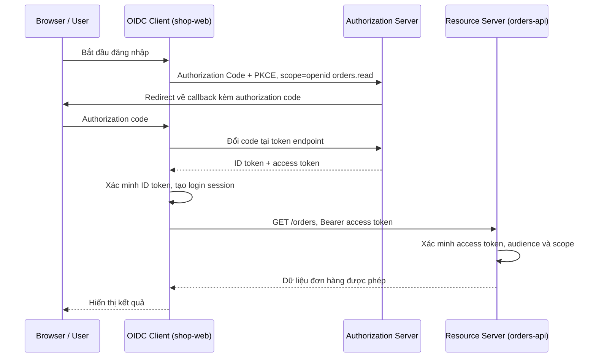

# Dùng ID token gọi API

## 1. Lỗi thường gặp: lấy ID token làm Bearer token

Trong ứng dụng dùng OpenID Connect (OIDC), sau khi người dùng đăng nhập, client thường nhận được một **ID token** và có thể nhận thêm một **access token**. Hai token có thể đều được mã hóa dưới dạng JWT, cùng do một Authorization Server phát hành và có chữ ký hợp lệ. Vì vậy, developer đôi khi lấy ID token đặt vào header `Authorization: Bearer` để gọi API.

Đây là lỗi nhầm mục đích của token. **ID token thông báo cho OIDC client biết kết quả xác thực và danh tính người dùng. Access token cấp quyền truy cập một resource server theo scope và audience được phát hành.** API cần access token đúng resource; ID token không tự trở thành access token chỉ vì nó là JWT có chữ ký hợp lệ.

Nếu API chỉ kiểm tra chữ ký và issuer mà không kiểm tra loại token, audience và profile, nó có thể chấp nhận nhầm ID token. Khi đó API đang dùng một bằng chứng đăng nhập dành cho client như credential truy cập tài nguyên, tạo ra lỗi token substitution và ranh giới tin cậy không rõ ràng.

Bài học này giải thích vì sao ID token không dùng để gọi API, cách phân biệt ID token với access token trong OAuth 2.0/OIDC, cách sửa luồng gọi API và cách kiểm thử để ngăn lỗi tái diễn.

Sau bài học, người học có thể:

- Phân biệt mục đích, audience và cách sử dụng của ID token, access token và refresh token.
- Giải thích vì sao chữ ký JWT hợp lệ không chứng minh token phù hợp với API.
- Kiểm tra `iss`, `aud`, `azp`, `exp`, `nonce` theo đúng vai trò OIDC client.
- Gửi access token tới resource server và xử lý token bị từ chối.
- Thiết kế API chỉ chấp nhận access token đúng issuer, audience, token profile và scope.
- Viết test xác nhận ID token bị từ chối, access token hợp lệ được chấp nhận và thiếu quyền trả lỗi phù hợp.

## 2. ID token và access token khác nhau thế nào?

| Tiêu chí | ID token | Access token |
| --- | --- | --- |
| Chuẩn/ngữ cảnh | OpenID Connect | OAuth 2.0 |
| Mục đích | Thông tin kết quả xác thực cho OIDC client | Cấp quyền truy cập resource server |
| Đối tượng nhận chính | OIDC client có `client_id` tương ứng | API/resource được chỉ định |
| Audience | Thường chứa `client_id` của OIDC client | Audience/resource theo chính sách của Authorization Server |
| Dữ liệu thường gặp | `iss`, `sub`, `aud`, `exp`, `iat`, có thể có `auth_time`, `nonce`, `azp` | Scope/permission, subject/client và audience cần cho API theo access token profile |
| Cách dùng | Client xác minh rồi tạo trạng thái đăng nhập/session | Client gửi cho API qua `Authorization: Bearer` |
| Định dạng | JWT theo OIDC Core | Có thể là JWT hoặc opaque/reference token |
| Resource server có chấp nhận? | Không dùng thay access token | Có, nếu hợp lệ và đủ quyền |

Cả hai token có thể là JWT, nhưng **định dạng không quyết định mục đích**. Một JWT có chữ ký đúng vẫn có thể là sai loại token cho endpoint. Opaque access token cũng có thể hợp lệ để gọi API nếu resource server xác minh trạng thái qua introspection hoặc cơ chế tin cậy đã cấu hình.

Refresh token lại có mục đích khác: client gửi nó tới token endpoint để xin access token mới theo refresh grant. Không gửi refresh token tới API nghiệp vụ.

## 3. OIDC flow đúng: ID token cho client, access token cho API

Ví dụ ứng dụng web có `client_id=shop-web`, API có audience `orders-api` và cần scope `orders.read`.



ID token được client dùng để xác nhận người dùng đã đăng nhập theo issuer và client đã đăng ký. Access token được gửi đến API để API kiểm tra quyền. Client không nên lấy ID token làm credential gọi endpoint nghiệp vụ.

Trong ứng dụng dùng Backend for Frontend (BFF), browser thường chỉ giữ session cookie an toàn; BFF giữ token ở phía server và dùng access token gọi API. Điều này cũng không thay đổi ngữ nghĩa token: BFF xác minh/duy trì session theo thiết kế, còn resource server nhận access token đúng audience.

## 4. Audience của ID token là client, không mặc định là API

Một ID token có thể có payload minh họa:

```json
{
  "iss": "https://identity.example.test",
  "sub": "user-42",
  "aud": "shop-web",
  "exp": 1795428300,
  "iat": 1795428000,
  "auth_time": 1795427900,
  "nonce": "client-generated-nonce"
}
```

Ở ví dụ này, `aud` là `shop-web`: token được phát hành cho OIDC client. API `orders-api` không nên chấp nhận token này làm access token chỉ vì cùng tin issuer.

Access token dành cho API có thể có cấu trúc khác:

```json
{
  "iss": "https://identity.example.test",
  "sub": "user-42",
  "aud": "orders-api",
  "scope": "orders.read",
  "iat": 1795428000,
  "exp": 1795428300
}
```

Đây là payload minh họa cho access token dạng JWT; access token thực tế có thể dùng claim profile khác hoặc là opaque token. Không tự giả định mọi access token đều phải có đúng các claim này. Resource server phải áp dụng profile và cấu hình của Authorization Server mà nó tin cậy.

### 4.1. Ý nghĩa của `aud` và `azp` trong ID token

- `aud` xác định audience của ID token; theo OIDC, client phải xác minh `aud` chứa `client_id` của chính nó.
- Nếu ID token có nhiều audience, client nên kiểm tra `azp` theo quy tắc OIDC. Nếu `azp` có mặt, client phải xác minh giá trị đó phù hợp với `client_id` của mình.
- `azp` (authorized party) xác định bên được token ủy quyền/đại diện trong một số tình huống nhiều audience; nó không biến ID token thành access token cho API.
- API phải kiểm tra audience của **access token** theo resource mà API đại diện. Không lấy `azp` của ID token để thay cho audience authorization.

Nếu một ứng dụng vô tình cấu hình `orders-api` là audience của ID token, điều đó vẫn không tự tạo ra quyền API. Cần xem lại thiết kế issuer/client và dùng access token được phát hành theo đúng mục đích OAuth resource access. Không sửa lỗi bằng cách thêm `client_id` hoặc `azp` vào allowlist audience của API.

## 5. Vì sao API phải từ chối ID token?

Có nhiều lý do độc lập:

1. **Sai đối tượng nhận:** ID token được phát hành cho OIDC client, trong khi API là resource server. `aud` thường không khớp audience của API.
2. **Sai ngữ nghĩa:** ID token chứng minh một sự kiện xác thực cho client; nó không phải hợp đồng cấp quyền gọi endpoint.
3. **Thiếu authorization context:** ID token không nhất thiết chứa scope/permission mà API cần. Các claim danh tính không thay thế quyền truy cập.
4. **Nguy cơ token substitution:** nếu API chỉ kiểm tra chữ ký/issuer, kẻ gọi có thể đưa một JWT hợp lệ nhưng được phát hành cho client hoặc mục đích khác.
5. **Ranh giới client/resource bị phá vỡ:** API có thể vô tình tin claim chỉ dành cho client, dẫn đến nhầm lẫn giữa đăng nhập và quyền truy cập dữ liệu.

Resource server nên yêu cầu access token theo profile đã thống nhất với Authorization Server. Với JWT access token theo RFC 9068, có thể xác minh loại token theo profile, ví dụ header `typ` là `at+jwt`, cùng chữ ký, issuer, audience và claim bắt buộc. Tuy nhiên, không chỉ dựa vào `typ`; phải kiểm tra đầy đủ profile và trust configuration.

## 6. Xác minh ID token đúng nơi: tại OIDC client

ID token vẫn cần được xác minh nghiêm ngặt, nhưng việc đó diễn ra ở OIDC client khi xử lý kết quả đăng nhập.

Các bước quan trọng theo OIDC Core:

- Xác minh chữ ký hoặc cơ chế bảo vệ tương ứng bằng khóa của issuer tin cậy; kiểm tra thuật toán được phép.
- So khớp `iss` chính xác với issuer đã cấu hình.
- Xác minh `aud` chứa `client_id` của client.
- Nếu `azp` xuất hiện, xác minh nó phù hợp với `client_id`; xử lý nhiều audience theo yêu cầu OIDC.
- Kiểm tra `exp` và các điều kiện thời gian liên quan.
- Nếu authorization request gửi `nonce`, xác minh `nonce` trong ID token khớp giá trị đã lưu cho phiên đăng nhập.
- Nếu yêu cầu `max_age`, xác minh `auth_time` theo chính sách.
- Ràng buộc phản hồi với authorization transaction, `state` và PKCE theo flow đang dùng.

`state` là tham số tương quan/CSRF của authorization response, không phải claim thay thế `nonce`. `nonce` ràng buộc ID token với yêu cầu xác thực của client. Không bỏ qua các bước này chỉ vì token có chữ ký hợp lệ.

Sau khi xác minh, client có thể dùng claim danh tính được phép để hiển thị tên hoặc tạo session. Không cần gửi nguyên ID token cho mọi service nội bộ. Nếu service cần danh tính người dùng, hãy dùng access token phù hợp hoặc cơ chế delegation/token exchange được thiết kế rõ ràng.

## 7. Gọi API bằng access token đúng cách

Ví dụ client nhận access token từ token endpoint và gọi API:

```http
GET /api/orders HTTP/1.1
Host: api.example.test
Authorization: Bearer <ACCESS_TOKEN_FOR_ORDERS_API>
Accept: application/json
```

API xác minh:

- Token được phát hành bởi issuer tin cậy.
- Token thực sự là access token theo profile được hỗ trợ.
- Audience/resource có chứa `orders-api`.
- Chữ ký hoặc trạng thái opaque token hợp lệ.
- `exp`, `nbf` và các claim bắt buộc đáp ứng policy.
- Scope có `orders.read`.
- Subject/tenant có quyền trên các đơn hàng được truy cập.

Không gửi ID token trong header trên. Nếu client chỉ nhận ID token mà không có access token, cần kiểm tra authorization request có yêu cầu scope/resource cần thiết không và token endpoint có trả access token theo flow không. Đừng tự chuyển ID token thành access token ở client.

### 7.1. UserInfo endpoint cũng dùng access token

Trong OIDC, UserInfo endpoint được gọi bằng access token có quyền phù hợp, thường là scope `openid` cùng các scope profile/email cần thiết. Không gửi ID token tới UserInfo endpoint thay cho access token. ID token đã được client nhận và xác minh trong authentication response; UserInfo là protected resource.

## 8. Phân biệt lỗi 401 và 403 khi API nhận nhầm token

Nếu API nhận ID token thay cho access token, cách xử lý điển hình là từ chối xác thực credential:

| Tình huống | Kết quả mong đợi | Giải thích |
| --- | --- | --- |
| Không gửi token | `401 Unauthorized` | Request chưa được xác thực |
| Gửi ID token có chữ ký hợp lệ nhưng `aud=shop-web` | `401 Unauthorized`, `invalid_token` theo Bearer contract | Sai loại/ngữ cảnh hoặc audience không dành cho API |
| Gửi ID token của client khác | `401 Unauthorized` | Sai audience và không thuộc client/resource mong đợi |
| Gửi access token sai chữ ký/hết hạn | `401 Unauthorized` | Access token không hợp lệ |
| Gửi access token đúng audience nhưng thiếu `orders.read` | `403 Forbidden`, `insufficient_scope` khi phù hợp | Token hợp lệ nhưng không đủ quyền |
| Gửi access token đủ scope nhưng truy cập order tenant khác | `403` hoặc `404` theo policy dữ liệu | Authorization ở cấp tài nguyên từ chối |

Không trả `403 insufficient_scope` cho ID token chỉ vì nó không có scope. API chưa có access token hợp lệ để đánh giá quyền; lỗi gốc là token không phù hợp với resource server. Hãy dùng response contract thống nhất, không tiết lộ chi tiết nội bộ về token.

## 9. Ví dụ cấu hình và kiểm thử Resource Server

### 9.1. Chính sách xác minh access token

Ví dụ pseudoconfiguration cho API:

```yaml
resource_server:
  accepted_token_profile: oauth_access_token
  trusted_issuer: https://identity.example.test
  expected_audience: orders-api
  accepted_signing_algorithms:
    - RS256
  required_scopes:
    GET:/api/orders:
      - orders.read
    POST:/api/orders:
      - orders.write
  reject_id_tokens: true
```

`reject_id_tokens` ở đây là ý nghĩa chính sách minh họa, không phải thuộc tính chuẩn có sẵn trong mọi framework. Cách triển khai thực tế là chỉ chấp nhận access token profile và kiểm tra issuer, audience, chữ ký, thời hạn, token type và scope. Không nên tạo một nhánh nhận ID token rồi thử suy ra quyền từ claim danh tính.

### 9.2. Test matrix chống nhầm ID token và access token

| Test case | Token gửi tới API | Kết quả |
| --- | --- | --- |
| Access token hợp lệ | `aud=orders-api`, scope `orders.read` | Cho phép GET nếu quyền resource đạt |
| ID token của đúng web client | `aud=shop-web` | Từ chối |
| ID token có cùng issuer và chữ ký với access token | `aud=shop-web`, không phải access-token profile | Từ chối |
| ID token có `azp=shop-web` | `azp` đúng client nhưng token vẫn là ID token | Từ chối |
| ID token bị sửa payload | Chữ ký sai | Từ chối |
| Access token sai audience | `aud=billing-api` | Từ chối |
| Access token hết hạn | `exp` trong quá khứ | Từ chối |
| Access token đủ audience nhưng thiếu scope | Scope không đủ | `403` theo contract |
| Opaque access token active | Introspection xác nhận active và audience phù hợp | Cho phép nếu scope/resource policy đạt |
| Refresh token | Được gửi tới resource API | Từ chối |

Test quan trọng nhất là **ID token hợp lệ về mật mã nhưng sai mục đích**. Nếu chỉ dùng token giả chữ ký sai, test không chứng minh API có phân biệt ID token với access token.

### 9.3. Pseudocode integration test

Ví dụ dưới đây mô tả test HTTP qua resource server thật. `TokenFixture` ký token bằng khóa test và tạo ID token/access token có cùng issuer để chứng minh chữ ký hợp lệ không đủ:

```java
@Test
void rejectsValidIdTokenWhenCallingOrdersApi() throws Exception {
    String idToken = TokenFixture.signedIdToken()
        .issuer(TRUSTED_ISSUER)
        .subject("user-42")
        .audience("shop-web")
        .expiresAt(clock.instant().plusSeconds(300))
        .signWith(testPrivateKey);

    mockMvc.perform(get("/api/orders")
            .header(HttpHeaders.AUTHORIZATION, "Bearer " + idToken))
        .andExpect(status().isUnauthorized());
}

@Test
void acceptsAccessTokenForOrdersApiWithReadScope() throws Exception {
    String accessToken = TokenFixture.signedAccessToken()
        .issuer(TRUSTED_ISSUER)
        .subject("user-42")
        .audience("orders-api")
        .scope("orders.read")
        .expiresAt(clock.instant().plusSeconds(300))
        .signWith(testPrivateKey);

    mockMvc.perform(get("/api/orders")
            .header(HttpHeaders.AUTHORIZATION, "Bearer " + accessToken))
        .andExpect(status().isOk());
}
```

Các helper và cấu hình trong ví dụ là pseudocode, cần thay bằng thư viện token và fixture của dự án. Điều quan trọng là hai token được ký thật bằng khóa test, gửi qua Bearer header và đi qua decoder thật. Không mock `JwtDecoder` trong test xác minh token profile.

### 9.4. Kiểm thử phía OIDC client

Ngoài test resource server, client cần test xác minh ID token:

- ID token có `aud` chứa đúng `client_id` → qua audience validation.
- ID token có audience của client khác → từ chối.
- `azp` có mặt nhưng không khớp client → từ chối.
- `nonce` không khớp authorization request → từ chối.
- `iss` sai hoặc chữ ký sai → từ chối.
- `exp` hết hạn hoặc `auth_time` vượt max age → xử lý theo policy.
- Authorization response có `state` sai → từ chối transaction.

Như vậy test suite kiểm tra cả hai phía: client chỉ nhận ID token dành cho mình; API chỉ nhận access token dành cho resource.

## 10. Các biến thể sai thường gặp và cách sửa

**Lấy trường `sub` từ ID token rồi gửi token tới API.** `sub` nhận diện subject trong issuer, nhưng không cấp quyền truy cập API. Hãy dùng access token và để API xác minh subject trong ngữ cảnh resource.

**API chỉ kiểm tra chữ ký JWT.** Chữ ký đúng không chứng minh audience hoặc token profile phù hợp. Bổ sung kiểm tra issuer, audience, thời hạn, token type và scope.

**Thêm `shop-web` vào allowlist audience của API để hết lỗi 401.** Điều này làm mờ ranh giới client/resource và có thể khiến API chấp nhận ID token. Hãy sửa client gửi access token có audience `orders-api`.

**Tự decode ID token ở gateway để lấy role.** Decode không phải xác minh, và ID token không phải nguồn authorization cho API. Dùng access token hoặc policy service tin cậy.

**Dùng ID token gọi UserInfo endpoint.** UserInfo là protected resource nhận access token. Hãy gửi access token đúng scope.

**Lưu ID token như access token trong một biến chung `token`.** Tên biến mơ hồ dễ dẫn đến dùng sai. Dùng tên cụ thể như `idToken`, `accessToken`, `refreshToken` và kiểu dữ liệu/abstraction phân biệt nếu có thể.

**Đưa ID token vào cookie rồi backend dùng cookie đó như Bearer token cho API nội bộ.** Cookie có thể là session credential của ứng dụng, nhưng không làm ID token trở thành access token. Backend nên xác minh session rồi lấy access token phù hợp để gọi API.

**Chấp nhận token vì cùng issuer.** Một issuer có thể phát hành nhiều loại token cho nhiều client/resource. Luôn kiểm tra token profile và audience.

## 11. Checklist review luồng OIDC và API

- [ ] OIDC client dùng Authorization Code Flow với PKCE khi phù hợp.
- [ ] ID token chỉ được client xác minh theo OIDC Core.
- [ ] Client kiểm tra chữ ký, issuer, audience, thời hạn, nonce và azp khi áp dụng.
- [ ] API nhận access token đúng resource/audience.
- [ ] API xác minh chữ ký hoặc introspection, issuer, audience, thời hạn và token profile.
- [ ] API kiểm tra scope/permission và quyền trên từng tài nguyên.
- [ ] Không dùng ID token gọi API hoặc UserInfo endpoint.
- [ ] Không dùng refresh token tại resource server.
- [ ] Có test ID token chữ ký hợp lệ nhưng sai audience bị từ chối.
- [ ] Có test access token đúng audience/scope được chấp nhận.
- [ ] Có test phân biệt invalid token `401` và insufficient scope `403`.
- [ ] Log không ghi raw ID token, access token hoặc refresh token.

## 12. Câu hỏi tự kiểm tra

**1. ID token có chữ ký hợp lệ thì có thể gọi API không?**

Không. Chữ ký chỉ xác minh tính toàn vẹn và nguồn phát hành theo khóa tin cậy. ID token được phát hành cho OIDC client; API cần access token đúng audience và quyền.

**2. `aud` trong ID token thường đại diện cho ai?**

Nó chứa `client_id` của OIDC client mà ID token được phát hành cho. API phải kiểm tra audience của access token theo resource của chính API.

**3. Nếu ID token và access token đều là JWT thì phân biệt bằng cách nào?**

Dựa vào ngữ nghĩa và profile phát hành, audience, claim, token type theo profile và chính sách issuer. Không chỉ dựa vào việc decode được hoặc có chữ ký.

**4. `azp` có biến ID token thành access token không?**

Không. `azp` giúp xác định authorized party trong ID token, đặc biệt khi có nhiều audience. Nó không cấp quyền resource access cho API.

**5. API nên trả lỗi nào khi nhận ID token thay cho access token?**

Thông thường trả `401 invalid_token` vì credential không hợp lệ cho resource server. `403 insufficient_scope` dành cho access token hợp lệ nhưng thiếu quyền theo contract.

**6. Client nên gửi token nào tới UserInfo endpoint?**

Access token có scope phù hợp, không phải ID token.

## Tài liệu chuẩn tham khảo

- [OpenID Connect Core 1.0](https://openid.net/specs/openid-connect-core-1_0.html): ngữ nghĩa ID token, `aud`, `azp`, `nonce`, `auth_time` và quy trình xác minh.
- [RFC 6749 – The OAuth 2.0 Authorization Framework](https://www.rfc-editor.org/rfc/rfc6749): access token, refresh token và protected resource.
- [RFC 6750 – OAuth 2.0 Bearer Token Usage](https://www.rfc-editor.org/rfc/rfc6750): cách gửi access token và Bearer error.
- [RFC 9068 – JWT Profile for OAuth 2.0 Access Tokens](https://www.rfc-editor.org/rfc/rfc9068): profile JWT dành cho OAuth access token, bao gồm `typ=at+jwt`.
- [RFC 9700 – Best Current Practice for OAuth 2.0 Security](https://www.rfc-editor.org/rfc/rfc9700): thực hành bảo mật OAuth 2.0 hiện đại.
- [OpenID Connect Discovery 1.0](https://openid.net/specs/openid-connect-discovery-1_0.html): discovery metadata và endpoint của OpenID Provider.


