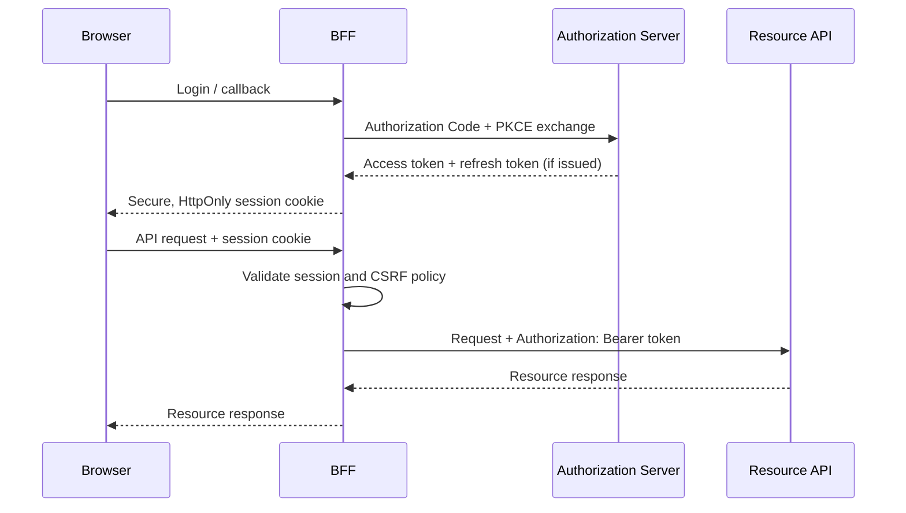

# Đặt token trong URL

Một lỗi bảo mật thường gặp khi tích hợp OAuth 2.0 là đưa access token vào URL, chẳng hạn query parameter `access_token`, path segment hoặc link tải tệp. Cách làm này có vẻ tiện vì trình duyệt, thẻ liên kết, một số thư viện tải tệp và công cụ kiểm thử đều xử lý URL dễ dàng. Tuy nhiên, URL thường được lưu hoặc sao chép qua nhiều thành phần hơn phần header xác thực. Token có thể xuất hiện trong browser history, access log, reverse proxy, CDN, hệ thống analytics, trace, referrer hoặc ticket hỗ trợ.

Access token là credential. Với bearer token, bất kỳ ai lấy được token đều có thể sử dụng nó trong phạm vi quyền, audience và thời hạn của token. Vì vậy, đưa token vào URL làm tăng đáng kể bề mặt rò rỉ và nguy cơ replay. RFC 6750 cho phép một phương thức truyền bearer token qua URI query trong trường hợp hạn chế, nhưng khuyến cáo không dùng phương thức này trừ khi không thể truyền token bằng Authorization header hoặc form body. Thiết kế mặc định nên gửi access token trong HTTP `Authorization` header.

Trong module **SECURITY_TOKEN_SECURITY_FUNDAMENTALS**, bài học này nối cách lưu trữ và sử dụng token với bảo vệ credential: token phải được truyền qua kênh phù hợp, không bị sao chép vào URL, log hay referrer, và phải có quy trình thu hồi khi nghi ngờ đã lộ.

## 1. Đặt token trong URL nghĩa là gì?

Token bị đặt trong URL khi credential xuất hiện trong một phần của URI mà client dùng để gọi API hoặc mở tài nguyên. Có ba dạng thường gặp:

**Query parameter**

```text
GET /api/orders?access_token=<access-token>
```

**Path segment**

```text
GET /download/<access-token>/report.pdf
```

**Fragment phía trình duyệt**

```text
https://app.example.com/callback#access_token=<access-token>
```

Query và path là một phần của request target được gửi đến server. Fragment bắt đầu bằng `#` không được trình duyệt gửi trong HTTP request đến server, nhưng vẫn hiện diện trong địa chỉ trình duyệt và có thể được đọc bởi JavaScript chạy trên trang. Vì vậy, fragment không phải nơi lưu access token an toàn.

Một số hệ thống còn đưa token vào URL redirect, link email, QR code, ảnh, iframe, WebSocket URL hoặc URL tải file. Dù tên parameter không phải `access_token`, nếu giá trị đó cho phép người sở hữu truy cập tài nguyên thì nó đang hoạt động như một credential hoặc capability URL và cần được bảo vệ tương ứng.

## 2. Vì sao URL làm tăng nguy cơ lộ token?

URL thường được ghi nhận tự động bởi nhiều tầng của hệ thống. Developer có thể không chủ động log token nhưng vẫn để token xuất hiện trong access log hoặc telemetry do framework, proxy hay nền tảng cloud tạo ra.

Các kênh rò rỉ phổ biến:

| Kênh | Token có thể xuất hiện như thế nào |
|---|---|
| Browser history | URL được lưu trong lịch sử duyệt web, đồng bộ tài khoản hoặc khôi phục tab. |
| Address bar/autocomplete | URL có thể được gợi ý lại, chụp màn hình hoặc sao chép vào clipboard. |
| Web server access log | Nhiều server ghi request target gồm path và query string. |
| Reverse proxy/API gateway | Log, tracing hoặc error report có thể lưu full URL trước khi request đến ứng dụng. |
| CDN, WAF, load balancer | URL có thể nằm trong request log, cache key, rule event hoặc hệ thống phân tích. |
| Referrer header | Khi trang điều hướng hoặc tải tài nguyên khác, browser có thể gửi một phần URL của trang trước theo Referrer Policy. |
| Analytics và third-party scripts | Công cụ analytics, tag manager, pixel hoặc script có thể đọc location URL. |
| APM và distributed tracing | Span attribute hoặc exception report có thể chứa URL đầy đủ. |
| Cache | URL có query có thể trở thành cache key hoặc được lưu trong cache metadata. |
| Ticket/chat/email | Người dùng hoặc kỹ thuật viên có thể dán URL vào nội dung trao đổi. |
| Monitoring và alert | Alert có thể đính kèm URL lỗi, request sample hoặc context. |

Ví dụ: một client gửi `GET /api/profile?access_token=...` qua CDN, gateway và application. Dù application không log query, CDN có thể lưu full URL; gateway có thể ghi request target; APM có thể gắn URL vào span; browser có thể giữ URL trong history. Chỉ cần một hệ thống trong chuỗi bị truy cập trái phép là token có nguy cơ bị sử dụng lại.

### HTTPS không giải quyết được vấn đề này

HTTPS bảo vệ dữ liệu trên đường truyền giữa các điểm TLS, giúp ngăn người ngoài đọc hoặc sửa request khi truyền qua mạng. Nhưng các endpoint TLS như browser, CDN, reverse proxy, gateway và application vẫn nhìn thấy URL sau khi giải mã. Các thành phần này có thể log hoặc lưu URL theo cấu hình.

Vì vậy, dùng HTTPS là bắt buộc khi truyền token nhưng không làm cho token trong URL trở nên an toàn. Cần loại bỏ token khỏi URL và giảm thiểu việc ghi credential ở mọi tầng.

## 3. RFC 6750 nói gì về bearer token trong URI?

RFC 6750 mô tả ba cách client có thể trình bày bearer access token cho resource server:

1. Authorization request header field với scheme `Bearer`.
2. Form-encoded body parameter trong một HTTP POST đáp ứng các điều kiện của RFC.
3. URI query parameter `access_token` trong trường hợp hạn chế.

Phương thức được khuyến nghị là Authorization header:

```http
GET /api/orders HTTP/1.1
Host: api.example.com
Authorization: Bearer <access-token>
```

RFC 6750 khuyến cáo không dùng URI query parameter trừ khi không thể truyền token trong Authorization header hoặc request entity body. Lý do chính là URL có xác suất cao bị ghi vào log. Nếu dùng nhiều phương thức trong cùng một request, việc xác định credential nào có hiệu lực cũng trở nên không rõ ràng; client không nên gửi token bằng nhiều phương thức cùng lúc.

Form body chỉ phù hợp với trường hợp được RFC mô tả, thường là POST với `application/x-www-form-urlencoded` và body đơn phần. Không nên hiểu rằng có thể tùy ý đặt token vào JSON body của mọi request. Trong các API thông thường, Authorization header vẫn là lựa chọn rõ ràng và dễ kiểm soát nhất.

RFC 6750 cũng yêu cầu bảo vệ bearer token bằng TLS. Ngoài ra, hệ thống cần giới hạn audience, scope và thời hạn token để giảm hậu quả nếu credential bị lộ.

## 4. Phân biệt URL query, path và fragment

| Vị trí | Có được gửi đến server trong HTTP request? | Rủi ro chính | Khuyến nghị |
|---|---|---|---|
| Query `?access_token=...` | Có | Access log, proxy, CDN, cache, referrer và browser history. | Không dùng cho access token. |
| Path `/resource/<token>` | Có | Web server log, route tracing, analytics, proxy và history. | Không dùng token làm path segment. |
| Fragment `#access_token=...` | Không gửi trong HTTP request thông thường | JavaScript, browser history, extension, analytics và XSS. | Không dùng làm nơi lưu access token. |
| Authorization header | Có, trong header | Có thể bị log nếu cấu hình ghi toàn bộ header. | Lựa chọn chuẩn; phải redact header trong log. |
| Form body | Có, trong request body | Có thể bị ghi nếu log request body; chỉ dùng trong trường hợp RFC cho phép. | Chỉ dùng khi phù hợp giao thức và đã kiểm soát body logging. |
| HttpOnly Secure cookie | Browser tự gửi trong Cookie header | CSRF, cấu hình domain/path và cookie theft. | Phù hợp với session/BFF nếu có CSRF protection và cấu hình đúng. |

Path segment có thể không mang tên `access_token`, nhưng vẫn có cùng vấn đề: web server thường ghi path vào access log và router/telemetry có thể thu thập nó. Đặt token ở vị trí khác trong URL không loại bỏ nguy cơ.

Fragment có một đặc tính khác: trình duyệt không gửi phần sau `#` trong HTTP request. Tuy vậy, script trên trang có thể đọc `window.location`, browser history có thể giữ URL và extension hoặc mã analytics có thể truy cập. Một lỗ hổng XSS cũng có thể đọc fragment nếu token được đặt ở đó. Vì vậy, fragment không nên được dùng để lưu access token trong ứng dụng mới.

## 5. Những tình huống dễ dẫn đến lỗi

### 5.1. Gọi API bằng query parameter

```javascript
// Không an toàn: token xuất hiện trong URL
fetch(`/api/orders?access_token=${accessToken}`);
```

URL có thể được ghi bởi browser, gateway, proxy hoặc tracing. Cách sửa là gửi token trong Authorization header:

```javascript
// Ưu tiên: token nằm trong Authorization header
fetch("/api/orders", {
  method: "GET",
  headers: {
    Authorization: `Bearer ${accessToken}`
  }
});
```

Đoạn code chỉ minh họa vị trí truyền token. Ứng dụng browser cần quản lý token theo kiến trúc phù hợp, hạn chế thời gian lưu trong JavaScript và tránh để token truy cập được từ mã bên thứ ba. Với ứng dụng web nhạy cảm, mô hình Backend for Frontend (BFF) thường giúp giữ access token ở phía server.

### 5.2. Đưa token vào link tải file

```html
<!-- Không an toàn: token trở thành một phần của URL -->
<a href="/files/report.pdf?access_token=...">Download report</a>
```

Link có thể được lưu trong history, gửi qua email, chat hoặc hệ thống hỗ trợ. Nếu file cần xác thực, hãy dùng endpoint tải file nhận session cookie hoặc Authorization header; backend kiểm tra quyền rồi stream file về client.

Nếu cần chia sẻ file bằng URL có khả năng truy cập, hãy thiết kế một signed/capability URL riêng với thời hạn ngắn, quyền rất hẹp, resource cụ thể và cơ chế thu hồi phù hợp. Đây vẫn là một bí mật dạng bearer, không phải access token OAuth thông thường; cần tránh log/referrer và không tái sử dụng nó cho API khác.

### 5.3. Đặt token trong redirect URL

Redirect URL có thể được ghi ở browser history, proxy, monitoring và hệ thống analytics. Một số luồng OAuth cũ từng trả access token trong fragment qua Implicit Flow. Với ứng dụng mới, nên dùng Authorization Code Flow với PKCE và tránh phát access token trực tiếp qua URL.

Authorization code cũng là giá trị nhạy cảm, dù không phải access token. Cần ràng buộc code với client, redirect URI, thời hạn ngắn, dùng một lần và PKCE. Không để code hoặc token bị ghi vào log hay chuyển tiếp sang bên thứ ba.

### 5.4. Đặt token trong URL của WebSocket

Một số thư viện WebSocket trên browser không cho tùy chỉnh Authorization header trong handshake. Developer đôi khi thêm token vào query:

```javascript
// Không an toàn: query string chứa bearer token
new WebSocket(`wss://api.example.com/events?access_token=${accessToken}`);
```

URL handshake có thể được ghi trong proxy hoặc gateway log. Các phương án thay thế được trình bày ở phần WebSocket bên dưới; không nên dùng access token dài hạn trong query chỉ vì API browser hạn chế header.

### 5.5. Đặt token trong URL của Server-Sent Events

`EventSource` trong browser không cung cấp API chuẩn để tùy ý đặt Authorization header. Đưa token vào URL là một cách giải quyết nhanh nhưng làm token xuất hiện trong request target. Có thể dùng BFF với session cookie hoặc một ticket dùng một lần, thời hạn ngắn và chỉ dành cho stream cụ thể.

## 6. Cách truyền access token an toàn

### 6.1. Authorization header

Đối với API HTTP thông thường, client gửi access token trong header:

```http
GET /v1/accounts HTTP/1.1
Host: api.example.com
Authorization: Bearer <access-token>
Accept: application/json
```

Resource server xác minh chữ ký hoặc introspection, issuer, audience, thời hạn, token type và scope theo hợp đồng. Không log toàn bộ request header; cần redact `Authorization` ở application, proxy, gateway và APM.

Ví dụ với curl:

```bash
curl --fail \
  --header "Authorization: Bearer ${ACCESS_TOKEN}" \
  --header "Accept: application/json" \
  https://api.example.com/v1/accounts
```

Không đặt token trực tiếp vào command line nếu môi trường lưu command history hoặc process arguments. Với shell tương tác, biến môi trường chỉ là ví dụ đơn giản; trong production nên lấy credential từ secret manager hoặc cơ chế credential an toàn của workload.

### 6.2. Backend for Frontend (BFF)

Với ứng dụng browser, BFF là một mô hình giúp access token không phải đi qua JavaScript của trang:

1. Browser đăng nhập và nhận session cookie từ BFF.
2. Cookie được cấu hình `Secure`, `HttpOnly` và `SameSite` phù hợp.
3. Browser gọi BFF bằng session cookie.
4. BFF giữ access/refresh token ở phía server và gọi resource API bằng Authorization header.
5. BFF kiểm tra quyền, CSRF và session trước khi chuyển request.



BFF không tự động loại bỏ mọi rủi ro. Cần chống CSRF cho các request thay đổi trạng thái, bảo vệ session cookie, giới hạn CORS, kiểm tra Origin khi phù hợp và không log cookie hoặc token.

### 6.3. Cookie cho session

Cookie có thể phù hợp để duy trì session browser, đặc biệt khi dùng BFF. Một số thuộc tính cần xem xét:

- `Secure`: chỉ gửi cookie qua HTTPS.
- `HttpOnly`: JavaScript không đọc trực tiếp cookie.
- `SameSite`: giảm khả năng cookie được gửi trong một số request cross-site; chọn `Lax`, `Strict` hoặc `None` theo flow.
- `Path` và `Domain`: giới hạn phạm vi gửi cookie ở mức cần thiết.
- Thời hạn cookie: không dài hơn nhu cầu session.

Cookie tự động được browser gửi nên có rủi ro CSRF. `SameSite` hỗ trợ giảm rủi ro nhưng không thay thế thiết kế CSRF đầy đủ khi ứng dụng cần. Có thể dùng anti-CSRF token, kiểm tra Origin/Referer và quy tắc method/content type theo threat model.

Không nên đặt access token OAuth trực tiếp vào cookie có thể truy cập từ JavaScript. Nếu dùng cookie để mang credential, cần thiết kế sender/CSRF/session semantics rõ ràng. Mô hình BFF thường lưu access token phía server và chỉ đưa session identifier được bảo vệ cho browser.

## 7. WebSocket và Server-Sent Events khi browser không đặt được Authorization header

### WebSocket

Browser WebSocket API không cho ứng dụng tùy ý đặt mọi HTTP header trong handshake. Có thể cân nhắc:

1. **Cookie session qua BFF:** browser mở WebSocket cùng origin và gửi session cookie; server xác minh session, kiểm tra Origin và áp dụng CSRF/origin policy phù hợp.
2. **One-time connection ticket:** browser gọi một endpoint HTTPS đã xác thực để xin ticket ngắn hạn; ticket chỉ dùng một lần, gắn với user/session, resource và mục đích kết nối; sau đó dùng ticket trong handshake theo contract riêng.
3. **Protocol/application authentication:** thiết lập kết nối rồi xác thực thông qua một message đầu tiên có cơ chế chống replay và timeout nghiêm ngặt; server không xử lý dữ liệu nghiệp vụ trước khi xác thực xong.

Ticket kết nối phải có entropy đủ lớn, thời hạn rất ngắn, dùng một lần và bị đánh dấu đã dùng ngay khi tiêu thụ. Nếu ticket nằm trong query, nó vẫn có thể xuất hiện trong log; do đó cần log redaction và giới hạn phạm vi, không coi ticket là dữ liệu công khai. Không dùng lại access token OAuth làm ticket dài hạn.

Server nên xác minh `Origin` cho browser WebSocket, ràng buộc session với quyền truy cập và đóng kết nối khi session/token bị thu hồi theo policy. Không dựa duy nhất vào việc URL có đúng origin.

### Server-Sent Events

Với SSE, có thể dùng BFF cùng cookie session để browser mở stream mà không đưa access token vào URL. Nếu kiến trúc bắt buộc có ticket, ticket phải dùng một lần, thời hạn ngắn, chỉ dành cho một stream/resource và không được cấp quyền gọi API tổng quát.

Nếu một endpoint stream chấp nhận cookie, cần kiểm tra Origin, quyền của session và CSRF threat model. Cần xác định cách ngắt stream khi logout, revoke hoặc session hết hạn.

## 8. Signed URL và download link có phải ngoại lệ?

Một signed URL thường chứa chữ ký hoặc token capability để người sở hữu URL truy cập một object cụ thể trong một khoảng thời gian. Nó có thể hữu ích cho tải file từ object storage hoặc CDN mà không cần chia sẻ access token OAuth gốc.

Tuy nhiên, signed URL cũng là một bearer secret: ai có URL trong thời hạn hiệu lực có thể thực hiện hành động đã được ký. Vì vậy, cần:

- Giới hạn vào một object hoặc một hành động cụ thể, ví dụ chỉ GET một file.
- Đặt thời hạn ngắn theo nhu cầu tải.
- Không cho phép đổi URL thành quyền truy cập API rộng hơn.
- Dùng HTTPS và kiểm tra chữ ký, thời hạn, method, resource và các điều kiện liên quan ở server.
- Không ghi query string đầy đủ vào access log, proxy log, analytics hoặc support ticket.
- Áp dụng `Referrer-Policy: no-referrer` cho trang chứa link khi phù hợp; vẫn phải xử lý log và history.
- Cân nhắc giới hạn số lần tải, một lần dùng hoặc cơ chế thu hồi nếu nền tảng hỗ trợ.
- Không nhúng signed URL vào trang có third-party script không cần thiết.

Signed URL không phải lý do để đưa access token OAuth vào URL. Hãy coi nó là một loại credential riêng với scope, TTL và quy trình phát hành/thu hồi phù hợp.

## 9. Không nhầm access token với các giá trị khác trong OAuth/OIDC

Một số URL trong OAuth/OIDC có parameter nhạy cảm, nhưng chúng có vai trò khác nhau:

| Giá trị | Mục đích | Cách bảo vệ |
|---|---|---|
| Access token | Truy cập resource server | Gửi trong Authorization header hoặc cơ chế sender-constrained đã thiết kế. |
| Refresh token | Lấy access token mới | Giữ ở nơi lưu trữ bảo mật; chỉ gửi đến token endpoint qua TLS. |
| Authorization code | Đổi lấy token sau redirect | Thời hạn ngắn, dùng một lần, ràng buộc client/redirect URI và PKCE. |
| ID token | Chứng minh kết quả xác thực OIDC cho client | Xác minh theo OIDC; không dùng thay access token gọi API. |
| State | Liên kết authorization response với request ban đầu, chống CSRF | Tạo giá trị khó đoán, ràng buộc session và kiểm tra khi callback. |
| Nonce | Liên kết ID token với authentication request và chống replay | Tạo và kiểm tra chính xác trong OIDC flow. |
| One-time download/stream ticket | Quyền tạm thời cho một hành động cụ thể | TTL ngắn, một lần dùng, scope/resource cụ thể và bảo vệ URL/log. |

Authorization code thường xuất hiện trong query của callback đối với Authorization Code Flow. Điều đó không biến access token thành thứ có thể đặt trong URL. Code vẫn nhạy cảm và cần bảo vệ bằng TLS, PKCE, redirect URI chính xác, thời hạn ngắn, single-use và redaction log.

Với ứng dụng mới, ưu tiên Authorization Code Flow với PKCE. Không chọn Implicit Flow chỉ để tránh bước đổi code; OAuth Security Best Current Practice khuyến nghị tránh các luồng trả access token trực tiếp trong authorization response qua front channel.

## 10. JWT và opaque token đều không nên nằm trong URL

Định dạng token không làm thay đổi nguyên tắc truyền credential:

- **JWT:** thường có ba phần Base64URL và payload có thể đọc được nếu không mã hóa. Đưa JWT vào URL có thể làm lộ cả credential lẫn claims như subject, audience, scope hoặc thông tin tùy chỉnh.
- **Opaque token:** thường là chuỗi khó đoán và không tự chứa claims đọc được. Nhưng nếu là bearer token, người có chuỗi vẫn có thể sử dụng nó.
- **Sender-constrained token:** DPoP hoặc mTLS có thể giảm khả năng replay khi token bị đánh cắp, nhưng không biến URL thành nơi truyền phù hợp. Token và proof/certificate binding vẫn cần được bảo vệ.

Chữ ký JWT chỉ bảo vệ tính toàn vẹn và nguồn phát hành; nó không che nội dung payload và không ngăn người khác dùng một bearer token đã bị lấy cắp. Opaque token khó đọc hơn nhưng vẫn là credential.

## 11. Các biện pháp giảm thiểu khi ứng dụng đang có legacy API

Nếu một API cũ chỉ nhận token qua query parameter, cần lập kế hoạch loại bỏ giao thức này. Trong thời gian chuyển đổi, có thể giảm thiểu rủi ro theo thứ tự:

1. Xác định tất cả client, route và integration đang gửi token trong URL.
2. Thêm hỗ trợ Authorization header ở server và cập nhật client.
3. Ngừng phát hành tài liệu hoặc ví dụ sử dụng query token.
4. Ghi nhận số lần sử dụng query token bằng metric tổng hợp, không ghi giá trị token.
5. Đặt thời hạn chấm dứt hỗ trợ query token và thông báo cho chủ client.
6. Sau thời hạn, từ chối request chứa `access_token` trong query/path.

Nếu chưa thể loại bỏ ngay, chỉ xem đây là biện pháp chuyển tiếp có thời hạn và có phê duyệt rủi ro. Các biện pháp giảm thiểu:

- Bắt buộc HTTPS.
- Token có TTL rất ngắn, scope hẹp và audience duy nhất.
- Không dùng refresh token hoặc token có quyền rộng trong URL.
- Redact query/path ở CDN, gateway, reverse proxy, web server, application log và APM.
- Tắt capture request URL/body/header nhạy cảm ở analytics và error reporting.
- Dùng `Cache-Control: no-store` phù hợp cho response nhạy cảm và cấu hình cache bypass cho endpoint; hiểu rằng header này không xóa access log hoặc browser history.
- Dùng `Referrer-Policy: no-referrer` trên trang có chứa URL nhạy cảm; đây chỉ là lớp giảm thiểu.
- Tránh redirect sau khi token đã xuất hiện trong URL và tránh tải third-party resources từ trang đó.
- Có quy trình thu hồi token nhanh khi nghi ngờ lộ.

Không được coi việc chỉ che `access_token` ở log của application là đủ nếu proxy, CDN hoặc load balancer vẫn ghi full URL. Phải kiểm tra toàn bộ đường đi của request.

## 12. Cấu hình log và telemetry để không làm lộ token

### Access log

Ưu tiên log route template và metadata đã chuẩn hóa thay vì full URL có query. Ví dụ:

```text
Không nên:
GET /api/orders?access_token=<secret>

Nên:
method=GET route=/api/orders status=200 request_id=req-123
```

Ở web server hoặc reverse proxy, cấu hình log format không ghi query string cho các route nhạy cảm. Nếu nền tảng bắt buộc log request target, cần có cơ chế redact trước khi ghi và kiểm tra rằng redaction áp dụng cả error log, debug log, sampling và export.

### Application log

- Không log toàn bộ request object hoặc header map nếu chưa redact.
- Không đưa URL đầy đủ vào exception message hoặc structured log.
- Dùng route template, status code, error class và request ID.
- Redact `Authorization`, `Cookie`, `access_token`, `refresh_token`, `code` và các parameter nhạy cảm đã xác định.
- Dùng allowlist trường được log thay vì blacklist token theo tên parameter, vì credential có thể được đặt tên khác.

### APM, tracing và analytics

- Tắt hoặc lọc capture full URL/query trên route có thể mang credential.
- Không gắn Authorization header, cookie, token hoặc toàn bộ query vào span attributes.
- Kiểm tra auto-instrumentation, error tracking, session replay và browser analytics.
- Dùng `url.route`/route template hoặc path đã làm sạch khi phù hợp.
- Kiểm thử dữ liệu telemetry thực tế được gửi đi, không chỉ xem code cấu hình.

### Referrer Policy và cache

Trang browser có thể thiết lập:

```http
Referrer-Policy: no-referrer
```

Chính sách này ngăn browser gửi referrer trong các request phát sinh từ trang theo hành vi của trình duyệt. Nó không xóa URL khỏi history, access log, proxy log hoặc telemetry đã thu thập trước đó.

Với response chứa dữ liệu nhạy cảm, có thể dùng:

```http
Cache-Control: no-store
Pragma: no-cache
```

`no-store` giúp ngăn cache lưu response theo chính sách HTTP, nhưng không phải cơ chế xóa URL khỏi log. Cần cấu hình CDN và shared cache riêng; không dùng cache-control thay cho việc loại token khỏi URL.

## 13. Xử lý khi phát hiện token đã xuất hiện trong URL

Hãy coi token đã được ghi vào URL như một credential có khả năng bị lộ, kể cả khi chưa có bằng chứng bị lạm dụng.

Quy trình phản ứng:

1. **Khoanh vùng:** xác định token type, issuer, client, audience, scope, thời điểm và các route đã nhận token trong URL.
2. **Ngăn tiếp tục rò rỉ:** chặn query/path token ở gateway hoặc resource server nếu có thể; triển khai client dùng Authorization header.
3. **Thu hồi:** revoke token hoặc grant liên quan theo khả năng của authorization server; với JWT offline, áp dụng denylist/version/status check hoặc chờ TTL ngắn theo incident policy.
4. **Đánh giá refresh token:** nếu refresh token hoặc authorization code cũng bị lộ, thu hồi token family/grant và yêu cầu xác thực lại theo policy.
5. **Bảo vệ log:** giới hạn quyền truy cập vào log chứa URL; dừng export không cần thiết; xử lý bản sao, backup và retention theo incident/legal policy.
6. **Điều tra:** tìm request sử dụng token sau thời điểm nghi lộ bằng fingerprint an toàn, client/subject reference và timestamp; không xuất raw token ra kết quả tìm kiếm.
7. **Xoay credential:** nếu client secret, key hoặc credential khác cũng xuất hiện, rotate và cập nhật các consumer liên quan.
8. **Thông báo:** phối hợp với chủ client, security team và bên liên quan theo quy trình incident response.
9. **Khắc phục gốc:** loại bỏ URL token, sửa logging/telemetry, thêm kiểm thử và theo dõi việc client cũ còn gửi query token hay không.

Không chỉ xóa một dòng log rồi kết luận sự cố đã được xử lý. URL có thể đã được sao chép sang CDN log, backup, browser history, monitoring, ticket hoặc hệ thống bên thứ ba. Cần đánh giá từng nơi lưu theo chính sách bảo mật và retention.

## 14. Ví dụ kiểm tra request an toàn

### Request đúng

```http
GET /v1/invoices HTTP/1.1
Host: api.example.com
Authorization: Bearer <access-token>
Accept: application/json
```

### Request cần từ chối hoặc loại bỏ trong API mới

```http
GET /v1/invoices?access_token=<access-token> HTTP/1.1
Host: api.example.com
```

Resource server không nên ưu tiên query token khi header cũng có mặt. Hãy xác định một phương thức xác thực duy nhất theo contract và từ chối request mơ hồ hoặc chứa token qua nhiều phương thức. Với API đã ngừng hỗ trợ query token, trả lỗi phù hợp và không phản chiếu giá trị token trong response.

Ví dụ logic kiểm tra:

```text
function authenticate(request):
    if request.query.contains("access_token"):
        reject("token_in_uri_not_supported")

    if request.pathMatchesLegacyTokenPattern():
        reject("credential_in_path_not_supported")

    bearer = parseAuthorizationBearerHeader(request.headers)
    if bearer is missing:
        rejectAuthentication()

    return validateBearerToken(bearer)
```

Đây là pseudocode. Trong triển khai thực tế, cần xác định các route public, route legacy và contract lỗi; không được vô tình chặn parameter nghiệp vụ hợp lệ có tên gần giống. Nếu hệ thống cần tương thích tạm thời, hãy đo lường và đặt ngày kết thúc hỗ trợ rõ ràng.

## 15. Các lỗi thường gặp và cách khắc phục

| Lỗi | Hậu quả | Cách khắc phục |
|---|---|---|
| Đặt access token trong query `access_token` | Token có thể nằm trong browser history, access log, proxy và referrer. | Dùng Authorization header hoặc BFF/session. |
| Đưa token vào path segment | Path thường được log và thu thập bởi router/APM. | Dùng header và route template không chứa credential. |
| Cho rằng fragment không gửi lên server nên an toàn | JavaScript, history, extension và XSS có thể đọc fragment. | Dùng Authorization Code Flow với PKCE; không lưu access token trong URL. |
| Cho rằng HTTPS làm URL an toàn | TLS không ngăn endpoint hoặc proxy ghi URL sau giải mã. | Loại token khỏi URL và bảo vệ log ở mọi tầng. |
| Chỉ redact ở application log | CDN, gateway, load balancer hoặc APM vẫn có thể lưu token. | Kiểm tra toàn bộ request path và telemetry pipeline. |
| Dùng token dài hạn trong WebSocket query | Handshake URL có thể xuất hiện trong log. | Dùng cookie session/BFF hoặc one-time ticket ngắn hạn. |
| Dùng token dài hạn trong SSE URL | Event stream URL bị lưu trong browser/proxy log. | Dùng BFF cookie hoặc ticket một lần cho stream. |
| Dùng signed URL như access token dùng chung | Người có link có thể truy cập ngoài phạm vi dự kiến. | Giới hạn object/action, TTL ngắn và bảo vệ link như secret. |
| Dùng `no-store` để thay thế redaction | Header không xóa browser history hoặc access log. | Redact/không log URL; cấu hình cache riêng. |
| Chỉ revoke access token nhưng quên refresh token | Client có thể lấy access token mới sau sự cố. | Thu hồi grant/token family liên quan. |
| Chỉ xóa token khỏi log mà không rotate/revoke | Bản sao khác có thể đã tồn tại; token vẫn còn hiệu lực. | Xử lý như credential compromise và đánh giá mọi bản sao. |
| Chấp nhận đồng thời header và query token | Không rõ token nào được dùng, dễ tạo bypass khác nhau giữa proxy và app. | Chỉ hỗ trợ một phương thức theo contract; từ chối request mơ hồ. |

## 16. Ma trận kiểm thử

| Tình huống | Kết quả mong đợi |
|---|---|
| Client gửi access token trong Authorization header | Xác thực theo JWT/opaque token và policy bình thường. |
| Client gửi `access_token` trong query | API mới từ chối; không log hoặc phản chiếu token. |
| Client gửi token trong path | Route không hỗ trợ; không ghi path có credential vào log. |
| Request chứa cả header và query token | Từ chối request mơ hồ theo contract; không chọn token ngầm định. |
| URL có query nhạy cảm đi qua reverse proxy | Log đã loại query hoặc redact giá trị trước khi lưu. |
| APM nhận request có Authorization header | Span không chứa raw token/header. |
| Trang có URL nhạy cảm điều hướng sang trang khác | Referrer Policy ngăn gửi referrer theo cấu hình; token không được đặt trong URL ngay từ đầu. |
| Browser mở link tải file cần xác thực | Dùng session/BFF hoặc signed URL capability được giới hạn, không dùng access token OAuth. |
| WebSocket handshake | Xác thực qua session hoặc ticket một lần; URL log không chứa access token. |
| SSE stream | Dùng BFF cookie hoặc ticket ngắn hạn; không đưa bearer token dài hạn vào query. |
| Token bị phát hiện trong log | Incident flow revoke/rotate, hạn chế log access và kiểm tra bản sao. |
| Token đã revoke được dùng lại | Resource server từ chối theo introspection/version/denylist/TTL policy. |
| Token JWT hợp lệ nhưng sai audience | Resource server từ chối; không dùng query token để bypass. |
| Token opaque introspection timeout | Xử lý dependency failure theo fail-closed policy; không ghi raw token. |

Test cần kiểm tra cả status code, quyết định xác thực, log thực tế tại proxy/application/APM, referrer behavior và cache. Chỉ kiểm tra response API là chưa đủ để chứng minh token không bị ghi ở nơi khác.

## 17. Checklist trước khi phát hành

**Thiết kế API và client**

- Access token được gửi trong Authorization header theo Bearer scheme hoặc cơ chế sender-constrained đã thiết kế.
- Không đặt token trong query, path, redirect URL, link email hoặc browser fragment.
- Không dùng refresh token làm credential truy cập resource server.
- WebSocket/SSE có phương thức session/ticket riêng, không tái sử dụng access token dài hạn trong URL.
- Download link có scope, resource và TTL hẹp nếu dùng capability URL.

**Server và hạ tầng**

- Gateway, CDN, reverse proxy, web server và application không ghi raw token hoặc URL nhạy cảm.
- APM, trace, analytics, session replay và error reporting đã được kiểm tra redaction.
- Response nhạy cảm có cache policy phù hợp; không nhầm `no-store` với log redaction.
- `Referrer-Policy` được cấu hình phù hợp cho trang browser.
- Authorization server hỗ trợ revoke và resource server có cách áp dụng trạng thái thu hồi theo yêu cầu.

**Kiểm thử và ứng phó**

- Có test từ chối token trong query/path và request có nhiều phương thức truyền token.
- Có test xác minh log không chứa token/header/cookie.
- Có quy trình xử lý token đã lộ, gồm revoke, refresh token family, log copies và credential rotation.
- Có metric tổng hợp để phát hiện client còn sử dụng query token.
- Có kế hoạch loại bỏ legacy behavior và ngày kết thúc hỗ trợ.

## 18. Kết luận

Đặt access token trong URL là lỗi thiết kế vì URL thường được lưu và chia sẻ qua browser, server log, proxy, CDN, referrer, analytics và tracing. HTTPS không loại bỏ rủi ro này vì các endpoint và intermediary vẫn nhìn thấy URL sau khi giải mã. JWT, opaque token và sender-constrained token đều cần được bảo vệ; thay đổi định dạng hoặc vị trí query/path/fragment không làm URL trở thành kênh truyền credential phù hợp.

Với API HTTP, hãy gửi access token trong Authorization header và cấu hình redaction ở mọi tầng. Với browser, cân nhắc BFF và session cookie an toàn; với WebSocket/SSE, dùng session hoặc ticket một lần, ngắn hạn và giới hạn resource; với download, dùng endpoint được xác thực hoặc capability URL riêng. Nếu token đã xuất hiện trong URL/log, xử lý như credential có khả năng bị lộ: khoanh vùng, revoke, điều tra bản sao và loại bỏ nguyên nhân gốc.

## Tài liệu tham khảo

- [RFC 6750 — OAuth 2.0 Bearer Token Usage](https://www.rfc-editor.org/rfc/rfc6750): Authorization header, form body và URI query parameter; khuyến cáo tránh truyền bearer token trong URI.
- [RFC 6749 — The OAuth 2.0 Authorization Framework](https://www.rfc-editor.org/rfc/rfc6749): access token, authorization response và grant types.
- [RFC 9700 — Best Current Practice for OAuth 2.0 Security](https://www.rfc-editor.org/rfc/rfc9700): khuyến nghị bảo mật OAuth 2.0 hiện hành và tránh front-channel access token exposure.
- [RFC 7636 — Proof Key for Code Exchange (PKCE)](https://www.rfc-editor.org/rfc/rfc7636): bảo vệ Authorization Code Flow bằng PKCE.
- [RFC 7009 — OAuth 2.0 Token Revocation](https://www.rfc-editor.org/rfc/rfc7009): thu hồi token và xử lý token liên quan.
- [RFC 9449 — OAuth 2.0 Demonstrating Proof of Possession (DPoP)](https://www.rfc-editor.org/rfc/rfc9449): sender-constrained token bằng proof-of-possession.
- [OWASP Logging Cheat Sheet](https://cheatsheetseries.owasp.org/cheatsheets/Logging_Cheat_Sheet.html): bảo vệ log và dữ liệu không nên ghi.
- [OWASP Session Management Cheat Sheet](https://cheatsheetseries.owasp.org/cheatsheets/Session_Management_Cheat_Sheet.html): bảo vệ session và cookie trong ứng dụng web.
