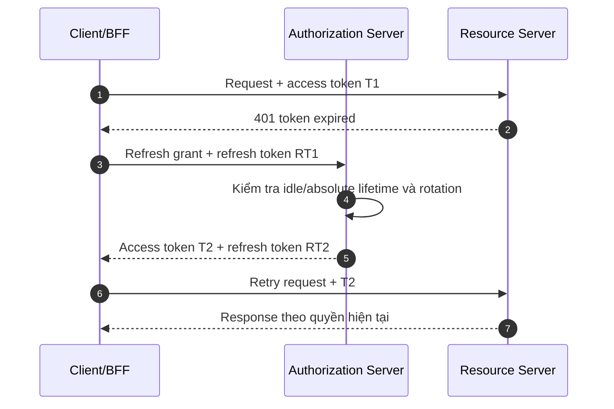

# Token lifetime quá dài

Access token là chứng cứ cho phép client gọi resource server. Nếu token có hiệu lực quá lâu, người dùng đăng xuất, bị khóa tài khoản hoặc mất quyền nhưng token bị lộ vẫn có thể tiếp tục được sử dụng. Với Bearer token, bất kỳ bên nào lấy được token đều có thể phát lại nó trong thời gian token còn hiệu lực, trừ khi có cơ chế ràng buộc người gửi hoặc thu hồi được kiểm tra kịp thời.

**Token lifetime quá dài** là lỗi thiết kế vòng đời credential: thời hạn token vượt quá mức rủi ro và thời gian phơi nhiễm mà hệ thống có thể chấp nhận. Lỗi này không chỉ nằm ở claim exp; nó còn liên quan refresh token, session, cache, introspection, revocation, clock skew và thời điểm quyền của người dùng thay đổi.

Bài học thuộc chương **Lỗi thường gặp** của mô-đun **SECURITY_TOKEN_SECURITY_FUNDAMENTALS**. Nội dung gắn với mô hình tin cậy và vòng đời token: phân biệt JWT, opaque token, access token và refresh token; hiểu phát hành, kiểm tra claims, scope, audience, lưu trữ, thu hồi và phòng chống token bị đánh cắp hoặc phát lại trong OAuth 2.0/OIDC.

Sau bài này, bạn có thể:

- Giải thích vì sao access token dài hạn làm tăng thời gian lạm dụng khi bị đánh cắp.
- Phân biệt lifetime của access token, refresh token, ID token và phiên đăng nhập.
- Đặt thời hạn theo mức độ nhạy cảm, loại client, audience, sender constraint và khả năng thu hồi.
- Hiểu giới hạn thu hồi của JWT offline, opaque token và cache introspection.
- Thiết kế refresh token rotation, idle timeout, absolute lifetime và yêu cầu xác thực lại.
- Kiểm thử exp, nbf, iat, clock skew, cache, logout và revocation.

## 1. Token lifetime là gì?

Token lifetime là khoảng thời gian token được phép sử dụng theo chính sách phát hành và xác minh. Với JWT, thời hạn thường được biểu diễn bằng claim exp (expiration time), cùng các claim thời gian như iat và nbf. Với opaque token, thời hạn có thể được quản lý trong Authorization Server (AS) và trả về qua introspection, ví dụ trường exp nếu AS cung cấp.

Một số khái niệm cần tách biệt:

| Khái niệm | Ý nghĩa |
|---|---|
| **Access token lifetime** | Khoảng thời gian resource server có thể chấp nhận access token |
| **Refresh token lifetime** | Khoảng thời gian refresh token còn được dùng để xin access token mới |
| **ID token lifetime** | Khoảng thời gian ID token còn hợp lệ theo OIDC client validation |
| **Session lifetime** | Thời hạn phiên đăng nhập tại IdP/BFF/client |
| **Idle timeout** | Phiên/token hết hiệu lực nếu không có hoạt động trong khoảng thời gian quy định |
| **Absolute lifetime** | Giới hạn tổng thời gian tối đa, kể cả khi phiên liên tục được sử dụng |
| **Revocation latency** | Độ trễ từ lúc thu hồi đến khi mọi resource server ngừng chấp nhận token |
| **Clock skew/leeway** | Khoảng sai lệch đồng hồ được validator cho phép khi kiểm tra claim thời gian |

Một access token hết hạn không đồng nghĩa phiên đăng nhập đã kết thúc. Client có thể dùng refresh token để xin access token mới nếu phiên và refresh grant vẫn hợp lệ. Ngược lại, session còn hoạt động cũng không có nghĩa access token cũ phải được chấp nhận vô thời hạn.

## 2. Vì sao lifetime quá dài nguy hiểm?

### 2.1. Tăng cửa sổ phát lại khi token bị đánh cắp

Bearer token là credential dạng possession: bên giữ token có thể sử dụng token theo quyền được cấp. Nếu token bị lộ trong browser storage, log, proxy, crash dump, thiết bị thất lạc hoặc máy bị malware, attacker có thể replay token tới resource server.

Ví dụ token có thời hạn 8 giờ. Attacker lấy được token sau 1 phút và không có cơ chế thu hồi được kiểm tra, thời gian còn lại có thể gần 7 giờ 59 phút. Token càng dài thì cửa sổ sử dụng trái phép càng lớn.

### 2.2. Quyền cũ tồn tại sau khi trạng thái thay đổi

Trong thời gian token còn hiệu lực:

- Nhân viên có thể đã bị khóa hoặc rời công ty.
- User có thể đã bị xóa khỏi tenant hoặc mất role.
- Consent hoặc delegation có thể đã bị thu hồi.
- Client/service account có thể bị disable.
- Một khóa ký hoặc credential nguồn có thể đã bị compromise.

JWT thường chứa snapshot claims tại thời điểm phát hành. Resource server xác minh chữ ký offline không tự biết membership hoặc policy vừa thay đổi. Nếu lifetime dài và không có kiểm tra trạng thái bổ sung, quyền cũ có thể tiếp tục được chấp nhận.

### 2.3. Tăng phạm vi tác động của sự cố

Nếu token chứa scope rộng, nhiều audience hoặc quyền nhạy cảm, lifetime dài làm tăng cả thời gian lẫn phạm vi mà attacker có thể khai thác. Ví dụ token có payments:charge và payments:refund dùng được 12 giờ tạo rủi ro lớn hơn token chỉ có orders:read dành riêng cho orders-api.

### 2.4. Làm chậm phản ứng thu hồi

Một tổ chức có thể disable user ngay lập tức nhưng resource server vẫn chấp nhận JWT cũ đến exp. Nếu API không kiểm tra denylist, introspection hoặc trạng thái session, thời điểm disable tài khoản không đồng nghĩa mọi token đã bị vô hiệu.

### 2.5. Tăng gánh nặng vận hành

Token dài hạn thường kéo theo cache lâu, khó đồng bộ trạng thái, claims cũ, khó xoay quyền và các ngoại lệ cho logout. Hệ thống có thể phải triển khai thêm denylist, introspection, event invalidation hoặc kiểm tra quyền trực tuyến để bù lại.

## 3. Không có một thời hạn cố định cho mọi token

OAuth 2.0 không quy định một con số lifetime duy nhất áp dụng cho mọi access token. Thời hạn cần dựa trên threat model, mức nhạy cảm dữ liệu, cách token được lưu, loại client, audience, khả năng thu hồi và mức chấp nhận gián đoạn khi AS không khả dụng.

Một bảng tham khảo để bắt đầu thiết kế:

| Loại token/ngữ cảnh | Hướng thiết kế | Lý do |
|---|---|---|
| Access token cho browser/BFF | Ngắn hạn, cấp mới qua phiên được bảo vệ | Giảm thời gian replay khi token lộ |
| Access token cho mobile/native app | Ngắn hạn; refresh token được bảo vệ trong secure storage | Thiết bị có thể thất lạc hoặc bị compromise |
| Access token cho API nhạy cảm | Ngắn hơn, scope/audience hẹp, cân nhắc sender constraint và kiểm tra trạng thái | Giảm cửa sổ lạm dụng quyền có tác động cao |
| Service-to-service access token | Ngắn hạn, credential workload riêng, audience cụ thể | Giảm tác động khi secret/workload bị lộ |
| Refresh token | Có idle timeout, absolute lifetime, rotation và reuse detection khi được hỗ trợ | Không cho phép phiên kéo dài vô hạn |
| ID token | Theo cấu hình OIDC client; chỉ dùng cho mục đích xác thực client | Không dùng thay access token gọi API |

Các khoảng thời gian như 5 phút, 10 phút hoặc 15 phút đôi khi được dùng làm điểm bắt đầu trong thiết kế, nhưng **không phải giá trị bắt buộc của OAuth/OIDC**. Cần kiểm chứng bằng rủi ro, trải nghiệm người dùng, tần suất refresh, tải AS và mục tiêu thu hồi của hệ thống thực tế.

## 4. Đánh giá lifetime theo rủi ro

Có thể dùng các yếu tố sau để chọn lifetime:

| Yếu tố | Rủi ro tăng khi | Hướng kiểm soát |
|---|---|---|
| Mức nhạy cảm | Token có quyền thanh toán, dữ liệu cá nhân hoặc quản trị | Lifetime ngắn, scope hẹp, step-up/reauth cho hành động quan trọng |
| Client type | Browser public client, thiết bị không quản lý, môi trường dễ bị malware | Giảm lifetime, bảo vệ refresh/session, sender constraint nếu phù hợp |
| Token storage | Token ở nơi JavaScript hoặc tiến trình khác có thể đọc | Rút ngắn lifetime, giảm exposure, dùng BFF/secure storage |
| Audience | Một token dùng cho nhiều API | Token riêng theo resource server |
| Scope | Có quyền ghi/xóa/quản trị rộng | Thu hẹp scope, lifetime ngắn, authorization theo tài nguyên |
| Revocation | JWT xác minh offline, không có denylist/introspection | Lifetime ngắn hoặc bổ sung cơ chế trạng thái |
| Cache | Introspection/JWKS/decision cache dài | TTL giới hạn theo token expiry và revocation SLA |
| Sender constraint | Bearer token có thể dùng từ thiết bị khác | Cân nhắc mTLS/DPoP, vẫn giữ lifetime hợp lý |
| Thay đổi quyền | Membership/role/consent thay đổi thường xuyên | Recheck entitlement, event invalidation hoặc token ngắn |
| Availability | AS khó đáp ứng refresh/introspection liên tục | Điều chỉnh TTL có kiểm soát, dự phòng AS; không kéo dài tùy tiện |

Một cách suy nghĩ thực tế là xác định **thời gian phơi nhiễm tối đa chấp nhận được** khi token bị lộ, sau đó tính cả độ trễ thu hồi và cache:

```text
effective_exposure_window
  ≈ min(token_time_remaining, revocation_detection_and_propagation)
    nếu revocation được kiểm tra đáng tin cậy

effective_exposure_window
  ≈ token_time_remaining + relevant_cache_staleness
    nếu resource server vẫn chấp nhận trạng thái cache cũ
```

Đây là mô hình tư duy, không phải công thức chuẩn hóa. Thời gian thực tế còn phụ thuộc thời điểm attacker lấy token, lần kiểm tra tiếp theo, cache topology và khả năng vô hiệu hóa ở từng resource server.

## 5. Access token và refresh token có vòng đời khác nhau

### 5.1. Access token

Access token được gửi tới resource server để truy cập API. Nó nên:

- Có lifetime phù hợp rủi ro và mục tiêu thu hồi.
- Có audience đúng API nhận token.
- Chỉ chứa scope cần thiết.
- Có exp rõ ràng và được validator kiểm tra ở mỗi request.
- Không được gia hạn bằng cách tự sửa claim hoặc ký lại ở client.
- Được bảo vệ khi lưu trữ, truyền tải và ghi log.

Khi access token hết hạn, resource server từ chối token. Client có thể xin token mới qua refresh grant hoặc flow được phép khác. Không nên làm access token sliding bằng cách kéo dài exp của chính token cũ.

### 5.2. Refresh token

Refresh token dùng với Authorization Server để lấy access token mới. Nó thường có thời hạn dài hơn access token, nhưng là credential có giá trị cao và phải được quản lý chặt:

- Có idle timeout để token không hoạt động lâu bị hết hiệu lực.
- Có absolute lifetime để phiên không kéo dài vô hạn.
- Rotation: mỗi lần refresh cấp token mới và vô hiệu hóa token cũ nếu AS hỗ trợ.
- Reuse detection: phát hiện refresh token cũ bị sử dụng lại, có thể thu hồi token family/session.
- Ràng buộc với client, grant, subject và quyền được cấp.
- Thu hồi khi logout, compromise, thay đổi trạng thái tài khoản hoặc sự kiện bảo mật theo policy.
- Lưu ở secure storage hoặc server-side session store phù hợp với loại client.

Không được nhầm việc access token hết hạn với refresh token hết hạn. Nếu refresh token còn hiệu lực, client có thể tiếp tục xin access token mới; vì vậy kiểm soát refresh token quyết định thời lượng phiên thực tế.

### 5.3. Idle timeout và absolute lifetime

Ví dụ một chính sách refresh token:

```text
idle_timeout = 7 days
absolute_lifetime = 30 days

last_used_at = 2026-11-20T10:00:00Z
issued_at    = 2026-11-01T10:00:00Z
```

Các giá trị chỉ minh họa. Nếu người dùng hoạt động đều đặn, idle timeout có thể được làm mới theo policy; nhưng absolute lifetime vẫn chặn phiên sau tổng thời gian tối đa. Khi hết absolute lifetime, yêu cầu xác thực lại thay vì cấp refresh token nối tiếp vô hạn.

Không áp dụng sliding extension mà không có trần tuyệt đối, nếu không một refresh token có thể duy trì phiên nhiều tháng hoặc nhiều năm dù ban đầu được thiết kế là ngắn hạn.

## 6. Kiểm tra exp, iat, nbf và clock skew

### 6.1. exp — thời điểm hết hạn

JWT exp là NumericDate, biểu diễn thời điểm sau đó token không được chấp nhận. Resource server phải kiểm tra thời gian hiện tại theo clock của nó và áp dụng leeway nhỏ, có cấu hình.

Ví dụ payload:

```json
{
  "iss": "https://id.example.com",
  "sub": "user-42",
  "aud": ["orders-api"],
  "scope": "orders:read",
  "iat": 1795507200,
  "nbf": 1795507200,
  "exp": 1795507500
}
```

Các timestamp trên chỉ là dữ liệu minh họa. exp - iat cho biết lifetime được token khai báo; validator cũng cần áp dụng giới hạn tối đa nếu hệ thống quy định access token không được dài hơn một ngưỡng.

### 6.2. iat — thời điểm phát hành

iat giúp biết token được phát hành khi nào. Nếu iat nằm quá xa trong tương lai hoặc tuổi token vượt policy, validator có thể từ chối. Tuy nhiên, chỉ có iat không đủ để chứng minh token còn hiệu lực; vẫn phải kiểm tra exp, issuer, audience, chữ ký và các điều kiện khác.

### 6.3. nbf — chưa có hiệu lực trước thời điểm

Nếu nbf ở tương lai, token chưa được sử dụng. Test cần bao gồm thời điểm trước, đúng và sau biên nbf, có xét leeway.

### 6.4. Clock skew

Đồng hồ AS và resource server có thể lệch nhau. Leeway quá nhỏ có thể gây lỗi ngẫu nhiên khi đồng hồ lệch; leeway quá lớn lại kéo dài hiệu lực token sau exp hoặc chấp nhận token trước nbf.

Thực hành:

- Đồng bộ thời gian bằng NTP hoặc dịch vụ time sync đáng tin.
- Dùng leeway nhỏ và thống nhất giữa gateway/backend.
- Đo và cảnh báo clock drift.
- Không tăng leeway chỉ để che một lỗi đồng bộ thời gian.
- Test ở biên exp, nbf và token có iat bất thường.

## 7. JWT offline và opaque token: lifetime không giống nhau về thu hồi

### 7.1. JWT

JWT có chữ ký thường được resource server xác minh offline bằng public key đã lấy từ JWKS. Điều này giảm phụ thuộc mạng tới AS, nhưng có hệ quả:

- Khi user bị disable, JWT đã phát hành vẫn có thể được chấp nhận tới exp.
- Khi role/tenant thay đổi, claims trong token vẫn là snapshot cũ.
- Khi key bị compromise, cần kế hoạch xoay/thu hồi khóa và xử lý token đã ký bằng key cũ.
- Nếu không có denylist hoặc kiểm tra trạng thái, lifetime là giới hạn tự nhiên quan trọng của token.

Vì vậy JWT offline thường cần lifetime ngắn tương xứng với khả năng chấp nhận stale authorization. Không giả định đổi JWKS hoặc disable user sẽ tự động vô hiệu mọi JWT đang lưu ở client.

### 7.2. Opaque token

Opaque token thường được resource server introspect tại AS. AS có thể trả active=false khi token bị thu hồi hoặc hết hiệu lực. Nhưng nếu resource server cache kết quả active=true, token có thể còn được chấp nhận cho đến khi cache hết hạn.

Ví dụ:

```text
AS introspection: active=true
Resource server cache TTL: 120 seconds
Token revoked at AS: 10:00:00
Cached active result may remain usable until cache expires
```

Đây là lý do phải tính cache staleness vào revocation SLA. TTL cache không được vượt exp còn lại của token và cần phù hợp với mức chấp nhận chậm thu hồi. Với API nhạy cảm, có thể cần cache ngắn hơn hoặc kiểm tra trạng thái trực tuyến.

### 7.3. So sánh

| Tiêu chí | JWT offline | Opaque + introspection |
|---|---|---|
| Kiểm tra mỗi request | Chữ ký và claims tại resource server | AS/introspection hoặc cache |
| Thu hồi tức thời | Khó nếu không có state check | Có thể phản ánh nhanh hơn, tùy cache và AS |
| Phụ thuộc AS khi gọi API | Thường thấp sau khi có JWKS | Thường cao hơn nếu không cache |
| Lifetime dài | Làm tăng cửa sổ stale/replay | Vẫn nguy hiểm nếu cache/state không cập nhật |
| Điều cần đo | exp, key rotation, denylist/state check | exp, introspection latency, cache freshness |

Opaque token không làm lifetime dài trở nên an toàn một cách tự động. JWT cũng không bắt buộc phải có lifetime dài để giảm tải AS; có thể kết hợp JWKS cache, refresh flow và token lifetime phù hợp.

## 8. Thu hồi token và phản ứng khi compromise

### 8.1. Các cơ chế thu hồi

- **OAuth token revocation endpoint (RFC 7009):** client gửi token tới AS để yêu cầu thu hồi theo quyền được cấp.
- **Introspection (RFC 7662):** resource server hỏi AS token còn active không.
- **Denylist/revocation list:** resource server kiểm tra jti hoặc token reference bị thu hồi.
- **Session/client disable:** vô hiệu hóa phiên, client hoặc grant liên quan.
- **Key rotation:** thay khóa ký khi có sự cố khóa; cần xử lý các token được ký bằng khóa cũ theo policy.
- **Event-driven invalidation:** phát sự kiện thu hồi tới gateway/service cache để giảm độ trễ.

Mỗi cơ chế có chi phí và giới hạn riêng. Chỉ gọi endpoint revoke không bảo đảm JWT offline lập tức bị mọi API từ chối nếu resource server không kiểm tra trạng thái.

### 8.2. Quy trình khi token bị lộ

1. Xác định token type, issuer, subject/client, audience, scope và thời điểm hết hạn từ log/audit đã redaction; không yêu cầu người dùng gửi token raw qua chat hoặc ticket.
2. Thu hồi token/refresh token/session hoặc disable client/credential liên quan theo khả năng AS.
3. Nếu refresh token bị lộ, thu hồi token family hoặc grant/session liên quan và xử lý reuse detection.
4. Kiểm tra denylist/introspection/cache propagation; xác minh từng resource server đã ngừng chấp nhận token.
5. Nếu private signing key bị lộ, thực hiện key compromise procedure: rotate key, cập nhật JWKS, loại bỏ trust key cũ theo kế hoạch và đánh giá token đã ký.
6. Kiểm tra audit để xác định request trái phép, tài nguyên bị truy cập và side effect đã xảy ra.
7. Cấp credential mới sau khi xử lý nguyên nhân lộ; yêu cầu xác thực lại nếu cần.
8. Ghi nhận thời điểm phát hiện, thời điểm revoke và thời điểm cuối cùng token còn được chấp nhận để đo revocation latency.

Không chỉ dựa vào exp để xử lý sự cố nếu token có quyền nhạy cảm và đã bị lộ. Cần xác minh đường thu hồi thực tế.

## 9. Renewal, reauthentication và step-up

Làm mới access token và xác thực lại người dùng là hai việc khác nhau:

- **Refresh:** AS cấp access token mới dựa trên refresh token/grant còn hợp lệ.
- **Reauthentication:** người dùng chứng minh lại danh tính, ví dụ đăng nhập lại hoặc xác thực yếu tố phù hợp.
- **Step-up authentication:** yêu cầu mức xác thực mạnh hơn trước một hành động nhạy cảm.

Không nên chỉ refresh token để tiếp tục phiên khi cần xác minh lại người dùng. Ví dụ chuyển tiền giá trị cao, thay đổi MFA, thay đổi tài khoản nhận tiền hoặc thao tác quản trị có thể cần step-up/reauth theo policy.

Một access token mới có thể mang auth_time, acr hoặc amr nếu OIDC/profile và AS hỗ trợ; resource server/client phải xác minh đúng semantics của các claim đó. Không tự suy luận rằng token vừa refresh đồng nghĩa người dùng vừa nhập lại mật khẩu.

### Ví dụ luồng



Nếu RT1 đã hết hạn, bị thu hồi hoặc reuse bị phát hiện, AS từ chối refresh và client cần khởi động lại authorization/reauthentication theo flow. Không lặp retry vô hạn với refresh token cũ.

## 10. Ví dụ chính sách lifetime

Ví dụ cấu hình khái niệm:

```yaml
tokenPolicy:
  accessToken:
    defaultLifetimeSeconds: 600
    highRiskLifetimeSeconds: 180
    maximumLifetimeSeconds: 900
    clockSkewSeconds: 30

  refreshToken:
    idleTimeoutSeconds: 604800
    absoluteLifetimeSeconds: 2592000
    rotationEnabled: true
    reuseDetectionEnabled: true

  sensitiveActions:
    payments.refund:
      requireRecentAuthentication: true
      maximumAuthenticationAgeSeconds: 300
```

Đây là ví dụ minh họa để thảo luận policy, không phải giá trị chuẩn hoặc khuyến nghị áp dụng nguyên trạng. Cần điều chỉnh theo threat model, loại client, yêu cầu nghiệp vụ, khả năng AS, tần suất refresh, availability và mục tiêu thu hồi.

Các kiểm soát quan trọng:

- maximumLifetimeSeconds phải được enforce ở AS và test; không chỉ là tài liệu.
- Clock skew phải được tính trong validator và nhỏ hơn mức có thể chấp nhận.
- Refresh token phải có cả idle timeout và absolute lifetime.
- Rotation/reuse detection phải hoạt động đúng khi nhiều request refresh đồng thời.
- requireRecentAuthentication cần dựa trên bằng chứng xác thực phù hợp, không chỉ thời điểm refresh access token.

## 11. Các lỗi thường gặp

| Lỗi | Hậu quả | Cách khắc phục |
|---|---|---|
| Access token sống 8–24 giờ không có lý do | Token bị lộ có cửa sổ replay dài | Giảm lifetime theo risk và audience |
| Một lifetime cho mọi API | API nhạy cảm nhận token dài như API đọc thông thường | Policy theo resource/action |
| Coi JWT đã ký là không thể bị đánh cắp | Bearer JWT vẫn có thể bị replay | Bảo vệ storage, log, TLS; cân nhắc sender constraint |
| Không có exp hoặc bỏ qua exp | Token có thể không có giới hạn hiệu lực rõ | Yêu cầu expiry theo profile và validate bắt buộc |
| Client tự kéo dài exp | Mất kiểm soát issuer và vòng đời | Chỉ AS phát hành token mới |
| Refresh token không có absolute lifetime | Phiên kéo dài vô hạn | Đặt absolute expiry và yêu cầu reauth |
| Refresh token không rotation/reuse detection | Token cũ bị replay mà khó phát hiện | Rotation và revoke token family theo khả năng AS |
| Logout chỉ xóa token ở client | Token đã bị copy vẫn còn dùng được | Revoke session/grant và kiểm tra propagation |
| JWT offline nhưng kỳ vọng revoke tức thời | API vẫn chấp nhận token cũ đến expiry | TTL ngắn hoặc state check/denylist |
| Introspection cache quá lâu | Token đã revoke vẫn active trong cache | Giảm TTL và đặt revocation SLA |
| Clock skew quá lớn | Token hết hạn vẫn được chấp nhận lâu hơn | Đồng bộ thời gian, leeway nhỏ |
| Không giới hạn tuổi iat/lifetime | AS lỗi có thể phát token sống quá lâu | Enforce maximum token age/lifetime |
| Refresh token dùng như Bearer access token | Credential có thể bị lộ cho API nghiệp vụ | Chỉ gửi refresh token tới AS |
| Refresh khi cần step-up | Hành động nhạy cảm không được xác thực lại | Reauth/step-up theo policy |
| Cache authorization không gắn expiry | Quyền cũ còn được dùng sau token hết hạn | TTL không vượt token expiry/revocation SLA |
| Retry refresh vô hạn | Tải AS tăng, client loop và lỗi dây chuyền | Retry có giới hạn, backoff, xử lý invalid_grant |

## 12. Ma trận kiểm thử lifetime và revocation

| ID | Kịch bản | Kết quả mong đợi |
|---|---|---|
| L01 | Access token còn hạn, claims và audience hợp lệ | Chấp nhận nếu authorization đạt |
| L02 | now sau exp | Từ chối |
| L03 | now đúng biên exp theo validator/profile | Kết quả nhất quán với quy tắc expiry và leeway |
| L04 | nbf nằm trong tương lai | Từ chối trước thời điểm có hiệu lực |
| L05 | iat nằm quá xa trong tương lai | Từ chối theo policy |
| L06 | exp - iat vượt maximum lifetime | AS không phát hành hoặc resource server từ chối |
| L07 | exp bị thiếu/sai kiểu | Từ chối theo token profile |
| L08 | Đồng hồ resource server lệch trong giới hạn leeway | Hoạt động nhất quán |
| L09 | Đồng hồ lệch vượt giới hạn | Từ chối và phát tín hiệu vận hành |
| L10 | JWT bị revoke nhưng không có state check | Xác minh giới hạn: có thể còn được chấp nhận đến exp |
| L11 | JWT bị revoke và denylist đã cập nhật | Từ chối theo SLA |
| L12 | Opaque token introspection trả active=false | Từ chối |
| L13 | Opaque token revoke nhưng cache active=true còn TTL | Kiểm chứng độ trễ thu hồi không vượt mục tiêu |
| L14 | Refresh token hết idle timeout | AS từ chối refresh |
| L15 | Refresh token hết absolute lifetime | AS từ chối và yêu cầu authorization/reauth |
| L16 | Refresh token rotation thành công | RT cũ bị vô hiệu, RT mới được lưu an toàn |
| L17 | Reuse refresh token cũ | Phát hiện và xử lý token family/session theo policy |
| L18 | Hai request refresh đồng thời | Không tạo race cho phép RT cũ dùng lại |
| L19 | Logout/revoke session | Token/refresh grant bị xử lý đúng theo revocation design |
| L20 | Token scope cao dùng cho action nhạy cảm sau khi auth quá cũ | Yêu cầu step-up/reauth |
| L21 | Token hết hạn nhưng cache response còn dữ liệu | API không dùng cache để bỏ qua token expiry |
| L22 | AS/JWKS/introspection không khả dụng | Không fail open; xử lý theo availability policy |
| L23 | Sender-constrained token được gửi từ key khác | Từ chối proof/token binding |
| L24 | Access token được refresh nhiều lần | Mỗi token mới vẫn tuân thủ maximum lifetime và policy hiện tại |

Kiểm thử cần chạy qua resource server thật hoặc decoder/introspection adapter thật. Unit test chỉ kiểm tra hàm tính thời gian không đủ để chứng minh gateway, cache và mọi service cùng thực thi lifetime.

## 13. Theo dõi vận hành

Nên đo các sự kiện và chỉ số:

- Phân bố tuổi access token khi được sử dụng, không chỉ lifetime cấu hình.
- Số token bị từ chối do expired, not_yet_valid hoặc lifetime vượt policy.
- Tỷ lệ refresh thành công/thất bại và invalid_grant.
- Số lần refresh token reuse bị phát hiện.
- Thời gian từ revoke đến lần cuối resource server chấp nhận token.
- Introspection latency, cache TTL/freshness và cache hit/miss.
- Clock drift giữa AS, gateway và resource server.
- Tỷ lệ request nhận token mới nhưng vẫn bị từ chối do stale claims hoặc audience/scope mismatch.

Không ghi raw token, refresh token hoặc PII vào metrics/log. Dùng reason code hữu hạn, issuer alias, resource server và correlation ID được bảo vệ. Khi điều tra sự cố, đối chiếu audit event với thời điểm revoke và kết quả xác minh ở từng API.

### SLO thu hồi

Định nghĩa một mục tiêu có thể đo:

```text
revocation_latency =
  last_time_any_resource_server_accepts(token)
  - revocation_requested_at
```

Đo riêng theo loại token và đường xác minh. JWT offline có thể cần chờ exp nếu không có state check; opaque introspection có thể bị giới hạn bởi cache TTL. Không công bố “logout tức thời” nếu chưa đo được mọi resource server, gateway và cache.

## 14. Checklist thiết kế

- Xác định mức rủi ro của từng access token theo dữ liệu, action, audience và client.
- Đặt access token lifetime ngắn phù hợp với cửa sổ phơi nhiễm chấp nhận được.
- Không dùng một token quá rộng cho nhiều resource server.
- Enforce exp, nbf, iat và maximum lifetime ở validator.
- Đồng bộ thời gian; cấu hình clock skew nhỏ và thống nhất.
- Tách lifetime access token, refresh token, ID token và session.
- Refresh token có idle timeout, absolute lifetime, storage an toàn, rotation và reuse detection khi hỗ trợ.
- Logout/revocation có propagation và cache invalidation được kiểm thử.
- JWT offline có chiến lược cho token cũ khi user/role/key bị thu hồi.
- Opaque introspection cache có TTL phù hợp với token expiry và revocation SLA.
- Hành động nhạy cảm có yêu cầu reauthentication/step-up phù hợp.
- Không kéo dài exp ở client hoặc dùng refresh token để bỏ qua step-up.
- Có test biên thời gian, clock skew, refresh concurrency, reuse, revoke và fail-closed.
- Đo revocation latency thực tế và lưu audit đã redaction.

### Bài tập suy luận

Một API nhận access token JWT có iat lúc 09:00 và exp lúc 17:00. Người dùng bị disable lúc 09:10. Resource server xác minh JWT offline, không introspection và không denylist.

**Câu hỏi 1:** Chỉ disable user tại AS có bảo đảm API từ chối JWT ngay lúc 09:10 không?

**Đáp:** Không. Resource server không hỏi trạng thái hiện tại và chữ ký JWT vẫn hợp lệ; token có thể tiếp tục được chấp nhận tới exp theo validator.

**Câu hỏi 2:** Nếu giảm access token lifetime xuống 10 phút, có loại bỏ hoàn toàn rủi ro không?

**Đáp:** Không. Nó giảm cửa sổ replay/stale claims nhưng vẫn cần bảo vệ token, refresh token, cache và cơ chế thu hồi cho trường hợp nhạy cảm.

**Câu hỏi 3:** Nếu opaque token introspection cache active=true trong 5 phút, revoke lúc 09:10 có thể phản ánh ngay không?

**Đáp:** Không nhất thiết. Resource server có thể dùng kết quả cache cũ tới khi TTL hết hoặc có invalidation event. Cần đo và giới hạn revocation latency.

**Câu hỏi 4:** Người dùng refresh access token lúc 09:11 có đồng nghĩa vừa xác thực lại không?

**Đáp:** Không. Refresh dựa trên refresh grant còn hợp lệ; reauthentication/step-up là yêu cầu xác minh người dùng lại ở mức phù hợp.

**Nguyên tắc cốt lõi:** *Lifetime giới hạn thời gian một token có thể được sử dụng, nhưng mức bảo vệ thực tế còn phụ thuộc refresh token, cache và khả năng thu hồi. Hãy đặt thời hạn theo rủi ro, đo độ trễ thu hồi và yêu cầu xác thực lại khi hành động cần bằng chứng mới.*

### Tiêu chuẩn tham khảo

- [RFC 6749 — The OAuth 2.0 Authorization Framework](https://www.rfc-editor.org/rfc/rfc6749)
- [RFC 6750 — OAuth 2.0 Bearer Token Usage](https://www.rfc-editor.org/rfc/rfc6750)
- [RFC 7009 — OAuth 2.0 Token Revocation](https://www.rfc-editor.org/rfc/rfc7009)
- [RFC 7662 — OAuth 2.0 Token Introspection](https://www.rfc-editor.org/rfc/rfc7662)
- [RFC 7519 — JSON Web Token (JWT)](https://www.rfc-editor.org/rfc/rfc7519)
- [RFC 8725 — JSON Web Token Best Current Practices](https://www.rfc-editor.org/rfc/rfc8725)
- [RFC 9068 — JWT Profile for OAuth 2.0 Access Tokens](https://www.rfc-editor.org/rfc/rfc9068)
- [RFC 9449 — OAuth 2.0 Demonstrating Proof of Possession (DPoP)](https://www.rfc-editor.org/rfc/rfc9449)
- [RFC 9700 — Best Current Practice for OAuth 2.0 Security](https://www.rfc-editor.org/rfc/rfc9700)
- [OpenID Connect Core 1.0](https://openid.net/specs/openid-connect-core-1_0.html)
