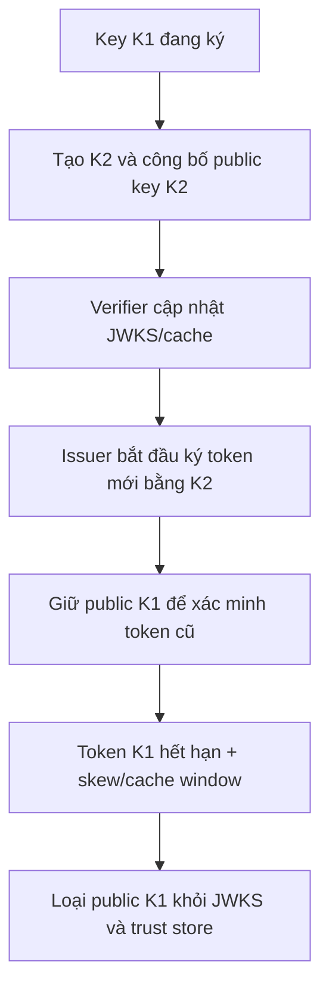

# Không xoay key: rủi ro và cách vận hành vòng đời khóa token

## 1. Bối cảnh và mục tiêu

Các hệ thống xác thực dựa vào khóa mật mã để ký JWT, xác minh chữ ký, mã hóa refresh token lưu trữ, tạo fingerprint và xác thực OAuth client. Khóa có thể bị lộ, bị sao chép, hết thời hạn sử dụng, không còn đáp ứng chính sách thuật toán hoặc cần thay theo chu kỳ vận hành. Nếu hệ thống không xoay khóa, một khóa cũ có thể tiếp tục bảo vệ token và dữ liệu trong thời gian dài hơn dự kiến. Khi khóa bị compromise, kẻ tấn công có thể giả mạo token, giải mã dữ liệu hoặc mạo danh client tùy loại khóa.

**Key rotation** là quá trình thay khóa đang dùng bằng khóa mới theo một kế hoạch có kiểm soát, đồng thời quản lý việc chuyển tiếp, xác minh dữ liệu cũ, loại bỏ khóa cũ và xử lý dữ liệu đã được tạo bằng khóa trước đó. Rotation không chỉ là tạo một key mới trong KMS rồi đổi cấu hình một dòng; các issuer, resource server, cache JWKS, token storage, backup và client có thể cần thời gian chuyển đổi đồng bộ.

Trong nền tảng **Security Token Security Fundamentals**, bài này giải thích lỗi thường gặp khi không xoay key trong vòng đời JWT, opaque token, access token, refresh token và OAuth 2.0/OIDC. Người học cần phân biệt khóa ký, khóa mã hóa, HMAC secret, pepper và client secret vì mỗi loại có cách thay, phạm vi ảnh hưởng và điều kiện giữ khóa cũ khác nhau.

Sau bài này, người học có thể:

- Nhận diện các loại khóa được sử dụng trong phát hành, xác minh và lưu trữ token.
- Giải thích hậu quả khi khóa quá hạn, bị lộ hoặc không còn tương thích.
- Lập kế hoạch rollover có giai đoạn publish, activate, overlap và retire.
- Cấu hình `kid`, JWKS, cache và thuật toán theo allowlist.
- Xoay khóa mã hóa bằng envelope encryption và quản lý key version.
- Thực hiện emergency rotation khi nghi ngờ khóa bị compromise.
- Kiểm thử rotation, rollback, backup/restore và khả năng xác minh token trong giai đoạn chuyển tiếp.

## 2. Những loại khóa thường gặp trong hệ thống token

Không có một quy trình rotation duy nhất áp dụng cho mọi bí mật. Trước khi thay khóa, cần xác định khóa đang làm nhiệm vụ gì và dữ liệu nào phụ thuộc vào nó.

| Loại khóa/bí mật | Công dụng | Thành phần thường giữ | Cách rotation điển hình |
| --- | --- | --- | --- |
| Asymmetric signing private key | Ký JWT/JWS do issuer phát hành. | Authorization server hoặc identity provider, thường qua KMS/HSM. | Tạo key pair mới, công bố public key, chuyển signer sang private key mới, giữ public key cũ tới khi token cũ hết hạn hoặc bị revoke. |
| Asymmetric verification public key | Xác minh chữ ký JWT. | Resource server/JWKS cache. | Cập nhật JWKS hoặc trust store; giữ public key cũ trong thời gian overlap cần thiết. |
| HMAC signing secret | Ký và xác minh token bằng cùng một secret, ví dụ HS256. | Issuer và mọi verifier được phép xác minh. | Phân phối secret version mới tới các bên, chuyển signer/verifier theo giai đoạn; thu hồi secret cũ sau khi không còn token phụ thuộc. |
| Data encryption key (DEK) | Mã hóa refresh token hoặc credential lưu trong database. | Service hoặc KMS-managed envelope flow. | Sinh DEK mới và mã hóa lại dữ liệu; hoặc dùng DEK riêng cho từng record. |
| Key encryption key (KEK) | Bọc/giải bọc DEK trong envelope encryption. | KMS/HSM. | Rewrap DEK bằng KEK mới; giữ key cũ tới khi mọi bản sao/backup đã chuyển hoặc hết retention. |
| HMAC pepper/fingerprint key | Tạo fingerprint để tra cứu token mà không lưu raw token. | Authorization server, KMS/secret manager. | Dùng key version mới, hỗ trợ tra cứu nhiều phiên bản trong chuyển tiếp rồi migrate record. |
| OAuth client secret | Xác thực confidential client tại token endpoint. | Client và authorization server. | Tạo credential mới, triển khai client, cho phép overlap nếu AS hỗ trợ rồi thu hồi secret cũ. |
| DPoP/mTLS private key hoặc certificate | Ràng buộc token/request với client. | Client hoặc workload identity provider. | Cấp key/certificate mới, cập nhật binding và trust chain, chuyển tiếp theo policy. |

`kid` trong protected header của JWT thường là định danh giúp verifier chọn khóa trong tập khóa tin cậy. `kid` không phải khóa, không chứng minh nguồn phát hành và không được phép làm verifier tải một key tùy ý từ URL do token cung cấp.

## 3. Vì sao không xoay key là lỗi bảo mật?

Khóa không nên được xem là bí mật có thể dùng mãi. Theo thời gian, khả năng lộ khóa tăng do nhiều người/dịch vụ có quyền truy cập, backup và snapshot tích lũy, log/debug sai cấu hình, nhân sự thay đổi, máy chủ bị xâm nhập hoặc nhà cung cấp phát hiện vấn đề thuật toán.

Các hậu quả chính:

1. **Giả mạo token:** private signing key hoặc HMAC secret bị lộ có thể cho phép tạo JWT có chữ ký hợp lệ theo verifier đang tin khóa đó.
2. **Giải mã dữ liệu cũ:** KEK/DEK bị lộ có thể làm lộ refresh token đã mã hóa và credential khác trong phạm vi khóa bảo vệ.
3. **Mở rộng phạm vi compromise:** một HMAC secret dùng chung cho nhiều service khiến việc lộ ở một service ảnh hưởng toàn bộ verifier dùng chung secret.
4. **Không thể thu hồi tin cậy:** nếu không biết token nào được ký bằng key version nào, issuer khó xác định phạm vi token cần revoke khi khóa gặp sự cố.
5. **Phụ thuộc vào cấu hình cũ:** thư viện, thuật toán hoặc key size cũ có thể không còn phù hợp chính sách bảo mật.
6. **Gián đoạn dịch vụ khi buộc phải thay khóa:** không có quy trình overlap và kiểm thử khiến việc thay khóa khẩn cấp gây 401 hàng loạt hoặc làm client không refresh được.

Rotation không thay thế kiểm soát truy cập khóa. Nếu attacker vẫn có quyền đọc private key mới hoặc có thể gọi KMS để ký tùy ý, việc tạo key version mới không loại bỏ được nguyên nhân compromise.

## 4. Lập chính sách vòng đời khóa

Mỗi khóa cần một hồ sơ vòng đời có thể kiểm tra được:

- **Owner:** service/team chịu trách nhiệm và người phê duyệt thao tác.
- **Purpose:** ký JWT, mã hóa credential, fingerprint token hay xác thực client.
- **Algorithm/key type:** RSA, EC, HMAC, AES-GCM hoặc loại phù hợp.
- **Key ID/version:** định danh bất biến, không tái sử dụng `kid` cho key material khác.
- **Created/activated/retired time:** thời điểm tạo, bắt đầu dùng và ngừng dùng.
- **Rotation trigger:** lịch định kỳ, tuổi khóa, thay đổi thuật toán, thay đổi owner hoặc sự cố.
- **Dependencies:** issuer, resource server, JWKS cache, database record, backup, client và môi trường DR.
- **Access policy:** workload nào được ký, giải mã, rewrap hoặc quản lý key.
- **Recovery/retirement:** cách phục hồi và điều kiện xóa/disable key cũ.

Thời hạn rotation cụ thể phụ thuộc chuẩn áp dụng, loại khóa, khả năng KMS/HSM, mức độ nhạy cảm và threat model. Không có một số ngày duy nhất phù hợp cho mọi signing key, encryption key và client secret. Tổ chức cần đặt lịch và ngưỡng dựa trên policy được phê duyệt, đồng thời có quy trình emergency rotation độc lập.

### 4.1. Phân biệt rotation, rekey và rewrap

- **Rotation:** thay khóa đang được dùng bằng một khóa mới và quản lý chuyển tiếp.
- **Rekey:** tạo khóa mới và mã hóa lại dữ liệu bằng khóa mới; thường áp dụng cho DEK hoặc khi cần thay key material bảo vệ dữ liệu.
- **Rewrap:** dùng KEK mới bọc lại DEK hiện có mà không giải mã rồi mã hóa lại toàn bộ plaintext. Đây là thao tác thường dùng trong envelope encryption.
- **Revocation/disable:** ngừng tin hoặc ngừng cho phép sử dụng khóa; cần thiết khi compromise nhưng có thể gây lỗi ngay nếu dependency chưa được cập nhật.

Một key version mới không tự động làm dữ liệu cũ được bảo vệ bằng key mới. Với ciphertext, cần re-encrypt hoặc rewrap theo đúng lớp khóa. Với JWT đã ký, chữ ký cũ vẫn phụ thuộc public key cũ cho tới khi token hết hạn hoặc bị từ chối bằng policy.

## 5. Rollover khóa ký JWT/JWS

Với chữ ký bất đối xứng như RS256 hoặc ES256, issuer ký bằng private key và resource server xác minh bằng public key. Mô hình JWKS cho phép issuer công bố nhiều public key cùng lúc để verifier chọn đúng khóa dựa trên `kid`.

### 5.1. Rollover bình thường theo bốn giai đoạn

**Giai đoạn 1 — Prepare:** tạo key pair mới trong KMS/HSM. Cấp quyền ký cho issuer nhưng chưa chuyển signer. Công bố public key mới trong JWKS với `kid` duy nhất, đúng `kty`, `use`, `alg` và tham số key.

**Giai đoạn 2 — Propagate:** chờ resource server tải JWKS mới hoặc xác nhận cache đã cập nhật. Có thể chủ động refresh cache theo cơ chế được thư viện hỗ trợ. Không giả định mọi instance nhận key ngay lập tức.

**Giai đoạn 3 — Activate:** chuyển issuer sang ký token mới bằng private key K2 và đặt header `kid=K2`. Giữ public key K1 trong JWKS để xác minh token đã ký trước thời điểm chuyển.

**Giai đoạn 4 — Retire:** sau khi mọi token ký bằng K1 đã hết hạn, cộng clock skew, thời gian propagation và cache policy, loại K1 khỏi JWKS. Xóa/disable private key K1 theo quy trình lưu trữ và audit; nếu cần giữ để xác minh lịch sử offline thì tách quyền và đánh dấu không còn được phép ký.

Không xóa private key cũ trước khi issuer ngừng dùng nó. Không xóa public key cũ trước khi token hợp lệ được ký bằng nó đã hết thời hạn cần xác minh. Ngược lại, không giữ public key cũ vô thời hạn nếu token có thể được chấp nhận lâu hơn dự kiến hoặc key đã compromise.

### 5.2. Tính thời gian overlap

Overlap cần bao phủ:

- Thời hạn tối đa của access token được ký bằng key cũ.
- Clock skew mà verifier cho phép khi kiểm tra `exp`/`nbf`.
- Thời gian propagation JWKS tới tất cả instance và vùng.
- Thời gian cache của verifier, proxy hoặc thư viện JWT.
- Các job offline hoặc batch còn xác minh token được ký bằng key cũ.

Ví dụ: issuer ngừng ký bằng K1 lúc 12:00. Token cuối cùng do K1 ký có `exp` lúc 12:15. Verifier cho phép clock skew 60 giây và JWKS cache có thể giữ dữ liệu cũ thêm 5 phút. Thời điểm loại K1 phải tính từ các giới hạn thực tế và thời gian đồng bộ hệ thống, không chỉ lấy 12:15 rồi xóa key.

### 5.3. Kiểm tra `kid`, `alg` và JWKS

- `kid` phải duy nhất trong phạm vi issuer/key set và không tái sử dụng cho key material khác.
- Verifier chọn key từ JWKS URI đã cấu hình tin cậy hoặc trust store đã onboarding.
- Không tải `jku`, `x5u` hoặc URL khác do token cung cấp nếu không có policy cho phép và kiểm soát chặt.
- Allowlist thuật toán ở verifier; không tin `alg` trong token để tự động bật thuật toán.
- Kiểm tra key type/curve phù hợp với thuật toán, ví dụ RSA key cho RS256 và EC key phù hợp cho ES256.
- Nếu không tìm thấy `kid`, refresh JWKS có giới hạn; nếu vẫn không có key phù hợp thì từ chối token.
- Không fallback sang `alg=none`, HMAC hoặc một key khác chỉ để làm token parse thành công.

`kid` không bí mật. Có thể xuất hiện trong log an toàn để điều tra key selection, nhưng không đưa token đầy đủ hoặc claims nhạy cảm vào log.

## 6. Xoay HMAC secret

Với HS256, cùng một secret được dùng để ký và xác minh. Điều này làm phân phối secret phức tạp hơn mô hình bất đối xứng: mỗi verifier giữ secret đều có khả năng tạo chữ ký, không chỉ xác minh.

Khi cần rotation:

1. Sinh secret mới có entropy cao bằng CSPRNG hoặc secret manager.
2. Gán key ID/version rõ ràng và cấu hình verifier chấp nhận tập secret được phép trong giai đoạn chuyển tiếp.
3. Triển khai secret mới tới issuer và verifier qua secret manager/KMS, không qua source code, ticket hoặc chat log.
4. Chuyển issuer sang ký bằng secret mới và gắn key ID nếu định dạng/hợp đồng hỗ trợ.
5. Giữ secret cũ chỉ trong thời gian cần xác minh token cũ.
6. Sau khi token cũ hết hạn hoặc bị revoke, xóa quyền dùng secret cũ khỏi verifier và secret store theo policy.

Nếu JWT profile hoặc thư viện không hỗ trợ `kid`/nhiều secret, cần một cách chuyển đổi có kiểm soát, ví dụ triển khai đồng bộ hoặc đổi phiên token theo một mốc đã thống nhất. Không viết verifier thử lần lượt mọi secret và thuật toán không giới hạn.

HMAC secret dùng chung cho nhiều service làm tăng blast radius. Nếu các resource server chỉ cần xác minh token, cân nhắc chữ ký bất đối xứng để chỉ issuer giữ private key có quyền ký. Không dùng public key RSA làm HMAC secret; đây là lỗi algorithm confusion nghiêm trọng.

## 7. Xoay khóa mã hóa token storage

Backend OAuth client có thể lưu refresh token đã mã hóa để sử dụng lại ở token endpoint. Với envelope encryption, cần phân biệt DEK và KEK.

### 7.1. Rotation KEK bằng rewrap

Nếu chỉ thay KEK trong KMS:

1. Tạo KEK version mới và cấp quyền tối thiểu cho workload.
2. Kiểm tra service có thể giải bọc DEK bằng KEK cũ và ghi wrapped DEK mới bằng KEK mới.
3. Rewrap DEK theo batch có giới hạn; ghi `kek_version` mới cùng record.
4. Xác minh ciphertext vẫn giải mã được và authentication tag hợp lệ.
5. Đối chiếu số record còn phụ thuộc KEK cũ, bao gồm replica, snapshot và backup.
6. Chỉ disable/destroy KEK cũ khi không còn dữ liệu hợp lệ cần giải mã và quy trình DR đã xác nhận.

Rewrap không thay đổi DEK hoặc ciphertext của token; nó thay lớp bảo vệ DEK. Đây thường là cách hiệu quả khi mục tiêu là thay KEK mà không phải mã hóa lại toàn bộ credential.

### 7.2. Rotation DEK bằng re-encryption

Nếu DEK bị nghi ngờ lộ hoặc policy yêu cầu thay DEK:

1. Sinh DEK mới.
2. Giải mã ciphertext bằng DEK cũ trong môi trường được bảo vệ.
3. Mã hóa plaintext bằng DEK mới với nonce duy nhất và AEAD.
4. Bọc DEK mới bằng KEK hiện hành.
5. Ghi ciphertext, nonce/tag, wrapped DEK và key version mới một cách nguyên tử.
6. Xác minh dữ liệu mới đọc được, sau đó xóa/disable DEK cũ theo retention và backup policy.

Không ghi plaintext refresh token ra file tạm hoặc log trong quá trình migration. Nếu migration thất bại, record phải giữ được trạng thái nhất quán và không mất credential đang hoạt động.

### 7.3. HMAC pepper/fingerprint key

Authorization server có thể dùng HMAC pepper để tạo fingerprint token. Khi xoay pepper, cần lưu key version trong metadata để biết cách tính fingerprint. Trong giai đoạn chuyển tiếp, server có thể tra cứu theo các pepper version còn được phép, sau đó cập nhật record sang version mới khi token được rotate hoặc khi có quy trình migration phù hợp.

Không lưu pepper cùng database backup chứa fingerprint. Nếu pepper cũ bị compromise, cân nhắc buộc token family liên quan cấp lại hoặc chuyển trạng thái theo incident plan; chỉ thay pepper mà không xử lý fingerprint/token cũ có thể khiến server không còn tra cứu được token hợp lệ hoặc vẫn giữ rủi ro từ dữ liệu đã lộ.

## 8. Xoay OAuth client secret và credential sender-constrained

Client secret là credential xác thực confidential client, không phải signing key của access token. Cách rotation phụ thuộc authorization server có hỗ trợ nhiều secret cùng lúc, thời gian overlap và cơ chế revoke hay không.

Quy trình thường gặp:

1. Tạo client secret mới tại authorization server.
2. Cập nhật secret mới trong secret manager của client nhưng chưa xóa secret cũ.
3. Deploy hoặc reload client theo cơ chế không ghi secret vào log.
4. Xác nhận token endpoint chấp nhận client authentication bằng secret mới trên mọi instance.
5. Thu hồi secret cũ tại authorization server.
6. Xóa secret cũ khỏi secret manager, pipeline và các bản cấu hình không còn cần thiết theo policy.

Nếu authorization server không hỗ trợ overlap, cần kế hoạch cutover đồng bộ, có cửa sổ bảo trì hoặc cơ chế credential thứ hai được provider hỗ trợ. Không để một nửa instance dùng secret mới trong khi instance còn lại tiếp tục gửi secret cũ sau khi server đã thu hồi.

Với mTLS certificate hoặc DPoP key, rotation cần cập nhật binding giữa client, certificate/key thumbprint và token. Token được ràng buộc với key cũ có thể không dùng được với key mới; cần cấp lại token hoặc hỗ trợ overlap theo profile và policy. Không chỉ thay certificate ở client rồi giả định access token cũ vẫn hợp lệ.

## 9. Quy trình rotation định kỳ

Một runbook chung có thể dùng cho từng loại khóa sau khi bổ sung bước chuyên biệt:

### Trước khi rotation

1. Xác định loại key, owner, key ID/version, mục đích và dữ liệu phụ thuộc.
2. Kiểm tra tuổi khóa, quyền truy cập, thuật toán, key size/curve và trạng thái KMS/HSM.
3. Liệt kê issuer, resource server, JWKS cache, client, backup, replica và vùng DR cần cập nhật.
4. Xác định overlap, token lifetime, clock skew, cache TTL và thời điểm retire.
5. Xác nhận có backup/restore phù hợp và khả năng quay lại cấu hình trước mà không tái kích hoạt key đã compromise.
6. Chuẩn bị dashboard và alert cho signature failure, unknown `kid`, KMS error, token endpoint authentication failure và decrypt failure.

### Trong khi rotation

1. Tạo key version mới trong KMS/HSM hoặc secret manager.
2. Kiểm tra quyền ký/giải mã của workload mới và xác minh public key/metadata đã công bố.
3. Triển khai verifier/consumer hỗ trợ key mới trước khi chuyển issuer nếu cần.
4. Chuyển issuer hoặc encryption writer sang key mới.
5. Theo dõi kết quả ở mọi instance/vùng; xác minh token mới có key ID/version mới.
6. Giữ key cũ chỉ cho mục đích xác minh/giải mã dữ liệu còn phụ thuộc trong overlap đã định.

### Sau rotation

1. Xác nhận không còn issuer ký bằng key cũ hoặc writer mã hóa bằng DEK cũ.
2. Xác nhận token cũ đã hết hạn/revoke hoặc dữ liệu đã được re-encrypt/rewrap.
3. Xác nhận backup và DR không còn phụ thuộc key cũ, hoặc key cũ được giữ ở trạng thái lưu trữ được kiểm soát.
4. Thu hồi quyền sử dụng key cũ, disable hoặc destroy theo policy.
5. Ghi audit: key ID, owner, thời điểm, approver, phạm vi, kết quả và ngoại lệ.
6. Cập nhật inventory và lịch rotation tiếp theo.

## 10. Emergency rotation khi nghi ngờ compromise

Rollover định kỳ cho phép overlap để không gián đoạn dịch vụ. Khi khóa bị compromise, ưu tiên là ngừng tin khóa bị lộ. Không áp dụng overlap bình thường nếu nó cho phép attacker tiếp tục ký token hoặc giải mã dữ liệu.

Quy trình phản ứng:

1. **Xác định phạm vi:** loại khóa, key ID/version, thời điểm có thể bị lộ, service và dữ liệu phụ thuộc.
2. **Chặn sử dụng:** disable quyền ký/giải mã của key bị compromise; cô lập workload hoặc identity có quyền gọi KMS nếu cần.
3. **Tạo và triển khai key mới:** phát hành key version mới, cập nhật issuer/verifier/consumer và xác minh đường đi mới.
4. **Vô hiệu token liên quan:** với signing key bị lộ, loại public key khỏi trust sau khi các verifier đã cập nhật và từ chối token ký bằng key đó; cân nhắc revoke grant/session và yêu cầu cấp token mới.
5. **Thay secret liên quan:** nếu HMAC/client secret/pepper bị lộ, thay credential và đánh giá toàn bộ service dùng chung.
6. **Xử lý dữ liệu mã hóa:** nếu KEK/DEK bị lộ, rewrap hoặc re-encrypt dữ liệu; đánh giá khả năng attacker đã lấy ciphertext và key.
7. **Điều tra:** xem KMS audit, secret access, signing events, JWKS fetch, token issuance và truy cập bất thường.
8. **Theo dõi sau sự cố:** giám sát token signature failure, unknown key, invalid_grant, reuse detection và API 401/403.

Không chỉ xóa key khỏi KMS rồi cho rằng token cũ tự vô hiệu. Verifier có thể đã cache public key, hoặc token đã được phát hành vẫn còn hiệu lực. Cần cập nhật trust/cache và chính sách chấp nhận token một cách có kiểm soát. Với compromise nghiêm trọng, có thể phải thu hồi toàn bộ token ký bằng key bị lộ, chấp nhận người dùng đăng nhập lại.

## 11. Rollback và tương thích

Rollback phần mềm không đồng nghĩa quay lại sử dụng key cũ. Nếu key cũ chỉ được giữ để xác minh token cũ trong overlap, rollback signer có thể tạo token mới bằng key đã định retire và làm phức tạp việc điều tra.

Quy tắc:

- Không kích hoạt lại key bị compromise.
- Không tái sử dụng `kid` cũ cho key material mới.
- Không xóa key cũ trước khi biết dữ liệu/backup nào còn phụ thuộc.
- Giữ version metadata trong record để có thể xác định key cần thiết.
- Nếu rollback code cần đọc định dạng cũ, giữ reader tương thích trong thời gian giới hạn nhưng writer vẫn dùng key version mới theo policy.
- Nếu không thể bảo đảm tương thích, ưu tiên cấp lại token/credential thay vì giảm kiểm soát mật mã.

## 12. Quan sát và cảnh báo

Metric nên giúp phát hiện rotation thất bại mà không lộ key material:

| Metric/event | Ý nghĩa |
| --- | --- |
| `security.token.signature.verify.failure` | Số lần xác minh chữ ký thất bại. |
| `security.token.signing.key_id` | Key ID đang được issuer dùng, nếu được xuất như trạng thái bounded. |
| `security.token.jwks.unknown_kid` | Verifier nhận token có `kid` không tìm thấy trong JWKS. |
| `security.token.jwks.refresh.failure` | Không cập nhật được JWKS. |
| `security.token.encryption.decrypt.failure` | Lỗi giải mã token storage/credential. |
| `security.token.key.version.remaining` | Số record/backup còn phụ thuộc key version cũ. |
| `oauth.client.authentication.failure` | Client secret/certificate rotation gây lỗi xác thực client. |
| `security.token.key.rotation.duration` | Thời gian hoàn tất một đợt rotation. |

Tag chỉ nên dùng key ID/version và service alias đã được chuẩn hóa. Không xuất private key, HMAC secret, client secret, plaintext token hoặc token hash vào metric. Nếu key ID có thể do người dùng tự do cung cấp, không dùng trực tiếp làm label cardinality cao.

Dashboard nên thể hiện tỷ lệ token mới dùng key version mới, số verifier còn cache key cũ, lỗi unknown `kid`, số record chưa rewrap/re-encrypt và các workload còn gọi key cũ. Cảnh báo khi issuer vẫn ký bằng key đã retire, JWKS thiếu key đang dùng, verifier không tải được key mới hoặc record cũ không giảm trong thời gian migration.

## 13. Các lỗi thường gặp khi không xoay key

| Lỗi | Vì sao xảy ra | Hậu quả | Cách khắc phục |
| --- | --- | --- | --- |
| Dùng một signing key nhiều năm | Không có owner hoặc lịch rotation. | Tăng blast radius nếu private key lộ. | Inventory, rotation schedule, KMS/HSM và quy trình emergency. |
| Xóa public key cũ ngay khi chuyển signer | Không tính token cũ và cache. | JWT hợp lệ bị 401 trên verifier chưa đồng bộ. | Giữ overlap tới khi token cũ hết hạn cộng skew/cache. |
| Giữ key cũ vô thời hạn | Không có điều kiện retire. | Tăng tập key được tin và khó xử lý compromise. | Đặt thời điểm retire và xác minh dependency. |
| Publish key mới sau khi signer đã dùng | Verifier chưa biết public key mới. | Token mới bị từ chối do unknown `kid`. | Publish/propagate trước rồi mới activate signer. |
| Tái sử dụng `kid` | Dùng tên cố định cho nhiều key version. | Cache có thể ánh xạ `kid` tới key cũ hoặc sai. | `kid` duy nhất, không tái sử dụng. |
| Verifier tải key từ URL trong token | Tin `jku`/`x5u` không kiểm soát. | SSRF hoặc trust vào key do attacker kiểm soát. | Chỉ dùng JWKS URI đã cấu hình tin cậy. |
| Không giới hạn `alg` | Dựa vào header do client gửi. | Algorithm confusion hoặc downgrade. | Allowlist thuật toán và kiểm tra key type. |
| Dùng public RSA key làm HMAC secret | Nhầm loại khóa hoặc thư viện cấu hình động. | Attacker có thể giả mạo chữ ký trong cấu hình sai. | Tách algorithm/key type, chỉ cho phép cấu hình cụ thể. |
| Chỉ đổi KEK nhưng tưởng ciphertext đã đổi | Nhầm rewrap với re-encryption. | DEK/ciphertext cũ vẫn tồn tại như trước. | Ghi rõ lớp khóa cần rotate và xác minh version. |
| Xóa KEK cũ trước khi hết backup | Không kiểm tra dependency DR. | Không thể restore ciphertext hợp lệ. | Giữ key theo backup retention và kiểm thử restore. |
| Xoay client secret không đồng bộ | Instance vẫn dùng secret cũ. | Token endpoint trả `invalid_client`. | Overlap/cutover có kiểm soát và theo dõi mọi instance. |
| Xoay key nhưng không xử lý token đã phát hành | Nghĩ đổi key tự thu hồi JWT cũ. | Token ký bằng key cũ vẫn có thể được chấp nhận. | Retain/retire theo expiry hoặc revoke token/family khi compromise. |

## 14. Ma trận kiểm thử key rotation

| ID | Kịch bản | Kết quả mong đợi |
| --- | --- | --- |
| KEY-01 | Token cũ ký bằng K1 trong giai đoạn overlap. | Verifier xác minh được bằng public key K1. |
| KEY-02 | Token mới ký bằng K2 sau activation. | Verifier xác minh được bằng public key K2. |
| KEY-03 | JWKS publish K2 trước khi issuer dùng K2. | Mọi verifier cập nhật được key mới trước cutover. |
| KEY-04 | Token có `kid` không tồn tại. | Refresh JWKS có giới hạn rồi từ chối token nếu vẫn không có key. |
| KEY-05 | `kid` bị tái sử dụng cho key material khác. | Kiểm tra cấu hình phát hiện collision; không ánh xạ nhầm cache. |
| KEY-06 | `alg` ngoài allowlist hoặc key type không phù hợp. | Từ chối trước khi cấp authentication. |
| KEY-07 | JWKS timeout/HTTP lỗi. | Không bỏ qua xác minh; áp dụng cache/fail-closed policy. |
| KEY-08 | Hết overlap, token K1 đã hết hạn. | K1 có thể được retire mà token hợp lệ còn hạn không bị từ chối. |
| KEY-09 | Signing key K1 bị compromise. | K1 bị chặn theo emergency policy; token liên quan bị revoke/re-auth khi cần. |
| KEY-10 | Rewrap DEK bằng KEK mới. | Ciphertext vẫn giải mã được; record ghi key version mới. |
| KEY-11 | Re-encrypt credential bằng DEK mới. | Ciphertext/tag mới hợp lệ; plaintext không xuất hiện trong log/temp file. |
| KEY-12 | KMS key version cũ cần cho backup. | Restore vẫn thành công trước khi key cũ được retire. |
| KEY-13 | HMAC secret rotation với token cũ. | Verifier chấp nhận secret cũ trong overlap được kiểm soát rồi retire. |
| KEY-14 | Client secret rotation trên nhiều instance. | Tất cả instance xác thực bằng secret mới trước khi secret cũ bị revoke. |
| KEY-15 | Rollback phiên bản ứng dụng. | Không kích hoạt lại key đã compromise hoặc tái sử dụng `kid`. |
| KEY-16 | Kiểm tra metric/log/audit. | Không xuất hiện private key, secret hoặc raw token. |

Nên chạy integration test với JWKS server và cache thật của thư viện đang dùng, không chỉ mock một key resolver. Với encryption rotation, kiểm thử trên database engine và backup/restore fixture tương tự production để phát hiện record cũ bị bỏ sót.

## 15. Checklist vận hành

- [ ] Có inventory và owner cho signing key, verification key, DEK, KEK, pepper, client secret và sender-constrained key.
- [ ] Mỗi key có ID/version, purpose, algorithm, created/activated/retired time và dependency rõ ràng.
- [ ] Private signing key và KEK được bảo vệ trong KMS/HSM hoặc secret management phù hợp.
- [ ] Có lịch rotation định kỳ và trigger emergency rotation.
- [ ] JWKS công bố key mới trước khi issuer bắt đầu ký bằng key đó.
- [ ] `kid` duy nhất; verifier chỉ tải key từ issuer/JWKS URI tin cậy.
- [ ] Thuật toán được allowlist và key type được kiểm tra rõ ràng.
- [ ] Public key cũ được giữ đúng overlap cho token cũ; key đã compromise không được overlap theo quy trình bình thường.
- [ ] KEK rotation, DEK re-encryption và pepper rotation được phân biệt.
- [ ] Backup/DR vẫn truy cập được key version cần thiết cho tới khi hết retention.
- [ ] Client secret/certificate được cutover đồng bộ và secret cũ được revoke.
- [ ] Có metric cho unknown `kid`, signature failure, KMS error và key version còn tồn tại.
- [ ] Có kiểm thử bình thường, emergency, rollback, cache, backup và restore.
- [ ] Không ghi key material, client secret hoặc token vào log, trace hay metric.

**Ghi nhớ:** Xoay key là một quy trình vòng đời có publish, activate, overlap và retire. Với JWT ký bất đối xứng, công bố public key mới trước khi dùng private key mới và giữ public key cũ đủ thời gian cho token còn hạn. Với khóa mã hóa, xác định rõ cần rewrap DEK hay mã hóa lại dữ liệu. Khi key bị compromise, ngừng tin key đó và xử lý token/dữ liệu phụ thuộc theo quy trình khẩn cấp.

## Tài liệu đối chiếu

- [RFC 7515 — JSON Web Signature (JWS)](https://www.rfc-editor.org/rfc/rfc7515): cấu trúc JWS, header và xác minh chữ ký.
- [RFC 7517 — JSON Web Key (JWK)](https://www.rfc-editor.org/rfc/rfc7517): biểu diễn khóa và JWKS.
- [RFC 7518 — JSON Web Algorithms (JWA)](https://www.rfc-editor.org/rfc/rfc7518): thuật toán ký/mã hóa và loại khóa JOSE.
- [RFC 7519 — JSON Web Token (JWT)](https://www.rfc-editor.org/rfc/rfc7519): cấu trúc JWT và claims.
- [RFC 8725 — JSON Web Token Best Current Practices](https://www.rfc-editor.org/rfc/rfc8725): kiểm soát thuật toán, key confusion và xác minh JWT an toàn.
- [RFC 9700 — Best Current Practice for OAuth 2.0 Security](https://www.rfc-editor.org/rfc/rfc9700): bảo vệ token và thực hành OAuth 2.0 an toàn.
- [NIST SP 800-57 Part 1 Rev. 5](https://csrc.nist.gov/pubs/sp/800/57/pt1/r5/final): quản lý vòng đời và sử dụng khóa mật mã.
- [NIST SP 800-131A Rev. 2](https://csrc.nist.gov/pubs/sp/800/131/a/r2/final): chuyển đổi thuật toán và độ dài khóa mật mã.
- [OWASP Key Management Cheat Sheet](https://cheatsheetseries.owasp.org/cheatsheets/Key_Management_Cheat_Sheet.html): tạo, lưu trữ, rotation, backup và hủy khóa.
- [OWASP Secrets Management Cheat Sheet](https://cheatsheetseries.owasp.org/cheatsheets/Secrets_Management_Cheat_Sheet.html): quản lý vòng đời secret và quyền truy cập.
