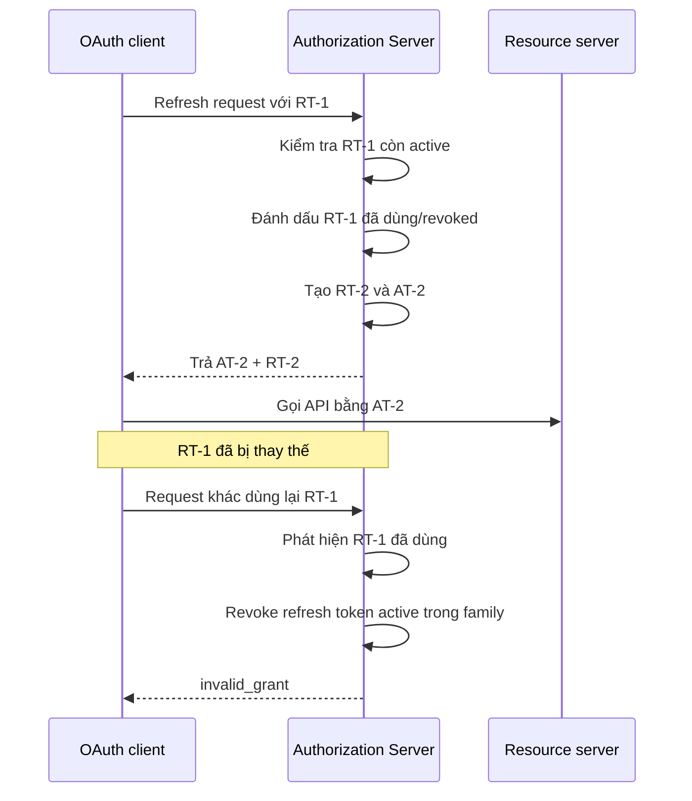

# Không revoke refresh token reuse

## 1. Lỗi này là gì và vì sao nguy hiểm?

Refresh token là credential được gửi tới Authorization Server (AS) để xin access token mới. Vì refresh token thường sống lâu hơn access token và có thể duy trì quyền truy cập qua nhiều lần cấp token, nó là mục tiêu có giá trị cao khi bị đánh cắp.

Với **refresh token rotation**, mỗi lần refresh thành công, AS phát hành một refresh token mới và làm token cũ mất hiệu lực. Nếu token cũ xuất hiện lại sau khi đã được thay thế, đó là dấu hiệu **reuse**. Tình huống này có thể xảy ra khi attacker sao chép refresh token, nhưng cũng có thể do hai request hợp lệ chạy đồng thời, retry sau timeout hoặc client không lưu token mới thành công.

Lỗi **không revoke refresh token reuse** xảy ra khi AS hoặc hệ thống quản lý phiên phát hiện token cũ đã bị dùng lại nhưng vẫn để refresh token đang hoạt động tiếp tục được chấp nhận. Attacker có thể tiếp tục đổi token, duy trì quyền truy cập hoặc cạnh tranh với người dùng hợp lệ để lấy access token mới.

Ví dụ:

- Client nhận `RT-1` và dùng nó để xin token.
- AS trả `AT-2` cùng `RT-2`, đồng thời đánh dấu `RT-1` không còn hợp lệ.
- Attacker đã sao chép `RT-1` trước đó và gửi nó tới token endpoint.
- AS nhận ra `RT-1` đã được dùng nhưng chỉ trả lỗi, không vô hiệu hóa refresh token hiện hành `RT-2`.
- Attacker có thể tiếp tục dùng `RT-2` nếu đã lấy được nó hoặc khai thác một đường khác trong cùng phiên.

Trong mô hình rotation, AS không thể luôn biết bên nào là chủ thể hợp lệ: request thứ hai có thể đến từ attacker hoặc từ client thật đang retry. Vì vậy, khi phát hiện reuse, **AS cần thu hồi refresh token đang còn hoạt động theo chính sách bảo vệ của rotation**. RFC 9700 mô tả việc thu hồi active refresh token khi reuse được phát hiện; nhiều nhà cung cấp quản lý các token liên quan trong cùng một token family và thu hồi cả family.

Mục tiêu bài học là nhận diện lỗi, hiểu cơ chế reuse detection, phân biệt replay thật với refresh đồng thời, thiết kế thu hồi đúng phạm vi và kiểm thử để chứng minh token bị phát lại không thể duy trì quyền truy cập.

## 2. Phân biệt rotation, reuse detection và revocation

| Khái niệm | Ý nghĩa | Kết quả cần có |
| --- | --- | --- |
| **Refresh token rotation** | Mỗi lần refresh thành công phát hành token mới và làm token trước đó mất hiệu lực | Chỉ token mới nhất trong chuỗi được tiếp tục sử dụng |
| **Refresh token reuse** | Một refresh token đã bị thay thế lại xuất hiện ở token endpoint | Phát hiện sự kiện replay hoặc race cần điều tra |
| **Reuse detection** | AS nhận diện token cũ đã dùng/đã revoke được gửi lại | Tạo security event và kích hoạt policy xử lý |
| **Token family** | Nhóm refresh token liên kết qua các lần rotation của một grant/session | Có thể thu hồi các token đang hoạt động thuộc cùng family |
| **Refresh token revocation** | Làm refresh token không còn được chấp nhận | Không thể dùng token đó xin access token mới |
| **Grant/session revocation** | Thu hồi cơ sở ủy quyền hoặc phiên liên quan | Ngừng cấp token mới dựa trên grant/session đó |
| **Access token revocation** | Làm access token không còn được resource server chấp nhận theo cơ chế triển khai | Ngăn tiếp tục sử dụng access token đã phát hành nếu hệ thống hỗ trợ |

Rotation và reuse detection là hai phần liên quan. Nếu chỉ phát hành refresh token mới nhưng không lưu dấu vết token cũ đã bị thay thế, AS không có đủ thông tin để phát hiện việc dùng lại. Nếu phát hiện reuse nhưng không thu hồi token hiện hành, cơ chế phát hiện không ngăn được phiên bị chiếm dụng.

**Không phải mọi OAuth client đều có refresh token.** Client Credentials Grant thông thường xin access token mới bằng client authentication; RFC 6749 khuyến nghị AS không cấp refresh token cho grant này. Bài học này tập trung vào các flow mà AS thực sự phát hành refresh token, thường là các phiên người dùng hoặc ứng dụng có grant được phép duy trì.

## 3. Cách rotation và reuse detection hoạt động



Một implementation cần giữ quan hệ giữa token cũ và token mới. Khi `RT-1` được đổi thành `RT-2`, AS cần ghi nhận:

- `RT-1` đã được sử dụng và không còn active.
- `RT-2` là token active tiếp theo.
- Cả hai thuộc cùng grant/session/token family.
- Thời điểm rotation và client/principal liên quan.
- Trạng thái family/grant và phiên bản cập nhật để xử lý race condition.

Khi nhận `RT-1` lần nữa, AS tra cứu được rằng token này đã từng hợp lệ nhưng đã bị thay thế. Đây là tín hiệu khác với một chuỗi ngẫu nhiên chưa từng tồn tại hoặc token sai chữ ký/format.

**Phản hồi `invalid_grant` đơn thuần chưa đủ.** Hệ thống cần áp dụng hành động thu hồi đối với refresh token active liên quan, ghi security event và ngăn việc cấp token mới từ family bị đánh dấu compromised. Cách quản lý token family cụ thể tùy AS; cần xác minh semantics của nhà cung cấp thay vì giả định mọi sản phẩm có cùng hành vi.

## 4. Kịch bản lỗi: phát hiện reuse nhưng không thu hồi token active

Giả sử AS có bảng trạng thái refresh token:

| Token | Family | Trạng thái |
| --- | --- | --- |
| `RT-1` | `family-77` | `ROTATED` |
| `RT-2` | `family-77` | `ACTIVE` |

Attacker gửi lại `RT-1`. AS phát hiện `ROTATED`, trả `invalid_grant`, nhưng không cập nhật `RT-2` hoặc family. Khi đó:

1. Attacker biết `RT-1` không còn dùng được.
2. Người dùng/client thật vẫn có thể tiếp tục refresh bằng `RT-2`.
3. Nếu attacker đã lấy được `RT-2` qua một kênh khác hoặc tiếp tục chiếm thiết bị/phiên, attacker vẫn duy trì quyền truy cập.
4. AS không buộc phiên bị nghi ngờ phải xác thực lại và không tạo tín hiệu revoke đủ mạnh cho resource server.

Một biến thể khác nguy hiểm hơn: AS phát hiện reuse nhưng chỉ đánh dấu `RT-1` là revoked lần nữa, trong khi token đã revoked từ lần rotation đầu. Hành động này không thay đổi quyền của token active `RT-2`, do đó không containment được token family.

Khi reuse detection báo một token cũ đã bị sử dụng, AS không thể dựa vào thứ tự request để kết luận bên gửi lần đầu là hợp lệ và bên gửi lần hai là attacker. Cả hai có thể là cùng client bị retry hoặc hai bên đang giữ cùng một bí mật. Policy an toàn thường thu hồi refresh token active và yêu cầu người dùng xác thực/ủy quyền lại.

## 5. Tại sao refresh token reuse xảy ra?

Không phải mọi reuse đều chứng minh có attacker. Cần điều tra nguyên nhân, nhưng không được bỏ qua hành động containment chỉ vì có khả năng race.

### 5.1. Token bị đánh cắp

- Token bị ghi vào log, trace, crash dump hoặc support bundle.
- Token lưu trong browser storage hoặc thiết bị bị malware đọc.
- Refresh token bị lấy từ database/backup chưa mã hóa.
- Token bị gửi qua URL, analytics, telemetry hoặc message queue.
- Attacker có quyền đọc secret store hoặc session database.

Đây là trường hợp compromise thực sự: attacker có thể dùng token cũ để dò xem nó còn hiệu lực hay không, hoặc cố đổi token trước người dùng.

### 5.2. Hai refresh request chạy đồng thời

Một ứng dụng có nhiều tab, nhiều worker hoặc nhiều replica cùng dùng một refresh token. Cả hai đọc `RT-1` từ store gần như cùng lúc:

- Request A gửi `RT-1` và nhận `RT-2`.
- Request B cũng gửi `RT-1` trước khi biết kết quả của A.
- AS xử lý A thành công, sau đó nhận B như reuse.
- AS thu hồi family theo policy, khiến phiên hợp lệ cũng bị đăng xuất.

Đây là race condition ở client. Cần single-flight/lock theo đúng session/client/token family, không cho nhiều worker refresh cùng một token.

### 5.3. Retry sau timeout hoặc mất response

AS đã xử lý `RT-1`, phát `RT-2`, nhưng response bị mất trên đường truyền. Client không biết `RT-1` đã được sử dụng nên retry. AS thấy token cũ và báo reuse.

Client phải phân biệt timeout trước khi gửi, timeout khi đang chờ response và lỗi sau khi nhận response. Không thể mặc định request timeout nghĩa là AS chưa xử lý. Cần cơ chế đồng bộ token state, hỗ trợ idempotency/recovery nếu AS có, hoặc yêu cầu xác thực lại khi trạng thái không thể khôi phục an toàn.

### 5.4. Không lưu token mới nguyên tử

Client nhận `RT-2` nhưng process chết trước khi ghi vào secure storage. Sau restart, client chỉ còn `RT-1` và thử dùng lại. Nếu AS đã rotation thành công, token cũ sẽ bị phát hiện reuse.

Việc lưu `access_token`, `refresh_token` mới và version/session state cần được thực hiện nhất quán. Không ghi đè token mới bằng một response cũ đến muộn.

### 5.5. Cache hoặc replication lag

Một số hệ thống lưu token state trên nhiều node. Nếu node B chưa thấy `RT-1` đã được thay thế ở node A, B có thể chấp nhận token cũ hoặc xử lý không nhất quán. Đây là lỗi consistency có thể làm vô hiệu hóa reuse detection.

Cần transaction/conditional update hoặc cơ chế đồng bộ đủ mạnh cho thao tác single-use. Không để eventual consistency làm hai node cùng chấp nhận một refresh token.

## 6. Mô hình dữ liệu token family

Một data model khái niệm có thể gồm hai bảng:

```sql
CREATE TABLE refresh_token_family (
    family_id          VARCHAR(100) PRIMARY KEY,
    grant_id           VARCHAR(100) NOT NULL,
    subject_id         VARCHAR(200),
    client_id          VARCHAR(200) NOT NULL,
    tenant_id          VARCHAR(100),
    status             VARCHAR(30) NOT NULL,
    version            BIGINT NOT NULL,
    created_at         TIMESTAMP NOT NULL,
    revoked_at         TIMESTAMP
);

CREATE TABLE refresh_token_state (
    token_id           VARCHAR(100) PRIMARY KEY,
    family_id          VARCHAR(100) NOT NULL,
    token_hash         VARCHAR(256) NOT NULL UNIQUE,
    status             VARCHAR(30) NOT NULL,
    issued_at          TIMESTAMP NOT NULL,
    used_at            TIMESTAMP,
    replaced_by        VARCHAR(100),
    expires_at         TIMESTAMP NOT NULL,
    FOREIGN KEY (family_id)
        REFERENCES refresh_token_family(family_id)
);
```

Đây là schema minh họa, không phải migration dùng trực tiếp. Những nguyên tắc chính:

- Lưu **hash/HMAC của refresh token** thay vì token nguyên văn nếu AS tự quản lý token opaque.
- Token ID/family ID là định danh nội bộ; không dùng token bí mật làm primary key có thể quan sát từ log.
- `status` phân biệt `ACTIVE`, `ROTATED`, `REVOKED`, `EXPIRED` hoặc trạng thái tương đương.
- `replaced_by` giúp truy vết chuỗi rotation.
- `version` hỗ trợ optimistic locking và phát hiện update cạnh tranh.
- Family có trạng thái riêng để revoke toàn bộ token đang hoạt động khi cần.
- Index theo family, grant, client và expiry để tra cứu/cleanup có kiểm soát.

Nếu dùng JWT refresh token, việc chỉ lưu chữ ký hợp lệ hoặc `jti` chưa đủ để hỗ trợ rotation/revocation. AS vẫn cần state server-side hoặc cơ chế tương đương để biết token đã dùng, bị thay thế hay bị revoke.

## 7. Xử lý refresh một lần và chống race condition

### 7.1. Atomic consume-and-rotate

AS nên bảo đảm thao tác “kiểm tra token active, đánh dấu token cũ đã dùng, phát token mới” là một thao tác nhất quán. Một transaction khái niệm:

```sql
BEGIN;

SELECT family_id, status
FROM refresh_token_state
WHERE token_hash = :presented_hash
FOR UPDATE;

-- Chỉ tiếp tục nếu token đang ACTIVE và family còn ACTIVE.

UPDATE refresh_token_state
SET status = 'ROTATED',
    used_at = CURRENT_TIMESTAMP,
    replaced_by = :new_token_id
WHERE token_hash = :presented_hash
  AND status = 'ACTIVE';

-- Chỉ khi đúng một row được cập nhật:
-- tạo token state mới và trả token mới sau commit.

COMMIT;
```

Nếu update không đổi đúng một row, token không còn active hoặc một request khác đã thắng race. AS phải xác định đây có phải reuse của token đã rotation hay trạng thái khác. Không phát token mới chỉ dựa trên việc chữ ký/format hợp lệ.

Transaction này là mô hình khái niệm. Với hệ thống phân tán, cần đảm bảo lock/conditional update có hiệu lực trên datastore dùng chung; lock trong bộ nhớ của một process không bảo vệ các replica khác.

### 7.2. Single-flight ở OAuth client

Ở client, tất cả request cần access token cho cùng session/family nên dùng chung một thao tác refresh đang chạy:

```text
function getAccessToken(sessionKey):
    tokenState = secureStore.read(sessionKey)

    if tokenState.accessTokenIsUsable():
        return tokenState.accessToken

    return singleFlight(sessionKey, function:
        latest = secureStore.read(sessionKey)

        if latest.accessTokenIsUsable():
            return latest.accessToken

        response = refreshAtAuthorizationServer(
            latest.refreshToken
        )

        validateRefreshResponse(response)

        secureStore.compareAndSet(
            sessionKey,
            expectedVersion = latest.version,
            newAccessToken = response.access_token,
            newRefreshToken = response.refresh_token,
            newVersion = latest.version + 1
        )

        return response.access_token
    )
```

Đây là pseudocode. `singleFlight` phải phối hợp đúng phạm vi chia sẻ state. Nếu có nhiều instance, cần distributed lock/lease hoặc một token broker chung; `synchronized` trong một JVM chỉ bảo vệ các thread của JVM đó.

Nếu `compareAndSet` thất bại vì version đã đổi, client không được ghi đè token mới bằng response cũ. Đọc lại state mới và xử lý theo kết quả; không tự động gửi lại refresh token cũ.

### 7.3. Client nhiều tab và nhiều thiết bị

Trong ứng dụng browser, hai tab có thể cùng refresh. Có thể dùng một token broker ở backend/BFF, Web Locks hoặc cơ chế coordination an toàn để một nơi duy nhất quản lý refresh token. Tránh broadcast refresh token nguyên văn qua local storage hoặc channel rộng.

Nhiều thiết bị có thể có refresh token family riêng hoặc share grant theo cách AS thiết kế. Không gộp mọi thiết bị vào một family nếu yêu cầu cho phép revoke riêng từng thiết bị. Khi một family bị compromise, thu hồi đúng family/grant liên quan theo policy.

## 8. Phản ứng khi phát hiện reuse

Khi AS xác định refresh token đã bị rotation nhưng lại được gửi tới token endpoint:

1. Xác định token cũ thuộc family/grant nào.
2. Kiểm tra family còn active hay đã bị revoke.
3. Đánh dấu family/grant bị compromise hoặc revoke theo policy.
4. Thu hồi **refresh token active** thuộc family; nếu hệ thống hỗ trợ, revoke toàn bộ token family.
5. Ngăn mọi lần refresh tiếp theo dựa trên family đó.
6. Ghi security event có issuer, client, subject, tenant, family ID, token ID/fingerprint và timestamp; không ghi raw token.
7. Phát event tới session store/resource server nếu chúng cần cập nhật trạng thái.
8. Thông báo client cần xác thực/ủy quyền lại.
9. Điều tra nguồn token bị lộ hoặc race condition ở client.
10. Kiểm tra access token đã được cấp từ family đó và áp dụng cơ chế thu hồi phù hợp.

Không chỉ revoke token cũ đã bị dùng lại: nó đã không còn active từ trước. **Đối tượng cần chặn là token mới đang active hoặc grant/family chứa nó.**

Nếu AS không quản lý family, cần xác định cách ánh xạ refresh token về grant/session và thu hồi các credential còn hiệu lực trong phạm vi đó. Không revoke toàn bộ user/client nếu chỉ một family bị ảnh hưởng, trừ khi phạm vi compromise hoặc policy yêu cầu.

## 9. Access token đã phát hành có tự mất hiệu lực không?

Không. Thu hồi refresh token hoặc token family chặn việc xin access token mới, nhưng **không bảo đảm access token đã phát hành lập tức bị resource server từ chối**.

| Kiểu access token | Sau khi refresh family bị revoke |
| --- | --- |
| **Opaque token + introspection** | Có thể bị từ chối khi AS trả `active=false`; cần kiểm cache introspection và propagation |
| **JWT offline validation** | Có thể vẫn được chấp nhận đến `exp` nếu API chỉ kiểm chữ ký/issuer/audience/thời hạn |
| **JWT + denylist/session version** | Có thể bị từ chối sớm nếu resource server kiểm trạng thái revoke |
| **Sender-constrained token** | Giảm khả năng replay nếu attacker không có private key/certificate; vẫn cần xử lý key compromise |

Nếu yêu cầu revoke access token đang hoạt động, AS/resource server cần cơ chế riêng như RFC 7009, introspection, denylist theo `jti`/fingerprint, session/grant version hoặc revocation event. Đừng coi `refresh_token_reuse_detected` là bằng chứng access token đã bị chặn.

Khi điều tra, xác định access token được cấp từ family bị compromise trong khoảng thời gian nào, audience và scope gì, resource server nào đã chấp nhận và có request nào thực hiện thao tác nhạy cảm không.

## 10. Security event và audit khi reuse xảy ra

Một event có thể ghi:

```json
{
  "event_id": "evt-refresh-reuse-1042",
  "event_type": "refresh_token.reuse_detected",
  "issuer": "https://auth.example.test",
  "tenant_id": "tenant-01",
  "subject_id": "user-123",
  "client_id": "web-portal",
  "grant_id": "grant-82",
  "family_id": "family-77",
  "presented_token_id": "rt-1",
  "family_version": 8,
  "detected_at": "2026-11-23T10:05:00Z",
  "action": "active_family_revoked",
  "reason": "rotated_token_reused"
}
```

Không đưa token nguyên văn, refresh token hash có thể đảo ngược, client secret hoặc Authorization header vào event. Nếu dùng HMAC fingerprint, bảo vệ khóa HMAC và giới hạn quyền tra cứu.

Audit cần phân biệt:

- Token cũ bị trình bày lại.
- Reuse detection có kích hoạt hay không.
- Active refresh token/family có bị revoke không.
- Client nào nhận thông báo cần xác thực lại.
- Consumer nào đã áp dụng revoke event.
- Thời gian propagation tới resource server.
- Có access token nào vẫn được chấp nhận sau thời điểm revoke hay không.

Event phải có `event_id` duy nhất và version/sequence để consumer xử lý idempotent, tránh sự kiện cũ ghi đè trạng thái family mới hơn.

## 11. Xử lý false positive và grace period

Refresh reuse có thể do attacker hoặc do lỗi đồng bộ client. Hệ thống phải xử lý an toàn mà không biến mọi race thành một lỗ hổng.

### 11.1. Không bỏ qua reuse để giảm lỗi đăng nhập

Một cách sửa sai thường gặp là cho phép refresh token cũ dùng lại nhiều lần trong một khoảng grace period rộng. Cách này giảm lỗi do retry nhưng cũng tạo cửa sổ để attacker dùng token đã bị đánh cắp.

Nếu nhà cung cấp có grace period hoặc retry tolerance, cần hiểu rõ semantics: có thể cho phép xử lý lại một request đã hoàn tất theo idempotency key mà không phát thêm token, nhưng không nên phát nhiều refresh token active từ cùng một token cũ. Cần đánh giá rủi ro và tài liệu AS cụ thể.

### 11.2. Ưu tiên sửa race ở client

- Một refresh coordinator cho mỗi session/family.
- Distributed lock/lease nếu nhiều replica chia sẻ refresh token.
- Ghi token response mới bằng transaction/CAS.
- Không retry refresh token cũ sau timeout chưa rõ kết quả.
- Giới hạn thời gian chờ và số lần retry.
- Có luồng re-authentication rõ ràng khi state không thể khôi phục.
- Ghi telemetry để phân biệt reuse do concurrency, timeout hay nguồn IP/device bất thường.

### 11.3. Khi nào cần xác thực lại?

Khi AS đã revoke active refresh token/family, client thường không thể tiếp tục refresh. Tùy flow, người dùng cần đăng nhập và cấp consent/ủy quyền lại. Với ứng dụng machine-to-machine có grant/credential riêng, cần cấp credential mới hoặc tạo grant mới theo policy.

Không tự động khôi phục family cũ chỉ vì client gửi request đăng nhập thành công; phải bảo đảm thiết bị/workload và nguồn lộ đã được xử lý.

## 12. Những lỗi triển khai phổ biến

| Lỗi | Hậu quả | Cách khắc phục |
| --- | --- | --- |
| Phát hiện token cũ nhưng chỉ trả `invalid_grant` | Token active trong family vẫn dùng được | Revoke active refresh token/family và ghi security event |
| Chỉ revoke token cũ đã rotated | Token cũ vốn đã không active; attacker có thể giữ token mới | Thu hồi token active liên quan hoặc grant/family |
| Không lưu quan hệ token family | Không biết token mới nào cần revoke | Lưu family/grant lineage hoặc trạng thái tương đương |
| Chỉ kiểm tra trong một JVM | Replica khác vẫn refresh đồng thời | Dùng datastore atomic/shared lock hoặc token broker |
| Hai tab cùng refresh | Race hợp lệ bị coi là replay | Single-flight/coordination theo session |
| Retry sau timeout bằng token cũ | Có thể kích hoạt reuse hoặc gây mất phiên | Reconcile trạng thái, dùng idempotency nếu AS hỗ trợ |
| Ghi token mới không atomic | Restart có thể làm client dùng lại token cũ | CAS/transaction và versioning |
| Cache node không đồng bộ | Một node vẫn chấp nhận token cũ | Strong consistency cho consume/rotate hoặc thiết kế single writer |
| Không phát audit/security event | SOC không biết có replay hoặc revoke | Event taxonomy, alert và retention |
| Không xử lý access token đã cấp | API có thể tiếp tục chấp nhận token cũ | Introspection/denylist/version/event hoặc TTL phù hợp |
| Grace period quá rộng | Token bị đánh cắp có thể được dùng lại | Thu hẹp tolerance, không phát nhiều token active |
| Revoke toàn bộ user/client cho mọi reuse | Gây gián đoạn quá phạm vi | Revoke đúng family/grant; mở rộng khi evidence yêu cầu |

## 13. Ví dụ pseudocode phía Authorization Server

Đoạn mã sau minh họa quyết định khi token được trình bày:

```text
function handleRefresh(presentedToken):
    tokenRecord = tokenStore.findBySecureHash(hash(presentedToken))

    if tokenRecord == null:
        audit("refresh.invalid", reason="unknown_token")
        return invalid_grant

    family = familyStore.lock(tokenRecord.familyId)

    if family.status != ACTIVE:
        audit("refresh.rejected", familyId=family.id)
        return invalid_grant

    if tokenRecord.status == ACTIVE:
        // Atomic consume-and-rotate; only one request may win.
        newPair = issueNextTokenPair(family, tokenRecord)
        tokenStore.markRotated(tokenRecord, newPair.refreshTokenId)
        tokenStore.insertActive(newPair.refreshTokenRecord)
        familyStore.incrementVersion(family.id)
        audit("refresh.rotated", familyId=family.id)
        return newPair

    if tokenRecord.status == ROTATED:
        familyStore.revokeActiveTokens(family.id)
        familyStore.markCompromised(family.id)
        audit("refresh.reuse_detected",
              familyId=family.id,
              action="active_tokens_revoked")
        publishRevocationEvent(family.id)
        return invalid_grant

    audit("refresh.rejected", familyId=family.id)
    return invalid_grant
```

Đây là pseudocode, không phải triển khai hoàn chỉnh. Trong hệ thống thật:

- Việc khóa family và cập nhật token state phải atomic trên datastore chia sẻ.
- Không giữ lock trong khi gọi network hoặc thực hiện thao tác dài.
- Việc tạo token pair và ghi trạng thái phải có cách tránh phát token không được commit.
- Event nên được ghi qua outbox cùng transaction nếu cần bảo đảm phát hành.
- Lỗi storage không được biến thành chấp nhận token.
- Response không tiết lộ cho caller thông tin nội bộ về token family.
- Cần policy cho family đã revoke, token unknown, expired và client authentication failure.

Một triển khai production có thể dùng opaque random refresh token, lưu hash/HMAC, transaction và outbox. Nếu AS bên thứ ba quản lý token, cần dùng API/setting chính thức để bật rotation/reuse detection và kiểm thử hành vi thực tế.

## 14. Checklist kiểm thử reuse detection

| Test | Điều kiện | Kết quả mong đợi |
| --- | --- | --- |
| T1 — Rotation bình thường | Dùng `RT-1` lần đầu | AS cấp access token mới và `RT-2`; `RT-1` không còn active |
| T2 — Reuse token cũ | Gửi lại `RT-1` sau rotation | AS nhận diện reuse và revoke refresh token active/family theo policy |
| T3 — Token family | Family có nhiều generation | Revoke đúng token active trong family; token cũ không thể refresh |
| T4 — Access token còn hạn | Revoke refresh family trong khi access token chưa hết hạn | Resource server xử lý theo revocation design/SLA; không giả định tự hết hiệu lực |
| T5 — Concurrent refresh | Hai request cùng gửi `RT-1` | Chỉ một rotation thành công; race được ghi nhận và xử lý an toàn |
| T6 — Timeout sau AS commit | AS đã phát `RT-2` nhưng response bị mất | Client không retry mù `RT-1`; recovery/re-auth theo policy |
| T7 — Client crash trước persist | Response chứa `RT-2` nhưng store chưa commit | Không ghi đè state; yêu cầu recovery an toàn |
| T8 — CAS conflict | Một response cũ đến sau token state mới | Không ghi đè refresh token mới |
| T9 — Multi-replica | Hai node refresh cùng family | Datastore/shared coordinator ngăn double consume |
| T10 — Unknown token | Token chưa từng được cấp | Từ chối an toàn, không revoke nhầm family |
| T11 — Expired token | Token hết hạn được gửi lại | Từ chối; xử lý audit theo policy |
| T12 — Family đã revoked | Gửi token active cũ của family bị revoke | Không cấp token mới |
| T13 — Duplicate security event | Consumer nhận event reuse hai lần | Idempotent, trạng thái không thay đổi sai |
| T14 — Event out of order | Version cũ tới sau version mới | Không rollback trạng thái family |
| T15 — Tenant boundary | Reuse ở tenant A | Không revoke nhầm family tenant B |
| T16 — Client boundary | Hai client có token khác nhau | Không nhầm family giữa client |
| T17 — Audit secrecy | Bật debug/log trong test | Không có raw refresh token/secret trong log |
| T18 — Recovery | Người dùng xác thực lại sau family revoke | Family/grant mới được tạo theo policy và scope được duyệt lại |
| T19 — Sender-constrained token | Refresh token gắn DPoP/mTLS được trình bày sai binding | Từ chối và ghi nhận tín hiệu phù hợp |
| T20 — AS outage | Storage hoặc event broker không sẵn sàng trong quá trình revoke | Fail-safe, không cấp token mới từ family nghi compromise; event được retry/reconcile |

Ngoài test chức năng, cần đo:

- Tỷ lệ refresh token reuse trên tổng refresh request.
- Số family bị revoke do reuse.
- Tỷ lệ reuse do concurrent request/timeout theo client version.
- Thời gian từ phát hiện reuse đến revoke active token.
- Thời gian propagation đến resource server.
- Số access token thuộc family bị revoke vẫn được chấp nhận.
- Số phiên phải re-auth và tỷ lệ phục hồi thành công.
- Tỷ lệ event bị retry, dead-letter hoặc không được consumer xác nhận.

## 15. Ghi nhớ và tài liệu tham khảo

Lỗi **không revoke refresh token reuse** khiến reuse detection chỉ dừng ở việc phát hiện, trong khi credential active vẫn có thể tiếp tục cấp access token. Với rotation, refresh token cũ chỉ được dùng một lần; khi token đã bị thay thế xuất hiện lại, AS không thể luôn phân biệt attacker với client thật đang retry. Biện pháp an toàn là thu hồi refresh token active liên quan hoặc token family/grant theo policy, ghi audit và yêu cầu xác thực/ủy quyền lại.

Đồng thời, phải sửa nguyên nhân reuse hợp lệ như refresh đồng thời, timeout và lưu token mới không nguyên tử. Revoke refresh token không tự động làm access token đã cấp mất hiệu lực; resource server cần cơ chế introspection, denylist, version hoặc event propagation nếu cần thu hồi trước expiry.

Tài liệu nên đối chiếu:

- [RFC 9700 — Best Current Practice for OAuth 2.0 Security](https://www.rfc-editor.org/rfc/rfc9700): bảo vệ refresh token, rotation, sender-constrained token và phát hiện reuse.
- [RFC 6749 — OAuth 2.0 Authorization Framework](https://www.rfc-editor.org/rfc/rfc6749): refresh token grant, token endpoint và client authentication.
- [RFC 7009 — OAuth 2.0 Token Revocation](https://www.rfc-editor.org/rfc/rfc7009): endpoint thu hồi token.
- [RFC 7662 — OAuth 2.0 Token Introspection](https://www.rfc-editor.org/rfc/rfc7662): xác minh trạng thái token ở resource server.
- [RFC 9449 — OAuth 2.0 Demonstrating Proof of Possession (DPoP)](https://www.rfc-editor.org/rfc/rfc9449): ràng buộc token với khóa và giảm replay.
- [RFC 8705 — OAuth 2.0 Mutual-TLS Client Authentication and Certificate-Bound Access Tokens](https://www.rfc-editor.org/rfc/rfc8705): mTLS client authentication và certificate-bound token.
- [OWASP OAuth 2.0 Cheat Sheet](https://cheatsheetseries.owasp.org/cheatsheets/OAuth2_Cheat_Sheet.html): thực hành an toàn khi triển khai OAuth 2.0.
