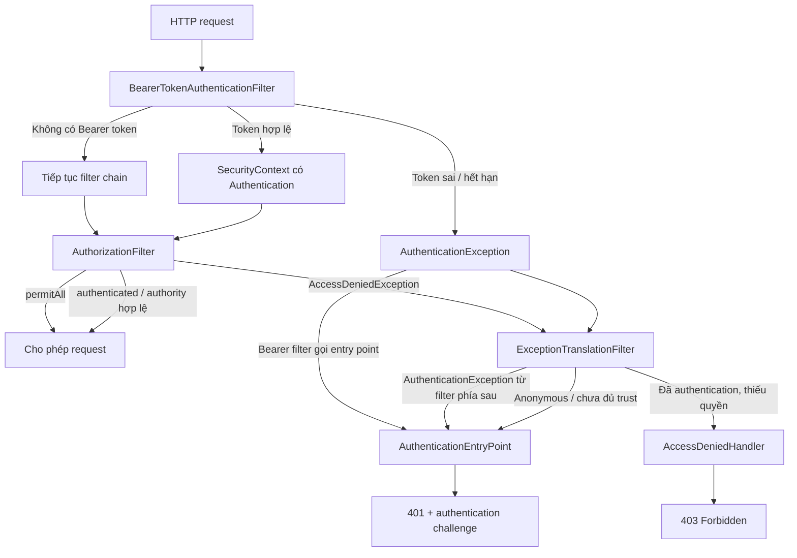

# Lỗi trả 403 khi người gọi chưa được xác thực

## 1. Phân biệt 401 Unauthorized và 403 Forbidden

Một API được bảo vệ thường cần xác minh hai điều theo thứ tự: **người gọi đã được xác thực chưa** và **người gọi có quyền thực hiện hành động này không**. Hai câu hỏi này tương ứng với hai trạng thái HTTP khác nhau.

- **401 Unauthorized:** request chưa cung cấp credential hợp lệ hoặc credential không thể được xác thực. Với HTTP, response 401 phải có ít nhất một `WWW-Authenticate` challenge để chỉ ra cách xác thực được chấp nhận.
- **403 Forbidden:** server hiểu request nhưng từ chối thực hiện. Trong API có authentication, trường hợp điển hình là người gọi đã xác thực nhưng thiếu quyền, scope, role hoặc điều kiện truy cập.

Vì vậy, nếu client chưa gửi access token tới một endpoint yêu cầu Bearer authentication, phản hồi thông thường là **401 kèm `WWW-Authenticate: Bearer`**, không phải 403. Nếu client gửi token hợp lệ nhưng token chỉ có `orders.read` trong khi endpoint yêu cầu `orders.write`, phản hồi phù hợp là **403**.

| Trạng thái caller | Ví dụ | Phản hồi thường dùng |
| --- | --- | --- |
| Không gửi credential | Gọi `/api/orders` nhưng không có `Authorization` | `401 Unauthorized` và Bearer challenge. |
| Bearer token sai định dạng/chữ ký hoặc hết hạn | Token không thể xác minh hoặc đã hết hạn | `401 Unauthorized`, thường có `error="invalid_token"`. |
| Token hợp lệ, thiếu scope | Có `orders.read`, gọi thao tác cần `orders.write` | `403 Forbidden`, có thể kèm `error="insufficient_scope"`. |
| Token hợp lệ, sai audience | Token phát hành cho API khác | `401` vì token không hợp lệ đối với Resource Server này. |
| Token hợp lệ, account/tenant bị khóa | Credential được xác minh nhưng policy hiện tại cấm truy cập | Thường là `403`, tùy hợp đồng API và cách biểu diễn trạng thái account. |
| Người gọi đã xác thực nhưng không sở hữu resource | User có quyền đọc đơn hàng nhưng đơn hàng thuộc tenant khác | `403`; một số API chọn `404` để không tiết lộ resource tồn tại. |

Mã trạng thái cụ thể cần nhất quán với hợp đồng API và loại lỗi. Không nên trả 403 cho mọi trường hợp chỉ để đơn giản hóa exception handler, vì client sẽ khó biết khi nào cần đăng nhập/lấy token mới và khi nào cần yêu cầu thêm quyền.

## 2. Bearer token và phản hồi đúng theo OAuth 2.0

Với OAuth 2.0 Bearer Token Usage (RFC 6750), Resource Server nhận access token qua header:

```http
GET /api/orders HTTP/1.1
Host: api.example.test
Authorization: Bearer <access-token>
```

Nếu request không có credential, Resource Server có thể trả challenge:

```http
HTTP/1.1 401 Unauthorized
WWW-Authenticate: Bearer realm="orders-api"
Content-Type: application/problem+json

{
  "title": "Authentication required",
  "status": 401
}
```

Nếu token không hợp lệ, ví dụ chữ ký sai hoặc đã hết hạn:

```http
HTTP/1.1 401 Unauthorized
WWW-Authenticate: Bearer realm="orders-api", error="invalid_token"
Content-Type: application/problem+json

{
  "title": "Invalid access token",
  "status": 401
}
```

Nếu token hợp lệ nhưng thiếu scope:

```http
HTTP/1.1 403 Forbidden
WWW-Authenticate: Bearer error="insufficient_scope", scope="orders.write"
Content-Type: application/problem+json

{
  "title": "Insufficient permission",
  "status": 403
}
```

Đây là các response minh họa. Không đưa token, claims nhạy cảm hoặc thông tin nội bộ về policy vào body lỗi. Với request không có authentication information, challenge không nhất thiết phải chứa `error`; với token invalid hoặc scope thiếu, error code trong `WWW-Authenticate` giúp client hiểu loại lỗi. Không dùng `error="insufficient_scope"` để mô tả token hết hạn.

## 3. Vì sao ứng dụng trả 403 khi chưa authentication?

Trong ứng dụng Spring Security hoặc API gateway, nhiều thành phần có thể từ chối request trước khi controller chạy. Một response 403 không tự chứng minh rằng authentication đã thành công.

Các nguyên nhân thường gặp:

1. **Custom `AccessDeniedHandler` xử lý mọi lỗi:** handler trả 403 kể cả khi caller là anonymous hoặc chưa có `Authentication` hợp lệ.
2. **Custom `AuthenticationEntryPoint` bị cấu hình sai:** entry point dùng cho trường hợp chưa authentication lại gọi `sendError(403)`.
3. **Exception translation không được áp dụng đúng filter chain:** request bị chặn bởi filter tự viết, gateway hoặc middleware trước `ExceptionTranslationFilter`.
4. **CSRF filter từ chối request:** ứng dụng session/browser có thể trả 403 khi thiếu hoặc sai CSRF token. Đây là lỗi CSRF, không phải kết quả của việc thiếu access token.
5. **CORS preflight bị chặn:** request `OPTIONS` có thể bị security rule chặn trước khi CORS xử lý, tạo 403 dù browser chưa gửi request nghiệp vụ.
6. **Sai matcher hoặc thứ tự rule:** endpoint được match vào rule khác với dự kiến, ví dụ một route public bị yêu cầu authority hoặc một route protected dùng custom denial response.
7. **Gateway/WAF/reverse proxy trả 403:** request chưa tới ứng dụng nhưng lớp hạ tầng đã từ chối do IP, method, route, rate limit hoặc policy khác.
8. **Controller hoặc method security tự trả 403:** code ứng dụng ném `AccessDeniedException` hoặc trả status trực tiếp trước khi authentication được thiết lập như mong đợi.

Do đó, hãy xác định chính xác lớp tạo response và trạng thái `SecurityContext` tại thời điểm từ chối trước khi sửa cấu hình.

## 4. Cách Spring Security phân loại lỗi

Trong một filter chain điển hình, `BearerTokenAuthenticationFilter` đọc Bearer token và yêu cầu `AuthenticationManager` xác thực. Nếu token hợp lệ, một `Authentication` đã xác thực được đặt vào `SecurityContext`. Nếu không có Bearer token, filter thường tiếp tục chain để rule authorization quyết định endpoint có cho anonymous truy cập hay không.

`AuthorizationFilter` áp dụng authorization rule. Khi một exception `AuthenticationException` hoặc `AccessDeniedException` thoát khỏi filter chain, `ExceptionTranslationFilter` chuyển exception thành HTTP response thông qua các handler:



Sơ đồ thể hiện luồng phổ biến; thứ tự và hành vi chi tiết có thể khác khi ứng dụng thêm filter, nhiều `SecurityFilterChain`, custom authentication mechanism hoặc gateway. Cụ thể, `BearerTokenAuthenticationFilter` thường xử lý lỗi xác thực Bearer ngay trong filter bằng `AuthenticationEntryPoint`; còn exception từ authorization ở các filter phía sau được `ExceptionTranslationFilter` chuyển tiếp. Một điểm quan trọng là Spring Security có thể tạo anonymous `Authentication` trong `SecurityContext`. Vì vậy, kiểm tra `SecurityContextHolder.getContext().getAuthentication() != null` chưa đủ để kết luận người gọi đã đăng nhập. Cần xét `Authentication.isAuthenticated()` cùng `AuthenticationTrustResolver`/loại principal, vì `AnonymousAuthenticationToken` cũng có thể được đánh dấu authenticated ở mức API.

### AuthenticationEntryPoint và AccessDeniedHandler

| Thành phần | Dùng khi | Kết quả thường mong đợi với Bearer API |
| --- | --- | --- |
| `AuthenticationEntryPoint` | Chưa có authentication hợp lệ hoặc authentication thất bại | `401` và `WWW-Authenticate: Bearer`. |
| `AccessDeniedHandler` | Đã xác thực nhưng không được phép thực hiện hành động | `403`; có thể có Bearer challenge `insufficient_scope`. |

Không cấu hình một handler chung trả 403 cho cả hai tình huống. Với Spring Resource Server, cấu hình mặc định đã tích hợp cách xử lý Bearer token. Chỉ tùy chỉnh khi cần thay đổi response format và phải giữ nguyên semantics cùng challenge header.

## 5. Ví dụ cấu hình Spring Security cho Resource Server

Một cấu hình đơn giản có thể dùng `oauth2ResourceServer().jwt()` và authorization rule rõ ràng:

```java
@Configuration
@EnableWebSecurity
class ApiSecurityConfiguration {

    @Bean
    SecurityFilterChain apiSecurity(HttpSecurity http) throws Exception {
        return http
            .authorizeHttpRequests(authorize -> authorize
                .requestMatchers("/health", "/public/**").permitAll()
                .requestMatchers(HttpMethod.GET, "/api/orders/**")
                    .hasAuthority("SCOPE_orders.read")
                .requestMatchers(HttpMethod.POST, "/api/orders/**")
                    .hasAuthority("SCOPE_orders.write")
                .anyRequest().authenticated()
            )
            .oauth2ResourceServer(oauth2 -> oauth2.jwt(Customizer.withDefaults()))
            .build();
    }
}
```

Với cấu hình này:

- Request `/health` và `/public/**` được cho phép mà không cần token.
- Request GET tới orders yêu cầu scope `orders.read`.
- Request POST tới orders yêu cầu scope `orders.write`.
- Request protected không có authentication hợp lệ sẽ được xử lý qua authentication entry point và trả 401.
- Request có token hợp lệ nhưng thiếu authority sẽ bị access denied và trả 403.

Spring Resource Server thường ánh xạ claim `scope` hoặc `scp` thành authority có prefix `SCOPE_`. Vì vậy `orders.read` trở thành `SCOPE_orders.read`. `hasRole("ADMIN")` thường kiểm tra authority `ROLE_ADMIN`, khác với `hasAuthority("SCOPE_orders.read")`. Không nhầm role, scope và tên claim; hãy xác nhận converter thực tế nếu ứng dụng tùy chỉnh JWT authorities.

Ví dụ trên giả định API stateless dùng Bearer token trong Authorization header. Chính sách CSRF phải được quyết định theo cách browser credential được gửi và kiến trúc session/cookie; không tắt CSRF một cách máy móc chỉ vì ứng dụng có OAuth. Nếu API sử dụng cookie tự động gửi từ browser, CSRF vẫn có thể cần được bảo vệ.

## 6. Khi nào 403 là đúng?

Không phải mọi 403 đều là bug. Một số trường hợp đúng về mặt authorization:

- Người gọi đã xác thực bằng token hợp lệ nhưng scope không đủ.
- User có role `VIEWER` nhưng gọi thao tác chỉ dành cho `ADMIN`.
- Client service được phép đọc nhưng không được phép ghi.
- User không thuộc tenant sở hữu resource.
- Account hoặc membership đang bị đình chỉ theo policy.
- Method security từ chối hành động sau khi authentication thành công.

Ví dụ token chỉ có quyền đọc:

```json
{
  "iss": "https://auth.example.test",
  "sub": "user-42",
  "aud": "https://orders.api.example.test",
  "scope": "orders.read",
  "exp": 1900000300
}
```

GET `/api/orders/123` có thể thành công, trong khi POST `/api/orders/123/cancel` bị từ chối nếu cần `orders.write` hoặc một permission riêng. Resource Server không nên nâng quyền hoặc yêu cầu token mới một cách tự động nếu user chưa được cấp quyền đó.

Nếu API cần ẩn sự tồn tại của resource, có thể trả 404 cho cả trường hợp không tồn tại và trường hợp caller không được phép biết resource đó. Đây là lựa chọn thiết kế để tránh resource enumeration, cần nhất quán và không thay đổi nguyên tắc xác thực: caller chưa có credential hợp lệ vẫn cần được xử lý theo authentication policy.

## 7. Phân biệt 401/403 với CSRF và CORS

Một nguyên nhân gây nhầm lẫn là mọi response 403 đều bị quy về lỗi authentication. Hãy xem request thực tế và filter tạo response:

| Tình huống | Dấu hiệu | Hướng xử lý |
| --- | --- | --- |
| Thiếu Bearer token | Không có Authorization header; endpoint yêu cầu authentication | Kiểm tra entry point và Bearer challenge; thường phải là 401. |
| Token invalid/expired | Có Bearer header nhưng decoder/introspection từ chối | Trả 401 `invalid_token`; kiểm tra issuer, audience, expiry, signature và clock. |
| Thiếu scope/role | SecurityContext có principal đã xác thực nhưng authorization rule từ chối | Trả 403; kiểm tra scope/authority mapping và policy. |
| CSRF token thiếu/sai | Request state-changing có cookie/session nhưng thiếu CSRF token hợp lệ | Kiểm tra CSRF configuration và client gửi token; không sửa bằng cách đổi mọi 403 thành 401. |
| CORS preflight | Browser gửi OPTIONS với `Origin` và `Access-Control-Request-Method` | Cấu hình CORS trước authorization cho preflight hợp lệ; không yêu cầu Bearer token cho preflight nếu policy cho phép. |
| Gateway/WAF denial | Response không có format/log tương ứng của ứng dụng; request có thể chưa tới app | Kiểm tra proxy, WAF, IP allowlist, rate limit và route policy. |

Để debug, so sánh response headers, body, correlation ID và log ở gateway/application. Không log Authorization header để tìm nguyên nhân; hãy log authentication result, error class và filter/route đã xử lý theo cách an toàn.

## 8. Ma trận kiểm thử 401 và 403

Integration test nên xác minh cả status code lẫn header challenge và hành vi API. Một test chỉ assert `status().isForbidden()` có thể che giấu việc authentication entry point bị cấu hình sai.

| Test case | Request | Kết quả mong đợi |
| --- | --- | --- |
| Protected endpoint không token | GET `/api/orders` | 401 và `WWW-Authenticate: Bearer`. |
| Token sai chữ ký | Bearer token giả hoặc ký bằng key không tin cậy | 401 `invalid_token`. |
| Token hết hạn | JWT có `exp` trong quá khứ | 401 `invalid_token`. |
| Sai issuer/audience | Token không thuộc issuer hoặc API đích | 401; không chạy controller nghiệp vụ. |
| Token hợp lệ, thiếu scope | Có `SCOPE_profile.read`, gọi endpoint cần `SCOPE_orders.read` | 403. |
| Token hợp lệ, đúng scope | Có `SCOPE_orders.read`, gọi GET orders | 2xx theo nghiệp vụ. |
| Token đúng scope nhưng sai tenant/resource ownership | Gọi resource ngoài phạm vi được phép | 403 hoặc 404 theo hợp đồng bảo mật. |
| Public endpoint không token | GET `/public/status` | 2xx; không bị authentication entry point chặn. |
| CSRF token thiếu trong app session | POST với cookie nhưng không có CSRF token | CSRF denial theo policy, thường 403; phân biệt với Bearer authentication. |
| CORS preflight hợp lệ | OPTIONS với Origin và Access-Control-Request-* | CORS response phù hợp; không bị authorization rule chặn sai. |

### Ví dụ Spring MockMvc

```java
@Test
void missingBearerTokenReturns401WithChallenge() throws Exception {
    mockMvc.perform(get("/api/orders"))
        .andExpect(status().isUnauthorized())
        .andExpect(header().string(
            HttpHeaders.WWW_AUTHENTICATE,
            containsString("Bearer")));
}

@Test
void authenticatedCallerWithoutRequiredScopeGets403() throws Exception {
    mockMvc.perform(get("/api/orders")
            .with(jwt().authorities(
                new SimpleGrantedAuthority("SCOPE_profile.read"))))
        .andExpect(status().isForbidden());
}
```

Đây là ví dụ theo Spring Security Test. Test thứ hai tạo một JWT authentication giả lập đã được xác thực để cô lập authorization rule; nó không kiểm tra chữ ký JWT thật. Cần có integration test riêng gửi Bearer token tới decoder thật để kiểm tra signature, issuer, audience và expiry.

### Kiểm tra invalid token

```java
@Test
void invalidBearerTokenReturns401() throws Exception {
    mockMvc.perform(get("/api/orders")
            .header(HttpHeaders.AUTHORIZATION, "Bearer not-a-valid-token"))
        .andExpect(status().isUnauthorized())
        .andExpect(header().string(
            HttpHeaders.WWW_AUTHENTICATE,
            containsString("invalid_token")));
}
```

Kết quả cụ thể phụ thuộc Resource Server config và decoder. Không mock entry point trong test này nếu mục tiêu là xác minh behavior mặc định của Bearer authentication.

## 9. Checklist điều tra lỗi 403 khi chưa đăng nhập

1. Xác nhận request có gửi Authorization header hay không; không ghi giá trị header vào log.
2. Xác định response được tạo ở gateway, WAF, reverse proxy hay Spring application.
3. Kiểm tra endpoint có thực sự cần authentication và request match đúng `SecurityFilterChain`.
4. Kiểm tra `AuthenticationEntryPoint` có trả 401 và Bearer challenge hay bị custom handler thay thế.
5. Kiểm tra `AccessDeniedHandler` chỉ xử lý authorization denial của principal đã xác thực theo đúng trust policy.
6. Xem `SecurityContext` theo loại Authentication; phân biệt `AnonymousAuthenticationToken` với user/client đã xác thực.
7. Nếu có Bearer token, kiểm tra token decoder/introspection, issuer, audience, expiry, signature và authority converter.
8. Kiểm tra CSRF, CORS preflight, method security và custom filters nếu response 403 xuất hiện trước controller.
9. Viết test riêng cho missing token, invalid token, valid token thiếu scope và valid token đủ scope.
10. Sau khi sửa, kiểm tra response có đúng `WWW-Authenticate` và không lộ token/claims nhạy cảm.

## 10. Các cách sửa sai cần tránh

- **Đổi tất cả 403 thành 401:** làm mất phân biệt giữa authentication và authorization, khiến client có thể refresh token không cần thiết.
- **Đổi tất cả 401 thành 403:** che giấu việc credential không hợp lệ và làm client không biết cần xác thực lại.
- **Cho anonymous vào mọi endpoint để hết 403:** có thể mở API ngoài ý muốn; chỉ dùng `permitAll()` cho route công khai đã xác định.
- **Tắt authorization rule:** không giải quyết nguyên nhân status code và có thể tạo lỗ hổng truy cập.
- **Tắt CSRF toàn cục:** có thể mở rủi ro CSRF trong ứng dụng dùng cookie/session.
- **Tự tạo principal giả để qua filter:** làm sai trạng thái authentication và có thể biến request anonymous thành request được tin cậy.
- **Bỏ `WWW-Authenticate`:** response 401 không có challenge phù hợp với semantics HTTP và gây khó cho client.
- **Chỉ kiểm tra status code:** không xác nhận đúng filter, đúng challenge, không có token bị phát hành hoặc controller không chạy.

## 11. Checklist triển khai

- [ ] Endpoint protected không có credential trả 401 và challenge phù hợp.
- [ ] Bearer token invalid/expired/sai issuer/audience bị từ chối như authentication failure.
- [ ] Token hợp lệ nhưng thiếu scope/role bị từ chối như authorization failure (403).
- [ ] `AuthenticationEntryPoint` và `AccessDeniedHandler` có trách nhiệm riêng, không cùng trả 403.
- [ ] Anonymous authentication được nhận diện đúng; không chỉ kiểm tra Authentication object khác null.
- [ ] Scope-to-authority mapping nhất quán với rule `hasAuthority`/`hasRole`.
- [ ] CSRF và CORS được kiểm tra như các cơ chế riêng, không nhầm với authentication.
- [ ] Gateway/WAF và application có correlation để xác định lớp tạo response.
- [ ] Test có missing token, invalid token, insufficient scope, đủ quyền, CSRF và CORS.
- [ ] Log không chứa Authorization header, access token, refresh token hoặc credential.

**Điểm cốt lõi:** 401 cho biết request chưa có authentication hợp lệ và cần challenge phù hợp; 403 cho biết server từ chối hành động theo authorization policy. Với Bearer Resource Server, thiếu token hoặc token invalid thường dẫn tới 401, còn token hợp lệ nhưng thiếu scope dẫn tới 403. Hãy sửa đúng entry point, access-denied handler hoặc filter gây lỗi thay vì đổi status code hàng loạt.

## Tài liệu tham khảo

- IETF, **RFC 9110 — HTTP Semantics**, mục 15.5.2 (401 Unauthorized) và 15.5.4 (403 Forbidden). <https://www.rfc-editor.org/rfc/rfc9110>
- IETF, **RFC 6750 — OAuth 2.0 Bearer Token Usage**, mục 3 (WWW-Authenticate challenges và error codes). <https://www.rfc-editor.org/rfc/rfc6750>
- IETF, **RFC 6749 — The OAuth 2.0 Authorization Framework**: access token, scope và authorization framework. <https://www.rfc-editor.org/rfc/rfc6749>
- Spring Security Reference, **OAuth 2.0 Resource Server JWT**: cấu hình JWT Resource Server và xử lý Bearer token. <https://docs.spring.io/spring-security/reference/servlet/oauth2/resource-server/jwt.html>
- Spring Security Reference, **Exception Translation**: `ExceptionTranslationFilter`, `AuthenticationEntryPoint` và `AccessDeniedHandler`. <https://docs.spring.io/spring-security/reference/servlet/architecture.html>
