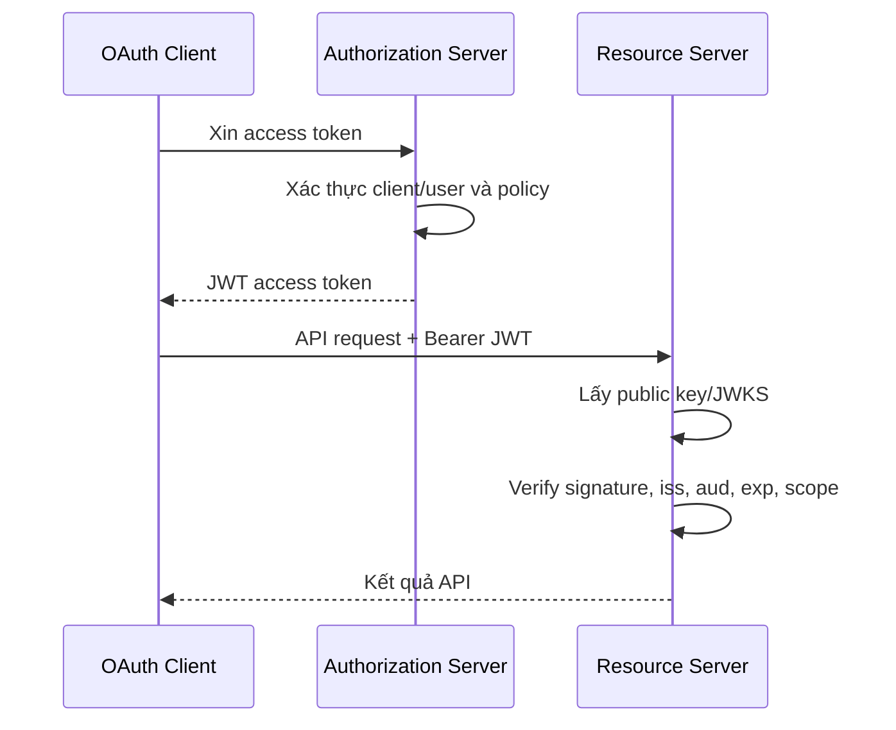
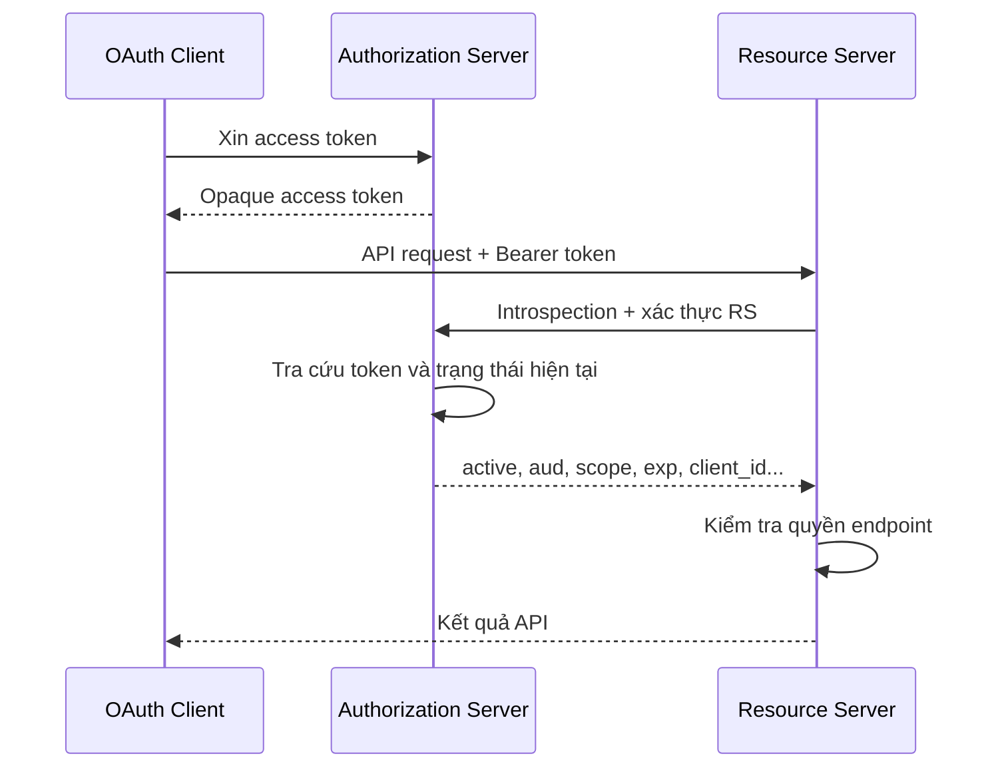
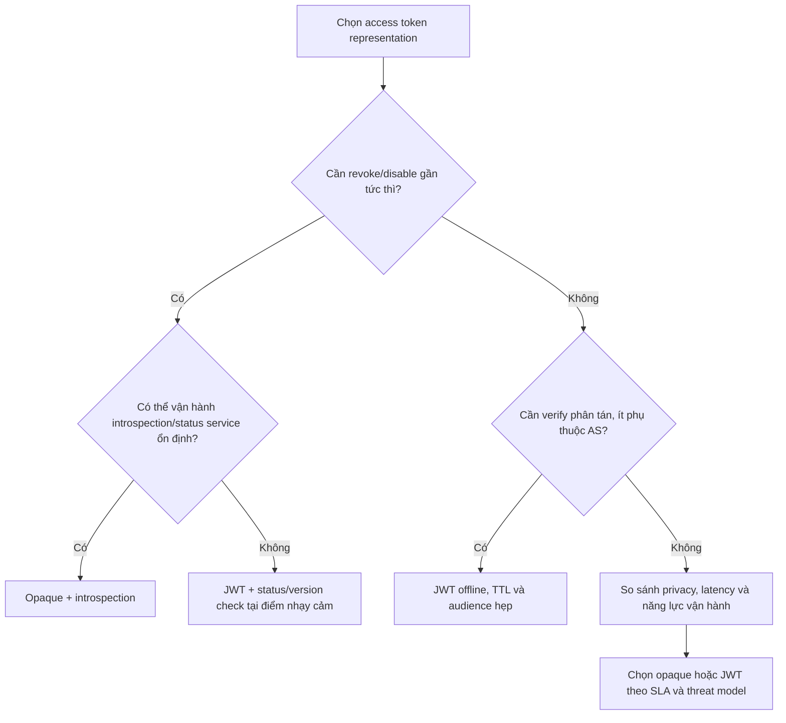

# Chọn JWT hay opaque token

## 1. Bài toán thiết kế: token tự mô tả hay token tham chiếu?

Khi thiết kế OAuth 2.0/OIDC, một quyết định quan trọng là access token sẽ được biểu diễn dưới dạng **JWT** hay **opaque token**. Lựa chọn này ảnh hưởng đến cách Resource Server xác minh token, tốc độ thu hồi quyền, khả năng vận hành khi Authorization Server gián đoạn, mức độ lộ thông tin và chi phí quản lý khóa.

Cần phân biệt hai khái niệm:

- **JWT (JSON Web Token)** là định dạng token có cấu trúc. JWT thường được ký dưới dạng JWS để Resource Server có thể xác minh chữ ký và đọc claims. JWT cũng có thể được mã hóa dưới dạng JWE, nhưng access token JWT phổ biến thường là JWS ký số, không phải dữ liệu được mã hóa.
- **Opaque token** là token không mang cấu trúc có ý nghĩa đối với client hoặc Resource Server. Nó thường là một chuỗi ngẫu nhiên khó đoán, được Authorization Server ánh xạ tới trạng thái và quyền ở phía server. Resource Server thường xác minh qua introspection hoặc một cơ chế tra cứu tin cậy khác.

JWT và opaque mô tả **cách biểu diễn/tra cứu token**, không phải hai loại quyền khác nhau. Cả hai đều có thể là access token OAuth 2.0. Access token dùng để gọi API; ID token của OIDC cung cấp thông tin xác thực cho client. Không dùng ID token thay access token chỉ vì cả hai đều có thể là JWT.

**JWT không mặc nhiên an toàn hơn opaque token, và opaque token không mặc nhiên dễ thu hồi hơn nếu hệ thống cache sai cách.** Quyết định phải dựa trên yêu cầu về revocation, độ trễ, tính sẵn sàng, privacy, quy mô và năng lực vận hành.

## 2. Hai mô hình hoạt động

### JWT access token

Authorization Server phát hành token chứa claims như issuer, subject, audience, scope và thời hạn, sau đó ký bằng private key. Resource Server lấy public key từ JWKS đã cấu hình tin cậy, xác minh chữ ký và kiểm tra claims cục bộ.



Trong đường đi thông thường, Resource Server không cần gọi Authorization Server ở mỗi request. Điều này giảm độ trễ và phụ thuộc mạng, nhưng token đã phát hành có thể tiếp tục được chấp nhận đến khi hết hạn nếu không có kiểm tra trạng thái bổ sung.

### Opaque access token

Authorization Server phát hành một chuỗi không chứa claims mà client có thể tự đọc. Resource Server gửi token đến introspection endpoint bằng danh tính client được xác thực. Authorization Server tra cứu trạng thái và trả metadata cần thiết, ví dụ token còn active hay không, audience, scope và thời hạn.



Mỗi request có thể tạo thêm một lần gọi introspection. Có thể cache kết quả để giảm tải, nhưng cache tạo ra khoảng trễ giữa lúc revoke và lúc Resource Server nhận biết trạng thái mới.

## 3. JWT: điểm mạnh và giới hạn

Một JWT access token theo profile phù hợp có thể có payload minh họa:

```json
{
  "iss": "https://auth.example.internal",
  "sub": "user-204",
  "aud": ["urn:service:orders-api"],
  "client_id": "web-store",
  "scope": "orders.read orders.update",
  "iat": 1795400000,
  "exp": 1795400300,
  "jti": "at-7f81",
  "tenant_id": "acme"
}
```

Đây là claims giả lập để minh họa. Tên và ý nghĩa claim phải tuân theo profile token và hợp đồng giữa issuer với Resource Server. Không đưa dữ liệu bí mật vào payload chỉ vì JWT được ký: JWS thường chỉ mã hóa nội dung theo Base64URL, không giữ bí mật nội dung.

### Ưu điểm

- **Xác minh cục bộ:** Resource Server có thể kiểm tra chữ ký bằng public key đã tin cậy mà không gọi AS cho từng request.
- **Độ trễ thấp:** phù hợp hệ thống có lưu lượng lớn hoặc nhiều service ở nhiều vùng mạng.
- **Giảm phụ thuộc runtime vào AS:** API vẫn có thể xác minh token khi introspection service tạm thời không truy cập được, miễn JWKS/key cache còn hợp lệ và policy cho phép.
- **Claims mang theo ngữ cảnh:** issuer, subject, audience, scope, client và một số authorization context có thể được cung cấp cùng token.
- **Hỗ trợ nhiều Resource Server:** public key có thể được phân phối qua JWKS, giúp các service xác minh độc lập.

### Giới hạn và rủi ro

- **Thu hồi tức thì khó hơn:** JWT đã ký có thể còn hợp lệ đến thời điểm exp nếu RS chỉ xác minh offline.
- **Claims có thể cũ:** role, membership hoặc trạng thái tenant thay đổi sau khi token được phát hành nhưng token vẫn chứa giá trị cũ.
- **Lộ metadata:** người có token có thể đọc payload JWS; không đặt thông tin nhạy cảm hoặc dữ liệu cá nhân không cần thiết vào claims.
- **Quản lý khóa phức tạp:** cần rotation, JWKS propagation, overlap window, bảo vệ private key và xử lý compromise.
- **Token có thể lớn:** nhiều claims làm tăng header/request size, chi phí truyền tải và nguy cơ vượt giới hạn proxy.
- **Khó đồng bộ trạng thái toàn cục:** denylist, token version hoặc introspection bổ sung lại đưa một phần stateful behavior vào kiến trúc.

JWT phù hợp khi hệ thống chấp nhận một cửa sổ hiệu lực hữu hạn, cần xác minh phân tán và có quy trình quản lý signing key tốt. Nếu quyền phải thay đổi có hiệu lực gần như ngay lập tức, cần thêm cơ chế trạng thái; không thể chỉ dựa vào chữ ký JWT.

## 4. Opaque token: điểm mạnh và giới hạn

Opaque token thường có dạng chuỗi ngẫu nhiên, ví dụ:

```text
v2_8mQxJf4sTn9kR3pLw7cA...
```

Giá trị trên chỉ là chuỗi minh họa, không phải token có thể sử dụng. Resource Server không giải mã chuỗi để lấy claims; nó hỏi AS hoặc tra một kho trạng thái được bảo vệ.

### Ưu điểm

- **Quyền được giữ ở server:** scope, audience, trạng thái revoke và metadata có thể được thay đổi mà không phải chờ token tự hết hạn, miễn RS kiểm tra trạng thái đủ mới.
- **Thu hồi thuận tiện:** AS có thể đánh dấu token inactive hoặc thu hồi grant/token family theo policy.
- **Ít lộ metadata cho client:** token không tự bộc lộ claims như subject, tenant hoặc scope khi bị quan sát ở dạng chuỗi.
- **Dễ áp chính sách động:** AS có thể kiểm tra user, membership, tenant, risk signal hoặc trạng thái phiên tại thời điểm introspection.
- **Không cần Resource Server quản lý JWT signing key:** RS dùng endpoint introspection và xác thực với AS; AS vẫn cần bảo vệ các khóa nội bộ nếu có.

### Giới hạn và rủi ro

- **Phụ thuộc introspection:** nếu AS/introspection không sẵn sàng, RS có thể không xác định được token có active hay không.
- **Độ trễ và tải:** mỗi request có thể thêm một network round trip và truy vấn trạng thái.
- **Cache làm chậm revoke:** cache active=true quá lâu khiến token đã revoke vẫn được chấp nhận trong thời gian cache.
- **Cần bảo vệ introspection endpoint:** endpoint phải xác thực Resource Server, giới hạn quyền xem metadata và chống lạm dụng.
- **Khó mở rộng nếu tra cứu không hiệu quả:** cần thiết kế cache, database, sharding, rate limit và capacity planning.
- **Opaque không đồng nghĩa token một lần:** cùng một bearer opaque token vẫn có thể được dùng cho nhiều request đến khi hết hạn hoặc bị revoke.

Opaque token phù hợp khi cần kiểm soát tập trung và trạng thái thay đổi nhanh, đồng thời hệ thống đủ khả năng vận hành introspection ổn định, có cache policy rõ ràng và chấp nhận độ trễ bổ sung.

## 5. So sánh theo tiêu chí thiết kế

| Tiêu chí | JWT access token | Opaque access token |
|---|---|---|
| Cách xác minh | Chữ ký, issuer, audience, thời hạn và claims | Introspection hoặc lookup tin cậy |
| Phụ thuộc AS trên mỗi request | Không bắt buộc nếu xác minh offline | Thường có, trừ khi dùng cache/replica |
| Độ trễ request | Thường thấp hơn | Có thể cao hơn do network lookup |
| Thu hồi sớm | Cần denylist, version check, introspection hoặc TTL ngắn | AS có thể đánh dấu inactive; hiệu lực phụ thuộc cache |
| Thay đổi quyền | Token cũ giữ claims cũ nếu không kiểm tra trạng thái | Metadata trả về có thể phản ánh quyền mới |
| Khả năng hoạt động khi AS gián đoạn | Có thể tiếp tục xác minh nếu key cache còn hợp lệ | Phụ thuộc cache và fail policy |
| Privacy của claims | Payload JWS có thể đọc được | Chuỗi token không tự bộc lộ claims |
| Quản lý khóa tại RS | Cần tin cậy issuer/JWKS và xử lý rotation | Cần xác thực kết nối tới introspection; không cần public signing key để đọc token |
| Kích thước token | Thay đổi theo số lượng claims | Thường ngắn hơn, tùy định dạng |
| Scale nhiều RS | Phân phối public key và verify cục bộ | AS/introspection cần chịu tải hoặc có cache/replica |
| Kiểm soát tập trung | Thấp hơn nếu chỉ offline | Cao hơn khi introspection được gọi thường xuyên |
| Khả năng audit | Có thể liên kết jti, kid, issuer và request | Có thể liên kết token reference/fingerprint và introspection event |

Không có cột nào luôn thắng. Ví dụ, JWT có thể được introspect để thu hồi sớm; opaque token có thể được cache để giảm độ trễ. Các biện pháp bổ sung làm thay đổi trade-off ban đầu và phải được tính vào quyết định.

## 6. Quyết định quan trọng nhất: yêu cầu revocation nhanh đến mức nào?

Hãy bắt đầu từ câu hỏi: khi admin disable user, thu hồi membership hoặc phát hiện token bị đánh cắp, Resource Server phải ngừng chấp nhận token trong bao lâu?

### JWT xác minh offline

Nếu JWT có TTL 10 phút và RS không kiểm tra trạng thái, cửa sổ sử dụng sau khi disable có thể gần bằng thời gian còn lại của token. TTL ngắn giúp giới hạn cửa sổ nhưng không tạo ra revoke tức thì.

Có thể bổ sung:

- **Denylist:** RS kiểm tra jti hoặc token fingerprint với trạng thái revoke.
- **Authorization version:** token chứa version; RS so sánh với version hiện tại của user, tenant hoặc membership.
- **Introspection:** RS hỏi AS với những endpoint hoặc request nhạy cảm.
- **Revocation event:** AS phát sự kiện cập nhật cache/denylist ở gateway và RS.
- **TTL ngắn:** giảm khoảng thời gian token cũ còn được chấp nhận.

Mỗi cơ chế cần kiểm tra tính sẵn sàng, consistency, cache TTL và failure mode. Nếu status store không truy cập được, hệ thống phải có policy rõ ràng: fail closed cho hành động nhạy cảm, hoặc chấp nhận một cửa sổ rủi ro đã được phê duyệt.

### Opaque với introspection

Khi AS revoke token, introspection có thể trả:

```json
{
  "active": false
}
```

Khi token còn hiệu lực, response có thể chứa metadata như:

```json
{
  "active": true,
  "scope": "payments.authorize",
  "client_id": "order-api",
  "sub": "user-204",
  "aud": ["urn:service:payment-api"],
  "exp": 1795400300,
  "iss": "https://auth.example.internal"
}
```

Response là ví dụ minh họa; tập claim được trả về phụ thuộc AS và policy. RS phải kiểm tra active, audience, scope và các ràng buộc cần thiết; không coi active=true là đủ để cho phép mọi endpoint.

Nếu RS cache response active=true trong 60 giây, token có thể tiếp tục được chấp nhận tối đa khoảng thời gian cache còn hiệu lực sau khi revoke, tùy cách cache và invalidation hoạt động. TTL càng ngắn thì revoke càng nhanh nhưng tải introspection càng lớn.

### Đặt SLA trước khi chọn

| Mức yêu cầu | Cách tiếp cận có thể phù hợp |
|---|---|
| Chấp nhận token còn hiệu lực đến hết TTL ngắn | JWT offline với access token TTL ngắn |
| Thu hồi trong vài chục giây | Opaque + introspection cache ngắn hoặc JWT + status/version propagation |
| Gần tức thì cho thao tác rủi ro cao | Kiểm tra trạng thái online/denylist có consistency mạnh tại điểm thực thi |
| API đọc lưu lượng rất lớn, quyền ít thay đổi | JWT offline, audience hẹp và scope tối thiểu |
| Quyền tenant/membership thay đổi thường xuyên | Opaque introspection hoặc JWT kèm tenant/membership version check |

Đây là hướng thiết kế tham khảo. SLA thực tế cần đo trong môi trường triển khai, gồm thời gian phát event, invalidation, cache propagation và request đang chạy.

## 7. Kiểm tra JWT access token đúng cách

Resource Server không nên chỉ decode JWT rồi tin payload. Một quy trình xác minh cần có:

1. Chỉ chấp nhận thuật toán được cấu hình rõ; không chọn thuật toán theo giá trị tùy ý từ token header.
2. Lấy key từ issuer/JWKS đã tin cậy; xử lý kid không tìm thấy một cách an toàn.
3. Xác minh chữ ký và loại token theo profile được chấp nhận.
4. Kiểm tra iss đúng issuer.
5. Kiểm tra aud chứa API hiện tại.
6. Kiểm tra exp, nbf và clock skew theo policy.
7. Kiểm tra scope/authority cho endpoint.
8. Kiểm tra sub, client_id, tenant, actor hoặc authorization version nếu policy yêu cầu.
9. Nếu token sender-constrained, xác minh DPoP proof hoặc mTLS certificate binding.
10. Không ghi raw token vào log và không dùng ID token thay access token.

RFC 9068 mô tả JWT Profile cho OAuth 2.0 Access Token. Khi dùng profile này, Resource Server cần xác minh đúng các yêu cầu của profile, gồm typ phù hợp, issuer, audience, chữ ký và claims bắt buộc. RFC 8725 cung cấp best practices chung để tránh nhầm lẫn thuật toán và token substitution.

### Ví dụ cấu hình Spring Security cho JWT

```java
@Bean
JwtDecoder jwtDecoder() {
    String issuer = "https://auth.example.internal";

    NimbusJwtDecoder decoder = JwtDecoders.fromIssuerLocation(issuer);

    OAuth2TokenValidator<Jwt> audienceValidator = jwt -> {
        if (jwt.getAudience().contains("urn:service:orders-api")) {
            return OAuth2TokenValidatorResult.success();
        }
        return OAuth2TokenValidatorResult.failure(
            new OAuth2Error("invalid_token", "Invalid audience", null)
        );
    };

    OAuth2TokenValidator<Jwt> withIssuer =
        JwtValidators.createDefaultWithIssuer(issuer);

    decoder.setJwtValidator(
        new DelegatingOAuth2TokenValidator<>(withIssuer, audienceValidator)
    );

    return decoder;
}
```

Đây là đoạn minh họa, cần import và cấu hình authority mapping phù hợp. Endpoint vẫn phải kiểm tra scope, ví dụ SCOPE_orders.read. Nếu cần disable/revoke nhanh, bổ sung validator hoặc authorization check đọc trạng thái/version; validator audience không thay thế kiểm tra trạng thái user hay tenant.

## 8. Kiểm tra opaque token và introspection

Resource Server phải xác thực với introspection endpoint bằng cơ chế phù hợp, thường là client authentication. Không cho client bên ngoài tùy ý introspect token của user hoặc workload khác.

Các bước chính:

1. Gửi token đến endpoint introspection qua TLS.
2. Xác thực Resource Server/client có quyền introspect.
3. Kiểm tra response active.
4. Kiểm tra audience/resource có đúng API hiện tại.
5. Kiểm tra scope có đủ cho endpoint.
6. Kiểm tra thời hạn và subject/client theo policy.
7. Cache kết quả theo TTL phù hợp với revocation SLA.
8. Khi AS/introspection lỗi, thực hiện fail policy đã thiết kế; không tự coi token là active.

### Ví dụ Spring Security cho opaque token

```java
@Bean
SecurityFilterChain apiSecurity(HttpSecurity http) throws Exception {
    return http
        .authorizeHttpRequests(auth -> auth
            .requestMatchers("/orders/**")
                .hasAuthority("SCOPE_orders.read")
            .anyRequest().authenticated()
        )
        .oauth2ResourceServer(oauth -> oauth
            .opaqueToken(opaque -> opaque
                .introspectionUri(
                    "https://auth.example.internal/oauth2/introspect"
                )
                .introspectionClientCredentials(
                    "orders-api",
                    "injected-secret"
                )
            )
        )
        .build();
}
```

Đây là ví dụ API của Spring Security; cần kiểm tra đúng overload theo phiên bản framework đang dùng và lấy secret từ secret manager, không hard-code vào source. Cần cấu hình audience validation cho introspection principal hoặc custom opaque token introspector nếu response/contract của AS yêu cầu.

### Cache introspection

Cache có thể giảm tải AS nhưng làm chậm thu hồi. Cache key phải phân biệt issuer, token fingerprint và context cần thiết; không ghi raw token làm cache key trong log. Không cache active=true lâu hơn revocation SLA. Có thể cache active=false trong khoảng phù hợp để giảm lặp lại lookup token đã bị từ chối.

## 9. Privacy và dữ liệu trong token

JWT JWS có payload đọc được. Không đưa các thông tin sau vào JWT nếu Resource Server không thực sự cần:

- Email, số điện thoại hoặc địa chỉ đầy đủ.
- Thông tin thanh toán, hồ sơ sức khỏe hoặc dữ liệu nhạy cảm.
- Danh sách lớn tenant membership hoặc quyền chi tiết.
- Dữ liệu nghiệp vụ có thể thay đổi nhanh.
- Bí mật, password, API key hoặc private key.

Opaque token che giấu claims khỏi người chỉ nhìn thấy chuỗi token, nhưng không làm token tự động an toàn nếu bị đánh cắp. Bearer opaque token vẫn là credential: người nắm giữ có thể sử dụng nó đến khi hết hạn hoặc bị revoke.

Nếu cần mang thông tin bí mật trong token, xem xét thiết kế dữ liệu và cơ chế mã hóa phù hợp; không nhầm chữ ký JWS với mã hóa JWE. Thường tốt hơn là chỉ đưa định danh và quyền tối thiểu vào access token, còn dữ liệu nhạy cảm được truy xuất qua API có authorization.

## 10. Hiệu năng, availability và khả năng mở rộng

### JWT offline

Chi phí chính nằm ở xác minh chữ ký, kiểm tra claims và tải/cache JWKS. Khi JWKS endpoint gián đoạn, RS có thể tiếp tục dùng key đã cache nếu policy cho phép và key còn trong thời hạn tin cậy. Tuy nhiên, nếu issuer rotate key mà RS không tải được public key mới, token ký bằng key mới có thể bị từ chối.

Cần đo:

- CPU/latency của signature verification.
- JWKS refresh, cache TTL và hành vi kid mới.
- Số lượng claims và kích thước HTTP header.
- Số lần gọi status/version store nếu có.
- Hành vi khi AS/JWKS/status service gián đoạn.

### Opaque + introspection

Chi phí chính là network round trip, xác thực RS, lookup trạng thái và cache. Khi lưu lượng tăng, introspection có thể trở thành điểm nóng hoặc điểm lỗi tập trung. Cần đo:

- Latency p50/p95/p99 của introspection.
- Throughput và capacity của AS.
- Cache hit ratio và độ trễ revoke.
- Timeout, retry, circuit breaker và connection pool.
- Phân vùng/replication trạng thái token.
- Hành vi khi introspection trả lỗi hoặc không truy cập được.

Không retry vô hạn trên mỗi API request khi introspection chậm; điều đó có thể khuếch đại sự cố. Dùng timeout ngắn, giới hạn retry và fail policy phù hợp độ nhạy cảm của API.

## 11. Chọn theo loại hệ thống và nghiệp vụ

| Bối cảnh | Hướng lựa chọn thường phù hợp | Lý do và điều kiện |
|---|---|---|
| Nhiều microservice, lưu lượng lớn, verify phân tán | JWT | Giảm lookup trung tâm; cần TTL, audience và key rotation tốt |
| API quản trị, quyền thay đổi thường xuyên | Opaque hoặc JWT có status check | Cần revoke/disable có hiệu lực nhanh |
| Payment/transaction nhạy cảm | Kết hợp theo threat model; opaque hoặc online status check ở điểm quyết định | Cần trạng thái quyền và giao dịch hiện tại; token format không thay kiểm tra nghiệp vụ |
| API nội bộ với workload identity | JWT ngắn hạn hoặc token theo platform | Chọn theo khả năng xác minh phân tán và policy của identity platform |
| Nhiều tenant, membership thay đổi thường xuyên | Opaque hoặc JWT kèm tenant/membership version | Tránh dùng claims cũ để quyết định quyền tenant |
| Hệ thống cần giảm metadata lộ ra ngoài client | Opaque | Claims được giữ ở AS; vẫn phải bảo vệ bearer token |
| Edge service cần hoạt động khi AS gián đoạn | JWT offline | RS có thể verify với key cache; chấp nhận giới hạn revocation |
| Hệ thống nhỏ, ít API, cần vận hành đơn giản | Dựa trên khả năng AS và SLA | Không chọn JWT chỉ vì phổ biến hoặc opaque chỉ vì dễ revoke |

### Cây quyết định



Đây là cây quyết định khởi đầu. Kết quả cuối cùng cần được xác nhận bằng tải thực tế, threat model, yêu cầu tuân thủ và khả năng vận hành.

## 12. Mô hình kết hợp: dùng token khác nhau cho từng trust boundary

Không nhất thiết toàn bộ nền tảng chỉ dùng một dạng token. Có thể chọn theo từng API hoặc từng ranh giới tin cậy:

- Browser/mobile client nhận access token có audience dành cho API public.
- Gateway introspect opaque token ở điểm vào nếu cần trạng thái tập trung.
- Service nội bộ nhận JWT ngắn hạn qua token exchange, audience riêng cho từng downstream.
- API quản trị nhạy cảm kiểm tra trạng thái user/tenant online dù access token là JWT.
- Workload dùng mTLS hoặc DPoP để ràng buộc token với khóa của client khi threat model yêu cầu.

Ví dụ, token dành cho Order API không nên được chuyển nguyên sang Payment API nếu audience khác. Order API có thể dùng OAuth Token Exchange để xin token mới có audience Payment API và scope tối thiểu. Token mới có thể là JWT hoặc opaque tùy khả năng AS và yêu cầu của Payment API.

**Đừng dùng định dạng token để thay thế authorization.** Dù JWT hay opaque, Resource Server vẫn phải kiểm tra audience, scope, tenant context và quyền trên đối tượng/giao dịch cụ thể.

## 13. Lộ trình chuyển đổi JWT sang opaque hoặc ngược lại

Nếu hệ thống đã có token format đang vận hành, thay đổi cần có kế hoạch tương thích.

### JWT sang opaque

1. AS hỗ trợ phát hành opaque token cho client/resource được chọn.
2. RS được cấu hình introspection endpoint, client authentication, audience/scope mapping và timeout.
3. Chạy song song hai loại token trong thời gian chuyển tiếp nếu contract cho phép.
4. Theo dõi latency, cache hit, introspection errors và revoke propagation.
5. Cập nhật client, gateway, observability và runbook.
6. Ngừng chấp nhận JWT cũ sau khi token cũ hết hạn hoặc theo quy trình revoke đã xác định.
7. Xóa public key/issuer trust chỉ khi không còn consumer cần xác minh token cũ.

### Opaque sang JWT

1. Chọn JWT access token profile, claims tối thiểu, issuer, audience và signing algorithm.
2. Tạo signing key trong KMS/HSM và công bố public key qua JWKS.
3. Cấu hình RS verify signature, issuer, audience, expiration, token type và scope.
4. Xác định cách xử lý revoke: TTL, denylist, status/version hoặc introspection.
5. Chạy song song, quan sát lỗi kid, JWKS cache, token size và authorization mapping.
6. Ngừng opaque introspection khi mọi consumer đã chuyển và token cũ hết hiệu lực.
7. Giữ audit cho thay đổi issuer/key/consumer và khả năng rollback trong thời gian chuyển tiếp.

Không thay token format mà không kiểm kê tất cả Resource Server, gateway, background worker, job và integration client. Một consumer bị bỏ sót có thể khiến token hợp lệ bị từ chối hoặc tạo đường xác minh yếu hơn.

## 14. Ma trận kiểm thử trước khi quyết định

| Nhóm kiểm thử | JWT | Opaque |
|---|---|---|
| Token hợp lệ | Verify chữ ký, issuer, audience, thời hạn và scope | Introspection active, audience và scope đúng |
| Token giả/sửa | Chữ ký sai phải bị từ chối | Token không tồn tại phải inactive |
| Sai audience | RS từ chối | RS từ chối metadata audience không phù hợp |
| Hết hạn | exp hết hạn bị từ chối | Introspection inactive hoặc exp hết hạn bị từ chối |
| Thiếu scope | 403 theo policy endpoint | 403 theo policy endpoint |
| Revoke | Kiểm tra denylist/version/TTL hoặc introspection bổ sung | Introspection inactive theo propagation SLA |
| Disable user/tenant | Status/version check hoặc giới hạn theo TTL | AS từ chối refresh/introspection theo policy |
| AS outage | Verify offline với JWKS cache theo policy | Cache/fail policy; không tự coi token active |
| JWKS/key rotation | RS nhận kid mới, vẫn xử lý token cũ trong overlap | Không phải đường xác minh token chính, nhưng AS vẫn cần bảo vệ khóa nội bộ |
| Introspection outage | Chỉ ảnh hưởng nếu JWT dùng status check | Timeout/fail closed hoặc policy được phê duyệt |
| Token theft | Đánh giá bearer risk, DPoP/mTLS và revoke | Đánh giá bearer risk, DPoP/mTLS và revoke |
| Token substitution | Kiểm tra issuer, audience, token type và thuật toán | Kiểm tra issuer/resource/client qua introspection contract |
| Cache | JWKS/status cache không vượt policy | Introspection cache không vượt revocation SLA |
| Load test | Verify CPU, token size, JWKS refresh | Introspection throughput, latency và cache hit |
| Logging | Không log raw JWT | Không log raw opaque token |

Nên kiểm thử cả đường thành công, lỗi, timeout, concurrency và multi-instance. Với mỗi loại token, đo thời gian từ lúc revoke/disable đến request cuối cùng bị từ chối; đây là số liệu thực tế để xác nhận SLA.

## 15. Ví dụ ghi quyết định thiết kế (ADR)

Một quyết định thiết kế nên ghi rõ bối cảnh và trade-off, thay vì chỉ ghi “chọn JWT vì nhanh”.

```markdown
# ADR: Access token cho Orders API

## Status
Accepted

## Context
Orders API có lưu lượng cao, nhiều instance và cần xác minh token khi Authorization Server tạm gián đoạn. Quyền đọc đơn hàng thay đổi không thường xuyên; thao tác quản trị nhạy cảm vẫn cần kiểm tra trạng thái hiện tại.

## Decision
Dùng JWT access token theo RFC 9068, audience riêng cho Orders API, scope tối thiểu và TTL ngắn. Signing key được giữ trong KMS/HSM và public key phân phối qua JWKS.

## Revocation
Với API thông thường, chấp nhận cửa sổ hiệu lực tối đa theo TTL. Với thao tác quản trị/rủi ro cao, kiểm tra authorization version hoặc trạng thái online.

## Consequences
Giảm network lookup ở mỗi request. Đổi lại, phải vận hành key rotation, JWKS cache và cơ chế status check cho các thao tác nhạy cảm.
```

ADR cho opaque token có thể chọn introspection, cache TTL ngắn và fail policy rõ ràng; cần ghi latency budget, capacity, availability target và cách xử lý khi AS không truy cập được.

## 16. Checklist ra quyết định

- Xác định token là access token hay ID token; Resource Server chỉ nhận access token đúng audience.
- Đánh giá yêu cầu revoke/disable theo thời gian cụ thể, không dùng khái niệm “ngay lập tức” mơ hồ.
- Đo latency và capacity của introspection nếu chọn opaque.
- Đánh giá khả năng quản lý signing key, JWKS, rotation và compromise nếu chọn JWT.
- Xác định claims tối thiểu; không đưa dữ liệu nhạy cảm vào JWS payload.
- Kiểm tra issuer, audience, scope, expiration và token type ở mọi Resource Server.
- Định nghĩa cache TTL và failure policy cho JWKS, introspection, denylist hoặc authorization version.
- Xác định cách disable user, membership, tenant và client ảnh hưởng token hiện tại.
- Kiểm thử token theft, replay, DPoP/mTLS binding và revocation.
- Tách audience và scope theo downstream service; dùng token exchange khi cần delegation.
- Kiểm tra mọi gateway, service, job nền và integration client trước khi đổi format.
- Ghi ADR với lý do, trade-off, SLA, owner và kế hoạch chuyển đổi/rollback.

## Tài liệu chuẩn để tra cứu

- [RFC 6749 — The OAuth 2.0 Authorization Framework](https://www.rfc-editor.org/rfc/rfc6749): vai trò access token, refresh token, client và Resource Server.
- [RFC 7519 — JSON Web Token (JWT)](https://www.rfc-editor.org/rfc/rfc7519): cấu trúc và claims của JWT.
- [RFC 7515 — JSON Web Signature (JWS)](https://www.rfc-editor.org/rfc/rfc7515): chữ ký và tính toàn vẹn của nội dung JWT.
- [RFC 7517 — JSON Web Key (JWK)](https://www.rfc-editor.org/rfc/rfc7517): phân phối và biểu diễn public key/JWKS.
- [RFC 7662 — OAuth 2.0 Token Introspection](https://www.rfc-editor.org/rfc/rfc7662): kiểm tra trạng thái và metadata của token.
- [RFC 7009 — OAuth 2.0 Token Revocation](https://www.rfc-editor.org/rfc/rfc7009): thu hồi token.
- [RFC 9068 — JWT Profile for OAuth 2.0 Access Tokens](https://www.rfc-editor.org/rfc/rfc9068): profile JWT access token.
- [RFC 8725 — JSON Web Token Best Current Practices](https://www.rfc-editor.org/rfc/rfc8725): xác minh JWT an toàn và ngăn nhầm lẫn token.
- [RFC 9700 — Best Current Practice for OAuth 2.0 Security](https://www.rfc-editor.org/rfc/rfc9700): khuyến nghị bảo mật OAuth 2.0 hiện hành.
- [RFC 8707 — Resource Indicators for OAuth 2.0](https://www.rfc-editor.org/rfc/rfc8707): xác định resource/audience khi xin token.

**Ghi nhớ:** JWT phù hợp khi cần xác minh phân tán và chấp nhận được cửa sổ hiệu lực có giới hạn; opaque phù hợp khi cần trạng thái tập trung và revocation nhanh với introspection được vận hành tốt. Hãy chọn theo SLA thu hồi, privacy, latency, availability và năng lực vận hành, rồi xác nhận bằng integration test và số liệu thực tế.
