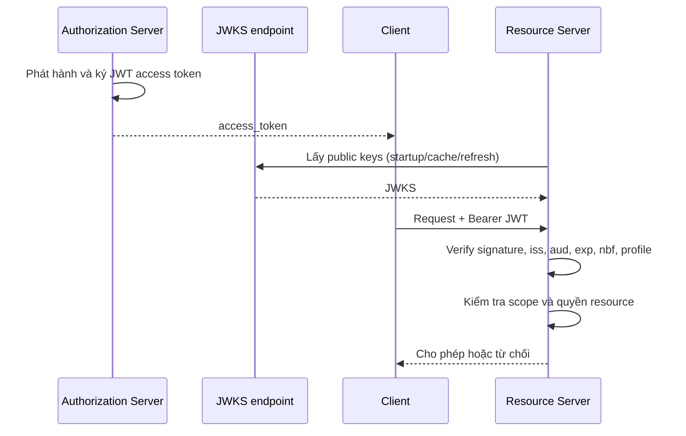
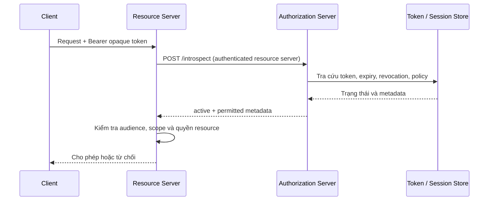

# Chọn local validation hay introspection

## 1. Bài toán quyết định

Mỗi request tới resource server cần một quyết định xác thực: credential được gửi có hợp lệ, còn hiệu lực và được phát hành trong phạm vi tin cậy của API hay không? Với access token, hai cách triển khai phổ biến là:

- **Local validation:** resource server tự xác minh token trong tiến trình của mình. Cách này thường dùng với JWT có chữ ký; API lấy public key từ JWKS của issuer rồi kiểm tra chữ ký và claim.
- **Token introspection:** resource server gửi token tới endpoint introspection của Authorization Server (AS) để hỏi trạng thái và metadata. Cách này thường dùng với opaque/reference token, nhưng AS cũng có thể hỗ trợ introspection JWT.

Quyết định này ảnh hưởng trực tiếp tới độ trễ request, khả năng phục hồi khi AS gặp sự cố, thời gian thu hồi token có hiệu lực, cách phân phối claim, chi phí vận hành và ranh giới tin cậy giữa các dịch vụ.

Không có lựa chọn luôn tốt hơn. Cần bắt đầu từ yêu cầu bảo mật và vận hành: token phải bị vô hiệu hóa nhanh đến mức nào, API có thể phụ thuộc AS trực tuyến không, có bao nhiêu resource server, dữ liệu quyền thay đổi thường xuyên ra sao và hệ thống chấp nhận rủi ro cache stale ở mức nào.

Sau bài học, người học có thể:

- Phân biệt local validation và introspection, đồng thời hiểu chúng không hoàn toàn đồng nghĩa với JWT và opaque token.
- So sánh độ trễ, availability, revocation freshness, privacy, scale và chi phí vận hành.
- Thiết kế kiểm tra JWT local đúng cách và gọi introspection an toàn.
- Đánh giá tác động của cache, key rotation, network failure và AS outage.
- Chọn mô hình local, centralized hoặc hybrid dựa trên yêu cầu có thể đo lường.
- Viết một quyết định kiến trúc có rationale, trade-offs và điều kiện xem xét lại.

## 2. Hai trục cần tách biệt: token format và cách xác minh

JWT/opaque mô tả **hình thức và cách biểu diễn token**. Local validation/introspection mô tả **nơi và cách hệ thống xác minh token**. Hai khái niệm thường đi cùng nhau nhưng không phải một.

| Token format | Local validation | Introspection |
| --- | --- | --- |
| JWT access token | Phổ biến: kiểm tra chữ ký và claim bằng khóa tin cậy | Có thể: AS nhận JWT và trả trạng thái/metadata qua RFC 7662 |
| Opaque/reference access token | Cần tra cứu server-side hoặc cơ chế riêng; không thể tự decode để suy ra trạng thái | Phổ biến: hỏi AS hoặc authorization service |
| Refresh token | Resource server không nên tự xác minh như access token | Thường chỉ token endpoint xử lý theo refresh grant; không gửi refresh token tới API nghiệp vụ |
| ID token | OIDC client xác minh theo OIDC Core, không dùng làm access token | Không biến ID token thành credential API chỉ vì có thể introspect |

Một JWT có chữ ký hợp lệ vẫn cần kiểm tra issuer, audience, thời hạn, token profile và quyền. Một opaque token không có payload đọc được; resource server phải hỏi nguồn quản lý token hoặc dùng cơ chế tham chiếu tin cậy. Ngược lại, introspection không chỉ dành cho opaque token: AS có thể kiểm tra JWT, áp dụng trạng thái phiên/thu hồi và trả kết quả đã chuẩn hóa.

Do đó, câu hỏi kiến trúc chính là **resource server có tự quyết định dựa trên dữ liệu token và trust material đã nhận, hay phải hỏi một authority trung tâm ở mỗi lần xác minh?**

## 3. Local validation hoạt động thế nào?

Với JWT access token có chữ ký bất đối xứng, AS ký token bằng private key. Resource server lấy public key từ JWKS endpoint đã tin cậy, sau đó xác minh token ngay tại chỗ.

Luồng cơ bản:



Resource server không cần gọi AS trong mỗi request nếu public key đã được cache hợp lệ. Nó cần thực hiện đầy đủ các bước:

1. Parse token theo định dạng và profile được hỗ trợ.
2. Chỉ chấp nhận thuật toán nằm trong allowlist cấu hình; không để header token tự chọn thuật toán.
3. Chọn đúng key theo claim header kid từ JWKS của issuer đã đăng ký.
4. Xác minh chữ ký bằng thư viện đã được kiểm chứng.
5. Kiểm tra issuer khớp chính xác issuer tin cậy.
6. Kiểm tra audience chứa đúng resource/API hiện tại.
7. Kiểm tra expiration, not-before và clock tolerance nhỏ đã được phê duyệt.
8. Kiểm tra token type/profile và claim bắt buộc theo hợp đồng access token.
9. Ánh xạ scope/permission và kiểm tra quyền trên endpoint, tenant, object.

**Chữ ký đúng không đồng nghĩa request được phép.** Local validation chỉ xác định token đáng tin theo issuer và điều kiện kỹ thuật; authorization vẫn phải áp dụng policy nghiệp vụ.

### 3.1. Ưu điểm

- Không cần round trip tới AS trên mỗi request; độ trễ thấp và ổn định hơn.
- Resource server có thể tiếp tục xác minh token khi AS tạm thời không truy cập được, miễn là có key tin cậy còn hiệu lực và policy cho phép.
- Giảm tải introspection endpoint và giảm coupling runtime giữa API với AS.
- Phù hợp hệ thống có lượng request lớn, nhiều service và yêu cầu latency chặt.
- JWT có thể mang claim cần thiết để resource server quyết định mà không phải tra cứu thêm.

### 3.2. Hạn chế và rủi ro

- Token thường không bị vô hiệu hóa tức thời ở mọi API nếu resource server chỉ xác minh chữ ký và thời hạn.
- Claim trong token có thể stale khi role, consent, tenant membership hoặc account status thay đổi.
- Mỗi resource server phải cấu hình đúng issuer, audience, thuật toán, key cache và claim mapping.
- Token JWT thường lớn hơn opaque token và có thể chứa claim không cần thiết nếu thiết kế phát hành kém.
- Key rotation, JWKS refresh, clock skew và validator configuration trở thành trách nhiệm vận hành ở từng resource server.
- Nếu nhiều API dùng chung một audience hoặc chấp nhận claim quá rộng, một token có thể bị dùng sai ranh giới.

## 4. Introspection hoạt động thế nào?

Với introspection, resource server gửi token tới endpoint của AS hoặc authorization service. Endpoint xác minh token theo trạng thái trung tâm và trả metadata. RFC 7662 định nghĩa giao thức introspection cho OAuth 2.0.

Luồng cơ bản:



Request introspection thường dùng form parameter token và tùy chọn token_type_hint. Resource server phải xác thực với introspection endpoint theo cấu hình AS, ví dụ client authentication, mTLS hoặc cơ chế được hỗ trợ. Giao tiếp phải được bảo vệ bằng TLS và endpoint chỉ cho phép resource server được ủy quyền hỏi trạng thái token.

Phản hồi có thể chứa active, scope, client_id, sub, aud, iss, exp, iat, nbf, jti và metadata khác tùy AS. Theo RFC 7662, trường active là tín hiệu cốt lõi; không được giả định mọi trường mở rộng đều luôn có mặt. Resource server cần kiểm tra audience, scope và ngữ cảnh theo hợp đồng đã thống nhất, không chỉ thấy active=true là cho phép mọi thao tác.

### 4.1. Ưu điểm

- AS có thể kiểm tra trạng thái token tập trung, gồm expiry, revocation, session, consent hoặc policy động theo thiết kế.
- Opaque token không phải mang claim dễ đọc hoặc có thể bị giải mã ở client.
- Có thể giảm thời gian thu hồi có hiệu lực so với JWT local validation thuần, nếu không cache hoặc cache ngắn.
- Thay đổi quyền hoặc trạng thái tài khoản có thể được phản ánh nhanh hơn mà không phải chờ token cũ hết hạn.
- Resource server có ít trách nhiệm xử lý format và signing key của token hơn; logic xác minh trạng thái tập trung.

### 4.2. Hạn chế và rủi ro

- Mỗi request có thể thêm network round trip, làm tăng latency và chi phí.
- Introspection endpoint trở thành dependency trực tuyến; outage có thể ảnh hưởng nhiều API cùng lúc.
- AS phải xử lý lưu lượng introspection lớn, có thể trở thành bottleneck.
- Resource server cần quản lý client credential, TLS, timeout, retry và circuit breaker.
- Cache introspection giảm tải nhưng tạo khoảng trễ thu hồi; cache quá lâu làm mất lợi ích freshness.
- Nếu AS trả metadata quá rộng, resource server nhận nhiều dữ liệu hơn cần thiết; cần giới hạn trường và bảo vệ privacy.
- Lỗi kết nối phải có chính sách rõ ràng; fail-open có thể biến outage thành lỗ hổng cho phép token chưa xác minh.

## 5. So sánh theo tiêu chí quyết định

| Tiêu chí | Local validation (thường JWT) | Introspection (thường opaque) |
| --- | --- | --- |
| Latency mỗi request | Thấp; chủ yếu CPU và cache key | Có network round trip; phụ thuộc AS |
| Throughput resource server | Dễ scale ngang, ít tải tập trung | Phụ thuộc capacity và scale của introspection |
| AS outage | Có thể tiếp tục nếu key đã cache và policy cho phép | Không xác minh được token mới nếu không có kết quả/cache hợp lệ |
| Revocation freshness | Hạn chế nếu không có denylist/push/session check | Gần realtime hơn nếu gọi AS mỗi request |
| Claim freshness | Claim trong token stale tới khi hết hạn | Metadata có thể phản ánh trạng thái hiện tại |
| Token size | JWT thường lớn hơn do claim và chữ ký | Opaque token thường ngắn hơn |
| Privacy | Claim có thể được đọc bởi bên cầm JWT nếu không mã hóa; thường nên tránh claim nhạy cảm | Nội dung nằm server-side; API nhận metadata được introspect |
| Key management | Resource server cần trust JWKS, rotation và thuật toán | AS giữ phần lớn logic token; resource server vẫn phải bảo vệ credential gọi introspection |
| Operational coupling | Thấp hơn ở runtime, nhưng có coupling tới issuer/JWKS | Cao hơn vì request phụ thuộc endpoint trung tâm |
| Debugging | Có thể kiểm tra claim đã xác minh; không log token | Dựa vào reason code/metadata introspection; không log token |
| Multi-resource | Audience và scope phải giới hạn đúng API | AS có thể áp dụng policy theo resource tập trung |
| Chi phí | CPU và key distribution; ít network call | Network, AS capacity, credential và cache |

Bảng này mô tả xu hướng, không phải cam kết tuyệt đối. Một hệ thống JWT có thể gọi policy service ở mỗi request và vẫn phụ thuộc mạng; một hệ thống introspection có thể cache kết quả và có latency thấp. Cần đo bằng workload, cache policy và topology thực tế.

## 6. Thu hồi token: yếu tố thường quyết định lựa chọn

Câu hỏi quan trọng nhất thường là: **sau khi token bị revoke, API phải ngừng chấp nhận nó trong bao lâu?**

### 6.1. JWT local validation thuần

Nếu resource server chỉ xác minh chữ ký và claim, JWT đã phát hành vẫn hợp lệ cho tới expiration theo verifier. Việc AS đánh dấu token revoked trong database không tự làm thay đổi JWT đã nằm ở client.

Các cách giảm khoảng thời gian này:

- Access token TTL ngắn, phù hợp với mức rủi ro và trải nghiệm.
- Denylist theo jti hoặc token reference, có cache và đồng bộ giữa các instance.
- Session/version check hoặc policy lookup cho các thao tác nhạy cảm.
- Push event hoặc revocation feed để resource server cập nhật trạng thái.
- Dùng introspection cho endpoint hoặc loại token cần freshness cao.

Mỗi cơ chế bổ sung có chi phí và có thể làm local validation phụ thuộc trạng thái trung tâm một phần. Cần tính toán rõ độ trễ lan truyền, availability và behavior khi cache/event bus lỗi.

### 6.2. Introspection

Nếu resource server gọi AS mỗi lần, trạng thái revoke có thể được phản ánh ở lần introspection kế tiếp. Tuy nhiên, kết quả còn phụ thuộc:

- AS cập nhật revocation store ngay hay theo eventual consistency.
- Introspection replica có đọc dữ liệu mới không.
- Resource server có cache positive response hay không.
- Cache có được invalidation khi revoke không.
- Có request đang chạy trước thời điểm revoke hay không.

Vì vậy, introspection không tự bảo đảm thu hồi tức thời tuyệt đối. Phải xác định SLA revocation freshness từ thời điểm yêu cầu revoke tới lần API cuối cùng chấp nhận token.

### 6.3. Ví dụ ngân sách freshness

Giả sử yêu cầu hệ thống là token revoked phải ngừng được chấp nhận trong tối đa 15 giây:

| Thành phần | Ngân sách minh họa |
| --- | --- |
| AS ghi trạng thái revoke | 2 giây |
| Đồng bộ trạng thái tới introspection replicas | 3 giây |
| Positive cache tại resource server | Tối đa 5 giây |
| Request đang xử lý / propagation margin | 5 giây |
| Tổng | 15 giây |

Đây là ví dụ phân bổ ngân sách, không phải thông số mặc định. Nếu local validation có denylist/push event, cần lập ngân sách tương tự cho publish, delivery, cache invalidation và xử lý request. Nếu không chứng minh được SLA, không tuyên bố token bị revoke có hiệu lực ngay lập tức.

## 7. Cache: điểm đánh đổi giữa hiệu năng và freshness

Cache xuất hiện trong cả hai mô hình:

- Local validation cache public key/JWKS, không phải cache kết quả authorization cho mọi subject.
- Introspection cache kết quả active/metadata để giảm số lần gọi AS.

### 7.1. Cache JWKS

JWKS cache giúp resource server xác minh JWT mà không gọi issuer mỗi request. Cần thiết kế:

- Cache TTL hợp lý, hỗ trợ refresh khi gặp kid mới.
- Rotation overlap để token mới được xác minh trong khi key cũ còn được tin trong thời gian cần thiết.
- Không tải key từ URL tùy ý do token cung cấp.
- Xử lý JWKS timeout/5xx: không chấp nhận chữ ký chưa xác minh.
- Có giới hạn stale key và runbook khi key bị compromise.
- Kiểm tra issuer và audience độc lập với chữ ký.

Nếu signing key bị lộ, chỉ chờ JWKS cache hết hạn có thể không đủ. Cần quy trình khẩn cấp loại key, chặn token, cập nhật trust và theo dõi propagation tới tất cả resource server.

### 7.2. Cache introspection

Cache introspection cần xác định:

- Positive cache TTL: token active được giữ bao lâu.
- Negative cache TTL: token inactive hoặc không tồn tại được cache bao lâu.
- Cache key có ràng buộc với token, resource/audience và client context cần thiết không.
- Khi revoke, AS có cơ chế invalidation/push hay phải đợi TTL.
- Token sắp hết hạn không được cache active vượt quá expiration.
- Response có audience/scope khác nhau theo resource không bị dùng chung nhầm.
- Cache không lưu raw token dưới dạng dễ bị đọc; bảo vệ storage, memory dump và observability.

Positive cache TTL dài tăng performance nhưng làm revoke chậm. TTL ngắn tăng freshness nhưng tăng load và coupling. Cần đặt TTL theo SLA revocation và khả năng của AS, không chọn theo cảm tính.

## 8. Failure mode và nguyên tắc fail-closed

| Sự cố | Local validation | Introspection |
| --- | --- | --- |
| AS token endpoint down | Không ảnh hưởng xác minh token đã phát hành nếu key/cache còn hợp lệ | Introspection có thể vẫn hoạt động nếu endpoint riêng; refresh/issue token bị ảnh hưởng |
| JWKS endpoint down | Key đã cache có thể tiếp tục dùng theo policy; key mới chưa biết không xác minh được | Không nhất thiết ảnh hưởng nếu introspection server tự xác minh token |
| Introspection endpoint down | Không áp dụng nếu local path | Không xác minh được token mới; dùng cache chỉ trong giới hạn đã phê duyệt |
| Key bị compromise | Cần emergency key removal/denylist hoặc chuyển trạng thái trust | AS có thể từ chối token theo trạng thái trung tâm nếu phát hiện được |
| Revocation store down | JWT local có thể không biết trạng thái revoke | AS có thể không kết luận active an toàn |
| Network partition | Local path thường chịu lỗi tốt hơn | Resource server mất đường tới authority trung tâm |

Nguyên tắc an toàn: nếu không có đủ dữ kiện để xác minh credential, không được tự coi token là hợp lệ. Với introspection timeout/5xx, fail closed là mặc định. Có thể cho phép dùng kết quả cache đã xác minh trong một khoảng stale rất ngắn chỉ khi risk owner phê duyệt, SLA được định lượng và có giới hạn rõ ràng. Không dùng fail-open tổng quát.

Với local validation, việc JWKS endpoint tạm thời down không có nghĩa phải từ chối mọi JWT ngay lập tức nếu key đang cache vẫn nằm trong trust window. Nhưng token có kid mới hoặc key không xác minh được phải bị từ chối. Nếu key compromise được thông báo, stale cache có thể nguy hiểm và cần emergency invalidation.

## 9. Security và privacy considerations

### 9.1. Trust boundary và audience

Local validation phải kiểm tra đúng issuer và audience. Không chấp nhận mọi token được ký bởi một issuer chung. Một issuer có thể phát hành ID token, access token cho nhiều API, token exchange và token dành cho client khác nhau.

Introspection cũng phải kiểm tra resource context. AS cần biết resource server nào hỏi và token có được dùng cho resource đó không. Resource server không nên chỉ dựa vào active=true nếu audience, scope hoặc tenant không khớp.

### 9.2. Bảo vệ introspection endpoint

- Chỉ resource server được đăng ký mới được gọi endpoint.
- Dùng client authentication mạnh, mTLS hoặc cơ chế được AS hỗ trợ.
- Bảo vệ transport bằng TLS và xác minh certificate.
- Giới hạn rate, timeout và payload size.
- Không ghi raw token vào log, trace hoặc error report.
- Không trả quá nhiều claim hoặc dữ liệu cá nhân không cần thiết.
- Theo dõi hành vi introspection bất thường và credential compromise.

Introspection endpoint có thể trở thành mục tiêu enumeration. Response active=false nên không tiết lộ vì sao token inactive hoặc token có từng tồn tại hay không nếu điều đó tạo rủi ro.

### 9.3. Bảo vệ JWT local validation

- Dùng thư viện JWT đã được duy trì, không tự viết verifier.
- Allowlist thuật toán và key type.
- Lấy JWKS từ issuer đã cấu hình, không theo URL tùy ý trong token.
- Kiểm tra iss, aud, exp, nbf và token profile.
- Không đặt dữ liệu nhạy cảm vào JWT payload chỉ vì payload được ký.
- Giới hạn TTL và scope; không phát token có quyền rộng cho nhiều API.
- Bảo vệ cache key và telemetry, không log raw token.

## 10. Mô hình hybrid: dùng cách xác minh phù hợp với mức rủi ro

Nhiều hệ thống không cần chọn duy nhất một phương thức cho mọi API. Có thể chia theo mức rủi ro:

| Use case | Mô hình có thể chọn | Lý do |
| --- | --- | --- |
| API đọc dữ liệu ít nhạy cảm, lượng request lớn | JWT local validation, TTL ngắn | Latency thấp, ít phụ thuộc AS |
| API tài chính hoặc thao tác có rủi ro cao | Introspection hoặc policy check bổ sung | Cần trạng thái và quyền gần thời gian thực |
| API cần hoạt động khi AS outage | JWT local với key cache và TTL giới hạn | Giảm runtime dependency |
| Token opaque cho mobile/backend | Introspection | AS quản lý trạng thái tập trung |
| Token exchange giữa service | Local validation cho token đích cộng policy/actor check khi cần | Giữ latency thấp nhưng không bỏ qua delegation |
| Logout/revoke cần hiệu lực nhanh | Introspection cache ngắn hoặc revocation event/check | Giảm cửa sổ token còn được chấp nhận |

Hybrid phải được thiết kế rõ ràng. Ví dụ, API thường dùng local JWT validation nhưng endpoint chuyển tiền gọi thêm policy service để kiểm tra trạng thái tài khoản và hạn mức. Không nên âm thầm introspect một số request mà không đo latency, xác định timeout và định nghĩa failure mode.

## 11. Quy trình ra quyết định kiến trúc

Để chọn phương thức, hãy thu thập yêu cầu trước:

1. **Revocation SLA:** sau khi revoke, tối đa bao lâu API còn được chấp nhận token?
2. **Latency budget:** mỗi request có thể thêm bao nhiêu millisecond cho việc xác minh?
3. **Availability target:** API phải tiếp tục hoạt động bao lâu khi AS/introspection không truy cập được?
4. **Request volume:** tổng QPS và số resource server/region?
5. **Claim freshness:** role, consent, account state và tenant membership thay đổi thường xuyên đến mức nào?
6. **Token format:** JWT hay opaque; ai phát hành và ai quản lý vòng đời?
7. **Privacy:** resource server có được phép nhận claim nào? Có cần giữ dữ liệu ở AS không?
8. **Operations:** đội vận hành có khả năng quản lý JWKS rotation, cache, introspection capacity và incident không?

Sau đó chấm theo mức ưu tiên và kiểm chứng bằng thử nghiệm tải/failure injection. Một ví dụ tiêu chí:

| Tiêu chí | Local validation | Introspection |
| --- | --- | --- |
| Revocation trong vài giây | Cần denylist/event/policy check bổ sung | Có thể đáp ứng với cache rất ngắn và AS đủ capacity |
| Latency budget rất chặt | Thường phù hợp | Cần đo và có thể không phù hợp |
| AS outage vẫn cần phục vụ | Thuận lợi nếu key đã cache | Khó hơn nếu không có cache được phê duyệt |
| Quyền thay đổi liên tục | Claim JWT có thể stale | Dễ phản ánh trạng thái mới hơn |
| Không muốn phát tán claim | JWT payload cần tối giản hoặc mã hóa theo use case | Opaque + introspection thường phù hợp hơn |

Không chọn bằng cách đếm số ô thắng. Trọng số tiêu chí phải phản ánh business impact và threat model. Một yêu cầu revoke trong 5 giây có thể quan trọng hơn vài millisecond latency; một API public read-only có thể ưu tiên availability và throughput.

## 12. Ví dụ Architecture Decision Record (ADR)

Ví dụ minh họa cho API đọc đơn hàng có lưu lượng cao:

```text
ADR-012: Xác minh access token tại Orders API

Status: Accepted

Context:
- Orders API có nhiều request đọc và yêu cầu latency thấp.
- Access token do issuer nội bộ phát hành dưới dạng JWT.
- Token chỉ chứa claim tối thiểu, audience riêng orders-api.
- Access token có TTL ngắn theo policy.
- Revocation SLA cho luồng đọc thông thường lớn hơn thời hạn lan truyền JWKS/key rotation.

Decision:
- Dùng local JWT validation với public key lấy từ JWKS của issuer tin cậy.
- Bắt buộc kiểm tra signature, algorithm allowlist, iss, aud, exp, nbf và token profile.
- Scope và quyền tenant/resource được kiểm tra tại API.
- Các thao tác nhạy cảm cần trạng thái mới sẽ gọi policy service riêng.
- Không log raw token.

Consequences:
- Giảm network round trip và tải introspection.
- API vẫn xác minh token khi AS tạm thời down nếu key cache còn hợp lệ.
- Revocation không tức thời; TTL, denylist và incident runbook phải đáp ứng SLA.
- Cần vận hành JWKS refresh, key rotation, clock sync và alert.
- Nếu revocation SLA thay đổi, phải đánh giá lại quyết định.
```

ADR cần ghi rõ owner, ngày quyết định, phương án đã xem xét, rủi ro chấp nhận, cách đo và điều kiện review. Không sao chép ví dụ này thành quyết định production nếu yêu cầu của hệ thống khác.

## 13. Những sai lầm thường gặp

**Cho rằng JWT luôn tốt hơn opaque token.** JWT local validation có lợi về latency, nhưng có thể làm revocation và claim freshness khó hơn. Chọn theo SLA và threat model.

**Cho rằng introspection luôn realtime.** Cache, replication lag và request đang chạy vẫn tạo cửa sổ stale. Đo revocation propagation thực tế.

**Chỉ kiểm tra chữ ký JWT.** Cần issuer, audience, thời gian, token profile và scope; chữ ký không cấp quyền.

**Chỉ kiểm tra active=true từ introspection.** Cần xác nhận audience/resource, scope, tenant và các điều kiện authorization khác.

**Dùng cache quá lâu nhưng vẫn tuyên bố revoke tức thời.** TTL cache phải nằm trong ngân sách freshness và có cơ chế invalidation nếu cần.

**Fail-open khi introspection endpoint lỗi.** Không xác minh được token không đồng nghĩa token hợp lệ. Dùng fail-closed hoặc stale cache rất giới hạn được phê duyệt.

**Dùng introspection cho mọi request mà không capacity plan.** Endpoint trung tâm có thể thành bottleneck và single point of failure. Load test, rate limit và scale phù hợp.

**Dùng local validation nhưng không có key rotation runbook.** Key mới không được nhận hoặc key compromise còn được tin quá lâu. Kiểm thử rotation và emergency removal.

**Dùng một audience chung cho mọi API.** Token bị phát hành cho resource này có thể bị dùng ở resource khác. Giới hạn audience theo resource.

## 14. Checklist trước khi chốt lựa chọn

- [ ] Đã tách token format (JWT/opaque) khỏi phương thức validation (local/introspection).
- [ ] Đã xác định revocation freshness SLA và đo propagation/cache.
- [ ] Đã xác định latency budget, QPS, availability và AS dependency.
- [ ] Local validation có allowlist thuật toán, JWKS trust, key rotation, issuer, audience, expiry và profile validation.
- [ ] Introspection endpoint có client authentication, TLS, rate limit, timeout và response contract.
- [ ] Scope, tenant và resource authorization được kiểm tra sau xác minh token.
- [ ] Cache TTL không vượt freshness SLA; revoke invalidation được kiểm thử nếu có.
- [ ] Failure mode được định nghĩa; không fail-open không giới hạn.
- [ ] Token/claim không bị lộ qua log, trace, metric hoặc cache dump.
- [ ] Có load test, outage test, key rotation test và revoke propagation test.
- [ ] ADR ghi rationale, trade-offs, owner và điều kiện review lại.

## 15. Câu hỏi tự kiểm tra

**1. Local validation có bắt buộc token phải là JWT không?**

Không tuyệt đối, nhưng JWT có chữ ký là trường hợp phổ biến vì resource server có thể xác minh bằng public key. Opaque token cần tra cứu trạng thái hoặc cơ chế xác minh riêng; không thể decode chuỗi để lấy claim.

**2. Introspection có chỉ dùng cho opaque token không?**

Không. AS có thể introspect cả JWT để áp dụng trạng thái revoke, session hoặc policy trung tâm. Opaque token chỉ là use case phổ biến của introspection.

**3. Vì sao local JWT validation không tự thu hồi token ngay khi AS revoke?**

Resource server chỉ thấy chữ ký và claim trong token; nếu không hỏi trạng thái trung tâm hoặc nhận thông tin revoke, nó không biết token đã bị đánh dấu revoked. TTL ngắn, denylist, push event hoặc policy lookup có thể giảm cửa sổ này.

**4. Introspection cache 5 phút có phù hợp với SLA revoke 10 giây không?**

Không nếu cache positive response có thể giữ token active đủ 5 phút và không có invalidation đáng tin. TTL hoặc cơ chế invalidation phải nằm trong ngân sách freshness 10 giây.

**5. Nếu introspection endpoint timeout, API nên làm gì?**

Mặc định từ chối request chưa xác minh (fail-closed). Chỉ dùng kết quả cache stale trong giới hạn ngắn nếu risk owner phê duyệt, policy ghi rõ và có metric/alert.

**6. Vì sao vẫn cần kiểm tra scope sau khi introspection trả active=true?**

active=true cho biết token được xem là active theo AS; nó không tự chứng minh token có audience, scope hoặc quyền trên resource cụ thể mà request đang truy cập.

## Tài liệu chuẩn tham khảo

- [RFC 7662 – OAuth 2.0 Token Introspection](https://www.rfc-editor.org/rfc/rfc7662): giao thức introspection, xác thực resource server và thuộc tính phản hồi.
- [RFC 7519 – JSON Web Token (JWT)](https://www.rfc-editor.org/rfc/rfc7519): cấu trúc JWT và các claim.
- [RFC 9068 – JWT Profile for OAuth 2.0 Access Tokens](https://www.rfc-editor.org/rfc/rfc9068): profile access token JWT.
- [RFC 8414 – OAuth 2.0 Authorization Server Metadata](https://www.rfc-editor.org/rfc/rfc8414): metadata và endpoint của authorization server.
- [RFC 7009 – OAuth 2.0 Token Revocation](https://www.rfc-editor.org/rfc/rfc7009): endpoint và semantics thu hồi token.
- [RFC 8725 – JSON Web Token Best Current Practices](https://www.rfc-editor.org/rfc/rfc8725): thực hành an toàn khi xử lý JWT.
- [RFC 9700 – Best Current Practice for OAuth 2.0 Security](https://www.rfc-editor.org/rfc/rfc9700): khuyến nghị bảo mật OAuth 2.0 hiện đại.

