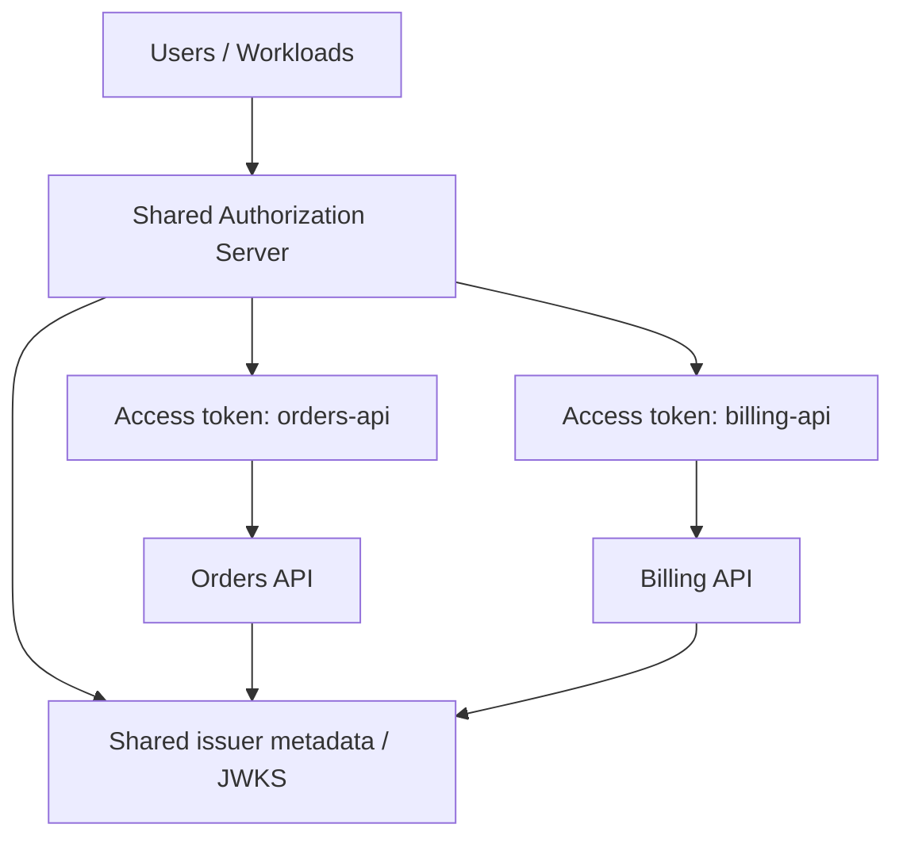
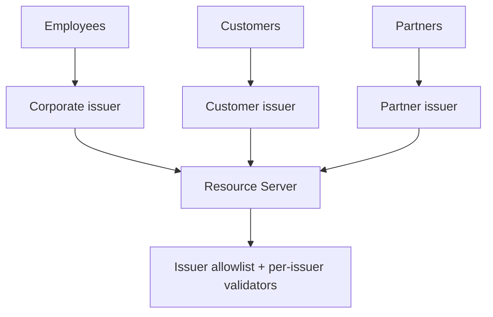

# Chọn một issuer hay nhiều issuer

## 1. Quyết định này thực sự chọn điều gì?

Trong OAuth 2.0 và OpenID Connect (OIDC), **issuer** là Authorization Server hoặc OpenID Provider phát hành token. Issuer được nhận diện bằng một định danh, thường là URL, và công bố metadata/key material theo trust configuration. Với JWT, claim `iss` trong token cho biết bên phát hành; Resource Server phải xác minh claim này khớp issuer được tin cậy.

Một nền tảng có thể dùng:

- **Một issuer dùng chung:** một Authorization Server phát hành token cho nhiều ứng dụng, API, khách hàng hoặc tenant.
- **Nhiều issuer:** nhiều Authorization Server/realm/identity domain độc lập phát hành token, mỗi issuer có metadata, signing keys, client registration và policy riêng.
- **Mô hình kết hợp:** một issuer cho người dùng nội bộ, một issuer cho đối tác hoặc workload; hoặc một issuer chung cho đa số tenant và issuer riêng cho nhóm tenant có yêu cầu isolation đặc biệt.

Đây là quyết định về **ranh giới tin cậy, quản trị danh tính và vận hành**, không chỉ là chọn số lượng URL. Nó ảnh hưởng tới cách Resource Server xác minh token, quản lý JWKS, ánh xạ subject, cấp scope, định tuyến tenant, thu hồi, audit và xử lý sự cố.

Trong module SECURITY_TOKEN_SECURITY_FUNDAMENTALS, cần đặt quyết định này trong bối cảnh JWT/opaque token, access/refresh token, OAuth 2.0/OIDC, claims, scope, audience, token exchange và phòng chống token bị đánh cắp hoặc phát lại.

## 2. Phân biệt issuer, client và audience

Ba khái niệm thường bị nhầm:

| Thành phần | Trả lời câu hỏi | Ví dụ |
|---|---|---|
| **Issuer (iss)** | Ai phát hành token? | `https://auth.example.com/` |
| **Client ID** | Ứng dụng nào yêu cầu token hoặc thực hiện OAuth flow? | `orders-web` |
| **Audience (aud)** | Resource Server nào được phép nhận token? | `orders-api` |

Một issuer có thể phát hành token cho nhiều client và nhiều audience. Nhiều issuer có thể cùng phát hành token có audience là `orders-api`, nhưng API vẫn phải biết issuer nào được phép và mỗi issuer có semantics subject/claims nào.

Ví dụ hai issuer:

- Corporate identity: `https://login.corp.example/`
- Partner identity: `https://identity.partner.example/`

Cả hai có thể phát hành access token dành cho `partner-api`, nhưng token của họ không thể được chấp nhận chỉ vì `aud` giống nhau. API cần xác minh issuer, key set, token profile, audience và mapping quyền của từng issuer.

**Audience không thay thế issuer. Issuer cũng không thay thế audience.** Kiểm tra một trường mà bỏ qua trường còn lại có thể dẫn đến token substitution giữa các trust domain hoặc resource server.

## 3. Mô hình một issuer dùng chung

Trong mô hình single issuer, một Authorization Server phục vụ nhiều ứng dụng và API:



Issuer có thể hỗ trợ nhiều OAuth client, grant type, scope, audience và tenant policy. Resource Server cấu hình một issuer URI và lấy metadata/JWKS theo trust relationship đó.

### Ưu điểm

- **Quản trị tập trung:** một nơi quản lý client registration, MFA/SSO, consent, token policy, signing key và audit.
- **Tích hợp đơn giản hơn:** nhiều API có thể dùng chung issuer metadata và quy trình xác minh.
- **Ít cấu hình hơn:** giảm số issuer URI, discovery document, JWKS endpoint, certificate và cache namespace.
- **Trải nghiệm đăng nhập thống nhất:** phù hợp khi người dùng thuộc cùng một tổ chức hoặc identity domain.
- **Vận hành và giám sát tập trung:** dễ theo dõi token issuance, key rotation, lỗi login và policy rollout.
- **Chi phí tích hợp thấp hơn:** client và API ít phải xử lý nhiều định dạng claims hoặc issuer-specific behavior.

### Nhược điểm và rủi ro

- **Blast radius lớn:** lỗi cấu hình, compromise signing key hoặc outage của issuer có thể ảnh hưởng nhiều ứng dụng và tenant.
- **Chính sách khó tách biệt:** các nhóm có yêu cầu MFA, assurance level, token lifetime hoặc consent khác nhau có thể làm cấu hình phức tạp.
- **Phụ thuộc chung:** outage hoặc migration của issuer ảnh hưởng nhiều resource server.
- **Khó tách ownership:** nhiều business unit cùng chia sẻ client registry, subject namespace và release cadence.
- **Rủi ro nhầm lẫn tenant:** nếu claim mapping hoặc authorization không chặt, một token hợp lệ có thể bị sử dụng sai tenant.

Single issuer phù hợp khi các ứng dụng cùng một miền quản trị và trust policy, có thể thống nhất identity lifecycle, token profile, key management và availability requirement.

## 4. Mô hình nhiều issuer

Trong mô hình multi-issuer, các trust domain có Authorization Server riêng:



Resource Server có thể chấp nhận nhiều issuer, nhưng mỗi issuer phải được cấu hình và xác minh độc lập.

### Ưu điểm

- **Tách ranh giới tin cậy:** nhân viên, khách hàng, đối tác và workload có thể dùng identity domain khác nhau.
- **Chính sách độc lập:** mỗi issuer có MFA, authentication assurance, token lifetime, client policy và consent riêng.
- **Giảm blast radius:** compromise hoặc cấu hình sai ở một issuer có thể giới hạn trong nhóm ứng dụng/identity domain đó, nếu key và resource policy được tách đúng.
- **Ownership rõ:** từng tổ chức hoặc business unit có thể quản lý client registration, key rotation và incident response.
- **Hỗ trợ liên kết danh tính:** mỗi partner hoặc customer identity provider có thể giữ hệ thống gốc của họ.
- **Migration độc lập:** có thể thay một issuer mà không buộc mọi client chuyển cùng lúc.

### Nhược điểm và chi phí

- **Nhiều trust configuration:** issuer URI, discovery metadata, JWKS cache, audience policy và token validator tăng lên.
- **Identity mapping phức tạp:** `sub` không nhất thiết duy nhất giữa các issuer; cùng chuỗi subject có thể chỉ hai người khác nhau.
- **Authorization khó thống nhất:** scope, role, group và claim semantics có thể khác nhau.
- **Operational overhead:** theo dõi certificate, key rotation, outage, rate limit, SLO và incident theo từng issuer.
- **Tăng bề mặt tấn công:** cấu hình sai issuer discovery hoặc dynamic issuer resolution có thể tạo SSRF hoặc trust issuer ngoài allowlist.
- **Client experience phân mảnh:** người dùng có thể phải đăng nhập nhiều lần hoặc chuyển qua nhiều session/IdP.
- **Testing tăng:** phải kiểm tra từng issuer và các trường hợp token được phát bởi issuer không được phép.

Multi-issuer phù hợp khi các nhóm có trust policy hoặc ownership thực sự khác nhau, không chỉ vì muốn chia hệ thống thành nhiều URL.

## 5. Decision matrix: khi nào chọn một hay nhiều issuer?

| Tiêu chí | Nghiêng về một issuer | Nghiêng về nhiều issuer |
|---|---|---|
| Trust domain | Cùng một tổ chức/chính sách | Nhân viên, khách hàng, đối tác hoặc workload có miền tin cậy khác |
| Identity lifecycle | Quản lý tập trung | Mỗi tổ chức tự quản lý user/credential |
| MFA/assurance | Cùng mức yêu cầu | Mức assurance hoặc phương thức đăng nhập khác nhau |
| Signing keys | Có thể dùng chung key domain và policy | Cần key ownership/rotation/compromise isolation riêng |
| Token claims | Có thể thống nhất semantics | Claims/profile khác nhau theo issuer |
| Client registration | Một team quản lý | Ownership tách biệt theo tổ chức |
| Availability/SLO | Chấp nhận dependency chung | Cần failure domain độc lập |
| Compliance/data residency | Một miền tuân thủ | Khu vực/quy định yêu cầu tách biệt |
| Scale/operations | Muốn giảm cấu hình và vận hành | Có năng lực quản trị nhiều trust domain |
| Migration | Thay đổi đồng bộ được | Cần migrate từng nhóm độc lập |

Không nên chọn nhiều issuer chỉ vì dự kiến số lượng tenant tăng. Tenant isolation có thể được thực hiện bằng tenant claim, tenant authorization, per-tenant key hoặc data isolation trong một issuer chung. Tương tự, không nên ép tất cả identity provider vào một issuer nếu trust policy và ownership của họ khác nhau đáng kể.

## 6. Một issuer có đủ cho multi-tenant không?

**Thường có.** Multi-tenant không đồng nghĩa phải có một issuer cho mỗi tenant.

Một issuer chung có thể phát hành token chứa tenant context đã được xác minh:

```json
{
  "iss": "https://auth.example.com/",
  "sub": "user-1842",
  "aud": ["orders-api"],
  "tid": "acme",
  "scope": "orders:read",
  "exp": 1795400300
}
```

`tid` là claim theo quy ước của ứng dụng, không phải registered claim bắt buộc trong JWT. Issuer chỉ nên ghi tenant sau khi xác minh user/client có membership hoặc quyền hoạt động trong tenant đó.

Resource Server cần:

1. Xác minh chữ ký và issuer.
2. Kiểm tra audience dành cho API hiện tại.
3. Kiểm tra tenant claim đã ký khớp tenant context của request đã được xác minh.
4. Kiểm tra scope/role và quyền trên tài nguyên.
5. Áp dụng tenant filter ở repository/database hoặc cơ chế row-level security phù hợp.

Có thể dùng per-tenant signing key trong một issuer chung để tăng key isolation, nhưng điều này làm key registry/JWKS và rotation phức tạp hơn. Issuer riêng cho từng tenant chỉ nên chọn khi tenant có trust domain, ownership, compliance hoặc lifecycle đủ độc lập để cần boundary đó.

### 6.1. Khi nào nên tách issuer theo tenant?

Cân nhắc issuer riêng nếu tenant:

- Tự vận hành identity provider hoặc tự quản lý signing key.
- Có yêu cầu pháp lý/data residency hoặc assurance khác biệt.
- Cần độc lập hoàn toàn về client registration, MFA, token policy và incident response.
- Có hợp đồng federation riêng với hệ thống của họ.
- Cần chấm dứt trust hoặc di chuyển identity mà không ảnh hưởng tenant khác.

Không tách issuer chỉ để xử lý phân quyền dữ liệu. Tenant authorization và data isolation vẫn là trách nhiệm của API/database ngay cả khi mỗi tenant có issuer riêng.

## 7. Resource Server chấp nhận nhiều issuer như thế nào?

Resource Server phải có **issuer allowlist** và validator riêng cho từng issuer. Một cách thiết kế:

```yaml
# Pseudoconfig minh họa, không phải schema mặc định của Spring.
security:
  trusted-issuers:
    - issuer: https://login.corp.example/
      jwks-uri: https://login.corp.example/.well-known/jwks.json
      audiences: [orders-api]
      token-profile: employee-access-token
    - issuer: https://identity.partner.example/
      jwks-uri: https://identity.partner.example/oauth2/jwks
      audiences: [orders-api]
      token-profile: partner-access-token
```

Đây là cấu hình khái niệm. Production cần schema validation, TLS, secret/config management, startup checks và policy rõ cho mỗi issuer.

Với từng issuer, định nghĩa:

- Issuer URI chính xác.
- JWKS URI hoặc trust metadata được phép.
- Thuật toán/key type allowlist.
- Audience được phép.
- Token type/profile và claim bắt buộc.
- Scope/role mapping.
- Subject namespace và mapping sang principal nội bộ.
- Tenant/organization mapping.
- Clock skew, token lifetime và revocation behavior.
- Timeout, cache, retry và observability policy.

Không dùng một validator quá rộng chỉ vì nhiều issuer có chung một audience. Nếu issuer A phát token theo profile employee còn issuer B phát token theo profile partner, API phải áp dụng đúng validator và authorization mapping cho từng profile.

## 8. Chọn issuer an toàn khi request đến

Resource Server phải xác định token thuộc issuer nào mà không tạo trust động do attacker kiểm soát.

Có một số cách:

### 8.1. Chọn theo endpoint/route hoặc trust context

Ví dụ endpoint `/employee-api/**` chỉ nhận corporate issuer, còn `/partner-api/**` chỉ nhận partner issuer. Đây là cách dễ hiểu nếu API surface và trust domain tách rõ.

### 8.2. Chọn từ issuer claim nhưng chỉ trong allowlist tĩnh

Với một endpoint chấp nhận nhiều issuer, thư viện có thể đọc `iss` từ token chưa xác minh như **selector không đáng tin**, rồi chọn validator tương ứng trong danh sách issuer đã cấu hình sẵn. Sau đó phải verify chữ ký bằng key set của issuer đó và kiểm tra `iss` khớp chính xác.

Quy tắc:

1. Không dùng `iss` chưa xác minh để tải metadata/JWKS từ URL bất kỳ.
2. Chỉ map giá trị `iss` sang issuer đã có trong allowlist.
3. Dùng JWKS URI được cấu hình hoặc metadata đã pin/trust theo policy.
4. Verify chữ ký và kiểm tra lại `iss`, `aud`, `exp`, `nbf`, token profile.
5. Nếu không match issuer nào, từ chối token.

### 8.3. Tránh dynamic issuer discovery

Không tạo `JwtDecoder` bằng cách lấy `iss` tùy ý từ request rồi tự gọi discovery URL. Attacker có thể đặt issuer thành URL nội bộ, metadata endpoint độc hại hoặc domain do họ kiểm soát, biến Resource Server thành SSRF client hoặc khiến API tin key do attacker cung cấp.

Nếu hệ thống có onboarding issuer mới, đó phải là quy trình quản trị riêng: xác minh ownership/domain, review metadata, pin trust configuration, kiểm tra key và policy, rồi mới đưa issuer vào allowlist.

## 9. Identity mapping: sub không nhất thiết duy nhất toàn hệ thống

Trong một issuer, `sub` thường là định danh subject trong namespace của issuer. Khi có nhiều issuer, cùng giá trị `sub` có thể thuộc hai danh tính khác nhau.

Ví dụ:

| Issuer | `sub` | Ý nghĩa |
|---|---|---|
| Corporate | `12345` | Nhân viên A |
| Partner | `12345` | Người dùng đối tác B |

Nếu ứng dụng chỉ dùng `sub=12345` làm primary key, hai danh tính có thể bị nhập nhầm. Một principal nội bộ nên được định danh ít nhất bằng cặp:

```text
(identity_issuer, subject)
```

Hoặc map sang internal immutable principal ID sau khi xác minh issuer/subject. Cần quy định rõ:

- Account linking có yêu cầu xác minh và consent phù hợp.
- Một user có nhiều identity provider có được liên kết không.
- Email không nên được xem là khóa định danh bất biến.
- Khi issuer đổi subject format, mapping migration cần được kiểm soát.
- Disable một issuer không vô tình khóa hoặc mở quyền cho danh tính từ issuer khác.
- Audit phải giữ được issuer context để truy vết nguồn danh tính.

Không tự động hợp nhất hai account chỉ vì email hoặc `sub` giống nhau.

## 10. Scope, role và authorization khi có nhiều issuer

Nhiều issuer có thể dùng cùng chuỗi scope nhưng ý nghĩa khác nhau. Ví dụ `admin` ở issuer nội bộ có thể là quản trị hệ thống, còn `admin` ở partner chỉ là quản trị tổ chức đối tác.

Nên chuẩn hóa thành **internal permission model**:

```text
(issuer, token_profile, external_scope/role)
                |
                v
       trusted mapping policy
                |
                v
       internal permission
                |
                v
     resource + tenant authorization
```

Ví dụ mapping:

| Issuer/profile | Claim bên ngoài | Permission nội bộ |
|---|---|---|
| Corporate employee | `orders:read` | `ORDER_READ` |
| Partner access token | `partner.orders.view` | `ORDER_READ_PARTNER` |
| Corporate admin | `system:users:manage` | `USER_ADMIN` |
| Partner admin | `organization:members:manage` | `PARTNER_MEMBER_ADMIN` |

Không map mọi `admin` hoặc `read` thành quyền nội bộ giống nhau. Mapping phải gắn với issuer/profile và được review khi issuer thay đổi claims.

Authorization cuối cùng vẫn cần kiểm tra tenant, object ownership, relationship, business state và actor/delegation. Token hợp lệ không đồng nghĩa mọi hành động được phép.

## 11. Token exchange khi đi qua trust boundary

Nếu API nhận token từ issuer A nhưng cần gọi service chỉ tin issuer B, không chuyển tiếp token A một cách mù quáng. Có thể dùng OAuth 2.0 Token Exchange (RFC 8693) hoặc federation flow được hỗ trợ để xin token dành cho resource đích.

Ví dụ:

1. Gateway nhận token từ corporate issuer A.
2. Gateway xác minh token A theo allowlist.
3. Gateway xác định route tới `orders-api`.
4. STS được cấu hình tin issuer A và cho phép Gateway exchange subject token.
5. STS cấp token B có audience `orders-api`, scope giới hạn và subject/actor semantics rõ.
6. Orders API chỉ tin issuer B và xác minh token B.

Token exchange không tự động nối hai issuer. STS phải có trust policy xác minh subject token, actor/client, target audience, scope và delegation. Không tự decode token A rồi ký lại claims bằng issuer B; chỉ Authorization Server/STS được phép cấp token mới.

Nếu service đích có thể tin trực tiếp issuer A với policy phù hợp, exchange có thể không cần thiết. Quyết định phụ thuộc trust boundary, token profile và yêu cầu giảm blast radius.

## 12. Availability, key rotation và revocation theo issuer

Nhiều issuer tạo nhiều dependency và trạng thái vận hành:

- Discovery/JWKS endpoint có thể outage độc lập.
- Mỗi issuer có lịch rotation và overlap khác nhau.
- Token lifetime, revocation và introspection cache có thể khác.
- Certificate/TLS trust và client authentication có thể hết hạn không đồng thời.
- Một issuer có thể trả 429/5xx trong khi các issuer khác vẫn hoạt động.

Resource Server cần cache JWKS theo issuer namespace, không dùng lẫn key giữa issuer. Khi `kid` không biết, chỉ refresh JWKS của issuer đã chọn và có giới hạn. Không cho một issuer lỗi làm hỏng toàn bộ cache hoặc khiến token của issuer khác bị chấp nhận.

Với opaque token, mỗi issuer có thể có introspection endpoint và client credential riêng. Timeout hoặc lỗi introspection của issuer A phải được phân loại là dependency failure; không được thử token A trên endpoint issuer B như fallback.

Với JWT, offline verification giảm dependency runtime nhưng revocation có thể chậm. Cần lựa chọn token lifetime, denylist/status service, cache và emergency key revocation theo risk. Nhiều issuer không tự tạo ra revocation isolation nếu tất cả dùng chung signing key hoặc chung trạng thái token không phân tách.

## 13. Migration từ một issuer sang nhiều issuer

Migration nên diễn ra theo giai đoạn và có khả năng rollback.

### Giai đoạn 1: lập inventory

- Liệt kê client, API, grant type, audience, scope và token profile.
- Xác định identity source và ownership của từng nhóm.
- Ghi nhận claim mapping, subject namespace và tenant model.
- Xác định API nào đang tin issuer hiện tại và cách lấy JWKS/introspection.

### Giai đoạn 2: xác lập trust policy mới

- Chọn issuer mới và xác minh issuer URI/domain.
- Cấu hình client registration, key management, JWKS/discovery và token lifetime.
- Định nghĩa audience, scope, subject mapping và tenant mapping.
- Viết policy để API chỉ chấp nhận issuer cần thiết.

### Giai đoạn 3: hỗ trợ song song có giới hạn

- Thêm issuer mới vào allowlist cho đúng API/client.
- Kiểm thử token cũ và mới qua filter chain thật.
- Đảm bảo `sub` không bị nhập nhầm giữa issuer.
- Không mở tất cả API cho mọi issuer chỉ để migration dễ hơn.
- Theo dõi 401/403, audience mismatch, issuer mismatch và latency.

### Giai đoạn 4: chuyển client và thu hẹp trust

- Chuyển từng nhóm client sang issuer mới.
- Theo dõi token issuance và usage; xác nhận không còn luồng phụ thuộc issuer cũ.
- Chờ token cũ hết hạn hoặc thu hồi theo policy.
- Gỡ issuer cũ khỏi API không còn cần nó.
- Xóa client/secret/key cũ theo quy trình lifecycle và retention.

### Giai đoạn 5: xác minh sau migration

- Test negative: issuer cũ bị từ chối ở API đã chuyển.
- Test positive: issuer mới hoạt động đúng.
- Test rollback: có thể quay về trạng thái trước theo thời gian cho phép mà không mở rộng trust ngoài kế hoạch.
- Kiểm tra logs/audit và dashboard không lộ token.
- Cập nhật runbook, ownership và incident contact.

Không giữ cả hai issuer được chấp nhận vô thời hạn nếu mục tiêu migration là loại bỏ trust cũ. Mỗi giai đoạn cần thời điểm kết thúc và owner.

## 14. Test matrix cho quyết định single/multi-issuer

| Ca kiểm thử | Setup | Kết quả mong đợi |
|---|---|---|
| Token từ issuer được phép | Signature, issuer, audience và profile hợp lệ | Qua authentication |
| Token từ issuer không allowlist | Chữ ký có thể hợp lệ nhưng issuer không được tin | 401 |
| Issuer A token gửi tới endpoint chỉ nhận B | Route trust policy chỉ cho B | 401 |
| `iss` giả trỏ URL attacker | Không có trong allowlist | Từ chối, không fetch URL |
| Issuer A và B có cùng `sub` | Hai identity khác nhau | Không nhập nhầm principal |
| Cùng audience nhưng issuer khác | Chỉ issuer được cấu hình được chấp nhận | Issuer validation vẫn bắt buộc |
| Token sai audience | Issuer hợp lệ nhưng `aud` không chứa API | 401 |
| Token đúng issuer nhưng thiếu scope | Token đã xác minh | 403 |
| Tenant claim mismatch | Tenant trong token khác request context | 403/404 theo policy |
| JWKS issuer A timeout | Issuer B vẫn hoạt động | Không ảnh hưởng trust/cache của B |
| `kid` không tồn tại ở issuer A | Refresh A có giới hạn | Không thử key set B |
| Opaque token A gửi sang introspection B | Token không thuộc B | Inactive hoặc từ chối theo contract |
| Token exchange A → B | STS policy cho phép subject/actor/target | Token mới đúng audience/scope |
| Issuer cũ sau migration | API đã loại trust cũ | Bị từ chối |
| Issuer mới trong rollout | API đã cấu hình trust mới | Hoạt động đúng |
| Telemetry | Request từ nhiều issuer | Metric có issuer class hợp lệ, không chứa token/subject nhạy cảm |

Test cần đi qua Resource Server/Gateway thật với JWT ký bằng test key hoặc opaque token qua test introspection endpoint. Mock principal có thể test authorization mapping nhưng không chứng minh issuer discovery, signature verification hoặc JWKS isolation.

## 15. Checklist ra quyết định và vận hành

1. **Xác định trust domain:** các nhóm user/workload có cùng owner, lifecycle, assurance và policy không?
2. **Chọn boundary:** một issuer chung, nhiều issuer hoặc mô hình kết hợp; ghi rõ lý do.
3. **Chuẩn hóa token profile:** `iss`, `aud`, token type, scope, claim semantics và lifetime.
4. **Thiết kế identity mapping:** subject phải gắn với issuer; account linking có quy trình rõ.
5. **Giới hạn issuer trust:** allowlist tĩnh, metadata/JWKS URI tin cậy, không dynamic discovery từ request.
6. **Tách key/cache:** JWKS và introspection client theo issuer; không dùng lẫn trust context.
7. **Authorization mapping:** scope/role ngoài được ánh xạ theo issuer/profile, sau đó kiểm tra tenant và resource.
8. **Chọn token exchange khi cần:** chỉ STS được phép chuyển trust domain và phát token mới.
9. **Định nghĩa SLO/incident:** availability, rotation, revocation, outage và owner theo issuer.
10. **Kiểm thử negative cases:** issuer lạ, audience sai, subject collision, tenant mismatch, JWKS outage và token substitution.
11. **Migration có giới hạn:** rollout theo client/API, có deadline loại trust cũ và rollback plan.
12. **Audit và observability:** theo dõi issuer class, outcome và reason; không log token, refresh token hoặc raw claims nhạy cảm.

**Nguyên tắc cốt lõi:** Chọn một issuer khi các ứng dụng cùng chia sẻ một miền tin cậy và chính sách danh tính; chọn nhiều issuer khi có ranh giới quản trị, assurance, compliance hoặc ownership thực sự độc lập. Dù chọn mô hình nào, Resource Server vẫn phải xác minh chính xác issuer, audience, token profile và quyền trên tài nguyên. Số lượng issuer không thay thế authorization và tenant isolation.

### Tài liệu tiêu chuẩn tham khảo

- [RFC 6749 — The OAuth 2.0 Authorization Framework](https://www.rfc-editor.org/rfc/rfc6749): vai trò Authorization Server, client, resource owner và resource server.
- [RFC 8414 — OAuth 2.0 Authorization Server Metadata](https://www.rfc-editor.org/rfc/rfc8414): discovery metadata và issuer configuration.
- [OpenID Connect Discovery 1.0](https://openid.net/specs/openid-connect-discovery-1_0.html): issuer và provider metadata trong OIDC.
- [RFC 7519 — JSON Web Token (JWT)](https://www.rfc-editor.org/rfc/rfc7519): iss, sub, aud và JWT claims.
- [RFC 7517 — JSON Web Key (JWK)](https://www.rfc-editor.org/rfc/rfc7517): JWK/JWKS và key publication.
- [RFC 8725 — JSON Web Token Best Current Practices](https://www.rfc-editor.org/rfc/rfc8725): issuer/audience validation và ngăn JWT confusion.
- [RFC 8693 — OAuth 2.0 Token Exchange](https://www.rfc-editor.org/rfc/rfc8693): chuyển token giữa resource/trust boundary.
- [RFC 7662 — OAuth 2.0 Token Introspection](https://www.rfc-editor.org/rfc/rfc7662): kiểm tra trạng thái opaque token.
- [RFC 9700 — Best Current Practice for OAuth 2.0 Security](https://www.rfc-editor.org/rfc/rfc9700): khuyến nghị bảo mật OAuth 2.0 hiện đại.
