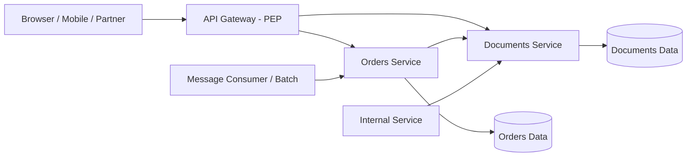
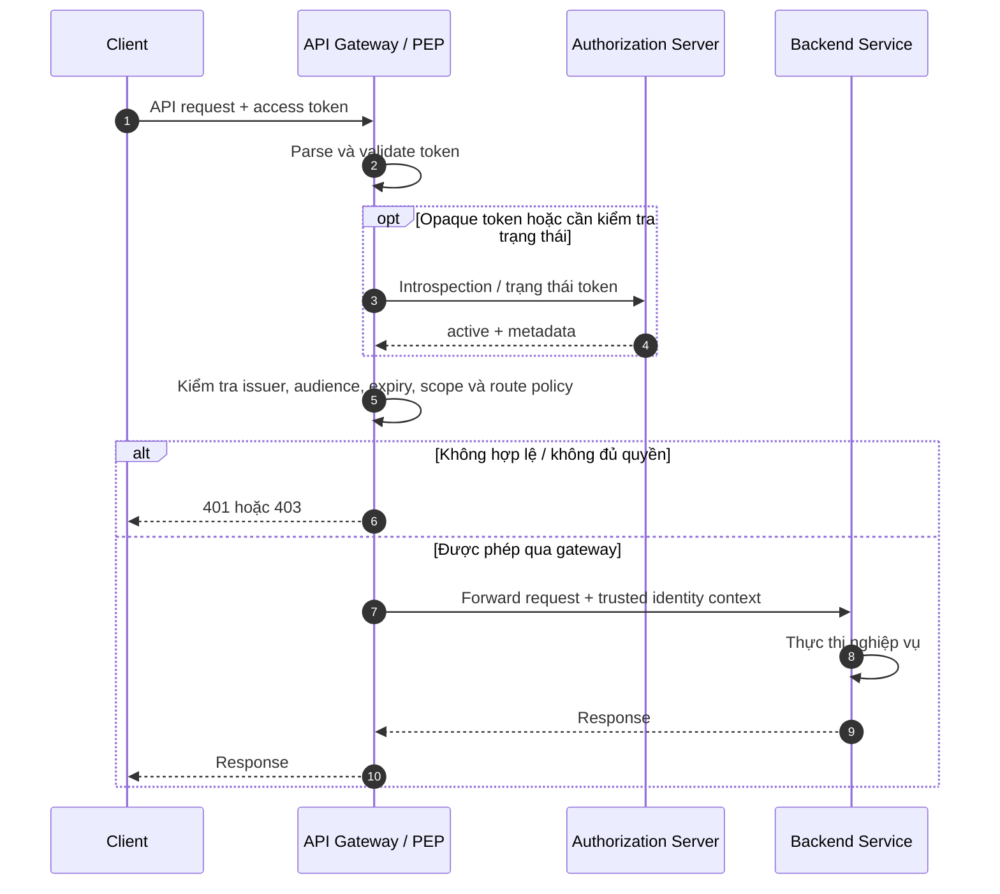
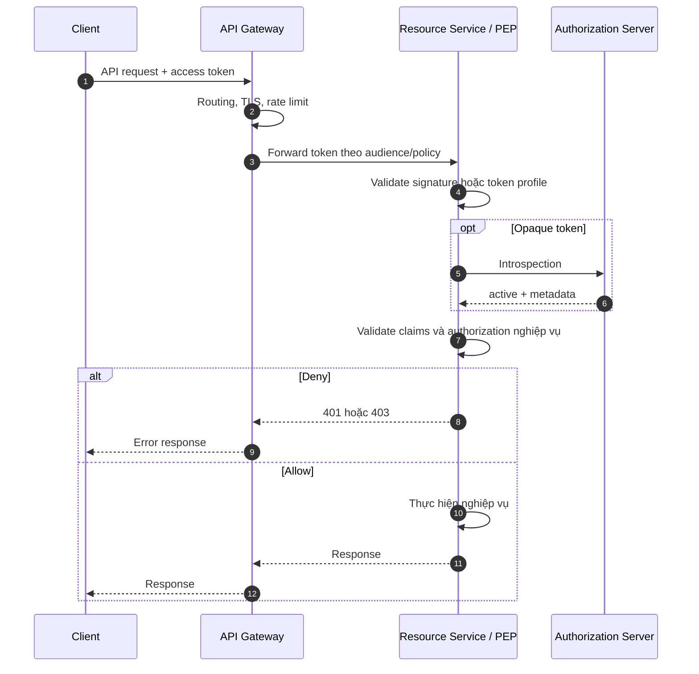
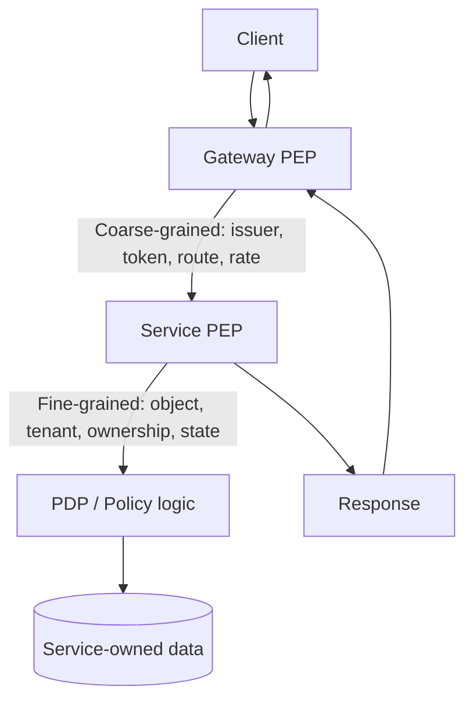

# Chọn gateway enforcement hay service enforcement

## 1. Bối cảnh và mục tiêu

Trong một hệ thống API, access token có thể đi qua API gateway rồi tới nhiều service phía sau. Câu hỏi thiết kế là lớp nào chịu trách nhiệm xác minh token và thực thi quyền truy cập: gateway, từng service, hay kết hợp cả hai. Quyết định này ảnh hưởng trực tiếp tới ranh giới tin cậy, khả năng truy cập trực tiếp vào service, độ trễ, tính nhất quán của policy và mức độ thiệt hại khi một thành phần bị xâm nhập.

**Gateway enforcement** đặt một phần hoặc phần lớn việc xác thực và phân quyền tại gateway trước khi request đi vào backend. **Service enforcement** yêu cầu từng service tự xác minh token và quyết định quyền đối với tài nguyên mà service sở hữu. Trong thực tế, hệ thống thường cần nhiều điểm thực thi (Policy Enforcement Point — PEP), còn chính sách có thể được quản lý tập trung hoặc phân phối từ Policy Decision Point (PDP).

Trong nền tảng **Security Token Security Fundamentals**, quyết định này phải xét đồng thời JWT, opaque token, access token, refresh token, OAuth 2.0/OIDC, issuer, audience, scope, tenant context, thu hồi và phòng chống replay. Không thể quyết định chỉ dựa vào việc gateway có thể decode JWT hay service có thể nhận header người dùng. Cần xác định rõ thành phần nào được tin, API nào có thể bị gọi trực tiếp, và quyền nào chỉ service mới có đủ dữ liệu để quyết định.

Sau bài này, người học có thể:

- Phân biệt authentication, authorization, PEP và PDP.
- So sánh mô hình gateway enforcement, service enforcement và hybrid enforcement.
- Xác định threat model khi request đi qua gateway tới service.
- Thiết kế việc chuyển tiếp access token, identity context và audience đúng cách.
- Chọn nơi thực thi coarse-grained policy và fine-grained business policy.
- Đưa ra quyết định kiến trúc dựa trên rủi ro, latency, khả năng vận hành và ownership.
- Viết decision record cùng ma trận kiểm thử cho mô hình được chọn.

## 2. Các khái niệm cần thống nhất

### 2.1. Authentication và authorization

**Authentication** xác định caller là ai hoặc token được phát hành bởi issuer nào. Với JWT, resource server có thể xác minh chữ ký và claims. Với opaque token, resource server thường hỏi authorization server qua introspection hoặc dùng cơ chế trạng thái tương đương.

**Authorization** quyết định caller có được thực hiện hành động trên tài nguyên cụ thể hay không. Một token hợp lệ không có nghĩa mọi request đều được phép. Quyết định có thể phụ thuộc scope, role, tenant, ownership, trạng thái tài nguyên, quan hệ giữa các đối tượng và policy nghiệp vụ.

Ví dụ: token hợp lệ có scope `documents:read` chứng minh caller được cấp quyền đọc một loại tài nguyên. Service Documents vẫn cần kiểm tra tài liệu thuộc tenant nào, người dùng có quyền truy cập tài liệu đó không và tài liệu có đang ở trạng thái cho phép đọc không.

### 2.2. PEP và PDP

- **Policy Enforcement Point (PEP):** thành phần chặn request, thu thập context cần thiết và thực thi quyết định allow/deny. Gateway và service đều có thể là PEP.
- **Policy Decision Point (PDP):** thành phần đánh giá policy dựa trên subject, action, resource và environment rồi trả quyết định. PDP có thể là policy engine trung tâm hoặc logic nằm trong service.
- **Policy Administration Point (PAP):** nơi quản trị, phê duyệt và phân phối policy nếu kiến trúc có tách vai trò này.

Không bắt buộc phải có một PDP từ xa. Điều quan trọng là xác định nơi policy được định nghĩa, nơi quyết định được tính và nơi request bị chặn. Nếu gateway và service có hai bộ policy khác nhau, cần quy định rõ policy nào có thẩm quyền cho từng loại quyết định.

### 2.3. Gateway và service

**API gateway** là điểm vào API thường xử lý routing, TLS termination, rate limiting, WAF, request normalization, authentication và một phần authorization. Gateway có thể phục vụ nhiều nhóm API và nhiều backend.

**Service** là thành phần sở hữu nghiệp vụ và dữ liệu. Service hiểu cấu trúc tài nguyên, tenant, trạng thái đối tượng và các quy tắc nghiệp vụ chi tiết. Service có thể được gọi từ gateway, message consumer, batch job, service khác hoặc luồng nội bộ.

## 3. Ranh giới tin cậy và câu hỏi trước khi chọn

Trước khi quyết định, hãy vẽ đường đi thực tế của request và xác định tất cả đường vào service:



Hãy trả lời các câu hỏi:

1. Service có thể truy cập từ Internet, mạng nội bộ, service mesh, job hoặc consumer nào?
2. Có thể bỏ qua gateway bằng DNS nội bộ, load balancer, port service, debug endpoint hoặc đường quản trị không?
3. Ai sở hữu dữ liệu và policy nghiệp vụ của từng service?
4. Token có audience dành cho gateway, backend service hay cả hai?
5. Gateway có đủ dữ liệu để quyết định quyền trên từng object và tenant không?
6. Service có thể được gọi bởi workload không có browser/user token không?
7. Khi issuer, JWKS hoặc introspection endpoint lỗi, mỗi lớp sẽ xử lý thế nào?
8. Có yêu cầu audit chỉ ra service nào đã chấp nhận hoặc từ chối hành động không?

Nếu chưa xác định được các đường vào service, chưa thể kết luận gateway là ranh giới thực thi duy nhất. Một service chỉ được bảo vệ bởi gateway khi mọi đường tới service thực sự đi qua gateway và backend không thể bị gọi bằng một đường khác ngoài dự kiến.

## 4. Mô hình A — Gateway enforcement

Trong mô hình này, gateway xác minh access token và thực thi các policy dùng chung trước khi chuyển request tới backend. Service có thể nhận request đã được gateway xác thực và dùng identity context đã được thiết lập theo một giao thức nội bộ đáng tin cậy.

### 4.1. Luồng xử lý



Gateway có thể xác minh chữ ký JWT, `iss`, `aud`, `exp`, `nbf`, token type và scope; hoặc gọi introspection với opaque token. Sau đó gateway kiểm tra policy ở mức route, API product, client, nhóm quyền hoặc quota.

### 4.2. Ưu điểm

- Một điểm cấu hình chung cho TLS, authentication, rate limiting và các policy coarse-grained.
- Giảm việc lặp lại cấu hình issuer, JWKS, introspection và thuật toán ở nhiều service.
- Có thể từ chối request sớm trước khi backend tiêu tốn tài nguyên.
- Dễ áp dụng chính sách thống nhất cho API public và partner.
- Có một nơi tập trung để đo tỷ lệ token invalid, request bị chặn và traffic theo client.

### 4.3. Giới hạn và rủi ro

- Gateway có thể trở thành điểm lỗi tập trung và điểm có quyền quá rộng.
- Nếu service có thể bị gọi trực tiếp, attacker có thể bypass policy ở gateway.
- Gateway thường không sở hữu đầy đủ thông tin để kiểm tra object-level authorization, tenant membership hoặc trạng thái nghiệp vụ.
- Nếu backend tin header như `X-User`, `X-Role` hoặc `X-Tenant` mà không xác thực nguồn gửi, client có thể giả mạo identity context.
- Policy ở gateway có thể không bao phủ message consumer, scheduled job, internal RPC hoặc service-to-service call.
- Gateway có thể tạo cảm giác token đã được xác minh toàn diện dù mới chỉ kiểm tra route-level scope.

### 4.4. Khi nào phù hợp?

Gateway enforcement phù hợp khi cần kiểm soát thống nhất tại edge, backend thực sự chỉ nhận traffic từ gateway, các quyết định chủ yếu là coarse-grained và service vẫn kiểm soát nghiệp vụ cốt lõi. Mô hình gateway-only chỉ nên dùng khi đã chứng minh mọi đường vào backend đều được bảo vệ, identity context được xác thực và rủi ro bypass có thể chấp nhận.

## 5. Mô hình B — Service enforcement

Trong mô hình này, mỗi service đóng vai trò resource server/PEP và tự xác minh token hoặc identity assertion được cấp cho service. Gateway có thể vẫn thực hiện routing, WAF và rate limiting, nhưng service không dựa hoàn toàn vào việc gateway đã xác thực request.

### 5.1. Luồng xử lý



Mỗi service cấu hình trust riêng: issuer được phép, audience của service, thuật toán, JWKS/introspection, clock skew, token type, scope và policy nghiệp vụ. Service kiểm tra quyền trên tài nguyên trước khi thực hiện side effect.

### 5.2. Ưu điểm

- Service tự bảo vệ dữ liệu và nghiệp vụ ngay tại nơi sở hữu chúng.
- Có thể áp dụng object-level, tenant-level và relationship-based authorization.
- Các đường gọi nội bộ, message consumer hoặc direct service call có thể dùng cùng policy nếu identity context được truyền đúng.
- Giảm phụ thuộc vào gateway như một điểm tin cậy duy nhất.
- Service có thể yêu cầu audience và scope chuyên biệt, giới hạn token bị dùng nhầm giữa API.

### 5.3. Giới hạn và rủi ro

- Cấu hình issuer, JWKS, introspection, key cache và token validator có thể bị lặp lại.
- Các service có thể triển khai policy không đồng nhất hoặc dùng phiên bản thư viện khác nhau.
- Tăng chi phí CPU/network, đặc biệt khi nhiều service cùng introspect một opaque token.
- Việc thay đổi trust policy, thuật toán hoặc issuer có thể cần rollout trên nhiều service.
- Nếu mỗi service tự tạo cách parse/validate token, dễ xuất hiện lỗi bảo mật khác nhau.

### 5.4. Khi nào phù hợp?

Service enforcement phù hợp khi backend có thể được gọi từ nhiều đường, mỗi service sở hữu policy nghiệp vụ riêng, dữ liệu có độ nhạy cao hoặc hệ thống theo kiến trúc zero trust. Mô hình này đặc biệt quan trọng với API nội bộ có object-level authorization và service-to-service call.

## 6. Mô hình C — Hybrid enforcement

Hybrid đặt kiểm soát ở cả gateway và service. Gateway thực thi các policy chung ở edge; service tiếp tục xác minh token/identity và thực thi quyền nghiệp vụ trên tài nguyên.



### 6.1. Phân công trách nhiệm

| Kiểm soát | Gateway | Service |
| --- | --- | --- |
| TLS termination, WAF, request size | Chủ yếu | Có thể yêu cầu mTLS từ gateway tới backend. |
| Xác minh access token ở edge | Thường có | Vẫn xác minh token hoặc trust assertion phù hợp. |
| Issuer/audience/token type | Kiểm tra token dùng ở edge | Kiểm tra audience và profile dành cho service. |
| Rate limit theo client/IP/API | Chủ yếu | Có thể thêm quota nghiệp vụ. |
| Route-level scope | Có thể từ chối sớm | Kiểm tra lại quyền thực sự cần cho hành động. |
| Object-level authorization | Không nên là nơi duy nhất | Chủ yếu do service sở hữu tài nguyên thực thi. |
| Tenant isolation | Có thể kiểm tra tenant claim cơ bản | Xác minh tenant membership và tài nguyên thuộc tenant. |
| Service-to-service identity | Kiểm tra ingress | Xác minh workload identity hoặc token dành cho service. |
| Audit quyết định nghiệp vụ | Log edge decision | Ghi quyết định trên tài nguyên và side effect. |

### 6.2. Vì sao hybrid thường là lựa chọn mặc định tốt?

Gateway giảm traffic không hợp lệ và chuẩn hóa các kiểm soát chung. Service vẫn là lớp có thẩm quyền cuối cùng đối với dữ liệu và hành động mà nó sở hữu. Khi gateway bị cấu hình sai hoặc có một đường gọi nội bộ khác, service vẫn có thể từ chối token không hợp lệ hoặc hành động không được phép.

Hybrid không có nghĩa là sao chép toàn bộ policy ở hai nơi. Cần phân ranh rõ: gateway xử lý coarse-grained controls; service xử lý fine-grained authorization. Nếu cả hai cùng quyết định một quyền nghiệp vụ nhưng dùng dữ liệu khác nhau, kết quả có thể mâu thuẫn và khó điều tra.

## 7. Thiết kế token và identity context khi chuyển tiếp

Đây là phần thường bị bỏ sót khi chọn enforcement. Gateway xác minh token xong không có nghĩa có thể gửi mọi dữ liệu nhận dạng tùy ý tới backend.

### 7.1. Chuyển tiếp access token gốc

Chỉ forward access token gốc khi token được phát hành cho audience phù hợp với service nhận. Nếu token có `aud` chỉ dành cho gateway, backend service không nên chấp nhận token đó như token dành cho mình. Nếu nhiều service cùng chấp nhận một audience quá rộng, việc token bị lộ ở một service có thể mở rộng phạm vi truy cập.

Quy tắc:

- Không forward ID token hoặc refresh token tới resource server.
- Không forward bearer token tới service không nằm trong intended audience/resource.
- Không biến token của client thành credential service-to-service mà không có ràng buộc phù hợp.
- Dùng TLS, và cân nhắc mTLS giữa gateway và backend.
- Service vẫn kiểm tra `iss`, `aud`, expiry, token type, chữ ký và scope theo policy của mình.

### 7.2. Token exchange / on-behalf-of

Khi gateway hoặc backend cần gọi service khác với quyền đại diện người dùng, cân nhắc OAuth 2.0 Token Exchange (RFC 8693) hoặc cơ chế delegation tương đương. Authorization server có thể cấp token mới với audience/resource và scope giới hạn cho downstream service.

Ví dụ:

```text
Client access token (aud = api-gateway)
             |
             v
Gateway xác minh token và xác định cần gọi Documents API
             |
             v
Token exchange / delegation tại Authorization Server
             |
             v
Downstream token (aud = documents-api, scope = documents:read)
             |
             v
Documents Service xác minh token và kiểm tra quyền trên document
```

Token exchange không tự động cấp thêm quyền. AS phải áp dụng delegation policy, giới hạn audience/scope và giữ quan hệ actor/subject theo profile được dùng. Service cần hiểu token đại diện user hay workload, và không được nhầm `act`/actor context với subject của người dùng.

### 7.3. Forward identity context qua header

Một số hệ thống gateway forward `X-Authenticated-User`, `X-User-Id`, `X-Roles` hoặc `X-Tenant-Id`. Đây là dữ liệu có thể bị giả mạo nếu service nhận trực tiếp request từ client hoặc từ workload không được tin.

Nếu dùng identity header:

1. Gateway phải xóa mọi header cùng tên do client gửi trước khi tạo giá trị nội bộ.
2. Backend chỉ nhận request qua gateway hoặc kênh có xác thực workload như mTLS/service identity.
3. Network policy/firewall/service mesh phải ngăn đường bypass không được phép.
4. Service phải xác minh danh tính gateway hoặc chữ ký của assertion/context theo thiết kế.
5. Header chỉ mang dữ liệu cần thiết; không chuyển toàn bộ JWT claims mặc định.
6. Tenant và resource authorization vẫn được service kiểm tra bằng dữ liệu có thẩm quyền.

Không dùng một header thông thường như `X-User-Role: admin` làm bằng chứng quyền nếu nguồn gửi chưa được xác thực. Nếu identity context được ký, cần quản lý key, audience, expiry, replay protection và rotation tương tự một assertion bảo mật khác.

## 8. JWT, opaque token và nơi thực hiện validation

### 8.1. JWT access token

Gateway hoặc service xác minh JWT cần kiểm tra tối thiểu:

- Chữ ký bằng key thuộc issuer tin cậy và thuật toán nằm trong allowlist.
- `iss` khớp issuer đã cấu hình.
- `aud` bao gồm resource server đang xử lý request.
- `exp` chưa hết hạn và `nbf` đã có hiệu lực; clock skew có giới hạn.
- Token type/profile phù hợp với access token API.
- Scope/role và các claim cần thiết cho authorization.

Decode JWT không phải validate JWT. Không cấp authentication chỉ vì parse được header/payload. Không tải `jku` hoặc `x5u` tùy ý từ token để tạo trust mới.

### 8.2. Opaque access token

Opaque token thường cần introspection. Nếu gateway gọi introspection và service cũng gọi, một request có thể tạo nhiều round trip tới AS. Có thể tối ưu bằng cache an toàn, nhưng TTL phải phù hợp expiry và revocation SLA.

Các lựa chọn:

- Gateway introspect rồi service cũng introspect: bảo vệ độc lập tốt hơn nhưng tăng tải/latency.
- Gateway introspect, service nhận một assertion nội bộ có chữ ký và audience dành cho service: giảm introspection lặp lại nhưng tăng trách nhiệm quản lý trust assertion.
- Service introspect trực tiếp: service có quyền truy cập AS và tự quyết định token state.

Cache không được biến lỗi introspection thành `active=true`. Khi AS không khả dụng, quyết định phải tuân theo fail-closed policy đã xác định; ngoại lệ dùng cache chỉ được phép trong giới hạn rõ ràng và có thể kiểm toán.

### 8.3. Revocation và key rotation

Với JWT tự xác minh, resource server có thể không biết token đã bị revoke trước `exp` nếu không có denylist, introspection, session version hoặc cơ chế tương đương. Gateway kiểm tra revocation không bảo vệ backend nếu backend chấp nhận token độc lập mà không có trạng thái cập nhật.

Với opaque token, introspection thường cho phép nhận biết trạng thái active tại AS. Nếu cache ở nhiều lớp, cần đo và kiểm soát thời gian propagation. Khi JWKS key rotation, cả gateway lẫn service phải cập nhật key set theo overlap policy; không giả định một lớp cập nhật là lớp kia cũng cập nhật.

## 9. Coarse-grained và fine-grained authorization

Một cách phân chia trách nhiệm hữu ích:

| Quyết định | Ví dụ | Nơi phù hợp |
| --- | --- | --- |
| Edge/client admission | Client đã đăng ký? Token có hợp lệ? API product có được dùng? | Gateway và/hoặc service. |
| Route-level permission | Token có scope `orders:read` để gọi route đọc đơn hàng? | Gateway có thể từ chối sớm; service vẫn kiểm tra action cụ thể. |
| Object-level permission | User A có được đọc document 123? | Service sở hữu document. |
| Tenant isolation | Document có thuộc tenant trong context đã xác minh? | Service/data access layer. |
| State transition | Đơn hàng đã giao có được hủy? | Service nghiệp vụ. |
| Delegation | Service A có được gọi Service B thay mặt user? | Authorization server/token exchange và service nhận token. |
| Workload permission | Batch worker có quyền chạy job? | Service xác minh workload identity hoặc service token. |

Nếu gateway truy vấn database nghiệp vụ để quyết định object ownership, gateway đang hấp thụ logic và coupling của service. Điều này thường làm policy khó duy trì và tạo nguy cơ sai lệch dữ liệu. Hãy để service sở hữu quyết định phụ thuộc dữ liệu nội bộ.

## 10. Ma trận quyết định

Đánh giá các yếu tố dưới đây cho từng API domain, không nhất thiết chọn một mô hình duy nhất cho toàn hệ thống.

| Tiêu chí | Gateway enforcement | Service enforcement | Hybrid |
| --- | --- | --- | --- |
| Một điểm vào được kiểm soát tuyệt đối | Phù hợp | Không bắt buộc | Phù hợp |
| Service có đường gọi trực tiếp/nội bộ | Rủi ro nếu không có kiểm soát khác | Phù hợp | Phù hợp |
| Quyền phụ thuộc object/tenant/business state | Gateway khó đủ context | Phù hợp | Phù hợp nhất khi gateway lọc sớm, service quyết định cuối. |
| Nhiều service và nhiều issuer | Dễ tập trung cấu hình | Cần chuẩn hóa thư viện/policy | Tập trung trust chung, service giữ audience/policy riêng. |
| Opaque token introspection latency | Một lần ở gateway | Mỗi service có thể gọi riêng | Cần cache/assertion/delegation để tránh round trip thừa. |
| Service-to-service và background jobs | Gateway không bao phủ tự nhiên | Phù hợp | Phù hợp với identity cho từng workload. |
| Tính độc lập khi gateway lỗi/cấu hình sai | Backend có thể thiếu lớp bảo vệ | Service vẫn có thể tự bảo vệ | Service giữ enforcement cốt lõi. |
| Độ phức tạp policy | Ít điểm thực thi hơn nhưng gateway dễ phình nghiệp vụ. | Nhiều điểm triển khai cần governance. | Cần ranh giới trách nhiệm rõ. |

### 10.1. Chọn theo mức rủi ro

**Gateway-only** có thể cân nhắc cho API đơn giản, dữ liệu ít nhạy cảm, không có đường bypass và không có quyết định object-level. Phải có bằng chứng network isolation, header sanitization và cơ chế identity propagation đáng tin.

**Service-only** có thể phù hợp với service nội bộ được gọi qua nhiều kênh, có resource server middleware chuẩn hóa và gateway không phải ranh giới bảo mật chính. Gateway vẫn nên xử lý edge controls như WAF/rate limit khi cần.

**Hybrid** thường phù hợp với nền tảng API có nhiều service, nhiều loại caller và dữ liệu nghiệp vụ cần bảo vệ. Gateway thực thi policy chung; service xác minh token/audience và quyết định quyền cuối cùng trên tài nguyên.

### 10.2. Ví dụ bảng chấm điểm

Nhóm kiến trúc có thể chấm mỗi tiêu chí từ 1 đến 5 theo trọng số của tổ chức. Ví dụ: mức độ nhạy cảm dữ liệu 25%, khả năng bypass 20%, nhu cầu object/tenant authorization 20%, số loại caller 15%, latency/chi phí introspection 10%, năng lực vận hành policy 10%. Điểm số không thay thế threat modeling; một tiêu chí rủi ro nghiêm trọng có thể loại bỏ gateway-only dù tổng điểm cao.

## 11. Ví dụ triển khai với Spring Security

### 11.1. Service tự xác minh JWT

Một resource server Spring Security có thể cấu hình issuer và audience để xác minh token tại service. Ví dụ minh họa cấu hình, cần điều chỉnh theo phiên bản Spring Security và profile token của hệ thống:

```java
@Bean
JwtDecoder jwtDecoder() {
    NimbusJwtDecoder decoder = JwtDecoders
            .fromIssuerLocation("https://issuer.example.test");

    OAuth2TokenValidator<Jwt> issuerValidator =
            JwtValidators.createDefaultWithIssuer("https://issuer.example.test");

    OAuth2TokenValidator<Jwt> audienceValidator = jwt ->
            jwt.getAudience().contains("documents-api")
                    ? OAuth2TokenValidatorResult.success()
                    : OAuth2TokenValidatorResult.failure(
                            new OAuth2Error("invalid_token", "Invalid audience", null));

    decoder.setJwtValidator(new DelegatingOAuth2TokenValidator<>(
            issuerValidator, audienceValidator));
    return decoder;
}
```

Đoạn code chỉ minh họa issuer/audience validation. Cấu hình thực tế còn cần allowlist thuật toán/key type, token type/profile, scope mapping, clock skew và policy phù hợp. Không dùng decoder mặc định mà không xác minh audience nếu API yêu cầu audience riêng.

### 11.2. Gateway lọc scope ở route

Gateway có thể kiểm tra scope để từ chối sớm request không phù hợp. Tuy nhiên, scope ở gateway không thay thế việc service kiểm tra quyền trên object. Ví dụ, `documents:read` chỉ cho biết token được cấp quyền đọc tài liệu nói chung; service vẫn phải xác minh document ID và tenant.

### 11.3. Service dùng opaque token

Với Spring Security Resource Server Opaque Token, service có thể cấu hình introspection URI và client credentials để xác minh token. Secret introspection phải được lưu trong secret manager và service chỉ được cấp quyền introspect theo policy. Nếu gateway cũng introspect, đánh giá chi phí và consistency trước khi bật cache ở nhiều lớp.

Không dùng `@WithMockUser` hoặc mock `JwtDecoder` để tuyên bố đã kiểm thử chữ ký JWT/introspection thật. Các helper đó hữu ích cho authorization rule, nhưng cần integration test đi qua filter chain với token/AS test thực để xác minh ranh giới bảo mật.

## 12. Vận hành và tính sẵn sàng

### 12.1. Latency và cache

Nếu cả gateway và service cùng introspect opaque token, latency có thể tăng theo số lớp. Có thể cân nhắc:

- Cache introspection ở một lớp có thẩm quyền và cấp identity assertion có thời hạn ngắn cho downstream.
- Token exchange để cấp audience/scope riêng cho service.
- Giới hạn concurrency, timeout và connection pool.
- Cache TTL không vượt expiry và revocation SLA.
- Đo riêng remote introspection latency, cache hit/miss và end-to-end request latency.

Không chia sẻ cache active vô hạn giữa service vì điều đó có thể làm chậm phát hiện token bị thu hồi. Nếu dùng shared cache, kiểm soát quyền truy cập, keying, TTL, tenant separation và invalidation.

### 12.2. Fail-closed và dependency outage

Khi JWKS hoặc introspection endpoint lỗi, gateway và service cần policy nhất quán. Không được biến timeout thành authentication success. Một số hệ thống có thể tiếp tục dùng public key đã cache còn trong hạn để xác minh JWT; điều đó khác với bỏ qua chữ ký. Với opaque token, nếu không có kết quả active đáng tin cậy, mặc định từ chối request hoặc áp dụng cache policy hữu hạn đã được phê duyệt.

### 12.3. Policy drift

Khi policy nằm ở gateway và service, quản lý phiên bản và ownership:

- Có schema chung cho issuer, audience, scope và claim mapping.
- Có thư viện hoặc middleware được duy trì để tránh mỗi service tự viết validator.
- Có policy test dùng chung và contract test giữa gateway-service.
- Theo dõi phiên bản policy và key set đang hoạt động.
- Thay đổi policy theo rollout có quan sát, có khả năng rollback an toàn.

## 13. Những anti-pattern cần tránh

- **Gateway xác minh một lần rồi backend tin mọi header:** header có thể bị giả mạo nếu có đường bypass hoặc gateway không xóa header do client gửi.
- **Chỉ kiểm tra JWT có parse được:** parse không xác minh chữ ký, issuer, audience hoặc expiry.
- **Một audience cho mọi API:** token bị lộ ở service này có thể dùng ở service khác.
- **Forward refresh token xuống backend:** refresh token chỉ nên tới authorization server/token endpoint theo giao thức.
- **Dùng ID token gọi API:** ID token dành cho OIDC client, không thay access token.
- **Gateway quyết định object ownership:** gateway thường không sở hữu dữ liệu và policy của object.
- **Service mở cổng nội bộ nhưng không xác thực caller:** mạng nội bộ không tự động là trust boundary.
- **Mỗi service tự cấu hình thuật toán tùy ý:** dễ tạo khác biệt và lỗ hổng algorithm confusion.
- **Cache active vô hạn:** token bị revoke vẫn có thể được chấp nhận.
- **Dùng mock authentication để chứng minh token validation:** test không đi qua bước mật mã hoặc introspection thực.
- **Gateway và service cùng áp dụng policy khác nhau mà không có ownership:** gây kết quả không nhất quán và khó điều tra.

## 14. Quy trình ra quyết định kiến trúc

Một decision record nên ghi lại:

1. **Context:** sơ đồ request path, caller, service, data owner và các đường bypass có thể có.
2. **Security requirements:** loại token, issuer, audience, scope, revocation SLA, tenant/object policy và audit.
3. **Options:** gateway-only, service-only, hybrid; nêu rõ PEP/PDP ở đâu.
4. **Threat analysis:** token theft, replay, forged headers, direct service access, confused deputy và issuer/JWKS outage.
5. **Decision:** mô hình được chọn cho từng API domain và lý do.
6. **Consequences:** latency, chi phí, ownership, policy drift, vận hành và migration.
7. **Controls:** network isolation, mTLS, token exchange, audience, cache, key rotation và logging.
8. **Validation:** integration test, penetration test, bypass test, negative authorization test và DR test.
9. **Review trigger:** khi thêm caller mới, mở service direct access, đổi issuer, thêm tenant model hoặc thay đổi token profile.

Ví dụ quyết định:

```text
Decision: Hybrid enforcement

Gateway:
- Validate external token profile at edge.
- Apply WAF, rate limit, client admission and route-level scope checks.
- Remove client-supplied identity headers.

Service:
- Accept traffic only from authenticated workloads/gateway paths.
- Validate service-specific audience and token profile.
- Enforce object ownership, tenant isolation and business permissions.
- Record authorization outcome for sensitive operations.

Delegation:
- Use audience-restricted downstream token when a service calls another service
  on behalf of a user.
```

## 15. Ma trận kiểm thử kiến trúc

| ID | Kịch bản | Kết quả mong đợi |
| --- | --- | --- |
| ENF-01 | Token hợp lệ gọi API qua gateway. | Gateway và service chấp nhận theo policy tương ứng. |
| ENF-02 | Token sai chữ ký. | Bị từ chối tại lớp xác minh; không chạy nghiệp vụ. |
| ENF-03 | Issuer không tin cậy. | Request bị từ chối. |
| ENF-04 | Audience chỉ dành cho gateway nhưng gọi service trực tiếp. | Service từ chối. |
| ENF-05 | Token thiếu scope route. | Gateway có thể từ chối sớm; service cũng không cho phép hành động. |
| ENF-06 | Token có scope chung nhưng user không sở hữu object. | Service từ chối object-level authorization. |
| ENF-07 | Tenant header do client tự gửi khác tenant claim/context. | Gateway xóa header giả; service xác minh tenant theo nguồn tin cậy và từ chối truy cập chéo. |
| ENF-08 | Gọi service qua IP/port nội bộ bỏ qua gateway. | Network policy chặn hoặc service tự xác minh token/identity và từ chối nếu không hợp lệ. |
| ENF-09 | Gửi `X-User-Role: admin` trực tiếp tới service. | Header giả không tạo authentication/authorization. |
| ENF-10 | Gateway đã xác minh token nhưng backend nhận header bị sửa. | Service xác minh nguồn context hoặc token; request bị từ chối. |
| ENF-11 | ID token được gửi tới API. | Resource server từ chối nếu không phải access token phù hợp. |
| ENF-12 | Refresh token được forward tới backend API. | Thiết kế chặn; refresh token chỉ tới token endpoint. |
| ENF-13 | Opaque token inactive. | Introspection result false dẫn tới từ chối. |
| ENF-14 | Introspection timeout. | Không fail-open; áp dụng policy cache/fail-closed rõ ràng. |
| ENF-15 | Token bị revoke khi cache active còn tồn tại. | Phát hiện trong giới hạn revocation SLA. |
| ENF-16 | JWKS key rotation. | Gateway và service đều xác minh được token trong overlap; key cũ retire đúng thời điểm. |
| ENF-17 | Service A gọi Service B thay mặt user. | Dùng token/audience/delegation phù hợp; Service B kiểm tra actor và subject. |
| ENF-18 | Background job gọi service. | Xác minh workload identity/service token; không giả lập user tùy tiện. |
| ENF-19 | Gateway outage hoặc bypass path xuất hiện. | Service vẫn giữ enforcement cốt lõi theo kiến trúc đã chọn. |
| ENF-20 | Policy version khác nhau giữa gateway và service. | Contract/policy test phát hiện drift; quyết định cuối vẫn theo owner đã định. |
| ENF-21 | Mock user trong unit test. | Không được tính là bằng chứng xác minh chữ ký/introspection thật. |
| ENF-22 | Audit sensitive action. | Có record quyết định tại service, không lưu raw token. |

Kiểm thử bypass cần chạy từ mạng và identity tương đương attacker thực tế: public ingress, private subnet, service mesh, node port, debug port và workload nội bộ. Chỉ kiểm tra routing trên gateway không chứng minh service không thể bị gọi trực tiếp.

## 16. Checklist trước khi chốt quyết định

- [ ] Đã liệt kê mọi caller và đường truy cập tới service.
- [ ] Đã xác định PEP, PDP và policy owner cho từng quyết định.
- [ ] Gateway kiểm tra token/route policy phù hợp với nhiệm vụ edge.
- [ ] Service bảo vệ dữ liệu và business action mà nó sở hữu.
- [ ] `iss`, `aud`, `exp`, `nbf`, token type và thuật toán được xác minh đúng.
- [ ] Access token chỉ được forward tới audience phù hợp; ID/refresh token không bị dùng thay access token.
- [ ] Identity header do client gửi bị loại bỏ; gateway-to-service channel được xác thực.
- [ ] Object-level và tenant-level authorization được thực hiện tại nơi có dữ liệu có thẩm quyền.
- [ ] Service-to-service và background workload có identity riêng.
- [ ] Cache, introspection, revocation và key rotation có SLA rõ ràng.
- [ ] Có fail-closed policy khi issuer/JWKS/introspection gặp sự cố.
- [ ] Có integration test và bypass test cho cả đường public lẫn internal.
- [ ] Có audit ở service cho hành động nhạy cảm mà không ghi raw token.
- [ ] Có owner và quy trình quản lý policy drift.

**Ghi nhớ:** Gateway là nơi phù hợp để chuẩn hóa và chặn sớm các kiểm soát ở edge. Service là nơi có đủ ngữ cảnh để bảo vệ dữ liệu, tenant và hành động nghiệp vụ. Chọn gateway-only chỉ khi mọi đường vào backend thực sự bị khóa và identity context được bảo vệ; với hệ thống nhiều service hoặc có quyền trên từng object, hybrid enforcement thường tạo ranh giới tin cậy rõ hơn.

## Tài liệu đối chiếu

- [RFC 6750 — OAuth 2.0 Bearer Token Usage](https://www.rfc-editor.org/rfc/rfc6750): cách gửi và xử lý bearer access token.
- [RFC 7519 — JSON Web Token (JWT)](https://www.rfc-editor.org/rfc/rfc7519): cấu trúc JWT và registered claims.
- [RFC 8725 — JSON Web Token Best Current Practices](https://www.rfc-editor.org/rfc/rfc8725): xác minh JWT, thuật toán, issuer và audience an toàn.
- [RFC 7662 — OAuth 2.0 Token Introspection](https://www.rfc-editor.org/rfc/rfc7662): kiểm tra trạng thái opaque token.
- [RFC 8693 — OAuth 2.0 Token Exchange](https://www.rfc-editor.org/rfc/rfc8693): delegation và cấp token cho audience/resource khác.
- [RFC 9068 — JWT Profile for OAuth 2.0 Access Tokens](https://www.rfc-editor.org/rfc/rfc9068): profile JWT access token.
- [RFC 9700 — Best Current Practice for OAuth 2.0 Security](https://www.rfc-editor.org/rfc/rfc9700): thực hành bảo mật OAuth 2.0 hiện hành.
- [NIST SP 800-207 — Zero Trust Architecture](https://csrc.nist.gov/pubs/sp/800/207/final): nguyên tắc không mặc định tin cậy theo vị trí mạng.
- [OWASP API Security Top 10 — Broken Object Level Authorization](https://owasp.org/API-Security/editions/2023/en/0xa1-broken-object-level-authorization/): rủi ro authorization trên từng object.
- [Spring Security — OAuth 2.0 Resource Server JWT](https://docs.spring.io/spring-security/reference/servlet/oauth2/resource-server/jwt.html): xác minh JWT tại resource server.
- [Spring Security — OAuth 2.0 Resource Server Opaque Token](https://docs.spring.io/spring-security/reference/servlet/oauth2/resource-server/opaque-token.html): introspection opaque token trong Spring Security.
