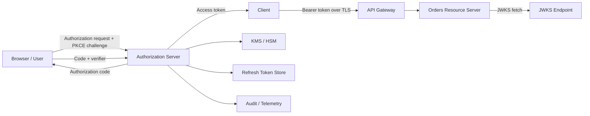

# Ghi threat model và giới hạn của quyết định bảo mật token

## 1. Vì sao quyết định thiết kế token cần threat model?

Một quyết định về token thường ảnh hưởng nhiều thành phần cùng lúc: client, Authorization Server, Resource Server, API Gateway, kho session, hệ thống ký khóa, cache, log và các dịch vụ tích hợp. Chọn JWT hay opaque token, thời hạn access token, cách lưu refresh token hoặc cơ chế thu hồi đều tạo ra một tập giả định và rủi ro riêng.

Nếu chỉ ghi “dùng JWT vì hiệu năng tốt” hoặc “dùng refresh token rotation để an toàn”, nhóm triển khai chưa biết hệ thống đang bảo vệ tài sản nào, kẻ tấn công có thể đứng ở đâu, điều kiện nào khiến biện pháp có hiệu lực và rủi ro nào vẫn còn. Một **threat model** mô tả tài sản, tác nhân, ranh giới tin cậy, luồng dữ liệu, đường tấn công và kiểm soát. Một **decision record** ghi lại lựa chọn, lý do, giả định, phương án thay thế và giới hạn của lựa chọn đó.

Trong module token security, hai việc này cần đi cùng nhau. Threat model giúp tìm rủi ro; decision record giúp đội kỹ thuật hiểu tại sao một kiểm soát được chọn và khi nào cần xem xét lại. Tài liệu phải phản ánh đúng hệ thống đang vận hành, không chỉ là sơ đồ lý tưởng trong thiết kế.

Sau bài này, người học có thể:

- Xác định tài sản, chủ thể, trust boundary và luồng token trong OAuth 2.0/OIDC.
- Phân tích các mối đe dọa với JWT, opaque token, access token, refresh token và token exchange.
- Ghi quyết định bảo mật với giả định, phạm vi áp dụng, trade-off và residual risk.
- Nêu rõ điều kiện mà một quyết định không còn phù hợp và tín hiệu cần review.
- Liên kết quyết định với kiểm thử, monitoring, vận hành và bằng chứng chấp nhận rủi ro.

## 2. Phạm vi và ranh giới của threat model

Threat model cần bắt đầu bằng câu trả lời rõ ràng cho câu hỏi: **hệ thống và luồng nào đang được phân tích?** Không nên tuyên bố đã threat model toàn bộ nền tảng nếu tài liệu chỉ xem xét token endpoint hoặc một API.

Ví dụ phạm vi:

```text
In scope
- Authorization Server phát hành access token và refresh token.
- JWT ký bằng asymmetric key và public key được công bố qua JWKS.
- Resource Server xác minh issuer, audience, thời hạn và scope.
- Refresh token rotation, revocation và logout.
- Token được truyền giữa gateway và service nội bộ.
- Log, trace và cache có thể tiếp xúc với credential.

Out of scope (được ghi rõ)
- Quy trình xác minh danh tính tại nhà cung cấp identity bên ngoài.
- Bảo mật thiết bị đầu cuối của người dùng ngoài các giả định đã nêu.
- Quy trình lưu trữ dữ liệu nghiệp vụ không liên quan đến authorization.
```

Out of scope không có nghĩa là rủi ro không tồn tại. Nó có nghĩa tài liệu này không phân tích sâu phần đó. Nếu một phần ngoài phạm vi có thể làm mất hiệu lực quyết định trong phạm vi, phải ghi dependency và yêu cầu owner tương ứng xác nhận.

### Những câu hỏi xác định scope

| Câu hỏi | Ví dụ câu trả lời cần ghi |
| --- | --- |
| Hệ thống nào được xem xét? | Authorization Server, Orders API, Gateway và service-to-service client. |
| Token nào được dùng? | JWT access token, opaque refresh token; không dùng ID token để gọi API. |
| Grant/flow nào? | Authorization Code + PKCE, Client Credentials và Token Exchange. |
| Ai là chủ thể? | Người dùng cuối, confidential client, service actor và administrator. |
| Môi trường nào? | Production và các môi trường staging có cùng trust boundary quan trọng. |
| Hệ thống phụ thuộc nào? | KMS/HSM, JWKS/CDN, session store, introspection, event bus và log platform. |
| Điều gì chưa phân tích? | Nhà cung cấp IdP bên ngoài và bảo mật thiết bị cá nhân, kèm owner/dependency. |

## 3. Xác định tài sản cần bảo vệ

Không thể đánh giá threat nếu không biết điều gì có giá trị và hậu quả khi bị lộ, sửa, xóa hoặc sử dụng trái phép. Với hệ thống token, tài sản bao gồm cả dữ liệu và khả năng thực hiện hành động.

| Tài sản | Hậu quả khi bị xâm phạm | Ví dụ kiểm soát |
| --- | --- | --- |
| Access token | Kẻ tấn công gọi API trong phạm vi quyền và thời hạn token | TLS, storage an toàn, TTL, audience, scope, sender constraint và revocation. |
| Refresh token | Kẻ tấn công xin access token mới, duy trì quyền lâu hơn | Rotation, reuse detection, secure storage, family revocation. |
| Authorization code + PKCE verifier | Đổi code thành token nếu lấy được cả hai trong điều kiện hợp lệ | PKCE S256, code ngắn hạn, single-use, redirect URI binding. |
| Client secret/private key | Giả mạo confidential client hoặc ký assertion | Secret manager/KMS, least privilege, rotation và audit. |
| Signing private key | Phát hành JWT giả được verifier tin cậy | KMS/HSM, tách quyền, key rotation và incident response. |
| JWKS/public key trust configuration | Verifier có thể dùng nhầm key hoặc không nhận key mới | Issuer pinning, TLS, metadata trust, cache policy. |
| User identity và membership | Quyền bị cấp nhầm tenant hoặc không thu hồi khi user bị khóa | Identity lifecycle, membership version, authorization check. |
| Consent/grant/session state | Client tiếp tục được ủy quyền sau khi user thu hồi | Grant revocation, session invalidation, audit. |
| Audit/log/trace | Rò rỉ token, PII hoặc mất bằng chứng điều tra | Allowlist, redaction sớm, retention và access control. |
| Authorization policy | Scope/role/resource mapping sai dẫn tới privilege escalation | Policy review, test âm, versioning và change approval. |

Nên phân loại tài sản theo tính bí mật, toàn vẹn và sẵn sàng (CIA), nhưng cần bổ sung thuộc tính **ủy quyền đúng**. Một hệ thống có thể luôn sẵn sàng và không lộ token nhưng vẫn cấp `admin` cho client chỉ được phép đọc.

## 4. Xác định tác nhân và năng lực của đối thủ

Threat model không nên giả định một kẻ tấn công toàn năng, cũng không nên giả định mọi client đều đáng tin. Hãy mô tả đối thủ theo khả năng thực tế.

| Tác nhân | Năng lực có thể có | Điều không nên mặc định |
| --- | --- | --- |
| Người dùng độc hại | Thay request, thử token/tenant/resource khác, tự động hóa API | Không mặc định user chỉ truy cập qua UI chính thức. |
| Malware/browser extension | Đọc dữ liệu trong browser hoặc lợi dụng XSS | Không mặc định mọi script trong origin đều an toàn. |
| Client bị compromise | Lấy token, secret, cache hoặc gửi request với quyền của client | Không coi client ID là bằng chứng rằng máy chạy client vẫn an toàn. |
| Insider có quyền vận hành | Đọc log, cấu hình, secret hoặc thực hiện thao tác key | Không mặc định mọi quyền admin đều cần thiết hoặc được giám sát. |
| Kẻ tấn công mạng | Nghe lén/mạo danh khi cấu hình TLS sai, gây DoS hoặc khai thác endpoint | Không giả định TLS bảo vệ dữ liệu sau khi endpoint đã nhận request. |
| Attacker chiếm service nội bộ | Gọi API ngang hàng, lợi dụng trust giữa các service | Không coi mạng nội bộ là ranh giới tin cậy tuyệt đối. |
| Attacker có token bị lộ | Replay Bearer token trong thời hạn hiệu lực | Không giả định chữ ký JWT ngăn replay. |
| Attacker có private signing key | Ký JWT giả với claims do họ chọn | Không giả định kiểm tra `exp` có thể phát hiện chữ ký giả. |

Mỗi tác nhân cần gắn với entry point và điều kiện. Ví dụ: “attacker có access token bị lộ từ log” khác với “attacker có quyền gọi KMS để ký token”. Hai kịch bản cần kiểm soát và mức độ ưu tiên khác nhau.

## 5. Vẽ luồng dữ liệu và trust boundary

Sơ đồ luồng dữ liệu (Data Flow Diagram - DFD) cho biết token đi qua đâu, thành phần nào tạo hoặc xác minh token và nơi trust boundary bị vượt qua. Ví dụ một luồng Authorization Code + PKCE:



Các trust boundary cần đánh dấu:

- Browser/device của user ↔ backend do tổ chức quản lý.
- Client application ↔ Authorization Server.
- Gateway ↔ Resource Server/service nội bộ.
- Application ↔ KMS/HSM và secret store.
- Verifier ↔ JWKS endpoint/CDN.
- Production runtime ↔ log, trace, analytics và support platform.
- Tenant A ↔ tenant B trong cùng một API hoặc database.

Với mỗi boundary, ghi giao thức, cơ chế xác thực, dữ liệu đi qua, owner và giả định tin cậy. “Nội bộ” không phải mô tả kiểm soát. Cần nêu rõ service identity, mTLS, network policy, token audience hoặc cơ chế authorization nào bảo vệ boundary đó.

## 6. Nhận diện mối đe dọa theo STRIDE và đặc thù token

STRIDE là một cách phân loại threat hữu ích: Spoofing, Tampering, Repudiation, Information Disclosure, Denial of Service và Elevation of Privilege. Có thể dùng nó như checklist, sau đó bổ sung các tình huống đặc thù OAuth/token.

| Nhóm | Ví dụ trong token security | Câu hỏi cần đặt ra |
| --- | --- | --- |
| Spoofing | Giả mạo client, issuer hoặc subject; dùng JWT giả | Verifier có xác minh issuer, chữ ký, client identity và audience không? |
| Tampering | Sửa JWT claims, scope, tenant hoặc redirect URI | Chữ ký, code binding và policy có phát hiện thay đổi không? |
| Repudiation | Không xác định được ai đã exchange/revoke token | Audit có ghi actor, subject reference, decision và thời điểm không? |
| Information Disclosure | Token bị log, refresh token bị đọc từ storage | Credential có bị redact, mã hóa hoặc giới hạn quyền truy cập không? |
| Denial of Service | JWKS refresh storm, introspection flood, token endpoint brute force | Có rate limit, cache, timeout, backoff và capacity không? |
| Elevation of Privilege | Xin scope/audience cao hơn, confused deputy, tenant escape | Quyền có được ràng buộc với subject, actor, resource và tenant không? |

### Danh sách threat đặc thù token

1. **Token theft:** access/refresh token bị lấy từ browser storage, mobile device, memory, log, crash dump hoặc proxy.
2. **Replay:** Bearer token hoặc authorization code bị sử dụng lại trong thời hạn cho phép.
3. **Algorithm/key confusion:** verifier chấp nhận thuật toán không an toàn, nhầm key type hoặc dùng key từ nguồn không tin cậy.
4. **Issuer/audience confusion:** token của issuer hoặc API khác được chấp nhận.
5. **Scope/role escalation:** client tự yêu cầu scope cao hơn hoặc claims được copy nguyên từ token nguồn.
6. **Cross-tenant access:** tenant ID lấy từ request hoặc membership cũ không được kiểm tra lại.
7. **Refresh token reuse:** token cũ bị dùng lại sau rotation nhưng hệ thống không phát hiện hoặc không revoke family.
8. **Authorization code interception:** code bị lấy nhưng PKCE, redirect URI hoặc single-use validation yếu.
9. **Signing key compromise:** private key bị lộ cho phép ký JWT giả.
10. **Stale authorization:** JWT còn chữ ký hợp lệ nhưng user, membership hoặc grant đã bị thu hồi.
11. **Confused deputy:** service được tin cậy thực hiện hành động thay chủ thể không có quyền.
12. **Telemetry leakage:** header/body/trace chứa token hoặc secret.
13. **Availability failure:** token endpoint, JWKS, introspection, KMS hoặc event bus bị gián đoạn.
14. **Configuration drift:** môi trường staging/production dùng issuer, audience, key hoặc policy khác ngoài dự kiến.

## 7. Đánh giá rủi ro và ưu tiên xử lý

Không phải mọi threat đều có mức ưu tiên giống nhau. Ghi rõ tác động, khả năng xảy ra, khả năng phát hiện và phạm vi ảnh hưởng. Một ma trận đơn giản có thể dùng mức Low/Medium/High/Critical, nhưng tổ chức cần định nghĩa tiêu chí để các nhóm chấm nhất quán.

Ví dụ:

| Threat | Likelihood | Impact | Ưu tiên minh họa | Lý do |
| --- | --- | --- | --- | --- |
| Bearer access token bị lộ trong log | Medium | High | High | Log có nhiều consumer; token có thể replay trước khi hết hạn. |
| Private signing key bị compromise | Low | Critical | Critical | Attacker có thể tạo JWT giả cho nhiều API cùng issuer. |
| JWKS endpoint tạm thời timeout | Medium | Medium/High | High | Token mới với unknown `kid` có thể không xác minh được. |
| Client yêu cầu scope ngoài allowlist | Medium | High | High | Có thể gây privilege escalation nếu server tin scope request. |
| Một refresh token cũ bị reuse | Medium | High | High | Có thể cho thấy refresh credential đã bị đánh cắp. |

Khi chấm rủi ro, cần ghi lý do và nguồn bằng chứng. Không dùng điểm số giả chính xác như `7.3/10` nếu không có phương pháp đo. Nếu threat được giảm bởi kiểm soát, phân biệt **inherent risk** (trước kiểm soát) và **residual risk** (sau kiểm soát). Residual risk vẫn cần owner và quyết định chấp nhận hoặc xử lý.

Một cách thực dụng để ưu tiên:

1. Xác định tác động tới confidentiality, integrity, availability và authorization.
2. Xác định khả năng khai thác, quyền cần có và mức độ phơi lộ entry point.
3. Đánh giá phạm vi: một user, một tenant, một client, một issuer hay toàn bộ hệ thống.
4. Xem xét khả năng phát hiện và thời gian phản ứng.
5. Ghi kiểm soát hiện tại, lỗ hổng còn lại và hành động tiếp theo.

## 8. Ghi quyết định thiết kế có giới hạn rõ ràng

Một decision record tốt phải giúp người đọc hiểu **quyết định áp dụng ở đâu, dựa trên giả định nào, giảm threat nào và không giải quyết threat nào**.

Mẫu cấu trúc:

```text
Decision ID:
Title:
Status: Proposed | Accepted | Superseded | Rejected
Date / Owner / Reviewers:

Context and problem:
Scope and affected components:
Assets and threats:
Assumptions and dependencies:
Decision:
Alternatives considered:
Security controls and rationale:
Operational impact:
Residual risks / known limitations:
Validation evidence:
Rollback / incident response:
Review triggers and review date:
```

### Nội dung cần viết cụ thể

- **Context:** mô tả vấn đề và điều kiện khiến cần ra quyết định.
- **Scope:** nêu rõ component, client, issuer, tenant và môi trường chịu ảnh hưởng.
- **Assumptions:** ví dụ KMS/HSM bảo vệ private key, TLS được xác minh, clock được đồng bộ, Resource Server dùng issuer allowlist.
- **Alternatives:** ghi các phương án thực sự đã cân nhắc và lý do loại bỏ.
- **Rationale:** liên kết lựa chọn với threat và mục tiêu bảo mật.
- **Limitations:** nêu rõ threat chưa được giải quyết hoặc chỉ giảm một phần.
- **Validation:** trỏ tới test, audit, metric hoặc kết quả canary chứng minh quyết định hoạt động.
- **Review triggers:** nêu điều kiện khiến quyết định cần được đánh giá lại, không chỉ ghi “review khi cần”.

Không ghi secret, token thật, private key hoặc PII vào decision record. Dùng alias, sơ đồ và reference an toàn tới hệ thống quản lý cấu hình.

## 9. Ví dụ quyết định: JWT access token hay opaque token?

### Context

Các Resource Server cần xác minh access token cho nhiều API. Hệ thống cân nhắc JWT để xác minh cục bộ và opaque token với introspection tập trung.

### Lựa chọn minh họa

Chọn JWT access token cho các API nội bộ có yêu cầu latency cao, với các điều kiện: asymmetric signing key trong KMS/HSM; issuer và audience allowlist; access token TTL ngắn; JWKS cache có freshness policy; authorization state được kiểm tra cho thao tác nhạy cảm; key rotation có overlap và emergency revocation.

### Threat được giảm

- Resource Server không cần chia sẻ private signing key.
- Token giả hoặc bị sửa bị phát hiện bằng chữ ký và kiểm tra claims.
- Audience allowlist giảm nguy cơ token bị dùng chéo giữa API.
- TTL ngắn giới hạn thời gian sử dụng token stale nếu không có lookup trực tuyến.

### Giới hạn phải ghi

- JWT đã phát hành không tự bị vô hiệu ngay khi user bị khóa; nếu không có denylist/version/introspection, token còn được chấp nhận tới `exp`.
- JWKS cache có thể khiến key mới hoặc key bị thu hồi chưa được nhận biết ngay.
- Claims có thể lỗi thời khi membership/role thay đổi.
- JWT dễ bị lộ qua log hoặc storage và Bearer token có thể replay.

### Điều kiện review

- API cần thu hồi gần như tức thời nhưng chưa có authorization-state lookup.
- TTL access token phải tăng vượt ngưỡng đã phê duyệt.
- Số Resource Server hoặc bên tích hợp làm việc với JWKS cache không thể quản lý tăng đáng kể.
- Có incident liên quan tới key compromise, token theft hoặc stale authorization.
- Yêu cầu pháp lý/đối tác thay đổi cách lưu hoặc kiểm tra token.

Nếu API yêu cầu trạng thái token tức thời và issuer có thể phục vụ introspection với availability phù hợp, opaque token có thể là lựa chọn tốt hơn cho một số boundary. Không có định dạng token nào tự động an toàn trong mọi hệ thống.

## 10. Ví dụ quyết định: thời hạn access token và refresh token rotation

### Context

Ứng dụng cần duy trì phiên người dùng nhưng giảm tác động khi access token bị lộ. Có thể chọn access token TTL ngắn và refresh token rotation.

### Quyết định minh họa

- Access token có TTL ngắn theo mức nhạy cảm API và trải nghiệm người dùng.
- Refresh token được lưu theo cơ chế an toàn phù hợp với loại client.
- Mỗi lần refresh thành công phát hành refresh token mới và vô hiệu token cũ.
- Reuse detection thu hồi token family và phát sự kiện bảo mật.
- Logout, account disable và deletion workflow thu hồi refresh family/session.

### Threat được giảm

- Token access bị đánh cắp có cửa sổ sử dụng ngắn hơn.
- Refresh token cũ bị dùng lại có thể phát hiện dấu hiệu compromise.
- Thu hồi family giúp chặn chuỗi refresh tiếp theo.

### Giới hạn phải ghi

- Rotation không ngăn được attacker dùng refresh token mới nhất nếu họ kiểm soát client hoặc đánh cắp token sau lần rotate.
- Access token đã phát hành có thể còn hoạt động tới `exp` nếu Resource Server không có trạng thái thu hồi.
- Client có nhiều request refresh đồng thời có thể tạo reuse false positive nếu không đồng bộ refresh.
- Thiết bị bị compromise có thể làm lộ token dù token được mã hóa khi lưu.

### Điều kiện review

- Tỷ lệ refresh reuse tăng hoặc có false positive đáng kể.
- Client không hỗ trợ rotation hoặc không thể bảo vệ refresh token.
- Session duration, TTL hoặc retention requirement thay đổi.
- Hệ thống cần sender-constrained token hoặc phát hiện thiết bị rủi ro.

## 11. Ví dụ quyết định: token gắn audience và tenant

Một access token có `aud` rộng như “all internal APIs” và không ràng buộc tenant rõ ràng có thể bị dùng tại service ngoài mục đích ban đầu. Quyết định nên giới hạn audience theo API/resource và xác định tenant context từ dữ liệu đáng tin cậy.

Ví dụ claims theo quy ước ứng dụng:

```json
{
  "iss": "https://auth.example.test",
  "sub": "user-42",
  "aud": "https://orders.api.example.test",
  "tenant_id": "tenant-A",
  "scope": "orders.read",
  "exp": 1900000300
}
```

`tenant_id` không phải claim OAuth bắt buộc. Issuer chỉ phát hành claim sau khi xác minh membership. Resource Server kiểm tra audience, membership hiện tại và quyền trên object; không coi claim tenant đơn lẻ là đủ để truy cập mọi bản ghi trong tenant.

Giới hạn quyết định: token có audience đúng vẫn không ngăn lỗi authorization ở cấp object; tenant claim có thể stale; một service được ủy quyền có thể bị lợi dụng làm confused deputy nếu policy không kiểm tra cả actor và subject.

## 12. Liên kết quyết định với kiểm thử và vận hành

Mỗi threat quan trọng cần có ít nhất một kiểm soát và bằng chứng xác nhận. Không ghi “đã bảo vệ” chỉ dựa trên việc có cấu hình; cần kiểm tra hành vi thực tế.

| Threat | Kiểm soát/decision | Bằng chứng nên lưu |
| --- | --- | --- |
| Token giả hoặc sửa claims | JWT signature verification, issuer/audience allowlist | Integration test với chữ ký sai, issuer sai, audience sai. |
| Token bị replay | TTL, sender constraint hoặc replay detection phù hợp | Test token reuse, telemetry bất thường và incident runbook. |
| Refresh token bị reuse | Rotation và family revocation | Test reuse cũ, xác minh family bị thu hồi. |
| Scope escalation | Scope allowlist và policy mapping | Test xin scope ngoài quyền; audit policy denial. |
| Cross-tenant access | Membership check và object-level authorization | Test đổi tenant ID và resource ID. |
| Signing key compromise | KMS/HSM, rotation, emergency revocation | Rotation drill, audit key usage, verifier invalidation test. |
| Token lộ trong log | Allowlist logging và redaction | Sentinel test trên app, gateway, APM và CI. |
| JWKS outage | HA, bounded cache và fail-closed cho unknown key | Chaos/integration test timeout, stale cache và unknown `kid`. |
| Stale membership | Version check, introspection hoặc event invalidation | Test token cũ sau membership change và đo revocation latency. |

Các quyết định phải có owner theo dõi metric và cảnh báo. Nếu không có người chịu trách nhiệm hoặc không có cách phát hiện kiểm soát bị hỏng, decision record chỉ mô tả ý định chứ chưa phải kiểm soát vận hành.

## 13. Quản lý giả định, dependency và residual risk

Giả định là điều quyết định dựa vào nhưng không trực tiếp chứng minh trong phạm vi. Ví dụ: “KMS/HSM có SLA và audit phù hợp”; “mọi Resource Server chỉ tin issuer đã đăng ký”; “clock skew không vượt 60 giây”; “JWKS cache refresh trong tối đa 5 phút”. Mỗi giả định cần owner, cách xác minh và điều gì xảy ra nếu nó sai.

Dependency thường gồm:

- Identity Provider hoặc Authorization Server bên ngoài.
- KMS/HSM, secret manager và IAM policy.
- DNS, TLS certificate, CDN, JWKS endpoint và network.
- Session/token store, database, event bus và cache.
- API Gateway, Resource Server, mobile/web client và bên tích hợp.
- Log/trace platform, backup và data processor.

Residual risk phải được viết bằng ngôn ngữ cụ thể. Ví dụ: “JWT cũ có thể được chấp nhận tối đa 5 phút sau khi membership bị thu hồi do cache invalidation; các thao tác admin kiểm tra membership trực tiếp”. Câu “vẫn còn một số rủi ro” không đủ để người chịu trách nhiệm đưa ra quyết định.

Nếu chấp nhận rủi ro, cần ghi:

1. Rủi ro cụ thể và phạm vi ảnh hưởng.
2. Lý do chưa xử lý ngay và phương án thay thế.
3. Owner có thẩm quyền chấp nhận.
4. Thời hạn chấp nhận hoặc ngày review.
5. Metric/trigger khiến phải mở lại quyết định.
6. Kế hoạch giảm thiểu tiếp theo nếu rủi ro vượt ngưỡng.

Không xem việc một kỹ sư ghi “accepted” trong tài liệu là phê duyệt của tổ chức nếu quy trình yêu cầu security owner, risk owner hoặc người có thẩm quyền khác.

## 14. Khi nào phải cập nhật threat model?

Threat model là tài liệu sống. Cần review khi có thay đổi làm đổi trust boundary, asset, attacker capability hoặc tác động của kiểm soát.

Các trigger phổ biến:

- Thêm issuer, grant type, token exchange hoặc loại client mới.
- Thay đổi JWT/opaque, signing algorithm, key storage hoặc JWKS endpoint.
- Tăng TTL access token/refresh token hoặc thay đổi rotation/revocation policy.
- Thêm API, audience, tenant model, service-to-service path hoặc third-party integration.
- Thay đổi browser/mobile storage, gateway, APM hoặc logging pipeline.
- Có incident token theft, key compromise, replay, privilege escalation hoặc cross-tenant access.
- Thay đổi pháp lý, hợp đồng xử lý dữ liệu hoặc yêu cầu audit.
- SLO/availability thay đổi khiến cơ chế introspection, revocation hoặc key lookup không còn phù hợp.
- Kiểm thử bảo mật phát hiện threat chưa được mô hình hóa hoặc kiểm soát không hiệu quả.

Khi review, cập nhật version, ngày, owner, thay đổi so với phiên bản trước và quyết định bị supersede. Không xóa lịch sử để làm tài liệu trông nhất quán; lịch sử giúp hiểu vì sao rủi ro từng được chấp nhận.

## 15. Checklist hoàn thiện threat model và decision record

- [ ] Scope và out-of-scope được ghi rõ, có dependency owner.
- [ ] Tài sản token, key, identity, grant, policy, log và session đã được liệt kê.
- [ ] Actor/attacker và năng lực thực tế được mô tả.
- [ ] DFD có trust boundary, token flow, issuer, audience và thành phần xác minh.
- [ ] Threat STRIDE và threat đặc thù OAuth/token được đánh giá.
- [ ] Likelihood, impact, phạm vi và residual risk có lý do/bằng chứng.
- [ ] Decision record nêu context, alternatives, rationale và status.
- [ ] Assumptions/dependencies có owner và cách xác minh.
- [ ] Giới hạn quyết định được viết rõ, không tuyên bố kiểm soát bảo vệ quá phạm vi.
- [ ] Có test, metric, audit hoặc runbook để xác nhận kiểm soát.
- [ ] Rủi ro được chấp nhận có owner, thời hạn và trigger review.
- [ ] Có ngày review và điều kiện cập nhật khi hệ thống thay đổi.

**Điểm cốt lõi:** Một quyết định bảo mật token chỉ có ý nghĩa khi người triển khai biết nó bảo vệ tài sản nào, chống threat nào, dựa trên giả định gì và để lại rủi ro nào. Threat model giúp làm rõ bối cảnh; decision record biến phân tích thành lựa chọn có thể kiểm chứng, vận hành và xem xét lại.

## Tài liệu tham khảo

- IETF, **RFC 9700 — Best Current Practice for OAuth 2.0 Security**: khuyến nghị bảo mật OAuth 2.0 và các luồng token. <https://www.rfc-editor.org/rfc/rfc9700>
- IETF, **RFC 6749 — The OAuth 2.0 Authorization Framework**: vai trò, grant, access token và refresh token. <https://www.rfc-editor.org/rfc/rfc6749>
- IETF, **RFC 7519 — JSON Web Token (JWT)**: cấu trúc JWT và claims. <https://www.rfc-editor.org/rfc/rfc7519>
- IETF, **RFC 8725 — JSON Web Token Best Current Practices**: xác minh JWT và các rủi ro triển khai. <https://www.rfc-editor.org/rfc/rfc8725>
- IETF, **RFC 8707 — Resource Indicators for OAuth 2.0**: giới hạn token theo resource server. <https://www.rfc-editor.org/rfc/rfc8707>
- OWASP, **Threat Modeling Cheat Sheet**: cách tổ chức threat modeling và nhận diện rủi ro. <https://cheatsheetseries.owasp.org/cheatsheets/Threat_Modeling_Cheat_Sheet.html>
- Microsoft, **STRIDE threat modeling**: phân loại threat theo Spoofing, Tampering, Repudiation, Information Disclosure, Denial of Service và Elevation of Privilege. <https://learn.microsoft.com/en-us/azure/security/develop/threat-modeling-tool-threats>
