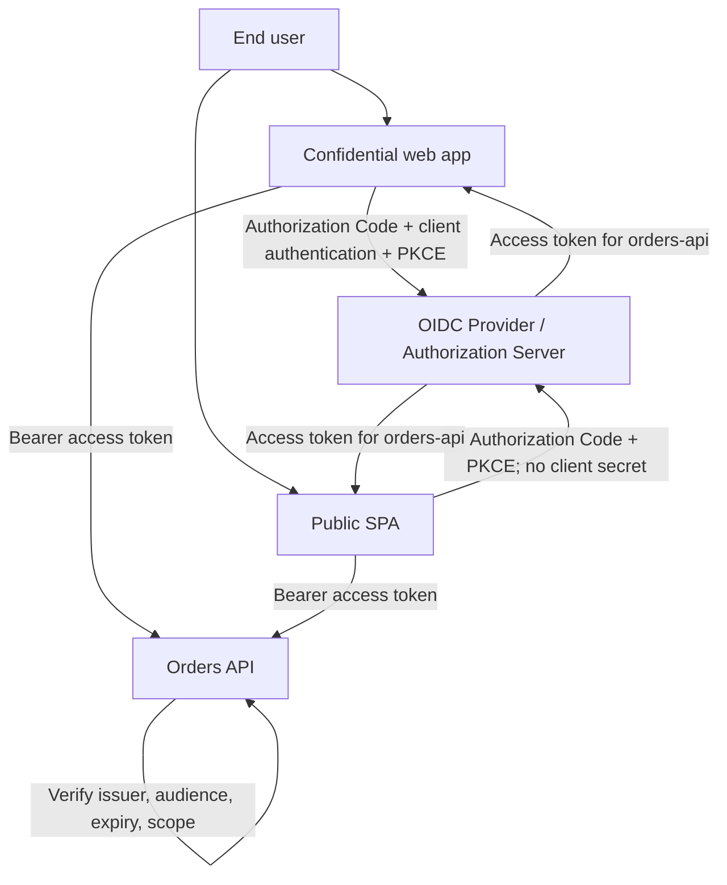
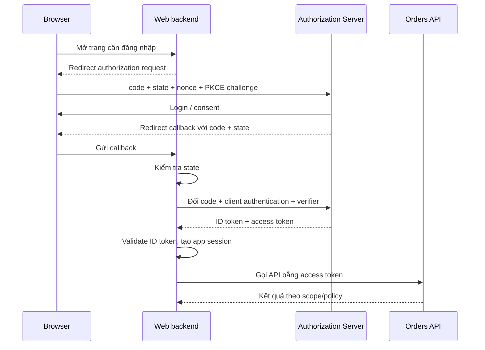
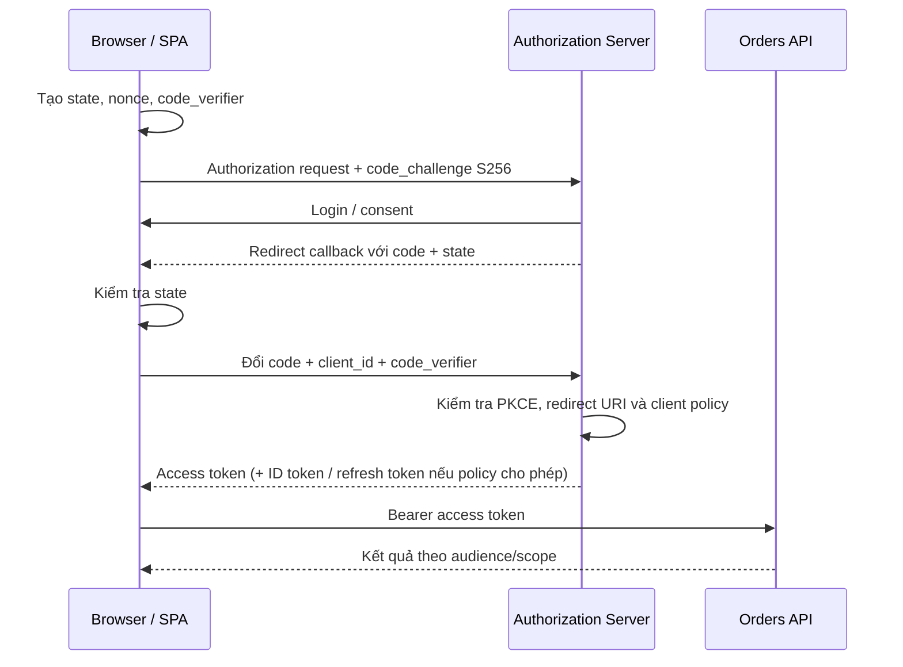

# Đăng ký confidential và public client

## 1. Mục tiêu dự án

Trong OAuth 2.0/OIDC, client là ứng dụng yêu cầu Authorization Server (AS) cấp token để truy cập tài nguyên. Một ứng dụng web chạy trên backend có thể giữ credential bí mật ở server; một SPA chạy trong browser hoặc ứng dụng native cài trên thiết bị người dùng không thể bảo đảm giữ bí mật dài hạn. Vì vậy, AS phân biệt hai nhóm client:

- **Confidential client:** có khả năng bảo vệ credential của client, thường vì credential chỉ nằm trên server hoặc trong môi trường workload được kiểm soát.
- **Public client:** không thể giữ bí mật client một cách đáng tin cậy, ví dụ SPA chạy trong browser hoặc ứng dụng mobile/desktop phân phối tới người dùng.

Dự án thực hành này đăng ký hai client OIDC trong một realm test:

1. `orders-web-confidential`: ứng dụng web có backend, dùng Authorization Code Flow và xác thực client tại token endpoint.
2. `orders-spa-public`: ứng dụng SPA, dùng Authorization Code Flow với PKCE và không có client secret.

Cả hai client xin quyền đọc đơn hàng từ một resource server `orders-api`. Ta sẽ cấu hình redirect URI, grant/flow, client authentication, PKCE, scope và audience; sau đó cấp token, xác minh token tại API và chạy các bài kiểm thử âm tính.

Kết quả cần đạt là có thể giải thích vì sao hai ứng dụng cần hai kiểu đăng ký khác nhau, tạo được client trong IdP test, chứng minh token được cấp đúng resource và scope, đồng thời xác nhận các cấu hình sai bị từ chối.

## 2. Kiến trúc và các thành phần



Các thành phần:

| Thành phần | Vai trò trong lab |
| --- | --- |
| **OIDC Provider / AS** | Đăng ký client, xác thực user/client, cấp authorization code và token |
| **Realm `token-lab`** | Không gian cấu hình riêng cho bài thực hành |
| **Confidential client** | Đại diện backend web app có thể giữ credential server-side |
| **Public client** | Đại diện SPA; không có client secret |
| **User test** | Người đăng nhập và cấp quyền trong Authorization Code Flow |
| **Resource server `orders-api`** | API nhận access token, kiểm tra audience/scope và bảo vệ endpoint |
| **Browser** | Chuyển hướng người dùng tới authorization endpoint và nhận callback |
| **PKCE** | Ràng buộc authorization code với client instance đã tạo code verifier |

Client ID là định danh công khai của ứng dụng, không phải password. Client secret hoặc private key mới là credential dùng xác thực confidential client. Việc biết `client_id` không cho phép attacker tự động xin token; AS còn kiểm tra redirect URI, user authentication, grant, scope và các điều kiện bảo mật khác.

## 3. Confidential client và public client khác nhau thế nào?

| Thuộc tính | Confidential client | Public client |
| --- | --- | --- |
| Có thể giữ secret lâu dài? | Có, nếu secret chỉ ở môi trường được kiểm soát | Không; người dùng có thể trích xuất từ browser/app package |
| Client authentication tại token endpoint | Có, ví dụ `client_secret_basic`, `private_key_jwt` hoặc mTLS | Thường là `none`; không gửi client secret |
| Ví dụ | Server-side web app, backend service | SPA, mobile app, desktop app |
| Authorization Code Flow | Có | Có |
| PKCE | Nên dùng, đặc biệt để bảo vệ authorization code | Bắt buộc theo best practice cho public client |
| Nơi giữ credential | Server-side secret manager/KMS/HSM | Không có shared client secret; giữ code verifier tạm thời và token theo thiết kế |
| Rủi ro chính | Secret/key bị lộ, cấu hình redirect quá rộng | XSS, code interception, token theft, giả mạo app instance |
| Cách thu hồi credential | Rotate/revoke secret, key hoặc certificate | Không có shared secret để rotate; revoke grant/token và cập nhật app/client policy |

Một client không trở thành confidential chỉ vì source code bị minify, obfuscate hoặc secret được nhúng trong file cấu hình đã mã hóa. Nếu mọi người dùng có thể tải ứng dụng và lấy credential, credential đó không còn bí mật.

Public client vẫn có `client_id` và có thể được AS đăng ký redirect URI, scope, grant type và policy. Public client chỉ không chứng minh danh tính bằng một shared secret được nhúng trong ứng dụng. PKCE giúp chứng minh bên đổi authorization code là bên đã tạo `code_verifier`; PKCE không biến public client thành confidential client.

## 4. Chuẩn bị môi trường thực hành

Ta dùng Keycloak làm ví dụ IdP OIDC vì nó hỗ trợ realm, client, client scope, service account và token endpoint. Các khái niệm áp dụng cho IdP OAuth/OIDC khác, nhưng tên menu và cách cấu hình có thể khác theo sản phẩm/phiên bản.

Chuẩn bị:

- Một Keycloak instance riêng cho lab, chạy local hoặc trong môi trường test cô lập.
- Quyền quản trị realm test.
- Browser để đăng nhập và hoàn tất consent/login.
- Một confidential web app và một public SPA test. Có thể dùng ứng dụng mẫu, Postman hoặc một test harness có khả năng chạy Authorization Code + PKCE.
- Một resource server/API test có thể kiểm access token.
- Không dùng user, client secret, signing key hoặc tenant production.

Tạo realm:

```text
Realm: token-lab
Issuer: https://idp.example.test/realms/token-lab
Test user: alice
Resource audience: api://orders
Scope: orders.read
```

Các URL `example.test` là placeholder dành cho tài liệu. Khi chạy thật, thay bằng hostname/port của IdP và callback đã cấu hình. Issuer phải khớp chính xác với `iss` trong token và cấu hình resource server. Nếu service chạy trong Docker network còn browser/test runner chạy trên host, cần thiết kế hostname có thể truy cập nhất quán từ từng thành phần.

Tạo user test có password riêng, bật trạng thái active và chỉ cấp quyền tối thiểu. Không dùng admin user để thử gọi API nghiệp vụ.

## 5. Xác định yêu cầu trước khi đăng ký client

Trước khi mở Admin Console, lập một bản khai báo cho mỗi ứng dụng:

| Thuộc tính | `orders-web-confidential` | `orders-spa-public` |
| --- | --- | --- |
| Loại ứng dụng | Server-side web app | Single-page application |
| Client type | Confidential | Public |
| Client ID | `orders-web-confidential` | `orders-spa-public` |
| Grant/flow | Authorization Code | Authorization Code |
| Client authentication | Bật | Tắt |
| PKCE | S256 | S256 bắt buộc |
| Redirect URI | `https://web.example.test/login/oauth2/code/oidc` | `https://spa.example.test/callback` |
| Scope | `openid profile orders.read` | `openid profile orders.read` |
| Resource/audience | `api://orders` | `api://orders` |
| Implicit flow | Tắt | Tắt |
| Password grant / Direct Access Grants | Tắt | Tắt |
| Client secret | Có, chỉ server giữ | Không |

Các URL callback cần là URL thật của ứng dụng/harness. Không đăng ký wildcard rộng như `https://*.example.test/*` nếu không có yêu cầu rõ ràng. Redirect URI cần khớp chính xác theo quy tắc của AS; không dùng pattern dễ cho phép attacker chuyển authorization code về domain ngoài kiểm soát.

Với native app, redirect URI có thể dùng claimed HTTPS app link hoặc loopback redirect theo hướng dẫn OAuth cho native apps. Không lấy callback của SPA làm callback cho mobile app nếu cơ chế platform khác nhau.

## 6. Đăng ký confidential client trong Keycloak

### 6.1. Tạo client

Trong Admin Console của realm `token-lab`:

1. Mở **Clients** và chọn tạo client mới.
2. Chọn protocol/type **OpenID Connect**.
3. Đặt Client ID là `orders-web-confidential`.
4. Lưu client và mở phần capability/configuration.
5. Bật **Client authentication** để client là confidential.
6. Bật **Standard Flow** (Authorization Code).
7. Tắt **Implicit Flow**.
8. Tắt **Direct Access Grants** nếu ứng dụng không có yêu cầu cụ thể.
9. Không bật **Service accounts roles** cho web login client này nếu không dùng Client Credentials.
10. Lưu cấu hình.

Tên trường có thể khác theo phiên bản Keycloak. Điều cần xác minh là client được đánh dấu confidential, dùng Authorization Code Flow và không vô tình bật grant không cần thiết.

### 6.2. Cấu hình client authentication

Ở tab credential, chọn phương thức phù hợp:

- **Client secret:** cách đơn giản cho lab. AS cấp secret; backend gửi secret khi đổi authorization code.
- **`private_key_jwt`:** backend ký client assertion bằng private key, AS xác minh bằng public key đã đăng ký. Phù hợp khi hệ thống có KMS/HSM hoặc quản lý key tốt.
- **mTLS:** client xác thực bằng chứng chỉ theo cấu hình AS và hạ tầng TLS.

Trong lab cơ bản, có thể dùng `client_secret_basic`. Secret chỉ được lưu trong secret manager hoặc biến môi trường của backend, không commit vào Git và không gửi về browser.

Không ưu tiên `client_secret_post` nếu có phương thức client authentication an toàn hơn: secret trong request body dễ xuất hiện ở log/application diagnostics nếu cấu hình logging sai.

### 6.3. Cấu hình redirect URI và web origin

Đặt:

```text
Valid Redirect URI:
https://web.example.test/login/oauth2/code/oidc

Valid Post Logout Redirect URI:
https://web.example.test/logout/callback

Web Origins:
Chỉ origin chính xác của web app nếu browser cần CORS.
```

Redirect URI là nơi AS gửi authorization response. Web origin điều khiển CORS cho một số request từ browser; nó không thay thế kiểm tra redirect URI. Chỉ thêm origin cần thiết và tránh wildcard.

Với confidential web app, callback thường nằm trên backend/BFF. Backend nhận code, xác minh `state`, đổi code tại token endpoint bằng client authentication và PKCE verifier nếu có, rồi tạo session ứng dụng cho browser.

### 6.4. Lưu và kiểm tra secret

Sau khi lưu, lấy secret từ trang credential của client. Đưa secret vào secret manager hoặc môi trường runtime bảo mật. Ví dụ tên biến:

```text
OIDC_CLIENT_ID=orders-web-confidential
OIDC_CLIENT_SECRET=<inject-from-secret-manager>
OIDC_ISSUER_URI=https://idp.example.test/realms/token-lab
OIDC_REDIRECT_URI=https://web.example.test/login/oauth2/code/oidc
```

Không đặt secret trong JavaScript bundle, HTML, mobile app, query string, browser storage hoặc file cấu hình được đóng gói vào artifact client-side.

Nếu secret bị lộ, rotate/revoke credential và kiểm tra access token đã được cấp. Đổi secret không mặc nhiên làm mọi access token cũ mất hiệu lực.

## 7. Đăng ký public client cho SPA

### 7.1. Tạo client

Tạo client OIDC thứ hai:

1. Client ID: `orders-spa-public`.
2. Tắt **Client authentication** để client là public.
3. Bật **Standard Flow**.
4. Tắt **Implicit Flow**.
5. Tắt **Direct Access Grants**.
6. Không bật service account.
7. Cấu hình redirect URI callback của SPA.
8. Chỉ khai báo web origin cần thiết.
9. Lưu cấu hình.

Public client vẫn có Client ID, nhưng không có secret dùng để xác thực client tại token endpoint. Nếu Admin Console vẫn hiển thị một giá trị secret do cách sản phẩm quản lý metadata, không được nhúng hoặc dựa vào secret đó cho public app.

### 7.2. Bắt buộc PKCE S256

Cấu hình PKCE để AS yêu cầu `code_challenge_method=S256`. Nếu sản phẩm có Client Policy/Advanced settings cho Proof Key for Code Exchange, chọn S256 và không cho phép `plain` khi có thể.

Client tạo `code_verifier` ngẫu nhiên có entropy đủ mạnh, giữ nó tạm thời trong context của lần đăng nhập, rồi tính:

```text
code_challenge = BASE64URL(SHA256(ASCII(code_verifier)))
```

Khi đổi code, client gửi `code_verifier`. AS tính lại challenge và so sánh với challenge trong authorization request. Nếu attacker chỉ chặn được authorization code mà không có verifier, code không thể được đổi thành token.

PKCE không thay thế `state`, redirect URI validation hoặc bảo vệ khỏi XSS. Với OIDC, client còn dùng `nonce` để ràng buộc ID token với authentication request.

### 7.3. Cấu hình redirect URI và browser origin

Ví dụ:

```text
Valid Redirect URI:
https://spa.example.test/callback

Web Origins:
https://spa.example.test
```

SPA cần callback route thực sự xử lý authorization response, kiểm `state`, `nonce` và PKCE verifier. Không đăng ký mọi origin bằng `*` trong môi trường production. Nếu ứng dụng chạy nhiều môi trường, tạo client/config riêng cho dev, staging và production hoặc giới hạn rõ từng URI/origin.

### 7.4. Vì sao không có client secret?

Mọi code và cấu hình gửi tới browser đều có thể được người dùng kiểm tra. Mobile/desktop package cũng có thể bị giải nén và phân tích. Obfuscation chỉ làm khó đọc, không tạo được ranh giới bí mật.

Không tạo secret giả cho public client chỉ để làm cho form đăng ký giống confidential client. Điều đó tạo cảm giác an toàn sai và có thể khiến nhóm phát triển gửi credential công khai tới token endpoint.

## 8. Cấu hình scope và audience cho Orders API

Đăng ký client thành công chưa có nghĩa token tự có quyền truy cập API. AS cần biết resource nào được yêu cầu và scope nào được cấp.

### 8.1. Scope

Trong realm test, tạo hoặc cấu hình scope:

```text
openid
profile
orders.read
```

- `openid` kích hoạt OIDC và cho phép cấp ID token.
- `profile` yêu cầu một số thông tin profile theo scope/claim mapping.
- `orders.read` là scope API tùy biến của Orders API.

Chỉ gắn `orders.read` cho client/user được phép. Không dùng `admin`, `orders.write` hoặc scope rộng để làm test đơn giản.

### 8.2. Audience

Resource server cần access token có audience dành cho chính nó, ví dụ `api://orders`. Tùy IdP, có thể cần:

- Tạo resource/client đại diện API.
- Tạo audience mapper/client scope.
- Gắn mapper vào client scope hoặc client.
- Yêu cầu resource indicator theo RFC 8707 nếu AS hỗ trợ và hệ thống dùng cơ chế này.

Không giả định audience tự động bằng Client ID của ứng dụng. `orders-web-confidential` và `orders-spa-public` là client; `api://orders` là resource audience. Đây là hai vai trò khác nhau.

### 8.3. Phân biệt ID token và access token

| Token | Dành cho ai? | Dùng làm gì? |
| --- | --- | --- |
| **ID token** | OIDC client, thường `aud` là client ID | Xác nhận thông tin đăng nhập và subject cho client |
| **Access token** | Resource server/API, `aud` phải chứa resource được phép | Gọi API theo scope/permission được cấp |
| **Refresh token** | Token endpoint của AS | Xin access token mới theo grant |

Không gửi ID token tới Orders API chỉ vì token là JWT và được cùng issuer ký. Resource server phải kiểm token profile/type, issuer, audience, thời hạn và scope.

## 9. Thực hiện Authorization Code Flow cho confidential client

Luồng tổng quát:



Authorization request chứa các tham số chính:

```http
GET /authorize?
  response_type=code&
  client_id=orders-web-confidential&
  redirect_uri=https%3A%2F%2Fweb.example.test%2Flogin%2Foauth2%2Fcode%2Foidc&
  scope=openid%20profile%20orders.read&
  state=<random-state>&
  nonce=<random-nonce>&
  code_challenge=<base64url-sha256>&
  code_challenge_method=S256
```

Sau khi người dùng đăng nhập, backend nhận code tại callback. Backend kiểm tra `state`, sau đó đổi code tại token endpoint. Request token endpoint về mặt khái niệm:

```http
POST /token HTTP/1.1
Content-Type: application/x-www-form-urlencoded
Authorization: Basic <base64(client_id:client_secret)>

grant_type=authorization_code&
code=<authorization-code>&
redirect_uri=https%3A%2F%2Fweb.example.test%2Flogin%2Foauth2%2Fcode%2Foidc&
code_verifier=<original-verifier>
```

Đây là minh họa giao thức. Client phải URL-encode form values đúng cách và tạo HTTP Basic credentials theo quy tắc chuẩn. Authorization code chỉ dùng một lần, có thời hạn ngắn và phải được ràng buộc với client/redirect URI/PKCE theo policy AS.

Backend xác minh ID token theo OIDC, tạo session cookie an toàn cho browser (`HttpOnly`, `Secure`, `SameSite` phù hợp) và giữ access/refresh token server-side nếu cần. Không trả client secret hoặc refresh token cho browser.

## 10. Thực hiện Authorization Code Flow cho public SPA

SPA cũng dùng Authorization Code Flow, nhưng không gửi client secret:



Request đổi code có các trường:

```http
POST /token HTTP/1.1
Content-Type: application/x-www-form-urlencoded

grant_type=authorization_code&
client_id=orders-spa-public&
code=<authorization-code>&
redirect_uri=https%3A%2F%2Fspa.example.test%2Fcallback&
code_verifier=<original-verifier>
```

Không có HTTP Basic client secret. AS xác minh public client theo `client_id`, authorization code, redirect URI, PKCE verifier và các policy khác.

SPA cần bảo vệ token khỏi XSS và không lưu token dài hạn ở nơi mọi script có thể đọc nếu có lựa chọn an toàn hơn. Với ứng dụng browser có backend, mô hình **Backend for Frontend (BFF)** thường giúp token ở server-side và browser chỉ giữ session cookie an toàn. Nếu triển khai SPA thuần, đánh giá kỹ XSS/CSP/dependency supply chain, thời gian sống token, refresh token rotation và khả năng revoke.

## 11. Cấu hình ứng dụng và lưu credential

### 11.1. Confidential web app

Ví dụ cấu hình khái niệm cho backend:

```yaml
security:
  oauth2:
    client:
      registration:
        orders-web:
          client-id: orders-web-confidential
          client-secret: OIDC_CLIENT_SECRET_FROM_SECRET_STORE
          authorization-grant-type: authorization_code
          client-authentication-method: client_secret_basic
          redirect-uri: "{baseUrl}/login/oauth2/code/{registrationId}"
          scope:
            - openid
            - profile
            - orders.read
      provider:
        token-lab:
          issuer-uri: OIDC_ISSUER_URI_FROM_ENVIRONMENT
```

Đây là ví dụ cấu hình khái niệm; tên property và cách liên kết registration/provider phụ thuộc framework/version. Các giá trị suffix FROM_SECRET_STORE/FROM_ENVIRONMENT là placeholder, phải được inject lúc runtime. Secret không được ghi trực tiếp vào file cấu hình hoặc commit vào repository. Thêm PKCE cho confidential client theo khả năng framework/AS để bảo vệ authorization code.

### 11.2. Public SPA

Cấu hình SPA không có secret:

```javascript
const oidcConfig = {
  authority: "https://idp.example.test/realms/token-lab",
  client_id: "orders-spa-public",
  redirect_uri: "https://spa.example.test/callback",
  response_type: "code",
  scope: "openid profile orders.read"
};

// OIDC library tạo state, nonce và PKCE verifier/challenge.
```

Đừng thêm `client_secret` vào object này. Dùng thư viện OIDC đã được kiểm tra, không tự viết thuật toán PKCE hoặc token validation nếu không cần thiết.

### 11.3. Lưu trữ token

| Vị trí | Confidential backend | Public SPA |
| --- | --- | --- |
| Client secret/private key | Secret manager/KMS/HSM hoặc runtime secret store | Không có shared client secret |
| Access token | Server-side token store/cache, giới hạn quyền đọc | Ưu tiên memory hoặc kiến trúc BFF; đánh giá XSS |
| Refresh token | Mã hóa, server-side, rotation và concurrency control | Chỉ dùng nếu AS/client policy cho phép; phải hiểu rotation/reuse và rủi ro browser |
| Session | Cookie `HttpOnly`, `Secure`, `SameSite` phù hợp | Có thể dùng session cookie qua BFF |
| Log/trace | Không ghi token/secret | Không ghi token/secret |

Không dùng localStorage để cất client secret; public client không được có secret. Với access/refresh token trong browser, localStorage làm token dễ bị đọc khi có XSS. Lựa chọn lưu trữ phải dựa trên threat model và kiến trúc cụ thể.

## 12. Kiểm tra token và gọi Orders API

Sau khi cấp token, xác minh access token thực sự được cấp cho Orders API. Nếu token là JWT, decode chỉ để quan sát claim; phải xác minh chữ ký và claim bằng thư viện verifier tin cậy.

Các claim thường cần kiểm tra theo profile/hợp đồng:

| Claim/thuộc tính | Kiểm tra |
| --- | --- |
| `iss` | Khớp issuer tin cậy của realm |
| `aud` | Chứa `api://orders` hoặc audience resource server đã cấu hình |
| `exp` | Token chưa hết hạn |
| `nbf` | Token đã có hiệu lực |
| `iat` | Thời điểm phát hành hợp lý theo clock policy |
| `sub` | Subject đúng với người dùng/service mong đợi |
| `scope` hoặc claim quyền | Có `orders.read` khi gọi endpoint đọc |
| Token type/profile | Là access token theo hợp đồng API, không phải ID token |
| Chữ ký/thuật toán | Khóa thuộc JWKS của issuer tin cậy và thuật toán nằm trong allowlist |

Với opaque token, API dùng introspection hoặc cơ chế AS cung cấp để kiểm tra `active`, audience, scope và thông tin liên quan. Không cố decode chuỗi opaque như JWT.

Ví dụ request:

```http
GET /api/orders HTTP/1.1
Host: api.example.test
Authorization: Bearer <access-token>
```

Kết quả mong đợi:

- Token hợp lệ, đúng audience và có `orders.read`: API cho phép nếu policy nghiệp vụ cũng đạt.
- Token hết hạn, sai issuer hoặc sai audience: từ chối xác thực, thường là `401`.
- Token hợp lệ nhưng thiếu `orders.read`: từ chối phân quyền, thường là `403`.
- Token dành cho client khác nhưng không có audience Orders API: từ chối.
- ID token được gửi tới API: từ chối theo token profile/policy.

Scope là quyền ở mức API; nó không tự chứng minh người dùng được đọc mọi đơn hàng. API vẫn phải kiểm tenant, resource ownership và business authorization.

## 13. Đăng ký client tĩnh và Dynamic Client Registration

Có hai cách quản lý đăng ký:

| Cách | Mô tả | Khi nên dùng |
| --- | --- | --- |
| **Static/admin registration** | Admin hoặc automation nội bộ tạo client qua console/API quản trị | Hệ thống doanh nghiệp có owner, approval và inventory |
| **Dynamic Client Registration (DCR)** | Client gửi metadata tới registration endpoint theo RFC 7591 | Hệ sinh thái cần client tự đăng ký theo policy AS |

DCR không có nghĩa endpoint đăng ký nên mở công khai cho bất kỳ ai. AS cần policy về ai được đăng ký, client metadata nào được phép, redirect URI validation, rate limit, approval, client ownership và khả năng disable client. RFC 7592 định nghĩa quản lý registration access token cho một số thao tác quản lý client metadata.

Metadata có thể gồm:

- `client_name`
- `redirect_uris`
- `grant_types`
- `response_types`
- `token_endpoint_auth_method`
- `scope`
- `application_type`
- `contacts`

Ví dụ metadata rút gọn cho public client:

```json
{
  "client_name": "Orders SPA",
  "application_type": "web",
  "token_endpoint_auth_method": "none",
  "grant_types": ["authorization_code"],
  "response_types": ["code"],
  "redirect_uris": ["https://spa.example.test/callback"],
  "scope": "openid profile orders.read"
}
```

Ví dụ metadata cho confidential client:

```json
{
  "client_name": "Orders Web Backend",
  "application_type": "web",
  "token_endpoint_auth_method": "client_secret_basic",
  "grant_types": ["authorization_code"],
  "response_types": ["code"],
  "redirect_uris": [
    "https://web.example.test/login/oauth2/code/oidc"
  ],
  "scope": "openid profile orders.read"
}
```

Metadata trên là minh họa, không phải yêu cầu mọi AS phải hỗ trợ đúng cấu hình này. Với confidential client, AS có thể cấp credential riêng sau registration hoặc dùng `private_key_jwt`/mTLS. Không gửi client secret trong metadata public hoặc repository.

## 14. Quản lý vòng đời client sau đăng ký

Đăng ký client là bước đầu; client cần owner và quy trình thay đổi:

1. **Create:** tạo client ID, loại client, redirect URI, grant và scope.
2. **Review:** kiểm tra owner, purpose, môi trường, resource, authentication method và risk.
3. **Issue credential:** cấp secret/certificate/key cho confidential client qua kênh bảo mật.
4. **Deploy:** inject credential vào đúng workload, kiểm tra version và quyền truy cập secret.
5. **Monitor:** theo dõi token issuance, authentication failure, redirect mismatch, scope và audience.
6. **Rotate:** tạo credential mới, triển khai theo overlap policy, xác minh credential mới hoạt động, sau đó revoke credential cũ.
7. **Change:** review lại khi thêm redirect URI, scope, grant, audience hoặc owner.
8. **Disable/delete:** vô hiệu client khi không còn sử dụng; revoke grant/token liên quan theo policy và lưu audit.

Không tái sử dụng cùng client ID/secret giữa dev, staging và production. Không dùng một confidential client cho nhiều ứng dụng không cùng owner nếu không có lý do rõ ràng. Client inventory nên ghi owner, environment, loại client, redirect URI, authentication method, credential version, grant, scope, audience và ngày review gần nhất.

## 15. Bộ kiểm thử cho dự án

### 15.1. Kiểm thử đăng ký và cấu hình

| Test | Thao tác | Kết quả mong đợi |
| --- | --- | --- |
| T1 | Đăng ký confidential client | Client authentication bật |
| T2 | Đăng ký public client | Client authentication tắt; không dựa vào secret |
| T3 | Kiểm grant | Chỉ Authorization Code Flow được bật cho hai client |
| T4 | Kiểm implicit/password grant | Không bật nếu không có yêu cầu được duyệt |
| T5 | Kiểm redirect URI | Chỉ callback chính xác được chấp nhận |
| T6 | Kiểm web origin | Chỉ origin cần thiết được phép |
| T7 | Kiểm PKCE public | S256 được yêu cầu |
| T8 | Kiểm scope/audience | Hai client chỉ xin quyền Orders đã duyệt |

### 15.2. Kiểm thử luồng token

| Test | Thao tác | Kết quả mong đợi |
| --- | --- | --- |
| T9 | Confidential client đổi code bằng secret hợp lệ | Token endpoint cấp token |
| T10 | Confidential client dùng secret sai | AS từ chối client authentication |
| T11 | Public client đổi code với verifier đúng | AS cấp token không cần secret |
| T12 | Public client bỏ verifier | AS từ chối |
| T13 | Public client gửi verifier sai | AS từ chối |
| T14 | Dùng lại authorization code | AS từ chối code đã dùng |
| T15 | Thay redirect URI khi đổi code | AS từ chối mismatch |
| T16 | Thiếu hoặc sai state | Client từ chối callback |
| T17 | Sai nonce trong ID token | OIDC client từ chối authentication response |
| T18 | Xin scope không được cấp | AS không cấp scope đó hoặc từ chối theo policy |

### 15.3. Kiểm thử resource server và vận hành

| Test | Thao tác | Kết quả mong đợi |
| --- | --- | --- |
| T19 | Gọi API bằng access token đúng audience/scope | Cho phép nếu policy nghiệp vụ đạt |
| T20 | Gọi API bằng ID token | Từ chối |
| T21 | Dùng token sai audience | Từ chối |
| T22 | Dùng token hết hạn | Từ chối |
| T23 | Dùng token thiếu orders.read | `403` hoặc lỗi authorization theo contract |
| T24 | Gọi API bằng token của issuer không tin cậy | Từ chối |
| T25 | Rotate confidential secret | Secret mới hoạt động, secret cũ bị từ chối sau cutover |
| T26 | Disable client | Token request mới bị từ chối theo policy |
| T27 | Thêm redirect URI ngoài owner review | Change bị từ chối hoặc cảnh báo |
| T28 | Kiểm log | Không có client secret, access token hoặc refresh token |

Test âm tính quan trọng hơn việc chỉ chứng minh login thành công. Một cấu hình an toàn cần chứng minh AS từ chối redirect URI lạ, public client không thể dùng secret giả, PKCE thiếu/sai bị chặn, token sai audience không qua API và scope thiếu không được cấp quyền.

## 16. Lỗi thường gặp và cách khắc phục

| Lỗi | Hậu quả | Cách sửa |
| --- | --- | --- |
| Nhúng client secret vào SPA/mobile app | Secret có thể bị trích xuất và dùng để giả client | Đăng ký public client, bỏ secret, dùng Authorization Code + PKCE |
| Gọi public client là confidential vì đã obfuscate | Không có ranh giới bảo vệ secret thực | Phân loại theo khả năng giữ credential trong runtime |
| Dùng Implicit Flow cho SPA | Token có thể đi qua front-channel và tăng nguy cơ lộ | Dùng Authorization Code + PKCE |
| Bỏ PKCE ở public client | Authorization code interception dễ khai thác hơn | Bắt buộc S256 |
| Dùng wildcard redirect URI | Code có thể bị gửi về endpoint attacker kiểm soát | Exact redirect URI và review mỗi thay đổi |
| Coi Web Origin thay thế Redirect URI | Bỏ sót kiểm soát callback | Cấu hình và kiểm tra riêng hai thuộc tính |
| Không kiểm audience | Token dành cho API khác có thể bị chấp nhận | API kiểm aud của chính resource |
| Dùng ID token gọi API | Nhầm token xác thực người dùng với credential truy cập resource | Chỉ nhận access token đúng profile/audience |
| Cho scope quá rộng | Client có quyền vượt nhu cầu | Least privilege và review scope |
| Dùng secret trong query string | Secret dễ lọt vào access log/referrer | Dùng client authentication method phù hợp qua TLS |
| Chia sẻ client giữa nhiều môi trường | Credential và redirect URI khó cô lập | Client riêng theo environment |
| Không rotate secret | Secret bị lộ có thể dùng lâu dài | Credential lifecycle và rotation |
| Chỉ kiểm tra login, không test API | Token có thể sai audience/scope mà không phát hiện | Test end-to-end resource server |
| Mở Dynamic Registration không kiểm soát | Attacker tạo client/redirect URI tùy ý | Authenticated/approved DCR, rate limit và metadata policy |

## 17. Tiêu chí nghiệm thu dự án

- [ ] Realm `token-lab` được tạo trong IdP test.
- [ ] `orders-web-confidential` được đăng ký với client authentication bật.
- [ ] Secret của confidential client chỉ nằm ở backend/secret manager.
- [ ] `orders-spa-public` được đăng ký với client authentication tắt và không có secret được sử dụng.
- [ ] Cả hai client chỉ bật Authorization Code Flow theo yêu cầu.
- [ ] Public client bắt buộc PKCE S256; confidential client cũng dùng PKCE nếu hỗ trợ.
- [ ] Redirect URI và web origin được giới hạn theo đúng ứng dụng.
- [ ] Scope `orders.read` và audience `api://orders` được cấu hình rõ.
- [ ] Cả hai client lấy được access token qua luồng tương ứng.
- [ ] Orders API xác minh chữ ký/issuer/audience/expiry/scope hoặc introspection tương ứng.
- [ ] ID token, token sai audience và token thiếu scope đều bị từ chối.
- [ ] Secret, token và Authorization header không xuất hiện trong log hoặc repository.
- [ ] Có owner và quy trình rotate/disable client.
- [ ] Bộ test âm tính đã chạy và có bằng chứng kết quả.

Sản phẩm bàn giao của lab gồm cấu hình realm/client đã loại bỏ secret, sơ đồ luồng, bảng client inventory, kết quả test dương/âm và ghi chú về cách vận hành credential.

## 18. Mở rộng dự án

Sau khi hoàn tất hai client tương tác, có thể mở rộng:

- **Service-to-service:** tạo confidential client riêng cho `inventory-worker`, bật Client Credentials và service account, cấp audience/scope riêng. Không dùng client web login cho workload.
- **Private key JWT:** thay secret bằng key pair được quản lý trong KMS/HSM; kiểm tra assertion expiry và replay.
- **mTLS:** đăng ký certificate-bound client/token nếu hạ tầng hỗ trợ.
- **Dynamic Client Registration:** tạo flow đăng ký client có approval, ownership và giới hạn metadata.
- **Refresh token rotation:** bật policy cho client phù hợp, kiểm reuse detection và xử lý race.
- **Tenant isolation:** tách client/redirect URI/consent theo tenant nếu sản phẩm cần nhiều tổ chức.
- **BFF:** chuyển token khỏi browser sang backend và dùng cookie session an toàn.
- **Credential rotation exercise:** mô phỏng secret bị lộ, triển khai secret mới và xác minh credential cũ bị từ chối.

Mỗi phần mở rộng nên có client registration và test riêng. Không bật thêm grant hoặc scope trên client hiện hữu chỉ để tiện cho một bài lab mới.

## 19. Ghi nhớ và tài liệu tham khảo

Confidential và public client khác nhau ở khả năng giữ credential bí mật. Confidential client xác thực tại token endpoint bằng secret, private key hoặc mTLS; public client không có shared secret và dùng Authorization Code + PKCE để bảo vệ code exchange. Cả hai vẫn cần redirect URI chính xác, state/nonce phù hợp, scope/audience tối thiểu và resource server validation.

Đăng ký client không tự cấp quyền truy cập dữ liệu. AS phải cấp token theo grant/scope/resource đã được cho phép, còn API phải kiểm tra token dành cho chính mình. Client secret không được đặt trong SPA/mobile app, và ID token không được dùng thay access token.

Tài liệu chuẩn để đối chiếu:

- [RFC 6749 — The OAuth 2.0 Authorization Framework](https://www.rfc-editor.org/rfc/rfc6749): client types, authorization code và client authentication.
- [RFC 7636 — Proof Key for Code Exchange by OAuth Public Clients](https://www.rfc-editor.org/rfc/rfc7636): PKCE và code verifier/challenge.
- [RFC 8252 — OAuth 2.0 for Native Apps](https://www.rfc-editor.org/rfc/rfc8252): public native apps và external user-agent.
- [RFC 7591 — OAuth 2.0 Dynamic Client Registration Protocol](https://www.rfc-editor.org/rfc/rfc7591): đăng ký client động.
- [RFC 7592 — OAuth 2.0 Dynamic Client Registration Management Protocol](https://www.rfc-editor.org/rfc/rfc7592): quản lý metadata/registration access token.
- [RFC 9700 — Best Current Practice for OAuth 2.0 Security](https://www.rfc-editor.org/rfc/rfc9700): thực hành bảo mật OAuth hiện hành.
- [RFC 8705 — OAuth 2.0 Mutual-TLS Client Authentication and Certificate-Bound Access Tokens](https://www.rfc-editor.org/rfc/rfc8705): mTLS và token binding.
- [OpenID Connect Core 1.0](https://openid.net/specs/openid-connect-core-1_0.html): ID token, authentication request và nonce.
- [Keycloak Server Administration Guide](https://www.keycloak.org/docs/latest/server_admin/): realm, client, client authentication và client scope.
