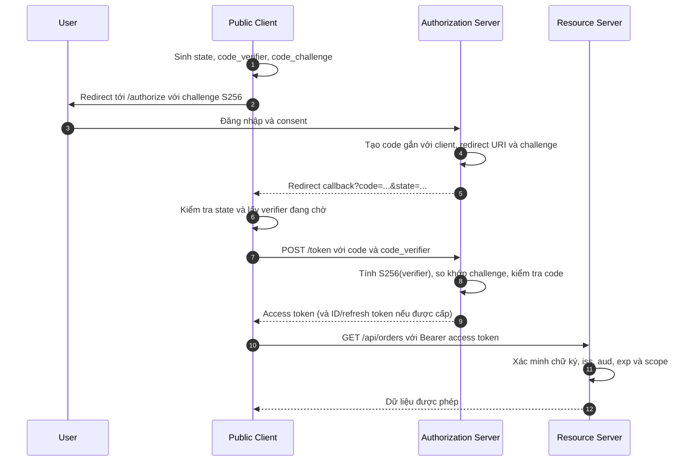

# Thực hiện authorization code với PKCE

Trong dự án này, bạn xây dựng một luồng đăng nhập OAuth 2.0 Authorization Code với Proof Key for Code Exchange (PKCE). Một public client khởi tạo yêu cầu đăng nhập, chuyển người dùng tới Authorization Server, nhận authorization code tại callback, rồi đổi code lấy access token bằng `code_verifier`. Resource Server xác minh access token và chỉ cho phép gọi API khi issuer, audience, thời hạn và scope đều phù hợp.

Đây là dự án thực hành thuộc chương **Dự án thực hành** của mô-đun **SECURITY_TOKEN_SECURITY_FUNDAMENTALS**. Mục tiêu tổng thể của mô-đun là nắm mô hình tin cậy và vòng đời token bảo mật, phân biệt JWT, opaque token, access token và refresh token trong xác thực, phân quyền và OAuth 2.0/OIDC; hiểu phát hành, kiểm tra claims, scope, audience, lưu trữ, thu hồi và phòng chống token bị đánh cắp hoặc phát lại.

Bạn sẽ hoàn thành một luồng có thể chạy và kiểm thử được, sau đó chứng minh các trường hợp sai như state không khớp, verifier không đúng, authorization code bị dùng lại, redirect URI sai, token sai audience và scope thiếu đều bị từ chối.

## 1. Kết quả cần đạt

Sau khi hoàn thành, hệ thống có ba thành phần:

| Thành phần | Trách nhiệm |
|---|---|
| **Authorization Server (AS)** | Đăng nhập/consent, cấp authorization code, ràng buộc code với PKCE challenge, đổi code lấy token |
| **Public Client** | Sinh `state`, `code_verifier`, `code_challenge`; chuyển hướng tới AS; xử lý callback và đổi code |
| **Resource Server (API)** | Xác minh access token, kiểm tra audience/scope và bảo vệ tài nguyên |

Các tiêu chí đầu ra:

- Public client không chứa `client_secret`.
- Authorization request dùng `response_type=code` và `code_challenge_method=S256`.
- AS yêu cầu PKCE cho client đã đăng ký.
- Client kiểm tra `state` ở callback; nếu dùng OpenID Connect thì gửi và xác minh `nonce` bằng OIDC client library.
- Token request gửi `code_verifier`; AS tự tính lại challenge và so khớp với challenge đã gắn vào authorization code.
- Authorization code chỉ được dùng một lần, gắn với client và redirect URI đã đăng ký, có thời hạn ngắn.
- Resource Server chỉ nhận access token dành cho API của nó và có scope phù hợp.
- Không ghi token, verifier hoặc authorization code vào log.

## 2. Kiến trúc và luồng tổng thể

Môi trường lab dùng các địa chỉ ví dụ sau; bạn có thể thay đổi port nhưng phải cập nhật nhất quán cấu hình client và AS:

| Thành phần | Địa chỉ ví dụ |
|---|---|
| Authorization Server | `http://localhost:9000` |
| Public Client | `http://127.0.0.1:8080` |
| Redirect URI | `http://127.0.0.1:8080/callback` |
| Resource Server | `http://localhost:8081` |
| API được bảo vệ | `GET http://localhost:8081/api/orders` |

Đây là địa chỉ loopback dành cho môi trường phát triển cục bộ. Khi triển khai thật, dùng HTTPS, issuer công khai ổn định và redirect URI HTTPS đã đăng ký. Không dùng HTTP cho domain tùy ý.



PKCE không thay thế đăng nhập, client registration, redirect URI validation, TLS hoặc authorization. PKCE bảo vệ authorization code khỏi bị một ứng dụng khác đánh cắp rồi đổi lấy token nếu ứng dụng đó không có đúng verifier.

## 3. Chuẩn bị môi trường

Bạn cần:

- Java và build tool tương thích với phiên bản Spring Boot/Spring Authorization Server mà dự án chọn.
- Một Authorization Server hỗ trợ OAuth 2.0 Authorization Code và PKCE.
- Một public client chạy trong browser hoặc native app; lab này dùng SPA minh họa.
- Một Resource Server có JWT validation hoặc introspection.
- Browser và công cụ kiểm thử HTTP như DevTools/curl.

Có thể triển khai bằng ba ứng dụng Spring riêng:

```text
pkce-lab/
  authorization-server/
  public-client/
  orders-resource-server/
```

Không cần dùng chung database production. Dùng user test, client test, khóa ký test và dữ liệu đơn hàng giả lập. Phiên bản thư viện phải tương thích với nhau; tra tài liệu của đúng phiên bản trước khi cấu hình endpoint hoặc API builder.

### 3.1. Đăng ký client

Tạo một public client với các thuộc tính:

| Thuộc tính | Giá trị lab |
|---|---|
| `client_id` | `spa-client` |
| Client type | Public |
| Client authentication | Không dùng secret |
| Grant | `authorization_code` |
| Redirect URI | `http://127.0.0.1:8080/callback` |
| Scopes | `openid`, `orders.read` |
| PKCE | Bắt buộc |
| PKCE method | `S256` |

Không đăng ký wildcard như `http://127.0.0.1:8080/*`, `https://*.example.com/callback` hoặc redirect URI do người dùng tùy ý cung cấp. AS phải so khớp redirect URI theo quy tắc chính xác đã đăng ký.

### 3.2. Ví dụ cấu hình Spring Authorization Server

Đoạn Java dưới đây minh họa đăng ký public client trong Spring Authorization Server. Tên API cụ thể có thể thay đổi theo phiên bản thư viện:

```java
RegisteredClient spaClient = RegisteredClient
    .withId(UUID.randomUUID().toString())
    .clientId("spa-client")
    .clientAuthenticationMethod(ClientAuthenticationMethod.NONE)
    .authorizationGrantType(AuthorizationGrantType.AUTHORIZATION_CODE)
    .redirectUri("http://127.0.0.1:8080/callback")
    .scope(OidcScopes.OPENID)
    .scope("orders.read")
    .clientSettings(ClientSettings.builder()
        .requireProofKey(true)
        .requireAuthorizationConsent(true)
        .build())
    .build();
```

Lưu client vào `RegisteredClientRepository`. Bật authorization endpoint, token endpoint và OIDC nếu lab có dùng `openid`. AS phải lưu `code_challenge` và `code_challenge_method` cùng authorization code; chỉ thêm tham số ở client mà không kiểm tra tại AS thì PKCE chưa được triển khai.

Với public client, `ClientAuthenticationMethod.NONE` có nghĩa client không chứng minh danh tính bằng secret tại token endpoint. PKCE là bằng chứng sở hữu verifier đã tạo trước khi redirect. Nếu client là confidential (ví dụ BFF chạy trên server), client vẫn phải xác thực theo phương thức đã đăng ký; PKCE có thể được dùng thêm như một lớp bảo vệ.

## 4. Hiểu chính xác PKCE

PKCE dùng hai giá trị:

- **`code_verifier`:** chuỗi ngẫu nhiên bí mật do client tạo và giữ lại cho lần authorization hiện tại.
- **`code_challenge`:** giá trị dẫn xuất từ verifier, gửi trong authorization request.

Với phương thức `S256`:

\[
\text{code\_challenge} =
\operatorname{BASE64URL}(\operatorname{SHA256}(\operatorname{ASCII}(\text{code\_verifier})))
\]

`BASE64URL` dùng Base64 URL-safe và bỏ dấu padding `=`. Verifier phải dài từ 43 đến 128 ký tự thuộc tập ký tự được RFC 7636 cho phép. Sinh 32 byte ngẫu nhiên mật mã rồi Base64URL không padding sẽ tạo verifier 43 ký tự.

Ví dụ minh họa:

```text
code_verifier  = generated-random-secret-held-by-client
code_challenge = BASE64URL(SHA256(ASCII(code_verifier)))
method         = S256
```

Không tự chọn verifier dễ đoán như `123456`, email, timestamp hoặc chuỗi cố định. Không gửi verifier trong authorization URL. Không dùng `plain` trong lab này; chọn `S256`.

### 4.1. Sinh verifier và challenge trong browser

Ví dụ JavaScript dùng Web Crypto API:

```javascript
function base64Url(bytes) {
  let binary = "";
  for (const byte of bytes) {
    binary += String.fromCharCode(byte);
  }
  return btoa(binary)
    .replace(/\+/g, "-")
    .replace(/\//g, "_")
    .replace(/=+$/g, "");
}

function randomUrlSafeValue(byteLength = 32) {
  const bytes = crypto.getRandomValues(new Uint8Array(byteLength));
  return base64Url(bytes);
}

async function createPkcePair() {
  const verifier = randomUrlSafeValue(32);
  const digest = await crypto.subtle.digest(
    "SHA-256",
    new TextEncoder().encode(verifier)
  );
  const challenge = base64Url(new Uint8Array(digest));

  return { verifier, challenge };
}
```

Web Crypto yêu cầu secure context trong browser; loopback origin được browser xem là môi trường phát triển an toàn theo quy tắc secure context. Production phải dùng HTTPS.

## 5. Bước A — Khởi tạo authorization request

Khi người dùng nhấn **Sign in**, client:

1. Sinh `state` ngẫu nhiên, không tái sử dụng.
2. Sinh `code_verifier` và `code_challenge` với S256.
3. Nếu dùng OIDC (`scope` có `openid`), sinh thêm `nonce`.
4. Lưu state, verifier, nonce và thời điểm tạo trong giao dịch tạm thời gắn với browser tab/session.
5. Redirect browser tới authorization endpoint của AS.

Ví dụ khởi tạo:

```javascript
async function startLogin() {
  const issuer = "http://localhost:9000";
  const redirectUri = "http://127.0.0.1:8080/callback";
  const { verifier, challenge } = await createPkcePair();
  const state = randomUrlSafeValue(32);
  const nonce = randomUrlSafeValue(32);

  sessionStorage.setItem("oauth.pending", JSON.stringify({
    state,
    verifier,
    nonce,
    createdAt: Date.now()
  }));

  const authorizationUrl = new URL("/oauth2/authorize", issuer);
  authorizationUrl.search = new URLSearchParams({
    response_type: "code",
    client_id: "spa-client",
    redirect_uri: redirectUri,
    scope: "openid orders.read",
    state,
    nonce,
    code_challenge: challenge,
    code_challenge_method: "S256"
  }).toString();

  window.location.assign(authorizationUrl.toString());
}
```

Đường dẫn `/oauth2/authorize` là endpoint thường gặp của Spring Authorization Server. Trong ứng dụng thật, lấy endpoint từ metadata/discovery của issuer thay vì giả định mọi AS dùng cùng path.

### Vì sao cần cả state và PKCE?

- `state` liên kết callback với lần đăng nhập mà client đã khởi tạo, giúp phát hiện callback giả hoặc phản hồi không thuộc giao dịch đang chờ.
- `code_verifier` chứng minh client đang đổi code là client đã tạo authorization request ban đầu.
- `nonce` trong OIDC liên kết ID token với authentication request, giúp chống phát lại ID token.

Không dùng một giá trị cố định cho mọi request. Mỗi lần đăng nhập phải tạo giá trị mới.

## 6. Bước B — Authorization Server xác thực và cấp code

Khi nhận authorization request, AS phải:

1. Xác thực `client_id` đã đăng ký.
2. So khớp `redirect_uri` chính xác với URI đã đăng ký.
3. Xác nhận `response_type=code` và grant được phép.
4. Xác nhận client yêu cầu PKCE theo policy; kiểm tra `code_challenge` có hình dạng hợp lệ và method `S256` được hỗ trợ.
5. Xác thực người dùng và xử lý consent theo policy.
6. Tạo authorization code ngẫu nhiên, ngắn hạn, dùng một lần.
7. Lưu code cùng client, redirect URI, scope, subject, PKCE challenge/method và các dữ liệu cần thiết khác.
8. Redirect về callback đã đăng ký, mang `code` và `state` trong response.

Authorization code chỉ là credential tạm thời để đổi token. Nó không phải access token và không được dùng gọi API.

### Các điều kiện AS phải từ chối

- Client không tồn tại hoặc không được phép dùng grant.
- Redirect URI không khớp.
- PKCE challenge bị thiếu khi client/policy yêu cầu.
- `code_challenge_method` không được hỗ trợ hoặc không phải `S256` theo policy lab.
- Request chứa tham số mâu thuẫn hoặc không hợp lệ.
- Người dùng không xác thực được hoặc từ chối consent.

Không redirect lỗi tới một URL không được đăng ký. Error response phải giữ đúng liên kết `state` nếu có thể phản hồi an toàn.

## 7. Bước C — Xử lý callback và kiểm tra state

Callback nhận query parameters:

```text
http://127.0.0.1:8080/callback?code=...&state=...
```

Client phải:

1. Đọc `state` trả về và giao dịch pending trong session/tab hiện tại.
2. Từ chối nếu không có pending transaction, state thiếu hoặc không khớp.
3. Kiểm tra giao dịch chưa quá hạn và chưa được xử lý.
4. Nếu response chứa OAuth error, xử lý lỗi sau khi xác minh state.
5. Lấy `code_verifier` đúng với giao dịch đã tạo.
6. Đánh dấu/xóa pending transaction để callback không thể được xử lý lại.
7. Đổi code tại token endpoint.

Ví dụ kiểm tra state:

```javascript
function consumePendingTransaction(returnedState) {
  const raw = sessionStorage.getItem("oauth.pending");

  if (!raw) {
    throw new Error("Missing pending authorization transaction");
  }

  const pending = JSON.parse(raw);
  const ageMs = Date.now() - pending.createdAt;

  if (!returnedState || returnedState !== pending.state) {
    throw new Error("OAuth state mismatch");
  }

  if (ageMs < 0 || ageMs > 5 * 60 * 1000) {
    throw new Error("Authorization transaction expired");
  }

  // Consume only after the callback is bound to the pending transaction.
  sessionStorage.removeItem("oauth.pending");
  return pending;
}
```

`sessionStorage` trong ví dụ chỉ giữ verifier ngắn hạn cho tab hiện tại. XSS vẫn có thể đọc dữ liệu trong browser storage; cần CSP nghiêm ngặt, tránh script bên thứ ba không cần thiết và xóa dữ liệu sau khi xử lý. Với ứng dụng production cần mức bảo vệ cao, cân nhắc BFF để giữ verifier/token ở server-side session và dùng cookie `HttpOnly`, `Secure`, `SameSite` phù hợp.

Không ghi callback URL có `code` vào analytics, access log hoặc error tracking. Callback page nên tối giản, không tải ảnh/script từ bên thứ ba, đặt `Referrer-Policy: no-referrer` và xóa query string khỏi address bar sau khi đã lấy dữ liệu cần thiết.

## 8. Bước D — Đổi authorization code lấy token

Client gửi token request bằng HTTPS:

```http
POST /oauth2/token HTTP/1.1
Host: localhost:9000
Content-Type: application/x-www-form-urlencoded

grant_type=authorization_code
&client_id=spa-client
&code=<authorization-code>
&redirect_uri=http%3A%2F%2F127.0.0.1%3A8080%2Fcallback
&code_verifier=<original-code-verifier>
```

Trong ví dụ public client, không gửi `client_secret`. Nếu confidential client, phải xác thực client bằng phương thức đã đăng ký và vẫn gửi `code_verifier` nếu đã dùng PKCE.

AS phải thực hiện:

1. Tìm authorization code và xác nhận code còn hạn, chưa dùng và chưa bị thu hồi.
2. Kiểm tra code được phát hành cho đúng client.
3. So khớp `redirect_uri` trong token request với URI đã dùng ở authorization request khi tham số này được yêu cầu.
4. Tính challenge từ verifier nhận được bằng phương thức đã lưu.
5. So sánh challenge mới với challenge gắn cùng code.
6. Nếu tất cả hợp lệ, đánh dấu code đã dùng một cách nguyên tử rồi cấp token.
7. Nếu bất kỳ kiểm tra nào thất bại, từ chối đổi code; không cấp access token.

Với S256:

\[
\operatorname{BASE64URL}(\operatorname{SHA256}(\operatorname{ASCII}(verifier)))
= stored\_code\_challenge
\]

Không nhận verifier chỉ vì request đến từ cùng browser hoặc cùng IP. Bằng chứng là phép so khớp mật mã với challenge đã gắn vào code.

### 8.1. Token response

Ví dụ response:

```json
{
  "access_token": "<access-token>",
  "token_type": "Bearer",
  "expires_in": 600,
  "scope": "orders.read",
  "id_token": "<id-token>"
}
```

Response thực tế phụ thuộc scope và AS; refresh token có thể không được cấp cho SPA. `id_token` chỉ xuất hiện khi dùng OIDC và được cấp theo policy. Client phải xác minh ID token bằng OIDC library (issuer, audience, signature, thời hạn, nonce và các kiểm tra liên quan); không chỉ decode payload rồi tin nội dung.

Access token dùng gọi API. Không dùng ID token làm Bearer token cho `orders-api`.

## 9. Bước E — Gọi Resource Server

Resource Server cần xác minh:

- Chữ ký JWT bằng khóa thuộc issuer tin cậy hoặc trạng thái opaque token qua introspection.
- `iss` đúng issuer đã cấu hình.
- `aud` chứa audience của chính API, ví dụ `orders-api`.
- `exp` còn hiệu lực và `nbf` đã đến nếu có.
- Token là access token theo profile được API chấp nhận.
- Scope chứa `orders.read`.
- Quyền trên tài nguyên và tenant context đạt yêu cầu nếu API có phân quyền theo tài nguyên/tenant.

Ví dụ gọi API:

```http
GET /api/orders HTTP/1.1
Host: localhost:8081
Authorization: Bearer <access-token>
```

Ví dụ cấu hình Resource Server bằng Spring Security:

```java
@Bean
SecurityFilterChain apiSecurity(HttpSecurity http) throws Exception {
    return http
        .authorizeHttpRequests(authorize -> authorize
            .requestMatchers("/api/orders/**")
                .hasAuthority("SCOPE_orders.read")
            .anyRequest().authenticated()
        )
        .oauth2ResourceServer(resourceServer ->
            resourceServer.jwt(Customizer.withDefaults())
        )
        .build();
}
```

Khai báo issuer trong cấu hình ứng dụng để framework lấy metadata/JWKS từ AS:

```yaml
spring:
  security:
    oauth2:
      resourceserver:
        jwt:
          issuer-uri: http://localhost:9000
```

Trong môi trường thật, dùng issuer HTTPS đã cấu hình và thêm audience validator. Ví dụ validator khái niệm:

```java
OAuth2TokenValidator<Jwt> audienceValidator = jwt ->
    jwt.getAudience().contains("orders-api")
        ? OAuth2TokenValidatorResult.success()
        : OAuth2TokenValidatorResult.failure(
            new OAuth2Error("invalid_token", "Required audience missing", null)
        );
```

Kết hợp audience validator với issuer và timestamp validators của framework. Không tự viết JWT parser hoặc xác minh chữ ký bằng cách so sánh chuỗi.

## 10. Lưu trữ token và bảo vệ callback

Đối với SPA trong lab:

- Giữ access token trong memory càng lâu càng tốt.
- Chỉ giữ `state`, verifier và nonce trong storage tạm thời của tab để hoàn tất redirect; xóa ngay sau khi dùng hoặc khi hết hạn.
- Không lưu access token hoặc refresh token trong `localStorage`.
- Không đưa token vào URL, query string, fragment, log hoặc analytics.
- Không render nội dung callback chưa escape.
- Giới hạn CORS của token endpoint và Resource Server cho đúng origin cần thiết; CORS không thay thế xác thực.

Với production, BFF thường là lựa chọn tốt khi muốn token không xuất hiện trong JavaScript: browser giữ session cookie `HttpOnly; Secure; SameSite`, BFF giữ access/refresh token server-side và gọi API thay browser. BFF vẫn cần CSRF protection cho cookie-authenticated requests.

Token endpoint trả response nhạy cảm cần header cache phù hợp như `Cache-Control: no-store` và `Pragma: no-cache`. TLS phải được dùng cho mọi kết nối ngoài loopback lab.

## 11. Cấu hình kiểm soát bắt buộc

| Kiểm soát | Phía thực thi | Điều cần chứng minh |
|---|---|---|
| PKCE `S256` | Client + AS | Challenge được tạo đúng và verifier được so khớp |
| PKCE required | AS client policy | Request thiếu challenge bị từ chối |
| `state` ngẫu nhiên | Client | Callback state sai bị từ chối |
| `nonce` OIDC | Client + OIDC validation | ID token nonce sai bị từ chối |
| Exact redirect URI | AS | URI lạ/wildcard không được chấp nhận |
| Code single-use | AS | Code đã đổi không đổi lần hai |
| Code expiry | AS | Code hết hạn không được đổi |
| Client binding | AS | Code của client A không đổi bởi client B |
| Verifier length/entropy | Client + AS | Verifier hợp lệ, không dễ đoán |
| Issuer/audience | Resource Server | Token sai issuer/audience bị từ chối |
| Scope | Resource Server | Token thiếu `orders.read` không đọc được API |
| TLS | Toàn luồng | Token/code không truyền qua mạng không an toàn |
| Secret handling | Client/AS/logging | Public client không có secret; credential không bị log |

Nếu hệ thống hỗ trợ nhiều Authorization Server, cần thêm biện pháp chống issuer mix-up: ràng buộc issuer với giao dịch, kiểm tra authorization response issuer (`iss`) theo hỗ trợ của AS hoặc dùng redirect URI riêng cho từng issuer. Không chọn token endpoint theo dữ liệu không tin cậy từ callback.

## 12. Ma trận kiểm thử bảo mật

Thực hiện tối thiểu các ca sau. Dùng user, client và signing key test; không dùng token production.

| ID | Thử nghiệm | Kết quả mong đợi |
|---|---|---|
| P01 | Đăng nhập bình thường với S256 | Nhận code, đổi token thành công |
| P02 | Authorization request thiếu `code_challenge` | AS từ chối theo policy PKCE required |
| P03 | Dùng `code_challenge_method=plain` | AS từ chối theo policy lab chỉ cho S256 |
| P04 | Verifier ngắn hơn 43 ký tự | Client/AS từ chối |
| P05 | Verifier dài hơn 128 ký tự hoặc chứa ký tự ngoài tập cho phép | Client/AS từ chối |
| P06 | Token request gửi verifier sai | AS trả lỗi, không cấp token |
| P07 | Đổi authorization code đã sử dụng | AS từ chối |
| P08 | Đổi code sau khi code hết hạn | AS từ chối |
| P09 | Đổi code bằng client khác | AS từ chối |
| P10 | Token request dùng redirect URI khác | AS từ chối |
| P11 | Callback có `state` sai | Client dừng, không gửi token request |
| P12 | Callback không có pending transaction | Client từ chối |
| P13 | Callback cũ được phát lại | Client từ chối vì transaction đã consume/hết hạn |
| P14 | OIDC ID token có nonce sai | OIDC client từ chối |
| P15 | Redirect URI chưa đăng ký | AS từ chối, không redirect tới URI đó |
| P16 | Client cố gửi `client_secret` giả như public client | AS không dùng secret giả để xác thực client |
| P17 | Access token sai issuer | Resource Server trả 401 |
| P18 | Access token sai audience | Resource Server trả 401 |
| P19 | Access token hết hạn | Resource Server trả 401 |
| P20 | Token hợp lệ nhưng thiếu `orders.read` | API trả 403 |
| P21 | Dùng ID token gọi `/api/orders` | Resource Server từ chối |
| P22 | Dùng authorization code làm Bearer token | Resource Server từ chối |
| P23 | Dùng token của API khác | Resource Server từ chối do audience |
| P24 | Token hoặc verifier xuất hiện trong log | Test phải thất bại; redaction phải che dữ liệu |
| P25 | AS/JWKS không khả dụng khi cần xác minh | Không fail open |
| P26 | Hai callback cùng xử lý một transaction | Chỉ một lần được xử lý |

Đặc biệt, P06 phải dùng authorization code có nguồn gốc hợp lệ nhưng gửi sai verifier. Nếu chỉ dùng code giả, test có thể thất bại ở bước tìm code và chưa chứng minh PKCE verifier check hoạt động.

## 13. Tiêu chí nghiệm thu

Đánh dấu dự án hoàn thành khi:

- [ ] Ba thành phần AS, public client và Resource Server chạy được trong môi trường lab.
- [ ] Client tạo verifier đủ entropy, challenge S256, state và nonce mới cho từng lần đăng nhập.
- [ ] AS yêu cầu PKCE và lưu challenge cùng authorization code.
- [ ] Redirect URI được so khớp chính xác; không có wildcard/open redirect.
- [ ] Callback xác minh state trước khi đổi code.
- [ ] Token request gửi đúng verifier; sai verifier không thể lấy token.
- [ ] Authorization code có thời hạn ngắn và chỉ dùng một lần.
- [ ] Access token có audience và scope đúng; Resource Server xác minh issuer, audience, expiry và scope.
- [ ] ID token chỉ được xử lý theo OIDC client validation, không dùng gọi API.
- [ ] Không có client secret trong public client và không có token/verifier/code trong log.
- [ ] Các ca P01–P26 được ghi lại kết quả, gồm cả negative tests.
- [ ] Có sơ đồ luồng, cấu hình client và hướng dẫn chạy lại lab.

## 14. Sự cố thường gặp và cách tìm nguyên nhân

| Triệu chứng | Nguyên nhân có thể | Cách kiểm tra |
|---|---|---|
| `invalid_request` ở authorization endpoint | Thiếu tham số, redirect URI hoặc PKCE method sai | So sánh query với client registration |
| `invalid_grant` khi đổi code | Code hết hạn/đã dùng, redirect URI khác hoặc verifier sai | Kiểm tra code transaction ở AS mà không log raw code/verifier |
| `invalid_client` | Client authentication không khớp loại client | Public client không gửi secret; confidential client dùng đúng phương thức |
| Callback bị từ chối | State không khớp hoặc pending transaction mất | Kiểm tra tab/session và thời hạn state |
| Không nhận ID token | Không yêu cầu scope `openid` hoặc OIDC chưa bật | Kiểm tra scope và OIDC provider configuration |
| API trả 401 | Issuer, chữ ký, audience, expiry hoặc token type sai | Kiểm tra validator và discovery/JWKS |
| API trả 403 | Token hợp lệ nhưng thiếu scope/permission | Kiểm tra scope mapping và policy |
| Browser báo CORS | Token/API endpoint chưa cho origin lab | Chỉ allow origin chính xác; không dùng wildcard với credential |
| PKCE luôn thất bại | Base64URL padding/encoding sai hoặc challenge tính trên bytes sai | Dùng ASCII verifier, SHA-256, Base64URL không padding |
| Code bị lộ qua log | Callback query hoặc HTTP access log ghi raw URL | Redact query `code`, rút gọn callback logging và xóa URL |

Không khắc phục `invalid_grant` bằng cách tắt PKCE hoặc bỏ kiểm tra redirect URI. Hãy xác định chính xác giao dịch nào không khớp và sửa client/AS.

## 15. Mở rộng sau khi hoàn thành

Khi luồng cơ bản hoạt động, mở rộng lần lượt:

1. **Confidential BFF:** xác thực client tại token endpoint đồng thời dùng PKCE.
2. **Refresh token rotation:** cấp refresh token mới, phát hiện reuse và thu hồi token family theo policy.
3. **Opaque access token:** thay JWT bằng opaque token và thêm introspection adapter.
4. **Revocation:** triển khai logout/revoke và đo độ trễ propagation tới Resource Server.
5. **Sender-constrained token:** thử mTLS hoặc DPoP để giảm khả năng replay Bearer token bị đánh cắp.
6. **Multi-tenant:** thêm tenant binding và kiểm thử token tenant A không truy cập dữ liệu tenant B.
7. **Observability:** đo validation accepted/rejected/error, introspection latency và reason code; không đưa token/subject vào metric labels.

Mỗi phần mở rộng phải có test riêng. Không triển khai đồng thời quá nhiều thay đổi rồi chỉ kiểm tra một lần đăng nhập thành công.

## 16. Báo cáo bàn giao dự án

Tạo báo cáo ngắn gồm:

- Sơ đồ kiến trúc và sequence flow.
- Cấu hình registered client, redirect URI, grant, scope và PKCE policy.
- Cách sinh verifier/challenge/state/nonce.
- Ví dụ authorization request và token request đã redaction.
- Cấu hình Resource Server: issuer, audience và scope.
- Bảng kết quả P01–P26, gồm lý do cho các ca thất bại.
- Cách lưu trữ và redaction token/code/verifier.
- Những giới hạn còn lại của lab và các bước hardening trước production.

Không đính kèm access token, refresh token, ID token, authorization code, verifier, client secret hoặc private key vào báo cáo.

### Nguyên tắc cốt lõi

**Authorization Code** đưa credential tạm thời qua redirect; **PKCE** ràng buộc việc đổi code với client đã tạo verifier; **state** bảo vệ giao dịch callback; **nonce** ràng buộc ID token trong OIDC; **audience và scope** giới hạn API và hành động được phép. Chỉ khi các lớp này được thực thi và kiểm thử độc lập, luồng đăng nhập mới chống được việc đánh cắp code, replay và sử dụng token sai mục đích.

### Tiêu chuẩn tham khảo

- [RFC 6749 — The OAuth 2.0 Authorization Framework](https://www.rfc-editor.org/rfc/rfc6749)
- [RFC 7636 — Proof Key for Code Exchange by OAuth Public Clients](https://www.rfc-editor.org/rfc/rfc7636)
- [RFC 8252 — OAuth 2.0 for Native Apps](https://www.rfc-editor.org/rfc/rfc8252)
- [RFC 9700 — Best Current Practice for OAuth 2.0 Security](https://www.rfc-editor.org/rfc/rfc9700)
- [OpenID Connect Core 1.0](https://openid.net/specs/openid-connect-core-1_0.html)
- [Spring Authorization Server Reference](https://docs.spring.io/spring-authorization-server/reference/)
- [Spring Security OAuth2 Resource Server](https://docs.spring.io/spring-security/reference/servlet/oauth2/resource-server/index.html)
