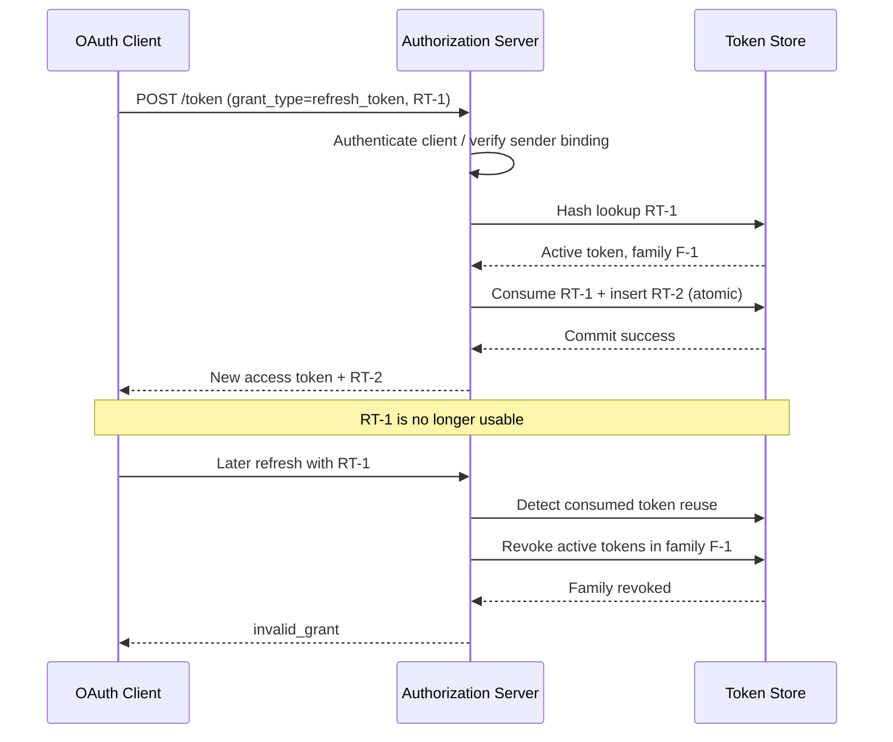
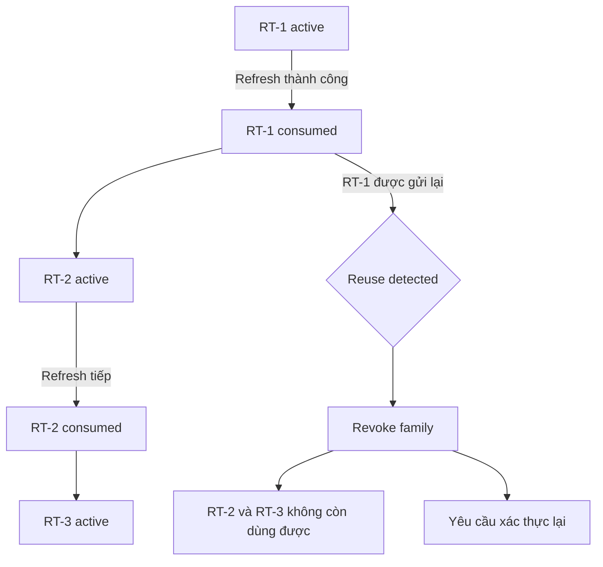

# Thêm refresh token rotation

## 1. Mục tiêu dự án

Refresh token cho phép OAuth client xin access token mới khi access token hiện tại hết hạn mà người dùng không phải đăng nhập lại trong mọi lần. Vì refresh token thường có thời hạn dài và chỉ được gửi tới authorization server, nó là credential có giá trị cao. Nếu refresh token bị đánh cắp, kẻ tấn công có thể tiếp tục xin access token mới trong phạm vi phiên và quyền đã được cấp.

**Refresh token rotation** là cơ chế mỗi lần refresh thành công, authorization server cấp một refresh token mới và vô hiệu hóa refresh token vừa dùng. Nếu một refresh token cũ đã bị dùng lại sau khi rotation, server có thể xem đó là dấu hiệu token bị sao chép và thu hồi toàn bộ token family liên quan.

Dự án này xây dựng rotation cho một OAuth authorization server giả định và kiểm thử luồng từ token endpoint tới kho dữ liệu. Người học sẽ thiết kế token family, chỉ lưu hash của refresh token, xử lý rotation nguyên tử, phát hiện reuse, thu hồi family và kiểm tra race condition khi nhiều request refresh đồng thời.

Kết quả mong muốn:

- Refresh token là chuỗi ngẫu nhiên có entropy cao, không phải JWT tự xác minh tại resource server.
- Server chỉ lưu giá trị hash của refresh token.
- Một refresh token chỉ có thể được tiêu thụ thành công một lần.
- Mỗi lần refresh thành công tạo một token mới trong cùng family.
- Dùng lại token đã tiêu thụ dẫn tới phát hiện reuse và thu hồi family theo policy.
- Client được ràng buộc với token; không thể dùng token của client khác.
- Thời hạn idle và absolute được kiểm soát, rotation không kéo dài phiên vô hạn.
- Các thao tác cập nhật trạng thái và phát hành token mới được thực hiện nguyên tử.
- Log, trace và audit không chứa raw refresh token.

Dự án tập trung vào refresh token trong OAuth 2.0. ID token và access token vẫn có vai trò riêng: access token gọi resource server, ID token phục vụ OIDC client, còn refresh token chỉ được gửi tới token endpoint theo refresh grant.

## 2. Kịch bản và kiến trúc

Giả sử có một ứng dụng web/mobile đã hoàn thành Authorization Code Flow với PKCE. Sau khi người dùng đăng nhập, authorization server cấp:

- Access token sống ngắn, ví dụ 5 phút.
- Refresh token sống lâu hơn, ví dụ idle TTL 14 ngày và absolute TTL 30 ngày theo policy minh họa.
- Client ID xác định ứng dụng đã nhận token.
- Subject và grant/session xác định người dùng, consent và quyền được cấp.

Khi access token hết hạn, client gửi refresh token tới token endpoint. Authorization server xác thực client hoặc ràng buộc sender theo loại client, xác minh refresh token, tiêu thụ token cũ và phát token mới.



Token family là nhóm refresh token phát sinh từ cùng một authorization grant/session. Các token trong family nối tiếp nhau qua các lần rotation. Khi phát hiện reuse, server thu hồi những refresh token còn hoạt động trong family để kẻ đang giữ bản sao không thể tiếp tục refresh.

## 3. Thiết kế token và dữ liệu

### 3.1. Sinh refresh token

Refresh token nên là opaque random value được tạo bằng cryptographically secure random number generator. Ví dụ dùng 32 byte ngẫu nhiên, mã hóa Base64 URL-safe không padding. 32 byte cung cấp 256 bit entropy; không tạo token bằng UUID thường, timestamp, username, Math.random() hoặc dữ liệu có thể dự đoán.

Ví dụ Java:

```java
SecureRandom secureRandom = new SecureRandom();

byte[] randomBytes = new byte[32];
secureRandom.nextBytes(randomBytes);

String refreshToken = Base64.getUrlEncoder()
    .withoutPadding()
    .encodeToString(randomBytes);
```

Giá trị token thô chỉ được trả về client trong response TLS. Server tính hash để tra cứu và lưu hash, không lưu raw token. Với token có entropy ngẫu nhiên cao, SHA-256 phù hợp để tạo lookup digest; không cần password hashing chậm như bcrypt vì token không phải mật khẩu do con người chọn. Có thể dùng HMAC-SHA-256 với secret pepper riêng nếu kiến trúc yêu cầu bảo vệ thêm trước database dump, nhưng phải quản lý version và rotation của pepper.

Ví dụ:

```java
byte[] digest = MessageDigest.getInstance("SHA-256")
    .digest(refreshToken.getBytes(StandardCharsets.US_ASCII));

String tokenHash = Base64.getUrlEncoder()
    .withoutPadding()
    .encodeToString(digest);
```

Dùng cùng một hàm chuẩn hóa/encoding cho lúc tạo và lúc tra cứu. Không log raw token, hash đầy đủ, request body hoặc Authorization header.

### 3.2. Mô hình token family

Có thể tách family và token thành hai bảng để quản lý trạng thái phiên và chuỗi rotation.

```sql
CREATE TABLE refresh_token_family (
    family_id           UUID PRIMARY KEY,
    subject_id          VARCHAR(200) NOT NULL,
    client_id           VARCHAR(200) NOT NULL,
    grant_id             VARCHAR(200) NOT NULL,
    created_at           TIMESTAMP WITH TIME ZONE NOT NULL,
    absolute_expires_at  TIMESTAMP WITH TIME ZONE NOT NULL,
    revoked_at           TIMESTAMP WITH TIME ZONE NULL,
    revoke_reason        VARCHAR(50) NULL
);

CREATE TABLE refresh_token (
    token_id          UUID PRIMARY KEY,
    family_id         UUID NOT NULL REFERENCES refresh_token_family(family_id),
    token_hash        VARCHAR(128) NOT NULL UNIQUE,
    parent_token_id   UUID NULL REFERENCES refresh_token(token_id),
    replaced_by_id    UUID NULL REFERENCES refresh_token(token_id),
    issued_at         TIMESTAMP WITH TIME ZONE NOT NULL,
    expires_at        TIMESTAMP WITH TIME ZONE NOT NULL,
    consumed_at       TIMESTAMP WITH TIME ZONE NULL,
    revoked_at        TIMESTAMP WITH TIME ZONE NULL
);

CREATE INDEX idx_refresh_token_family
    ON refresh_token(family_id);
```

Schema trên là mô hình minh họa; kiểu UUID, timestamp và index cần điều chỉnh theo database. Có thể thêm sender key thumbprint, device session ID, tenant ID, last used time hoặc version theo policy. Không cần lưu raw token hoặc toàn bộ access token đã phát hành trong bảng refresh token.

Các bất biến cần duy trì:

1. token_hash là duy nhất.
2. Mỗi token thuộc đúng một family.
3. Family gắn với subject, client và grant/session đã được cấp.
4. Token đã consumed_at không thể tiêu thụ lần nữa.
5. Token đã revoked_at hoặc family đã revoked không được refresh.
6. expires_at không vượt absolute_expires_at của family.
7. Chỉ có một token hiện hành được phép refresh trong một chuỗi rotation bình thường.
8. Mọi thay đổi token cũ/token mới phải commit cùng một transaction.

### 3.3. Idle expiry và absolute expiry

Hai giới hạn thời gian giải quyết hai mục tiêu khác nhau:

- **Idle expiry:** phiên hết hạn nếu refresh token không được sử dụng trong một khoảng thời gian.
- **Absolute expiry:** giới hạn tổng tuổi tối đa của authorization grant/family, kể cả client vẫn refresh đều.

Khi rotation, token mới có thể có idle expiry mới tính từ thời điểm hiện tại, nhưng tuyệt đối không vượt absolute expiry của family. Nếu mỗi lần refresh đều cộng thêm 30 ngày mà không có absolute limit, phiên có thể tồn tại vô hạn.

Ví dụ policy minh họa:

```yaml
refresh_token_policy:
  idle_ttl: 14d
  absolute_ttl: 30d
  rotate_on_use: true
  revoke_family_on_reuse: true
  bind_to_client: true
  require_sender_constraint_for_public_clients: true
```

Các con số phải được chọn theo mức rủi ro, UX và yêu cầu nghiệp vụ. Không dùng policy mẫu như một chuẩn chung cho mọi ứng dụng.

## 4. Luồng refresh và rotation

### 4.1. Request tới token endpoint

Client gửi refresh grant theo OAuth 2.0:

```http
POST /oauth2/token HTTP/1.1
Host: auth.example.test
Content-Type: application/x-www-form-urlencoded
Authorization: Basic <client-authentication>

grant_type=refresh_token
&refresh_token=<RAW_REFRESH_TOKEN>
```

Với confidential client, xác thực client theo phương thức đã đăng ký, chẳng hạn client secret được bảo vệ, private-key JWT hoặc mTLS. Với public client, không có client secret đáng tin cậy để xác thực; cần áp dụng refresh token rotation hoặc sender-constrained refresh token theo threat model và yêu cầu hiện hành.

Không gửi refresh token tới resource server. Không đưa token vào URL query string. Chỉ truyền qua TLS và không log body request.

### 4.2. Các bước xử lý thành công

Authorization server thực hiện:

1. Xác thực client hoặc kiểm tra sender constraint.
2. Kiểm tra grant_type=refresh_token.
3. Tính hash của refresh token nhận được và tra cứu token record.
4. Xác minh token tồn tại, chưa hết hạn, chưa consumed, chưa revoked.
5. Xác minh family còn hoạt động và chưa quá absolute expiry.
6. Xác minh token thuộc đúng client, subject, grant, tenant và sender binding.
7. Kiểm tra consent, account status và policy hiện hành.
8. Giữ nguyên hoặc thu hẹp scope/resource theo quy tắc OAuth; không tự nâng quyền.
9. Sinh refresh token mới và hash của nó.
10. Trong một transaction, consume token cũ, insert token mới, nối quan hệ parent/replacement và cập nhật idle expiry.
11. Commit transaction.
12. Chỉ sau khi commit thành công mới trả raw refresh token mới cùng access token mới cho client.

Nếu bước insert token mới thất bại, transaction phải rollback để token cũ không bị đánh dấu consumed đơn độc. Nếu commit thành công nhưng response bị mất trên đường mạng, client có thể retry token cũ và bị xem là reuse. Đây là đặc tính bảo mật cần được tính đến trong UX và protocol xử lý lỗi.

### 4.3. Response thành công

Ví dụ response:

```http
HTTP/1.1 200 OK
Content-Type: application/json
Cache-Control: no-store
Pragma: no-cache

{
  "access_token": "<NEW_ACCESS_TOKEN>",
  "token_type": "Bearer",
  "expires_in": 300,
  "refresh_token": "<NEW_REFRESH_TOKEN>",
  "scope": "orders.read"
}
```

Response cần có Cache-Control: no-store và Pragma: no-cache theo khuyến nghị OAuth token response. Client phải thay refresh token cũ bằng token mới ngay sau khi nhận response. Không ghi response body vào log hoặc analytics.

## 5. Xử lý reuse và thu hồi token family

### 5.1. Reuse là gì?

Reuse xảy ra khi server nhận một refresh token đã được tiêu thụ trong lần rotation trước. Ví dụ:

- Client gửi RT-1.
- Server đánh dấu RT-1 consumed và cấp RT-2.
- Một request khác gửi lại RT-1.
- Server phát hiện RT-1 đã consumed.

Server không thể luôn biết ai là người hợp pháp: client gốc có thể retry do mất response, hoặc kẻ tấn công có thể dùng bản sao đã đánh cắp. Với rotation, việc dùng lại token cũ là tín hiệu nghi ngờ compromise. Policy thường thu hồi toàn bộ family để vô hiệu hóa refresh token mới mà kẻ tấn công hoặc client hợp pháp đang giữ.



### 5.2. Thu hồi family

Khi reuse được xác nhận theo policy:

- Đánh dấu family revoked_at.
- Ghi revoke_reason=REFRESH_TOKEN_REUSE.
- Đánh dấu mọi refresh token active trong family revoked.
- Từ chối các lần refresh tiếp theo của family.
- Phát audit/security event với correlation ID, client alias, family reference đã pseudonymize và reason code.
- Có thể yêu cầu người dùng xác thực lại và thông báo qua kênh bảo mật nếu mức rủi ro yêu cầu.

Không log raw token hoặc hash token để điều tra. Không trả thông báo chi tiết cho caller về token record tồn tại, token đã consumed hay family bị revoke; các chi tiết đó có thể giúp attacker dò trạng thái credential. Với client, thường trả lỗi OAuth invalid_grant cùng thông báo tổng quát.

### 5.3. Phạm vi thu hồi và access token đã phát hành

Thu hồi refresh token family ngăn client xin access token mới. Nó **không tự động làm JWT access token đã phát hành mất hiệu lực ngay** nếu resource server chỉ xác minh chữ ký cục bộ.

Để giới hạn cửa sổ này:

- Access token có TTL ngắn.
- Với API nhạy cảm, cân nhắc introspection hoặc policy/session check.
- Có thể dùng denylist/session version hoặc cơ chế revocation propagation phù hợp.
- Thu hồi access token theo khả năng của AS và kiến trúc resource server.
- Định nghĩa rõ logout/reuse response và SLA revoke cho access token.

## 6. Xử lý race condition và request đồng thời

Đây là phần quan trọng nhất của implementation. Nếu hai request cùng gửi RT-1 gần như đồng thời, cả hai không được cùng thành công và tạo RT-2, RT-3 riêng biệt.

### 6.1. Consume bằng conditional update

Không triển khai kiểu đọc token active, sau đó cập nhật consumed ở một câu lệnh riêng mà không có điều kiện nguyên tử. Hai transaction có thể cùng đọc trạng thái active trước khi transaction nào cập nhật.

Dùng conditional update:

```sql
UPDATE refresh_token
SET consumed_at = :now,
    replaced_by_id = :new_token_id
WHERE token_hash = :token_hash
  AND consumed_at IS NULL
  AND revoked_at IS NULL
  AND expires_at > :now;
```

Chỉ khi số dòng cập nhật bằng 1, request mới có quyền tiếp tục insert token mới. Nếu số dòng bằng 0, cần phân biệt token không tồn tại/không hợp lệ với token đã consumed/revoked theo cách không làm lộ thông tin ra client.

Có thể dùng row lock (SELECT FOR UPDATE), optimistic version hoặc atomic compare-and-set tùy database. Dù chọn cách nào, invariant phải được bảo vệ dưới tải đồng thời.

### 6.2. Transaction và reuse handling

Một transaction rotation điển hình:

```text
BEGIN;

1. Lock token/family record theo token hash.
2. Kiểm tra family, client, expiry, sender binding và grant.
3. Nếu token còn active:
   a. Conditional consume token cũ.
   b. Insert token mới với hash mới.
   c. Ghi replaced_by/parent relationship.
   d. Commit.
4. Nếu token đã consumed:
   a. Đánh dấu family revoked.
   b. Revoke các token active trong family.
   c. Commit quyết định revoke.
5. Trả response sau commit.

COMMIT;
```

Điểm tinh tế: nếu phát hiện reuse rồi ném exception làm transaction rollback, thao tác revoke family cũng bị rollback. Cần thiết kế để **quyết định revoke được commit trước khi trả lỗi**. Có thể trả một kết quả nghiệp vụ REUSE_DETECTED từ transaction, commit xong controller mới ánh xạ thành OAuth invalid_grant; hoặc dùng transaction riêng có kiểm soát. Không để exception handler vô tình rollback trạng thái bảo mật.

### 6.3. Hai request đồng thời

Giả sử request A và B cùng dùng RT-1:

- A khóa hoặc consume RT-1 thành công.
- B phải chờ hoặc conditional update trả 0 dòng.
- A insert RT-2 và commit.
- B đọc lại trạng thái RT-1, xác định token đã consumed và áp dụng reuse policy.
- Nếu policy revoke family ngay khi reuse, RT-2 cũng bị revoke; client cần đăng nhập lại.

Hệ thống không được trả hai refresh token mới cho hai request cùng token cũ. Nếu dùng optimistic locking, phải kiểm tra version conflict và không tự retry việc phát hành token như một refresh mới.

### 6.4. Retry sau khi mất response

Một trường hợp khó: server commit RT-2 nhưng response bị mất; client không biết RT-1 đã được dùng và retry RT-1. Server nhìn thấy reuse và có thể revoke family.

Đây là đánh đổi giữa bảo vệ replay và trải nghiệm mạng. Không nên tùy tiện cho phép dùng lại token cũ trong một khoảng grace period nếu không có cơ chế phân biệt retry hợp pháp với attacker. Nếu cần hỗ trợ retry, phải thiết kế idempotency protocol có ràng buộc client, khóa request, thời hạn ngắn và lưu response mới theo cách được bảo vệ; việc lưu raw refresh token hoặc cho phép token cũ dùng lại tự do sẽ làm suy yếu rotation. Với dự án cơ bản, chọn strict rotation và yêu cầu re-authentication khi kết quả refresh không rõ ràng là phương án dễ kiểm chứng hơn.

## 7. Pseudocode service Java

Đây là pseudocode thể hiện thứ tự và ranh giới transaction; tên repository, exception và transaction API cần điều chỉnh theo framework của dự án.

```java
RefreshResult rotate(AuthenticatedClient client, String rawRefreshToken) {
    String tokenHash = tokenHasher.sha256(rawRefreshToken);

    return transaction.execute(status -> {
        RefreshToken token = repository.findByHashForUpdate(tokenHash)
            .orElse(null);

        if (token == null) {
            return RefreshResult.invalidGrant();
        }

        RefreshTokenFamily family =
            familyRepository.findByIdForUpdate(token.familyId());

        if (!client.id().equals(family.clientId())) {
            return RefreshResult.invalidGrant();
        }

        Instant now = clock.instant();

        if (family.revokedAt() != null
                || !now.isBefore(family.absoluteExpiresAt())
                || !now.isBefore(token.expiresAt())
                || token.revokedAt() != null) {
            return RefreshResult.invalidGrant();
        }

        if (token.consumedAt() != null) {
            familyRepository.revoke(family.id(), now,
                                    "REFRESH_TOKEN_REUSE");
            tokenRepository.revokeActiveFamilyTokens(family.id(), now);
            return RefreshResult.reuseDetected();
        }

        policy.assertAccountAndGrantActive(family);
        policy.assertSenderBinding(client, token, family);

        String newRawToken = tokenGenerator.generate();
        String newHash = tokenHasher.sha256(newRawToken);
        Instant newExpiry = min(
            now.plus(policy.idleTtl()),
            family.absoluteExpiresAt()
        );

        UUID newTokenId = UUID.randomUUID();

        int consumed = tokenRepository.consumeIfActive(
            token.id(), now, newTokenId
        );

        if (consumed != 1) {
            // Concurrent request may have consumed the same token.
            return handleConcurrentReuseAndRevoke(family, now);
        }

        tokenRepository.insert(
            newTokenId, family.id(), newHash, token.id(),
            now, newExpiry
        );

        return RefreshResult.rotated(newRawToken, newExpiry);
    });
}
```

Hàm transaction.execute ở đây giả định kết quả reuseDetected được commit bình thường. Không ném exception làm rollback sau khi đánh dấu revoke. Khi trả kết quả rotated, controller chỉ phát response sau khi transaction commit thành công. Nếu transaction manager trả kết quả trước commit hoặc framework có transaction boundary khác, cần xác minh hành vi thực tế.

Trong code production, không trả raw refresh token từ tầng repository. Chỉ service tạo token mới và giữ nó trong memory đến khi response được gửi. Không lưu token thô trong entity hoặc debug string.

## 8. Client phải cập nhật refresh token an toàn

Sau response thành công, client phải thay token cũ bằng token mới theo thao tác nguyên tử ở nơi lưu trữ của client:

1. Nhận response HTTPS.
2. Xác nhận response hợp lệ và có refresh token mới nếu rotation policy yêu cầu.
3. Ghi token mới vào secure storage.
4. Chỉ sau khi ghi thành công mới coi refresh flow hoàn tất và xóa bản cũ.
5. Không ghi token vào application log, crash report hoặc analytics.

Trên mobile, dùng secure platform storage phù hợp như Keychain/Keystore-backed storage. Trên web, cân nhắc BFF để refresh token không phải nằm trong JavaScript-accessible storage. Nếu browser client giữ refresh token, cần thiết kế chống XSS và bảo vệ theo khả năng của nền tảng; HttpOnly cookie có thể giảm khả năng JavaScript đọc token nhưng cần CSRF protection và cookie policy đúng.

Nếu client có nhiều tab hoặc nhiều worker cùng refresh, cần một cơ chế single-flight/lock để chỉ một request refresh được gửi cho mỗi session tại một thời điểm. Nếu nhiều tab dùng chung RT-1, tab thứ hai có thể kích hoạt reuse detection và làm family bị revoke.

## 9. Scope, resource và client binding

Refresh không phải cơ hội xin thêm quyền. Authorization server cần ràng buộc refresh token với grant ban đầu:

- Client ID phải khớp client đã nhận token.
- Subject và grant/session phải còn hiệu lực.
- Scope mới không được vượt quyền đã được cấp; nếu client xin scope hẹp hơn, AS có thể cấp hẹp hơn theo policy.
- Resource/audience phải nằm trong phạm vi grant ban đầu hoặc được AS cho phép rõ ràng.
- Tenant và authorization context phải còn hợp lệ.
- Consent, account state và risk policy phải được kiểm tra lại nếu cần.

Với public clients, rotation giúp phát hiện reuse nhưng có thể kết hợp sender-constrained refresh token như DPoP hoặc mTLS theo khả năng nền tảng và threat model. Sender constraint giúp ràng buộc token với khóa/certificate của client; rotation và sender constraint giải quyết các khía cạnh khác nhau và có thể bổ sung cho nhau.

## 10. Error handling và observability

Các tình huống token endpoint cần phản hồi an toàn:

| Tình huống | OAuth error thường dùng | Hành vi |
| --- | --- | --- |
| Refresh token không tồn tại, hết hạn, revoked hoặc reuse | invalid_grant | Từ chối, không cấp token mới |
| Client authentication thất bại | invalid_client | Từ chối xác thực client |
| Client không được phép dùng grant | unauthorized_client | Không thực hiện rotation |
| Scope yêu cầu không hợp lệ/vượt grant | invalid_scope | Không nâng quyền |
| Storage/DB lỗi hoặc transaction không commit | server_error hoặc lỗi hệ thống theo contract | Không trả token mới; trạng thái cũ phải nhất quán |

Không tiết lộ ra client liệu token hash có tồn tại, đã consumed hay bị revoke vì điều đó giúp dò trạng thái. Với reuse, server có thể trả cùng thông báo tổng quát invalid_grant, đồng thời thực hiện audit nội bộ.

Audit event nên có:

- Event: refresh_token_rotation.
- Outcome: success, denied, reuse_detected, system_error.
- Reason code hữu hạn.
- Client alias, family reference đã pseudonymize, timestamp và correlation ID.
- Service/region, transaction result và policy version.

Không ghi raw refresh token, hash token, access token mới, request body hoặc client secret. Không đưa token vào trace baggage hay metric label. Metric hữu ích gồm số lần rotation thành công, reuse detected, invalid grant, transaction conflict, refresh latency và family revocation count.

## 11. Kế hoạch triển khai theo từng bước

### Bước 1: Mô hình hóa dữ liệu

- Tạo bảng family và token.
- Thêm unique constraint cho token hash.
- Thêm quan hệ parent/replaced-by.
- Thêm trạng thái consumed/revoked và absolute expiry.
- Thiết kế index phục vụ tra cứu hash và revoke theo family.
- Xác định transaction isolation và locking strategy.

### Bước 2: Xây token generator và hasher

- Dùng CSPRNG sinh 32 byte hoặc entropy theo policy.
- Encode Base64URL không padding.
- Hash bằng SHA-256 hoặc HMAC có quản lý key.
- Viết test xác nhận token mới khác nhau và hash ổn định theo cùng input.
- Không ghi raw token/hash vào log.

### Bước 3: Cài refresh grant ban đầu

- Xác thực client.
- Kiểm tra refresh token và family.
- Kiểm tra account, consent, scope, resource và expiry.
- Cấp access token và refresh token ban đầu.
- Tạo family và token record.
- Trả response có no-store.

### Bước 4: Cài rotation nguyên tử

- Conditional consume token cũ.
- Sinh token mới và insert cùng transaction.
- Nối parent/replacement.
- Giới hạn expiry theo idle và absolute TTL.
- Chỉ trả response sau commit.

### Bước 5: Cài reuse detection

- Nhận diện token đã consumed.
- Thu hồi family và mọi token active trong family.
- Commit trạng thái revoke trước khi trả invalid_grant.
- Ghi audit event không chứa credential.
- Yêu cầu người dùng xác thực lại.

### Bước 6: Bảo vệ client

- Lưu token mới an toàn và thay token cũ.
- Single-flight refresh cho nhiều tab/worker.
- Xử lý network timeout sau commit theo policy.
- Không retry refresh token cũ vô hạn.
- Không gửi refresh token tới resource API.

### Bước 7: Kiểm thử và vận hành

- Chạy test chức năng, concurrency và failure injection.
- Đo tỷ lệ reuse và false positive do client retry.
- Thiết lập alert khi reuse tăng bất thường.
- Viết runbook thu hồi family và phiên liên quan.
- Kiểm tra access token đã phát hành còn hiệu lực bao lâu sau family revoke.

## 12. Bộ kiểm thử bắt buộc

| Test case | Thiết lập | Kết quả mong đợi |
| --- | --- | --- |
| Refresh lần đầu | Token active, client đúng | Cấp access token mới và refresh token mới |
| Token cũ sau rotation | RT-1 đã consumed | invalid_grant, phát hiện reuse và revoke family theo policy |
| Refresh token ngẫu nhiên | Hash không tồn tại | invalid_grant, không tạo token |
| Hết idle TTL | Token/family idle hết hạn | Từ chối |
| Hết absolute TTL | Family hết hạn tuyệt đối | Từ chối dù token vừa được dùng |
| Family revoked | Logout hoặc revoke trước đó | Từ chối |
| Client khác dùng token | Client ID không khớp | Từ chối |
| Sender binding sai | DPoP key/certificate không khớp | Từ chối |
| Scope mở rộng | Xin quyền ngoài grant | Từ chối hoặc chỉ cấp phần được phép theo policy |
| DB insert token mới lỗi | Consume và insert cùng transaction | Rollback, RT cũ vẫn nhất quán theo transaction |
| Hai request đồng thời | Cùng RT-1 được gửi song song | Không có hai lần rotation thành công; reuse policy được thực thi |
| Response mất sau commit | Server đã commit RT-2, client retry RT-1 | Reuse được phát hiện theo strict policy |
| Reuse RT-1 sau khi RT-2 đã phát hành | RT-1 consumed, RT-2 active | Revoke family và RT-2 không refresh được |
| Log kiểm tra | Token có marker test | Raw token và hash không xuất hiện trong log/trace |
| Logout | Revoke family | Mọi refresh token trong family bị từ chối |

### 12.1. Kiểm thử concurrency

Tạo barrier để hai thread gửi cùng một refresh token đồng thời. Xác minh:

- Không có hai token mới cùng được phát hành thành công từ RT-1.
- Database không có hai child token active của cùng một parent trong chuỗi rotation.
- Family state nhất quán sau khi request thứ hai phát hiện reuse.
- Revoke không bị rollback khi controller trả OAuth error.
- Không có raw token xuất hiện trong log.

Chạy test trên database engine tương ứng với production nếu có thể. H2 hoặc mock repository có thể không tái hiện đúng locking và isolation semantics của PostgreSQL/MySQL. Với concurrency, cần ít nhất một integration test dùng database thật hoặc container tương đương.

### 12.2. Kiểm thử transaction rollback

Giả lập lỗi insert RT-2 sau khi consume RT-1. Kết quả phải là transaction rollback: RT-1 vẫn ở trạng thái active và không có token mới được phát hành. Sau đó thực hiện lại refresh hợp lệ và xác minh rotation thành công.

Một test khác phải giả lập reuse, đánh dấu family revoked rồi trả invalid_grant; xác nhận trạng thái revoke đã commit và không bị rollback bởi exception mapping ở controller.

## 13. Tiêu chí nghiệm thu dự án

- [ ] Refresh token được sinh bằng CSPRNG, entropy cao và opaque.
- [ ] Database chỉ lưu hash, không lưu raw refresh token.
- [ ] Family gắn với đúng subject, client và grant/session.
- [ ] Refresh token cũ được consume nguyên tử khi rotation.
- [ ] Token mới được insert cùng transaction với consume token cũ.
- [ ] Mỗi parent chỉ có tối đa một replacement hợp lệ.
- [ ] Reuse token đã consumed được phát hiện và family bị revoke theo policy.
- [ ] Revoke family được commit trước khi trả lỗi; không bị rollback do exception.
- [ ] Idle TTL và absolute TTL đều được kiểm tra.
- [ ] Rotation không mở rộng scope/resource ngoài grant.
- [ ] Client binding và sender constraint được xác minh theo loại client.
- [ ] Client lưu token mới an toàn, có single-flight refresh và xử lý retry rõ ràng.
- [ ] Có test race condition, transaction failure, response loss, logout và reuse.
- [ ] Access token đã phát hành có policy riêng về TTL/revocation.
- [ ] Log, trace, metric và error response không làm lộ raw token/hash.

## 14. Câu hỏi tự kiểm tra

**1. Vì sao server chỉ nên lưu hash refresh token?**

Nếu database bị đọc trái phép, attacker không lấy được raw credential trực tiếp để dùng refresh. Refresh token có entropy cao nên hash nhanh như SHA-256 phù hợp cho lookup; không giống mật khẩu con người, token không cần password hashing chậm.

**2. Vì sao phải consume token cũ và insert token mới trong cùng transaction?**

Để tránh trạng thái token cũ đã bị vô hiệu hóa nhưng token mới không được tạo, hoặc hai request đồng thời cùng dùng token cũ và phát hành hai token mới.

**3. Reuse token cũ có ý nghĩa gì?**

Có thể là retry do mất response hoặc dấu hiệu token bị sao chép. Với strict rotation, reuse là tín hiệu compromise; server thường revoke toàn bộ family để chặn refresh tiếp theo.

**4. Revoke refresh token family có lập tức vô hiệu hóa JWT access token đã phát hành không?**

Không nếu resource server chỉ xác minh JWT cục bộ. Access token có thể còn hiệu lực đến exp; cần TTL ngắn, introspection, denylist hoặc session/policy check nếu cần revoke nhanh.

**5. Vì sao rotation cần absolute expiry?**

Nếu chỉ reset idle TTL mỗi lần refresh, phiên có thể kéo dài vô hạn. Absolute expiry giới hạn tổng tuổi của grant/family.

**6. Làm sao xử lý hai request refresh đồng thời?**

Dùng row lock hoặc conditional update/optimistic locking để chỉ một request consume token cũ. Request còn lại phải nhận diện trạng thái đã consumed và áp dụng reuse policy.

**7. Có nên cho phép grace period để client retry refresh token cũ không?**

Chỉ khi có giao thức idempotency an toàn, ràng buộc client, thời hạn ngắn và lưu response được bảo vệ. Cho phép dùng lại token cũ tự do làm suy yếu replay detection. Dự án này dùng strict rotation và yêu cầu re-authentication khi kết quả không rõ ràng.

## Tài liệu chuẩn tham khảo

- [RFC 6749 – The OAuth 2.0 Authorization Framework](https://www.rfc-editor.org/rfc/rfc6749): refresh token grant, token endpoint và lỗi invalid_grant.
- [RFC 9700 – Best Current Practice for OAuth 2.0 Security](https://www.rfc-editor.org/rfc/rfc9700): refresh token rotation, sender-constrained refresh token và phát hiện reuse.
- [RFC 9449 – OAuth 2.0 Demonstrating Proof of Possession (DPoP)](https://www.rfc-editor.org/rfc/rfc9449): ràng buộc token với khóa của client.
- [RFC 8705 – OAuth 2.0 Mutual-TLS Client Authentication and Certificate-Bound Access Tokens](https://www.rfc-editor.org/rfc/rfc8705): client authentication và certificate-bound token.
- [RFC 7009 – OAuth 2.0 Token Revocation](https://www.rfc-editor.org/rfc/rfc7009): thu hồi token.
- [OWASP OAuth 2.0 Cheat Sheet](https://cheatsheetseries.owasp.org/cheatsheets/OAuth2_Cheat_Sheet.html): các thực hành bảo mật OAuth.

