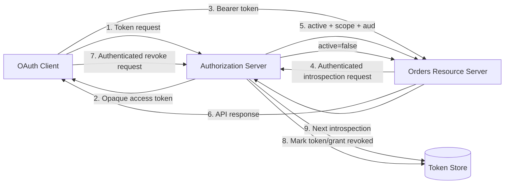

# Dự án thực hành: Thêm Introspection và Token Revocation

## 1. Mục tiêu dự án

Trong dự án này, bạn bổ sung hai khả năng quản lý vòng đời token cho một hệ thống OAuth 2.0 đang có:

- **Token Introspection** theo RFC 7662: Resource Server hỏi Authorization Server xem access token có còn active hay không và lấy các thuộc tính cần cho authorization.
- **Token Revocation** theo RFC 7009: client yêu cầu Authorization Server thu hồi token; trạng thái thu hồi được lưu và áp dụng khi introspection hoặc refresh.

Lab sử dụng opaque access token để làm rõ vai trò của kho trạng thái trung tâm. Resource Server không tự giải mã token; nó gọi introspection endpoint qua kết nối đã xác thực. Khi client revoke token, lần introspection tiếp theo trả `active=false` và API từ chối request.

Kết quả mong muốn là một luồng có thể kiểm thử từ đầu đến cuối: cấp token, gọi API, introspect token, revoke token, xác minh token không còn dùng được và kiểm tra refresh token/grant liên quan. Các ví dụ cấu hình hướng Spring Boot/Spring Security; endpoint và service phía Authorization Server được mô tả theo hợp đồng OAuth để có thể áp dụng với framework khác.

## 2. Kiến trúc và giả định của lab

Lab giả định đã có ba thành phần:

1. **Authorization Server (AS):** xác thực client/grant, cấp opaque access token và quản lý token store.
2. **Orders Resource Server (RS):** bảo vệ API `/api/orders` và cần kiểm tra access token trước khi cho phép truy cập.
3. **Database:** lưu metadata token, grant và trạng thái thu hồi. Có thể dùng PostgreSQL trong môi trường lab.



Giả định cụ thể:

- AS phát hành opaque access token có entropy cao, không phải JWT.
- Mỗi token được ràng buộc với client, subject (nếu có), audience/resource, scope, thời gian phát hành và hết hạn.
- RS là confidential client được đăng ký riêng để gọi introspection; client ứng dụng gọi revoke được xác thực theo chính sách của AS.
- Token endpoint, introspection endpoint và revocation endpoint chỉ truy cập qua HTTPS.
- Lab không triển khai một Authorization Server hoàn chỉnh từ đầu. Hãy tích hợp hai endpoint vào AS hiện có hoặc dùng implementation OAuth tương thích để thực hành hợp đồng và kiểm thử.

## 3. Phân biệt hai endpoint

| Thuộc tính | Introspection (RFC 7662) | Revocation (RFC 7009) |
| --- | --- | --- |
| Ai gọi? | Resource Server hoặc protected resource được AS cho phép | OAuth client đã xác thực theo policy |
| Mục đích | Hỏi token có active không và lấy metadata cần thiết | Yêu cầu vô hiệu token/grant liên quan |
| Tham số chính | `token`; `token_type_hint` tùy chọn | `token`; `token_type_hint` tùy chọn |
| Response thành công | JSON có `active` và các thuộc tính được phép tiết lộ | Thường trả HTTP 200, không tiết lộ token có tồn tại hay không |
| Ảnh hưởng trạng thái | Chỉ đọc trạng thái token | Thay đổi trạng thái token/grant |
| Khi token không hợp lệ | Trả `active=false` | Vẫn trả thành công theo semantics RFC để tránh token scanning |

Hai endpoint cần client authentication và authorization phù hợp. Việc biết URL endpoint hoặc có một token bất kỳ không cho phép mọi caller introspect hay revoke token của client khác.

## 4. Thiết kế token store

Opaque token nên là chuỗi ngẫu nhiên khó đoán. Không dùng ID tuần tự, email, user ID hay UUID có thể suy đoán làm access token. Ví dụ tạo token với 32 byte ngẫu nhiên bằng `SecureRandom`, sau đó mã hóa Base64 URL-safe không padding.

```java
byte[] randomBytes = new byte[32];
secureRandom.nextBytes(randomBytes);
String rawToken = Base64.getUrlEncoder()
    .withoutPadding()
    .encodeToString(randomBytes);
```

Chỉ trả `rawToken` cho client tại thời điểm cấp token. Trong database, lưu digest của token thay vì giá trị raw. Với token có entropy ngẫu nhiên cao, SHA-256 phù hợp để tra cứu chính xác; có thể dùng HMAC-SHA-256 với server-side pepper nếu muốn thêm lớp bảo vệ trước việc đối chiếu offline. Pepper phải được lưu trong secret manager/KMS, không nằm trong cùng database.

Ví dụ schema PostgreSQL tối giản:

```sql
CREATE TABLE oauth_token_record (
    token_hash       CHAR(64) PRIMARY KEY,
    token_kind       VARCHAR(16) NOT NULL,
    client_id        VARCHAR(120) NOT NULL,
    subject_id       VARCHAR(160),
    audience         TEXT NOT NULL,
    scope            TEXT NOT NULL,
    issued_at        TIMESTAMPTZ NOT NULL,
    not_before       TIMESTAMPTZ,
    expires_at       TIMESTAMPTZ NOT NULL,
    grant_id         VARCHAR(160),
    token_family_id  VARCHAR(160),
    revoked_at       TIMESTAMPTZ,
    revoke_reason    VARCHAR(40)
);

CREATE INDEX idx_oauth_token_grant
    ON oauth_token_record (grant_id);

CREATE INDEX idx_oauth_token_family
    ON oauth_token_record (token_family_id);

CREATE INDEX idx_oauth_token_expiry
    ON oauth_token_record (expires_at);
```

Schema chỉ là điểm bắt đầu. Trong hệ thống thật, chuẩn hóa grant, token family, client/resource ownership và audit event theo mô hình dữ liệu hiện có. `token_hash` trong ví dụ là hex SHA-256 64 ký tự; nếu dùng binary hoặc HMAC digest, thay đổi kiểu cột cho phù hợp.

### Metadata cần lưu

- `token_kind`: `access` hoặc `refresh`.
- `client_id`: client được cấp token.
- `subject_id`: user/service subject nếu grant có subject; Client Credentials có thể đại diện client.
- `audience`: resource server được phép sử dụng token.
- `scope`: tập scope thực tế được cấp, không phải scope client yêu cầu ban đầu.
- `issued_at`, `not_before`, `expires_at`: thời gian hiệu lực.
- `grant_id`: liên kết token với authorization grant/session.
- `token_family_id`: liên kết các refresh token được rotate trong cùng family.
- `revoked_at`: trạng thái thu hồi; `NULL` nghĩa là chưa bị revoke.

Không lưu `rawToken`, Authorization header hoặc token trong log. Có thể xóa record hết hạn theo retention policy sau khi không còn cần cho revoke, replay detection hoặc audit.

## 5. Xây dựng Introspection Endpoint

### 5.1. Request contract

Resource Server gọi endpoint bằng POST `application/x-www-form-urlencoded`. Ví dụ:

```http
POST /oauth2/introspect HTTP/1.1
Host: auth.example.test
Authorization: Basic <orders-resource-server-credentials>
Content-Type: application/x-www-form-urlencoded

token=<opaque-access-token>&token_type_hint=access_token
```

`token_type_hint` chỉ là gợi ý để AS tìm token nhanh hơn; AS vẫn phải xác định token thực tế và không được tin hint như một bằng chứng. Resource Server phải được xác thực, ví dụ bằng `private_key_jwt`, mTLS hoặc `client_secret_basic` theo phương thức đã đăng ký. Nên cấp riêng một client identity cho từng Resource Server hoặc nhóm resource có cùng trust boundary.

### 5.2. Quy tắc xác định `active`

AS chỉ trả `active=true` khi token tồn tại, chưa bị revoke, chưa hết hạn, đã tới `not_before` nếu có, thuộc issuer/token store hợp lệ và được phép introspect bởi resource caller. Token unknown, expired, revoked hoặc không hợp lệ phải trả `active=false`.

Response active minh họa:

```http
HTTP/1.1 200 OK
Content-Type: application/json
Cache-Control: no-store
Pragma: no-cache

{
  "active": true,
  "scope": "orders.read orders.write",
  "client_id": "orders-web-client",
  "sub": "user-42",
  "aud": "https://orders.api.example.test",
  "iss": "https://auth.example.test",
  "token_type": "Bearer",
  "iat": 1900000000,
  "exp": 1900000300,
  "jti": "opaque-record-8f31"
}
```

Response inactive nên tối thiểu như sau:

```json
{
  "active": false
}
```

Không trả subject, client, scope, expiry hoặc lý do cụ thể khi token inactive. Điều này hạn chế khả năng dùng introspection để dò token hoặc thu thập metadata. Chỉ trả các thuộc tính cần thiết cho Resource Server; không tiết lộ claims nội bộ hoặc PII không liên quan.

### 5.3. Pseudocode phía Authorization Server

```java
IntrospectionResponse introspect(
        AuthenticatedResourceServer caller,
        String rawToken) {

    requireTlsAndAuthenticatedClient(caller);
    requireIntrospectionPermission(caller);

    String digest = tokenHasher.digest(rawToken);
    TokenRecord record = tokenRepository.findByHash(digest);

    if (record == null
            || record.revokedAt() != null
            || record.expiresAt().isBefore(clock.instant())
            || (record.notBefore() != null
                && record.notBefore().isAfter(clock.instant()))) {
        return IntrospectionResponse.inactive();
    }

    if (!resourcePolicy.mayIntrospect(caller, record.audience())) {
        // Không tiết lộ token có tồn tại nhưng thuộc resource khác.
        return IntrospectionResponse.inactive();
    }

    return IntrospectionResponse.active(
        record.scope(), record.clientId(), record.subjectId(),
        record.audience(), record.issuedAt(), record.expiresAt());
}
```

Đây là pseudocode, không phải API framework có thể biên dịch trực tiếp. `caller` phải là client vừa được xác thực ở endpoint, không lấy `client_id` từ form body. `resourcePolicy` phải kiểm tra Resource Server chỉ được introspect token thuộc audience/resource mà nó được phép phục vụ. Cần xử lý thêm clock skew theo policy, token type, issuer và grant status.

## 6. Xây dựng Revocation Endpoint

### 6.1. Request contract

Client gửi POST tới revocation endpoint:

```http
POST /oauth2/revoke HTTP/1.1
Host: auth.example.test
Authorization: Basic <client-credentials>
Content-Type: application/x-www-form-urlencoded

token=<opaque-token>&token_type_hint=refresh_token
```

Client phải được xác thực theo cấu hình. `token_type_hint` là gợi ý, không thay thế việc tìm token. Authorization Server phải kiểm tra client có quyền revoke token đó hay không, ví dụ token được cấp cho chính client hoặc thuộc grant mà client có quyền quản lý.

### 6.2. Response và nguyên tắc không tiết lộ

Theo RFC 7009, nếu request hợp lệ và client được xác thực, Authorization Server thường trả `HTTP 200 OK` dù token hợp lệ, không hợp lệ hoặc đã bị revoke. Client không thể dùng response để dò xem token có tồn tại hay không. Nếu client authentication thất bại, endpoint trả lỗi xác thực client phù hợp.

```http
HTTP/1.1 200 OK
Cache-Control: no-store
Pragma: no-cache
```

Response 200 không có nghĩa token chắc chắn tồn tại hoặc trước đó đang active. Nó có nghĩa AS đã xử lý yêu cầu theo contract và không tiết lộ trạng thái token cho caller.

### 6.3. Quy tắc revoke

- Đánh dấu token mục tiêu revoked một cách nguyên tử.
- Nếu token là refresh token, thu hồi các access token liên quan đến cùng grant/family theo policy và khuyến nghị của RFC 7009.
- Nếu token là access token, xử lý các token liên quan cùng grant theo chính sách; không để refresh token tiếp tục tạo token mới trái với ý định thu hồi.
- Khi phát hiện refresh token reuse sau rotation, thu hồi toàn bộ token family và ghi security event.
- Không cho phép client A revoke token thuộc client B nếu không có quyền quản trị tương ứng.
- Nếu token không tồn tại hoặc đã revoke, trả response thành công chung theo RFC; không tạo khác biệt có thể bị dò.

### 6.4. Pseudocode revoke nguyên tử

```java
void revoke(
        AuthenticatedClient caller,
        String rawToken,
        String tokenTypeHint) {

    requireClientAuthenticated(caller);
    String digest = tokenHasher.digest(rawToken);

    transactionTemplate.executeWithoutResult(tx -> {
        TokenRecord token = tokenRepository.findByHashForUpdate(digest);
        if (token == null || token.revokedAt() != null) {
            return; // Response bên ngoài vẫn là HTTP 200.
        }

        if (!revocationPolicy.mayRevoke(caller, token)) {
            // Không để lộ token thuộc client khác; áp dụng response policy chung.
            return;
        }

        tokenRepository.markRevoked(token.id(), clock.instant(), "client_request");
        grantRevocationPolicy.revokeRelatedTokens(token.grantId(), token.id());
        outbox.publish(new TokenRevokedEvent(token.id(), token.grantId()));
    });
}
```

Pseudocode minh họa thứ tự xử lý. Trong hệ thống thực, cần phân biệt response cho lỗi client authentication với token không tồn tại, áp dụng chính sách quyền revoke theo RFC và hợp đồng AS, ghi audit tối thiểu, và bảo đảm event được commit cùng trạng thái qua transactional outbox. Không gửi event trước khi transaction commit nếu consumer có thể xử lý một trạng thái chưa tồn tại.

## 7. Tích hợp Resource Server bằng Spring Security

Với Spring Boot/Spring Security Resource Server, có thể cấu hình opaque token introspection qua properties:

```yaml
spring:
  security:
    oauth2:
      resourceserver:
        opaquetoken:
          introspection-uri: https://auth.example.test/oauth2/introspect
          client-id: orders-resource-server
          client-secret: ${ORDERS_INTROSPECTION_SECRET}
```

Không commit secret thật vào YAML. Dùng secret manager hoặc biến môi trường được bảo vệ. Với production, cân nhắc mTLS hoặc `private_key_jwt` nếu AS hỗ trợ và policy yêu cầu.

Security filter chain ví dụ:

```java
@Configuration
@EnableWebSecurity
class ResourceServerSecurityConfiguration {

    @Bean
    SecurityFilterChain apiSecurity(HttpSecurity http) throws Exception {
        return http
            .authorizeHttpRequests(authorize -> authorize
                .requestMatchers("/health").permitAll()
                .requestMatchers(HttpMethod.GET, "/api/orders/**")
                    .hasAuthority("SCOPE_orders.read")
                .requestMatchers(HttpMethod.POST, "/api/orders/**")
                    .hasAuthority("SCOPE_orders.write")
                .anyRequest().authenticated())
            .oauth2ResourceServer(oauth2 ->
                oauth2.opaqueToken(Customizer.withDefaults()))
            .build();
    }
}
```

Spring Security dùng introspection response để tạo `Authentication` và ánh xạ scope thành authority, thường có prefix `SCOPE_`. Ví dụ `orders.read` trở thành `SCOPE_orders.read`. Nếu AS trả scope dưới định dạng khác hoặc có claim tùy chỉnh, cần cấu hình converter phù hợp và viết test cho mapping.

Không để API controller tự gọi introspection thủ công cho mỗi endpoint. Để Resource Server filter chain thực hiện xác thực tập trung, sau đó dùng authorization rule và object-level policy. Với opaque token, nếu introspection không khả dụng, hành vi mặc định an toàn là từ chối request cần xác minh; không tự coi token là hợp lệ vì AS đang lỗi.

## 8. Cache introspection và giới hạn thời gian thu hồi

Introspection là một request mạng, nên hệ thống có thể cân nhắc cache kết quả active để giảm latency và tải AS. Tuy nhiên, cache `active=true` làm chậm hiệu lực revoke.

Ví dụ: nếu RS cache active response trong 60 giây, token vừa revoke vẫn có thể được chấp nhận tới gần 60 giây nếu không có cache invalidation. Vì vậy:

- Định nghĩa **revocation latency SLO**: thời gian tối đa từ lúc AS commit revoke đến khi mọi RS liên quan từ chối token.
- Chọn cache TTL ngắn hơn SLO, hoặc phát sự kiện invalidation để xóa cache sớm.
- Với endpoint nhạy cảm như quản trị, billing hoặc thay đổi quyền, cân nhắc introspection trực tiếp hoặc cache TTL rất ngắn.
- Cache key phải gắn với token digest và resource server/issuer context; không log raw token làm cache key.
- Không cache response `active=true` vượt quá `exp` của token.
- Xử lý timeout/5xx theo fail-closed cho request không thể xác minh; không biến lỗi mạng thành `active=true`.
- Cache `active=false` có thể giảm dò token nhưng phải có TTL hợp lý để token mới hoặc trạng thái được khôi phục không bị giữ sai lâu.

Nếu sử dụng event invalidation, consumer phải idempotent, retry khi lỗi, xử lý event đến sai thứ tự và đo thời gian propagation. Sự kiện chỉ là bổ trợ cho introspection; không bỏ kiểm tra issuer/resource và policy.

## 9. Thực hành gọi endpoint

Các lệnh sau chỉ dùng trong môi trường lab với credential giả. Tránh truyền secret production trên command line vì shell history/process list có thể lưu lại.

### 9.1. Introspect token

```bash
curl --request POST \
  --user 'orders-resource-server:<test-secret>' \
  --header 'Content-Type: application/x-www-form-urlencoded' \
  --data-urlencode 'token=<opaque-access-token>' \
  --data-urlencode 'token_type_hint=access_token' \
  https://auth.example.test/oauth2/introspect
```

Kỳ vọng `active=true` khi token còn hiệu lực, chưa bị revoke và audience phù hợp. Nếu token không tồn tại, hết hạn hoặc đã revoke, response phải có `active=false`.

### 9.2. Gọi API trước khi revoke

```bash
curl --request GET \
  --header 'Authorization: Bearer <opaque-access-token>' \
  https://orders.api.example.test/api/orders
```

Với token có `orders.read` và audience đúng, API trả kết quả theo dữ liệu test. Không lưu lệnh chứa token thật vào shell history.

### 9.3. Revoke token

```bash
curl --request POST \
  --user 'orders-web-client:<test-secret>' \
  --header 'Content-Type: application/x-www-form-urlencoded' \
  --data-urlencode 'token=<opaque-access-token>' \
  --data-urlencode 'token_type_hint=access_token' \
  https://auth.example.test/oauth2/revoke
```

Kỳ vọng endpoint trả HTTP 200 theo contract revocation. Gọi lại introspection và xác nhận `active=false`; sau đó gọi Orders API và xác nhận Resource Server từ chối token theo response authentication failure.

## 10. Ma trận kiểm thử tích hợp

| Kịch bản | Thao tác | Kết quả mong đợi |
| --- | --- | --- |
| Token active | Introspect token mới được cấp | `active=true`, metadata đúng client, scope, audience và thời hạn. |
| Token không tồn tại | Introspect chuỗi ngẫu nhiên | `active=false`, không lộ metadata. |
| Token hết hạn | Introspect token có `exp` trong quá khứ | `active=false`. |
| Token đã revoke | Revoke rồi introspect | `active=false`. |
| Thiếu authentication tại introspection | Gọi endpoint không credential | Từ chối caller theo cơ chế client authentication; không trả metadata token. |
| Resource Server không được phép | Client RS A hỏi token chỉ dành cho RS B | Không tiết lộ metadata; trả inactive hoặc xử lý theo policy đã công bố. |
| Scope không đủ | Token active nhưng thiếu `orders.read` | Introspection active; API authorization trả 403. |
| Revoke token hợp lệ | Client có quyền revoke token | HTTP 200; trạng thái token chuyển revoked. |
| Revoke token unknown | Client đã xác thực gửi token ngẫu nhiên | HTTP 200; không tiết lộ token tồn tại hay không. |
| Revoke token của client khác | Client không có quyền quản lý token đó | Không thu hồi token; response không tạo oracle dò token theo policy. |
| Revoke refresh token | Revoke refresh token thuộc grant | Refresh bị chặn; access token liên quan bị xử lý theo grant revocation policy. |
| Refresh token reuse | Dùng lại refresh token cũ sau rotation | Phát hiện reuse và revoke family theo policy. |
| AS timeout | RS gọi introspection khi AS không phản hồi | Request protected bị từ chối; có timeout/backoff/alert. |
| Cache còn active sau revoke | Revoke khi RS đã cache response | Cache invalidation hoặc TTL đảm bảo revoke latency nằm trong SLO. |
| Hai request revoke đồng thời | Revoke cùng token hai lần | Trạng thái cuối revoked; thao tác idempotent. |
| Token bị revoke giữa hai request | Request đầu thành công, sau đó revoke, request kế tiếp | Request sau bị từ chối theo cache/propagation SLO. |

### Ví dụ test theo phong cách Spring MockMvc

```java
@Test
void revokedOpaqueTokenCannotAccessOrdersApi() throws Exception {
    String token = fixtures.issueOpaqueToken(
        "orders-web-client", "orders.read");

    mockMvc.perform(get("/api/orders")
            .header(HttpHeaders.AUTHORIZATION, "Bearer " + token))
        .andExpect(status().isOk());

    revocationClient.revoke(token);

    mockMvc.perform(get("/api/orders")
            .header(HttpHeaders.AUTHORIZATION, "Bearer " + token))
        .andExpect(status().isUnauthorized());
}
```

Test này giả định không cache introspection hoặc đã invalidate cache đồng bộ trước request thứ hai. Nếu lab bật cache, test phải chờ xác nhận invalidation hoặc kiểm tra hành vi trong giới hạn revocation latency đã định nghĩa; không dùng sleep tùy ý làm bằng chứng chắc chắn.

## 11. Bảo mật, audit và vận hành

### Bảo vệ endpoint

- Bắt buộc HTTPS và xác thực client tại cả introspection và revocation endpoint.
- Chỉ cho Resource Server đã đăng ký quyền introspect token của resource tương ứng.
- Chỉ cho client revoke token thuộc grant/client mà nó được phép quản lý.
- Rate limit theo client và endpoint; tránh brute force token hoặc gây tải database.
- Không trả thông tin chi tiết cho token inactive hoặc token không thuộc caller.
- Dùng timeout, connection pool và retry có giới hạn; không retry POST revoke theo cách tạo side effect khác nhau.

### Audit và log

Ghi nhận sự kiện ở mức tối thiểu: client reference, token record reference/digest alias, grant reference, hành động introspect/revoke, outcome, timestamp và correlation ID. Không ghi raw token, Authorization header, client secret hoặc refresh token. Nếu cần tương quan token, dùng reference nội bộ không thể dùng để xác thực.

Metric gợi ý:

| Metric | Ý nghĩa |
| --- | --- |
| `oauth_introspection_requests_total` | Lượt introspection theo client class và outcome. |
| `oauth_introspection_duration_seconds` | Latency endpoint introspection. |
| `oauth_revocation_requests_total` | Lượt revoke theo token kind và outcome tổng quát. |
| `oauth_revocation_propagation_seconds` | Thời gian từ commit revoke đến khi RS từ chối token. |
| `oauth_refresh_token_reuse_total` | Số lần phát hiện refresh token reuse. |

Label phải là enum hoặc danh mục hữu hạn; không dùng raw token, subject, email, tenant ID hay request ID làm metric label.

### Dọn dẹp token record

Token record hết hạn có thể được dọn theo batch sau khi không còn cần cho replay detection, audit hoặc liên kết grant. Cần có index trên `expires_at`, batch size hợp lý và quan sát thời gian lock. Không xóa record revoked quá sớm nếu còn cần để ngăn token bị phát lại hoặc xử lý refresh family.

## 12. Tiêu chí hoàn thành dự án

- [ ] AS phát hành opaque access token có entropy cao và chỉ lưu digest trong token store.
- [ ] Introspection endpoint yêu cầu authenticated Resource Server client.
- [ ] Introspection trả `active=true` chỉ khi token hợp lệ, chưa revoke, còn hạn và đúng resource policy.
- [ ] Token unknown, expired hoặc revoked trả `active=false` mà không lộ metadata.
- [ ] Revocation endpoint yêu cầu client authentication và không tiết lộ token có tồn tại hay không.
- [ ] Revoke được thực hiện idempotent và cập nhật trạng thái trong transaction.
- [ ] Refresh token family/grant liên quan được xử lý theo policy khi revoke hoặc phát hiện reuse.
- [ ] Spring Resource Server gọi introspection và ánh xạ scope thành authority đúng.
- [ ] API từ chối token sau revoke trong revocation latency SLO.
- [ ] Timeout/5xx của AS không khiến RS tự chấp nhận token chưa xác minh.
- [ ] Có test active/inactive, unknown, expired, unauthorized caller, wrong audience, insufficient scope, revoke và cache.
- [ ] Log, trace, metric và CI artifact không chứa raw token hoặc secret.

**Kết quả cần chứng minh:** trước revoke, token active có thể gọi API trong đúng scope và audience; sau revoke, introspection trả `active=false` và Resource Server từ chối token trong thời gian đã cam kết. Đây là bằng chứng thực tế rằng hệ thống quản lý được trạng thái token trong suốt vòng đời của nó.

## Tài liệu tham khảo

- IETF, **RFC 7662 — OAuth 2.0 Token Introspection**: request, response và xác thực client tại introspection endpoint. <https://www.rfc-editor.org/rfc/rfc7662>
- IETF, **RFC 7009 — OAuth 2.0 Token Revocation**: revocation endpoint, client authentication và xử lý token liên quan. <https://www.rfc-editor.org/rfc/rfc7009>
- IETF, **RFC 6749 — The OAuth 2.0 Authorization Framework**: access token, refresh token, client authentication và token endpoint. <https://www.rfc-editor.org/rfc/rfc6749>
- Spring Security Reference, **OAuth 2.0 Resource Server Opaque Token**: cấu hình introspection cho Resource Server. <https://docs.spring.io/spring-security/reference/servlet/oauth2/resource-server/opaque-token.html>
