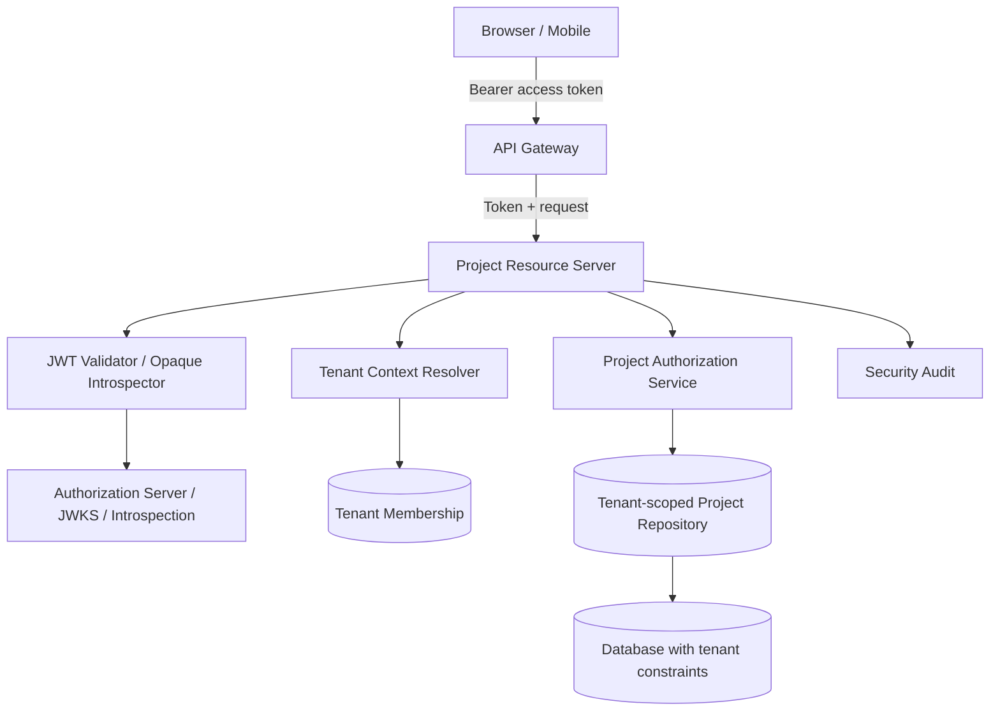
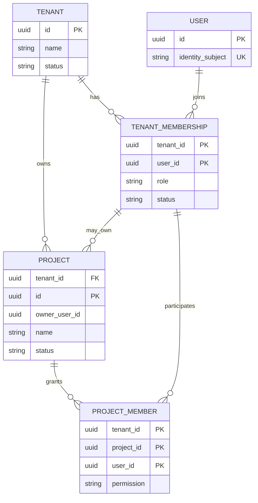

# Bổ sung multi-tenant authorization

## 1. Mục tiêu dự án

Xây dựng một phần API cho nền tảng SaaS nơi nhiều tổ chức (tenant) cùng sử dụng một ứng dụng. Người dùng có thể là thành viên của một hoặc nhiều tenant, nhưng mỗi request chỉ được thao tác trên dữ liệu thuộc tenant mà họ đang hoạt động và có quyền truy cập.

Điểm cần giải quyết là **tenant isolation**. Một người dùng có access token hợp lệ vẫn không được đọc, sửa hoặc xóa dữ liệu của tenant khác chỉ bằng cách thay `tenantId`, `projectId`, query parameter hoặc HTTP header. Hệ thống phải kết hợp xác minh token, kiểm tra membership, kiểm tra role/scope và truy vấn dữ liệu có điều kiện theo tenant.

Trong nền tảng **Security Token Security Fundamentals**, dự án vận dụng mô hình tin cậy và vòng đời JWT, opaque token, access token, refresh token, OAuth 2.0/OIDC, issuer, audience, scope, lưu trữ và thu hồi. Kết quả là một vertical slice có thể chạy trong môi trường phát triển: đăng nhập bằng access token, chọn tenant đang hoạt động, quản lý project trong tenant và chứng minh bằng integration test rằng truy cập chéo tenant bị từ chối.

Sau khi hoàn thành, người học có thể:

- Phân biệt authentication với authorization theo tenant.
- Thiết kế tenant context có nguồn gốc từ token do issuer tin cậy phát hành.
- Kiểm tra membership và role theo từng tenant.
- Ràng buộc truy vấn, cập nhật và quan hệ dữ liệu bằng `tenant_id`.
- Ngăn IDOR/BOLA và giả mạo tenant qua request parameter/header.
- Kiểm thử quyền đọc, ghi, quản trị, thu hồi membership và các đường gọi nội bộ.
- Đánh giá khi nào cần database row-level security (RLS) như một lớp phòng vệ bổ sung.

## 2. Bài toán và phạm vi

### 2.1. Tình huống nghiệp vụ

Một SaaS quản lý tài liệu và dự án có hai tổ chức:

- **Tenant A — Acme:** có người dùng Alice là tenant admin và Bob là project member.
- **Tenant B — Globex:** có người dùng Carol là tenant admin.

Alice có thể là thành viên của cả Acme và Globex, nhưng trong một phiên làm việc cô đang chọn Acme. Access token của phiên đó mang tenant context Acme. Alice chỉ được đọc project thuộc Acme theo membership và quyền của cô. Cô không thể đổi path thành tenant B hoặc gửi `X-Tenant-Id: Globex` để truy cập dữ liệu của Globex.

### 2.2. Phạm vi cần triển khai

| Thành phần | Phạm vi dự án |
| --- | --- |
| Identity provider / authorization server | Cấp access token có issuer, audience, subject, scope và tenant context đã được xác minh. Có thể dùng AS test hoặc môi trường phát triển. |
| Resource server | Spring Boot API xác minh access token và thực thi authorization. |
| Tenant membership | Lưu quan hệ user–tenant, trạng thái membership và role trong tenant. |
| Project API | Tạo, đọc, cập nhật và liệt kê project trong tenant hiện hành. |
| Persistence | Mọi thao tác dữ liệu project đều bị giới hạn theo `tenant_id`; có constraint ngăn quan hệ chéo tenant. |
| Audit | Ghi nhận quyết định truy cập quan trọng mà không lưu raw token. |
| Test | Unit test policy và integration test qua HTTP/filter chain/database. |

Không cần xây dựng một identity provider hoàn chỉnh trong dự án nếu đã có môi trường OAuth/OIDC. Có thể dùng authorization server test để phát hành token fixture. Điều quan trọng là resource server nhận token thật theo profile đã định và xác minh token trước khi sử dụng claims.

### 2.3. Ngoài phạm vi

- Xây dựng UI quản trị tenant hoàn chỉnh.
- Thanh toán, billing và provisioning SaaS.
- Xây dựng hệ thống policy engine phân tán.
- Tự triển khai thuật toán ký JWT hoặc mật mã.
- Tự phát hành token production từ một endpoint ứng dụng không được bảo vệ.

## 3. Nguyên tắc thiết kế bảo mật

1. **Tenant context phải đến từ nguồn tin cậy.** `tenant_id` trong access token chỉ được tin sau khi chữ ký/introspection, issuer, audience, thời hạn và token profile đã được xác minh.
2. **Request không tự cấp quyền.** Path, query parameter, body và header có thể chọn tài nguyên hoặc tenant cần thao tác, nhưng không chứng minh người gọi là thành viên của tenant đó.
3. **Kiểm tra membership ở phía server.** Token có tenant context không thay thế trạng thái membership, đặc biệt khi user bị suspend hoặc bị remove sau lúc token được cấp.
4. **Mọi truy vấn dữ liệu đều có tenant scope.** Không tải object toàn cục rồi chỉ dựa vào UI hoặc gateway để giới hạn kết quả.
5. **Role luôn gắn với tenant.** `ADMIN` của Tenant A không tự động là admin của Tenant B.
6. **Service sở hữu quyết định trên tài nguyên.** Gateway có thể lọc token và scope ở edge, nhưng service phải kiểm tra tenant, membership và quyền trên project.
7. **Mặc định từ chối.** Thiếu tenant context, membership không rõ, token không hợp lệ hoặc dependency xác minh lỗi thì không cấp quyền.
8. **Không ghi bearer token.** Log và audit chỉ lưu tham chiếu cùng mã lý do cần thiết.

## 4. Kiến trúc mục tiêu



Luồng request:

1. Client gửi access token tới API.
2. Resource server xác minh token theo issuer, audience, thuật toán, thời hạn và token type. Với opaque token, resource server gọi introspection theo cấu hình tin cậy.
3. Resource server tạo `TenantActor` từ subject và tenant claim đã xác minh.
4. Service kiểm tra membership đang active và quyền phù hợp.
5. Repository chỉ truy vấn bản ghi thuộc tenant của `TenantActor`.
6. Service ghi audit event phù hợp rồi trả kết quả.

Gateway có thể kiểm tra token và scope ở edge để từ chối sớm. Service vẫn thực hiện các kiểm tra cốt lõi vì service sở hữu dữ liệu và có thể có caller nội bộ khác.

## 5. Thiết kế access token và tenant context

### 5.1. Claims đề xuất

Ví dụ payload minh họa của access token JWT:

```json
{
  "iss": "https://identity.example.test",
  "sub": "user-7f32",
  "aud": ["projects-api"],
  "iat": 1795430400,
  "exp": 1795431300,
  "jti": "token-ref-8b21",
  "scope": "projects:read projects:write",
  "tenant_id": "tenant-acme",
  "token_use": "access"
}
```

Các giá trị trên chỉ là dữ liệu giả để minh họa. Trong triển khai thực tế:

- `iss` phải khớp issuer đã cấu hình.
- `sub` là định danh subject ổn định trong namespace của issuer.
- `aud` phải chứa audience dành cho API này (`projects-api`).
- `exp`, `iat` và `nbf` (nếu có) phải được kiểm tra theo clock skew có giới hạn.
- `scope` chỉ chứa quyền API được cấp.
- `tenant_id` là custom claim thể hiện tenant đang hoạt động đã được issuer xác nhận.
- `token_use` hoặc token profile phải phân biệt access token với ID token nếu hệ thống cần claim này.

`tenant_id` không phải claim chuẩn bắt buộc của OAuth 2.0. Đây là quy ước ứng dụng giữa authorization server và resource server, cần được định nghĩa, phát hành và kiểm tra nhất quán. Không tự lấy tenant từ `sub` hoặc suy ra từ email domain.

### 5.2. Vì sao không nhét mọi membership vào token?

Một user có thể tham gia nhiều tenant và role có thể thay đổi. Nếu token mang danh sách toàn bộ tenant và quyền, token có thể lớn, stale và khó thu hồi từng membership. Dự án dùng một tenant đang hoạt động trong `tenant_id`; service kiểm tra membership hiện tại trong database hoặc cache có TTL/invalidation phù hợp.

Khi người dùng chuyển tenant:

1. Client yêu cầu chọn tenant.
2. Backend/authorization server xác minh user đang có membership active tại tenant đó.
3. Authorization server cấp access token mới có `tenant_id` tương ứng, hoặc hệ thống dùng một cơ chế session/delegation đã được định nghĩa.
4. Resource server chỉ chấp nhận tenant context trong token mới.

Không cho client tự sửa JWT payload hoặc gửi tenant ID mới trong header để chuyển tenant. Nếu dùng opaque token, introspection response cần cung cấp tenant context tương đương theo hợp đồng của AS.

### 5.3. Access token, ID token và refresh token

- **Access token:** gửi tới Projects API và được kiểm tra theo audience `projects-api`.
- **ID token:** dành cho OIDC client xác minh đăng nhập; không gửi thay access token tới Projects API.
- **Refresh token:** chỉ gửi tới token endpoint để lấy access token mới; không gửi tới Project API hoặc lưu trong audit.

## 6. Mô hình dữ liệu multi-tenant

Mọi bảng chứa dữ liệu tenant-owned cần có `tenant_id` rõ ràng. Các quan hệ phải bảo đảm hai đầu thuộc cùng tenant.

### 6.1. Sơ đồ dữ liệu



### 6.2. SQL schema minh họa

Ví dụ dưới đây dùng PostgreSQL và UUID. Có thể điều chỉnh kiểu ID theo database của dự án.

```sql
CREATE TABLE tenant (
    id UUID PRIMARY KEY,
    name VARCHAR(200) NOT NULL,
    status VARCHAR(20) NOT NULL
);

CREATE TABLE app_user (
    id UUID PRIMARY KEY,
    identity_issuer VARCHAR(300) NOT NULL,
    identity_subject VARCHAR(300) NOT NULL,
    CONSTRAINT uq_user_identity UNIQUE (identity_issuer, identity_subject)
);

CREATE TABLE tenant_membership (
    tenant_id UUID NOT NULL REFERENCES tenant(id),
    user_id UUID NOT NULL REFERENCES app_user(id),
    role VARCHAR(30) NOT NULL,
    status VARCHAR(20) NOT NULL,
    created_at TIMESTAMPTZ NOT NULL DEFAULT CURRENT_TIMESTAMP,
    PRIMARY KEY (tenant_id, user_id)
);

CREATE TABLE project (
    id UUID PRIMARY KEY,
    tenant_id UUID NOT NULL REFERENCES tenant(id),
    owner_user_id UUID NOT NULL,
    name VARCHAR(200) NOT NULL,
    status VARCHAR(20) NOT NULL,
    version BIGINT NOT NULL DEFAULT 0,
    created_at TIMESTAMPTZ NOT NULL DEFAULT CURRENT_TIMESTAMP,
    CONSTRAINT uq_project_tenant_id UNIQUE (tenant_id, id),
    CONSTRAINT fk_project_owner_membership
        FOREIGN KEY (tenant_id, owner_user_id)
        REFERENCES tenant_membership (tenant_id, user_id)
);

CREATE TABLE project_member (
    tenant_id UUID NOT NULL,
    project_id UUID NOT NULL,
    user_id UUID NOT NULL,
    permission VARCHAR(30) NOT NULL,
    PRIMARY KEY (tenant_id, project_id, user_id),
    CONSTRAINT fk_project_member_project
        FOREIGN KEY (tenant_id, project_id)
        REFERENCES project (tenant_id, id),
    CONSTRAINT fk_project_member_tenant_user
        FOREIGN KEY (tenant_id, user_id)
        REFERENCES tenant_membership (tenant_id, user_id)
);
```

Composite primary key và foreign key làm cho quan hệ project/member được ràng buộc trong cùng tenant. Khi xóa membership, policy nghiệp vụ cần quyết định chuyển owner, xóa project member hay từ chối xóa; không để constraint bị vô hiệu hóa để vượt tenant boundary.

### 6.3. Quy tắc dữ liệu

- Mọi bảng tenant-owned có `tenant_id NOT NULL`.
- Mọi unique constraint trên dữ liệu tenant-owned cần cân nhắc đưa `tenant_id` vào khóa, ví dụ `UNIQUE (tenant_id, slug)`.
- Foreign key giữa hai bảng tenant-owned phải bao gồm `tenant_id` ở cả hai phía.
- Không lấy `tenant_id` từ request body để ghi trực tiếp; service lấy từ `TenantActor`.
- Không truy vấn `findById(id)` rồi dựa vào controller để kiểm tra tenant; truy vấn phải scope ngay từ repository.
- Khi cập nhật/xóa, điều kiện `WHERE` phải gồm cả ID và tenant ID.

## 7. Thiết kế authorization policy

### 7.1. Role theo tenant

Ví dụ role trong phạm vi tenant:

| Role | Quyền trong tenant hiện hành |
| --- | --- |
| `TENANT_ADMIN` | Quản lý membership và project trong tenant, theo policy ứng dụng. |
| `PROJECT_MANAGER` | Tạo project, cập nhật project được giao và quản lý thành viên project nếu được cấp quyền. |
| `PROJECT_MEMBER` | Đọc project được tham gia và thực hiện hành động được cấp. |
| `READ_ONLY` | Chỉ đọc tài nguyên được phép trong tenant. |

Không dùng một claim `role=ADMIN` toàn cục để đại diện cho tenant admin. Role cần được gắn với tenant hoặc lấy từ membership record tương ứng. Platform administrator (nếu có) là một vai trò đặc biệt ngoài tenant, phải có permission riêng, quy trình break-glass và audit chặt chẽ.

### 7.2. Authorization matrix

| Hành động | Tenant admin | Project manager | Project member | User không có membership |
| --- | --- | --- | --- | --- |
| Liệt kê project trong tenant | Allow | Allow theo policy | Chỉ project được tham gia hoặc danh sách được cấp | Deny |
| Tạo project | Allow | Allow | Deny | Deny |
| Đọc project | Allow trong tenant | Allow nếu được giao | Allow nếu là member | Deny |
| Cập nhật project | Allow trong tenant | Allow nếu được giao | Deny hoặc theo quyền cụ thể | Deny |
| Quản lý membership tenant | Allow | Deny | Deny | Deny |
| Đọc project tenant khác | Deny | Deny | Deny | Deny |

Đây là policy mẫu cho bài thực hành. Nhóm triển khai phải chọn rõ semantics cho từng action và đưa vào test. Không suy ra quyền từ việc user biết UUID của project.

### 7.3. Ba lớp kiểm tra

1. **API scope:** token có `projects:read` hoặc `projects:write` không?
2. **Tenant membership/role:** subject có membership active ở tenant trong token không, và role có cho phép action không?
3. **Resource permission:** user có quyền trên project cụ thể không, project có thuộc tenant đó không và trạng thái project có cho phép action không?

Chỉ khi cả ba lớp cần thiết đều đạt mới thực hiện nghiệp vụ.

## 8. Thiết kế API

API mẫu dùng tenant context trong access token. Path không cần lặp lại tenant ID cho các thao tác thông thường; điều này giảm nguy cơ client tự chọn tenant ngoài context.

| Method | Endpoint | Scope | Mô tả |
| --- | --- | --- | --- |
| `GET` | `/api/projects` | `projects:read` | Liệt kê project trong tenant hiện hành mà actor được xem. |
| `POST` | `/api/projects` | `projects:write` | Tạo project trong tenant hiện hành. |
| `GET` | `/api/projects/{projectId}` | `projects:read` | Đọc project theo ID nhưng luôn scope theo tenant. |
| `PATCH` | `/api/projects/{projectId}` | `projects:write` | Cập nhật project nếu role/resource policy cho phép. |
| `DELETE` | `/api/projects/{projectId}` | `projects:write` | Xóa hoặc archive project theo policy. |
| `GET` | `/api/me/tenant-context` | token hợp lệ | Trả tenant context và quyền tối thiểu phục vụ UI. |

Nếu API phải dùng path `/api/tenants/{tenantId}/projects`, service cần so sánh `tenantId` trên path với tenant context đã xác minh, sau đó vẫn kiểm tra membership. Path là selector; nó không cấp quyền.

Ví dụ request tạo project:

```http
POST /api/projects HTTP/1.1
Authorization: Bearer <access-token>
Content-Type: application/json

{
  "name": "Migration planning"
}
```

Client không gửi `tenant_id` trong body. Server lấy tenant từ principal đã xác minh. Nếu API buộc phải nhận tenant ID cho mục đích chọn context, server phải xác minh membership và ràng buộc token/context trước khi thực hiện.

## 9. Triển khai trong Spring Security

Các ví dụ dưới đây minh họa cách tổ chức code. Tên package và cấu hình cần điều chỉnh theo phiên bản Spring Boot/Spring Security của dự án.

### 9.1. Cấu hình Resource Server

```java
@Configuration
@EnableMethodSecurity
public class SecurityConfiguration {

    @Bean
    SecurityFilterChain securityFilterChain(HttpSecurity http) throws Exception {
        return http
                .authorizeHttpRequests(auth -> auth
                        .requestMatchers("/actuator/health").permitAll()
                        .anyRequest().authenticated())
                .oauth2ResourceServer(oauth2 -> oauth2.jwt(Customizer.withDefaults()))
                .build();
    }

    @Bean
    JwtDecoder jwtDecoder() {
        NimbusJwtDecoder decoder = NimbusJwtDecoder
                .withJwkSetUri("https://identity.example.test/oauth2/jwks")
                .build();

        OAuth2TokenValidator<Jwt> issuerAndTime =
                JwtValidators.createDefaultWithIssuer("https://identity.example.test");

        OAuth2TokenValidator<Jwt> audience = jwt ->
                jwt.getAudience().contains("projects-api")
                        ? OAuth2TokenValidatorResult.success()
                        : OAuth2TokenValidatorResult.failure(
                                new OAuth2Error("invalid_token", "Invalid audience", null));

        OAuth2TokenValidator<Jwt> accessTokenProfile = jwt ->
                "access".equals(jwt.getClaimAsString("token_use"))
                        ? OAuth2TokenValidatorResult.success()
                        : OAuth2TokenValidatorResult.failure(
                                new OAuth2Error("invalid_token", "Not an access token", null));

        decoder.setJwtValidator(new DelegatingOAuth2TokenValidator<>(
                issuerAndTime, audience, accessTokenProfile));
        return decoder;
    }
}
```

Ví dụ giả định issuer phát hành claim `token_use=access`. Nếu provider dùng JWT access token profile khác, hãy validate theo profile thực tế, không tự thêm claim rồi mong provider phát hành. Cấu hình production cần giới hạn thuật toán/key type và xử lý clock skew theo policy. Nếu dùng opaque token, thay decoder JWT bằng opaque token introspector và yêu cầu introspection response có metadata tenant phù hợp.

### 9.2. Chuyển scope thành authority

Spring Security có thể ánh xạ scope thành authority dạng `SCOPE_projects:read`. Controller có thể yêu cầu scope ở lớp API:

```java
@RestController
@RequestMapping("/api/projects")
public class ProjectController {
    private final ProjectService projectService;

    @GetMapping("/{projectId}")
    @PreAuthorize("hasAuthority('SCOPE_projects:read')")
    public ProjectResponse get(@PathVariable UUID projectId,
                               Authentication authentication) {
        TenantActor actor = TenantActor.from(authentication);
        return projectService.getProject(projectId, actor);
    }
}
```

Annotation scope chỉ là lớp đầu tiên. `ProjectService` vẫn phải kiểm tra membership và resource-level authorization.

### 9.3. Tạo TenantActor từ principal đã xác minh

```java
public record TenantActor(
        String issuer,
        String subject,
        UUID tenantId,
        Set<String> authorities) {

    public static TenantActor from(Authentication authentication) {
        if (!(authentication instanceof JwtAuthenticationToken jwtAuth)) {
            throw new AccessDeniedException("Unsupported authentication type");
        }

        Jwt jwt = jwtAuth.getToken();
        String tenantClaim = jwt.getClaimAsString("tenant_id");
        if (tenantClaim == null || tenantClaim.isBlank()) {
            throw new AccessDeniedException("Missing tenant context");
        }

        Set<String> authorities = jwtAuth.getAuthorities().stream()
                .map(GrantedAuthority::getAuthority)
                .collect(Collectors.toUnmodifiableSet());

        return new TenantActor(
                jwt.getIssuer().toString(),
                jwt.getSubject(),
                UUID.fromString(tenantClaim),
                authorities);
    }
}
```

Không tạo `TenantActor` từ request header hoặc body. Nếu `tenant_id` không đúng định dạng, thiếu hoặc không được issuer phát hành theo contract, từ chối request. Với opaque token, tạo actor từ principal do introspector tin cậy trả về sau khi kiểm tra response.

### 9.4. Kiểm tra membership và resource trong service

```java
@Service
public class ProjectService {
    private final TenantMembershipRepository memberships;
    private final ProjectRepository projects;

    @Transactional(readOnly = true)
    public ProjectResponse getProject(UUID projectId, TenantActor actor) {
        TenantMembership membership = memberships
                .findByTenantIdAndIdentitySubjectAndStatus(
                        actor.tenantId(), actor.subject(), MembershipStatus.ACTIVE)
                .orElseThrow(() -> new AccessDeniedException("No active membership"));

        Project project = projects
                .findByIdAndTenantId(projectId, actor.tenantId())
                .orElseThrow(ProjectNotFoundException::new);

        if (!canRead(membership, project, actor)) {
            throw new AccessDeniedException("Project access denied");
        }

        return ProjectResponse.from(project);
    }

    private boolean canRead(TenantMembership membership,
                            Project project,
                            TenantActor actor) {
        if (membership.role() == TenantRole.TENANT_ADMIN) {
            return true;
        }
        return project.isVisibleTo(actor.subject());
    }
}
```

Đây là skeleton minh họa; cần bổ sung constructor, mapping entity và policy thực tế. Điểm bắt buộc là truy vấn `findByIdAndTenantId`, không truy vấn project theo ID toàn cục rồi chỉ dựa vào controller. Khi user không có quyền xem project, có thể trả 404 để không tiết lộ sự tồn tại của object ở tenant khác; thống nhất semantics này trong API contract.

Nếu `sub` của issuer không phải UUID nội bộ, lưu cặp `(issuer, subject)` trong bảng identity mapping và tra cứu membership qua internal user ID. Không giả định `sub` luôn cùng namespace giữa các issuer.

### 9.5. Repository luôn có tenant scope

```java
public interface ProjectRepository extends JpaRepository<Project, UUID> {

    Optional<Project> findByIdAndTenantId(UUID id, UUID tenantId);

    Page<Project> findAllByTenantId(UUID tenantId, Pageable pageable);

    @Modifying
    @Query("""
        update Project p
           set p.name = :name, p.version = p.version + 1
         where p.id = :projectId
           and p.tenantId = :tenantId
        """)
    int updateName(UUID projectId, UUID tenantId, String name);
}
```

Đối với bulk update/delete, luôn có tenant predicate và kiểm tra số row bị ảnh hưởng. Nếu kết quả bằng 0, trả not found hoặc access denied theo API contract. Các query native, report, export và background job cũng phải áp dụng tenant scope.

## 10. Database row-level security (tùy chọn tăng cường)

Với PostgreSQL, có thể bật RLS để database tự giới hạn row theo tenant context. Đây là lớp defense in depth; nó không thay thế xác minh token và authorization ở service.

Ví dụ policy minh họa:

```sql
ALTER TABLE project ENABLE ROW LEVEL SECURITY;
ALTER TABLE project FORCE ROW LEVEL SECURITY;

CREATE POLICY project_tenant_isolation
ON project
USING (
    tenant_id = current_setting('app.tenant_id', true)::uuid
)
WITH CHECK (
    tenant_id = current_setting('app.tenant_id', true)::uuid
);
```

Trong mỗi transaction, service đặt tenant context đã xác minh:

```sql
SELECT set_config('app.tenant_id', :tenantId, true);
```

Tham số `true` giới hạn setting trong transaction hiện tại. Không dùng session-level setting trên connection pool nếu không có cơ chế reset đáng tin cậy; connection được tái sử dụng có thể mang tenant context của request trước. Database role của ứng dụng không được có `BYPASSRLS`; kiểm tra quyền owner/table và hành vi `FORCE ROW LEVEL SECURITY` theo cấu hình thực tế.

Nếu chưa dùng RLS, repository scoping và composite constraints vẫn là yêu cầu bắt buộc. Nếu dùng RLS, test phải xác minh cả transaction rollback, connection reuse và tenant context không rò giữa request.

## 11. Tenant context trong async và service-to-service

`ThreadLocal` hoặc request-scoped context có thể tiện nhưng dễ rò tenant khi dùng thread pool, `@Async`, reactive pipeline hoặc message consumer. Ưu tiên truyền `TenantActor`/tenant ID tường minh qua application service và command object. Nếu dùng context holder, phải cleanup trong `finally` và có test tái sử dụng thread.

Với service-to-service:

- Dùng workload identity hoặc access token dành cho service nhận.
- Nếu gọi thay mặt user, dùng token exchange/delegation theo policy; giữ cả actor và subject rõ ràng.
- Downstream service xác minh issuer, audience, scope và tenant context của token nhận được.
- Không tin tenant header do service upstream tự gửi nếu kênh và nguồn assertion chưa được xác thực.
- Background job cần service identity riêng và danh sách tenant được phép xử lý; không tự đặt tenant ID từ message mà không xác minh nguồn job và phạm vi công việc.

## 12. Cache và thu hồi membership

Nếu membership được cache, việc remove/suspend user có thể chưa có hiệu lực ngay ở mọi instance. Thiết kế phải nêu rõ thời gian tối đa từ lúc thay đổi membership tới lúc quyền bị thu hồi.

- Cache key phải bao gồm issuer/subject và tenant ID, không chỉ subject.
- TTL phù hợp revocation SLA; quyền quản trị nhạy cảm có thể cần đọc nguồn trạng thái trực tiếp.
- Có cơ chế invalidation khi membership bị revoke hoặc role thay đổi.
- Không cache authorization decision theo project ID mà thiếu tenant context.
- Khi cache unavailable, không suy diễn user là member.
- Refresh token rotation và access token expiry vẫn cần policy riêng; thu hồi membership có thể cần revoke grant hoặc cập nhật membership state ngay cả khi JWT chưa hết hạn.

## 13. Audit và xử lý lỗi

Ghi nhận các hành động nhạy cảm: project create/update/delete, thay đổi membership/role, tenant switch, truy cập bị từ chối và admin override. Một audit event có thể chứa:

```json
{
  "event": "project.access.denied",
  "actor_ref": "user-ref-7f32",
  "tenant_ref": "tenant-ref-acme",
  "resource_ref": "project-ref-91a2",
  "action": "read",
  "reason": "TENANT_SCOPE_MISMATCH",
  "request_ref": "req-opaque-3c1d",
  "occurred_at": "2026-11-23T10:30:00Z"
}
```

Ví dụ trên dùng tham chiếu giả. Không ghi raw access token, refresh token, ID token, token hash, client secret hoặc toàn bộ claims vào audit. Bảo vệ audit store và giới hạn quyền truy cập vì actor/tenant/resource reference vẫn có thể liên kết với hoạt động người dùng.

Quy ước phản hồi gợi ý:

| Tình huống | HTTP | Ghi chú |
| --- | --- | --- |
| Thiếu token hoặc token sai chữ ký/issuer/audience/hết hạn | `401 Unauthorized` | Authentication không thành công. |
| Token hợp lệ nhưng thiếu scope hoặc membership không đủ | `403 Forbidden` | Không cho phép hành động. |
| Project không tồn tại trong tenant hiện hành hoặc cố truy cập project tenant khác | `404 Not Found` có thể được chọn | Tránh tiết lộ object thuộc tenant khác. |
| Membership đã bị suspend/revoke | `403 Forbidden` hoặc `401` theo contract | Quyết định nhất quán và thu hồi đúng SLA. |
| Introspection/JWKS dependency lỗi | Fail closed theo policy | Không biến lỗi dependency thành authentication success. |

Không trả thông báo chi tiết cho client biết project có tồn tại ở tenant khác hay không. Log nội bộ có thể dùng reason code bounded để điều tra.

## 14. Kế hoạch thực hiện dự án

### Giai đoạn 1 — Chuẩn bị

1. Chốt tenant model: một user có thể thuộc nhiều tenant; một access token đại diện một tenant đang hoạt động.
2. Chốt role và authorization matrix.
3. Cấu hình AS test phát hành token có `iss`, `sub`, `aud`, `exp`, `scope` và `tenant_id`.
4. Tạo hai tenant và các user/membership fixture.
5. Tạo migration cho tenant, membership, project và project member.

**Đầu ra:** schema, policy table và token fixture hoạt động.

### Giai đoạn 2 — Xác minh token và tenant context

1. Cấu hình Spring Security Resource Server.
2. Kiểm tra issuer, audience, thời hạn, chữ ký và access token profile.
3. Ánh xạ scope thành authority.
4. Tạo `TenantActor` từ principal đã xác minh.
5. Từ chối token thiếu/sai tenant context.

**Đầu ra:** endpoint được bảo vệ và không thể tạo tenant context từ header tùy ý.

### Giai đoạn 3 — Membership và repository scoping

1. Tạo membership repository kiểm tra user–tenant và status.
2. Triển khai authorization service theo role matrix.
3. Thêm tenant predicate vào mọi repository method.
4. Thêm composite foreign key và unique constraint.
5. Bổ sung RLS nếu database và vận hành hỗ trợ.

**Đầu ra:** project API chỉ đọc/ghi dữ liệu tenant hiện hành.

### Giai đoạn 4 — API và audit

1. Triển khai list/create/get/update/delete project.
2. Lấy tenant ID từ `TenantActor` cho mọi write.
3. Kiểm tra resource permission và membership status.
4. Ghi audit cho thao tác nhạy cảm và deny decision.
5. Chuẩn hóa 401/403/404 và error response.

**Đầu ra:** vertical slice hoàn chỉnh với API contract rõ ràng.

### Giai đoạn 5 — Kiểm thử và hardening

1. Viết unit test cho policy.
2. Viết integration test đi qua security filter chain với JWT/opaque token test thực.
3. Kiểm thử chéo tenant cho read/write/list/export.
4. Kiểm thử membership revoke, cache invalidation và tenant context trong async.
5. Kiểm thử database constraints/RLS và connection pool reuse.
6. Kiểm tra log/trace/metric không chứa token.

**Đầu ra:** test report và bằng chứng tenant isolation.

## 15. Ma trận kiểm thử bắt buộc

| ID | Kịch bản | Kết quả mong đợi |
| --- | --- | --- |
| MT-01 | Alice có token hợp lệ cho Tenant A và membership active. | Đọc được project được phép trong A. |
| MT-02 | Alice dùng token Tenant A gọi project thuộc Tenant B. | Bị từ chối; không lộ dữ liệu B. |
| MT-03 | Client gửi `X-Tenant-Id` là Tenant B trong khi token là A. | Header bị bỏ qua hoặc từ chối; không đổi tenant context. |
| MT-04 | Client sửa `tenant_id` trong payload JWT nhưng giữ chữ ký cũ. | Token bị từ chối do chữ ký không hợp lệ. |
| MT-05 | Token thiếu `tenant_id`. | Từ chối trước khi gọi nghiệp vụ. |
| MT-06 | Token có issuer không tin cậy. | `401`; không truy vấn project. |
| MT-07 | Token có audience khác `projects-api`. | `401`; không truy cập dữ liệu. |
| MT-08 | Token hết hạn hoặc chưa tới `nbf`. | `401`. |
| MT-09 | Token hợp lệ nhưng thiếu `projects:read`. | `403`. |
| MT-10 | Membership của Alice ở A bị suspend sau khi token được cấp. | Request bị từ chối theo revocation SLA. |
| MT-11 | Alice là admin ở A nhưng member ở B. | Quyền admin chỉ áp dụng trong A. |
| MT-12 | Bob là project member nhưng đọc project khác trong A. | Bị từ chối theo resource policy. |
| MT-13 | User cố tạo project với `tenant_id` B trong body. | Server dùng tenant từ actor hoặc từ chối field không được phép. |
| MT-14 | Update project dùng ID của tenant khác. | Không row nào bị cập nhật; trả lỗi theo contract. |
| MT-15 | List project không có tenant predicate trong code path. | Test phát hiện không được trả project của tenant khác. |
| MT-16 | Tạo project member thuộc tenant B cho project tenant A. | Composite foreign key từ chối. |
| MT-17 | Hai tenant có cùng slug project. | Unique constraint cho phép nếu unique trong từng tenant. |
| MT-18 | Cache membership của user đã bị revoke. | Invalidation/TTL đáp ứng thời gian thu hồi tối đa. |
| MT-19 | Hai request dùng chung thread/connection nhưng tenant khác nhau. | Không rò tenant context giữa request. |
| MT-20 | Async job xử lý message có tenant giả. | Workload identity và phạm vi job được xác minh; message không tự cấp quyền. |
| MT-21 | Service B nhận token dành cho Service A. | Audience validation từ chối. |
| MT-22 | Opaque token introspection trả `active=false`. | Request bị từ chối. |
| MT-23 | Introspection timeout hoặc JWKS unavailable. | Fail closed theo policy; không chạy nghiệp vụ. |
| MT-24 | Tenant admin thay role của user. | Quyền mới có hiệu lực theo cache/revocation SLA và có audit. |
| MT-25 | Platform admin thực hiện break-glass. | Có permission riêng, lý do, phê duyệt và audit đầy đủ. |
| MT-26 | Audit/trace/log kiểm tra sau request. | Không chứa raw access/refresh/ID token hoặc secret. |
| MT-27 | RLS bật nhưng application role cố truy vấn tenant khác. | Database trả về 0 row hoặc từ chối theo policy. |
| MT-28 | RLS connection được tái sử dụng sau transaction rollback. | Tenant setting cũ không còn hiệu lực ở request tiếp theo. |

Các test chéo tenant phải bao phủ cả read, write, delete, list, search, export, bulk update và endpoint quản trị. Chỉ test `GET /projects/{id}` là chưa đủ vì lỗi thường xuất hiện ở truy vấn danh sách, báo cáo và job nền.

## 16. Tiêu chí nghiệm thu

Dự án đạt khi đáp ứng tất cả điều kiện sau:

- Token được xác minh đầy đủ theo issuer, audience, thời hạn, chữ ký/introspection và access token profile.
- Tenant context chỉ được tạo từ principal đã xác minh.
- Membership và role được kiểm tra trong tenant hiện hành.
- Mọi repository method thao tác tenant-owned data đều có tenant predicate.
- Database constraints ngăn quan hệ project/member chéo tenant.
- Không thể đổi tenant bằng path/header/body hoặc bằng cách đoán UUID.
- Membership bị revoke có hiệu lực trong SLA đã chọn.
- Có integration test cho cả đường JWT và/hoặc opaque token theo loại token thực tế.
- Có test bypass, async, cache, database connection reuse và RLS nếu bật.
- Audit đủ điều tra nhưng không lưu bearer token hoặc secret.
- Có tài liệu mô tả tenant model, role matrix, token profile và quy trình thu hồi.

## 17. Bàn giao dự án

Nhóm thực hiện nên bàn giao:

1. Sơ đồ kiến trúc và luồng token/tenant context.
2. Migration SQL và mô tả composite key/foreign key.
3. Authorization matrix được product/security owner xác nhận.
4. Cấu hình resource server và ví dụ token test giả.
5. Code `TenantActor`, membership policy, service và repository scoping.
6. Integration test report cho ma trận MT-01 đến MT-28.
7. Danh sách endpoint, scope và error semantics.
8. Audit event schema và retention/redaction rule.
9. Các giới hạn đã biết, ví dụ cache membership và revocation SLA.

**Ghi nhớ:** Multi-tenant authorization không dừng ở việc thêm `tenant_id` vào JWT hoặc database. Access token xác lập danh tính và tenant context sau khi được xác minh; membership xác định người dùng còn thuộc tenant hay không; service kiểm tra quyền trên tài nguyên; repository và database giữ mọi thao tác trong đúng tenant. Bốn lớp này phải cùng hoạt động và được kiểm thử bằng các tình huống truy cập chéo tenant.

## Tài liệu đối chiếu

- [RFC 6749 — The OAuth 2.0 Authorization Framework](https://www.rfc-editor.org/rfc/rfc6749): access token, refresh token và authorization server/resource server.
- [RFC 6750 — OAuth 2.0 Bearer Token Usage](https://www.rfc-editor.org/rfc/rfc6750): cách gửi bearer access token tới API.
- [RFC 7519 — JSON Web Token (JWT)](https://www.rfc-editor.org/rfc/rfc7519): cấu trúc JWT và claims.
- [RFC 8725 — JSON Web Token Best Current Practices](https://www.rfc-editor.org/rfc/rfc8725): kiểm tra JWT, issuer, audience và thuật toán an toàn.
- [RFC 7662 — OAuth 2.0 Token Introspection](https://www.rfc-editor.org/rfc/rfc7662): kiểm tra trạng thái opaque token.
- [RFC 9068 — JWT Profile for OAuth 2.0 Access Tokens](https://www.rfc-editor.org/rfc/rfc9068): profile JWT access token.
- [RFC 9700 — Best Current Practice for OAuth 2.0 Security](https://www.rfc-editor.org/rfc/rfc9700): thực hành bảo vệ access token và refresh token.
- [NIST SP 800-207 — Zero Trust Architecture](https://csrc.nist.gov/pubs/sp/800/207/final): nguyên tắc xác minh từng request và không mặc định tin cậy mạng nội bộ.
- [OWASP API Security Top 10 — Broken Object Level Authorization](https://owasp.org/API-Security/editions/2023/en/0xa1-broken-object-level-authorization/): rủi ro IDOR/BOLA khi không kiểm tra quyền trên object.
- [Spring Security — OAuth 2.0 Resource Server JWT](https://docs.spring.io/spring-security/reference/servlet/oauth2/resource-server/jwt.html): cấu hình JWT resource server.
- [PostgreSQL — Row Security Policies](https://www.postgresql.org/docs/current/ddl-rowsecurity.html): row-level security và policy theo row.
