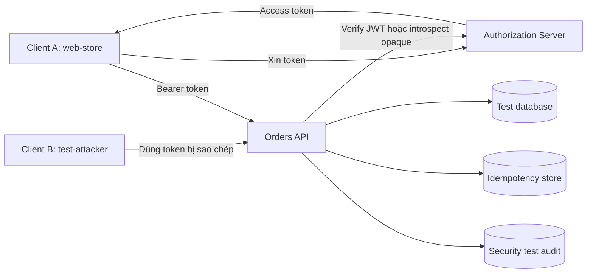

# Viết test token theft, replay và scope

## 1. Mục tiêu dự án

Trong dự án thực hành này, bạn xây một API nhỏ có bảo vệ bằng OAuth 2.0 access token, sau đó viết integration test để mô phỏng ba nhóm rủi ro:

- **Token theft:** access token bị sao chép khỏi client hợp lệ và được một client khác sử dụng.
- **Replay:** request hoặc bằng chứng xác thực đã gửi trước đó được gửi lại.
- **Scope violation:** token hợp lệ nhưng không có quyền cần thiết vẫn cố gọi endpoint.

Dự án phải chứng minh hành vi thực tế của Bearer token, kiểm tra quyền theo scope, xác minh audience và thời hạn, đồng thời xác định cách thu hồi token. Bạn cũng sẽ kiểm tra idempotency để request nghiệp vụ bị retry hoặc phát lại không tạo side effect trùng lặp.

Sau khi hoàn thành, bạn có thể:

1. Phân biệt việc dùng lại Bearer token hợp lệ với token theft và replay attack.
2. Viết test chứng minh token bị sao chép có thể bị sử dụng nếu chỉ dùng Bearer authentication.
3. Kiểm tra API từ chối token sai chữ ký, sai issuer, sai audience hoặc hết hạn.
4. Kiểm tra endpoint chỉ chấp nhận scope được cấp.
5. Kiểm tra refresh/revocation behavior theo kiến trúc JWT hoặc opaque token.
6. Ngăn duplicate business operation bằng idempotency.
7. Đề xuất biện pháp giảm rủi ro token theft như DPoP hoặc mTLS-bound token.

## 2. Phạm vi và quy tắc an toàn của lab

Dùng Authorization Server sandbox, test container hoặc token fixture được tạo riêng cho môi trường local. Chỉ sử dụng danh tính, token, key pair, certificate và dữ liệu giả lập. Không lấy token từ trình duyệt thật, log production, tài khoản thật hoặc hệ thống bên ngoài.

Trong lab, bạn mô phỏng token theft bằng cách **sao chép một access token giả lập** từ client A sang client B. Mục tiêu là quan sát đặc tính của Bearer token và xác minh lớp bảo vệ. Không cần đánh cắp credential thật hoặc truy cập hệ thống không thuộc môi trường test.

Các quy tắc:

- Chạy API và Authorization Server trên localhost hoặc mạng test cô lập.
- Tạo key pair riêng cho test; không tái sử dụng private key production.
- Không in Authorization header, access token, refresh token hoặc private key vào test report.
- Log jti, issuer, audience, scope, client ID và correlation ID khi cần, nhưng không log raw token.
- Dùng dữ liệu đơn hàng giả lập; không kết nối cổng thanh toán hoặc dịch vụ bên ngoài.
- Reset database, revocation store và idempotency store giữa các test suite.

## 3. Kiến trúc bài lab

Tạo hệ thống nhỏ gồm Authorization Server (AS), OAuth client và Resource Server (RS). Có thể dùng AS test riêng hoặc Authorization Server sandbox tương thích OAuth 2.0.



Các thành phần và trách nhiệm:

| Thành phần | Trách nhiệm |
|---|---|
| Authorization Server | Phát access token, refresh token; kiểm tra client/user; hỗ trợ introspection hoặc revocation theo cấu hình |
| Client A | Client hợp lệ nhận token cho Orders API |
| Client B | Client thử dùng token đã bị sao chép trong test theft |
| Orders API | Xác minh token, audience và scope; xử lý request |
| Test database | Lưu đơn hàng giả lập và đếm side effect |
| Idempotency store | Chống xử lý trùng request nghiệp vụ |
| Security audit | Ghi kết quả xác thực/authorization mà không lưu raw token |

### API cần xây dựng

| Method | Endpoint | Scope bắt buộc | Mục đích |
|---|---|---|---|
| GET | `/api/orders` | `orders.read` | Đọc danh sách đơn hàng |
| GET | `/api/orders/{id}` | `orders.read` | Đọc một đơn hàng |
| POST | `/api/orders` | `orders.write` | Tạo đơn hàng giả lập |
| PATCH | `/api/orders/{id}` | `orders.write` | Cập nhật đơn hàng |
| DELETE | `/api/admin/users/{id}` | `users.disable` | Mô phỏng thao tác quản trị nhạy cảm |

Không cấp scope quản trị cho token dùng trong test đọc đơn hàng. Mỗi API phải xác định audience phù hợp, ví dụ `urn:service:orders-api`.

## 4. Thiết kế token fixture

Tạo ít nhất năm token test với quyền và trạng thái khác nhau:

| Token fixture | Audience | Scope | Trạng thái |
|---|---|---|---|
| `token-read` | Orders API | `orders.read` | Active |
| `token-write` | Orders API | `orders.read orders.write` | Active |
| `token-wrong-aud` | Inventory API | `inventory.read` | Active nhưng sai resource |
| `token-expired` | Orders API | `orders.read` | Expired |
| `token-revoked` | Orders API | `orders.read` | Revoked theo test store/introspection |

JWT access token test có thể chứa các claims sau:

```json
{
  "iss": "https://auth.test.local",
  "sub": "user-204",
  "aud": ["urn:service:orders-api"],
  "client_id": "web-store",
  "scope": "orders.read",
  "iat": 1795400000,
  "exp": 1795400300,
  "jti": "test-at-001",
  "tenant_id": "tenant-test"
}
```

Đây là payload minh họa. Trong test tích hợp, token phải được ký bằng private key test và Resource Server phải xác minh chữ ký thực. Với opaque token, lưu metadata tương đương ở Authorization Server và để RS kiểm tra qua introspection.

Ý nghĩa claims:

- **iss:** issuer tin cậy.
- **sub:** chủ thể được token đại diện.
- **aud:** giới hạn API được phép nhận token.
- **scope:** quyền API được cấp.
- **exp:** thời điểm token hết hiệu lực.
- **jti:** định danh token, hữu ích cho audit hoặc denylist nếu hệ thống có kiểm tra trạng thái.
- **tenant_id:** chỉ có ý nghĩa nếu API xác minh tenant context và quyền trên tenant đó.

Không giả định có claim jti nghĩa là token tự động chỉ được dùng một lần. Bearer access token thường được dùng cho nhiều request đến khi hết hạn hoặc bị thu hồi.

## 5. Tạo Resource Server và kiểm soát scope

Nếu dùng Spring Boot/Spring Security, cấu hình ứng dụng như OAuth 2.0 Resource Server. Ví dụ dưới đây minh họa cách bảo vệ endpoint theo scope:

```java
@Bean
SecurityFilterChain apiSecurity(HttpSecurity http) throws Exception {
    return http
        .authorizeHttpRequests(auth -> auth
            .requestMatchers(HttpMethod.GET, "/api/orders/**")
                .hasAuthority("SCOPE_orders.read")
            .requestMatchers(HttpMethod.POST, "/api/orders")
                .hasAuthority("SCOPE_orders.write")
            .requestMatchers(HttpMethod.PATCH, "/api/orders/**")
                .hasAuthority("SCOPE_orders.write")
            .requestMatchers(HttpMethod.DELETE, "/api/admin/users/**")
                .hasAuthority("SCOPE_users.disable")
            .anyRequest().authenticated()
        )
        .oauth2ResourceServer(oauth -> oauth.jwt(Customizer.withDefaults()))
        .build();
}
```

Với cấu hình mặc định, Spring Security thường ánh xạ claim scope hoặc scp thành authority có tiền tố SCOPE_. Xác nhận mapping theo cấu hình thực tế của ứng dụng. Nếu issuer dùng claim hoặc định dạng scope tùy chỉnh, khai báo converter rõ ràng.

Cấu hình xác minh token phải kiểm tra tối thiểu:

- Issuer được tin cậy.
- Chữ ký hợp lệ và thuật toán được cho phép.
- Audience chứa Orders API.
- Token chưa hết hạn và đã đến thời điểm có hiệu lực.
- Token type/profile phù hợp.
- Scope đủ cho endpoint.

Ví dụ cấu hình audience validator:

```java
@Bean
JwtDecoder jwtDecoder() {
    String issuer = "https://auth.test.local";
    NimbusJwtDecoder decoder = JwtDecoders.fromIssuerLocation(issuer);

    OAuth2TokenValidator<Jwt> issuerValidator =
        JwtValidators.createDefaultWithIssuer(issuer);

    OAuth2TokenValidator<Jwt> audienceValidator = jwt -> {
        if (jwt.getAudience().contains("urn:service:orders-api")) {
            return OAuth2TokenValidatorResult.success();
        }
        return OAuth2TokenValidatorResult.failure(
            new OAuth2Error("invalid_token", "Invalid audience", null)
        );
    };

    decoder.setJwtValidator(
        new DelegatingOAuth2TokenValidator<>(
            issuerValidator,
            audienceValidator
        )
    );
    return decoder;
}
```

Đây là skeleton để minh họa. Bổ sung dependency/import và cấu hình JWKS URI hoặc issuer discovery phù hợp Authorization Server test. Không bỏ qua chữ ký chỉ để test audience.

## 6. Xây dựng test scope: token hợp lệ nhưng thiếu quyền

Viết test cho từng endpoint với token có scope khác nhau. Đây là kiểm thử authorization: token có thể xác thực thành công nhưng không đủ quyền cho hành động.

Ví dụ dùng MockMvc và Spring Security test support:

```java
@WebMvcTest(OrderController.class)
class OrderScopeTest {

    @Autowired
    MockMvc mockMvc;

    @Test
    void readEndpointAllowsOrdersRead() throws Exception {
        mockMvc.perform(get("/api/orders")
                .with(jwt().authorities(
                    new SimpleGrantedAuthority("SCOPE_orders.read")
                )))
            .andExpect(status().isOk());
    }

    @Test
    void writeEndpointRejectsReadOnlyToken() throws Exception {
        mockMvc.perform(post("/api/orders")
                .with(jwt().authorities(
                    new SimpleGrantedAuthority("SCOPE_orders.read")
                )))
            .andExpect(status().isForbidden());
    }

    @Test
    void adminEndpointRejectsOrdersWriteToken() throws Exception {
        mockMvc.perform(delete("/api/admin/users/user-901")
                .with(jwt().authorities(
                    new SimpleGrantedAuthority("SCOPE_orders.write")
                )))
            .andExpect(status().isForbidden());
    }
}
```

Đây là test authorization ở tầng MVC. Helper jwt() tạo authentication test và **không kiểm tra chữ ký JWT thực**. Vì vậy, cần có integration test riêng gửi token đã ký từ test Authorization Server để kiểm tra decoder, issuer, audience, expiry và key rotation.

### Ma trận scope cần đạt

| Token | GET orders | POST orders | DELETE admin user |
|---|---:|---:|---:|
| Không có token | 401 | 401 | 401 |
| `orders.read` | 200 | 403 | 403 |
| `orders.write` | 403 nếu không có read | 200 | 403 |
| `orders.read orders.write` | 200 | 200 | 403 |
| `users.disable` | 403 | 403 | 200 |
| Token có scope phù hợp nhưng sai audience | 401 | 401 | 401 |

Kết quả 401 thể hiện token không được xác thực cho API; 403 thể hiện token đã xác thực nhưng không có quyền cần thiết. Thống nhất status code theo contract của API và phân biệt rõ hai lớp này trong test.

## 7. Lab token theft: sao chép Bearer token giữa hai client

Đây là phần quan trọng nhất để hiểu rủi ro token theft.

### Bước A — tạo baseline bearer-only

1. Client A xin token-read từ test Authorization Server.
2. Client A gọi `GET /api/orders` bằng Bearer token và nhận thành công.
3. Trong test harness, sao chép chuỗi token test vào biến của Client B.
4. Client B gọi cùng endpoint với cùng token.
5. Ghi nhận kết quả.

Request minh họa:

```http
GET /api/orders HTTP/1.1
Host: localhost:8080
Authorization: Bearer <TEST_ACCESS_TOKEN>
```

Kết quả baseline thường là cả Client A và Client B đều được chấp nhận nếu token còn hiệu lực và RS chỉ kiểm tra Bearer token, issuer, audience, scope và thời hạn. Đây là đặc tính của Bearer token: **bất kỳ bên nào nắm giữ token đều có thể trình token**. Resource Server không tự biết token đang được gửi bởi đúng tiến trình ban đầu.

Test này là bằng chứng cho thấy token theft có thể dẫn tới token reuse. Đừng viết assertion rằng lần sử dụng thứ hai phải bị từ chối chỉ vì token đã được dùng một lần.

### Bước B — kiểm tra giới hạn thiệt hại

Sau khi mô phỏng token bị sao chép, thực hiện lần lượt:

- Đợi token hết hạn rồi gửi lại; RS phải từ chối.
- Revoke token hoặc grant; xác minh RS từ chối theo cơ chế và SLA đã thiết kế.
- Dùng token có audience khác; Orders API phải từ chối.
- Dùng token không có scope cần thiết; endpoint phải trả 403.
- Kiểm tra log; không được xuất hiện raw token.
- Kiểm tra token có TTL ngắn và scope tối thiểu.

Với JWT xác minh offline, revoke tại AS không tự động làm JWT cũ mất hiệu lực. Nếu RS không có introspection, denylist, authorization version hoặc cơ chế trạng thái tương đương, token có thể tiếp tục được chấp nhận đến exp. Test phải phản ánh đúng kiến trúc này.

Với opaque token, RS có thể gọi introspection. Sau khi revoke, AS trả active=false; nếu RS cache kết quả active=true, thời gian cache còn lại có thể tạo ra cửa sổ chấp nhận token cũ. Đo propagation delay thay vì chỉ kiểm tra response revoke.

### Bước C — đề xuất biện pháp sender-constrained

Để giảm khả năng người chỉ đánh cắp chuỗi token có thể dùng token từ client khác, nghiên cứu một trong các cơ chế:

- **DPoP:** client ký proof cho từng HTTP request bằng private key; RS kiểm tra proof, method, URI, thời gian, token hash và chống dùng lại proof.
- **mTLS-bound access token:** token được ràng buộc với certificate của client; RS xác minh certificate của kết nối khớp binding trong token.
- **Secure token storage:** giảm khả năng token bị lấy từ browser storage, log, crash dump hoặc process khác.
- **Short-lived access token và refresh rotation:** giới hạn thời gian sử dụng token bị lộ và phát hiện refresh token reuse.

DPoP/mTLS không biến access token thành token dùng một lần. Client hợp lệ vẫn có thể gửi nhiều request. Sender constraint hạn chế việc dùng token từ bên không sở hữu private key/certificate tương ứng; nó không thay thế scope, authorization, revocation và idempotency.

## 8. Lab replay: phân biệt token reuse với request replay

Replay có thể xuất hiện ở nhiều lớp. Bài lab cần có hai test riêng.

### Test 1 — Bearer token reuse

Gửi cùng access token cho hai request GET hợp lệ:

1. Client A gọi GET orders lần đầu.
2. Client A gọi GET orders lần hai bằng cùng token.
3. Xác nhận cả hai request được chấp nhận khi token vẫn hợp lệ.
4. Ghi nhận Bearer token được phép tái sử dụng; việc này không tự chứng minh có replay attack.

### Test 2 — replay request có side effect

Dùng endpoint tạo đơn hàng giả lập:

```http
POST /api/orders HTTP/1.1
Authorization: Bearer <TEST_ACCESS_TOKEN>
Idempotency-Key: create-order-test-001
Content-Type: application/json

{
  "productId": "demo-01",
  "quantity": 1
}
```

Gửi cùng request hai lần với cùng idempotency key. Kỳ vọng chỉ có một đơn hàng được tạo; lần sau trả lại kết quả đã lưu hoặc response tương đương theo API contract.

Idempotency key phải được ràng buộc với actor/client, tenant và operation phù hợp. Server cần lưu fingerprint của payload. Nếu cùng key nhưng payload khác, trả lỗi conflict (ví dụ 409). Thao tác kiểm tra key, tạo record và ghi side effect cần được bảo vệ khỏi race condition bằng transaction hoặc cơ chế atomic.

Pseudo-code:

```text
handle_create_order(request, principal):
    require_scope(principal, "orders.write")

    key = request.idempotency_key
    fingerprint = hash_canonical_payload(request.body)

    existing = idempotency_store.find(
        principal.client_id,
        principal.tenant_id,
        "create-order",
        key
    )

    if existing exists:
        if existing.fingerprint != fingerprint:
            return CONFLICT
        return existing.saved_response

    atomically:
        reserve_key(key, fingerprint)
        order = create_order_once(request.body)
        save_response(key, order)
        return order
```

Pseudo-code chỉ mô tả hành vi. Trong triển khai thực, cần unique constraint hoặc atomic insert để hai request đồng thời không cùng vượt qua bước kiểm tra. Idempotency key không phải credential; vẫn phải xác thực token và scope trước khi trả lại response đã lưu.

## 9. DPoP proof replay — bài mở rộng

Nếu lab có DPoP-capable Authorization Server và Resource Server, thêm test để chứng minh cùng một proof không được chấp nhận hai lần.

DPoP proof là JWT ký bằng private key của client cho một request. Các trường quan trọng gồm:

| Thành phần | Ý nghĩa |
|---|---|
| jti | ID duy nhất của proof |
| htm | HTTP method |
| htu | HTTP URI |
| iat | Thời điểm tạo proof |
| ath | Hash access token khi proof gắn với access token |
| nonce | Server challenge nếu được yêu cầu |
| cnf.jkt | Key thumbprint ràng buộc với token |

Test sequence:

1. Client tạo proof hợp lệ cho GET Orders.
2. Gửi access token cùng proof; RS chấp nhận.
3. Gửi lại đúng proof JWT; RS từ chối vì proof đã được dùng.
4. Tạo proof mới với jti mới và thời gian hợp lệ; RS có thể chấp nhận.
5. Thay htm, htu, ath, key hoặc signature; RS từ chối.
6. Gửi cùng proof tới hai RS instance; chỉ một instance được chấp nhận.

Replay store phải chia sẻ giữa các instance và thao tác check-and-set phải atomic. Nếu mỗi instance có cache riêng, cùng proof có thể được chấp nhận một lần ở từng instance.

Không tự viết thuật toán mật mã DPoP trong bài lab. Dùng thư viện và implementation tuân thủ RFC 9449; nếu stack hiện tại không hỗ trợ, giữ DPoP là bài mở rộng và ghi rõ giới hạn.

## 10. Test revocation và vòng đời token

Tạo test cho hai trường hợp:

### Refresh token

1. Xin access token và refresh token trong test.
2. Dùng refresh token để lấy access token mới; xác nhận thành công.
3. Revoke refresh token hoặc token family.
4. Gửi lại refresh token cũ; AS phải từ chối cấp token mới.
5. Nếu có rotation, dùng lại refresh token đã tiêu thụ để kiểm tra reuse detection.
6. Xác minh refresh token khác hoặc session khác không bị ảnh hưởng nếu policy chỉ revoke một family.

### Access token

- Opaque token: revoke, gọi introspection và xác nhận active=false sau propagation SLA.
- JWT offline: kiểm tra denylist/version/introspection nếu có; nếu không, xác nhận token chỉ hết hiệu lực khi hết hạn và ghi nhận giới hạn đó.
- Token hết hạn: RS trả 401.
- Token sai audience hoặc issuer: RS trả 401.
- Token đúng nhưng thiếu scope: RS trả 403.

Không chỉ assert HTTP 200 từ revocation endpoint. Theo RFC 7009, response thành công không nhất thiết chứng minh token trước đó tồn tại hoặc vừa được vô hiệu; phải thử dùng token sau revoke.

## 11. Bộ test tích hợp đề xuất

Đặt tên test rõ ràng để CI report thể hiện hành vi:

| Test ID | Tình huống | Kết quả mong đợi |
|---|---|---|
| AUTH-001 | Token hợp lệ, đúng audience và scope | 200 |
| AUTH-002 | Không có token | 401 |
| AUTH-003 | Token sai chữ ký | 401 |
| AUTH-004 | Token sai issuer | 401 |
| AUTH-005 | Token sai audience | 401 |
| AUTH-006 | Token hết hạn | 401 |
| SCOPE-001 | Read scope gọi GET orders | 200 |
| SCOPE-002 | Read-only token gọi POST orders | 403 |
| SCOPE-003 | Orders token gọi admin endpoint | 403 |
| THEFT-001 | Client A dùng bearer token hợp lệ | 200 |
| THEFT-002 | Client B dùng bản sao cùng bearer token | 200 ở baseline bearer-only |
| THEFT-003 | Token bị sao chép đã hết hạn | 401 |
| THEFT-004 | Token bị revoke | Bị từ chối theo kiến trúc và SLA |
| REPLAY-001 | GET request lặp với token còn hạn | Được phép theo Bearer semantics |
| REPLAY-002 | POST lặp cùng idempotency key và payload | Chỉ một side effect |
| REPLAY-003 | Cùng idempotency key nhưng payload khác | 409 hoặc lỗi conflict theo contract |
| REPLAY-004 | Hai POST đồng thời cùng idempotency key | Chỉ một side effect |
| DPOP-001 | Proof hợp lệ lần đầu | Được chấp nhận |
| DPOP-002 | Cùng DPoP proof gửi lại | Bị từ chối nếu DPoP replay protection được bật |
| DPOP-003 | Sai method/URI/token hash/key | Bị từ chối |
| REV-001 | Refresh token sau revoke | Không cấp access token mới |
| LOG-001 | Kiểm tra log sau test theft | Không có raw token hoặc secret |

## 12. Kiểm tra log và bằng chứng test

Mỗi test nên ghi metadata đủ để truy vết:

- Test ID và correlation ID.
- Issuer, client ID, subject test và audience.
- Scope được cấp và scope endpoint yêu cầu.
- jti hoặc fingerprint token đã được làm an toàn.
- Kết quả xác thực và authorization.
- Thời gian revoke request và thời gian RS bắt đầu từ chối.
- Số lượng side effect trước/sau replay.
- Kết quả của idempotency store hoặc DPoP replay store.

Không ghi:

- Authorization header nguyên vẹn.
- Raw access token hoặc refresh token.
- Private key, symmetric key hoặc client secret.
- DPoP proof đầy đủ nếu chứa dữ liệu nhạy cảm không cần thiết.
- Payload nghiệp vụ có PII không liên quan.

Trong test, có thể dùng token fingerprint bằng HMAC với test-only secret hoặc lưu jti giả lập. Không dùng hash không có bảo vệ cho dữ liệu có entropy thấp hoặc bí mật dễ đoán.

## 13. Tiêu chí hoàn thành dự án

Dự án được xem là hoàn thành khi:

1. Orders API xác minh token theo issuer, chữ ký/introspection, audience và thời hạn.
2. Scope được kiểm tra riêng cho GET, POST, PATCH và endpoint admin.
3. Test chứng minh Client B có thể dùng bản sao Bearer token trong baseline bearer-only.
4. Test chứng minh token hết hạn, sai audience hoặc bị revoke theo cơ chế đã chọn sẽ bị từ chối.
5. Test phân biệt được token reuse hợp lệ và replay request nghiệp vụ.
6. POST lặp cùng idempotency key không tạo duplicate side effect.
7. Nếu có DPoP, proof trùng bị từ chối kể cả khi request đến instance khác.
8. Log và report không chứa raw token, refresh token hoặc key material.
9. CI chạy được test suite trong môi trường local/test cô lập.
10. Báo cáo nêu rõ giới hạn còn lại, đặc biệt cửa sổ revoke của JWT offline và rủi ro bearer token.

### Deliverables

- Source code Orders API và cấu hình Resource Server.
- Test fixture hoặc cấu hình Authorization Server test.
- Unit test cho scope/authorization.
- Integration test cho chữ ký, issuer, audience, expiry và revocation.
- Test mô phỏng token theft bằng hai client test.
- Test replay và idempotency.
- Báo cáo kết quả test với test ID, expected/actual và bằng chứng không có raw secret.
- ADR ngắn ghi lựa chọn JWT/opaque, revocation SLA và biện pháp giảm token theft.

## 14. Lỗi thường gặp và cách khắc phục

| Lỗi | Vì sao sai | Cách khắc phục |
|---|---|---|
| Kỳ vọng Bearer token dùng lần thứ hai phải bị từ chối | Bearer token được phép tái sử dụng khi còn hiệu lực | Dùng test này để chứng minh rủi ro token theft |
| Chỉ decode JWT, không verify signature | Attacker có thể sửa claims | Dùng Resource Server decoder và test token ký thực |
| Chỉ kiểm tra scope ở frontend | Client có thể gọi API trực tiếp | Enforce scope ở server |
| Không kiểm tra audience | Token của API khác có thể bị chấp nhận | Audience validator tại mỗi RS |
| Gắn jti nhưng không lưu trạng thái | jti tự nó không ngăn replay | Denylist hoặc replay store nếu policy cần one-time semantics |
| Chỉ revoke refresh token và nghĩ access JWT mất hiệu lực | JWT offline có thể còn hạn | Denylist/version/introspection hoặc TTL ngắn |
| Cache introspection quá lâu | Token revoked vẫn có thể được chấp nhận | Cache TTL theo revocation SLA |
| Chỉ test tuần tự, bỏ qua concurrency | Hai request có thể cùng tạo side effect | Test đồng thời và atomic idempotency reservation |
| Dùng MockMvc jwt() để kết luận chữ ký đúng | Test helper bỏ qua xác minh chữ ký | Bổ sung integration test với token đã ký |
| Log token để debug | Tạo thêm nguồn rò credential | Log metadata, jti hoặc fingerprint an toàn |

## 15. Tài liệu chuẩn

- [RFC 6750 — OAuth 2.0 Bearer Token Usage](https://www.rfc-editor.org/rfc/rfc6750): cách sử dụng và rủi ro của Bearer token.
- [RFC 6749 — The OAuth 2.0 Authorization Framework](https://www.rfc-editor.org/rfc/rfc6749): access token, refresh token, scope và client.
- [RFC 7662 — OAuth 2.0 Token Introspection](https://www.rfc-editor.org/rfc/rfc7662): kiểm tra trạng thái opaque token.
- [RFC 7009 — OAuth 2.0 Token Revocation](https://www.rfc-editor.org/rfc/rfc7009): thu hồi access token và refresh token.
- [RFC 9449 — OAuth 2.0 Demonstrating Proof of Possession (DPoP)](https://www.rfc-editor.org/rfc/rfc9449): sender-constrained token và proof replay protection.
- [RFC 8705 — OAuth 2.0 Mutual-TLS Client Authentication and Certificate-Bound Access Tokens](https://www.rfc-editor.org/rfc/rfc8705): ràng buộc token với certificate.
- [RFC 9068 — JWT Profile for OAuth 2.0 Access Tokens](https://www.rfc-editor.org/rfc/rfc9068): profile và xác minh JWT access token.
- [RFC 9700 — Best Current Practice for OAuth 2.0 Security](https://www.rfc-editor.org/rfc/rfc9700): bảo vệ refresh token và thực hành OAuth an toàn.
- [Spring Security — OAuth 2.0 Resource Server JWT](https://docs.spring.io/spring-security/reference/servlet/oauth2/resource-server/jwt.html): xác minh JWT trong Spring Security.
- [Spring Security — OAuth 2.0 Resource Server Opaque Token](https://docs.spring.io/spring-security/reference/servlet/oauth2/resource-server/opaque-token.html): introspection và xác thực opaque token.

**Ghi nhớ:** Một bộ test tốt phải chứng minh đúng đặc tính của Bearer token, phát hiện quyền vượt scope và kiểm tra side effect khi request bị phát lại. Token format, sender constraint, revocation và idempotency giải quyết các lớp rủi ro khác nhau; cần kết hợp chúng theo threat model và xác nhận bằng integration test.
