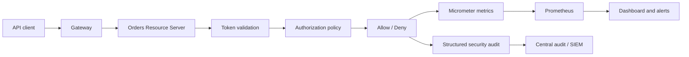

# Thêm metric và audit an toàn

## 1. Mục tiêu dự án

Trong dự án này, bạn sẽ bổ sung **metrics và security audit** cho một OAuth 2.0 Resource Server quản lý đơn hàng. API xác minh access token, kiểm tra scope và tenant, sau đó cho phép hoặc từ chối thao tác. Ta cần quan sát được những quyết định đó để vận hành và điều tra sự cố.

Kết quả cần hoàn thành:

- Đếm số lần authentication thất bại theo nhóm nguyên nhân.
- Đếm quyết định authorization allow/deny theo service, route, scope class và reason code.
- Đo latency của bước introspection nếu API dùng opaque token.
- Ghi audit event có cấu trúc cho các sự kiện bảo mật cần lưu.
- Không ghi raw JWT, opaque token, refresh token, Authorization header, client secret hoặc claims nhạy cảm.
- Giữ metric labels có cardinality thấp và tập giá trị được kiểm soát.
- Kiểm thử được cả metric, audit event, redaction và hành vi khi telemetry backend gặp lỗi.
- Tạo dashboard và alert để phát hiện thay đổi bất thường.

Dự án thuộc module **SECURITY_TOKEN_SECURITY_FUNDAMENTALS**: bạn sẽ nối quá trình phát hành và xác minh token với scope, audience, tenant, thu hồi và quyền truy cập API.

**Phân biệt ngay từ đầu:** metrics giúp quan sát xu hướng tổng hợp; audit lưu lại sự kiện có ý nghĩa bảo mật để điều tra và chứng minh hoạt động. Một hệ thống có metrics tốt chưa chắc đã có audit đầy đủ, và log thông thường chưa chắc là audit log đáng tin cậy.

## 2. Bối cảnh và kiến trúc

Giả sử hệ thống có:

- Authorization Server phát hành JWT access token hoặc opaque access token.
- Gateway chuyển request tới `orders-api`.
- `orders-api` xác minh token, kiểm tra `orders:read` hoặc `orders:write`.
- Policy kiểm tra tenant và quyền trên đơn hàng.
- Prometheus thu metrics; hệ thống log tập trung/SIEM nhận security audit event.

Luồng xử lý:



Metrics và audit được phát ra tại điểm hệ thống đã có quyết định xác thực hoặc phân quyền. Không decode token ở một logging filter rồi ghi toàn bộ claims để suy ra quyết định sau đó.

### 2.1. Phân biệt các lớp kết quả

| Sự kiện | Nhóm | Ví dụ reason code |
|---|---|---|
| Không có Bearer token | Authentication failure | `missing_credential` |
| JWT sai chữ ký | Authentication failure | `invalid_signature` |
| Issuer/audience không khớp | Authentication failure | `issuer_mismatch` / `audience_mismatch` |
| Token hết hạn hoặc opaque token inactive | Authentication failure | `expired_token` / `inactive_token` |
| Introspection/JWKS dependency timeout | Dependency failure | `introspection_timeout` / `jwks_unavailable` |
| Token hợp lệ nhưng thiếu scope | Authorization denial | `missing_scope` |
| Tenant không khớp | Authorization denial | `tenant_mismatch` |
| Không có quyền trên đơn hàng cụ thể | Authorization denial | `resource_denied` |
| Request được phép | Authorization allow | `allowed` |

Không gộp tất cả thành một metric `token_invalid_total`. Một token inactive là kết quả xác thực; introspection timeout là lỗi dependency; thiếu scope là quyết định phân quyền. Ba tình huống cần được dashboard và xử lý khác nhau.

## 3. Chuẩn bị dự án

Ví dụ sử dụng Java 17+, Spring Boot 3.x, Spring Security 6.x, Micrometer và Prometheus. Điều chỉnh version theo project đang dùng.

Các dependency Maven thường cần:

```xml
<dependencies>
    <dependency>
        <groupId>org.springframework.boot</groupId>
        <artifactId>spring-boot-starter-actuator</artifactId>
    </dependency>
    <dependency>
        <groupId>org.springframework.boot</groupId>
        <artifactId>spring-boot-starter-oauth2-resource-server</artifactId>
    </dependency>
    <dependency>
        <groupId>io.micrometer</groupId>
        <artifactId>micrometer-registry-prometheus</artifactId>
        <scope>runtime</scope>
    </dependency>
    <dependency>
        <groupId>org.springframework.boot</groupId>
        <artifactId>spring-boot-starter-test</artifactId>
        <scope>test</scope>
    </dependency>
    <dependency>
        <groupId>org.springframework.security</groupId>
        <artifactId>spring-security-test</artifactId>
        <scope>test</scope>
    </dependency>
</dependencies>
```

Nếu project đã có actuator, resource server hoặc test dependency, không thêm trùng. Không đưa secret hoặc signing key vào file cấu hình được commit.

Cấu hình expose endpoint Prometheus trong môi trường local:

```yaml
management:
  endpoints:
    web:
      exposure:
        include: health,info,prometheus
```

Chỉ expose endpoint metrics qua management network hoặc cơ chế authentication phù hợp. Không public toàn bộ Actuator endpoints ra Internet; đặc biệt không expose `env`, `configprops` hoặc thông tin nội bộ không cần thiết.

## 4. Thiết kế metric trước khi viết code

Metric cần trả lời câu hỏi vận hành cụ thể. Bắt đầu với một tập nhỏ:

| Metric logic | Loại | Mục đích |
|---|---|---|
| `security.authentication.failures` | Counter | Đếm authentication failure theo reason và token format |
| `security.authorization.decisions` | Counter | Đếm allow/deny theo route, scope class và reason |
| `security.authorization.duration` | Timer | Đo thời gian policy evaluation |
| `security.token.introspection.duration` | Timer | Đo latency introspection opaque token |
| `security.jwks.refresh` | Counter | Đếm JWKS refresh success/failure nếu service tự quản lý resolver |
| `security.audit.publish.failures` | Counter | Đếm lỗi đưa audit event tới sink |

Tên metric được Micrometer registry chuyển đổi theo naming convention. Với Prometheus, tên xuất ra thường được chuẩn hóa thành dạng snake_case và Counter có hậu tố `_total`; hãy kiểm tra tên thực tế tại `/actuator/prometheus`.

### 4.1. Chọn label có cardinality thấp

Những label thường phù hợp nếu lấy từ enum hoặc registry cấu hình:

- `service`: tên service cố định.
- `route`: route ID đã chuẩn hóa, ví dụ `orders-read`.
- `outcome`: `allow` hoặc `deny`.
- `reason`: tập reason code hữu hạn.
- `scope_class`: nhóm scope đã đăng ký, ví dụ `orders-read`.
- `client_type`: `web-app`, `workload` hoặc `partner-app`.
- `token_format`: `jwt`, `opaque` hoặc `unknown`.
- `region`: vùng triển khai được cấu hình.

Không dùng các giá trị sau làm metric label:

- Raw JWT, opaque token, refresh token, `jti` hoặc session ID.
- User ID, email, subject hoặc client ID riêng lẻ.
- Request ID, trace ID hoặc correlation ID.
- Tenant ID nếu số lượng tenant lớn hoặc thay đổi liên tục.
- URL đầy đủ có path parameter/query string.
- Exception message hoặc scope string tùy ý do caller gửi.

Cardinality cao làm tăng số time series, RAM, index, chi phí lưu trữ và query latency. Các định danh này cũng có thể tiết lộ hành vi hoặc danh tính. Nếu cần điều tra một request/tenant cụ thể, dùng audit event hoặc trace có kiểm soát quyền truy cập, không biến chúng thành metric label.

### 4.2. Metric không phải audit

Counter có thể bị reset khi process restart, scrape có thể mất mẫu và aggregation làm mất chi tiết từng sự kiện. Vì vậy:

- Dùng metrics để xem xu hướng, tỷ lệ, latency và alert.
- Dùng audit event để lưu sự kiện cần truy vết theo chính sách.
- Không dùng Prometheus làm kho audit.
- Không cho rằng một counter tăng một đơn vị là bằng chứng đủ cho một hành động cụ thể.

## 5. Tạo taxonomy bằng enum

Tránh truyền chuỗi tự do từ request vào metrics. Tạo enum hoặc registry để giữ tập giá trị hữu hạn.

Ví dụ:

```java
public enum AuthOutcome {
    ALLOW("allow"),
    DENY("deny");

    private final String tag;

    AuthOutcome(String tag) {
        this.tag = tag;
    }

    public String tag() {
        return tag;
    }
}

public enum AuthzReason {
    NONE("none"),
    MISSING_SCOPE("missing_scope"),
    TENANT_MISMATCH("tenant_mismatch"),
    RESOURCE_DENIED("resource_denied"),
    POLICY_ERROR("policy_error");

    private final String code;

    AuthzReason(String code) {
        this.code = code;
    }

    public String code() {
        return code;
    }
}

public enum TokenFormat {
    JWT("jwt"),
    OPAQUE("opaque"),
    UNKNOWN("unknown");

    private final String tag;

    TokenFormat(String tag) {
        this.tag = tag;
    }

    public String tag() {
        return tag;
    }
}
```

Tạo enum tương tự cho `AuthnFailureReason`, `RouteId`, `ScopeClass` và `ClientType`. Ví dụ `RouteId.ORDERS_READ` map cố định thành `orders-read`; không lấy raw URI như `/orders/12345` làm route label.

Một taxonomy tốt cần:

- Tên ngắn, ổn định, có tài liệu.
- Phân biệt authentication, authorization và dependency failure.
- Không nhét exception message vào reason code.
- Có `none` hoặc giá trị cố định cho chiều không áp dụng.
- Được review khi thêm route, scope class hoặc loại token mới.

## 6. Implement SecurityMetrics với Micrometer

Tạo một component chỉ chịu trách nhiệm ghi metric:

```java
@Component
public final class SecurityMetrics {

    private static final String SERVICE = "orders-api";

    private final MeterRegistry registry;

    public SecurityMetrics(MeterRegistry registry) {
        this.registry = registry;
    }

    public void recordAuthorization(
            RouteId route,
            ScopeClass scopeClass,
            ClientType clientType,
            AuthOutcome outcome,
            AuthzReason reason) {

        Counter.builder("security.authorization.decisions")
                .description("Authorization decisions by route and outcome")
                .tag("service", SERVICE)
                .tag("route", route.tag())
                .tag("scope_class", scopeClass.tag())
                .tag("client_type", clientType.tag())
                .tag("outcome", outcome.tag())
                .tag("reason", reason.code())
                .register(registry)
                .increment();
    }

    public void recordAuthenticationFailure(
            AuthnFailureReason reason,
            TokenFormat format) {

        Counter.builder("security.authentication.failures")
                .description("Rejected authentication attempts")
                .tag("service", SERVICE)
                .tag("reason", reason.code())
                .tag("token_format", format.tag())
                .register(registry)
                .increment();
    }

    public Timer.Sample startAuthorizationTimer() {
        return Timer.start(registry);
    }

    public void stopAuthorizationTimer(
            Timer.Sample sample,
            RouteId route,
            AuthOutcome outcome) {

        sample.stop(Timer.builder("security.authorization.duration")
                .tag("service", SERVICE)
                .tag("route", route.tag())
                .tag("outcome", outcome.tag())
                .register(registry));
    }
}
```

Đây là skeleton có thể tích hợp vào Spring Boot/Micrometer. Các enum được định nghĩa ở phần trước và cần bổ sung các enum còn lại. Nếu metric có nhiều tag combination, số time series tăng theo tích của các giá trị; giữ route, scope class và client type ở quy mô được kiểm soát.

Không truyền `principal.getName()`, `tenantId`, raw `scope` hoặc exception message vào `tag()`. Không bắt lỗi metric rồi cho phép request trái policy. Nếu metrics registry tạm lỗi, quyết định authorization vẫn phải dựa trên policy; telemetry không được trở thành cơ chế cấp quyền.

## 7. Đặt instrumentation tại điểm quyết định authorization

Đo tại nơi policy thực sự quyết định allow/deny. Ví dụ một service kiểm tra scope và tenant:

```java
public AuthorizationDecision checkOrderRead(
        VerifiedPrincipal principal,
        Order order) {

    boolean hasScope = principal.hasScope("orders:read");
    boolean sameTenant =
            principal.tenantId().equals(order.tenantId());

    if (!hasScope) {
        recorder.recordDenied(
                RouteId.ORDERS_READ,
                ScopeClass.ORDERS_READ,
                principal.clientType(),
                AuthzReason.MISSING_SCOPE);
        return AuthorizationDecision.deny();
    }

    if (!sameTenant) {
        recorder.recordDenied(
                RouteId.ORDERS_READ,
                ScopeClass.ORDERS_READ,
                principal.clientType(),
                AuthzReason.TENANT_MISMATCH);
        return AuthorizationDecision.deny();
    }

    recorder.recordAllowed(
            RouteId.ORDERS_READ,
            ScopeClass.ORDERS_READ,
            principal.clientType());

    return AuthorizationDecision.allow();
}
```

`VerifiedPrincipal` phải được tạo sau khi token đã được xác minh bởi Resource Server. Không tạo principal bằng cách decode payload trong controller.

Thứ tự quan trọng:

1. Authentication filter xác minh token.
2. Resource Server xây dựng verified principal.
3. Authorization policy kiểm tra scope, tenant và resource.
4. Recorder ghi quyết định đã được policy đưa ra.
5. Nếu deny, dừng request; nếu allow, tiếp tục nghiệp vụ.

Không ghi `allow` trước khi kiểm tra object ownership hoặc tenant. Nếu một request đi qua nhiều policy, định nghĩa rõ metric nào đo từng policy check và metric nào đo quyết định cuối cùng để tránh đếm trùng.

## 8. Ghi authentication failure an toàn

Authentication failure thường xảy ra trước controller. Có thể tích hợp recorder ở `AuthenticationEntryPoint`, `AuthenticationFailureHandler`, filter hoặc adapter tương ứng của Resource Server.

Ví dụ ý tưởng:

```java
@Component
public class ApiAuthenticationEntryPoint
        implements AuthenticationEntryPoint {

    private final SecurityMetrics metrics;

    public ApiAuthenticationEntryPoint(SecurityMetrics metrics) {
        this.metrics = metrics;
    }

    @Override
    public void commence(
            HttpServletRequest request,
            HttpServletResponse response,
            AuthenticationException exception) throws IOException {

        AuthnFailureReason reason =
                FailureReasonMapper.from(exception);

        metrics.recordAuthenticationFailure(
                reason,
                TokenFormat.UNKNOWN);

        response.setStatus(HttpServletResponse.SC_UNAUTHORIZED);
        response.setHeader(
                HttpHeaders.WWW_AUTHENTICATE,
                "Bearer error=\"invalid_token\"");
        response.setContentType(MediaType.APPLICATION_JSON_VALUE);
        response.getWriter().write(
                "{\"error\":\"unauthorized\"}");
    }
}
```

`FailureReasonMapper` phải ánh xạ exception sang enum hữu hạn. Không đưa `exception.getMessage()` vào metric, response hoặc audit vì message có thể chứa URL, key ID, claim hoặc dữ liệu nhạy cảm. Ví dụ này minh họa entry point; cấu hình thực tế cần giữ đúng semantics 401/403 và phân biệt lỗi dependency như JWKS/introspection timeout nếu API cần trả 503.

Nếu không thể xác định token format an toàn trước khi verify, dùng `unknown`. Không parse token chỉ để thêm label `jwt`/`opaque` nếu việc parse đó mở rộng attack surface hoặc tạo log không cần thiết.

## 9. Thiết kế security audit event

Audit event cần một schema có cấu trúc và allowlist field. Ví dụ:

```json
{
  "eventType": "authorization_decision",
  "occurredAt": "2026-11-23T10:15:30Z",
  "service": "orders-api",
  "route": "orders-read",
  "outcome": "deny",
  "reasonCode": "tenant_mismatch",
  "issuerId": "corporate-auth",
  "audienceClass": "orders-api",
  "scopeClass": "orders-read",
  "clientType": "workload",
  "traceId": "7f2a...e91c"
}
```

Event không chứa token, refresh token, Authorization header, secret, full JWT claims, email hoặc subject raw. `traceId` có thể giúp nối với trace đã được bảo vệ; không đưa nó vào metric label. Nếu trace context đến từ client, chỉ chấp nhận format hợp lệ và áp dụng policy để tránh client tự chèn dữ liệu tùy ý vào audit.

Các field gợi ý:

| Field | Quy tắc |
|---|---|
| `eventType` | Enum: authentication failure, authorization decision, token lifecycle event |
| `occurredAt` | Timestamp UTC từ clock đồng bộ |
| `service` | Tên service cấu hình cố định |
| `route` | Route ID đã chuẩn hóa |
| `outcome` | Tập giá trị hữu hạn |
| `reasonCode` | Enum; không dùng exception message |
| `issuerId` | Alias issuer đã cấu hình, không nhất thiết là URL tùy ý |
| `audienceClass` | Resource class đã chuẩn hóa |
| `scopeClass` | Nhóm scope đã đăng ký |
| `clientType` | Loại client, không phải client secret hoặc tên người dùng |
| `traceId` | Correlation identifier đã được xác thực/chuẩn hóa nếu cần |

### 9.1. Có cần lưu subject hoặc tenant ID không?

Mặc định không ghi subject raw, email hoặc tenant ID vào dashboard/log chung. Nếu yêu cầu điều tra hoặc compliance thực sự cần liên kết actor, hãy xác định mục đích, quyền truy cập và retention trước.

Các lựa chọn có kiểm soát:

- Lưu audit record ở hệ thống riêng với ACL chặt, mã hóa và audit access.
- Dùng internal actor ID chỉ trong kho audit được phân quyền.
- Dùng pseudonymous reference tạo bằng HMAC với secret server-side nếu cần liên kết sự kiện mà không lộ định danh trực tiếp.
- Tách mapping từ pseudonymous reference sang danh tính thật trong hệ thống có quyền hạn riêng.

Hash không khóa của email/user ID không bảo đảm ẩn danh. Nếu dùng HMAC fingerprint, phải quản lý key, domain separation, rotation và nguy cơ liên kết chéo. Không thêm pseudonymous ID vào Prometheus label.

## 10. Implement audit publisher

Định nghĩa một interface để tách nghiệp vụ khỏi đích lưu:

```java
public interface SecurityAuditSink {
    void publish(SecurityAuditEvent event);
}
```

DTO chỉ chứa field đã allowlist:

```java
public record SecurityAuditEvent(
        Instant occurredAt,
        String eventType,
        String service,
        String route,
        String outcome,
        String reasonCode,
        String issuerId,
        String audienceClass,
        String scopeClass,
        String clientType,
        String traceId) {
}
```

Một sink local có thể ghi JSON line qua logger:

```java
@Component
public final class JsonLineSecurityAuditSink
        implements SecurityAuditSink {

    private static final Logger log =
            LoggerFactory.getLogger(JsonLineSecurityAuditSink.class);

    private final ObjectMapper objectMapper;

    public JsonLineSecurityAuditSink(ObjectMapper objectMapper) {
        this.objectMapper = objectMapper;
    }

    @Override
    public void publish(SecurityAuditEvent event) {
        try {
            log.info("security_audit {}",
                    objectMapper.writeValueAsString(event));
        } catch (JsonProcessingException ex) {
            throw new IllegalStateException(
                    "Cannot serialize security audit event", ex);
        }
    }
}
```

Đây là sink phục vụ lab/local. Ghi JSON ra stdout **không tự biến log thành audit storage bền vững**. Trong production, cần collector chuyển event tới kho audit/SIEM có authentication, encryption in transit/at rest, access control, retention, backup, alert khi mất event và cơ chế phát hiện sửa/xóa trái phép. Không ghi exception message chứa dữ liệu đầu vào.

### 10.1. Phân biệt metrics, operational logs và audit

| Loại | Dữ liệu | Dùng cho |
|---|---|---|
| Metrics | Counter, timer, bounded labels | Dashboard, SLO, alert |
| Operational logs | Lỗi kỹ thuật đã redaction, request/trace context | Debug vận hành |
| Security audit | Sự kiện bảo mật có schema, actor/resource context theo policy | Điều tra, compliance, accountability |

Không nên dùng cùng một chính sách retention và quyền truy cập cho cả ba. Audit có thể cần retention dài hơn nhưng quyền truy cập hẹp hơn operational logs.

## 11. Gắn metrics và audit vào một recorder

Tạo một lớp điều phối. Nó nhận kết quả policy đã có, cập nhật metrics và tạo audit event theo chính sách.

```java
@Component
public final class AuthorizationObservationRecorder {

    private final SecurityMetrics metrics;
    private final SecurityAuditSink auditSink;
    private final AuditPolicy auditPolicy;
    private final Clock clock;

    public AuthorizationObservationRecorder(
            SecurityMetrics metrics,
            SecurityAuditSink auditSink,
            AuditPolicy auditPolicy,
            Clock clock) {
        this.metrics = metrics;
        this.auditSink = auditSink;
        this.auditPolicy = auditPolicy;
        this.clock = clock;
    }

    public void record(AuthorizationObservation observation) {
        metrics.recordAuthorization(
                observation.route(),
                observation.scopeClass(),
                observation.clientType(),
                observation.outcome(),
                observation.reason());

        if (auditPolicy.mustAudit(observation)) {
            SecurityAuditEvent event = new SecurityAuditEvent(
                    clock.instant(),
                    "authorization_decision",
                    "orders-api",
                    observation.route().tag(),
                    observation.outcome().tag(),
                    observation.reason().code(),
                    observation.issuerId().tag(),
                    observation.audienceClass().tag(),
                    observation.scopeClass().tag(),
                    observation.clientType().tag(),
                    observation.traceId());
            auditSink.publish(event);
        }
    }
}
```

`AuthorizationObservation`, `AuditPolicy`, `IssuerId` và `AudienceClass` là các kiểu dữ liệu domain cần định nghĩa. Chúng nên dùng enum hoặc registry allowlist; không để caller truyền string tùy ý từ HTTP request.

Không nên ghi audit event cho mọi request một cách vô điều kiện nếu lưu lượng rất lớn và policy không yêu cầu. Một chính sách phổ biến là audit tất cả denial, thay đổi quyền/key/client, thao tác admin và các allow event nhạy cảm; các allow event thông thường có thể chỉ ghi metrics. Nếu compliance yêu cầu audit mọi access, phải thiết kế capacity, durability và retention tương ứng.

## 12. Audit durability và xử lý khi sink lỗi

Metrics thường có thể best-effort. Audit cho hành động nhạy cảm có thể phải bền vững trước khi hành động được thực hiện.

Cần quyết định theo loại hành động:

| Hành động | Chính sách gợi ý khi audit sink lỗi |
|---|---|
| Request đọc thông thường | Theo policy đã phê duyệt; có thể ghi vào bounded durable queue và cảnh báo |
| Đọc dữ liệu đặc biệt nhạy cảm | Có thể yêu cầu audit durable trước khi trả dữ liệu |
| Thay đổi quyền, client registration hoặc signing key | Yêu cầu audit durable trước khi commit thay đổi |
| Denial do thiếu scope | Vẫn từ chối request; ghi lỗi audit và phát alert nếu sink không nhận |
| Security incident/key compromise | Dùng kênh incident/audit ưu tiên, không âm thầm drop |

Nếu dùng asynchronous queue:

- Queue phải có giới hạn dung lượng.
- Có backpressure và chính sách overflow rõ ràng.
- Có metric cho queue depth, publish latency và dropped/failed events.
- Không silently drop audit event.
- Có retry bounded và dead-letter/replay procedure.
- Gắn event ID để phát hiện duplicate khi retry.
- Nếu yêu cầu atomicity với thay đổi dữ liệu, cân nhắc transactional outbox hoặc cơ chế tương đương.

Đừng giả định logger async luôn bảo đảm durability. Cần biết log shipper buffer ở đâu, khi process crash thì mất bao nhiêu event, và cách phát hiện gap.

## 13. Prometheus dashboard và PromQL

Sau khi ứng dụng chạy, mở endpoint metrics trong môi trường local được bảo vệ và tìm metric đã instrument. Tên xuất ra phụ thuộc naming convention và registry; dưới đây là query minh họa cho tên Prometheus sau chuẩn hóa.

**Tốc độ authorization decision theo outcome:**

```promql
sum by (service, route, outcome) (
  rate(security_authorization_decisions_total[5m])
)
```

**Tỷ lệ denial theo service:**

```promql
sum by (service) (
  rate(security_authorization_decisions_total{outcome="deny"}[5m])
)
/
clamp_min(
  sum by (service) (
    rate(security_authorization_decisions_total[5m])
  ),
  1
)
```

**Top reason code gây denial:**

```promql
topk(10,
  sum by (service, route, reason) (
    rate(security_authorization_decisions_total{outcome="deny"}[15m])
  )
)
```

**Authentication failure theo nguyên nhân:**

```promql
sum by (service, reason, token_format) (
  rate(security_authentication_failures_total[5m])
)
```

**p95 authorization duration** (nếu Timer được export thành histogram):

```promql
histogram_quantile(
  0.95,
  sum by (le, service) (
    rate(security_authorization_duration_seconds_bucket[5m])
  )
)
```

Query phải được điều chỉnh theo metric thực tế. Nếu histogram percentile không được bật, cần cấu hình distribution statistics phù hợp. Khi traffic bằng 0, query phải tránh chia cho 0 và dashboard nên hiển thị “no data” thay vì kết luận tỷ lệ bằng 0.

### 13.1. Panel đề xuất

| Panel | Visualization | Câu hỏi |
|---|---|---|
| Request auth decisions | Time series allow/deny | Denial có tăng bất thường không? |
| Denial reasons | Stacked bar/table | Lý do nào gây 403 nhiều nhất? |
| Authentication failures | Time series theo reason | Có lỗi chữ ký, issuer hoặc expiry tăng không? |
| Authorization latency | p50/p95/p99 | Policy có làm chậm API không? |
| Introspection latency | p95 và error rate | Authorization Server có đáp ứng SLO không? |
| Sensitive scope usage | Table theo scope class | Scope nhạy cảm nào đang được dùng? |
| Audit pipeline health | Queue depth/publish errors | Có nguy cơ mất audit event không? |

Không hiển thị token, subject raw hoặc tenant ID không giới hạn trên dashboard chung.

## 14. Alerting và phản ứng

Alert phải gắn với baseline, thời gian duy trì và owner. Ví dụ:

| Alert | Điều kiện gợi ý | Hành động |
|---|---|---|
| Authorization denial spike | Denial rate vượt baseline nhiều cửa sổ | Kiểm tra release, scope policy và client configuration |
| Invalid signature spike | Signature failures tăng đột ngột | Kiểm tra issuer/key rotation và dấu hiệu token forgery |
| Wrong audience spike | Audience mismatch tăng | Kiểm tra client route/audience mapping |
| Tenant mismatch spike | Tenant mismatch tăng theo route/region | Kiểm tra tenant resolution và cross-tenant probing |
| Introspection dependency error | Timeout/5xx vượt SLO | Kiểm tra Authorization Server, network và token store |
| Audit publish failure | Sink error hoặc queue gần đầy | Kiểm tra log pipeline và durability |
| Sensitive permission activity | Scope class nhạy cảm được dùng bất thường | Kiểm tra client, actor và approval trail |
| Metric cardinality growth | Số time series tăng bất thường | Kiểm tra label động bị đưa vào metrics |

Một denial đơn lẻ có thể là hành vi bình thường. Alert nên dựa trên số lượng, tỷ lệ, baseline, route nhạy cảm và nhiều tín hiệu kết hợp. Không gửi raw token hoặc PII vào alert notification.

## 15. Kiểm thử bằng SimpleMeterRegistry và fake audit sink

Tạo test double cho audit sink:

```java
final class InMemorySecurityAuditSink implements SecurityAuditSink {

    private final List<SecurityAuditEvent> events =
            new CopyOnWriteArrayList<>();

    @Override
    public void publish(SecurityAuditEvent event) {
        events.add(event);
    }

    List<SecurityAuditEvent> events() {
        return List.copyOf(events);
    }
}
```

Test metric cho authorization denial:

```java
@Test
void recordsMissingScopeDecision() {
    SimpleMeterRegistry registry = new SimpleMeterRegistry();
    SecurityMetrics metrics = new SecurityMetrics(registry);

    metrics.recordAuthorization(
            RouteId.ORDERS_READ,
            ScopeClass.ORDERS_READ,
            ClientType.WEB_APP,
            AuthOutcome.DENY,
            AuthzReason.MISSING_SCOPE);

    double count = registry.get(
            "security.authorization.decisions")
            .tag("service", "orders-api")
            .tag("route", "orders-read")
            .tag("outcome", "deny")
            .tag("reason", "missing_scope")
            .counter()
            .count();

    assertThat(count).isEqualTo(1.0);
}
```

Test audit event:

```java
@Test
void publishesSafeAuditEventForDeniedRequest() {
    InMemorySecurityAuditSink sink =
            new InMemorySecurityAuditSink();

    SecurityAuditEvent event = new SecurityAuditEvent(
            Instant.parse("2026-11-23T10:15:30Z"),
            "authorization_decision",
            "orders-api",
            "orders-read",
            "deny",
            "missing_scope",
            "corporate-auth",
            "orders-api",
            "orders-read",
            "web-app",
            "trace-123");

    sink.publish(event);

    assertThat(sink.events()).hasSize(1);
    assertThat(sink.events().get(0).reasonCode())
            .isEqualTo("missing_scope");
}
```

Các ví dụ dùng AssertJ và JUnit; bổ sung import và cấu hình test theo project. Test này kiểm tra schema/event routing, không chứng minh log collector production lưu event bền vững.

## 16. Test redaction và metric cardinality

Dùng một token canary giả trong test để bảo đảm giá trị không xuất hiện ở output. Không dùng token production.

Ví dụ:

1. Gửi request với token canary vào Resource Server test.
2. Thu log output của test appender.
3. Kiểm tra raw token và chuỗi Authorization header không xuất hiện.
4. Kiểm tra audit event chỉ có field allowlist.
5. Kiểm tra metric tags không có `sub`, `jti`, token, email, request ID hoặc tenant ID.
6. Gửi nhiều request với subject/tenant khác nhau.
7. Xác nhận số meter không tăng theo từng subject/tenant.

Test cardinality có thể kiểm tra registry:

```java
@Test
void metricLabelsDoNotIncludeUserIdentity() {
    SimpleMeterRegistry registry = new SimpleMeterRegistry();
    SecurityMetrics metrics = new SecurityMetrics(registry);

    // Gọi recorder với các enum/route cố định cho nhiều principal khác nhau.
    metrics.recordAuthorization(
            RouteId.ORDERS_READ,
            ScopeClass.ORDERS_READ,
            ClientType.WEB_APP,
            AuthOutcome.ALLOW,
            AuthzReason.NONE);

    Meter meter = registry.find("security.authorization.decisions")
            .tag("service", "orders-api")
            .meter();

    assertThat(meter).isNotNull();
    assertThat(meter.getId().getTags())
            .extracting(Tag::getKey)
            .doesNotContain("sub", "email", "jti", "token", "tenant_id");
}
```

Đây là kiểm tra cấu trúc label. Nên bổ sung test gửi số lượng lớn principal giả lập để phát hiện code path vô tình thêm label động. Đừng chỉ kiểm tra tên tag ở một meter nếu hệ thống có nhiều recorder khác nhau.

## 17. Integration test qua Security Filter Chain

Unit test cho `SecurityMetrics` và audit sink chưa chứng minh request HTTP thực tế được đo. Thêm integration test qua filter chain:

- Request không có token → authentication failure metric tăng, API trả 401.
- JWT có chữ ký hợp lệ và đủ scope → authorization allow metric tăng.
- JWT có chữ ký hợp lệ nhưng thiếu scope → denial metric và audit event `missing_scope`.
- Token sai audience hoặc chữ ký → authentication failure, không tạo authorization allow event.
- Tenant mismatch → denial event với reason code phù hợp.
- Introspection trả `active=false` → invalid token; introspection timeout → dependency error riêng.
- Request bị từ chối không gọi business service và không tạo side effect.

Spring Security Test helper như `jwt()` tạo Authentication test và có thể bypass JWT decoder. Nó phù hợp để test authorization mapping; không dùng nó làm bằng chứng chữ ký, issuer, audience hoặc JWKS được xác minh. Muốn test authentication thực, tạo JWT ký bằng test private key và gửi qua filter chain dùng test JWKS/issuer thật.

## 18. Test khi telemetry backend gặp lỗi

Telemetry không được làm sai quyết định bảo mật. Hãy kiểm thử riêng từng đường:

| Failure | Hành vi mong đợi |
|---|---|
| Prometheus scrape lỗi | API vẫn xác thực/phân quyền bình thường |
| Metric registry/exporter lỗi | Không biến authorization deny thành allow |
| Audit sink lỗi khi request đọc thông thường | Theo policy durability; ghi cảnh báo/queue failure, không âm thầm drop |
| Audit sink lỗi trước thao tác admin nhạy cảm | Không commit nếu policy yêu cầu audit durable trước |
| Audit queue đầy | Backpressure hoặc fail theo policy; phát metric/alert |
| Log collector mất kết nối | Buffer/durable queue và cảnh báo; biết giới hạn mất dữ liệu |
| Trace exporter lỗi | Không ảnh hưởng quyết định security |
| Clock lệch | Phát hiện qua clock monitoring; audit timestamp vẫn có quy tắc rõ |

Không bắt mọi exception từ metrics/audit rồi bỏ qua một cách im lặng. Metrics best-effort có thể không làm request fail, nhưng lỗi pipeline phải được ghi nhận. Audit quan trọng cần durability guarantee và hành vi khi không thể ghi phải được quyết định theo mức rủi ro.

## 19. Bảo vệ audit pipeline trong production

Để audit có giá trị điều tra:

- Dùng TLS/mTLS và service identity giữa ứng dụng với collector.
- Giới hạn ai có quyền ghi, đọc, export và xóa audit event.
- Mã hóa khi truyền và khi lưu theo yêu cầu.
- Dùng append-only/WORM hoặc tamper-evident storage khi yêu cầu compliance cần.
- Đồng bộ clock giữa service, collector và storage.
- Đặt retention theo loại sự kiện và quy định áp dụng.
- Audit việc truy cập/xuất/xóa kho audit.
- Theo dõi queue depth, ingestion lag, dropped events và storage capacity.
- Có backup, replay và incident runbook.
- Tách quyền quản trị ứng dụng khỏi quyền sửa/xóa audit archive nếu có thể.

Một JSON line trong stdout chỉ là định dạng event. Tính bất biến, độ bền và khả năng chứng minh nguồn gốc đến từ pipeline và storage policy phía sau.

## 20. Hoàn thành dashboard và kiểm tra kết quả

Sau khi instrument:

1. Chạy ứng dụng với Prometheus registry.
2. Gọi endpoint orders bằng token test đủ scope.
3. Gọi lại bằng token thiếu scope.
4. Gửi token sai audience hoặc hết hạn.
5. Gửi request tenant mismatch.
6. Kiểm tra `/actuator/prometheus` trong môi trường local được bảo vệ.
7. Kiểm tra counter tăng đúng route/outcome/reason.
8. Kiểm tra timer có sample.
9. Kiểm tra audit event trong log sink/test sink.
10. Tìm raw token canary trong log output và xác nhận không xuất hiện.
11. Chạy PromQL và xác nhận dashboard phân biệt authentication failure, authorization denial và dependency error.
12. Giả lập audit sink lỗi và xác nhận policy durability được thực thi.

Kết quả mong đợi là operator có thể trả lời: API nào bị từ chối nhiều, lý do nào tăng, scope class nào được dùng, introspection có chậm không và audit pipeline có đang nhận event đầy đủ không — mà không cần đọc token hoặc claims nhạy cảm.

## 21. Checklist bàn giao

- [ ] Metric cho authentication failures có reason code hữu hạn.
- [ ] Metric cho authorization allow/deny có route và scope class đã chuẩn hóa.
- [ ] Timer đo authorization/introspection latency khi có áp dụng.
- [ ] Metric labels không chứa token, user, subject, `jti`, email, request ID hoặc tenant ID không giới hạn.
- [ ] Audit event dùng schema allowlist và timestamp UTC.
- [ ] Audit không chứa raw token, refresh token, Authorization header, secret hoặc full claims.
- [ ] Audit policy xác định event nào bắt buộc lưu và mức durability.
- [ ] Audit sink lỗi có queue/backpressure/alert hoặc fail policy rõ.
- [ ] Integration tests đi qua Security Filter Chain.
- [ ] Test phân biệt 401, 403 và dependency 503.
- [ ] Test redaction bằng token canary.
- [ ] Test cardinality với nhiều principal giả lập.
- [ ] Dashboard có allow/deny, reason, authentication failures và latency.
- [ ] Alert có threshold, owner và runbook.
- [ ] Management endpoints được bảo vệ.
- [ ] Đã xác nhận telemetry outage không làm authorization fail open.

**Nguyên tắc cốt lõi:** Metrics cho biết xu hướng của hệ thống; audit cho biết sự kiện bảo mật nào đã xảy ra theo schema và retention policy. Cả hai phải được phát tại điểm quyết định đáng tin cậy, chỉ chứa dữ liệu cần thiết và không bao giờ làm suy yếu việc xác minh token hoặc phân quyền.

### Tài liệu tham khảo

- [RFC 6749 — The OAuth 2.0 Authorization Framework](https://www.rfc-editor.org/rfc/rfc6749): access token, scope và OAuth roles.
- [RFC 6750 — OAuth 2.0 Bearer Token Usage](https://www.rfc-editor.org/rfc/rfc6750): truyền Bearer token và error semantics.
- [RFC 7519 — JSON Web Token (JWT)](https://www.rfc-editor.org/rfc/rfc7519): JWT claims và thời hạn.
- [RFC 8725 — JSON Web Token Best Current Practices](https://www.rfc-editor.org/rfc/rfc8725): JWT validation và ngăn token confusion.
- [RFC 7662 — OAuth 2.0 Token Introspection](https://www.rfc-editor.org/rfc/rfc7662): introspection và token active status.
- [RFC 9068 — JWT Profile for OAuth 2.0 Access Tokens](https://www.rfc-editor.org/rfc/rfc9068): profile JWT access token.
- [Spring Boot Actuator — Metrics](https://docs.spring.io/spring-boot/reference/actuator/metrics.html): expose và quan sát application metrics.
- [Micrometer — Counters](https://docs.micrometer.io/micrometer/reference/concepts/counters.html): ghi nhận event count.
- [Micrometer — Timers](https://docs.micrometer.io/micrometer/reference/concepts/timers.html): đo latency và thời lượng.
- [Prometheus — Instrumentation](https://prometheus.io/docs/practices/instrumentation/): metric naming, labels và instrumentation.
- [OWASP Logging Cheat Sheet](https://cheatsheetseries.owasp.org/cheatsheets/Logging_Cheat_Sheet.html): logging an toàn, redaction và bảo vệ log.
- [OpenTelemetry — Signals](https://opentelemetry.io/docs/concepts/signals/): metrics, logs và traces.
