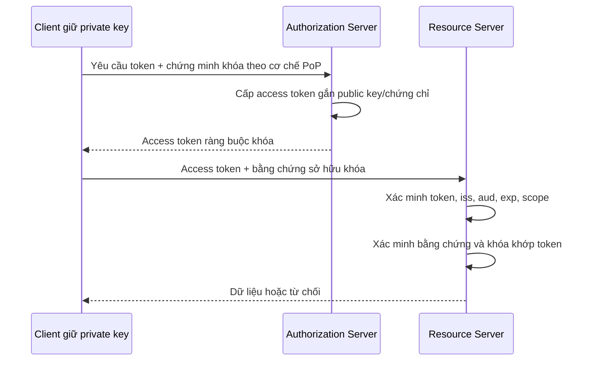
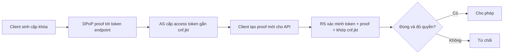
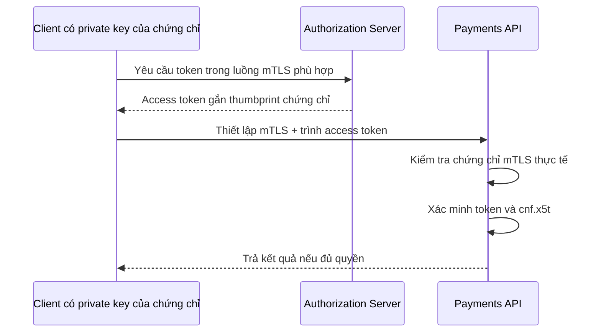

# Proof-of-possession token

## 1. Từ bearer token đến bằng chứng sở hữu khóa

Trong nhiều hệ thống OAuth 2.0, ứng dụng gọi API bằng một **bearer access token**:

```http
GET /accounts/me HTTP/1.1
Host: accounts-api.example.com
Authorization: Bearer <access_token>
```

Bearer có nghĩa là **bên nào cầm được token hợp lệ thì có thể trình token** cho resource server. API thường kiểm tra chữ ký hoặc trạng thái token, `iss` (issuer), `aud` (audience), `exp` (thời hạn) và quyền truy cập. Các bước này rất cần thiết, nhưng nếu kẻ tấn công lấy được chuỗi token từ log, bộ nhớ, môi trường trình duyệt hoặc thiết bị, chúng có thể thử gửi lại token trong thời gian token còn được chấp nhận.

**Proof-of-possession token (PoP token)** là cách gọi token được sử dụng theo cơ chế yêu cầu bên trình token **chứng minh đang nắm giữ một bí mật hoặc khóa mật mã đã được ràng buộc với token**, thay vì chỉ xuất trình chuỗi token. Trong các triển khai hiện đại, cơ chế này thường gọi là **sender-constrained access token** (access token được ràng buộc với bên gửi). Hai cách triển khai tiêu biểu là:

- **DPoP** (*Demonstrating Proof of Possession*, RFC 9449): client ký một bằng chứng riêng bằng **khóa bất đối xứng** khi gửi request; access token được ràng buộc với khóa công khai đó.
- **mTLS certificate-bound access token** (RFC 8705): token được ràng buộc với chứng chỉ client; resource server yêu cầu client chứng minh sở hữu khóa riêng tương ứng trong phiên TLS có xác thực bằng chứng chỉ client.

> **Phân biệt cốt lõi:** Bearer token chứng minh **“Tôi có giá trị token”**. Token ràng buộc bằng PoP còn yêu cầu **“Tôi có token và có thể chứng minh sở hữu khóa đã gắn với token”**. PoP giảm khả năng lợi dụng **token bị sao chép một mình**, nhưng không biến token thành bất khả xâm phạm.

Bài thuộc chương **Token types** của module `SECURITY_TOKEN_SECURITY_FUNDAMENTALS`. Để hiểu PoP đúng, cần liên hệ nó với vòng đời phát hành/xác minh access token, JWT và opaque token, scope, audience, OAuth 2.0/OIDC, lưu khóa, thu hồi và chống token bị đánh cắp hoặc phát lại.

## 2. PoP là thuộc tính bảo vệ, không phải một định dạng token

Có ba trục phân loại độc lập:

| Trục | Các ví dụ | Câu hỏi trả lời |
| --- | --- | --- |
| **Mục đích** | Access token, refresh token, ID token | Token dùng làm gì và bên nào được nhận? |
| **Định dạng** | JWT ký số, opaque token | Token chứa dữ liệu có cấu trúc hay chỉ là giá trị tham chiếu? |
| **Cơ chế trình token** | Bearer, PoP/sender-constrained | Ngoài việc cầm token, bên gửi có phải chứng minh sở hữu khóa không? |

Vì vậy:

- **JWT access token** có thể là bearer token **hoặc** được ràng buộc bằng DPoP/mTLS.
- **Opaque access token** cũng có thể được ràng buộc với khóa; authorization server lưu hoặc trả về metadata ràng buộc cho resource server qua kênh tin cậy.
- **Refresh token** có thể được sender-constrain hoặc bảo vệ bằng rotation và phát hiện sử dụng lại, tùy profile và loại client.
- **ID token OIDC** có mục đích cung cấp kết quả xác thực cho client. Không được dùng ID token như access token chỉ vì nó có cấu trúc JWT hoặc mang thông tin về khóa.

Một PoP token không nhất thiết có thêm một “phần chữ ký” nằm ngay trong giá trị access token. **Bằng chứng sở hữu khóa có thể được gửi riêng với từng request** (DPoP) hoặc được thiết lập ở tầng kết nối TLS (mTLS).

### 2.1. So sánh bearer và sender-constrained

| Tiêu chí | Bearer access token | Access token ràng buộc bằng PoP |
| --- | --- | --- |
| Điều kiện dùng token | Có token hợp lệ | Có token hợp lệ **và** bằng chứng sở hữu khóa đúng |
| Nếu chỉ lộ chuỗi access token | Có thể bị dùng lại trước khi hết hạn/thu hồi | Kẻ đánh cắp thường thiếu khóa tương ứng nên không trình được token |
| Xác minh ở API | Token, issuer, audience, thời gian, quyền | Tất cả kiểm tra bên trái **cộng** xác minh bằng chứng và ràng buộc khóa |
| Chi phí triển khai | Đơn giản hơn | Quản lý khóa, đồng bộ thời gian/nonce hoặc mTLS, tích hợp gateway |
| Rủi ro còn lại | Lộ token, replay, sai quyền | Lộ cả khóa, XSS ký hộ, chiếm thiết bị, cấu hình PoP sai, sai phân quyền |

**PoP không thay thế** kiểm tra `aud`, `scope`, quyền trên tài nguyên, TLS, thời hạn token hoặc cơ chế thu hồi.

## 3. Mô hình tin cậy: ba thứ phải khớp

Trong một API dùng sender-constrained access token, có ba đối tượng chính:

1. **Authorization server (AS):** quyết định cấp access token và **ràng buộc token với thông tin nhận diện khóa** đáng tin cậy.
2. **Client:** giữ khóa riêng, nhận token và tạo bằng chứng sử dụng khóa cho request.
3. **Resource server (RS/API):** xác minh token theo các quy tắc thông thường, rồi xác minh bằng chứng **khớp chính khóa đã được gắn với token**.



Hãy gọi **K** là khóa công khai được AS ràng buộc với token. RS phải có đủ bằng chứng rằng:

- Access token **thật sự** do AS tin cậy cấp, còn hiệu lực, đúng loại và đúng audience.
- Bằng chứng cho request được tạo bằng **khóa riêng** tương ứng với K.
- K trong bằng chứng chính là K mà AS đã **ràng buộc với token**, không phải một khóa khác do caller tự chọn.
- Bằng chứng **dành cho request/kết nối hiện tại** và vượt qua các kiểm tra chống phát lại phù hợp.
- Token có quyền cần thiết, đồng thời chủ thể được phép thao tác **dữ liệu cụ thể**.

Nếu API chỉ xác minh “bằng chứng có chữ ký hợp lệ” nhưng **không đối chiếu khóa với access token**, kẻ tấn công có thể ký bằng khóa của chính mình và biến kiểm tra PoP thành vô nghĩa.

## 4. Thành phần kỹ thuật: khóa, liên kết khóa và tính mới

### 4.1. Khóa công khai và khóa riêng

Với PoP bất đối xứng:

- **Private key** được client giữ kín và dùng để tạo chữ ký hoặc thực hiện chứng minh trong TLS.
- **Public key** được AS và RS dùng để nhận diện khóa và kiểm tra bằng chứng.
- Token hoặc metadata đáng tin chứa **dấu nhận diện khóa**: thí dụ JWK thumbprint hay certificate thumbprint.

Một công khai khóa trong proof không đủ để tin rằng đó là khóa đã được AS cho phép. Cần kiểm tra **ràng buộc mật mã giữa access token và khóa**.

### 4.2. Claim `cnf` (confirmation)

RFC 7800 định nghĩa cấu trúc **confirmation claim** `cnf` cho cách trình bày thông tin về khóa mà bên trình token cần chứng minh sở hữu. Các profile tiếp theo định nghĩa trường cụ thể. Ví dụ:

```json
{
  "iss": "https://auth.example.com",
  "sub": "user-123",
  "aud": "https://orders-api.example.com",
  "exp": 1893459600,
  "scope": "orders:read",
  "cnf": {
    "jkt": "base64url_sha256_jwk_thumbprint"
  }
}
```

Đây là **payload minh họa**, chưa phải token đã ký. Với DPoP, `cnf.jkt` chứa thumbprint của public JWK. Với mTLS, `cnf["x5t#S256"]` có thể chứa thumbprint SHA-256 của chứng chỉ X.509 phía client theo profile áp dụng.

**Không tự suy ra** token có PoP chỉ vì có trường `cnf` bất kỳ; server phải hiểu trường đó theo **đúng profile**, kiểm tra nó thuộc token hợp lệ và thực hiện cơ chế chứng minh tương ứng.

### 4.3. Freshness: chống phát lại bằng chứng

Kẻ tấn công có thể thu được **một proof cũ**, ngay cả khi không có private key. Vì thế hệ thống cần giảm khả năng trình lại proof bằng:

- Thời điểm phát hành hợp lý và **cửa sổ hiệu lực ngắn**.
- Mã nhận diện proof duy nhất, chẳng hạn `jti`, kết hợp **phát hiện dùng lại** trong cửa sổ kiểm tra.
- **Nonce** do server cung cấp nếu profile hỗ trợ/yêu cầu.
- Ràng buộc vào **HTTP method và URI đích**; với DPoP cho request truy cập API, ràng buộc thêm **chính access token**.

PoP không đảm bảo mọi yêu cầu đều “chỉ chạy đúng một lần”. Chống phát lại ở tầng xác thực khác với **idempotency** và kiểm soát các thao tác có tác dụng phụ trong nghiệp vụ.

## 5. DPoP: chứng minh sở hữu khóa cho từng HTTP request

**DPoP** được đặc tả trong **RFC 9449**. Client tạo một cặp khóa bất đối xứng, dùng public key để thiết lập ràng buộc với token và ký một JWT proof bằng private key khi giao tiếp với AS/RS.

### 5.1. Cấp token DPoP

Quy trình khái niệm:

1. Client sinh cặp khóa bất đối xứng và giữ private key.
2. Client gọi token endpoint kèm header `DPoP` chứa một **JWT proof** ký bằng private key. Proof dành cho token endpoint, ràng buộc phương thức và URI của yêu cầu.
3. AS xác minh proof, áp dụng chính sách cấp token, rồi phát hành **DPoP-bound access token** có liên kết với public key. Với JWT access token, liên kết thường thể hiện qua `cnf.jkt`; với opaque token, metadata liên kết có thể được quản lý phía AS.
4. Khi gọi API, client tạo **proof mới cho từng request**, kèm access token.
5. RS xác minh proof với public key bên trong proof, rồi đối chiếu thumbprint với khóa gắn trong access token.



DPoP không thay thế **Authorization Code + PKCE** ở public client. PKCE bảo vệ quá trình đổi authorization code; DPoP ràng buộc token với khóa khi sử dụng. Nếu authorization server và luồng hỗ trợ, tham số `dpop_jkt` có thể hỗ trợ ràng buộc khóa từ authorization request, nhưng phải áp dụng đúng quy định giao thức.

### 5.2. DPoP proof chứa gì?

DPoP proof là một **JWT được ký**. Ví dụ cấu trúc header (giá trị khóa chỉ là placeholder):

```json
{
  "typ": "dpop+jwt",
  "alg": "ES256",
  "jwk": {
    "kty": "EC",
    "crv": "P-256",
    "x": "<public-x-base64url>",
    "y": "<public-y-base64url>"
  }
}
```

- `typ` cho biết đây là **DPoP proof**.
- `alg` là thuật toán chữ ký **bất đối xứng** được chấp nhận; không cho phép `none` hoặc thuật toán đối xứng như `HS256` cho DPoP proof.
- `jwk` mang **public key**, không chứa private key hay secret.

Ví dụ payload proof dành cho request `GET /orders/42`:

```json
{
  "jti": "unique-random-proof-id-7c2e",
  "htm": "GET",
  "htu": "https://orders-api.example.com/orders/42",
  "iat": 1893456000,
  "ath": "base64url_sha256_of_access_token"
}
```

| Trường | Ý nghĩa | Kiểm tra tại RS |
| --- | --- | --- |
| `jti` | Định danh duy nhất của proof | Chống sử dụng lại proof trong cửa sổ có hiệu lực; theo chính sách nonce/replay |
| `htm` | Phương thức HTTP | Phải trùng phương thức request thực tế, ví dụ `GET` |
| `htu` | URI đích | Phải trùng URI request được chuẩn hóa theo quy tắc RFC 9449; **không tính query và fragment** |
| `iat` | Thời điểm tạo proof | Phải nằm trong khoảng được chấp nhận, xét sai lệch đồng hồ hợp lý |
| `ath` | Băm của access token | Phải khớp băm của **chính access token đang trình** |
| `nonce` (khi yêu cầu) | Nonce được server cấp | Phải đúng nonce đang được server yêu cầu/chấp nhận |

`ath` là giá trị **Base64url không padding của SHA-256** tính trên chuỗi access token đang được trình dưới dạng ASCII. Không được dùng `ath` như một mật khẩu hoặc định danh phiên. Khi client chỉ xin token ở token endpoint, proof thường **không chứa `ath`** vì chưa trình access token; khi trình DPoP-bound access token tại resource server, `ath` là trường cần kiểm tra.

**Chú ý:** `htu` không bao gồm query hoặc fragment, nên DPoP **không tự bảo vệ nội dung query string hay body**. TLS, xác thực/kiểm tra tham số, chống thay đổi nội dung và idempotency ở tầng nghiệp vụ vẫn cần thiết.

### 5.3. Một request mang access token DPoP

Ví dụ client gọi Orders API:

```http
GET /orders/42 HTTP/1.1
Host: orders-api.example.com
Authorization: DPoP <access_token>
DPoP: <signed_dpop_proof_jwt>
```

Hai giá trị **khác nhau**:

- `Authorization: DPoP <access_token>`: mang access token có ràng buộc khóa.
- `DPoP: <signed_dpop_proof_jwt>`: mang bằng chứng vừa ký bằng private key.

Trong luồng DPoP theo RFC 9449, client sử dụng scheme `DPoP` khi trình DPoP-bound access token ở resource server. Không giả định có thể đổi tùy tiện sang `Authorization: Bearer` mà vẫn bảo đảm sender-constraining.

Ở token endpoint, ví dụ hình thức request:

```http
POST /token HTTP/1.1
Host: auth.example.com
Content-Type: application/x-www-form-urlencoded
DPoP: <signed_proof_for_post_token_endpoint>

grant_type=authorization_code&code=<authorization_code>&redirect_uri=<registered_redirect_uri>&code_verifier=<pkce_verifier>
```

AS trả về theo hợp đồng của mình, ví dụ:

```json
{
  "access_token": "<dpop_bound_access_token>",
  "token_type": "DPoP",
  "expires_in": 600,
  "scope": "orders:read"
}
```

Các chuỗi `<...>` chỉ là placeholder, **không phải token hay khóa có thể sử dụng**. Mỗi request thực tế phải có proof hợp lệ được ký bằng khóa của client.

### 5.4. Cách xác minh DPoP ở resource server

RS phải kiểm tra cả **access token** và **proof**, không dùng một trong hai để thay thế cái còn lại:

1. Xác minh access token đúng loại, còn hiệu lực, đúng issuer, audience và có chính sách quyền phù hợp. Với JWT, xác minh chữ ký bằng **khóa tin cậy của AS**; với opaque token, introspection/tra cứu qua kênh tin cậy.
2. Trích metadata ràng buộc khóa **đáng tin** của access token, ví dụ `cnf.jkt`. Không lấy giá trị mong đợi từ tham số do client tự đặt.
3. Xác minh JWT proof: đúng `typ = dpop+jwt`, thuật toán bất đối xứng được chấp nhận, `jwk` hợp lệ chỉ chứa public key, chữ ký proof kiểm tra bằng khóa đó.
4. So khớp `htm` với HTTP method thực tế và `htu` với URI đích thực tế theo RFC 9449.
5. Kiểm tra `iat` hợp lệ theo thời gian và chính sách; kiểm tra `jti` chưa bị dùng lại trong khoảng chống replay; xử lý `nonce` khi server yêu cầu.
6. Xác minh `ath` khớp **access token** gửi trong header `Authorization`.
7. Tính **JWK thumbprint** theo RFC 7638 từ public key của proof; so với `cnf.jkt` của access token.
8. Sau đó tiếp tục kiểm tra `scope`/role và quyền thao tác trên **đối tượng dữ liệu**.

Pseudocode khái niệm:

```text
function authenticateDpopRequest(request):
    accessToken = parseDpopAuthorizationHeader(request)
    proof = parseSingleDpopProofHeader(request)

    tokenResult = validateAccessToken(
        accessToken,
        expectedIssuer = TRUSTED_AS,
        expectedAudience = ORDERS_API,
        expectedType = ACCESS_TOKEN
    )
    if tokenResult.invalid:
        rejectAuthentication()

    binding = getTrustedConfirmationBinding(tokenResult)
    if binding.kind != "jkt":
        rejectAuthentication()

    proofResult = verifyDpopProofSignatureAndProfile(proof)
    if proofResult.invalid:
        rejectAuthentication()

    if proofResult.htm != actualHttpMethod(request):
        rejectAuthentication()
    if proofResult.htu != canonicalHtuAccordingToRfc9449(request):
        rejectAuthentication()
    if not acceptableIssuedAt(proofResult.iat):
        rejectAuthentication()
    if requiredNonceMissingOrInvalid(proofResult):
        rejectAuthentication()
    if not markProofIdAsFreshAtomically(proofResult.key, proofResult.jti):
        rejectAuthentication()

    if proofResult.ath != base64urlSha256Ascii(accessToken):
        rejectAuthentication()
    if jwkThumbprint(proofResult.publicJwk) != binding.jkt:
        rejectAuthentication()

    return authenticatedTokenContext(tokenResult)
```

Đây là **pseudo-code để học khái niệm**; không đủ để triển khai an toàn. Trình xác minh thực tế phải xử lý đầy đủ quy tắc JWT/JWK, kiểm tra thuật toán, hash, đồng hồ, nonce, chống replay, đầu vào bị lặp, trường bắt buộc, lỗi mật mã, khóa và chính sách tin cậy. Kho lưu dấu `jti` cần hoạt động an toàn khi có nhiều instance API và xử lý cạnh tranh; replay detection không được chỉ là kiểm tra bộ nhớ cục bộ không nhất quán giữa các nút.

### 5.5. Nonce và vấn đề đồng hồ

Khi RS hoặc AS yêu cầu nonce DPoP, server cấp giá trị qua cơ chế quy định của RFC 9449, thường với header `DPoP-Nonce` và tín hiệu lỗi `use_dpop_nonce`. Client tạo **proof mới** chứa nonce hợp lệ rồi gửi lại yêu cầu trong giới hạn retry cho phép.

Nonce giúp server kiểm soát tính mới của proof và giảm phụ thuộc vào đồng hồ client. Nhưng nonce **không thay thế** xác minh `jti`, `htm`, `htu`, `ath`, chữ ký và ràng buộc khóa theo profile. Không để client tự chọn nonce rồi coi đó là bằng chứng server đã cấp.

Nếu một yêu cầu ghi có thể đã được xử lý trước khi phát sinh lỗi mạng, client cần cân nhắc idempotency khi retry; không vì cơ chế nonce mà mặc định có thể gửi lại mọi giao dịch một cách vô hại.

## 6. mTLS certificate-bound access token

**Mutual TLS (mTLS)** cho phép cả client và server dùng bằng chứng chứng chỉ trong quá trình thiết lập kết nối TLS. RFC 8705 mô tả OAuth 2.0 mTLS client authentication và **certificate-bound access tokens**.

Hai khả năng này liên quan nhưng **không đồng nhất**:

- **mTLS client authentication:** authorization server xác thực **client** qua chứng chỉ khi cấp/đổi token.
- **Certificate-bound access token:** access token được ràng buộc với **chứng chỉ client**; resource server yêu cầu chứng minh sở hữu private key của chứng chỉ đó khi token được dùng.

Một hệ thống có thể sử dụng cơ chế xác thực client riêng nhưng vẫn cấp certificate-bound access token theo profile được hỗ trợ. Không mặc định “đã dùng HTTPS” hoặc “client từng đăng nhập bằng mTLS” là mọi access token đã được chứng chỉ ràng buộc.

### 6.1. Cách ràng buộc chứng chỉ

AS xác định chứng chỉ client dùng trong cơ chế được chấp nhận, cấp token liên kết với dấu vân tay chứng chỉ. Ví dụ payload JWT access token:

```json
{
  "iss": "https://auth.example.com",
  "aud": "https://payments-api.example.com",
  "exp": 1893459600,
  "scope": "payments:read",
  "cnf": {
    "x5t#S256": "<base64url_sha256_der_client_certificate>"
  }
}
```

`x5t#S256` là **Base64url không padding của SHA-256 trên DER certificate** theo profile, không phải số sê-ri chứng chỉ hay fingerprint tùy ý dưới dạng hex. Với opaque token, thông tin ràng buộc có thể được AS cung cấp cho RS qua introspection đáng tin cậy.

Khi client gửi token qua kết nối mTLS, RS phải xác minh kết nối/chứng chỉ client theo cấu hình tin cậy, lấy chứng chỉ thực tế của kết nối và so sánh thumbprint với `cnf["x5t#S256"]` của access token hợp lệ.



### 6.2. mTLS ở gateway và reverse proxy

Nếu TLS dừng tại gateway, backend không còn trực tiếp thấy handshake mTLS. Khi đó cần xác định rõ **thành phần nào thực thi kiểm tra ràng buộc token với chứng chỉ** và cách backend nhận kết quả đáng tin cậy:

- Gateway xác minh chứng chỉ và access token rồi chuyển **ngữ cảnh đã xác thực** qua kênh nội bộ được bảo vệ.
- Hoặc backend dựa vào thông tin chứng chỉ do **proxy đã được tin cậy** cung cấp qua cơ chế chỉ dành cho kết nối nội bộ, có kiểm soát người gửi và xóa các header mạo danh từ bên ngoài.
- Không bao giờ tin một header như `X-Client-Cert` do client Internet tự gửi rồi xem nó tương đương chứng chỉ đã được kiểm tra trong handshake TLS.
- Khi dùng nhiều gateway, route hoặc mesh, hợp đồng chứng chỉ/audience/quyền phải nhất quán ở đúng ranh giới bảo mật.

mTLS phù hợp với nhiều hệ thống **service-to-service**, backend có quản lý chứng chỉ tập trung. DPoP thường linh hoạt hơn khi client không vận hành client certificate TLS, chẳng hạn ứng dụng mobile hoặc một số client trình duyệt; lựa chọn còn tùy năng lực và threat model.

## 7. Token còn phải đúng issuer, audience, scope và loại

PoP chỉ ràng buộc token với **bên trình token**. Nó không chứng minh token được cấp cho **API hiện tại** hay cho phép **mọi hành động**.

Giả sử một client có khóa K và access token DPoP:

```json
{
  "iss": "https://auth.example.com",
  "sub": "user-123",
  "aud": "https://orders-api.example.com",
  "scope": "orders:read",
  "exp": 1893459600,
  "cnf": {
    "jkt": "<thumbprint-of-K>"
  }
}
```

Các tình huống:

| Request | PoP proof hợp lệ? | API phải quyết định |
| --- | --- | --- |
| `GET /orders/42` tại Orders API, người dùng được xem đơn | Có | Cho phép nếu claims, scope và quyền bản ghi đều hợp lệ |
| `PATCH /orders/42` tại Orders API | Có | **Từ chối** vì thiếu `orders:write` |
| `GET /payments` tại Payments API | Có | **Từ chối** vì `aud` chỉ dành cho Orders API |
| `GET /orders/99` nhưng thuộc tenant khác | Có | **Từ chối** vì thiếu quyền trên dữ liệu |
| Client đưa một ID token OIDC có chữ ký hợp lệ | Có thể ký proof riêng | **Từ chối** vì ID token không phải access token của API |
| Token đã hết hạn hoặc bị thu hồi theo cơ chế kiểm tra | Có | **Từ chối** vì token không còn hợp lệ |

Ngay cả DPoP proof chính xác không thể “nâng” `scope`, `aud` hoặc `exp`. Authorization server phát hành token; RS phải kiểm tra chúng theo hợp đồng của mình. Một access token cho **client credentials grant** còn có thể đại diện cho workload thay vì người dùng; chính sách authorization phải phân biệt đúng loại chủ thể.

## 8. PoP giảm rủi ro nào và còn rủi ro gì?

### 8.1. Bốn tình huống bị tấn công

**Tình huống A — Lộ riêng access token:** Kẻ tấn công lấy token từ log nhưng không có khóa. Với bearer token, kẻ đó có thể trình token. Với DPoP/mTLS được xác minh đúng, token đã ràng buộc **không đủ** để dùng từ máy của kẻ tấn công.

**Tình huống B — Lộ token và một DPoP proof cũ:** Kẻ tấn công thử gửi lại request. Kiểm tra `jti`, `iat`, nonce, `htm`, `htu` và `ath` làm giảm khả năng phát lại. Nếu RS không kiểm tra proof đã dùng hoặc không phối hợp replay cache giữa nhiều instance, kẻ tấn công có thể lợi dụng khoảng thời gian proof còn hiệu lực.

**Tình huống C — Lộ cả token và private key:** Kẻ tấn công có thể tạo proof mới, do đó lợi ích của sender-constraining suy giảm đáng kể. Cần bảo vệ khóa, phát hiện bất thường, khóa/thu hồi credential hoặc phiên, và giới hạn tuổi thọ token.

**Tình huống D — XSS hoặc malware điều khiển client hợp pháp:** Với client trình duyệt, ngay cả một private key không xuất ra được cũng có thể bị mã độc/XSS **yêu cầu ký thay** trong lúc client còn hoạt động. PoP giảm rủi ro **sao chép token đem sang nơi khác**, nhưng không ngăn hoàn toàn việc chiếm quyền thực thi trong client.

### 8.2. Điều PoP không bảo vệ thay bạn

- **Kênh truyền và bí mật:** TLS vẫn cần thiết để bảo vệ dữ liệu/token khỏi nghe lén và tấn công trên đường truyền.
- **Phân quyền:** PoP không thay thế `scope`, `aud`, kiểm tra tenant, quyền bản ghi và nguyên tắc ít quyền nhất.
- **Thời hạn và thu hồi:** token ràng buộc khóa vẫn phải có expiry hợp lý, quy trình thu hồi/thay khóa và xử lý logout.
- **Toàn vẹn nội dung nghiệp vụ:** DPoP ký bằng chứng cho method/URI và token, không ký toàn bộ JSON body; cần kiểm tra nội dung và chống sửa đổi theo bối cảnh.
- **Chống CSRF/XSS:** DPoP không tự thay thế bảo vệ trình duyệt. Cookie phiên, SameSite, CSRF token, CSP, kiểm soát script vẫn có vai trò riêng.
- **Chống lạm dụng từ thiết bị hợp lệ:** Thiết bị đã bị chiếm quyền có thể trình proof hợp lệ; cần giám sát hành vi, giới hạn tần suất và xác thực tăng cường nếu chính sách yêu cầu.

## 9. Lựa chọn DPoP, mTLS hay bearer theo thiết kế

| Bối cảnh | Phương án thường cân nhắc | Cơ sở |
| --- | --- | --- |
| Ứng dụng web gọi API qua BFF | Backend giữ token, dùng session cookie ở browser; cân nhắc mTLS/DPoP giữa backend và API | Giảm việc token OAuth lộ trực tiếp cho JavaScript, quản lý khóa ở backend |
| Ứng dụng mobile/native | DPoP và lưu khóa bằng kho khóa hệ điều hành nếu hỗ trợ | Có khả năng ký request mà không cần client certificate TLS |
| Service-to-service, hạ tầng quản lý chứng chỉ | mTLS certificate-bound token | Kết hợp xác thực kết nối và ràng buộc access token với cert |
| Browser-based public client gọi API trực tiếp | DPoP có thể được cân nhắc cùng OAuth Authorization Code + PKCE | Hạn chế lợi ích của token bị sao chép, nhưng XSS vẫn nguy hiểm |
| API/AS chưa hỗ trợ sender-constraining | Bearer token sống ngắn, giới hạn audience/scope, bảo vệ lưu trữ và TLS | Triển khai đúng có thể an toàn hơn triển khai PoP nửa vời |

Đây là **hướng chọn kiến trúc theo rủi ro**, không phải tuyên bố một loại token luôn an toàn hơn cho mọi hệ thống. Cần xác nhận rằng **cả AS, client, resource server, gateway và thư viện** đều hỗ trợ cùng profile. Không nên tự phát minh chữ ký request rồi gọi là DPoP nếu giao thức hoặc thư viện không bảo đảm kiểm tra đầy đủ.

### 9.1. Key storage và vòng đời khóa

- **Backend:** dùng hệ thống lưu secret/key phù hợp; kiểm soát quyền đọc, ký và xoay vòng khóa. Không đưa private key vào source code, image build hoặc log.
- **Mobile:** ưu tiên keystore/keychain hoặc phần cứng bảo vệ khóa khi nền tảng hỗ trợ; khóa không xuất được giúp giảm một số kiểu đánh cắp, nhưng không loại bỏ thiết bị bị chiếm quyền.
- **Browser:** WebCrypto có thể sinh khóa với `extractable: false`, hạn chế xuất private key qua API thông thường. Tuy nhiên script độc hại trong origin vẫn có thể gọi thao tác ký nếu có quyền truy cập đối tượng khóa.
- **Mất khóa/đổi khóa:** access token đã ràng buộc với khóa cũ thường không dùng được bằng khóa mới. Client cần lấy token mới theo luồng hợp lệ; AS cần chính sách xử lý refresh token, phiên và khả năng thu hồi.
- **Refresh token:** sender-constraining có thể bổ sung cho rotation/phát hiện reuse. Không vì access token là PoP mà mặc định refresh token được bảo vệ tương đương.

## 10. Những lỗi triển khai phổ biến

| Lỗi | Vì sao nguy hiểm? | Kiểm soát cần thiết |
| --- | --- | --- |
| Kiểm tra chữ ký DPoP proof nhưng bỏ qua `cnf.jkt` | Bất kỳ người nào cũng ký proof bằng khóa tự tạo | Phải đối chiếu thumbprint với binding từ access token đã xác minh |
| Không so khớp `htu` hoặc `htm` | Proof có thể bị đem sang endpoint/method khác | Đối chiếu method/URI đúng theo RFC |
| Không kiểm tra `ath` ở RS | Proof có thể bị ghép với access token khác | Hash access token đang trình và so với proof |
| Chấp nhận `jti` đã dùng hoặc thời gian quá rộng | Proof cũ có thể bị phát lại | Cửa sổ proof ngắn, nonce khi cần, replay cache nhất quán |
| Tin `jwk` do client gửi như khóa ràng buộc duy nhất | Client tự chọn khóa bất kỳ | Yêu cầu chữ ký proof **và** khóa trùng binding của token |
| Dùng thuật toán không phù hợp hoặc `alg=none` | Có thể vượt kiểm tra chữ ký | Chỉ cho phép thuật toán bất đối xứng đã định nghĩa trong profile |
| Lấy URI xác minh từ header proxy không đáng tin | Attacker thay `Host`/forwarded headers nhằm khớp `htu` giả | Chỉ dùng cấu hình và metadata proxy tin cậy để dựng URI đích |
| Chỉ kiểm tra mTLS ở AS, bỏ kiểm tra chứng chỉ ở RS | Access token không thực sự ràng buộc khi dùng | RS/gateway phải xác minh cert đang hiện diện và fingerprint khớp |
| Tin `X-Client-Cert` từ Internet | Caller giả mạo bằng chứng chứng chỉ | Chỉ tin metadata từ TLS termination đáng tin qua kênh nội bộ bảo vệ |
| Coi PoP là đủ để bỏ `aud` hoặc `scope` | Token vẫn có thể bị dùng sai API hoặc vượt quyền | Kiểm tra đồng thời issuer, audience, hạn dùng, scope và chính sách dữ liệu |
| Xóa local token rồi coi như đã thu hồi | Bản token và khóa có thể đã bị sao chép | Có vòng đời thu hồi, thời hạn ngắn và phát hiện hành vi lạm dụng |

## 11. Xử lý lỗi và giới hạn thử lại

Nếu proof sai chữ ký, thiếu trường bắt buộc, dùng khóa không khớp token, bị phát lại hoặc thiếu nonce theo chính sách, **không được bỏ qua PoP rồi hạ cấp sang bearer** để “giúp client hoạt động”. Việc xử lý lỗi phải tuân theo scheme đang sử dụng.

Các tình huống DPoP ở RFC 9449 có thể gồm:

- `invalid_dpop_proof`: proof không hợp lệ; authorization server hoặc resource server trả lỗi theo vị trí và cơ chế giao thức tương ứng.
- `use_dpop_nonce`: server yêu cầu client dùng nonce mới; client lấy nonce từ thông tin phản hồi của server, tạo proof mới rồi thử lại có kiểm soát.
- Access token sai/chưa có quyền: tuân thủ kiểm tra access token và quy tắc HTTP authentication/authorization phù hợp (ví dụ `401` cho thông tin xác thực không hợp lệ, `403` cho thiếu quyền).

Phản hồi minh họa tại resource server khi cần nonce:

```http
HTTP/1.1 401 Unauthorized
WWW-Authenticate: DPoP error="use_dpop_nonce"
DPoP-Nonce: <server_issued_nonce>
Cache-Control: no-store
```

Client không nên tự gửi lại proof cũ khi server đòi nonce; phải tạo proof **mới**, dùng nonce được cấp và giới hạn số lần thử. Đối với thao tác có tác dụng phụ, cần cân nhắc tính idempotent nếu request có thể đã được thực hiện trước sự cố mạng.

Không đưa raw access token, private key, DPoP proof hoàn chỉnh, chứng chỉ có dữ liệu nhạy cảm hoặc authorization header vào log. Log vận hành nên có `requestId`, API đích, nhóm nguyên nhân đã chuẩn hóa (ví dụ `proof_replay`, `binding_mismatch`, `invalid_audience`) và đủ thời điểm để điều tra mà không tiết lộ bí mật.

## 12. Tình huống hệ thống: Orders API gọi Payments API

Giả sử client được cấp **DPoP-bound access token**:

```json
{
  "aud": "https://orders-api.example.com",
  "scope": "orders:read",
  "cnf": {"jkt": "<client-key-thumbprint>"}
}
```

Client tạo proof DPoP hợp lệ và gọi Orders API. Sau đó Orders API cần gọi Payments API để kiểm tra trạng thái thanh toán.

**Orders API không được tự động chuyển tiếp token đó tới Payments API**, kể cả có thể chuyển cả proof. Token có `aud` là Orders API, nên Payments API phải từ chối vì **sai audience**. Thêm nữa, Orders API thường **không có private key của client** để tự tạo proof mới hợp lệ.

Những hướng thiết kế phù hợp tùy quyền hạn và dịch vụ AS:

1. Orders API dùng token **riêng dành cho Payments API** theo danh tính service/workload.
2. Dùng **OAuth 2.0 Token Exchange** nếu AS hỗ trợ để xin token downstream có audience, scope và ràng buộc khóa đúng với bên gọi downstream.
3. Thiết kế rõ việc **on-behalf-of** khi cần bảo toàn ngữ cảnh ủy quyền của người dùng, kiểm tra subject/actor và chính sách không nâng quyền trái phép.

Cách giải quyết phải giữ nguyên **ranh giới issuer, audience, quyền, chủ thể và bằng chứng sở hữu khóa**. PoP không cấp quyền chuyển giao khóa hoặc gọi thay tùy ý.

## 13. Ma trận kiểm thử PoP token

Giả định Orders API chỉ chấp nhận JWT/opaque access token còn hiệu lực dành cho `https://orders-api.example.com`, ràng buộc với public key K qua DPoP và có `orders:read`.

| Trường hợp | Kết quả mong đợi | Thuộc tính được kiểm chứng |
| --- | --- | --- |
| Access token hợp lệ + proof mới ký bằng khóa K, đúng method/URI/token + đủ quyền | **Cho phép** | Toàn bộ điều kiện PoP và authorization đúng |
| Chỉ gửi access token, không có proof | **Từ chối** | Không chấp nhận token bị sao chép một mình |
| Gửi proof ký bằng khóa K2 khác K | **Từ chối** | Kiểm tra khóa PoP khớp binding |
| Proof chữ ký không hợp lệ hoặc thuật toán cấm | **Từ chối** | Xác minh chữ ký và profile DPoP |
| Proof có `htm=POST` nhưng request `GET` | **Từ chối** | Binding theo method |
| Proof có `htu` dành cho API/đường dẫn khác | **Từ chối** | Binding theo URI đích |
| Proof `ath` băm token A nhưng request trình token B | **Từ chối** | Binding proof với access token cụ thể |
| Gửi lại cùng `jti` trong cửa sổ chống replay | **Từ chối** | Chống phát lại proof |
| Proof quá cũ hoặc nonce không đúng khi server yêu cầu | **Từ chối** | Freshness, nonce |
| Token sai `iss`, sai `aud` hoặc hết hạn dù proof đúng | **Từ chối** | PoP không thay xác minh claims |
| Token đúng PoP nhưng thiếu `orders:read` | **Từ chối** | Scope vẫn bắt buộc |
| Token và proof đúng nhưng chủ thể không được xem đơn | **Từ chối** | Quyền trên bản ghi |
| Gửi DPoP-bound token bằng Bearer scheme để tránh proof | **Từ chối** | Không cho downgrade cơ chế |
| Request vào node API khác với proof `jti` đã dùng ở node đầu | **Từ chối** | Chống replay trên toàn hệ thống |
| mTLS-bound token trình qua kết nối thiếu chứng chỉ khớp | **Từ chối** | Binding với certificate thực tế |

Các kiểm thử phải dùng khóa và token **giả lập trong môi trường test**. Không lấy access token production đưa vào unit test, bug report hoặc log CI. Đối với API có gateway/reverse proxy, kiểm thử cả URL người dùng thấy và URI mà middleware dùng để xác minh `htu`.

## 14. Checklist trước khi triển khai thực tế

1. **Xác định nhu cầu:** Hệ thống cần giảm rủi ro bearer token bị sao chép ở ranh giới nào?
2. **Chọn profile:** DPoP (RFC 9449), mTLS certificate-bound token (RFC 8705) hoặc giải pháp tương thích được AS/RS hỗ trợ đầy đủ.
3. **Phát hành:** AS có bảo đảm access token ràng buộc đúng khóa/chứng chỉ và trả metadata `cnf` đáng tin không?
4. **Trình token:** Client có gửi proof hoặc kết nối mTLS chính xác khi truy cập resource server không?
5. **Xác minh:** RS có kiểm tra issuer, audience, hạn dùng, loại token, binding, chữ ký/bằng chứng, method/URI, freshness, scope và quyền dữ liệu?
6. **Chống phát lại:** DPoP `jti`, `iat` và nonce được xử lý nhất quán trên các instance và sau chuyển tiếp proxy?
7. **Bảo vệ khóa:** Private key ở đâu; ai có quyền ký; có khả năng bị xuất hoặc bị script độc hại sử dụng không?
8. **Vòng đời:** Khi mất thiết bị, khóa bị lộ, token hết hạn hoặc refresh token bị reuse, hệ thống làm mới và thu hồi ra sao?
9. **Không hạ cấp:** Token PoP không bị chấp nhận như bearer chỉ vì proof thiếu hoặc sai.
10. **Vận hành:** Có log nguyên nhân được ẩn dữ liệu nhạy cảm, theo dõi lỗi binding và kiểm thử đường đi qua gateway hay chưa?

**Kết luận:** Proof-of-possession token là cách thêm **bằng chứng sở hữu khóa** vào cơ chế sử dụng token. Nó giới hạn tác động của việc lộ **chỉ riêng chuỗi access token**. Thành công của PoP phụ thuộc vào cả quá trình **phát hành ràng buộc khóa, kiểm tra tại resource server, chống phát lại, lưu và bảo vệ private key, quản lý vòng đời và phân quyền**. DPoP và mTLS cung cấp hai cơ chế chuẩn với đánh đổi khác nhau; cả hai đều phải được kết hợp với issuer/audience/scope, TLS, kiểm soát dữ liệu và khả năng xử lý sự cố.

## Tài liệu chuẩn để tìm hiểu thêm

- **RFC 9449 — OAuth 2.0 Demonstrating Proof of Possession (DPoP):** proof JWT, `htm`/`htu`/`iat`/`jti`/`ath`, nonce, sender-constrained access token.
- **RFC 8705 — OAuth 2.0 Mutual-TLS Client Authentication and Certificate-Bound Access Tokens:** xác thực client bằng mTLS và binding chứng chỉ.
- **RFC 7800 — Proof-of-Possession Key Semantics for JSON Web Tokens (JWTs):** confirmation claim `cnf`.
- **RFC 7638 — JSON Web Key (JWK) Thumbprint:** xác định thumbprint của public key theo quy tắc chuẩn.
- **RFC 7519 — JSON Web Token (JWT):** claims, chữ ký và các giới hạn khi sử dụng JWT.
- **RFC 9068 — JWT Profile for OAuth 2.0 Access Tokens:** cấu trúc và quy tắc kiểm tra JWT access token.
- **RFC 7662 — OAuth 2.0 Token Introspection:** kiểm tra token và metadata tin cậy khi resource server không tự giải mã token.
- **RFC 9700 — Best Current Practice for OAuth 2.0 Security:** hướng dẫn bảo vệ access/refresh token và ứng dụng OAuth.
