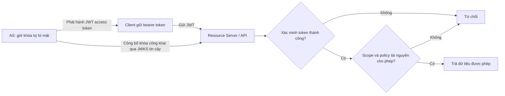
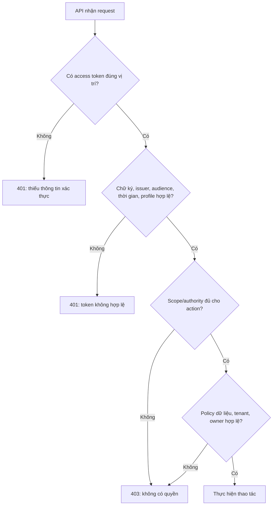
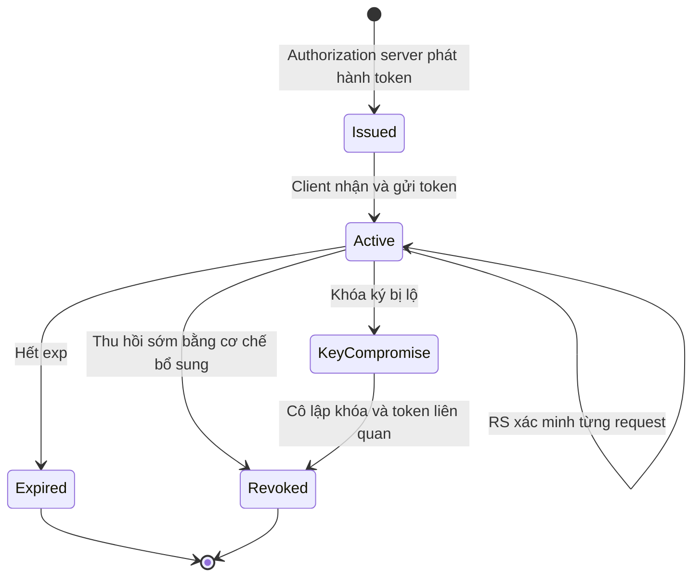

# Self-contained token — Token tự chứa thông tin

**Self-contained token** (token tự chứa thông tin) là token mang đủ những thông tin cần thiết để **bên nhận có thể xác minh token và diễn giải quyền được cấp theo hợp đồng đã thống nhất**, thường không phải hỏi lại authorization server về nội dung token trong **mỗi** yêu cầu. Ví dụ phổ biến là **JWT access token được ký số**: API kiểm tra chữ ký bằng khóa tin cậy, kiểm tra issuer, audience, thời hạn, loại token và scope trước khi xử lý yêu cầu.

Tính chất *self-contained* giúp giảm số lượt tra cứu trạng thái token và hỗ trợ hệ thống phân tán, nhưng không bảo đảm token tự nó chứng minh **mọi** quyền nghiệp vụ hiện tại. Chữ ký đúng chưa đủ để cho phép xem dữ liệu của người khác; claims có thể cũ, token có thể bị đánh cắp và việc thu hồi trước hạn cần cơ chế bổ sung.

Trong chương **Token types** của module **SECURITY_TOKEN_SECURITY_FUNDAMENTALS**, bài học đặt token tự chứa trong mô hình tin cậy và vòng đời token bảo mật: phân biệt JWT với opaque token, access token với refresh token và ID token trong OAuth 2.0/OIDC; từ phát hành, kiểm tra claims, scope, audience, lưu trữ, thu hồi đến phòng chống token bị đánh cắp hoặc phát lại.

## 1. Mục tiêu học tập

Sau bài học, bạn có thể:

1. Giải thích self-contained token là **một đặc tính thiết kế**, khác với **mục đích** của access/refresh/ID token và **định dạng** JWT/opaque.
2. Mô tả JWT ký số (JWS), JWT mã hóa (JWE) và ý nghĩa các claims khi API xác minh.
3. Trình bày cách authorization server phát hành token và cách resource server xác minh token bằng khóa đã được tin cậy.
4. Phân biệt xác minh token với phân quyền nghiệp vụ; chỉ ra vấn đề dữ liệu quyền đã thay đổi nhưng token còn hạn.
5. Đánh giá hiệu năng, tính sẵn sàng, độ trễ thu hồi và mức độ phơi lộ dữ liệu khi chọn self-contained hay reference/opaque token.
6. Lập chính sách thời hạn, thu hồi, xoay khóa, giới hạn phạm vi, lưu trữ và chống replay phù hợp.
7. Thiết kế kiểm thử để phát hiện lỗi chữ ký, audience, algorithm, token type, scope và quyền trên tài nguyên.

## 2. Hiểu đúng khái niệm “tự chứa”

### 2.1. Tự chứa thông tin nào?

Token có thể chứa những dữ liệu như:

- **Issuer (`iss`)**: bên có thẩm quyền phát hành token.
- **Subject (`sub`)**: chủ thể mà token nói đến, có thể là người dùng hoặc thực thể khác tùy loại token.
- **Audience (`aud`)**: API/bên nhận được phép dùng token.
- **Lifetime (`iat`, `nbf`, `exp`)**: mốc phát hành, bắt đầu và kết thúc hiệu lực.
- **Scope/authority**: quyền truy cập đã cấp theo hợp đồng token.
- **Các claims bổ sung được phê duyệt**: client ID, tenant hoặc thuộc tính khác thực sự cần cho bên nhận.

Với một **JWT access token ký số**, API có thể xác minh nguồn phát hành và tính toàn vẹn rồi đánh giá claims ngay tại chỗ bằng khóa công khai tin cậy. Không cần gửi nguyên token về authorization server cho từng lần gọi chỉ để biết `sub` hoặc `scope` là gì.

Tuy nhiên, “tự chứa” **không có nghĩa**:

- Token tự tạo ra lòng tin; **bên nhận vẫn phải có cấu hình issuer, khóa và quy tắc xác minh tin cậy**.
- Token luôn được mã hóa; **JWT dạng JWS thông dụng có payload đọc được**.
- Token chứa tất cả thông tin người dùng, mật khẩu hoặc mọi vai trò đang có; chỉ nên chứa claims cần thiết.
- Token luôn được chấp nhận tới `exp`; hệ thống có thể có cơ chế thu hồi sớm.
- Token tự chứng minh quyền truy cập một bản ghi; resource server vẫn phải kiểm tra quyền theo đối tượng, tenant và điều kiện nghiệp vụ.

### 2.2. Ba trục phân loại khác nhau

| Trục | Câu hỏi | Ví dụ |
| --- | --- | --- |
| **Mục đích** | Token được sử dụng để làm gì? | Access token gọi API; refresh token đổi token; ID token cho OIDC client |
| **Định dạng** | Token được biểu diễn thế nào? | JWT, opaque string, định dạng khác theo giao thức |
| **Cách xác minh** | Bên nhận có thể tự xác minh thông tin hay phải tra cứu nơi phát hành? | Self-contained bằng chữ ký/claims; reference token qua introspection hoặc lookup |

Một **JWT access token** thường là self-contained, nhưng **JWT không đồng nghĩa với access token**. OIDC ID token cũng là JWT, song được cấp cho client để mô tả việc xác thực, **không phải credential thay thế access token tại API**. Refresh token có thể dùng nhiều định dạng; client thường phải coi refresh token là bí mật không cần diễn giải.

Một chuỗi **opaque** không cho client/API biết cấu trúc bên trong; API thường tra cứu hiệu lực và metadata tại introspection endpoint. Ngược lại, ngay cả khi một hệ thống đóng gói dữ liệu dưới dạng JWT, nếu quy trình phân quyền buộc API tra cứu trạng thái server với mọi request thì lợi ích xác minh độc lập của JWT giảm đi. Hai cách thiết kế có thể kết hợp vì yêu cầu thu hồi hoặc phân quyền cập nhật.

## 3. Cấu trúc JWT self-contained: ký số khác mã hóa

### 3.1. JWT ký số dưới dạng JWS

Trong trường hợp thường gặp, JWT ở dạng JWS compact serialization gồm ba phần:

```text
BASE64URL(protected-header).BASE64URL(payload).BASE64URL(signature)
```

**Header** mô tả thông tin phục vụ xác minh (ví dụ `alg`, `kid`, đôi khi `typ`). **Payload** chứa claims. **Signature** chứng minh tính toàn vẹn và nguồn ký khi được xác minh đúng bằng thuật toán, khóa và issuer đáng tin.

Ví dụ payload **minh họa**, không phải token được ký và không thể dùng để truy cập dịch vụ:

```json
{
  "iss": "https://auth.example.test",
  "sub": "user-42",
  "aud": "orders-api",
  "iat": 1800000000,
  "nbf": 1800000000,
  "exp": 1800000900,
  "jti": "example-access-token-5e7a",
  "client_id": "storefront",
  "scope": "orders:read orders:create"
}
```

Trong nhiều profile JWT access token, `typ` của protected header có thể được dùng để nhận diện đây là access token, chẳng hạn `at+jwt` theo profile tương ứng. Phải xác minh **đúng profile token được triển khai**, vì không phải mọi nhà cung cấp đều sử dụng cùng claim/header cho mọi loại token.

**Base64URL không bảo mật nội dung.** Người có token dạng JWS có thể đọc payload mà không cần khóa ký. Vì thế không nhúng mật khẩu, bản băm mật khẩu, refresh token, private key, OTP hoặc dữ liệu cá nhân không cần thiết vào payload.

### 3.2. JWT mã hóa dạng JWE

JWT có thể được mã hóa với JWE. Dạng JWE compact thường có **năm phần**, khác JWS ba phần. JWE cung cấp tính bí mật cho bên không có khóa giải mã; tuy nhiên API vẫn phải xác minh các điều kiện về bên phát hành, người nhận, thời gian và quyền, cùng các yêu cầu về tính toàn vẹn/xác thực của cấu hình JWE.

**Self-contained token không bắt buộc là JWS, và JWE không biến token thành hoàn toàn an toàn.** Bên được cấp quyền giải mã vẫn nhìn thấy payload. Thiết kế không nên đưa bí mật không cần thiết vào token rồi dựa vào mã hóa để giảm hậu quả.

### 3.3. Dữ liệu trong token là một “ảnh chụp” tại thời điểm phát hành

Giả sử token có claim `role: manager` và `exp` sau 15 phút. Năm phút sau, người dùng bị thu hồi quyền manager tại cơ sở dữ liệu. Nếu API **chỉ** dựa vào role trong JWT đã ký, token cũ có thể tiếp tục thể hiện quyền manager tới khi hết hạn.

Đây không phải lỗi chữ ký: JWT xác thực rằng claim đã được **phát hành** bởi issuer và chưa bị sửa, **không** bảo đảm claim luôn phản ánh trạng thái nghiệp vụ **ở hiện tại**.

Với quyền có thể thay đổi khẩn cấp, cần lựa chọn một hoặc nhiều cơ chế: thời hạn ngắn, tra cứu quyền động, denylist, phiên bản quyền/phiên, hoặc introspection. Quyết định phụ thuộc yêu cầu thu hồi và tải hệ thống.

## 4. Mô hình tin cậy trong OAuth 2.0/OIDC

Các vai trò thường có:

- **Resource owner**: thường là người dùng hoặc chủ sở hữu dữ liệu.
- **Client**: ứng dụng xin và sử dụng quyền truy cập.
- **Authorization server (AS)**: xác thực/ủy quyền theo luồng phù hợp và phát hành token.
- **Resource server (RS)**: API bảo vệ tài nguyên, xác minh access token và thực thi chính sách phân quyền.
- **OIDC client / relying party**: kiểm tra ID token để biết kết quả xác thực danh tính theo quy tắc OIDC.

```mermaid
sequenceDiagram
    actor U as Người dùng
    participant C as Client
    participant AS as Authorization Server
    participant RS as Orders API
    U->>C: Yêu cầu truy cập đơn hàng
    C->>AS: Luồng OAuth 2.0/OIDC được ủy quyền
    AS->>AS: Xác thực và xét phạm vi quyền
    AS-->>C: Access token ký số, có aud=orders-api
    C->>RS: Authorization: Bearer access_token
    RS->>RS: Xác minh chữ ký, iss, aud, exp và loại token
    RS->>RS: Kiểm tra scope và quyền đơn hàng
    RS-->>C: Kết quả được phép hoặc từ chối
    Note over AS,RS: API có thể cache khóa ký công khai; không cần introspection cho từng request
```

**Điểm chính:** JWT self-contained có thể được kiểm tra cục bộ tại RS, nhưng RS **không tự quyết định mình tin bất kỳ khóa nào do token cung cấp**. RS phải cấu hình issuer tin cậy và cách lấy khóa từ metadata/JWKS tương ứng qua kênh được bảo vệ.

### 4.1. “Không cần gọi AS mỗi request” có nghĩa gì?

Khi RS đã có bộ khóa công khai phù hợp trong cache, RS có thể xác minh chữ ký và claims cục bộ. Thỉnh thoảng RS vẫn cần:

1. Tải hoặc cập nhật JWKS khi khóa được xoay vòng.
2. Đồng bộ cấu hình issuer/audience và profile token.
3. Tra cứu quyền nghiệp vụ biến động tại service hoặc cơ sở dữ liệu.
4. Hỏi trạng thái phiên/token nếu hệ thống áp dụng kiểm soát thu hồi trực tuyến.

Do đó không nên quảng bá self-contained token như giải pháp “không bao giờ cần mạng”. Lợi ích thực tế là **giảm phụ thuộc vào một điểm kiểm tra token tập trung trên đường đi của mỗi request**, tùy chính sách.

### 4.2. Trust boundary cần xác định rõ



Chữ ký số giúp các API xác minh token bằng **khóa công khai**, trong khi authorization server giữ **khóa riêng**. Với chữ ký đối xứng như HMAC, bên xác minh phải nắm cùng secret dùng để ký, nên cần cân nhắc nguy cơ mở rộng quyền phát hành token cho nhiều dịch vụ. Không chọn thuật toán chỉ theo hiệu năng; chọn theo mô hình tin cậy và khả năng quản lý khóa.

## 5. Quy trình phát hành self-contained access token

Một quy trình cấp token điển hình:

1. **Xác thực client/chủ thể** theo OAuth 2.0/OIDC grant phù hợp (ví dụ Authorization Code + PKCE cho ứng dụng có người dùng; Client Credentials cho service-to-service khi thích hợp).
2. **Đánh giá quyền**: xác định client được cấp audience và scope nào; không tự chấp nhận scope do client tự khai báo.
3. **Chọn claims tối thiểu**: issuer, subject/client, audience, thời điểm, scope và thuộc tính cần thiết theo hợp đồng token.
4. **Giới hạn thời gian sống**: đặt `exp` phù hợp mức rủi ro; cân nhắc `nbf`, `iat`, `jti` theo profile.
5. **Ký bằng khóa được quản lý an toàn**: thuật toán nằm trong danh sách cho phép, khóa có vòng đời và định danh ổn định.
6. **Trả đúng token cho đúng client** qua TLS; refresh token, ID token được cấp riêng nếu luồng và chính sách yêu cầu.
7. **Ghi sự kiện phát hành an toàn**: chỉ ghi metadata cần thiết để điều tra; không log nguyên token.

Các yếu tố làm token tự chứa không trở thành “túi thông tin người dùng”: không serialize nguyên `UserEntity`; không đưa mật khẩu/bản băm, khóa bí mật, địa chỉ, lịch sử giao dịch hoặc mọi quyền tương lai vào token chỉ vì tiện truy vấn.

### 5.1. Ví dụ thay đổi scope và audience

Giả sử client `storefront` cần hiển thị danh sách đơn. AS có thể phát hành access token cho audience `orders-api` với scope `orders:read`. Khi client muốn gọi `billing-api`, RS billing phải **từ chối** token vì sai audience, ngay cả khi JWT được cùng issuer ký.

Để gọi billing, client cần được cấp access token **dành cho billing** theo cơ chế được AS cho phép, với scope thích hợp. Không tạo token “dùng cho mọi API” chỉ để giảm số lượng token nếu rủi ro không chấp nhận được.

### 5.2. Access token, ID token, refresh token là những vai trò khác nhau

| Token | Người nhận chính | Chức năng | Quan hệ với self-contained |
| --- | --- | --- | --- |
| **Access token** | Resource server/API được chỉ định | Truy cập tài nguyên đã được cấp quyền | Có thể là JWT self-contained hoặc opaque/reference |
| **ID token** | OIDC client | Mô tả kết quả xác thực người dùng | Là JWT, nhưng **không phải access token cho API** |
| **Refresh token** | Token endpoint của AS | Xin access token mới trong giới hạn chính sách | Có thể mang định dạng khác nhau; client không nên giải mã để tự quyết định quyền |

RS phải có quy tắc phân biệt loại token được phép nhận. Việc dùng ID token thay access token là **token substitution/token confusion** và có thể khiến API chấp nhận một token phát cho đối tượng khác.

## 6. Kiểm tra JWT self-contained ở resource server

Không tự viết hàm xác minh chữ ký bằng cách “decode hai phần đầu và so sánh chuỗi”. Hãy dùng thư viện đã được kiểm chứng, cấu hình theo issuer và profile token cụ thể.

### 6.1. Checklist kiểm tra tại mỗi yêu cầu

| Kiểm tra | Ý nghĩa | Nếu bỏ qua |
| --- | --- | --- |
| **Issuer `iss`** | Chỉ tin AS đã cấu hình | Chấp nhận token từ nơi phát hành khác |
| **Thuật toán và khóa ký** | Chỉ thuật toán/key type được cho phép; chữ ký hợp lệ | Algorithm confusion, bỏ qua xác minh hoặc dùng khóa giả |
| **Audience `aud`** | Token dành chính xác cho RS này | Dùng token API A gọi API B |
| **Thời hạn `exp`, `nbf`** | Chỉ chấp nhận trong cửa sổ hiệu lực | Sử dụng token hết hạn/chưa được phép |
| **Token type/profile** | Phân biệt JWT access token với ID token và profile khác | Token substitution |
| **Client/subject context** | Chủ thể phù hợp yêu cầu/luồng cấp token | Dùng quyền của dịch vụ như quyền của người dùng |
| **Scope/authority** | Được cấp quyền cần cho action | Gọi thao tác ngoài phạm vi được cấp |
| **Resource-level policy** | Đúng chủ sở hữu, tenant và trạng thái | Truy cập dữ liệu đối tượng khác dù scope đúng |
| **Thu hồi, nếu áp dụng** | Token/phiên còn được chấp nhận theo chính sách | Token đã bị khóa vẫn dùng được |

Lưu ý:

- `iat` (issued at) và `jti` (JWT ID) **không tự ngăn** replay; chỉ hữu ích nếu hệ thống có chính sách kiểm tra tương ứng.
- Không phải mọi claim là bắt buộc cho mọi định dạng. Điều kiện bắt buộc do profile/issuer/RS quy định.
- Sai lệch đồng hồ (*clock skew*) chỉ nên được chấp nhận trong giới hạn nhỏ, có cấu hình; không bỏ kiểm tra expiry.
- Không lấy issuer, URL JWKS hoặc bộ thuật toán tin cậy trực tiếp từ token chưa xác minh.
- Khi parse header, `kid` chỉ được dùng để chọn khóa **trong tập khóa đã tin cậy**; không cho token tùy ý yêu cầu tải `jku`, `x5u` đến máy chủ lạ.
- Không chấp nhận `alg: none` hoặc thuật toán ngoài allowlist cho token ký số bắt buộc chữ ký.

### 6.2. Luồng xử lý quyết định



Ở một số API, trả `404` thay `403` có thể tránh tiết lộ tài nguyên tồn tại. Quan trọng là truy cập trái phép vẫn bị ngăn và không tạo side effect.

### 6.3. Mã giả xác minh và phân quyền

```text
handleRequest(request):
    raw = getBearerTokenFromAuthorizationHeader(request)
    if raw is missing:
        return HTTP_401

    claims = trustedJwtVerifier.verify(
        token = raw,
        trustedIssuer = "https://auth.example.test",
        expectedAudience = "orders-api",
        allowedAlgorithms = configuredAlgorithms,
        trustedJwks = configuredIssuerJwks,
        requiredTokenProfile = accessTokenProfile,
        validateTime = true
    )
    if verification failed:
        return HTTP_401

    if not scopeAllows(claims, request.action):
        return HTTP_403

    resource = loadResourceFromAuthoritativeStore(request.resourceId)
    if not policyAllows(claims.subject, claims, request.action, resource):
        return HTTP_403

    return performAuthorizedOperation(resource)
```

Đây là mô hình logic, **không phải hàm mật mã tự triển khai**. Thực tế việc lấy và xác minh JWT, ràng buộc thuật toán, kiểm tra issuer/audience/expiry cần dựa trên thư viện framework và cấu hình có kiểm thử. Đặc biệt, `trustedJwtVerifier` phải **thất bại an toàn** nếu không tải được khóa mới, token không có khóa phù hợp hoặc định dạng sai.

## 7. Ví dụ Java Spring Security: cấu hình issuer và audience

Với Spring Security Resource Server, có thể cấu hình `JwtDecoder` để xác minh token từ một issuer tin cậy, kiểm tra audience, và chỉ chấp nhận thuật toán phù hợp. Ví dụ khái niệm sau dùng JWKS URL được khai báo sẵn trong cấu hình ứng dụng:

```java
@Configuration
@EnableWebSecurity
class ResourceServerSecurity {

    private static final String ISSUER = "https://auth.example.test";
    private static final String AUDIENCE = "orders-api";
    private static final String JWKS =
        "https://auth.example.test/.well-known/jwks.json";

    @Bean
    JwtDecoder jwtDecoder() {
        NimbusJwtDecoder decoder = NimbusJwtDecoder
            .withJwkSetUri(JWKS)           // URI được cấu hình tin cậy
            .jwsAlgorithm(SignatureAlgorithm.RS256)
            .build();

        OAuth2TokenValidator<Jwt> standard =
            JwtValidators.createDefaultWithIssuer(ISSUER);

        OAuth2TokenValidator<Jwt> audience = jwt ->
            jwt.getAudience().contains(AUDIENCE)
                ? OAuth2TokenValidatorResult.success()
                : OAuth2TokenValidatorResult.failure(
                    new OAuth2Error(
                        "invalid_token", "Invalid audience", null
                    )
                );

        decoder.setJwtValidator(
            new DelegatingOAuth2TokenValidator<>(standard, audience)
        );
        return decoder;
    }

    @Bean
    SecurityFilterChain apiSecurity(HttpSecurity http) throws Exception {
        http
            .authorizeHttpRequests(auth -> auth
                .requestMatchers(HttpMethod.GET, "/api/orders/**")
                    .hasAuthority("SCOPE_orders:read")
                .anyRequest().denyAll()
            )
            .oauth2ResourceServer(oauth -> oauth.jwt(Customizer.withDefaults()));
        return http.build();
    }
}
```

Mã minh họa cần imports và phiên bản Spring Security tương thích. `ISSUER`, `JWKS`, audience, thuật toán và mapping scope phải được cấu hình đúng với token profile của hệ thống; ví dụ không bao gồm toàn bộ policy ứng dụng. Một số profile yêu cầu thêm xác minh **loại access token** (`typ` hoặc claim quy định); cần khai báo validator riêng theo issuer/profile thực tế. Chỉ điều chỉnh validator theo hợp đồng token có thật, không tắt bảo vệ mặc định để “nhận cho được token”.

Phần `GET /api/orders/**` mới chỉ cho qua HTTP layer với scope đọc. Trong service vẫn phải xác minh **đúng chủ đơn hàng và tenant**; không dùng scope để ngầm cho phép đọc tất cả đơn.

Ví dụ kiểm soát quyền nghiệp vụ:

```java
public OrderDto getOrderForCaller(
    JwtAuthenticationToken authentication,
    long orderId
) {
    Jwt jwt = authentication.getToken(); // Đã qua JwtDecoder
    String subject = jwt.getSubject();
    String tenantId = jwt.getClaimAsString("tenant_id");

    if (subject == null || tenantId == null) {
        throw new AccessDeniedException("Missing required identity context");
    }

    Order order = orderRepository.findById(orderId)
        .orElseThrow(OrderNotFoundException::new);

    if (!subject.equals(order.getOwnerId())
            || !tenantId.equals(order.getTenantId())) {
        throw new AccessDeniedException("Not authorized for this order");
    }

    return orderMapper.toDto(order);
}
```

Các lớp `OrderRepository`, `OrderNotFoundException` và `OrderMapper` là thành phần giả định. Mục đích của ví dụ là **tách việc xác minh token tự chứa khỏi quyết định quyền trên bản ghi**; không thể xem JWT hợp lệ là giấy phép truy cập mọi dữ liệu.

## 8. Self-contained token so với opaque/reference token

| Tiêu chí | Self-contained JWT access token | Opaque/reference access token |
| --- | --- | --- |
| Mang thông tin | Claims thường có trong payload đã ký | Chuỗi tham chiếu; metadata ở nơi phát hành/kho tra cứu |
| Cách kiểm tra | RS kiểm tra chữ ký và claims cục bộ khi có khóa | RS thường dùng introspection/lookup tin cậy |
| Độ trễ mỗi request | Có thể thấp do không cần round trip kiểm tra token | Có thể cần network và cache; tùy thiết kế |
| Mức phụ thuộc AS khi RS hoạt động | Thấp hơn cho bước xác minh nếu khóa đã cache | Cao hơn nếu tra cứu trực tuyến |
| Thu hồi gần thời gian thực | Cần cơ chế bổ sung ngoài chữ ký và `exp` | Có thể thay đổi trạng thái và thấy qua tra cứu, tùy TTL cache |
| Độ mới của claims | Thường là ảnh chụp khi phát hành | Có thể trả metadata cập nhật tùy hệ thống |
| Lộ nội dung khi token bị nhìn thấy | JWT ký số có payload dễ đọc | Chuỗi opaque không tự bộc lộ claims, nhưng vẫn là bearer credential |
| Độ lớn trên mạng | Có thể dài hơn vì mang nhiều claims/chữ ký | Thường ngắn hơn, tùy implementation |
| Quản lý vận hành | Khóa ký, JWKS, TTL, thu hồi, profile claims | Introspection service, lưu trạng thái, cache, tính sẵn sàng |

**Không có một loại token luôn tốt hơn.** Cần chọn dựa trên yêu cầu thu hồi, độ nhạy dữ liệu, tần suất request, số API, ngân sách latency và khả năng vận hành.

### 8.1. Khi self-contained token thường phù hợp

- Có nhiều resource server cần xác minh cùng một issuer mà không phụ thuộc round trip cho mọi request.
- Quyền có thể cấp trong scope/audience rõ ràng, thời hạn ngắn và chấp nhận một khoảng trễ thu hồi đã kiểm soát.
- Hạ tầng khóa/JWKS và validation được quản lý tốt.
- Claims có thể tối thiểu hóa, không đưa dữ liệu bí mật hoặc thông tin quyền biến động quá nhanh vào payload.

### 8.2. Khi reference/opaque token đáng cân nhắc

- Cần phản ánh trạng thái thu hồi nhanh và có dịch vụ introspection sẵn sàng cao.
- Không muốn phát tán claims qua nhiều client, proxy hoặc resource server.
- Muốn authorization server kiểm soát tập trung metadata/token status.
- Hệ thống chấp nhận chi phí vận hành, độ trễ và cache của tra cứu trực tuyến.

**Cảnh báo về opaque:** chuỗi khó đọc không đồng nghĩa không thể bị đánh cắp hoặc phát lại. Nếu là bearer token, kẻ giữ chuỗi vẫn có thể gọi API đến khi token hết hiệu lực, trừ khi có cơ chế ràng buộc người gửi.

## 9. Vòng đời, thời hạn và thu hồi self-contained token

### 9.1. Vòng đời thực tế



Với JWT tự chứa, **thu hồi trong AS không tự động làm chữ ký của token mất hợp lệ** ở tất cả API. Nếu RS chỉ kiểm tra chữ ký, issuer, audience và `exp`, token đã ký vẫn có thể qua bước xác minh cho đến `exp` dù người dùng đã đăng xuất hoặc mất quyền.

Các chiến lược phổ biến:

| Chiến lược | Cách thực hiện | Đánh đổi |
| --- | --- | --- |
| **TTL access token ngắn** | Giới hạn `exp` gần thời điểm phát hành | Giảm cửa sổ lạm dụng, nhưng không chặn ngay; cần cơ chế refresh |
| **Denylist theo `jti`** | RS/authorizer kiểm tra ID token đã bị cấm | Tăng trạng thái/tra cứu; cần lưu denylist tới lúc token hết hạn |
| **Phiên bản session/token** | Token mang phiên bản, RS đối chiếu nguồn trạng thái tin cậy | Thu hồi theo phiên linh hoạt nhưng tăng phụ thuộc tra cứu hoặc cache |
| **Policy/permission lookup động** | RS kiểm tra quyền hiện tại ngoài claims | Quyền cập nhật hơn, tăng độ trễ và phụ thuộc dữ liệu |
| **Introspection ngay cả với JWT** | RS hỏi nơi phát hành về trạng thái token | Kiểm soát tập trung hơn; giảm lợi ích xác minh cục bộ |
| **Sender-constrained token** | Gắn token với khóa/chứng chỉ bên gửi | Giảm replay token bị sao chép; không thay việc thu hồi quyền |

Không nhầm **refresh token rotation** với thu hồi access token. Rotation giúp phát hiện sử dụng lại refresh token cũ và giới hạn nguy cơ tạo thêm access token; nó **không mặc nhiên vô hiệu hóa** JWT access token đã cấp.

### 9.2. Thời gian sống nên thiết kế thế nào?

Không có một TTL phù hợp mọi hệ thống. Cần xét:

1. **Độ nhạy nghiệp vụ**: xem dữ liệu công khai khác với chuyển tiền hoặc thay đổi quyền.
2. **Khả năng thu hồi sớm**: có denylist, introspection hay chỉ chờ hết hạn?
3. **Tần suất request và hạ tầng**: thời hạn quá ngắn có thể tăng tải token endpoint.
4. **Khả năng refresh an toàn**: refresh token được cất ở đâu, có rotation/reuse detection không?
5. **Thay đổi quyền**: tài khoản và vai trò biến động nhanh đến mức nào?

Ví dụ mang tính minh họa: một access token sống 10–15 phút giúp giảm thời gian có thể sử dụng sau khi bị đánh cắp, nhưng nếu cần **khóa tức thì** khi phát hiện gian lận thì vẫn phải có cơ chế server-side tương ứng.

### 9.3. Xoay khóa ký và JWKS

Authorization server có thể dùng cặp khóa bất đối xứng và công bố khóa công khai trong **JWKS** tại endpoint đáng tin. Quy trình xoay khóa cần phối hợp:

1. Tạo khóa mới trong kho khóa an toàn; giữ private key ở nơi phát hành.
2. Công bố khóa công khai mới để RS có thể nhận diện trước khi AS bắt đầu ký bằng khóa mới.
3. AS phát hành token với khóa mới và `kid` phù hợp.
4. RS cập nhật JWKS cache theo chính sách; dùng `kid` để tìm khóa trong **tập đã tin cậy**.
5. Chỉ bỏ khóa công khai cũ sau khi các token được ký bằng khóa đó đã hết hạn hoặc có chiến lược chuyển tiếp/thu hồi phù hợp.

Nếu private key bị lộ, phải kích hoạt kế hoạch ứng phó sự cố: vô hiệu hóa khả năng ký mới, thay khóa, đánh giá các token đã phát và cách RS chặn token giả mạo. **Rút khóa cũ** có thể gây lỗi cho token hợp lệ đang còn hạn; cần tính toán và chấp nhận tác động này khi khẩn cấp.

RS cần xử lý JWKS endpoint mất kết nối, cache quá hạn và `kid` không tồn tại theo quy tắc an toàn. Không lấy khóa từ một URL do token tự chỉ định và không “bỏ xác minh tạm thời” để tránh downtime.

## 10. Đánh cắp, phát lại và nguyên tắc giới hạn rủi ro

### 10.1. Self-contained thường vẫn là bearer token

Nếu access token là **bearer**, bên nào giữ token đều có thể gửi nó đến API trong giới hạn hiệu lực, trừ khi có ràng buộc người gửi. JWT được ký đúng **không chứng minh** request đang được gửi bởi client hoặc người dùng ban đầu.

Các nguồn rò rỉ phổ biến:

- JavaScript độc hại (XSS) đọc token lưu trong browser hoặc gọi API trong ngữ cảnh phiên.
- Token lộ qua log, trace, analytics, URL hoặc công cụ gỡ lỗi.
- Máy chủ ứng dụng/proxy bị xâm nhập, memory dump hoặc backup không bảo vệ.
- Thiết bị mobile bị xâm nhập; token được sao chép ngoài kho lưu an toàn.

Phòng ngừa theo nhiều lớp: TLS, không đặt token trong URL, không log nguyên token, hạn chế TTL/scope/audience, hạn chế nơi lưu, bảo vệ XSS/CSRF đúng kiến trúc, bảo vệ khóa ký, phát hiện bất thường và thu hồi theo chính sách.

### 10.2. Sender-constrained token

Một số mô hình dùng **mTLS** hoặc **DPoP** để ràng buộc access token với bên giữ khóa. Với DPoP, client trình bằng chứng ký số ràng buộc request với khóa và các thuộc tính như phương thức, URL, thời gian; server kiểm tra bằng chứng theo profile và gắn nó với khóa đã ràng buộc trong token.

Điều này có thể giảm khả năng **chỉ sao chép chuỗi token** rồi phát lại từ thiết bị khác. Tuy nhiên vẫn cần chống replay đối với proof, bảo vệ khóa của client, kiểm tra đúng URL/method, thời gian/nonce theo cơ chế được chọn. Nếu attacker kiểm soát hoàn toàn client và khóa, ràng buộc không còn là hàng rào tuyệt đối.

Claim `jti` trong JWT tự nó **không** chống replay. Một hệ thống muốn phát hiện token/proof được sử dụng lại phải có chính sách lưu/kiểm tra định danh, nonce, cửa sổ thời gian hoặc tín hiệu tương ứng.

### 10.3. Phòng chống token confusion

Một số lỗi gây chấp nhận token sai bối cảnh:

- Dùng **ID token** có `aud` là client để gọi API.
- Nhận token dành cho API A ở API B chỉ vì chung issuer.
- Chấp nhận một JWT tự ký có cấu trúc chuẩn mà không kiểm chứng issuer/khóa.
- Cho phép token quyết định `alg`, `jku` hoặc vị trí khóa ngoài cấu hình tin cậy.
- Cấp token quá rộng kiểu `aud = all-services` và scope không giới hạn.

Hàng rào cốt lõi là **hợp đồng token rõ ràng cho từng resource server**: issuer, audience, loại token, thuật toán, claims bắt buộc, scope và policy nghiệp vụ.

## 11. Quyền truy cập thay đổi trong lúc token còn hiệu lực

Xét một ứng dụng quản trị nhiều tenant:

1. Lúc 09:00, AS phát hành JWT self-contained cho `user-42`, có `tenant_id = tenant-A` và `scope = reports:read`.
2. Lúc 09:03, quyền truy cập báo cáo của người dùng bị thu hồi trong database.
3. Token vẫn có chữ ký và `exp` hợp lệ đến 09:15.
4. Lúc 09:05, người dùng gửi token đó tới `GET /reports/quarterly`.

Nếu API chỉ kiểm tra chữ ký, expiry và scope, việc thu hồi quyền trong database **chưa chắc đã có hiệu lực**. Các cách xử lý:

- Kiểm tra quyền hiện tại tại nơi lấy báo cáo, độc lập với scope trong token.
- Dùng token sống ngắn nếu nghiệp vụ cho phép chấp nhận khoảng trễ.
- Áp dụng phiên bản quyền/denylist được tra cứu hoặc đồng bộ với cache đủ ngắn.
- Sử dụng introspection cho endpoint rủi ro cao nếu cần trạng thái tập trung.

Trong mọi phương án, phải xác định **độ trễ thu hồi tối đa chấp nhận được** và kiểm thử nó, thay vì giả định JWT tự chứa tự cập nhật quyền.

### 11.1. Kiểm soát đối tượng (BOLA/IDOR)

Token có scope `orders:read` cho phép một loại thao tác, **không mặc nhiên** cho phép đọc mọi đơn hàng. Với request:

```http
GET /api/orders/900 HTTP/1.1
Host: api.example.test
Authorization: Bearer <ACCESS_TOKEN_DA_CAP>
```

API phải kiểm tra `order 900` thuộc đúng người dùng hoặc tenant theo dữ liệu đáng tin. Đây là cách ngăn các lỗi phân quyền mức đối tượng, dù JWT self-contained đã được xác minh hoàn toàn.

## 12. Vận hành, hiệu năng và quan sát

### 12.1. Đo lợi ích thay vì mặc định JWT luôn nhanh hơn

Lợi ích chính thường đến từ việc giảm round trip introspection cho từng request. Tuy nhiên cần đo:

- Độ trễ xác minh chữ ký và cache JWKS tại mỗi RS.
- Kích thước JWT trên đường truyền, đặc biệt nếu có nhiều claims và call API thường xuyên.
- Tỷ lệ refresh token/access token, tải token endpoint.
- Số lượng request cần tra cứu quyền động dù token tự chứa.
- Tần suất tải lại khóa, tình trạng JWKS cache và hiệu ứng khi xoay khóa.
- Thời gian quyền bị thu hồi có hiệu lực tại toàn bộ API.

Không lưu claims lớn hoặc danh sách hàng nghìn quyền trong JWT chỉ để bỏ một truy vấn cơ sở dữ liệu nếu điều đó làm tăng kích thước request, rò rỉ thông tin và độ trễ cập nhật quyền.

### 12.2. Audit và log an toàn

Nên ghi **metadata** phục vụ phân tích, chẳng hạn request ID, tên API, issuer chuẩn hóa, audience, mã kết quả, nguyên nhân từ chối, `kid` đã qua kiểm tra, phiên bản policy, thời gian xác minh và thông tin token ID đã được xử lý theo chính sách.

Tránh ghi nguyên JWT, refresh token, authorization code, thông tin xác thực hoặc payload chứa dữ liệu cá nhân. Phải kiểm soát cả log ở gateway, web server, service, trace và nền tảng hỗ trợ khách hàng.

Những dấu hiệu đáng theo dõi gồm tăng lỗi `invalid_signature`, `invalid_audience`, `expired_token`, `unknown_kid`, refresh reuse, dùng token tại vị trí bất thường, hoặc số lần từ chối sau khi chính sách quyền thay đổi.

## 13. Kiểm thử bắt buộc cho self-contained JWT

| Kiểm thử | Tình huống | Kết quả mong đợi |
| --- | --- | --- |
| Token hợp lệ | Đúng issuer, audience, signature, profile và thời hạn | Qua lớp xác minh; tiếp tục xét quyền nghiệp vụ |
| Sai chữ ký | Payload bị sửa hoặc ký bằng khóa không tin cậy | Từ chối |
| Sai issuer | Token phát hành từ AS khác | Từ chối |
| Sai audience | Token cho `billing-api` gửi tới `orders-api` | Từ chối |
| Sai thuật toán | `alg: none` hoặc alg không được cấu hình | Từ chối |
| Không nhận diện khóa | `kid` lạ, URL khóa ngoài cấu hình | Từ chối và ghi lỗi an toàn |
| Hết hạn/chưa tới hiệu lực | `exp` đã qua hoặc `nbf` ở tương lai | Từ chối |
| Loại token sai | ID token/refresh token gửi đến API nghiệp vụ | Từ chối |
| Thiếu scope | Token có `orders:read`, action là `orders:delete` | Từ chối |
| Sai chủ sở hữu | Token đủ scope nhưng truy cập đơn của user khác | Từ chối |
| Tenant khác | Token cho tenant A nhắm tài nguyên tenant B | Từ chối |
| Quyền bị thu hồi | Quyền đã bị rút trong khi token còn hạn | Theo chính sách thu hồi đã xác định, không tự cho qua |
| Khóa xoay vòng | Token ký bằng khóa cũ còn hạn và khóa mới | Hành vi khớp kế hoạch chuyển đổi khóa |
| JWKS endpoint mất kết nối | Không có khóa tin cậy cần thiết để xác minh | Không bỏ qua xác minh; xử lý lỗi an toàn |
| Token bị lộ qua log | API lỗi, gateway ghi trace | Log không chứa nguyên token/credential |
| Replay | Dùng lại bearer token hoặc DPoP proof theo tình huống | Hành vi theo cơ chế ràng buộc/chống replay đã chọn |

### 13.1. Quy trình thử nghiệm có thể lặp lại

Trên môi trường kiểm thử, tạo **các token giả lập được ký bằng khóa thử nghiệm** và một RS được cấu hình issuer/JWKS thử nghiệm. Thực hiện:

1. Gửi token hợp lệ để quan sát đường đi xác minh và kiểm tra quyền.
2. Đổi `aud` nhưng giữ token được ký hợp lệ để chắc chắn API chặn nhầm audience.
3. Dùng một token sai chữ ký, một token quá hạn và một ID token để xác minh mỗi loại bị từ chối.
4. Đổi resource ID sang dữ liệu của người dùng/tenant khác với scope giữ nguyên.
5. Mô phỏng xoay khóa và mất kết nối JWKS; ghi lại hành vi cache và error handling.
6. Thu hồi quyền ở kho dữ liệu trong khi JWT còn hạn; đo khoảng thời gian trước khi API ngừng cho phép.
7. Rà soát log gateway/service sau mỗi test để chắc chắn không in ra token thật.

Không sử dụng token production trong tài liệu, công cụ giải mã trực tuyến hoặc kịch bản thử nghiệm có thể lộ dữ liệu.

## 14. Bài tập tình huống

### Bài A — Chọn token cho ba API

Một hệ thống thương mại điện tử có:

- `catalog-api` chủ yếu đọc dữ liệu sản phẩm công khai.
- `orders-api` xử lý dữ liệu đơn hàng theo user/tenant.
- `payment-api` thực hiện nghiệp vụ nhạy cảm, có yêu cầu thu hồi quyền nhanh.

Hãy đề xuất liệu mỗi API nên dùng **JWT self-contained**, **opaque token** hay **kết hợp JWT với kiểm tra trạng thái bổ sung**. Với mỗi lựa chọn, ghi rõ issuer, audience, scope, TTL, chính sách thu hồi và nơi kiểm tra quyền tài nguyên.

**Tiêu chí đạt:** không coi JWT là quyền truy cập tuyệt đối; không gửi access token dành cho orders sang payment; nhận ra payment cần chính sách kiểm soát quyền hiện tại/thu hồi mạnh hơn.

### Bài B — Chẩn đoán lỗi JWT sai audience

Giả sử payload đã ký và xác minh chữ ký thành công có:

```json
{
  "iss": "https://auth.example.test",
  "sub": "user-42",
  "aud": "orders-api",
  "scope": "orders:read",
  "exp": 1800000900
}
```

Ứng dụng gửi token đến `billing-api`. Trả lời:

1. API có thể chấp nhận chỉ vì chữ ký đúng không?
2. Vì sao `scope = orders:read` không giúp quyền gọi billing?
3. Khi cần dùng billing, token mới phải đáp ứng những điều kiện nào?

**Gợi ý:** billing phải kiểm tra mình là audience hợp lệ; access token cần được AS cấp cho billing với scope phù hợp, rồi API tiếp tục đánh giá policy nghiệp vụ.

### Bài C — Thu hồi quyền khi token còn hạn

Một nhân viên bị thu hồi quyền lúc 10:00 nhưng JWT access token đã cấp còn hạn tới 10:20. Ứng dụng yêu cầu không được thực hiện tác vụ quản trị ngay sau 10:00.

Hãy lập kế hoạch để **RS thấy trạng thái thu hồi đúng hạn**: lựa chọn cơ chế denylist/phiên bản quyền/tra cứu quyền động hoặc introspection, đánh đổi latency và yêu cầu cache. Viết ba kiểm thử: ngay trước thu hồi, ngay sau thu hồi, và khi nguồn trạng thái bị lỗi.

**Tiêu chí đạt:** phương án không chỉ trông chờ `exp`, không cho qua khi không xác định quyền và nêu được cách kiểm chứng độ trễ thu hồi.

### Bài D — Xử lý nghi token bị đánh cắp

Client web phát hiện JWT access token xuất hiện trong log. Hãy trình bày:

1. Những nơi có thể đã nhận hoặc lưu bản sao.
2. Các thuộc tính có thể giúp giới hạn ảnh hưởng: TTL, audience, scope, sender constraint.
3. Biện pháp thu hồi phiên/refresh token và chặn JWT còn hạn.
4. Cách khắc phục nguồn lộ ở gateway, ứng dụng và hệ thống log.

**Tiêu chí đạt:** phân biệt việc thu hồi refresh token với hiệu lực của access token đã cấp; không đưa nguyên token bị lộ vào ticket hoặc báo cáo.

## 15. Câu hỏi tự kiểm tra

**1. Self-contained token có phải luôn là JWT không?** Không. JWT ký số là trường hợp rất phổ biến, nhưng *self-contained* mô tả cách token mang và cho phép xác minh thông tin; JWT là một định dạng.

**2. Có thể đọc payload JWT ký số mà không có private key không?** Có. Header và payload của JWS thường chỉ được mã hóa Base64URL, không được giữ bí mật bằng chữ ký.

**3. Vì sao JWT hợp lệ vẫn có thể bị từ chối?** Vì sai audience, hết hạn, sai loại token, thiếu scope, thiếu policy hoặc không có quyền trên tài nguyên cụ thể.

**4. JWT self-contained có phải gọi authorization server khi xác minh mỗi request không?** Thường không cần nếu RS đã có khóa tin cậy và chỉ cần xác minh claims; nhưng RS vẫn có thể cần JWKS refresh, tra cứu quyền/thu hồi hoặc dữ liệu nghiệp vụ.

**5. Token hết hạn sau 15 phút có bảo đảm quyền bị thu hồi ngay lập tức không?** Không. Nếu chỉ dùng chữ ký và `exp`, token có thể tiếp tục được chấp nhận cho tới lúc hết hạn.

**6. `jti` tự ngăn token bị replay được không?** Không. Cần có cơ chế giám sát/đối chiếu hoặc sender-constrained proof phù hợp.

**7. Có nên thêm mật khẩu hay toàn bộ hồ sơ người dùng vào JWT để API không phải truy vấn database?** Không. Điều đó làm tăng lộ lọt và khiến claims không phản ánh dữ liệu hiện tại. Chỉ phát hành claims tối thiểu theo hợp đồng token.

**8. Dùng opaque token có loại bỏ nguy cơ bị đánh cắp không?** Không. Opaque bearer token vẫn có thể bị lạm dụng nếu bị sao chép; chỉ khác về cách biểu diễn và xác minh trạng thái.

**9. Xoay khóa ký và thu hồi một token có giống nhau không?** Không. Xoay khóa thay đổi công cụ ký/xác minh, có thể ảnh hưởng nhiều token; thu hồi nhắm hiệu lực token/phiên cụ thể theo cơ chế thiết kế.

**10. ID token OIDC là JWT, vậy API có thể nhận nó thay access token không?** Không. ID token dành cho OIDC client và có mục đích khác. RS phải xác minh đúng loại token và audience của API.

## 16. Checklist trước khi dùng self-contained token trong production

- [ ] Đã xác định rõ **loại token**, issuer, audience, client và profile claims của từng API.
- [ ] AS có cơ chế phát hành/ký số an toàn; khóa riêng được bảo vệ, có kế hoạch xoay khóa và ứng phó sự cố.
- [ ] RS dùng thư viện xác minh JWT tin cậy, khóa/JWKS từ issuer cấu hình sẵn và danh sách thuật toán cho phép.
- [ ] RS kiểm tra **chữ ký, issuer, audience, thời hạn, token type** và các claims bắt buộc trước khi tin thông tin trong token.
- [ ] Có kiểm tra scope và **phân quyền mức tài nguyên/tenant** sau xác minh token.
- [ ] Payload chỉ chứa claims cần thiết; không chứa mật khẩu, bản băm, refresh token hoặc thông tin nhạy cảm không cần dùng.
- [ ] TTL được chọn theo mức rủi ro; có chính sách làm mới và thu hồi phiên/token phù hợp.
- [ ] Đã xác định độ trễ tối đa chấp nhận được khi thu hồi quyền và kiểm thử cơ chế áp dụng.
- [ ] JWKS cache, khóa cũ/mới, lỗi network và token có `kid` lạ đều được xử lý theo chính sách an toàn.
- [ ] Token được truyền qua TLS, lưu phù hợp kiến trúc và không bị ghi nguyên dạng vào log/URL.
- [ ] Có kiểm soát chống replay tương ứng mô hình rủi ro; nếu dùng DPoP/mTLS thì xác minh đầy đủ ràng buộc người gửi.
- [ ] Đã chạy các test sai chữ ký, sai issuer/audience, expiry, token confusion, scope, tenant và thu hồi.

## 17. Tài liệu tiêu chuẩn để học sâu hơn

- **RFC 7519 — JSON Web Token (JWT):** cấu trúc JWT và các claims đã đăng ký như `iss`, `sub`, `aud`, `exp`.
- **RFC 7515 — JSON Web Signature (JWS):** biểu diễn và bảo vệ chữ ký số/MAC cho nội dung.
- **RFC 7516 — JSON Web Encryption (JWE):** biểu diễn và mã hóa nội dung.
- **RFC 8725 — JWT Best Current Practices:** tránh lỗi thuật toán, nhầm lẫn loại token và xác minh sai ngữ cảnh.
- **RFC 9068 — JWT Profile for OAuth 2.0 Access Tokens:** profile JWT access token, gồm cách nhận diện và claims theo giao thức.
- **RFC 7662 — OAuth 2.0 Token Introspection:** cách resource server tra cứu metadata/trạng thái token.
- **RFC 7009 — OAuth 2.0 Token Revocation:** cơ chế yêu cầu thu hồi token.

**Điều cần nhớ:** self-contained token giúp bên nhận **xác minh thông tin đã được phát hành** một cách độc lập hơn. Để quyết định có nên cho phép một request, hệ thống vẫn phải kiểm tra **đúng nơi phát hành, đúng đối tượng nhận, còn hiệu lực, đúng loại token, đủ quyền và đúng tài nguyên**, đồng thời có phương án xử lý khi quyền đổi hoặc token bị lộ.
