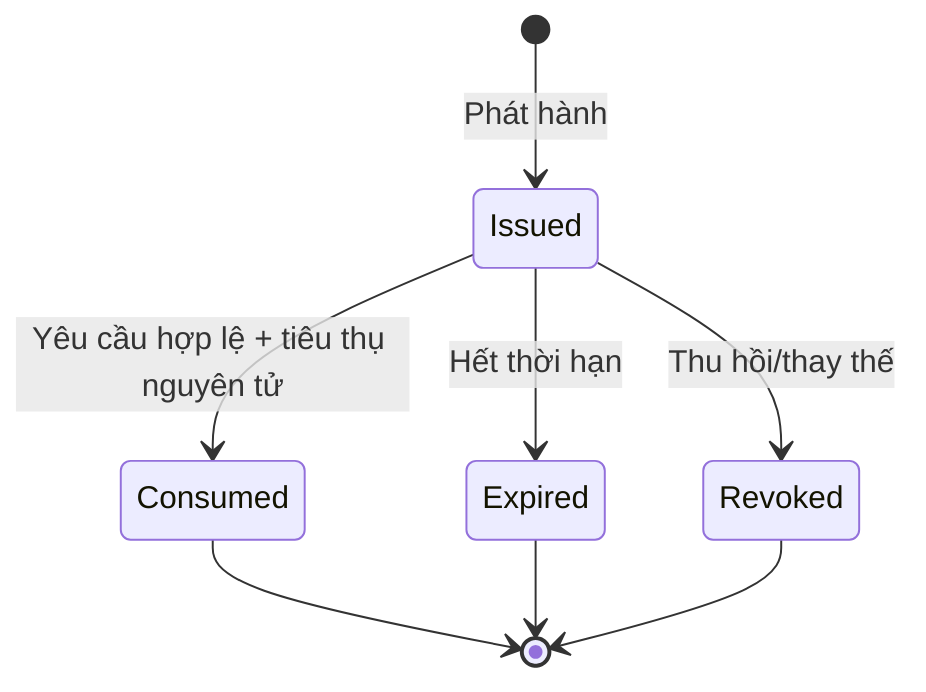
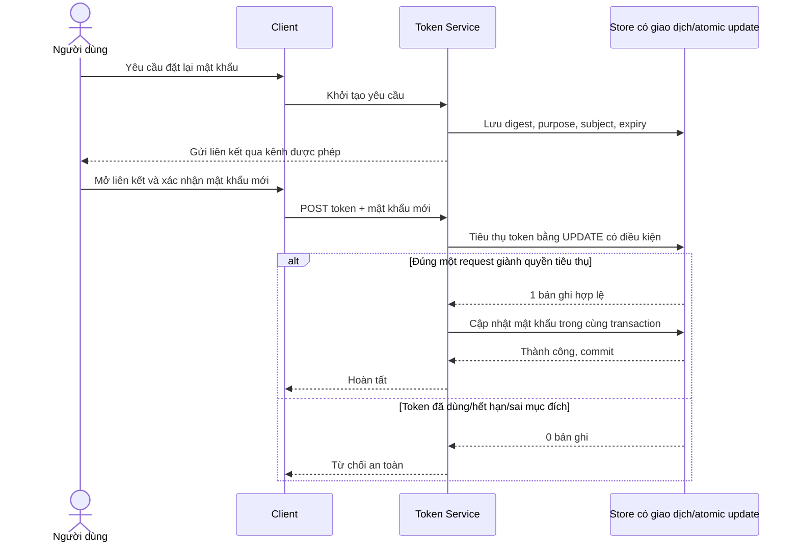
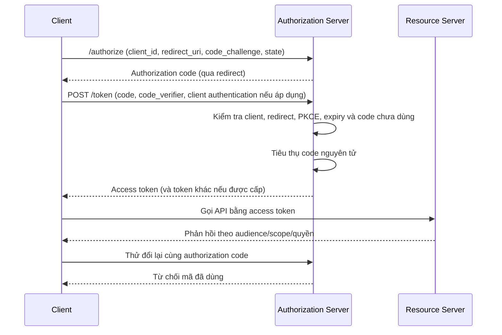

# One-time token: token chỉ được sử dụng một lần

Trong bảo mật ứng dụng, có những thao tác không nên được thực hiện lại chỉ bằng cách gửi lại một bí mật đã từng hợp lệ. Ví dụ: liên kết đặt lại mật khẩu, mã xác minh email, mã đăng nhập qua email hoặc mã ủy quyền trong OAuth 2.0. Nhóm bằng chứng dùng cho những thao tác này thường được gọi là **one-time token** (*token dùng một lần*).

Ý nghĩa của one-time token không nằm ở việc chuỗi token trông như thế nào mà ở **quy tắc sử dụng**: token chỉ được chấp nhận để thực hiện **một lần chuyển trạng thái được cho phép**, cho đúng mục đích, đúng đối tượng, trong khoảng thời gian hiệu lực; những lần dùng lại phải bị từ chối. Để bảo đảm quy tắc đó, hệ thống thường cần trạng thái sử dụng phía server và thao tác đánh dấu đã dùng **nguyên tử (atomic)**.

Bài học thuộc nhóm **Token types** của module **SECURITY_TOKEN_SECURITY_FUNDAMENTALS**. Nội dung liên hệ one-time token với mô hình tin cậy giữa client, authorization server, resource server; phân biệt JWT và opaque token, access token và refresh token; giải thích phát hành, kiểm tra, lưu trữ, thu hồi, cũng như cách chống token bị đánh cắp hoặc phát lại trong các luồng xác thực và phân quyền OAuth 2.0/OIDC.

## 1. One-time token là gì?

**One-time token** là một bằng chứng bảo mật được phát hành cho **một mục đích cụ thể** và có thể được chấp nhận tối đa **một lần** theo các quy tắc của bên phát hành/tiêu thụ. Sau lần tiêu thụ thành công, token không còn được dùng để khởi tạo thêm một hành động mới.

Ví dụ:

- Một liên kết đặt lại mật khẩu chỉ được hoàn tất một lần.
- Một mã xác minh địa chỉ email chỉ được chấp nhận cho địa chỉ đã được yêu cầu xác minh.
- Một mã mời tham gia tổ chức chỉ được dùng đúng số lần quy định, nếu là vé mời *dùng một lần*.
- Một **authorization code** trong OAuth 2.0 chỉ được đổi lấy token một lần và phải được ràng buộc với client cùng các điều kiện của luồng.
- Một mã OTP có thời hạn ngắn chỉ được chấp nhận cho một sự kiện xác thực, với cơ chế chống phát lại.

Chữ **one-time** không có nghĩa token *tự xóa khi được đọc* hoặc *tự động không thể dùng lại vì nó là JWT*. Định dạng token và chính sách tiêu thụ là hai khía cạnh khác nhau.

### 1.1. Phân biệt với các thuộc tính thường bị nhầm

| Khái niệm | Ý nghĩa | Đã bảo đảm chỉ dùng một lần chưa? |
| --- | --- | --- |
| **Short-lived** | Token hết hạn sau thời gian ngắn | **Chưa**. Trong 5 phút hợp lệ, cùng token có thể bị gửi nhiều lần |
| **One-time** | Một lần tiêu thụ thành công, sau đó từ chối lần tiếp theo | **Có**, nếu được triển khai với trạng thái/kiểm tra nguyên tử đáng tin |
| **Single-purpose** | Token chỉ dùng được cho một loại hành động | **Chưa**. Vẫn có thể bị phát lại trong cùng mục đích |
| **Bound token** | Token gắn với client, thiết bị, phiên hoặc khóa | **Chưa**. Có thể dùng nhiều lần bởi bên sở hữu hợp lệ |
| **JWT** | Định dạng token chứa claims, có thể được ký | **Chưa**. Chữ ký không ghi nhận trạng thái đã tiêu thụ |
| **Opaque token** | Chuỗi không mang cấu trúc claim có thể giải nghĩa trực tiếp với bên nhận | **Chưa**, nhưng dễ dùng làm khóa tra cứu trạng thái phía server |
| **Idempotency key** | Nhận diện một yêu cầu để hệ thống xử lý trùng lặp một cách nhất quán | **Không đồng nghĩa**. Có thể trả lại kết quả cũ cho cùng request thay vì coi đó là quyền mới |

Ví dụ, access token dạng bearer có `exp` sau 10 phút thường **được dùng nhiều lần** để gọi API trong 10 phút đó. Nếu muốn hạn chế token bị đánh cắp, chỉ giảm `exp` không tạo ra tính dùng một lần. Ngược lại, một mã xác nhận giao dịch có thể được cấp hiệu lực 3 phút **và** buộc chỉ tiêu thụ một lần.

## 2. Những trường hợp sử dụng phổ biến

| Tình huống | Token đại diện cho điều gì? | Điều kiện ràng buộc nên có | Kết quả của lần dùng hợp lệ |
| --- | --- | --- | --- |
| **Password reset** | Quyền thực hiện quy trình đặt lại mật khẩu cho tài khoản xác định | Tài khoản, mục đích `PASSWORD_RESET`, hạn ngắn, phiên bản yêu cầu | Đổi mật khẩu và vô hiệu hóa mã reset |
| **Email verification** | Quyền chứng minh người nhận kiểm soát hộp thư đích tại bước xác minh | User, địa chỉ email đích, mục đích `EMAIL_VERIFY` | Đánh dấu đúng địa chỉ email đã được xác minh |
| **Magic link** | Quyền hoàn tất một bước đăng nhập không mật khẩu | Principal/địa chỉ đích, client, luồng và yêu cầu đăng nhập cụ thể | Tạo phiên đăng nhập theo chính sách |
| **Invitation** | Quyền chấp nhận lời mời của một chủ thể | Mã mời, tổ chức, vai trò tối đa, người nhận, hạn | Chấp nhận lời mời một lần |
| **Transaction approval** | Quyền xác nhận một giao dịch cụ thể | Transaction ID, số tiền/đối tượng nhận, người phê duyệt, thời gian | Chuyển trạng thái giao dịch một lần |
| **OAuth authorization code** | Quyền đổi mã cấp phép thành token tại authorization server | Client, redirect URI, PKCE, quyền đã được cấp, thời gian | Đổi code một lần tại token endpoint |

Các luồng này khác nhau về **ai phát hành**, **ai tiêu thụ**, **người dùng đang chứng minh điều gì**, và **hành động nào được phép**. Không nên tạo một loại token chung rồi chấp nhận nó ở mọi endpoint chỉ vì nó chưa hết hạn.

## 3. Vòng đời của one-time token

Vòng đời tham khảo:



Các trạng thái có ý nghĩa:

1. **Issued:** tạo bí mật đủ khó đoán; lưu bản ghi gồm mục đích, chủ thể, thời hạn và các ràng buộc cần thiết.
2. **Presented:** client gửi token đến endpoint tương ứng qua HTTPS; phía server coi token là dữ liệu chưa đáng tin cho tới khi kiểm tra.
3. **Validated:** kiểm tra token tồn tại, đúng mục đích, đúng đối tượng, đúng client/phiên nếu yêu cầu, chưa hết hạn, chưa thu hồi và chưa dùng.
4. **Consumed:** sau khi thỏa điều kiện, server thực hiện **thao tác thay đổi trạng thái nguyên tử** để các yêu cầu cạnh tranh không cùng được chấp nhận.
5. **Expired/Revoked:** token không còn hợp lệ do hết thời gian, bị vô hiệu hóa, hoặc bị thay bằng một yêu cầu mới theo chính sách.

Nên phân biệt **đã được kiểm tra** và **đã được tiêu thụ**. Hai request song song có thể đều đọc thấy token còn hợp lệ; nếu không có thao tác tiêu thụ nguyên tử, cả hai đều có thể thực hiện hành động.



Trong sơ đồ, bước tiêu thụ và thay đổi mật khẩu **phải được phối hợp trong cùng giao dịch** nếu dùng cùng hệ quản trị dữ liệu. Nếu bước thay đổi nghiệp vụ thất bại, transaction phải rollback cả dấu hiệu tiêu thụ; nếu không, người dùng mất mã nhưng thao tác chưa hoàn tất.

## 4. Thiết kế một token dùng một lần an toàn

### 4.1. Sinh bí mật có entropy đủ cao

Đối với liên kết có token dài, nên tạo token ngẫu nhiên bằng **bộ sinh số ngẫu nhiên an toàn về mật mã (CSPRNG)**, ví dụ 32 byte (256 bit) được mã hóa Base64URL. Không dùng giá trị tuần tự, thời gian hiện tại, UUID có tính dự đoán, `Math.random()`, hoặc chuỗi tự ghép theo email/user ID làm bí mật.

Java minh họa:

```java
import java.security.SecureRandom;
import java.security.MessageDigest;
import java.nio.charset.StandardCharsets;
import java.util.Base64;

public final class OneTimeSecrets {
    private static final SecureRandom RANDOM = new SecureRandom();

    public static String generate() {
        byte[] bytes = new byte[32]; // 256 bit ngẫu nhiên
        RANDOM.nextBytes(bytes);
        return Base64.getUrlEncoder()
                .withoutPadding()
                .encodeToString(bytes);
    }

    public static byte[] digest(String token) throws Exception {
        // Chỉ phù hợp cho bí mật ngẫu nhiên có entropy cao.
        return MessageDigest.getInstance("SHA-256")
                .digest(token.getBytes(StandardCharsets.US_ASCII));
    }
}
```

Một token 32 byte ngẫu nhiên không cần chứa email, tenant, role hay mật khẩu. Server giữ **metadata** tương ứng ở nơi lưu trữ đáng tin. Mã hóa Base64URL chỉ giúp truyền token dễ dàng; **không phải mã hóa bảo mật**.

**OTP sáu chữ số là trường hợp khác:** không gian giá trị nhỏ, dễ đoán vét cạn. Dù dùng CSPRNG để tạo OTP, server phải áp dụng thời hạn ngắn, giới hạn số lần nhập, giới hạn tốc độ theo tài khoản/phiên/IP phù hợp và cơ chế chống phát lại. Không lấy SHA-256 đơn thuần của OTP sáu số rồi cho rằng một bảng hash bị rò sẽ không thể bị đảo bằng thử hết giá trị; cân nhắc lưu giá trị xác minh qua HMAC có khóa máy chủ được bảo vệ hoặc cơ chế đã được tiêu chuẩn hóa. Cả khóa HMAC và tốc độ thử online đều cần bảo vệ.

### 4.2. Lưu token theo cách giảm tác động khi dữ liệu bị lộ

Với token ngẫu nhiên có entropy cao, một cách phổ biến là chỉ lưu **digest SHA-256** của token trong database:

```text
Client nhận:   token bí mật ngẫu nhiên (hiển thị/gửi một lần)
Database lưu: SHA-256(token) + metadata + consumed_at
Request tới:  digest(token được trình) -> tra cứu bản ghi -> đánh giá policy
```

Nếu bảng token bị đọc trái phép, kẻ tấn công không lấy ngay được giá trị token gốc từ digest. Điều này phụ thuộc token thực sự khó đoán. Không ghi **raw token** vào log, trace, crash report hoặc bản ghi kiểm toán.

Một bảng tham khảo:

```sql
CREATE TABLE one_time_tokens (
    id                 UUID PRIMARY KEY,
    token_digest       BYTEA NOT NULL UNIQUE,
    purpose            VARCHAR(40) NOT NULL,
    subject_id         UUID NOT NULL,
    target_identifier  VARCHAR(320),
    client_id          VARCHAR(128),
    resource_id        VARCHAR(128),
    issued_at          TIMESTAMPTZ NOT NULL,
    expires_at         TIMESTAMPTZ NOT NULL,
    consumed_at        TIMESTAMPTZ NULL,
    revoked_at         TIMESTAMPTZ NULL
);
```

Đây là schema minh họa kiểu PostgreSQL. Tùy nghiệp vụ, cần thêm phiên bản yêu cầu, giao dịch được xác nhận, giới hạn thử sai, audit và các chỉ mục thích hợp. **Không dùng tên bảng/field như một giao thức chuẩn**; chúng chỉ thể hiện những ràng buộc nên có.

### 4.3. Bám đúng mục đích và đối tượng

Ngay cả token ngẫu nhiên chưa từng được dùng cũng phải bị từ chối nếu gửi đến sai endpoint:

- Token `EMAIL_VERIFY` không được dùng để đặt lại mật khẩu.
- Token xác minh email mới chỉ hợp lệ cho **địa chỉ email đã gắn với lần phát hành đó**; nếu người dùng đổi email, bản ghi cũ cần bị vô hiệu hóa hoặc không còn thỏa điều kiện.
- Token phê duyệt giao dịch A không được dùng cho giao dịch B, nhất là khi số tiền hay người nhận đã thay đổi.
- Token phát hành cho client A không tự động là bằng chứng để client B đăng nhập.
- Token cho `tenant-a` không được dùng cho `tenant-b`.

Khi thiết kế endpoint, nên truyền mục đích **từ cấu hình endpoint phía server** thay vì chấp nhận một tham số `purpose` do client tự chọn để nới điều kiện. Với giao dịch có thể sửa nội dung, có thể ràng buộc token với **phiên bản giao dịch hoặc digest của thông tin phải được phê duyệt**.

## 5. Bảo đảm tính dùng một lần bằng thao tác nguyên tử

Đây là trọng tâm của one-time token. Mẫu code dễ sai:

```java
// SAI: hai request song song cùng có thể thấy consumedAt == null.
OneTimeToken record = repository.findByDigest(digest);
if (record.getConsumedAt() == null && notExpired(record)) {
    performSensitiveAction();
    record.setConsumedAt(now);
    repository.save(record);
}
```

Vấn đề là **check-then-act race**: kiểm tra và ghi trạng thái nằm ở hai bước độc lập. Trong cụm nhiều instance, `synchronized` trong một JVM cũng không đủ ngăn instance khác xử lý cùng token.

### 5.1. Conditional update ở database

Ví dụ PostgreSQL dùng lệnh cập nhật có điều kiện:

```sql
UPDATE one_time_tokens
SET consumed_at = CURRENT_TIMESTAMP
WHERE token_digest = :digest
  AND purpose = 'PASSWORD_RESET'
  AND subject_id = :expected_subject_id
  AND consumed_at IS NULL
  AND revoked_at IS NULL
  AND expires_at > CURRENT_TIMESTAMP
RETURNING id, subject_id;
```

**Chỉ một yêu cầu** có thể đổi một hàng từ `consumed_at IS NULL` sang đã dùng; các yêu cầu cạnh tranh sau đó nhận **0 hàng**. Phải kiểm tra số hàng trả về trước khi thực hiện tác động nghiệp vụ.

Ví dụ luồng xử lý khi **token và tài khoản ở cùng database**:

```text
BEGIN TRANSACTION
  1. Xác minh định dạng đầu vào và digest token.
  2. UPDATE token ... WHERE chưa dùng/chưa hết hạn/đúng mục đích
     RETURNING bản ghi.
  3. Nếu 0 hàng: ROLLBACK và từ chối.
  4. Kiểm tra metadata, quyền và trạng thái tài khoản còn hợp lệ.
  5. Cập nhật tài khoản bằng thao tác có điều kiện.
  6. Nếu cập nhật nghiệp vụ thất bại: ROLLBACK.
COMMIT
```

Các điều kiện **phải được đánh giá trước commit** và việc tiêu thụ phải gắn với đúng hành động. Đối với thao tác qua service hoặc database khác, không thể giả định một transaction SQL bao trùm được toàn bộ hệ thống: cần thiết kế idempotency, trạng thái xử lý trung gian, outbox/saga hoặc cơ chế nghiệp vụ tương đương để tránh tiêu thụ token mà hành động không hoàn tất.

### 5.2. Dùng Redis hoặc cache phân tán

Redis có thể lưu trạng thái token kèm TTL, nhưng mô hình «`GET` kiểm tra, sau đó `DEL`» riêng lẻ **không nguyên tử**. Cần thao tác nguyên tử phù hợp, chẳng hạn một script Lua hoặc phương án tương đương kiểm tra điều kiện và đổi trạng thái trong một bước. Nếu xóa token bằng `GETDEL`, vẫn phải xử lý mục đích, đối tượng, thời hạn và thay đổi nghiệp vụ phía sau; xóa token thành công **không tự tạo transaction** với database nghiệp vụ.

Nếu TTL hết hạn làm bản ghi không còn tồn tại, kết quả phải là từ chối. Nếu hệ thống cho phép phát lại mã từ nhiều datacenter, cần xác định consistency/race semantics thực tế của kho trạng thái; một cache bị sao chép bất đồng bộ có thể không đáp ứng cam kết «chỉ một request thắng» trên mọi vùng.

## 6. Token opaque, JWT và trạng thái dùng một lần

**One-time** là chính sách sử dụng, không phải cấu trúc token.

| Thiết kế | Điểm mạnh | Điểm cần lưu ý |
| --- | --- | --- |
| **Opaque random token + server-side record** | Dễ tra cứu mục đích, trạng thái, thu hồi và tiêu thụ nguyên tử | Phải có kho trạng thái sẵn sàng và nhất quán |
| **JWT có `jti` và thời hạn ngắn** | JWT có thể chứng minh tính toàn vẹn claims, mang issuer/audience/purpose | **Vẫn phải lưu/check `jti` đã dùng** nếu muốn chặn phát lại; chữ ký và `exp` không đủ |
| **OTP ngắn** | Thuận tiện nhập thủ công | Entropy thấp: cần rate limit, khóa xác minh/giới hạn thử, ngăn replay |
| **Token gắn với một khóa/thiết bị** | Hạn chế bên không có khóa sử dụng được token | Không tự bảo đảm one-time; cần chính sách tiêu thụ và kiểm tra proof |

Một JWT one-time minh họa có thể chứa:

```json
{
  "iss": "https://auth.example.test",
  "aud": "account-service",
  "sub": "user-123",
  "purpose": "EMAIL_VERIFY",
  "jti": "unpredictable-unique-token-id",
  "iat": 1893456000,
  "nbf": 1893456000,
  "exp": 1893456600
}
```

Đây **chỉ là payload minh họa**, không phải JWT được ký. `purpose` là claim ứng dụng tự định nghĩa; `jti` là định danh token. Service phải xác minh **chữ ký, thuật toán, khóa từ issuer tin cậy, `iss`, `aud`, `exp`/`nbf` và các ràng buộc nghiệp vụ**, sau đó kiểm tra `jti` chưa sử dụng rồi **tiêu thụ nguyên tử**. Chỉ thêm `jti` không ngăn phát lại.

Với các tác vụ chỉ cần bí mật tra cứu, opaque token ngẫu nhiên thường đơn giản hơn JWT: không phải phát tán metadata trong payload và có trạng thái tiêu thụ trực tiếp. Đối với các luồng dùng giao thức chuẩn như OAuth 2.0, cần tuân thủ cấu trúc/điều kiện giao thức thay vì thay thế tùy ý bằng token tự chế.

## 7. Authorization code của OAuth 2.0 là một ví dụ quan trọng

**Authorization code** là mã tạm thời do authorization server phát hành để client đổi lấy token tại **token endpoint**. Theo OAuth 2.0, authorization code phải có thời gian sống ngắn, **chỉ dùng một lần** và gắn với client cùng redirect URI phù hợp.

Trong authorization code flow có **PKCE**, client tạo `code_verifier` bí mật cho mỗi luồng, gửi `code_challenge` khi bắt đầu rồi xuất trình `code_verifier` khi đổi code. Authorization server kiểm tra quan hệ giữa chúng, ngăn kẻ chỉ chiếm được authorization code dễ dàng đổi nó thành token.



Một số điểm cần phân biệt:

- **Authorization code:** one-time credential để đổi token tại AS; không được dùng để gọi resource server.
- **Access token:** thông thường cho phép nhiều request đến RS trong thời gian hiệu lực, theo scope và audience; không tự dùng một lần.
- **Refresh token:** dùng để xin access token mới. Khi bật **refresh token rotation**, mỗi lần refresh thành công sẽ cấp refresh token mới và vô hiệu hóa token cũ; bên phát hành có thể phát hiện **reuse** của refresh token cũ và xử lý cả chuỗi token theo chính sách.
- **ID token (OIDC):** bằng chứng xác thực dành cho client/Relying Party; nó không tự trở thành mã one-time và không được dùng thay access token tại API.

Tính một lần của authorization code được AS kiểm soát. Khi có dấu hiệu code bị dùng lặp lại, AS phải xử lý đúng quy tắc an toàn của giao thức; không tự suy ra rằng việc mã đã dùng đủ để biết ai là kẻ tấn công.

### 7.1. Refresh token rotation có giống one-time token?

Có nét tương đồng: refresh token cũ **không được dùng thêm** sau khi đổi thành công trong cơ chế rotation. Nhưng cơ chế quản lý còn bao gồm **token family**, phát hiện tái sử dụng, ràng buộc client, xử lý lỗi mạng và chính sách thu hồi. Vì vậy không nên mặc định rằng mọi refresh token đều là one-time; điều này phụ thuộc thiết kế của AS. Các luồng dành cho public client cần cơ chế bảo vệ refresh token phù hợp với tiêu chuẩn và khả năng của hệ thống.

## 8. OTP và one-time token: giống và khác

**OTP** (*one-time password*) là một loại bằng chứng xác thực dùng một lần, nhưng thường có không gian giá trị nhỏ để người dùng nhập bằng tay. Trong khi đó, link token đặt lại mật khẩu có thể dài hàng chục ký tự và có entropy cao.

| Thuộc tính | Token link ngẫu nhiên dài | OTP số ngắn |
| --- | --- | --- |
| Cách sử dụng | Người dùng nhấp liên kết hoặc client tự điền token | Người dùng đọc và nhập mã |
| Độ dài/entropy | Có thể dùng 128–256 bit ngẫu nhiên | Thường chỉ vài chữ số, độ khó đoán thấp hơn đáng kể |
| Kiểm tra | Digest tra cứu + mục đích/thời hạn/trạng thái | Xác minh mã theo challenge và chống vét cạn/phát lại |
| Rủi ro nổi bật | Rò URL/log, link scanner, phishing, gửi nhầm email | Brute force, phishing, SIM swap nếu dùng SMS, replay |
| Bảo vệ cần thiết | HTTPS, TTL, dùng một lần, không lộ token, ràng buộc mục đích | Tất cả điều kiện liên quan + giới hạn lần thử/rate limit và xử lý khóa an toàn |

Với **TOTP** (mã dựa trên thời gian, RFC 6238), cùng một mã có thể được tính ra trong một bước thời gian và server thường có cửa sổ chấp nhận để bù lệch đồng hồ. Vì vậy, **kiểm tra công thức TOTP đúng chưa đủ để chặn replay**: bộ xác minh phải theo dõi bước thời gian/mã đã chấp nhận cho authenticator phù hợp và từ chối dùng lại trong cửa sổ chấp nhận. Với **HOTP** (RFC 4226), phía xác minh quản lý bộ đếm và phải ngăn chấp nhận lại một mã đã tiêu thụ.

OTP không nhất thiết chống phishing; kẻ tấn công có thể dụ người dùng nhập OTP vào trang giả rồi chuyển tiếp. Khi yêu cầu xác thực chống phishing hoặc bảo đảm cao, cân nhắc các cơ chế như WebAuthn/passkey theo chính sách thay vì cho rằng «dùng một lần» đồng nghĩa «an toàn với mọi hình thức đánh cắp».

## 9. Password reset: ví dụ end-to-end

Giả sử người dùng quên mật khẩu tài khoản. Một luồng giảm rủi ro nên gồm:

1. **Yêu cầu:** người dùng nhập email. Server trả thông điệp trung lập, không tiết lộ tài khoản có tồn tại hay không; áp dụng giới hạn tốc độ hợp lý cho endpoint này.
2. **Phát hành:** nếu tài khoản hợp lệ, tạo token CSPRNG đủ entropy, TTL ngắn (ví dụ 10–15 phút theo chính sách), mục đích `PASSWORD_RESET`, gắn user và có thể với phiên bản yêu cầu hiện hành. Lưu digest, gửi token tới kênh đã xác minh.
3. **Mở liên kết:** người dùng mở trang reset qua HTTPS. **GET để hiển thị biểu mẫu không tự tiêu thụ token**, tránh phần mềm quét email hoặc chức năng preview làm vô hiệu hóa token trước khi người dùng hành động.
4. **Xác nhận:** người dùng gửi token và mật khẩu mới bằng **POST**. Server kiểm tra token còn hạn, đúng mục đích, chưa dùng/chưa thu hồi, đáp ứng chính sách mật khẩu và ràng buộc tài khoản.
5. **Tiêu thụ và cập nhật:** server đánh dấu token đã dùng bằng thao tác nguyên tử và đổi **hash mật khẩu** trong cùng transaction; không lưu mật khẩu dạng rõ.
6. **Hậu xử lý:** cân nhắc vô hiệu hóa các token reset khác, thông báo sự kiện bảo mật đến kênh phù hợp, đánh giá việc thu hồi phiên/refresh token theo rủi ro và chính sách. Đặt lại mật khẩu **không mặc nhiên cấp quyền đăng nhập** cho client trừ khi thiết kế đã quy định rõ.

Ví dụ liên kết:

```text
https://account.example.test/reset-password?token=<high-entropy-secret>
```

Trong thực tế, token trong URL có thể rò qua access log, lịch sử trình duyệt, công cụ phân tích, referrer hoặc tiện ích trình duyệt. Các biện pháp gồm giới hạn trang chỉ tải tài nguyên cần thiết, cấu hình `Referrer-Policy: no-referrer`, tránh analytics/third-party script trên trang nhận token, không log query chứa bí mật và không chèn token vào URL chuyển hướng ngoài domain. Có thể dùng phương án truyền token khác (chẳng hạn chuyển từ URL sang state của trang rồi loại khỏi thanh địa chỉ) theo thiết kế frontend/backend; **không coi việc ẩn khỏi thanh địa chỉ là biện pháp bảo mật duy nhất**.

Đường dẫn reset không nên chấp nhận một tham số `redirect_uri`/`next` tùy ý để chuyển token hoặc người dùng sang miền do kẻ tấn công kiểm soát. Nếu cần redirect, chỉ cho phép đích đã kiểm soát.

### 9.1. Trình quét liên kết trong email

Dịch vụ chống spam và trình xem trước email đôi khi **tự truy cập URL** để kiểm tra an toàn. Nếu endpoint reset/verify tiêu thụ token ngay khi nhận request GET, một bot có thể dùng mất token trước người dùng. Tốt hơn là:

- GET chỉ hiển thị trang xác nhận an toàn, không thực hiện thao tác nhạy cảm.
- POST biểu thị hành động xác nhận thực sự; có kiểm soát CSRF/session phù hợp nếu dùng cookie phiên.
- Token bị tiêu thụ khi backend chấp nhận hành động có ràng buộc nghiệp vụ; không dựa vào user-agent để phân biệt bot với người.

Riêng email verification có thể muốn xác nhận bằng một lần nhấp; nếu môi trường có link scanner, nên dùng trang trung gian yêu cầu hành động rõ ràng trước khi hoàn tất. Điều này cân bằng trải nghiệm và tính một lần.

## 10. Các rủi ro và biện pháp phòng chống

| Rủi ro | Tình huống | Biện pháp |
| --- | --- | --- |
| **Replay** | Kẻ tấn công gửi lại token sau khi một yêu cầu đã thành công | Atomic consume, ghi dấu đã dùng, kiểm tra trên mọi node |
| **Race condition** | Hai request cùng đọc token `unused` rồi đều cho phép | Conditional UPDATE hoặc primitive nguyên tử, transaction/cập nhật có điều kiện |
| **Token guessing** | Đoán token từ thời gian hoặc thử hết OTP | CSPRNG đủ entropy; OTP cần rate limit, giới hạn thử, giám sát |
| **Token theft** | Token lộ qua log, URL, email hoặc XSS | HTTPS, che token, TTL ngắn, storage thích hợp, hạn chế third-party content |
| **Cross-purpose use** | Token email verification được chấp nhận ở endpoint reset | Mỗi token gắn mục đích; endpoint kiểm tra mục đích cố định |
| **Cross-user / cross-tenant** | Token của người A tác động tới tài khoản B | Bind user, tenant, target resource; lấy dữ liệu từ server |
| **Stale challenge** | Email, số điện thoại hoặc giao dịch đã bị thay đổi sau phát hành | Bind phiên bản yêu cầu/tài nguyên; vô hiệu hóa token cũ khi thay đổi |
| **Link prefetch** | Scanner mở URL trước người dùng | Không tiêu thụ trên GET; dùng trang xác nhận và POST |
| **Session confusion** | Kết quả magic login gắn nhầm phiên hoặc client | Bind challenge, client/redirect và trạng thái đăng nhập; kiểm tra phiên |
| **Leak database** | Bảng chứa raw reset token bị truy cập trái phép | Chỉ lưu digest đối với token ngẫu nhiên đủ entropy; bảo vệ dữ liệu và backup |
| **Clock issues** | Node dùng giờ lệch, cùng token bị chấp nhận muộn | Dùng đồng hồ tin cậy, thống nhất nguồn thời gian, expiry kiểm tra phía server |
| **Failure after consume** | Token đã bị đánh dấu dùng nhưng thao tác nghiệp vụ chưa thành công | Transaction cùng database hoặc state machine/outbox và xử lý phục hồi được định nghĩa |
| **Account enumeration** | Endpoint thông báo email có tài khoản hay không | Phản hồi trung lập, giới hạn tốc độ và theo dõi lạm dụng |
| **OTP phishing** | Người dùng nhập OTP vào trang giả | Ràng buộc hành động/ngữ cảnh; chống phishing bằng phương thức mạnh phù hợp |

### 10.1. Đã dùng một lần có chặn được token bị đánh cắp không?

Không hoàn toàn. **Nếu kẻ tấn công lấy token trước và tiêu thụ nó trước người dùng, tính one-time không ngăn được lần dùng đầu tiên của kẻ tấn công**. Thuộc tính này chỉ giới hạn việc tái sử dụng sau khi tiêu thụ. Vì thế còn cần bảo vệ kênh gửi, hạn chế phạm vi, bind với phiên/chủ thể/giao dịch nếu phù hợp, giám sát hành vi bất thường và xác thực bổ sung cho thao tác rủi ro cao.

Với bearer token, bất kỳ bên nào nắm giá trị token có thể thử trình token. Các cơ chế **sender-constrained token** như mTLS/DPoP có thể giảm một số tình huống sử dụng token bị lộ, nhưng **không tự biến token thành one-time**. Trong DPoP, `jti` của proof được dùng cho kiểm soát phát lại proof theo cửa sổ xác minh; điều đó không có nghĩa access token được dùng đúng một request.

## 11. Thiết kế phản hồi và trải nghiệm người dùng

Một dịch vụ tốt phải xử lý đúng trạng thái bảo mật mà vẫn giúp người dùng hoàn thành quy trình:

- **Thành công:** hoàn tất một lần và phản hồi rõ hành động đã được ghi nhận.
- **Token hết hạn:** yêu cầu khởi tạo token mới bằng luồng được phép; không tự gia hạn token cũ chỉ vì nó đã được trình.
- **Token đã dùng:** không cho phép thao tác lần hai. Có thể cung cấp đường dẫn tạo yêu cầu mới hoặc hiển thị trạng thái đã hoàn tất sau xác thực phù hợp, tránh để lộ thông tin tài khoản.
- **Token sai hoặc bị thu hồi:** từ chối an toàn. Với endpoint public, nên tránh lỗi quá chi tiết khiến kẻ tấn công phân biệt tài khoản hoặc đoán trạng thái challenge.
- **Hai request cạnh tranh:** chỉ một request được xử lý thành công; request còn lại không được lặp tác động. Với lỗi mạng sau commit, ứng dụng phải quyết định cách nhận biết kết quả đã hoàn tất mà không tái chấp nhận token.

Không đánh đồng **dùng một lần** với **bắt mọi lần thử lại đều gây lỗi không thể phục hồi**. Có thể dùng trạng thái nghiệp vụ và cơ chế idempotency riêng để trả thông tin phù hợp cho yêu cầu lặp sau khi đã hoàn tất, nhưng tuyệt đối không cấp một quyền mới nhờ cùng token đã tiêu thụ.

## 12. Kiểm thử tính một lần và tính an toàn

Cần kiểm tra cả luồng bình thường lẫn các tình huống cạnh tranh:

| Trường hợp kiểm thử | Dữ liệu đầu vào | Kết quả mong đợi |
| --- | --- | --- |
| Dùng hợp lệ | Token đúng mục đích, chưa dùng, chưa hết hạn | Thao tác thành công đúng một lần |
| Dùng lại sau thành công | Gửi lại cùng token | Bị từ chối, không phát sinh hành động thứ hai |
| Hai request đồng thời | Hai request mang cùng token đến hai instance | Tối đa một request giành quyền tiêu thụ |
| Đúng mốc hết hạn | `now >= expires_at` | Token không hợp lệ |
| Sai mục đích | Token `EMAIL_VERIFY` gửi endpoint reset | Không thực hiện hành động |
| Sai tài khoản/tenant | Token của A dùng cho B | Từ chối |
| Tài nguyên thay đổi | Transaction/challenge đã thay phiên bản | Từ chối hoặc yêu cầu phát hành lại theo chính sách |
| Token đã thu hồi | `revoked_at` có giá trị | Từ chối |
| Mã được xem qua GET | Scanner mở URL | Token chưa bị tiêu thụ, không đổi trạng thái nghiệp vụ |
| Phát hành lại | Tạo challenge mới theo chính sách | Token cũ bị vô hiệu nếu chính sách chỉ cho một challenge hiện hành |
| Bước nghiệp vụ lỗi | Cập nhật mật khẩu thất bại trong transaction | Không commit tiêu thụ token nếu cả hai cùng transaction |
| OTP thử sai liên tục | Nhiều giá trị không hợp lệ | Giới hạn tốc độ/lần thử được áp dụng |
| Token bị log | Yêu cầu đến endpoint có query token | Trace/log không chứa raw token |
| Retry sau mất phản hồi | Commit đã thành công nhưng client timeout | Không thực hiện hành động thứ hai; UX xác định trạng thái an toàn |
| OAuth code dùng lại | Client đổi lại cùng authorization code | AS từ chối theo giao thức; không cấp thêm token mới |

Đối với thời gian, nên inject `Clock` ở test và kiểm tra chính xác hai phía của ranh giới `expires_at`. Đối với tranh chấp, test phải thực sự chạy **đồng thời qua nhiều connection/instance** và kiểm tra trạng thái database cuối cùng; một unit test chạy tuần tự không thể xác nhận điều kiện atomic.

## 13. Checklist trước khi đưa vào production

1. **Mục đích:** token chỉ được chấp nhận ở endpoint đã định; đã bind đúng subject, client, tenant, resource và challenge chưa?
2. **Entropy:** token bí mật có được tạo bằng CSPRNG? Nếu là OTP ngắn, có rate limiting, giới hạn thử và chống replay chưa?
3. **Lưu trữ:** có tránh lưu raw token đối với bí mật ngẫu nhiên đủ mạnh, và tránh log/query/trace chứa token chưa?
4. **Thời hạn:** đã xác định TTL, kiểm tra hết hạn phía server và thu hồi token cũ khi thay đổi yêu cầu chưa?
5. **One-time:** tiêu thụ có thật sự atomic giữa nhiều request/instance không? Bước nghiệp vụ và tiêu thụ có tính nhất quán không?
6. **Trust boundary:** token có thể bị dùng sai user, tenant, client hoặc mục đích không? API có đang tin dữ liệu do client tự khai không?
7. **Giao thức:** nếu là OAuth authorization code, có kiểm tra PKCE, client, redirect URI, thời hạn và dùng một lần? Có phân biệt authorization code, access token, refresh token và ID token không?
8. **Chống rò và replay:** đã dùng HTTPS, hạn chế URL referrer/third-party content, kiểm soát log và có biện pháp ứng phó khi token bị lộ chưa?
9. **Khôi phục:** khi token hết hạn, đã dùng hoặc thất bại sau commit, có cách phát hành lại/kiểm tra trạng thái an toàn và dễ hiểu không?
10. **Kiểm thử:** đã test replay, expiry boundary, sai mục đích, concurrency, scanner GET và lỗi transaction chưa?

## Tổng kết

**One-time token** là token chỉ cấp quyền hoàn tất **một hành động được ràng buộc rõ ràng, một lần duy nhất**, không phải một định dạng riêng của JWT hay opaque token. Thiết kế an toàn cần **bí mật khó đoán, mục đích và đối tượng cụ thể, thời hạn ngắn, lưu trữ phù hợp, thu hồi, và đặc biệt là tiêu thụ nguyên tử**. Trong OAuth 2.0, authorization code thể hiện rõ tính dùng một lần; access token thường được tái sử dụng còn refresh token chỉ có tính dùng một lần trong những cơ chế như rotation. Trong mọi trường hợp, phải bảo vệ token trước khi nó bị tiêu thụ, vì token dùng một lần vẫn có thể bị kẻ tấn công chiếm và dùng trước.

**Tài liệu tham khảo:** RFC 6749 (OAuth 2.0 Authorization Framework); RFC 7636 (Proof Key for Code Exchange); RFC 9700 (OAuth 2.0 Security Best Current Practice); RFC 6750 (Bearer Token Usage); RFC 7662 (Token Introspection); RFC 7009 (Token Revocation); RFC 7519 (JWT); RFC 8725 (JWT Best Current Practices); RFC 4226 (HOTP); RFC 6238 (TOTP); OWASP Forgot Password Cheat Sheet và OWASP Authentication Cheat Sheet.
