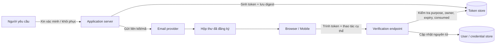
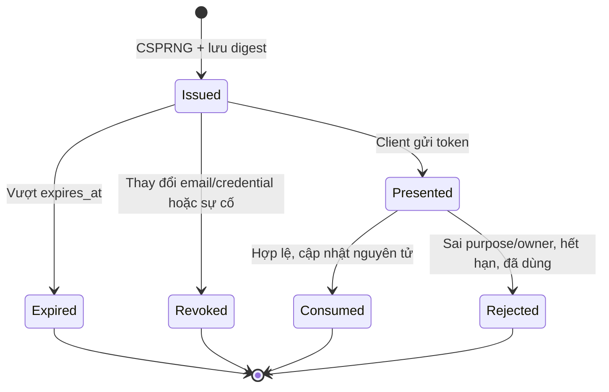

# Verification token cho email hoặc password reset

Khi người dùng đăng ký tài khoản, hệ thống thường gửi một liên kết để xác minh địa chỉ email. Khi người dùng quên mật khẩu, hệ thống có thể gửi một liên kết khác để đặt lại mật khẩu. Cả hai liên kết thường mang một **verification token**: một bí mật có hiệu lực ngắn, chỉ được dùng cho một mục đích và cần bị vô hiệu hóa sau khi hoàn tất.

Điểm dễ nhầm là verification token **không phải access token**. Người giữ liên kết xác minh email không đương nhiên được gọi API đọc dữ liệu cá nhân; người giữ liên kết đặt lại mật khẩu không đương nhiên được đăng nhập, xem đơn hàng hay có quyền quản trị. Token này chỉ cho phép **một thao tác cụ thể** tại một endpoint được thiết kế để kiểm tra nó.

Trong chương **Token types** của module **SECURITY_TOKEN_SECURITY_FUNDAMENTALS**, bài học đặt verification token vào mô hình tin cậy và vòng đời token bảo mật: phát hành, ràng buộc chủ thể/mục đích, lưu trữ, kiểm tra, tiêu thụ một lần, hết hạn, thu hồi và phòng chống đánh cắp hoặc phát lại. Các nguyên tắc này bổ trợ cho kiến thức về JWT, opaque token, access/refresh token, OAuth 2.0 và OIDC, nhưng cơ chế xác minh email/đặt lại mật khẩu **không cần phải triển khai bằng OAuth**.

Sau bài này, bạn có thể:

- Phân biệt **email verification**, **password reset** với xác thực đăng nhập và cấp access token.
- Thiết kế token ngẫu nhiên khó đoán, chỉ dùng một lần, có **purpose**, chủ thể và thời hạn rõ ràng.
- Mô tả luồng gửi email, mở liên kết, xác minh token và cập nhật trạng thái an toàn.
- Xử lý token bị lộ, bị quét trước bởi email scanner, bị dùng lại, hết hạn hoặc bị thay thế bởi token mới.
- Tránh **account enumeration**, **replay**, **race condition**, **cross-account token reuse** và các lỗi quản lý phiên sau khi reset mật khẩu.

## 1. Verification token chứng minh điều gì?

Đối với **xác minh email**, việc một người có thể nhận và sử dụng token được gửi đến địa chỉ email X là bằng chứng người đó có quyền truy cập kênh nhận thư X **tại thời điểm thao tác**, trong giới hạn cơ chế gửi thư và rủi ro bị chuyển tiếp/chiếm hộp thư. Điều này **không chứng minh danh tính pháp lý**, không chứng minh người đó luôn sở hữu email, cũng không tự chứng minh người đó đã đăng nhập vào ứng dụng.

Đối với **password reset**, token chứng minh người thao tác đang giữ một bí mật có thể được gửi qua kênh khôi phục đã đăng ký. Khi token hợp lệ, hệ thống có thể cho phép đặt lại mật khẩu của **đúng tài khoản được ràng buộc với token**. Đây là thao tác nhạy cảm vì có thể thay đổi quyền kiểm soát tài khoản, nhưng nó **không nên tự động tạo phiên đăng nhập hoặc access token** nếu chính sách không chủ động cho phép và chưa đánh giá rủi ro.

Ví dụ:

- Hệ thống gửi token **xác minh email** cho `new.user@example.com` sau khi tạo tài khoản. Token chỉ dùng để xác nhận địa chỉ này; nó không được phép reset mật khẩu.
- Hệ thống gửi token **đặt lại mật khẩu** cho email khôi phục của tài khoản `user-42`. Token chỉ dùng để thay mật khẩu của `user-42`; nó không thể xác minh một email khác hay chỉnh sửa tài khoản `user-99`.

Điều kiện được phép có thể biểu diễn như sau:

> Cho phép thao tác nếu **token tồn tại, khớp bản ghi đáng tin, đúng mục đích, đúng chủ thể/đích, chưa hết hạn, chưa sử dụng, chưa bị thu hồi và chính sách hiện hành vẫn cho phép**.

## 2. Phân biệt verification token với các loại token khác

| Loại token | Người nhận hoặc bên kiểm tra | Mục đích | Không được dùng để |
| --- | --- | --- | --- |
| **Email verification token** | Endpoint xác minh email của ứng dụng | Xác nhận quyền truy cập email đang chờ xác minh | Đăng nhập, gọi API nghiệp vụ, reset mật khẩu |
| **Password reset token** | Endpoint đặt lại mật khẩu | Cho phép đổi mật khẩu của tài khoản đã được ràng buộc | Đọc hồ sơ, cấp role, gọi API bằng Bearer |
| **Access token** | Resource server/API đúng `aud` | Ủy quyền gọi API theo scope, claims và chính sách | Thay token một lần của quy trình xác minh email |
| **Refresh token** | Authorization server | Xin access token mới theo phiên/grant đã được cấp | Reset mật khẩu hoặc xác nhận email |
| **ID token (OIDC)** | OIDC client | Truyền kết quả xác thực danh tính từ OpenID Provider | Gửi tới endpoint reset mật khẩu để coi là bí mật khôi phục |
| **Session cookie** | Backend ứng dụng/IdP | Liên kết trình duyệt với phiên | Thay thế kiểm tra token được gửi đến email mới |

**Mục đích token** khác với **định dạng token**: verification token thường là một chuỗi **opaque** không mang claims đọc được. Có thể dùng JWT theo một thiết kế phù hợp, nhưng JWT ký hợp lệ **không tự đảm bảo** token chỉ được dùng một lần, chỉ phục vụ đúng endpoint hay có thể thu hồi ngay. Dù dùng JWT hay opaque, backend phải thực thi ràng buộc mục đích và vòng đời.

Ở đây thuật ngữ “verification token” dùng cho **email/password recovery**. Một số thư viện cũng có “email token”, “confirmation token”, “reset code” hoặc “recovery link” với tên khác; hãy xét khả năng và chính sách thay vì suy luận mức quyền từ tên.

## 3. Mô hình tin cậy và các thành phần tham gia

Một luồng tiêu biểu gồm:

1. **Người yêu cầu**: tài khoản mới, chủ tài khoản muốn đổi email hoặc người khởi tạo yêu cầu quên mật khẩu.
2. **Application server**: kiểm tra điều kiện phát hành, tạo token và quản lý trạng thái một lần.
3. **Database hoặc token store**: lưu bản ghi token ở dạng **digest**, mục đích, user/email đích, thời hạn và trạng thái.
4. **Email delivery provider**: chuyển thông điệp chứa liên kết hoặc mã đến địa chỉ đã đăng ký.
5. **Người nhận thư và client**: dùng liên kết/mã qua trình duyệt hoặc mobile app.
6. **Verification endpoint**: kiểm tra và tiêu thụ token, cập nhật dữ liệu trong một giao dịch nguyên tử.



Ranh giới tin cậy quan trọng: **email là kênh chuyển một bí mật, không phải authorization server cấp access token**. URL hoặc mã trong thư có thể được người khác sao chép, chuyển tiếp, mở qua công cụ quét hoặc bị lộ từ log/history. API phải quyết định quyền từ bản ghi server, không tin các tham số `userId`/`email`/`purpose` do client gửi kèm.

## 4. Các thuộc tính của verification token an toàn

| Thuộc tính | Yêu cầu thiết kế | Vì sao? |
| --- | --- | --- |
| **Không thể đoán** | Sinh bằng CSPRNG với entropy đủ cao | Chống brute force và đoán token của người khác |
| **Độc nhất** | Mỗi lần phát hành là một bí mật riêng | Tránh dùng chung khóa giữa tài khoản/lần yêu cầu |
| **Mục đích cố định** | Gắn `EMAIL_VERIFY` hoặc `PASSWORD_RESET` tại server | Không đổi token reset thành token xác minh email và ngược lại |
| **Ràng buộc chủ thể/đích** | Gắn với `user_id` và email/pending email hoặc phiên bản credential phù hợp | Tránh dùng token để sửa tài khoản hoặc email khác |
| **Có hạn** | `expires_at` được kiểm tra trên server | Giảm thời gian bí mật có thể bị lạm dụng |
| **Dùng một lần** | Sau thành công, trạng thái chuyển `consumed` trong giao dịch nguyên tử | Chống replay/race condition |
| **Thu hồi được** | Có thể vô hiệu hóa theo user, loại token, phiên bản hoặc yêu cầu mới | Xử lý đổi email, reset thành công, nghi ngờ lộ |
| **Giảm lộ lọt** | Lưu digest, hạn chế log/URL/Referrer | Database leak hoặc browser leak không dễ dẫn đến chiếm quyền |

### 4.1. Sinh token bằng nguồn ngẫu nhiên mật mã

Một mẫu dễ hiểu là tạo **32 byte ngẫu nhiên từ CSPRNG**, tương đương **256 bit entropy** nếu nguồn ngẫu nhiên đáp ứng giả định mật mã, rồi mã hóa bằng Base64URL không padding (thường dài 43 ký tự). Đây là ví dụ phù hợp cho token liên kết trong email; hệ thống phải chọn entropy theo threat model và yêu cầu nền tảng.

Ví dụ Java:

```java
import java.security.MessageDigest;
import java.security.NoSuchAlgorithmException;
import java.security.SecureRandom;
import java.nio.charset.StandardCharsets;
import java.util.Base64;

public final class OneTimeToken {
    private static final SecureRandom RANDOM = new SecureRandom();

    public static String generate() {
        byte[] random = new byte[32];
        RANDOM.nextBytes(random);
        return Base64.getUrlEncoder()
                .withoutPadding()
                .encodeToString(random);
    }

    public static byte[] digest(String rawToken)
            throws NoSuchAlgorithmException {
        return MessageDigest.getInstance("SHA-256")
                .digest(rawToken.getBytes(StandardCharsets.US_ASCII));
    }
}
```

**Không dùng** `Math.random()`, `Random` không được thiết kế cho mật mã, timestamp, email/user ID, số đếm tăng dần, UUID yếu không bảo đảm entropy, hoặc chuỗi dễ đoán để làm token khôi phục. Token cũng không nên được tạo bằng cách lấy một mật khẩu/API key cố định rồi biến đổi theo user.

Với chuỗi ngẫu nhiên đủ entropy, **SHA-256 của token** có thể được lưu để so khớp mà không cần mật khẩu-hash chậm như Argon2id/bcrypt; kẻ tấn công không thể brute force 256 bit thực tế. Có thể dùng **HMAC-SHA-256 với secret server** nếu mô hình đe dọa yêu cầu bảo vệ thêm khi cơ sở dữ liệu bị lộ. HMAC key cần được bảo vệ và luân chuyển có kế hoạch. **Mật khẩu người dùng là trường hợp khác:** phải băm bằng thuật toán băm mật khẩu phù hợp như Argon2id cùng salt và cấu hình chi phí hợp lý, không dùng SHA-256 đơn thuần.

### 4.2. Một schema tham khảo

```sql
CREATE TABLE one_time_tokens (
    id BIGINT GENERATED ALWAYS AS IDENTITY PRIMARY KEY,
    token_digest BYTEA NOT NULL UNIQUE,
    user_id BIGINT NOT NULL,
    purpose VARCHAR(32) NOT NULL,    -- EMAIL_VERIFY / PASSWORD_RESET
    target_email VARCHAR(320),      -- email cần xác minh, khi áp dụng
    subject_version BIGINT NOT NULL, -- phiên bản trạng thái liên quan
    created_at TIMESTAMP WITH TIME ZONE NOT NULL,
    expires_at TIMESTAMP WITH TIME ZONE NOT NULL,
    consumed_at TIMESTAMP WITH TIME ZONE,
    revoked_at TIMESTAMP WITH TIME ZONE
);
```

Đây là schema minh họa, chưa bao gồm foreign key, chính sách lưu giữ và chỉ mục tối ưu cho hệ thống thực tế. `target_email` chỉ lưu email phải xác minh khi cần, không phải bằng chứng định danh từ client. `subject_version` có thể đại diện cho **phiên bản email đang chờ xác minh** hoặc **phiên bản credential** của tài khoản; khi thông tin gốc thay đổi, token phiên bản cũ trở nên vô hiệu. Ngoài ra có thể gắn token với một yêu cầu/chiến dịch bằng `request_id`, `purpose` và dấu vết audit phù hợp.

**Không lưu token thô** trong database, application logs, email-rendering logs, exception traces, analytics hoặc cột audit. Nếu hệ thống phải lưu bản sao có thể phục hồi để gửi lại email, cần đánh giá rủi ro và ưu tiên **phát hành token mới** thay cho lưu plaintext lâu dài.

## 5. Vòng đời token: phát hành đến tiêu thụ

Một vòng đời đầy đủ:

1. **Yêu cầu:** client gửi request qua HTTPS; server kiểm tra chính sách, tần suất, đích gửi và các điều kiện liên quan.
2. **Tạo:** server sinh token mới bằng CSPRNG; tính digest từ token.
3. **Ràng buộc:** tạo bản ghi gắn với `user_id`, `purpose`, `target_email`/phiên bản và `expires_at`.
4. **Gửi:** gửi token thô **chỉ qua kênh phục vụ người nhận** (email hoặc một kênh khôi phục được phê duyệt), không trả token khôi phục trong API response công khai.
5. **Trình token:** người dùng mở liên kết hoặc nhập mã; client đưa token về endpoint phù hợp qua HTTPS.
6. **Xác minh:** server tính digest và kiểm tra purpose, subject, target, thời hạn, trạng thái, policy hiện hành.
7. **Tiêu thụ:** thao tác nghiệp vụ và đánh dấu token đã dùng trong **cùng giao dịch nguyên tử**.
8. **Hoàn tất:** cập nhật audit, thông báo cần thiết; token dùng lại phải bị từ chối, các token liên quan có thể bị thu hồi.
9. **Dọn dẹp:** xóa/hết hạn các bản ghi không cần giữ theo retention policy, tránh lưu bí mật và dữ liệu cá nhân không cần thiết.



Thời hạn phụ thuộc mức rủi ro, độ trễ email và trải nghiệm. Ví dụ token reset có thể hết hạn sau **10–30 phút**, còn token xác minh email đăng ký có thể kéo dài hơn **vài giờ đến một ngày**; đây là **ví dụ thiết kế, không phải thời hạn chuẩn áp dụng cho mọi hệ thống**. Token sống quá dài tăng rủi ro nếu hộp thư bị lộ; quá ngắn gây khó cho người dùng và tăng thao tác gửi lại.

## 6. Luồng xác minh email sau khi đăng ký

Giả sử người dùng vừa đăng ký với `lan@example.com`. Hệ thống tạo tài khoản ở trạng thái email chưa xác minh và sinh token ràng buộc với user đó, địa chỉ đang chờ xác minh và mục đích `EMAIL_VERIFY`.

```mermaid
sequenceDiagram
    participant U as Người dùng
    participant APP as Application server
    participant DB as Token/User DB
    participant MAIL as Email provider
    U->>APP: Đăng ký email
    APP->>DB: Tạo user email_unverified + lưu digest token
    APP->>MAIL: Gửi link xác minh (token thô)
    MAIL-->>U: Email chứa link
    U->>APP: GET /verify-email?token=... (hiển thị trang)
    APP-->>U: Trang xác nhận, chưa tiêu thụ token
    U->>APP: POST /verify-email/confirm + token
    APP->>DB: Kiểm tra user, email đích, purpose, expiry; khóa hàng
    DB-->>APP: Token hợp lệ và chưa dùng
    APP->>DB: Đánh dấu email verified + token consumed trong một transaction
    APP-->>U: Xác minh thành công
```

**Các kiểm tra bắt buộc:**

- `purpose` phải là `EMAIL_VERIFY`, không nhận `PASSWORD_RESET`.
- Token phải gắn với **đúng user và đúng địa chỉ đang chờ xác minh**; không nhận email do client tự nhập rồi gán quyền xác minh cho email đó.
- Chỉ đánh dấu email verified nếu token còn hạn, chưa dùng, chưa bị thu hồi và phiên bản email/pending email vẫn đúng.
- Nếu email đang chờ xác minh đã đổi, token cũ không thể xác minh email mới.
- Việc email đã được xác minh có thể là điều kiện để bật một số chức năng, nhưng **không tự đồng nghĩa** với đăng nhập thành công hoặc được cấp mọi scope.

### 6.1. Xác minh email khi thay đổi địa chỉ

Khi tài khoản đã đăng nhập muốn đổi từ `old@example.com` sang `new@example.com`, cần lưu **pending email** cho đến khi địa chỉ mới được xác minh. Không nên ghi đè ngay email chính trước khi kiểm soát quy trình, vì có thể làm mất đường khôi phục hoặc tạo đường chiếm quyền.

Với thao tác nhạy cảm, có thể yêu cầu **xác thực lại** người dùng, thông báo tới email cũ, kiểm tra địa chỉ mới và áp dụng chính sách phê duyệt/độ trễ thích hợp. Nếu gửi xác nhận tới cả địa chỉ cũ và mới, từng token phải có **purpose và chủ thể/đích riêng**, không dùng một token chung cho hai kênh. Việc xác minh email mới không được vô hiệu hóa an toàn của phiên hay đường khôi phục cũ một cách âm thầm.

## 7. Luồng password reset an toàn

Password reset là một **account recovery flow**: người dùng không nhớ mật khẩu hiện tại nhưng có thể chứng minh quyền kiểm soát một kênh khôi phục đã đăng ký. Luồng điển hình:

1. Client gọi `POST /password-resets` với định danh tài khoản/email. Server kiểm soát rate limit và trả **thông điệp chung**, không tiết lộ tài khoản có tồn tại.
2. Nếu tài khoản đủ điều kiện, server sinh token `PASSWORD_RESET`, lưu digest, ràng buộc `user_id` và phiên bản credential, gửi liên kết đến **email đã được đăng ký và xác minh theo chính sách**.
3. Người dùng mở link; giao diện cung cấp form nhập mật khẩu mới. **GET mở trang không tự đổi mật khẩu và không tự tiêu thụ token**.
4. Client gửi token và mật khẩu mới qua HTTPS tới `POST /password-resets/confirm`. Server xác minh token, policy mật khẩu, trạng thái tài khoản và chặn replay.
5. Trong transaction, server thay **password hash bằng thuật toán dành cho mật khẩu**, tiêu thụ token, tăng credential version/thu hồi các token reset còn lại theo chính sách.
6. Sau commit, server xử lý phiên/refresh token đang tồn tại theo chính sách, thông báo đổi mật khẩu qua kênh đã đăng ký và yêu cầu người dùng **đăng nhập lại**.

```mermaid
sequenceDiagram
    participant U as Người dùng
    participant APP as Application server
    participant DB as DB/token store
    participant MAIL as Email provider
    U->>APP: POST /password-resets (email)
    APP-->>U: Câu trả lời chung không lộ tài khoản
    APP->>DB: Sinh reset token, lưu digest + user_id + expiry
    APP->>MAIL: Gửi link đến email khôi phục đã đăng ký
    MAIL-->>U: Email reset
    U->>APP: GET /reset-password?token=... (chỉ hiển thị form)
    APP-->>U: Form nhập mật khẩu mới
    U->>APP: POST /password-resets/confirm (token + newPassword)
    APP->>DB: Khóa token/user, kiểm tra purpose/expiry/state
    APP->>DB: Ghi hash mật khẩu, consume/revoke token atomically
    DB-->>APP: Commit thành công
    APP->>APP: Thu hồi/đánh giá các phiên và refresh token
    APP-->>U: Thành công; yêu cầu đăng nhập lại
```

**Không được** nhận `userId` từ body để quyết định tài khoản cần reset mà không đối chiếu token. Chủ thể cần sửa mật khẩu phải được lấy từ **bản ghi token đáng tin**. Người giữ token của user A không được gửi `userId=B` để đổi mật khẩu user B.

**Không gửi mật khẩu mới hoặc cũ qua email.** Sau khi reset thành công, gửi thông báo thay đổi bảo mật đến địa chỉ tin cậy; nếu có nghi ngờ bị chiếm tài khoản, cung cấp luồng hỗ trợ/khôi phục đã kiểm soát.

## 8. Đảm bảo single-use bằng cập nhật nguyên tử

Một lỗi phổ biến:

```text
if token.valid && token.used == false:
    changePassword()
    token.used = true
```

Hai request đồng thời có thể cùng nhìn thấy `used=false` rồi thực hiện thay đổi hai lần. Đó là **race condition / time-of-check to time-of-use (TOCTOU)**.

Với SQL database, một cách an toàn là dùng **transaction và khóa bản ghi**, hoặc một câu lệnh cập nhật có điều kiện/compare-and-swap có `RETURNING`. Giao dịch cần gắn kiểm tra token với thay đổi nghiệp vụ, để không tiêu thụ token khi cập nhật mật khẩu thất bại.

Ví dụ pseudocode cho password reset:

```text
function confirmReset(rawToken, newPassword):
    validatePasswordPolicy(newPassword)
    candidateHash = passwordHasher.argon2id(newPassword)
    digest = sha256(rawToken)      // rawToken đến từ request, không ghi log

    BEGIN DATABASE TRANSACTION
      token = SELECT token row WHERE token_digest = digest FOR UPDATE

      if token absent or token.purpose != PASSWORD_RESET:
          ROLLBACK; return genericInvalidToken
      if token.consumed_at != null or token.revoked_at != null:
          ROLLBACK; return genericInvalidToken
      if databaseNow() >= token.expires_at:
          ROLLBACK; return genericInvalidToken

      user = SELECT user row WHERE id = token.user_id FOR UPDATE
      if user absent or user.recovery_version != token.subject_version:
          ROLLBACK; return genericInvalidToken
      if user.disabled or !policy.canResetPassword(user):
          ROLLBACK; return genericInvalidToken

      UPDATE users
         SET password_hash = candidateHash,
             recovery_version = recovery_version + 1
       WHERE id = user.id

      UPDATE one_time_tokens
         SET consumed_at = databaseNow()
       WHERE id = token.id

      REVOKE remaining reset tokens / invalidate recovery grants per policy
    COMMIT

    scheduleSessionRevocationAndSecurityNotice(user.id)
    return successNoAutoLogin
```

Chỉ là mã giả mô tả giao dịch; SQL, chiến lược khóa và xử lý sự kiện ngoài transaction tùy database và hệ thống. Trong triển khai thực tế, muốn đảm bảo **việc thu hồi phiên và gửi thông báo không bị quên nếu tiến trình chết sau commit**, nên ghi một sự kiện **outbox** hoặc cơ chế tương đương trong transaction để worker xử lý sau. Nếu thu hồi phiên là yêu cầu bảo mật đồng bộ, cần đảm bảo điều kiện phiên mất hiệu lực ngay trong nơi kiểm tra phiên hoặc theo cam kết thu hồi được thiết kế, không chỉ dựa vào tác vụ gửi email bất đồng bộ.

**Điều kiện chống replay:** sau request đầu tiên commit thành công, request thứ hai cùng token phải bị từ chối. Nếu cập nhật mật khẩu thất bại và transaction rollback, hệ thống cần có trạng thái nhất quán; không để token ở trạng thái `consumed` trong khi mật khẩu chưa đổi.

## 9. Dùng token trong URL mà không làm rò bí mật

Liên kết email thường chứa token ở URL, ví dụ:

```text
https://accounts.example.com/reset-password?token=<random-secret>
```

Đây là một **capability URL**: người có liên kết có thể trình bí mật đến backend. URL có thể rơi vào browser history, log của reverse proxy, dịch vụ phân tích, ảnh chụp, bản ghi giám sát, công cụ email security hoặc header `Referer` khi trang tải tài nguyên ngoài domain. Vì vậy:

- Dùng **HTTPS**, hostname và domain tin cậy cố định do server cấu hình; không tự ghép host từ header không đáng tin để tránh **host-header poisoning/reset link poisoning**.
- Không đưa token vào frontend analytics, crash report, event tracking, URL logs, tracing hoặc external redirect.
- Trang nhận token nên gửi `Referrer-Policy: no-referrer` và `Cache-Control: no-store`, tránh tải script/ảnh/tài nguyên bên thứ ba trước khi token được xử lý an toàn.
- Nếu token xuất hiện trong query, sau khi client lấy token để chuẩn bị gửi `POST` có thể xóa nó khỏi thanh địa chỉ bằng `history.replaceState`; **điều này không xóa được bản sao đã lọt vào network/proxy log hoặc email**.
- Ưu tiên một trang GET chỉ hiển thị form/nút xác nhận, rồi gửi token qua **request POST body** tới endpoint xác minh. Chỉ giao dịch POST được kiểm tra đầy đủ mới làm thay đổi trạng thái.
- Một lựa chọn khác là gửi **mã người dùng nhập thủ công** thay vì bearer URL. Nếu mã ngắn (ví dụ sáu chữ số), entropy thấp hơn nhiều nên bắt buộc có rate limit nghiêm ngặt, giới hạn số lần thử và thời hạn phù hợp.

### Vì sao không nên “nhấp link là consume ngay”?

Nhiều email provider và hệ thống bảo mật tự động **truy cập trước liên kết trong email** để quét malware/phishing hoặc tạo preview. Nếu endpoint GET đánh dấu email verified hay tiêu thụ reset token ngay khi URL được mở, email scanner có thể vô tình dùng mất token trước người thật.

Giải pháp phổ biến là **GET không tạo tác dụng phụ bảo mật**, chỉ hiển thị trang chờ và yêu cầu **hành động xác nhận rõ ràng** (POST) hoặc nhập mật khẩu mới. Đối với xác minh email, cần thiết kế UX hợp lý để người dùng biết thao tác nào đã hoàn tất. Với reset mật khẩu, tuyệt đối không đổi mật khẩu ở bước GET.

Vì email có thể được chuyển tiếp hoặc mailbox bị chiếm, **không coi scanner hay chỉ dấu email open là bằng chứng xác minh người dùng**. Xác minh mail chỉ chứng tỏ việc sử dụng đúng token được gửi tới địa chỉ đó, theo điều kiện của kênh email.

## 10. Ngăn account enumeration và spam khôi phục

Endpoint yêu cầu quên mật khẩu rất dễ để lộ rằng email có tồn tại trong hệ thống. Ví dụ:

- Sai: `404: Tài khoản với email này không tồn tại`.
- Sai: `200: Đã gửi email đến user@example.com` trong khi lỗi khi không tồn tại lại khác.
- Tốt hơn: **“Nếu địa chỉ được đăng ký và đủ điều kiện, chúng tôi sẽ gửi hướng dẫn.”** Hãy giữ hành vi/status code và phản hồi đủ nhất quán, tránh tiết lộ thông qua nội dung, mã lỗi hoặc chênh lệch thời gian dễ khai thác.

Thực thi các kiểm soát:

1. **Rate limit** nhiều chiều: theo IP, user/email đã chuẩn hóa phù hợp, thiết bị/phiên và toàn hệ thống; ưu tiên cơ chế thích nghi để không khóa người dùng thật vì một attacker.
2. **Giới hạn gửi lại và số token còn hiệu lực**, tránh email flooding. Quy tắc vô hiệu hóa token trước đó khi phát hành token mới phải được thiết kế cẩn thận: nếu bất kỳ ai có thể yêu cầu liên tục khiến token của người thật vô hiệu, đó là một kiểu denial of service.
3. **Chỉ gửi đến địa chỉ khôi phục đã được xác thực theo chính sách**; không lấy tùy ý `sendToEmail` do client truyền để gửi token reset của tài khoản khác.
4. **Giới hạn thử mã**, nhất là mã sáu/tám chữ số do người dùng nhập. Dùng backoff, giám sát, kiểm soát abuse và khóa theo phiên/thử nghiệm phù hợp.
5. **Không để email provider là nguồn quyết định quyền**: gửi mail thành công không đồng nghĩa token đã được người nhận dùng hoặc tài khoản đã xác minh.
6. **Log tối thiểu**: ghi request ID, loại tác vụ, kết quả, dấu thời gian, sự kiện bảo mật; tránh token thô, password, OTP và thông tin nhạy cảm không cần thiết.

Một trang thông báo thành công khi gửi yêu cầu không nên nói dối rằng email **chắc chắn** đã được gửi. Câu trả lời chung ở trên cho phép bảo vệ riêng tư mà vẫn mô tả đúng điều kiện.

## 11. Thu hồi và thay thế token

| Sự kiện | Xử lý token đề xuất |
| --- | --- |
| Token được tiêu thụ thành công | Đánh dấu `consumed` ngay trong transaction; lần dùng tiếp theo từ chối |
| Token hết hạn | Từ chối; có thể dọn bản ghi theo retention policy |
| Người dùng yêu cầu gửi lại | Cấp token mới; áp dụng resend throttle và chính sách rõ về token cũ |
| Email đang chờ xác minh thay đổi | Thu hồi token email verification cũ hoặc tăng `email_version` khiến token cũ không hợp lệ |
| Password reset thành công | Thu hồi token reset còn hiệu lực và tăng `credential/recovery_version` |
| Tài khoản bị khóa hoặc xác định lộ token | Vô hiệu token theo user/purpose/phiên, điều tra và thông báo thích hợp |
| Người dùng thay mật khẩu qua phiên đăng nhập | Cân nhắc vô hiệu token reset cũ và các phiên liên quan |

Phát lại một verification token **không được** dẫn đến trạng thái “thành công lần nữa” nếu làm phát sinh quyền không kiểm soát. Với thao tác có thể idempotent về mặt dữ liệu (ví dụ email đã verified), server vẫn cần phân biệt token đã dùng với token hợp lệ để tránh tái sử dụng cho quy trình khác. UX có thể hiển thị “Liên kết đã được sử dụng hoặc không còn hiệu lực” và cho phép yêu cầu lại.

### Password reset và những phiên đang hoạt động

Khi thay mật khẩu, các **session cookie, refresh token và access token** đã phát hành trước đó có thể vẫn tồn tại. Chính sách nên xác định có:

- Thu hồi toàn bộ phiên và refresh token, hoặc ít nhất các phiên đáng ngờ, khi reset thành công.
- Tăng `session_version`/`credential_version` để phiên cũ bị API/BFF từ chối nếu kiểm tra phiên bản.
- Yêu cầu đăng nhập lại bằng mật khẩu mới và MFA nếu cần.
- Thông báo thay đổi mật khẩu đến địa chỉ đã đăng ký và hỗ trợ người dùng báo cáo thao tác trái phép.

**Access token JWT tự chứa** được API xác minh offline có thể vẫn hợp lệ đến `exp` nếu không có kiểm tra trạng thái phiên, denylist hoặc cơ chế thu hồi bổ sung. Thu hồi refresh token **không tự động** vô hiệu mọi access token cũ tức thì. Với opaque access token, introspection có thể phản ánh trạng thái thu hồi nhưng cache phía API vẫn tạo độ trễ.

## 12. JWT hay opaque token cho email verification/password reset?

### Opaque token — lựa chọn thường đơn giản hơn

Một token ngẫu nhiên dài được lưu ở database dưới dạng digest là lựa chọn trực quan: server tự quản lý `purpose`, user/email đích, `expires_at`, `consumed_at` và `revoked_at`. Endpoint tra cứu digest và kiểm tra trạng thái. Khi cần thu hồi, chỉ cần cập nhật bản ghi hoặc phiên bản liên quan. Đây là cách dễ đạt **single-use có xác minh trạng thái trung tâm**.

### JWT — khả thi nhưng không tự giải quyết single-use

JWT ký có thể chứa:

```json
{
  "iss": "https://accounts.example.com",
  "aud": "email-verification-endpoint",
  "sub": "user-42",
  "purpose": "EMAIL_VERIFY",
  "email": "new.user@example.com",
  "iat": 1795000000,
  "nbf": 1795000000,
  "exp": 1795000900,
  "jti": "random-one-time-id"
}
```

Đây chỉ là payload ví dụ, **không phải token thật**. Nếu dùng JWT, endpoint vẫn phải kiểm tra **chữ ký với issuer/khóa tin cậy và thuật toán allowlist**, `iss`, `aud`, `exp`, `nbf`, `purpose`, `sub`, đích và trạng thái tiêu thụ/thu hồi theo `jti` hoặc phiên bản server. Kể cả có `jti`, nếu không có state chống reuse, JWT có thể được phát lại trong thời hạn hiệu lực. Vì vậy JWT không giúp loại bỏ database hoàn toàn nếu yêu cầu **one-time và revocation**.

JWT ký thông thường có payload đọc được (Base64URL), **không được mã hóa bảo mật**. Tránh đặt dữ liệu cá nhân nhạy cảm, mật khẩu, session secret hoặc thông tin không cần thiết vào claims. Đừng dùng OAuth access token hay OIDC ID token thay cho verification token: mục đích và audience khác nhau.

## 13. Email verification và password reset: giống và khác nhau

| Khía cạnh | Email verification | Password reset |
| --- | --- | --- |
| Trạng thái đầu vào | Email chưa xác minh/đang thay đổi | Người dùng không có hoặc không dùng được mật khẩu hiện tại |
| Mục tiêu | Xác nhận quyền truy cập địa chỉ email đích | Thay credential xác thực của **đúng tài khoản** |
| Token purpose | `EMAIL_VERIFY` | `PASSWORD_RESET` |
| Ràng buộc | User ID + email đang chờ xác minh + phiên bản email | User ID + credential/recovery version và policy tài khoản |
| Kết quả | Đánh dấu email đã xác minh | Ghi password hash mới, thu hồi token/phiên theo chính sách |
| Tự tạo phiên đăng nhập? | **Không** nên mặc định | **Không** nên mặc định |
| Rủi ro khi lộ token | Người khác có thể xác minh email hoặc làm sai quy trình thay đổi email | Người khác có thể đổi mật khẩu và chiếm quyền tài khoản |
| Chính sách thời hạn | Phụ thuộc yêu cầu gửi email và rủi ro | Thường ngắn hơn do quyền khôi phục nhạy cảm |

Cả hai đều cần: CSPRNG, binding, HTTPS, rate limit, kiểm tra server-side, tiêu thụ nguyên tử và chống rò token. **Password reset đặc biệt nhạy cảm**, vì nó thay đổi bí mật dùng để xác thực tài khoản và có thể ảnh hưởng các phiên đã phát hành.

## 14. Ví dụ API và lỗi cần xử lý

Thiết kế API tối giản:

```http
POST /v1/password-resets HTTP/1.1
Host: accounts.example.com
Content-Type: application/json

{"email":"user@example.com"}
```

Phản hồi mẫu:

```http
HTTP/1.1 202 Accepted
Content-Type: application/json
Cache-Control: no-store

{"message":"Nếu địa chỉ đủ điều kiện, hướng dẫn sẽ được gửi."}
```

Khi người dùng xác nhận mật khẩu mới:

```http
POST /v1/password-resets/confirm HTTP/1.1
Host: accounts.example.com
Content-Type: application/json

{"token":"<random-secret>","newPassword":"<new-password-from-user>"}
```

Trong ví dụ, chuỗi trong dấu ngoặc nhọn là placeholder, không phải mật khẩu hoặc token thực tế. Request phải đi qua HTTPS và **không được ghi body chứa bí mật vào log**. Backend lấy user từ **token record**, kiểm tra policy mật khẩu, hash an toàn và tiêu thụ token trước khi trả kết quả. Nếu token sai, hết hạn, đã dùng hoặc bị thu hồi, server từ chối với nội dung rõ ràng cho người dùng mà không tiết lộ tài khoản khác.

API xác minh email có thể tổ chức tương tự:

```http
POST /v1/email-verifications/confirm HTTP/1.1
Host: accounts.example.com
Content-Type: application/json

{"token":"<random-secret>"}
```

Không nhận `{"email":"someone-else@example.com"}` từ client rồi cập nhật email verified dựa trên request body. Email được phép xác minh phải được lấy từ record đã ràng buộc khi phát token.

## 15. Những lỗi thiết kế dễ gặp

| Lỗi | Hậu quả | Cách khắc phục |
| --- | --- | --- |
| Dùng số ngẫu nhiên yếu/timestamp/user ID làm token | Có thể đoán liên kết người khác | CSPRNG, entropy đủ cao |
| Token của email verification dùng được tại reset endpoint | Vượt mục đích ban đầu | Kiểm tra `purpose` và endpoint |
| Chỉ kiểm tra chữ ký JWT, không ghi nhận đã dùng | Replay token cho đến `exp` | State dùng một lần, `jti`/version, transaction |
| Kiểm tra `used=false` rồi cập nhật ở hai bước rời nhau | Hai request đồng thời cùng thành công | Row lock / atomic conditional update + transaction |
| Cập nhật theo `userId` từ body mà không ràng buộc token | Đổi mật khẩu tài khoản khác | Derive user từ token record |
| GET link tự tiêu thụ token | Email scanner/prefetch làm mất token | GET hiển thị, POST xác nhận có chủ đích |
| URL reset chứa token trên trang tải analytics bên thứ ba | Token lộ qua Referer, log hoặc script | `Referrer-Policy: no-referrer`, hạn chế tài nguyên ngoài, không log token |
| Hostname link dựng từ header Host do client gửi | Reset link poisoning/phishing | Dùng canonical origin cấu hình server |
| Trả lỗi khác nhau cho email tồn tại/không tồn tại | Account enumeration | Phản hồi thống nhất, hạn chế timing leak |
| Gửi lại vô hạn hoặc gửi token cho email bất kỳ | Spam, DoS, chiếm đường khôi phục | Rate limit và kênh khôi phục đã đăng ký |
| Sau reset vẫn giữ mọi session cũ vô hạn | Kẻ xấu còn quyền truy cập sau đổi mật khẩu | Thu hồi/kiểm tra phiên, refresh token và access token theo chính sách |
| Lưu token thô trong DB/log | Lộ dữ liệu có thể dẫn đến chiếm tài khoản | Chỉ lưu digest, bảo vệ kênh gửi và log |

## 16. Những tình huống để tự đánh giá

### Tình huống A: Email scanner dùng mất token

Ứng dụng gửi link xác minh. Email gateway tự mở URL trước khi thư đến hộp người dùng. Endpoint backend đánh dấu token đã dùng ngay trong `GET`, khiến người dùng mở link sau đó gặp lỗi. **Nguyên nhân:** tác dụng phụ bảo mật trên request GET. **Cách sửa:** GET chỉ hiển thị trang, còn xác minh và tiêu thụ token được thực hiện khi người dùng xác nhận bằng POST đã kiểm tra.

### Tình huống B: Attacker gửi mã reset của A nhưng yêu cầu đổi mật khẩu B

API nhận `token` hợp lệ của user A và `userId=B` trong body. Nếu API chỉ kiểm tra token “có tồn tại” rồi dùng `userId` để chọn tài khoản cập nhật, attacker có thể sửa mật khẩu người khác. **Cách sửa:** tài khoản cập nhật **luôn được suy ra từ token record**; request body không được nâng quyền hoặc đổi chủ thể.

### Tình huống C: Hai request reset đồng thời

Hai client cùng gửi token và mật khẩu mới khác nhau. Cả hai đọc `consumed_at=NULL` trước khi bên nào ghi. **Cách sửa:** khóa record token trong transaction, cập nhật password và `consumed_at` nguyên tử; chỉ một request có thể commit hợp lệ.

### Tình huống D: Đã reset thành công nhưng token access cũ vẫn gọi API

Sau reset, ứng dụng thu hồi refresh token nhưng các JWT access token cũ vẫn còn hạn và API xác minh offline. **Nguyên nhân:** JWT không tự biết sự kiện đổi mật khẩu. **Cách sửa:** TTL phù hợp, kiểm tra phiên/credential version hoặc cơ chế thu hồi tại API tùy mục tiêu ngăn chặn. Không hứa rằng reset mật khẩu làm toàn bộ access token cũ mất hiệu lực tức thì nếu hạ tầng chưa hỗ trợ.

### Tình huống E: Người dùng đổi email đang chờ xác minh

Token `EMAIL_VERIFY` ban đầu gắn `old-pending@example.com`; sau đó người dùng sửa thành `new-pending@example.com` nhưng token cũ vẫn có hiệu lực. Nếu server chỉ kiểm tra user ID rồi cập nhật `email_verified=true`, token cũ có thể xác minh nhầm email mới. **Cách sửa:** token phải gắn email đích hoặc `email_version`; khi pending email đổi, token cũ không còn hợp lệ.

## 17. Checklist triển khai

Trước khi phát hành tính năng, hãy trả lời:

1. **Mục đích:** endpoint nào chấp nhận `EMAIL_VERIFY` hoặc `PASSWORD_RESET`? Hai loại token có tách biệt rõ không?
2. **Bí mật:** token được sinh bằng CSPRNG, đủ entropy, duy nhất và không dự đoán được chưa?
3. **Lưu trữ:** server chỉ lưu digest/HMAC cùng user, purpose, target, version, expiry và consumed/revoked state chưa?
4. **Binding:** có cách nào client dùng token của tài khoản/email A để thay đổi tài khoản/email B không?
5. **Single-use:** kiểm tra và thay đổi nghiệp vụ có nằm trong transaction/atomic operation chống race condition không?
6. **URL/email:** có HTTPS, canonical origin, no-referrer, no-store, giới hạn third-party và tránh log token không?
7. **Prefetch:** GET mở link có an toàn khi email scanner tự truy cập không?
8. **Abuse:** yêu cầu gửi/reset và nhập mã có giới hạn tốc độ, chống enumeration và chống spam chưa?
9. **Thu hồi:** token hết hạn, đã dùng, đổi email/credential hoặc bị lộ có bị vô hiệu hóa đúng không?
10. **Phiên sau reset:** cookie phiên, refresh token và access token còn hạn được xử lý theo chính sách có thể kiểm chứng không?
11. **Audit:** có ghi đủ sự kiện bảo mật mà không ghi token/mật khẩu thô không?
12. **Kiểm thử:** đã thử sai purpose, sai subject, hết hạn, dùng lại, request đồng thời, thay pending email, token cũ và scanner GET chưa?

Nguyên tắc kết thúc: **verification token là quyền tạm thời dành cho một thao tác duy nhất**. Nó phải được phát hành từ nguồn ngẫu nhiên đáng tin, ràng buộc với đúng tài khoản và mục đích, lưu/kiểm tra an toàn, tiêu thụ nguyên tử, có hạn và có thể thu hồi. Không được nâng một token reset hoặc xác minh email thành access token, phiên đăng nhập hay quyền gọi API ngoài mục đích ban đầu.

## Tài liệu tham khảo

- [OWASP Forgot Password Cheat Sheet](https://cheatsheetseries.owasp.org/cheatsheets/Forgot_Password_Cheat_Sheet.html) — reset token, chống enumeration, xử lý phiên.
- [OWASP Authentication Cheat Sheet](https://cheatsheetseries.owasp.org/cheatsheets/Authentication_Cheat_Sheet.html) — xác thực và khôi phục tài khoản.
- [OWASP Session Management Cheat Sheet](https://cheatsheetseries.owasp.org/cheatsheets/Session_Management_Cheat_Sheet.html) — phiên, cookie và kết thúc phiên.
- [OWASP Password Storage Cheat Sheet](https://cheatsheetseries.owasp.org/cheatsheets/Password_Storage_Cheat_Sheet.html) — lưu trữ password hash.
- [NIST SP 800-63B](https://pages.nist.gov/800-63-4/sp800-63b.html) — hướng dẫn authenticator và vòng đời xác thực; áp dụng các quy định phù hợp phiên bản/chính sách hệ thống.
- [RFC 7519 — JSON Web Token (JWT)](https://www.rfc-editor.org/rfc/rfc7519) — định dạng claims của JWT, không mặc nhiên bảo đảm một lần sử dụng.
- [RFC 7009 — OAuth 2.0 Token Revocation](https://www.rfc-editor.org/rfc/rfc7009) — đối chiếu khái niệm thu hồi OAuth token và thu hồi verification token do ứng dụng quản lý.
