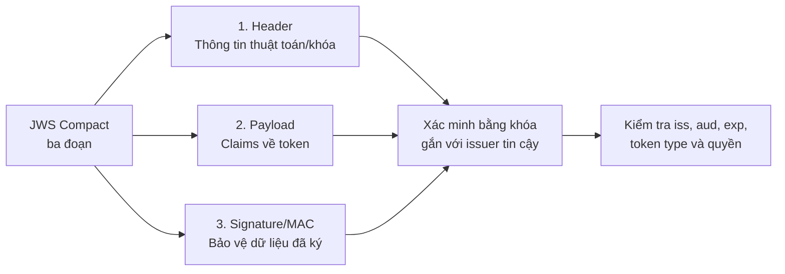
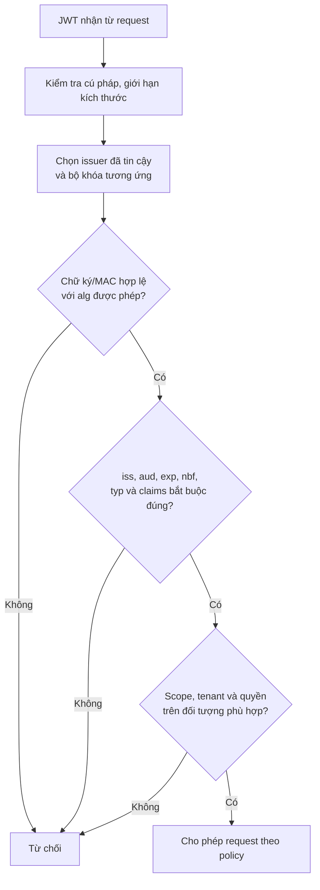

# Header, payload và signature ở token có cấu trúc

## Mục tiêu học tập

Trong module **SECURITY_TOKEN_SECURITY_FUNDAMENTALS**, việc hiểu định dạng token giúp bạn phân biệt **token mang dữ liệu có cấu trúc** với **opaque token**, kiểm chứng nguồn phát hành trước khi tin vào claims và giới hạn quyền truy cập API theo OAuth 2.0/OIDC.

Sau bài này, bạn có thể:

- Nhận diện ba phần **header.payload.signature** của một token JWT được biểu diễn dưới dạng **JWS Compact Serialization**, đọc đúng vai trò từng phần.
- Giải thích **Base64url là cách biểu diễn dữ liệu**, còn **chữ ký/MAC là cơ chế bảo vệ tính toàn vẹn và nguồn phát hành theo khóa**; chữ ký không tự mã hóa nội dung.
- Phân biệt JWT, JWS, JWE và opaque token; nhận diện vì sao JWE Compact thường có **năm** phần.
- Đọc các trường header `alg`, `typ`, `kid` và các claims `iss`, `sub`, `aud`, `exp`, `nbf`, `iat`, `jti`, `scope` một cách có điều kiện.
- Mô tả cách Resource Server kiểm chứng chữ ký, issuer, audience, thời hạn, loại token và quyền trước khi cho phép truy cập.
- Nhận diện lỗi sửa payload, `alg=none`, nhầm thuật toán, dùng JWKS không đáng tin cậy, lộ token và phát lại bearer token.

## 1. Token có cấu trúc là gì?

Token là một **credential hoặc vật mang bằng chứng** được hệ thống sử dụng theo một giao thức và mục đích cụ thể. Không phải chuỗi token nào cũng tự chứa thông tin mà ứng dụng có thể đọc được:

| Định dạng | Bên nhận có thể đọc claims ngay từ chuỗi token? | Cách xác minh thông thường |
| --- | --- | --- |
| **JWT dạng JWS compact** | Có thể giải mã Base64url để *xem* header/payload; nội dung đó chưa đáng tin nếu chưa xác minh. | Kiểm chứng chữ ký hoặc MAC bằng khóa được liên kết với issuer tin cậy, rồi kiểm tra claims/chính sách. |
| **JWT dạng JWE compact** | Không đọc được payload đã mã hóa khi thiếu khóa giải mã. | Giải mã và kiểm tra thẻ xác thực theo thuật toán JWE; kiểm chứng thêm chữ ký nếu token lồng JWS. |
| **Opaque token** | Không có hợp đồng để tự giải mã/diễn giải bên trong. | Resource Server dùng introspection hoặc tra cứu trạng thái tại nguồn tin cậy theo hợp đồng. |

**JWT** (JSON Web Token, RFC 7519) là cách biểu diễn một tập **claims** bằng JSON theo chuẩn JOSE. Trong thực tế, chuỗi JWT thường dùng **JWS** (JSON Web Signature, RFC 7515) hoặc **JWE** (JSON Web Encryption, RFC 7516). JWT thường gặp nhất trong tài liệu hướng dẫn là JWT *được ký* bằng JWS Compact, có ba phần phân tách bởi dấu chấm.

**Quan trọng:** một chuỗi trông giống JWT, có ba đoạn và giải mã được JSON **chưa chứng minh** nó đã được Authorization Server hợp lệ phát hành. Token phải đi qua quy trình kiểm chứng phù hợp trước khi ứng dụng tin vào claims.

## 2. Giải phẫu JWT được ký: `header.payload.signature`

Một JWS Compact Serialization thông dụng có cấu trúc:

```text
BASE64URL(protected header) . BASE64URL(payload) . BASE64URL(signature)
       phần 1                  phần 2                  phần 3
```

Ba phần được nối bằng **hai dấu chấm `.`**. Mỗi đoạn được mã hóa theo Base64url **không padding** trong JWS compact thông thường. Chuỗi token truyền qua HTTP header thường có dạng:

```http
GET /api/orders HTTP/1.1
Host: orders.example.com
Authorization: Bearer <compact-jws-token>
```

Ở đây `Bearer` là **cách sử dụng access token theo HTTP** (RFC 6750), không phải phần header JOSE bên trong JWT. Đừng nhầm `Authorization: Bearer ...` của HTTP với **protected header** trong JWS.



### 2.1. Header: cách token được bảo vệ

Protected header là một **JSON object** mô tả cách xử lý JWS. Ví dụ một access token JWT dùng chữ ký bất đối xứng:

```json
{
  "alg": "RS256",
  "typ": "at+jwt",
  "kid": "orders-signing-key-2027-01"
}
```

| Thuộc tính header | Ý nghĩa | Quy tắc an toàn |
| --- | --- | --- |
| `alg` | Thuật toán toàn vẹn/chữ ký JWS, ví dụ `RS256`, `ES256`, `EdDSA`, `HS256`. | Verifier phải giới hạn bằng **allowlist của hệ thống** và kiểu khóa phù hợp; không tin tùy ý thuật toán token tự khai. |
| `typ` | Gợi ý loại token theo hợp đồng, chẳng hạn `JWT` nói chung hoặc `at+jwt` cho JWT access token theo RFC 9068. | Kiểm tra đúng loại theo profile; `typ` chỉ được tin **sau** xác minh token, không tự chứng minh quyền. |
| `kid` | Key ID để chọn một khóa trong **tập khóa đã được tin cậy**. | Không coi `kid` là khóa, issuer hoặc URL; không tự lấy khóa từ địa chỉ do attacker điều khiển. |
| `cty` | Kiểu của nội dung bên trong, hữu ích khi JWT được lồng trong JWE/JWS; ví dụ `JWT`. | Chỉ diễn giải theo profile hỗ trợ; phải kiểm chứng các lớp tương ứng. |
| `crit` | Danh sách các tham số header mở rộng bắt buộc bên xử lý phải hiểu. | Nếu có tham số critical không được hỗ trợ, phải từ chối thay vì bỏ qua. |

Một số JOSE header có thể nhắc đến `jku` (URL JWKS), `jwk` (khóa JSON), `x5u` (URL chứng chỉ) hay `x5c` (chuỗi chứng chỉ). **Chúng do phía gửi token cung cấp**, chưa đáng tin. Không cho một header bất kỳ tự chọn nguồn khóa mạng hoặc tự thêm trust anchor vào hệ thống; phải tuân theo hợp đồng và danh sách khóa/issuer đã cấu hình.

**`alg` là khai báo về cách xác minh**, không phải lệnh yêu cầu verifier tắt/bật cơ chế bảo mật. JWS cho phép biểu diễn unsecured JWT với `alg = "none"` và phần signature rỗng trong một số ngữ cảnh chuẩn, nhưng **Resource Server cần token đã ký phải từ chối `none`**. Không được hiểu “giải mã được header” là “header đáng tin”.

### 2.2. Payload: nội dung claims

Payload thường là JSON chứa claims, chẳng hạn một JWT access token:

```json
{
  "iss": "https://identity.example.com/realms/retail",
  "sub": "user-4821",
  "aud": "api://orders",
  "client_id": "sales-portal",
  "scope": "orders:read",
  "iat": 1800000000,
  "nbf": 1800000000,
  "exp": 1800000900,
  "jti": "token-8e2d7a"
}
```

Payload này là **minh họa, chưa phải JWT hợp lệ để gửi đi**. Các trường, cách đặt tên và tính bắt buộc phải dựa trên **profile token và hợp đồng của Authorization Server**. JWT tổng quát không mặc nhiên yêu cầu toàn bộ claims trên; JWT access token theo RFC 9068 có các yêu cầu riêng.

| Claim | Diễn giải | Kiểm tra tại nơi nhận |
| --- | --- | --- |
| `iss` — issuer | Ai phát hành và chịu trách nhiệm về claims. | Khớp **chính xác** issuer đã cấu hình tin cậy; liên kết đúng tập khóa/endpoint của issuer. |
| `sub` — subject | Token mô tả ai/cái gì: có thể là user hoặc service principal tùy grant/profile. | Không mặc định là ID người dùng; có thể dùng cặp `(iss, sub)` để định danh an toàn giữa nhiều issuer. |
| `aud` — audience | Token dành cho Resource Server hoặc bên nhận nào. | API chỉ chấp nhận nếu audience chứa định danh chính API theo hợp đồng. |
| `client_id` | Client được liên kết với việc phát hành token, khi profile có claim này. | Có thể phục vụ policy/audit, không thay cho kiểm tra user/resource. |
| `scope` | Phạm vi thao tác được cấp; RFC 9068 định nghĩa cách biểu diễn trong profile JWT access token. | Kiểm tra scope của endpoint và quyền trên resource thực. |
| `iat` — issued at | Thời điểm phát hành. | Giúp audit, tính tuổi token hoặc chính sách token age nếu có; không tự thay cho `exp`. |
| `nbf` — not before | Thời điểm sớm nhất token được phép dùng. | Từ chối nếu chưa tới thời điểm hợp lệ, trừ leeway nhỏ có chính sách. |
| `exp` — expiration | Hạn cuối sử dụng token. | Từ chối token đã hết hạn; không coi chưa hết hạn là chắc chắn chưa thu hồi. |
| `jti` — JWT ID | Định danh duy nhất của JWT theo phạm vi phát hành. | Có thể hỗ trợ audit, replay detection/denylist **nếu có trạng thái xử lý**. |

Theo RFC 7519, các claim thời gian thường dùng **NumericDate**: số giây tính từ Unix epoch UTC (không phải mili giây). Ví dụ `1800000900` là một timestamp mẫu; muốn biết token còn hạn phải so với **đồng hồ tại thời điểm kiểm tra**, không suy diễn chỉ từ việc nhìn thấy một con số lớn.

`aud` có thể là **chuỗi** hoặc **mảng chuỗi** trong JWT. Một token có nhiều audience không mặc nhiên là sai chuẩn, nhưng làm tăng phạm vi sử dụng; hệ thống nên giới hạn audience theo tài nguyên cần truy cập và chính sách đã cấp.

Claim như `email`, `roles`, `tenant_id` hoặc `permissions` chỉ có ý nghĩa khi hợp đồng issuer/Resource Server quy định. Đừng tin vào vai trò `admin` tự khai trong một payload chưa xác minh, cũng đừng cho rằng `orders:read` tự động cấp quyền trên mọi đơn hàng/tenant.

### 2.3. Signature: bằng chứng về tính toàn vẹn và nguồn ký

Với **JWS Compact**, dữ liệu cần xác minh thường là hai đoạn đầu **đúng theo bytes của chúng**, nối bằng dấu chấm:

```text
signingInput = ASCII(
    BASE64URL(UTF8(protectedHeaderJSON))
    + "."
    + BASE64URL(payloadBytes)
)

signatureBytes = SIGN_OR_MAC(signingInput, trustedKey, algorithm)
token = encodedHeader + "." + encodedPayload + "." + BASE64URL(signatureBytes)
```

Đây là **mô hình minh họa**, không phải hướng dẫn tự cài thư viện mật mã. JWS có các tùy chọn biểu diễn đặc biệt (ví dụ `b64=false` theo RFC 7797) và JSON Serialization; trong phạm vi JWT access token thông thường, nên dùng thư viện JOSE đã kiểm chứng và profile được hỗ trợ, thay vì tự viết parser/logic ký.

Các lựa chọn thuật toán thường thấy:

| Nhóm | Ví dụ `alg` | Ai giữ khóa? | Ý nghĩa |
| --- | --- | --- | --- |
| MAC đối xứng | `HS256` | AS và bên xác minh đều phải biết **cùng khóa bí mật**. | Chứng minh dữ liệu được tạo bởi bên biết secret; verifier cũng có khả năng tạo MAC. |
| Chữ ký bất đối xứng | `RS256` | AS giữ **private key**, Resource Server dùng **public key**. | Resource Server kiểm tra chữ ký mà không cần private key của AS. |
| Chữ ký bất đối xứng | `ES256`, `EdDSA` | AS giữ private key, bên nhận biết public key đúng. | Cùng nguyên tắc nguồn ký, dùng các thuật toán/kiểu khóa khác nhau. |

Chữ ký hợp lệ chứng minh nội dung được ký bằng khóa tương ứng và không bị thay đổi từ lúc ký. **Nó chỉ chứng minh token đến từ issuer kỳ vọng khi verifier đã ràng buộc khóa đó với issuer kỳ vọng.** Một token do attacker tự ký bằng khóa của họ có thể kiểm tra chữ ký thành công **với chính khóa của attacker**, nhưng không được chấp nhận bởi Orders API.

Đặc biệt, **signature không mã hóa payload**. Người có chuỗi JWT JWS thường giải mã được header và claims mà không cần key; vì vậy không đưa password, refresh token, API key, thông tin nhạy cảm không cần thiết hoặc dữ liệu cá nhân quá mức vào payload.

## 3. Base64url: đọc được không có nghĩa sửa được hợp lệ

Base64url là biến thể Base64 phù hợp cho URL và header: dùng `-` thay `+`, `_` thay `/`, và trong JWS compact loại bỏ padding `=`. Nó **không phải mã hóa bảo mật**.

Ví dụ một header:

```json
{"alg":"HS256","typ":"JWT"}
```

Khi mã hóa Base64url, header này thường trở thành:

```text
eyJhbGciOiJIUzI1NiIsInR5cCI6IkpXVCJ9
```

Bạn có thể giải mã đoạn trên để đọc JSON mà **không cần biết secret**. Nhưng nếu đổi `"alg"` hoặc bất kỳ claim nào trong payload, **signing input sẽ thay đổi**; signature cũ không còn hợp lệ với nội dung mới. Kẻ tấn công không thể sửa token rồi giữ nguyên tính hợp lệ, trừ khi họ có khả năng tạo chữ ký/MAC được hệ thống tin cậy hoặc khai thác lỗi xác minh.

| Thao tác | Cần khóa bí mật/private key? | Dữ liệu có đáng tin ngay? |
| --- | --- | --- |
| Tách chuỗi theo dấu `.` | Không. | Không. |
| Base64url-decode header và payload của JWS thông thường | Không. | Không. |
| Đọc `iss`, `scope`, `exp` trước khi verify | Không. | Không. |
| Kiểm chứng chữ ký JWS bất đối xứng | Cần **public key đáng tin**, không cần private key. | Chỉ sau khi ràng buộc khóa, thuật toán và kiểm tra claims/policy. |
| Tạo chữ ký JWS bất đối xứng mới | Có, cần private key của bên ký. | Còn phụ thuộc các điều kiện policy. |
| Giải mã nội dung JWE | Cần khóa/khả năng giải mã tương ứng. | Còn phải kiểm tra tính xác thực, claims và policy. |

**Hai hành động độc lập:** *decode* là diễn giải bytes để hiển thị; *verify* là kiểm tra bằng mật mã và hợp đồng tin cậy. Một trang web có thể hiển thị payload JWT nhưng **không phải nơi thích hợp để dán token production**, vì token có thể là bearer credential còn hiệu lực.

## 4. Quy trình Resource Server kiểm chứng một JWT access token

Giả sử Orders API cấu hình:

```yaml
trustedIssuer: "https://identity.example.com/realms/retail"
expectedAudience: "api://orders"
acceptedAlgorithms: ["RS256"]
acceptedTokenType: "at+jwt"
requiredScopeForGet: "orders:read"
```

Đây là cấu hình **minh họa**, không phải schema của một framework cụ thể. AS cung cấp metadata/JWKS phù hợp; Resource Server có một **nguồn cấu hình issuer tin cậy** được thiết lập trước.

Quy trình kiểm tra phù hợp:

1. **Nhận token** từ vị trí giao thức cho phép (thường là `Authorization: Bearer` qua HTTPS). Giới hạn độ dài và định dạng đầu vào; từ chối token sai cấu trúc hoặc vượt tài nguyên xử lý.
2. **Đọc header/claims tạm thời nếu cần để định tuyến**. Chỉ sử dụng `iss` chưa xác minh để tra **một issuer trong allowlist đã cấu hình** khi hỗ trợ đa issuer. Không tự tạo URL lấy khóa từ nội dung token.
3. **Chọn verifier theo issuer tin cậy**, khóa/JWKS đúng issuer và **thuật toán allowlist**. `kid` chỉ chọn khóa bên trong tập khóa cho phép; từ chối thuật toán, header critical hoặc kiểu khóa không hỗ trợ.
4. **Kiểm chứng signature/MAC trên chính signing input của token**. Mọi lỗi chữ ký, cú pháp, khóa hoặc thuật toán đều dẫn tới từ chối.
5. **Kiểm tra claims đã xác minh**: `iss` khớp chính xác, `aud` chứa audience của Orders API, `exp`/`nbf` hợp lệ, các claim bắt buộc theo profile và `typ` xác định đúng token kind.
6. **Kiểm tra scope và chính sách nghiệp vụ**: ví dụ `orders:read` cho endpoint đọc; kiểm tra tenant, chủ sở hữu, ACL và quyền trên từng đơn hàng.
7. **Áp dụng trạng thái/thu hồi nếu cần**. JWT ký đúng và còn hạn chưa chắc hợp lệ nếu tài khoản, quyền hoặc token đã bị vô hiệu theo chính sách hệ thống.



### Ví dụ pseudocode Java

```java
VerifiedAccessToken authenticateOrdersRequest(String rawToken) {
    // Tất cả dữ liệu từ token chưa đáng tin trước verify.
    UntrustedHeader hint = joseParser.peekHeader(rawToken);

    TrustedIssuer issuer = configuration.ordersIssuer();
    if (!issuer.allowedAlgorithms().contains(hint.alg())) {
        throw new UnauthorizedException("Disallowed token algorithm");
    }

    // Verifier sử dụng keys và policy từ cấu hình issuer tin cậy.
    VerifiedJwt jwt = joseVerifier.verify(
        rawToken,
        issuer.trustedKeys(),
        issuer.allowedAlgorithms()
    );

    requireExactIssuer(jwt, issuer.id());
    requireAudience(jwt, "api://orders");
    requireValidTokenTimes(jwt, clock.now());
    requireAccessTokenType(jwt, "at+jwt");
    requireScope(jwt, "orders:read");

    return mapToAuthenticatedToken(jwt);
}
```

Các hàm trong ví dụ là **pseudocode**, không phải tên API thật của một thư viện. Trong thực tế hãy dùng thư viện JOSE/JWT hoặc bộ xác thực của Resource Server có hỗ trợ thuật toán, key validation, clock skew, issuer/audience và token type. Không tự triển khai kiểm chứng RSA/ECDSA/HMAC hoặc tự nối bytes rồi so sánh một chữ ký bằng cách không an toàn.

Sau khi xác thực, API vẫn phải xử lý quyền theo đối tượng:

```java
VerifiedAccessToken auth = authenticateOrdersRequest(rawBearerToken);
Order order = ordersRepository.findById(requestedOrderId);
authorization.requireCanReadOrder(auth.subject(), auth.clientId(), order);
return renderAllowedFields(order);
```

Trong OAuth 2.0, **scope mô tả phạm vi cấp quyền**, còn quyền truy cập một tài nguyên cụ thể cần do Resource Server áp dụng. `orders:read` không mặc nhiên cho phép xem mọi tenant hay mọi đơn hàng.

## 5. JWS khác JWE như thế nào?

Ba phần `header.payload.signature` mô tả **JWS Compact**. **JWE Compact** bảo vệ **tính bí mật bằng mã hóa có xác thực** và dùng **năm** phần:

```text
BASE64URL(protected header)
  . BASE64URL(encrypted key)
  . BASE64URL(initialization vector)
  . BASE64URL(ciphertext)
  . BASE64URL(authentication tag)
```

| Thuộc tính | JWS compact | JWE compact |
| --- | --- | --- |
| Mục tiêu chính | Bảo vệ tính toàn vẹn và xác thực nguồn ký theo khóa. | Giữ bí mật payload và bảo vệ tính toàn vẹn của nội dung đã mã hóa theo thuật toán. |
| Số đoạn thông dụng | 3. | 5. |
| Có xem được payload bằng Base64url decode thông thường không? | Thường có, vì không mã hóa payload. | Không: phần chứa claims là ciphertext. |
| Thông số thuật toán thường gặp | `alg` mô tả chữ ký/MAC, ví dụ `RS256`. | `alg` mô tả quản lý khóa, `enc` mô tả mã hóa nội dung (ví dụ một thuật toán AEAD được hỗ trợ). |
| Kiểm tra cần thiết | Signature/MAC, issuer, audience, thời hạn, token type, policy. | Giải mã và xác minh thẻ xác thực; nếu chứa token đã ký bên trong, kiểm tra chữ ký của lớp trong; sau đó kiểm tra claims/policy. |

**Mã hóa không tự thay thế cho chữ ký của issuer** trong mọi mô hình tin cậy. Chẳng hạn, một JWT được **ký rồi mã hóa** (nested JWT) có thể yêu cầu xác minh hai lớp theo profile: giải mã JWE bên ngoài, kiểm chứng JWS bên trong, rồi mới dùng claims. Đừng suy luận rằng một JWE có năm phần luôn được ký bằng khóa của AS; việc xác thực nguồn phát hành phụ thuộc thuật toán, phân phối khóa và hợp đồng giữa các bên.

Cũng không nên kết luận “token có hai dấu chấm luôn là JWT”, “năm đoạn luôn là JWE” nếu hợp đồng ứng dụng không nói vậy; token có thể có định dạng đặc thù. **Định dạng cần được nhà phát hành và bên nhận thống nhất**, sau đó parser phải kiểm tra nghiêm ngặt.

## 6. JWT, opaque, access, refresh và ID Token: hai trục phân loại khác nhau

Một lỗi hay gặp là dùng `JWT` như từ đồng nghĩa với `access token`. Thực tế:

- **JWT/opaque/JWS/JWE** nói về **biểu diễn và cách xử lý** token.
- **Access token/refresh token/ID Token** nói về **mục đích sử dụng** của token.

| Loại theo mục đích | Có thể có định dạng nào? | Bên nhận và quy tắc chính |
| --- | --- | --- |
| **OAuth access token** | JWT dạng JWS, có thể JWE hoặc opaque tùy AS. | Resource Server kiểm chứng token, `aud`, scope và quyền của API/tài nguyên. |
| **OAuth refresh token** | Thường là chuỗi opaque, đôi khi có cấu trúc nội bộ. | Dùng tại token endpoint của AS để xin access token mới; **không gửi như bearer token tới API**. |
| **OIDC ID Token** | JWT theo yêu cầu của OIDC, có thể ký và/hoặc mã hóa theo hợp đồng. | OIDC client/Relying Party xác minh issuer, audience là client, hạn dùng, nonce/`azp` khi áp dụng. |
| **Client assertion** | Thường là JWT JWS với claims theo profile xác thực client. | AS dùng để xác thực client tại token endpoint; không phải token cấp quyền gọi Resource Server. |

Ví dụ, ID Token cũng có `iss` và `sub`, thậm chí có chữ ký từ đúng issuer, nhưng **không được gửi thay access token** cho Orders API. Audience của ID Token thường là client, còn access token API cần audience cho API. Với JWT access token theo RFC 9068, header `typ` giúp phân biệt token kind và giảm nguy cơ *token confusion*.

Với **opaque access token**, API không nên cố tách theo dấu chấm rồi đoán claim. Hãy dùng introspection endpoint của AS được cấu hình tin cậy (RFC 7662), xác định trạng thái `active` và kiểm tra audience/scope/quyền theo hợp đồng. `active=true` riêng lẻ không có nghĩa token dành cho mọi Resource Server.

## 7. Các lỗi bảo mật thường gặp tại ba phần

| Sai sót | Kịch bản | Vì sao nguy hiểm? | Biện pháp |
| --- | --- | --- | --- |
| **Chỉ decode payload** | API đọc `sub` và `scope` rồi cho qua. | Ai cũng có thể tự tạo Base64url JSON với quyền admin. | Xác minh signature/MAC và toàn bộ claims trước khi cấp quyền. |
| **Cho phép `alg=none` ngoài ý muốn** | API bỏ kiểm chứng chữ ký khi gặp header tự khai. | Token giả có thể được chấp nhận. | Allowlist thuật toán, loại token và key policy; từ chối unsecured JWT khi yêu cầu token đã ký. |
| **Algorithm confusion** | Verifier bị đánh lừa dùng public key như HMAC secret hoặc đổi từ thuật toán mong đợi. | Có thể chấp nhận chữ ký giả. | Ràng buộc thuật toán với loại khóa/issuer, dùng thư viện cấu hình an toàn. |
| **Tin `kid`, `jku`, `x5u` tùy ý** | Header yêu cầu tải khóa từ URL do attacker đặt. | Có thể chấp nhận khóa giả, SSRF hoặc lộ dữ liệu nội bộ. | Chỉ dùng nguồn khóa đã ghim với issuer, giới hạn mạng và kích thước metadata. |
| **Không kiểm tra `iss`** | JWT ký hợp lệ nhưng thuộc tenant hoặc AS khác. | Nhầm ranh giới tin cậy. | So sánh issuer chính xác và lấy key theo issuer tin cậy. |
| **Không kiểm tra `aud`** | Token cấp cho Billing API lại được Orders API chấp nhận. | Dùng token sai tài nguyên. | Mỗi Resource Server xác minh audience của chính mình. |
| **Nhầm ID Token với access token** | API nhận ID Token vì chữ ký hợp lệ. | Token có mục đích và audience khác. | Kiểm tra token profile/`typ` khi áp dụng và policy chuyên biệt. |
| **Bỏ qua `exp`/`nbf`** | JWT hết hạn hoặc chưa có hiệu lực vẫn được dùng. | Kéo dài cửa sổ lạm dụng. | Kiểm tra NumericDate và độ lệch đồng hồ giới hạn. |
| **Tin `jti` tự chống replay** | API nhận lại bearer token y hệt nhiều lần. | `jti` là claim, không phải bộ nhớ chống phát lại. | Có cơ chế trạng thái/denylist nếu cần; sender-constrained token khi phù hợp. |
| **Nhồi dữ liệu nhạy cảm vào payload** | JWT chứa mật khẩu, secret hoặc nhiều PII và đi qua client/log. | JWS payload thường đọc được dễ dàng. | Tối thiểu hóa claims; dùng token không tiết lộ nội dung hoặc JWE khi thực sự cần. |
| **Lưu toàn bộ bearer token trong log** | Token bị sao chép từ trace, proxy, dashboard. | Người lấy log có thể phát lại token còn hiệu lực. | Che/redact credential, giới hạn nơi truyền và giữ token an toàn. |

### Phân tích tình huống giả mạo payload

Giả sử người gọi có JWS với payload đã xác minh:

```json
{"sub":"user-42","scope":"orders:read","aud":"api://orders"}
```

Người đó tự Base64url-encode payload mới:

```json
{"sub":"user-42","scope":"orders:read orders:delete","aud":"api://orders"}
```

Nếu giữ nguyên signature cũ, **chữ ký không còn khớp**. Nếu API chỉ decode payload và không verify, API có thể nhầm `orders:delete` là quyền thật. Cách sửa là **bắt buộc kiểm chứng chữ ký bằng khóa tin cậy**, sau đó **kiểm tra issuer, audience, hạn dùng, scope và quyền trên từng resource**.

Nếu một JWT **có chữ ký đúng** nhưng AS đã lỡ cấp scope quá rộng, chữ ký không sửa được lỗi **ủy quyền sai khi phát hành**. Cần giảm quyền ở AS và enforce ở Resource Server. Mật mã bảo vệ tính toàn vẹn của claims; chính sách mới quyết định claims có được phép tạo ra và sử dụng hay không.

## 8. Xoay khóa, thu hồi token và chống phát lại

### 8.1. Xoay khóa ký JWS

Issuer có thể công bố một **JWKS** (JSON Web Key Set) qua metadata/địa chỉ đã tin cậy. Trong thời kỳ chuyển khóa, nhiều public key có thể cùng hiện diện. Ví dụ:

```text
Ngày 1: AS ký bằng key-A; JWKS có key-A
Ngày 2: AS chuẩn bị key-B; JWKS có key-A và key-B
Ngày 3: AS ký bằng key-B; token cũ có thể còn được xác minh bằng key-A
Sau cửa sổ hiệu lực phù hợp: ngừng chấp nhận key-A theo chính sách
```

`kid` hỗ trợ chọn khóa phù hợp. **Đổi khóa ký không nhất thiết phải đổi `iss`**, vì issuer định danh thực thể phát hành, còn khóa là một thành phần trong vòng đời bảo mật của issuer. Khi token đến mang `kid` chưa biết, verifier chỉ nên làm mới JWKS từ nguồn đã ghim với rate limit/cache hợp lý; không đi tìm khóa theo URL tùy ý.

### 8.2. Chữ ký tốt không đồng nghĩa token chưa bị thu hồi

JWT tự chứa có thể được xác minh cục bộ nhưng quyền hoặc phiên đã thay đổi trong lúc token chưa hết hạn. Những lựa chọn cần cân nhắc:

- Access token có TTL ngắn phù hợp với rủi ro.
- Kiểm tra trạng thái phiên/quyền tại API cho tài nguyên nhạy cảm.
- Dùng opaque token và introspection để có thông tin trạng thái do AS cung cấp, lưu ý độ trễ do cache.
- Có denylist hoặc cơ chế vô hiệu hóa client/token khi tình huống yêu cầu.
- Xoay và thu hồi refresh token theo chính sách; việc đổi secret của client **không mặc nhiên thu hồi mọi access token đã phát hành**.

### 8.3. Bearer token có thể bị phát lại

JWT JWS bảo vệ claims khỏi sửa đổi nhưng **không tự ngăn kẻ khác dùng lại chính token đó**. `jti` chỉ hữu ích cho phát hiện phát lại khi phía nhận có cơ chế ghi nhận hoặc so khớp trạng thái phù hợp; với access token cho nhiều request hợp lệ, cũng không thể đơn giản từ chối mọi lần dùng lại `jti` sau request đầu.

Khi cần giảm khả năng dùng token bị đánh cắp, có thể dùng **certificate-bound access token qua mTLS** (RFC 8705) hoặc **DPoP** (RFC 9449), nếu toàn bộ AS/Resource Server hỗ trợ và xác minh ràng buộc khóa đúng cách. Kết hợp HTTPS, bảo vệ nơi lưu token, hạn chế audience/scope và cơ chế giám sát bất thường.

## 9. Bài tập thực hành

Giả sử Orders API chấp nhận access token JWT **được ký bằng RS256** từ issuer `https://identity.example.com/realms/retail`, audience `api://orders` và yêu cầu scope `orders:read`.

| Tình huống | Có chấp nhận không? | Giải thích |
| --- | --- | --- |
| JWT có ba phần và payload đọc được nhưng chữ ký không xác minh được. | **Không.** | Decode thành công không phải kiểm chứng danh tính. |
| JWT đúng chữ ký, `iss` và `aud` đúng, còn hạn, đúng loại access token và có `orders:read`; người gọi được phép xem đơn cụ thể. | **Có thể chấp nhận.** | Đủ các điều kiện đã nêu; vẫn cần đánh giá policy của resource. |
| Header tự khai `alg=none` và signature rỗng. | **Không.** | API yêu cầu chữ ký RS256; token unsecured không đạt hợp đồng. |
| JWT do issuer khác ký hợp lệ, `scope` giống hệt. | **Không.** | Khóa/issuer ngoài ranh giới tin cậy. |
| JWT từ issuer đúng, `aud=api://billing`. | **Không.** | Token không dành cho Orders API. |
| JWT từ issuer đúng, `exp` đã qua. | **Không.** | Token hết hiệu lực. |
| ID Token được OP ký hợp lệ nhưng gửi làm access token API. | **Không.** | Sai mục đích và audience/token profile. |
| Token được ký hợp lệ, đủ `orders:read`, nhưng đơn hàng thuộc tenant khác. | **Không.** | Scope không thay thế kiểm tra phân quyền trên đối tượng. |
| Opaque token được AS xác nhận `active=true` nhưng không có bằng chứng nó dành cho Orders API. | **Không hoặc chưa đủ dữ kiện để cho phép.** | Cần xác minh audience và chính sách API theo hợp đồng introspection. |

**Câu hỏi tự kiểm tra:**

1. Vì sao bất kỳ ai cũng có thể đọc claims trong JWS Compact mà không có private key, nhưng không được phép sửa `scope` hợp lệ?
2. `kid` cho biết điều gì? Vì sao verifier không nên tự tải JWKS từ URL do header của token cung cấp?
3. JWT và JWS khác nhau ở đâu? Vì sao JWE Compact thường có năm phần?
4. Vì sao chỉ kiểm tra signature và `exp` vẫn chưa đủ cho Orders API?
5. Nếu một token đã ký hợp lệ bị đánh cắp, attacker có thể dùng nguyên token đó không? Điều gì giảm rủi ro này?
6. Token có `jti` có tự chặn phát lại mà không cần trạng thái kiểm tra không?

**Gợi ý trả lời:** (1) Base64url không mã hóa, còn signing input gắn vào signature; sửa payload làm sai chữ ký. (2) `kid` là chỉ số trong bộ khóa tin cậy, không phải nguồn ủy quyền khóa. (3) JWT là dạng token/claims; JWS bảo vệ chữ ký/MAC, JWE mã hóa payload với các đoạn quản lý khóa/IV/ciphertext/tag. (4) Cần issuer, audience, loại token, scope và quyền trên đơn hàng. (5) Bearer token bị lộ có thể bị phát lại trong thời hạn còn hiệu lực; giảm thiểu bằng TTL, audience/scope, bảo vệ token, thu hồi và sender-constraining. (6) Không; cần cơ chế trạng thái/chính sách kiểm tra phù hợp.

## 10. Checklist khi triển khai

- [ ] Xác định định dạng token theo hợp đồng: JWT JWS, JWT JWE, opaque token; phân biệt access token với ID/refresh token.
- [ ] Với JWT JWS, parse an toàn và **verify trước khi tin** `iss`, `sub`, `aud`, scope hoặc roles.
- [ ] Chỉ chấp nhận thuật toán/khóa phù hợp issuer và token profile; từ chối `none` cho token yêu cầu chữ ký; xử lý `crit` đúng.
- [ ] Lấy JWKS từ issuer/metadata đã cấu hình tin cậy; `kid` chỉ là gợi ý chọn khóa, không mở quyền truy cập URL tùy ý.
- [ ] Kiểm tra `iss` chính xác, `aud` của API, `exp`/`nbf`, loại token, scope và chính sách từng resource.
- [ ] Với opaque token, dùng introspection đáng tin cậy và kiểm tra trạng thái **cùng** audience/scope/policy.
- [ ] Không đưa bí mật hoặc dữ liệu cá nhân quá mức vào payload JWS; không ghi bearer token vào log, query URL hoặc telemetry.
- [ ] Có chính sách xoay khóa JWKS, cache, thời hạn token, thu hồi và phản ứng khi credential bị lộ.
- [ ] Đánh giá DPoP hoặc mTLS token binding khi cần chống sử dụng token bị đánh cắp; hiểu giới hạn của claim `jti`.
- [ ] Kiểm thử các trường hợp sai signature, sai thuật toán, issuer lạ, audience sai, token hết hạn, sai token type, scope thiếu và truy cập sai tenant.

## Tài liệu nền tảng

- **RFC 7515 — JSON Web Signature (JWS):** protected header, signing input, Compact Serialization và kiểm chứng chữ ký.
- **RFC 7516 — JSON Web Encryption (JWE):** mã hóa, năm phần trong Compact Serialization và xử lý thẻ xác thực.
- **RFC 7518 — JSON Web Algorithms (JWA):** thuật toán và loại khóa của JOSE.
- **RFC 7519 — JSON Web Token (JWT):** cấu trúc JWT, claims và NumericDate.
- **RFC 7797 — JWS Unencoded Payload Option:** ngoại lệ nâng cao về cách biểu diễn payload trong JWS.
- **RFC 9068 — JSON Web Token (JWT) Profile for OAuth 2.0 Access Tokens:** claim và token-type của JWT access token.
- **RFC 7662 — OAuth 2.0 Token Introspection:** xác minh token dạng tham chiếu và trạng thái `active`.
- **RFC 6750 — OAuth 2.0 Bearer Token Usage:** sử dụng access token với header HTTP.
- **RFC 8705 / RFC 9449:** mTLS certificate-bound token và DPoP để hạn chế phát lại token bị sao chép.

**Ghi nhớ:** Với JWT dạng JWS compact, **header nói cách kiểm chứng**, **payload chứa claims**, và **signature/MAC bảo vệ tính toàn vẹn** của hai phần đó theo khóa được tin cậy. Giải mã Base64url chỉ giúp nhìn dữ liệu; **kiểm chứng chữ ký, issuer, audience, thời hạn, loại token và quyền** mới quyết định một access token có được sử dụng tại Resource Server hay không.
