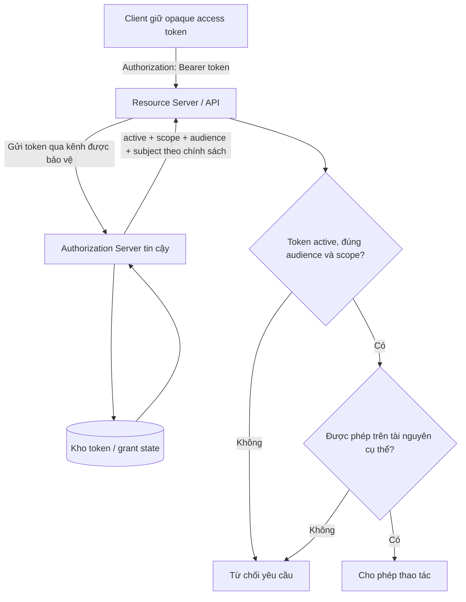
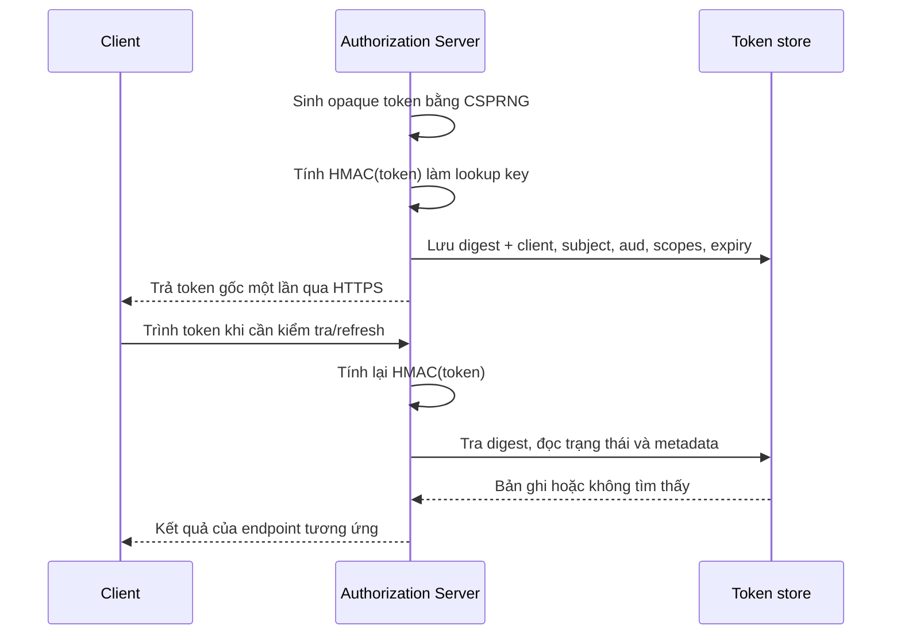
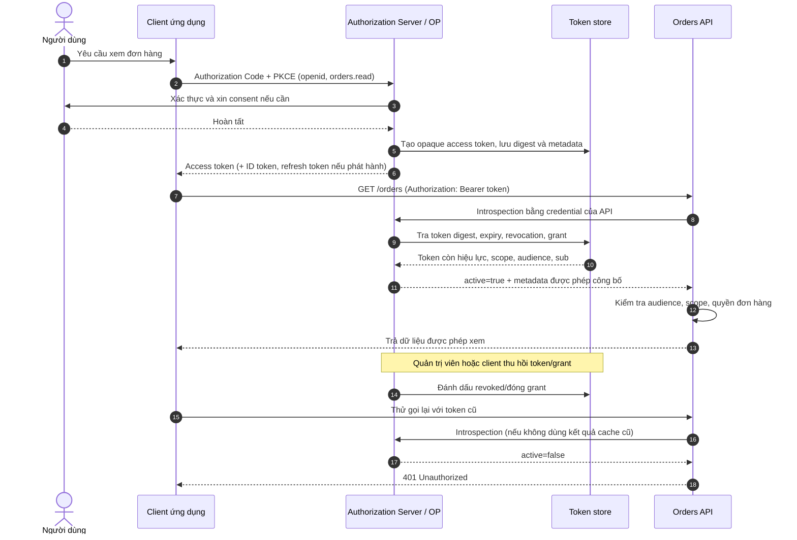

# Opaque identifier và dữ liệu phía server

Giả sử một ứng dụng nhận access token `x9f...` sau khi người dùng đăng nhập. Khi giải mã chuỗi này, ứng dụng không thấy `sub`, `scope`, `aud` hay thời hạn. Tuy nhiên, API đơn hàng vẫn biết token thuộc về ai, còn hiệu lực hay không và được phép đọc những dữ liệu nào. Lý do là chuỗi token có thể chỉ đóng vai trò **opaque identifier**: một giá trị tham chiếu khó đoán, trong khi **trạng thái và thông tin cấp quyền được quản lý phía server**.

Bài học thuộc chương **Token format** của module `SECURITY_TOKEN_SECURITY_FUNDAMENTALS`. Mục tiêu là hiểu cách opaque token liên hệ với mô hình tin cậy và vòng đời token trong OAuth 2.0/OIDC: phát hành định danh an toàn, tra cứu dữ liệu phía authorization server, kiểm tra audience/scope, hết hạn, thu hồi, lưu trữ và hạn chế nguy cơ token bị đánh cắp hoặc phát lại.

## 1. Opaque identifier thực chất là gì?

**Opaque** có nghĩa là *bên nhận không thể suy ra nội dung hoặc ý nghĩa cấp quyền chỉ từ cấu trúc token*. Token có thể là một chuỗi ngẫu nhiên được dùng như khóa tra cứu bản ghi ở authorization server (AS). Mẫu này còn được gọi là **reference token**.

```text
Access token client nhận:  4TRP...dVw  (giá trị minh họa, không phải token thật)

Authorization Server:
  token_lookup_key    ->  record-8127
  record-8127:
    subject           ->  user-123
    client            ->  orders-web
    audience          ->  orders-api
    scopes            ->  orders.read
    expires_at        ->  ...
    revoked           ->  false
```

Các thuộc tính `subject`, `audience`, `scopes` ở ví dụ là **dữ liệu do AS lưu và quản lý**; chúng không được mã hóa trực tiếp vào chuỗi opaque để API tự tách ra. Việc token nhìn như chuỗi ngẫu nhiên không tự chứng minh nó hợp lệ. Chỉ AS hoặc thành phần có quyền tra cứu, kiểm tra trạng thái mới có căn cứ trả lời token có hiệu lực hay không.

Phân biệt các khái niệm gần nhau:

| Khái niệm | Ý nghĩa | Có nên dùng thay opaque token không? |
|---|---|---|
| **Opaque token / reference token** | Một credential được phát hành, thường là chuỗi ngẫu nhiên trỏ đến trạng thái phía server. | Có, khi hệ thống thiết kế token theo mẫu tham chiếu và quản lý vòng đời đầy đủ. |
| **User ID / order ID / client ID** | Định danh nghiệp vụ hoặc định danh ứng dụng, có thể công khai. | **Không.** Biết user ID không được đồng nghĩa có quyền của user đó. |
| **Session ID** | Định danh phiên được server quản lý, thường dùng cùng cookie. | Có nguyên lý tương tự nhưng **không đồng nhất** với OAuth access token; phạm vi, cách truyền và bên nhận khác nhau. |
| **JWT access token** | Token có các claims được biểu diễn trong cấu trúc JSON Web Token và thường được ký. | Là lựa chọn định dạng khác; API có thể xác minh tại chỗ theo chính sách. |
| **Refresh token** | Credential để xin cấp access token mới tại token endpoint. | Có thể dùng chuỗi opaque, nhưng **mục đích khác** với access token. |

Một chuỗi `user-123`, ID tăng dần, thời gian hiện tại hoặc UUID sinh theo cơ chế có thể đoán được **không phải opaque bearer token an toàn**. Tính *opaque* và tính **khó đoán về mặt mật mã** là hai thuộc tính riêng, đều cần xem xét.

## 2. Vì sao để dữ liệu cấp quyền phía server?

Với mô hình tham chiếu, **token chứa ít thông tin**, còn AS lưu những dữ liệu cần kiểm tra. Nhờ đó, bên phát hành có thể thay đổi trạng thái token mà không phải tìm và chỉnh sửa từng chuỗi token đã cấp.

Ví dụ bản ghi access token phía AS:

| Trường trong bản ghi | Ví dụ | Công dụng |
|---|---|---|
| `token_digest` | HMAC-SHA-256 của token | Tra cứu token mà không phải lưu nguyên token trong cơ sở dữ liệu. |
| `token_type` | `access_token` | Phân biệt quyền gọi API với refresh token và các credential khác. |
| `issuer` | `https://id.example.test` | Gắn bản ghi với hệ thống phát hành có thẩm quyền. |
| `subject_id` | `user-123` | Xác định chủ thể theo ngữ nghĩa của luồng; có thể là user hoặc service. |
| `client_id` | `orders-web` | Gắn token với client đã được cấp quyền. |
| `audience` | `orders-api` | Xác định API/tài nguyên được nhận token. |
| `scopes` | `orders.read` | Biểu diễn phạm vi quyền được cấp. |
| `issued_at`, `expires_at` | Thời điểm UTC | Tính thời hạn hiệu lực. |
| `revoked_at` | `NULL` nếu chưa thu hồi | Cho phép vô hiệu hóa token trước khi hết hạn. |
| `grant_id` / `session_ref` | Mã liên kết nội bộ (nếu cần) | Hỗ trợ quản lý grant, phiên và thu hồi các token liên quan. |

Tên trường chỉ là **mô hình dữ liệu minh họa**, không phải schema bắt buộc trong RFC OAuth 2.0. Hệ thống có thể lưu trong cơ sở dữ liệu quan hệ, key-value store, cache được quản lý bền vững, hoặc kết hợp nhiều lớp. Một token opaque cũng **không bắt buộc** mọi triển khai phải có đúng một hàng dữ liệu giống bảng trên; đây là kiến trúc reference token thường gặp.

Điểm đáng chú ý là **AS sở hữu thông tin cấp quyền**, còn resource server (RS/API) không nên tự suy diễn quyền từ chuỗi token. Khi API muốn kiểm tra một token opaque, nó cần một cơ chế được AS tin cậy cung cấp, thường là **OAuth 2.0 Token Introspection** theo RFC 7662, hoặc một cách tra cứu nội bộ tương đương đã được bảo vệ.

## 3. Chuỗi tin cậy khi dùng opaque access token



Chuỗi tin cậy gồm các ràng buộc độc lập:

1. **Client** nhận token từ authorization server thông qua luồng OAuth 2.0 phù hợp, chẳng hạn Authorization Code + PKCE.
2. **Resource server** biết AS nào được phép cấp token cho nó; endpoint introspection hoặc nguồn tra cứu phải được cấu hình/khám phá từ issuer đáng tin cậy, không lấy tùy ý theo dữ liệu của người gọi.
3. **AS** kiểm tra token được phát hành thật, đúng loại, còn hạn, chưa thu hồi và gắn với thông tin cấp quyền hợp lệ.
4. **API** kiểm tra `active`, audience, scope và những thuộc tính cần thiết theo hợp đồng; rồi áp dụng **authorization cấp tài nguyên**, ví dụ chủ thể có được xem đơn hàng cụ thể không.

Một phản hồi introspection `active: true` chỉ là kết quả **trạng thái của token theo AS**, chưa tự động cho phép mọi request tại API. Tương tự, có scope `orders.read` không đồng nghĩa được đọc đơn hàng của người khác.

## 4. Phát hành identifier: ngẫu nhiên, khó đoán, không mang ngữ nghĩa

Opaque bearer token nên được tạo bằng **bộ sinh số ngẫu nhiên an toàn mật mã** (CSPRNG) với entropy đủ lớn. Ví dụ dùng 32 byte ngẫu nhiên (256 bit) rồi mã hóa Base64URL không có dấu `=` sẽ tạo chuỗi khoảng 43 ký tự:

```java
import java.security.SecureRandom;
import java.util.Base64;

public final class TokenIdentifierGenerator {
    private static final SecureRandom RANDOM = new SecureRandom();

    private TokenIdentifierGenerator() { }

    public static String newOpaqueToken() {
        byte[] randomBytes = new byte[32]; // 256 bit ngẫu nhiên
        RANDOM.nextBytes(randomBytes);
        return Base64.getUrlEncoder()
                .withoutPadding()
                .encodeToString(randomBytes);
    }
}
```

Đây là ví dụ về **cách tạo phần định danh bí mật**, chưa phải implementation đầy đủ của authorization server. Sau khi tạo token, server còn phải ghi trạng thái, gắn client/subject/audience/scope, thời hạn, loại token, xử lý trùng hiếm gặp và phát token qua kênh an toàn.

Những điều không nên làm:

- Sinh token bằng `Math.random()`, bộ đếm tăng dần, timestamp hoặc chuỗi liên quan trực tiếp tới user ID. Các giá trị này có thể đoán hoặc thu hẹp không gian tìm kiếm.
- Tự kết hợp các trường như `userId:scope:expiry` rồi chỉ Base64 để gọi đó là opaque token. Base64 là **mã hóa biểu diễn**, không phải cơ chế bảo mật.
- Dùng cùng một identifier cho access token và refresh token, hoặc dùng lại token cũ khi tạo grant mới.
- Giả định UUID v4 hay chuỗi dài bất kỳ đều an toàn như nhau mà không kiểm tra cách sinh, entropy và bối cảnh sử dụng. UUID v4 sinh đúng chuẩn có tính ngẫu nhiên, nhưng token được thiết kế riêng bằng CSPRNG cho phép kiểm soát rõ số bit bảo mật và cách biểu diễn.

**Không cần cố nhồi claim vào opaque token.** Các dữ liệu cấp quyền nên được gắn với bản ghi server và chỉ công bố phần cần thiết cho đúng bên sử dụng qua giao diện được bảo vệ.

## 5. Lưu identifier phía server: lưu bản rõ hay chỉ lưu bản dẫn xuất?

Vì access/refresh token dạng bearer là **bí mật có thể được sử dụng lại**, lưu nguyên token tại nhiều nơi làm tăng thiệt hại nếu cơ sở dữ liệu hoặc log bị đọc trái phép. Một thiết kế thường dùng là:

1. Sinh token ngẫu nhiên đủ entropy.
2. Tính **digest tra cứu** từ token, ví dụ HMAC-SHA-256 với khóa bí mật phía AS.
3. Lưu `token_digest` và metadata đã cấp quyền; chỉ trả **token gốc một lần** qua kênh được bảo vệ cho client.
4. Khi nhận lại token, server tính digest theo cùng quy tắc, tra cứu bản ghi và kiểm tra trạng thái.



Với token có entropy cao, một phép băm mật mã phù hợp cũng có thể dùng làm khóa tra cứu; HMAC với bí mật server giúp tách biệt thêm khả năng xác nhận token từ một bản dump dữ liệu. Cả hai cách **không cứu được token đã bị đánh cắp ở phía client hoặc trên đường truyền**. Mục tiêu chủ yếu là hạn chế thiệt hại khi kho lưu trữ bị đọc.

Ví dụ Java tính digest bằng HMAC (khóa phải được nạp từ hệ thống quản lý secret; không hardcode vào mã nguồn):

```java
import java.nio.charset.StandardCharsets;
import java.security.GeneralSecurityException;
import javax.crypto.Mac;
import javax.crypto.SecretKey;

public static byte[] tokenLookupDigest(String token, SecretKey hmacKey)
        throws GeneralSecurityException {
    Mac mac = Mac.getInstance("HmacSHA256");
    mac.init(hmacKey);
    return mac.doFinal(token.getBytes(StandardCharsets.US_ASCII));
}
```

Đây là **đoạn phương thức minh họa** về thuật toán, không phải tệp Java độc lập có thể chạy ngay. Trong ứng dụng thật phải kiểm tra độ dài/định dạng token trước khi tra cứu, hạn chế tài nguyên xử lý, bảo vệ khóa HMAC, phân tách môi trường và có phương án **xoay vòng khóa digest** (chẳng hạn lưu phiên bản khóa và hỗ trợ các phiên bản còn hiệu lực trong giai đoạn chuyển tiếp).

Nếu phát hành token có định dạng cố định Base64URL, nên kiểm tra input có đúng giới hạn độ dài/ký tự, trả lỗi chung khi không khớp, tránh log giá trị đầu vào và **không tiết lộ** token có tồn tại hay không qua thời gian phản hồi hoặc thông điệp quá chi tiết.

## 6. Sơ đồ dữ liệu ví dụ và thời điểm hiệu lực

Để hình dung chính xác dữ liệu phía server, sau đây là schema quan hệ **mang tính mô hình**:

```sql
CREATE TABLE oauth_token_records (
    token_digest       BYTEA PRIMARY KEY,
    token_kind         VARCHAR(24) NOT NULL,
    issuer             VARCHAR(255) NOT NULL,
    subject_ref        VARCHAR(255),
    client_id          VARCHAR(255) NOT NULL,
    audience           VARCHAR(255) NOT NULL,
    scopes             TEXT NOT NULL,
    issued_at          TIMESTAMP WITH TIME ZONE NOT NULL,
    expires_at         TIMESTAMP WITH TIME ZONE NOT NULL,
    revoked_at         TIMESTAMP WITH TIME ZONE,
    grant_ref          VARCHAR(255)
);
```

Schema trên chỉ minh họa cấu trúc **một audience chính** và biểu diễn scopes bằng văn bản. Nếu token có nhiều audience, nhiều scope hoặc quan hệ grant phức tạp, cần bảng liên kết/kiểu dữ liệu phù hợp, index theo cách truy vấn và quy tắc dữ liệu nhất quán. Trường `token_kind` giúp ngăn nhầm access token với refresh token. Hệ thống sản xuất cần cơ chế cô lập tenant, giới hạn quyền đọc/ghi, encryption at rest khi cần, backup, kiểm soát retention và dọn bản ghi hết hạn.

Một token chỉ được coi là còn hiệu lực khi **đồng thời** thỏa các điều kiện thích hợp: tìm thấy bản ghi hợp lệ; đúng loại; chưa vượt quá `expires_at`; chưa bị thu hồi; grant/client không bị vô hiệu; và chính sách AS cho phép sử dụng. Nếu có thời điểm bắt đầu hiệu lực (`not_before`) hoặc trạng thái phiên/grant bổ sung, phải kiểm tra cả những điều đó.

Không nên chỉ xóa bản ghi hết hạn rồi cho rằng hệ thống đã có cơ chế audit/thu hồi đủ tốt. Quy trình xóa dữ liệu, dấu vết kiểm toán và quy trình quản lý sự cố có **mục đích và thời hạn lưu riêng**.

## 7. API xác minh opaque token qua introspection như thế nào?

Resource server không thể giải mã opaque token để đọc claims. Với **RFC 7662**, RS có thể gửi yêu cầu đến token introspection endpoint của AS mà nó tin cậy. Ví dụ rút gọn:

```http
POST /oauth2/introspect HTTP/1.1
Host: id.example.test
Content-Type: application/x-www-form-urlencoded
Authorization: Basic <RESOURCE_SERVER_CREDENTIAL_EXAMPLE>

token=OPAQUE_ACCESS_TOKEN_EXAMPLE&token_type_hint=access_token
```

Trong ví dụ này, `Authorization: Basic ...` chỉ minh họa **một** kiểu xác thực bên gọi introspection; thực tế có thể dùng phương thức khác do AS hỗ trợ, ví dụ mTLS. `token_type_hint` là gợi ý về loại token, không thay thế việc AS kiểm tra token thực tế. Mọi dữ liệu trong ví dụ đều là placeholder.

Phản hồi minh họa khi token còn hiệu lực:

```json
{
  "active": true,
  "client_id": "orders-web",
  "token_type": "Bearer",
  "sub": "user-123",
  "scope": "orders.read",
  "aud": "orders-api",
  "iss": "https://id.example.test",
  "iat": 1795410000,
  "exp": 1795410900
}
```

Phản hồi khi token không hợp lệ hoặc đã bị vô hiệu có thể chỉ là:

```json
{
  "active": false
}
```

**Giá trị `active: true` chưa đủ để cho phép request.** Resource server vẫn cần:

| Phép kiểm tra | Ví dụ | Tại sao cần? |
|---|---|---|
| Nguồn phản hồi | Introspection endpoint đã được cấu hình từ AS tin cậy, dùng TLS và xác thực RS. | Không để kẻ tấn công tự cung cấp kết quả `active: true`. |
| Trạng thái và thời gian | `active == true`, kiểm tra các giới hạn thời gian được cung cấp. | Token hết hạn hoặc bị thu hồi không được tiếp tục sử dụng. |
| Loại token và ngữ nghĩa | Bản ghi là access token phù hợp, không phải refresh token/ID token. | Tránh sử dụng token sai mục đích. |
| Audience | `aud` chứa `orders-api`. | Token dành cho API khác không hợp lệ tại API đơn hàng. |
| Scope/quyền | Có `orders.read` cho thao tác đọc. | Token hợp lệ chưa có nghĩa được làm mọi việc. |
| Quyền trên tài nguyên | `user-123` được xem đơn hàng `ORD-101`. | Ngăn BOLA/IDOR và truy cập xuyên tenant. |

RFC 7662 định nghĩa phản hồi introspection, nhưng **không bảo đảm** mọi AS đều cung cấp tất cả các trường tùy chọn hoặc dùng cùng quy ước audience/subject. RS phải có một hợp đồng rõ ràng với AS: thiếu trường bắt buộc đối với chính sách API thì **không được tự suy diễn thành có quyền**.

Introspection là một lựa chọn, không có nghĩa mọi API bắt buộc phải gọi endpoint cho từng request trong mọi kiến trúc. AS và RS thuộc cùng một miền tin cậy có thể chia sẻ cơ chế kiểm tra nội bộ; khi đó vẫn cần quy tắc xác thực nguồn dữ liệu, phân quyền truy cập bản ghi và cập nhật trạng thái nhất quán.

## 8. Luồng đầy đủ: phát hành, sử dụng, thu hồi

Ví dụ một ứng dụng web cần đọc đơn hàng qua OAuth 2.0/OIDC:



OIDC **ID token** trong luồng này là JWT dành cho **client** để xác nhận kết quả đăng nhập; nó không trở thành access token. **Refresh token**, nếu được cấp, chỉ đi tới **token endpoint của AS** để xin access token mới; cũng có thể là opaque identifier với dữ liệu và cơ chế bảo vệ riêng phía server.

Trong hệ thống cache kết quả introspection, thời điểm thu hồi có hiệu lực tại API phụ thuộc TTL cache/cơ chế vô hiệu cache. Sơ đồ diễn tả đường đi khi API thực hiện kiểm tra trạng thái mới, không bảo đảm mọi lần thu hồi đều được phát hiện tức thì.

## 9. Thu hồi, xoay vòng và quản lý vòng đời phía server

Lợi thế của reference token là AS có thể **đổi trạng thái bản ghi** để ngăn việc sử dụng tiếp theo khi bên nhận kiểm tra trạng thái mới. Những sự kiện phổ biến:

| Sự kiện | Thay đổi phía AS | Điều RS cần quan tâm |
|---|---|---|
| Access token hết hạn | `expires_at` đã qua; lookup/introspection trả không active. | Từ chối token và trả phản hồi phù hợp. |
| Thu hồi access token | Đánh dấu `revoked_at` hoặc xóa bản ghi tham chiếu. | Từ chối ở lần kiểm tra trạng thái sau; cache có thể làm chậm phát hiện. |
| Thu hồi grant/đăng xuất | Chính sách AS có thể vô hiệu các token liên quan. | Không giả định mọi hệ thống đều tự thu hồi tức thì mọi session/API token. |
| Làm mới access token | Client gửi refresh token đến AS; AS kiểm tra rồi cấp token mới. | Token access mới có thể có digest/bản ghi và thời hạn riêng. |
| Refresh token rotation | AS cấp refresh token kế tiếp và vô hiệu refresh token cũ. | Phát hiện việc dùng lại token cũ có thể là tín hiệu bị đánh cắp. |
| Thay đổi quyền | AS hoặc policy engine cập nhật grants/roles/scopes theo chính sách. | Xác định xem introspection trả quyền mới hay quyền tại lúc cấp; API vẫn cần kiểm tra quyền nghiệp vụ hiện tại. |

RFC 7009 mô tả **OAuth 2.0 Token Revocation**. Việc gọi revocation endpoint không đồng nghĩa mọi token khác đã phát hành đều mất hiệu lực; cách vô hiệu token liên quan phụ thuộc loại token và chính sách server. Với refresh token rotation, cần thao tác **nguyên tử** (hoặc cơ chế đồng bộ tương đương) để hai request dùng token cũ đồng thời không cùng được phát hành hai refresh token tiếp theo ngoài ý muốn.

Với token dạng opaque, AS có thể truy vết một **token family** cho refresh token và xác định sử dụng lại token đã được thay thế. Nếu phát hiện dấu hiệu replay, server có thể vô hiệu hóa cả family và yêu cầu cấp quyền lại. Không nên áp dụng chính sách chỉ dựa vào một lần lỗi mạng mà không xét race condition, retry và hành vi client được thiết kế hợp lệ.

## 10. Những đánh đổi khi đặt dữ liệu phía server

| Tiêu chí | Opaque/reference access token | JWT access token tự chứa claims |
|---|---|---|
| Thông tin client nhìn thấy | Thường chỉ có identifier không giải thích quyền. | Payload JWT có thể đọc được nếu không được mã hóa; chữ ký không che giấu nội dung. |
| Nơi lưu trạng thái cấp quyền | AS/token store hoặc cơ chế trạng thái phía server. | Claims nằm trong token, có thể kèm trạng thái phụ tại AS/RS. |
| API kiểm tra | Thường cần introspection hoặc tra cứu nội bộ. | Có thể kiểm tra chữ ký và claims tại chỗ theo issuer, JWKS, audience và chính sách. |
| Thu hồi | Kiểm soát thuận lợi khi API tra trạng thái mới. | JWT tự kiểm tra có thể tồn tại đến `exp` trừ khi thêm denylist/introspection/cơ chế thu hồi. |
| Phụ thuộc kết nối | API có thể phụ thuộc AS/kho trạng thái và mạng. | Ít phụ thuộc AS trên mỗi request sau khi có khóa/cấu hình tin cậy. |
| Tải vận hành | Cần lookup, caching, capacity, phân quyền introspection và tính sẵn sàng kho token. | Cần quản lý khóa, chữ ký, clock skew, vòng đời claims và giới hạn token. |
| Rủi ro nếu token bị đánh cắp | Bearer token vẫn có thể bị phát lại khi còn hiệu lực. | Bearer JWT cũng có thể bị phát lại khi còn hiệu lực. |

Không thể kết luận “opaque luôn an toàn hơn JWT” chỉ dựa vào định dạng. Mức an toàn phụ thuộc **entropy, nguồn tin cậy, audience/scope, thời hạn, cách lưu, cách truyền, cache, thu hồi và cơ chế chống replay**. Một opaque token không được kiểm tra trạng thái và quyền đúng cách vẫn có thể tạo lỗ hổng nghiêm trọng.

### Introspection cache và độ mới trạng thái

Tra cứu AS trên mọi request có thể tăng độ trễ và tạo điểm phụ thuộc. API có thể cache introspection trong thời gian ngắn nhưng phải định nghĩa rõ:

- **TTL cache** không vượt quá hiệu lực còn lại của token và ngưỡng rủi ro chấp nhận được; token hết hạn phải bị từ chối dù cache từng ghi `active: true`.
- **Cache key** tránh lưu lộ token gốc, có thể dùng digest/HMAC và phân vùng theo issuer/audience hoặc ngữ cảnh được phép.
- **Thu hồi và thay đổi quyền** có thể chậm hiệu lực đến khi cache hết hạn trừ khi có cơ chế invalidation đáng tin.
- **Lỗi AS hoặc mạng** không được tự xem là token hợp lệ. Dùng cache đã xác minh còn hạn hay từ chối truy cập cần theo chính sách rủi ro; không tạo trạng thái `active: true` chỉ vì introspection timeout.
- **Độ sẵn sàng của AS** và token store phải được tính vào SLO của API. Cần giới hạn tải, timeout, circuit breaker và giám sát mà không bỏ qua bước kiểm tra quyền.

## 11. Bảo vệ opaque identifier trước đánh cắp và phát lại

Opaque access token dùng kiểu **Bearer** vẫn là credential: ai có chuỗi token còn hiệu lực thường có thể dùng nó để gọi API. “Không đọc được claims” **không ngăn** kẻ tấn công dùng lại chuỗi token vừa lấy cắp.

Các biện pháp cần kết hợp:

1. **Bảo vệ đường truyền:** HTTPS/TLS, tránh truyền token trong URL query, referrer hoặc redirect không phù hợp; gửi bearer access token bằng header `Authorization` theo RFC 6750.
2. **Giảm bề mặt lộ:** không ghi token gốc vào log, tracing, analytics, crash reports, mã nguồn, bản sao lưu không được bảo vệ hoặc lỗi trả về client.
3. **Lưu trữ phía client phù hợp:** ứng dụng web cân nhắc BFF/session cookie `HttpOnly`, `Secure`, `SameSite` và CSRF defense; ứng dụng native dùng kho lưu bí mật của OS. Không tự cho rằng `localStorage` chống được XSS.
4. **Giảm giá trị token khi lộ:** access token sống ngắn, audience và scope tối thiểu, kiểm tra quyền trên tài nguyên; theo dõi bất thường và có cơ chế thu hồi.
5. **Chống replay theo yêu cầu:** cân nhắc **sender-constrained tokens** như DPoP hoặc mTLS khi hạ tầng hỗ trợ. Token bị ràng buộc với bên gửi khó bị sử dụng từ một môi trường khác hơn bearer token thuần túy. Rotation giúp phát hiện sử dụng lại refresh token.
6. **Giới hạn quyền của introspection caller:** chỉ resource server được phép mới truy vấn; xác thực caller, giới hạn thông tin phản hồi, chống lạm dụng endpoint và không cho bên không có quyền kiểm tra hàng loạt token.

Đừng nhầm **khó đoán token** với **chống phát lại token bị lộ**. Entropy lớn ngăn việc đoán mò một token chưa biết; nó không ngăn người đã có bản sao token dùng lại. Hai lớp phòng vệ phải được thiết kế riêng.

## 12. Triển khai và kiểm chứng: những tình huống dễ sai

| Tình huống | Cách xử lý đúng | Sai lầm cần tránh |
|---|---|---|
| API nhận token không tra cứu được. | Từ chối theo chính sách, ví dụ `401`, không tiết lộ token có tồn tại hay không. | Tạo principal mặc định hoặc coi token “trông có vẻ ngẫu nhiên” là hợp lệ. |
| Access token còn hạn nhưng `aud = payments-api`. | API `orders-api` từ chối. | Bỏ kiểm tra audience vì AS đã trả `active: true`. |
| Access token hợp lệ nhưng thiếu `orders.write`. | Từ chối thao tác, thường `403 insufficient_scope`. | Chỉ kiểm tra `active`, bỏ qua scope. |
| Access token có `orders.read`, nhưng user đọc đơn người khác. | Kiểm tra owner/tenant và từ chối. | Cho phép vì bearer token hợp lệ và scope có mặt. |
| Refresh token bị gửi nhầm tới resource API. | Từ chối vì sai loại và sai bên nhận. | Dùng refresh token như access token sống lâu. |
| Refresh token cũ được dùng lại sau rotation. | Áp dụng chính sách phát hiện replay/thu hồi family thích hợp. | Cấp token mới không giới hạn khi reuse. |
| Introspection endpoint tạm mất kết nối. | Fail closed hoặc cache đã xác minh còn hạn theo chính sách; cảnh báo vận hành. | Tự cho phép request vì endpoint lỗi. |
| Database backup bị lộ. | Duy trì bí mật token nhờ digest/HMAC và kiểm soát truy cập/khóa. | Lưu nguyên access/refresh token trong trường dễ truy vấn/ghi log. |
| Client gửi token qua URL query. | Dùng header Authorization/TLS và giám sát rò rỉ. | Cho token vào access log, browser history, referrer. |

**Bài tập thực hành:** Thiết kế dịch vụ đơn hàng với access token opaque sống 10 phút và refresh token xoay vòng. Vẽ các thành phần AS, token store, API, client. Mô tả các bản ghi cần lưu và thứ tự kiểm tra khi `GET /orders/42`. Sau đó thử ba biến thể: (a) token hết hạn, (b) token còn hạn nhưng sai audience, (c) token còn hạn và đúng scope nhưng không có quyền trên đơn hàng. Giải thích vì sao cả ba đều phải bị từ chối dù **nguyên nhân và điểm kiểm tra khác nhau**.

### Câu hỏi tự đánh giá

1. Vì sao một opaque identifier cần được sinh bằng CSPRNG và có entropy đủ lớn?
2. Vì sao API không thể kết luận quyền chỉ bằng cách xem chuỗi token opaque?
3. Những trường nào nên được lưu tại AS và những trường nào **không** được đưa vào log?
4. Sự khác biệt giữa `active: true`, `aud` hợp lệ, scope đủ và quyền trên một đơn hàng cụ thể là gì?
5. Vì sao thu hồi token trên AS có thể chưa hiệu lực ngay nếu API cache kết quả introspection?
6. Digest/HMAC bảo vệ trường hợp nào và **không** giải quyết trường hợp nào khi token bị đánh cắp?

## 13. Ghi nhớ

- **Opaque identifier** là credential khó đoán dùng để **tham chiếu** dữ liệu/token state do server quản lý. Bản thân chuỗi không mang claims mà client/API có thể diễn giải đáng tin cậy.
- **Token store phía AS** có thể giữ subject, client, audience, scope, hạn dùng, trạng thái thu hồi và quan hệ grant; có thể lưu **digest** thay vì token gốc để giảm thiểu hậu quả lộ cơ sở dữ liệu.
- **Resource server** kiểm tra opaque token thông qua AS/introspection hoặc cơ chế được tin cậy khác, rồi tiếp tục kiểm tra **audience, scope và quyền trên tài nguyên cụ thể**.
- **Access token, refresh token và ID token** có mục đích khác nhau; opaque không làm mất đi yêu cầu phân biệt loại token và bên nhận.
- **Thu hồi thuận lợi hơn khi trạng thái tập trung**, nhưng phụ thuộc độ mới của dữ liệu và cache. Entropy giúp chống đoán token; việc ngăn token bị đánh cắp/phát lại cần TLS, lưu trữ an toàn, giới hạn quyền và cơ chế ràng buộc người gửi khi cần.

### Tài liệu chuẩn tham khảo

- [RFC 6749 — The OAuth 2.0 Authorization Framework](https://www.rfc-editor.org/rfc/rfc6749): cấp phát access/refresh token và quyền của client.
- [RFC 6750 — The OAuth 2.0 Authorization Framework: Bearer Token Usage](https://www.rfc-editor.org/rfc/rfc6750): cách sử dụng bearer access token và lỗi API.
- [RFC 7662 — OAuth 2.0 Token Introspection](https://www.rfc-editor.org/rfc/rfc7662): kiểm tra trạng thái và metadata token tại AS.
- [RFC 7009 — OAuth 2.0 Token Revocation](https://www.rfc-editor.org/rfc/rfc7009): giao diện thu hồi token.
- [RFC 9700 — Best Current Practice for OAuth 2.0 Security](https://www.rfc-editor.org/rfc/rfc9700): bảo mật token, rotation và giảm nguy cơ phát lại.
- [RFC 9068 — JWT Profile for OAuth 2.0 Access Tokens](https://www.rfc-editor.org/rfc/rfc9068): đối chiếu mô hình JWT access token với reference/opaque token.
- [OpenID Connect Core 1.0](https://openid.net/specs/openid-connect-core-1_0.html): vai trò ID token và xác thực danh tính trong OIDC.
