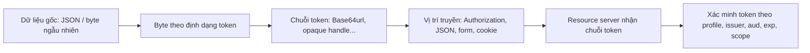

# Token encoding và charset

## 1. Vì sao encoding là một phần của token security?

Một **security token** có thể là access token, refresh token, ID token hoặc session token. Nó có thể ở dạng JWT có cấu trúc, hoặc một chuỗi opaque mà client không hiểu nội dung. Bất kể định dạng nào, token cuối cùng phải đi qua nhiều lớp: dữ liệu trong bộ nhớ, chuỗi ký tự, HTTP header, JSON response, đôi khi là form hoặc cookie. Tại mỗi lớp, **encoding** quyết định cách biểu diễn byte bằng ký tự; **charset** quyết định cách chuyển giữa ký tự và byte.

Một lỗi encoding có thể khiến API nhận **giá trị khác** với token authorization server đã phát hành. Tệ hơn, việc cố sửa token bằng các phép biến đổi tùy ý như thay `+` bằng khoảng trắng, cắt dấu `=`, chuẩn hóa Unicode hoặc decode URL nhiều lần có thể tạo ra lỗ hổng xác minh và ghi log.

Ví dụ:

- Client có token chứa dấu `+` và ghép thẳng vào form body; bộ giải mã form hiểu `+` là **dấu cách**.
- Client lấy JWT, giải mã Base64url để đọc JSON, rồi tạo lại JSON theo cách khác trước khi kiểm tra chữ ký; **các byte đã ký không còn nguyên vẹn**.
- API nhận token qua `Authorization` header nhưng tự thực hiện percent-decoding như khi xử lý URL; chuỗi token có thể bị thay đổi ngoài quy ước giao thức.
- Trình duyệt đưa token vào query string; log máy chủ, lịch sử trình duyệt hoặc một số thành phần trung gian có thể lưu lại **toàn bộ bí mật**.

Bài **Token encoding và charset** thuộc chương **Token format** của module `SECURITY_TOKEN_SECURITY_FUNDAMENTALS`. Trong bối cảnh vòng đời token bảo mật và OAuth 2.0/OIDC, mục tiêu là **biểu diễn token đúng và giữ nguyên giá trị xác thực**, đồng thời hiểu vì sao encoding **không thay thế** chữ ký, mã hóa bí mật, kiểm tra issuer, audience, scope, thời hạn hay thu hồi.

## 2. Nền tảng: ký tự, byte, charset và encoding

Hãy tách bốn khái niệm:

| Khái niệm | Ý nghĩa | Ví dụ |
| --- | --- | --- |
| **Ký tự** | Đơn vị văn bản mà con người nhận biết hoặc phần tử Unicode | Chữ `é`, `đ`, `A` |
| **Code point Unicode** | Giá trị số đại diện ký tự | `é` là `U+00E9` |
| **Charset / character encoding** | Quy tắc chuyển chuỗi ký tự thành byte và ngược lại | UTF-8 biến `é` thành hai byte `C3 A9` |
| **Binary-to-text encoding** | Cách biểu diễn byte bằng bộ ký tự hạn chế | Base64url biến hai byte `C3 A9` thành `w6k` (không padding) |

Ví dụ chuỗi văn bản `é`:

```text
Ký tự Unicode:         é
Code point:            U+00E9
UTF-8 bytes:           C3 A9
Base64url không pad:   w6k
```

Giải mã theo chiều ngược lại:

```text
"w6k" --Base64url decode--> [0xC3, 0xA9] --UTF-8 decode--> "é"
```

**Hai loại “decode” giải quyết hai việc khác nhau.** Base64url giải mã *chuỗi ký tự ASCII thành byte*; UTF-8 giải mã *byte thành văn bản Unicode*. Không phải token nào cũng chứa văn bản UTF-8 cần đọc. Một opaque token có thể chỉ là **byte ngẫu nhiên được biểu diễn thành chuỗi**, không có JSON hay Unicode nào bên trong.

### 2.1. ASCII và UTF-8 liên hệ ra sao?

ASCII cơ bản dùng các giá trị byte `0x00–0x7F`. UTF-8 giữ nguyên biểu diễn ASCII cho các ký tự trong tập này, và dùng từ một đến bốn byte cho các code point Unicode khác.

Ví dụ:

| Văn bản | UTF-8 dạng hex | Ghi chú |
| --- | --- | --- |
| `A` | `41` | Một byte ASCII/UTF-8 |
| `é` | `C3 A9` | Hai byte UTF-8 |
| `Đ` | `C4 90` | Hai byte UTF-8 |
| Dấu cách | `20` | Không giống ký tự `+` trong byte thô |

Trong các giao thức web hiện đại, **UTF-8 là lựa chọn mặc định thích hợp khi cần chuyển văn bản sang byte**, trừ khi tiêu chuẩn đang dùng quy định cụ thể một cách biểu diễn khác. Khi token đã là chuỗi ASCII với cú pháp xác định, không có lý do tự chuyển lại bằng một charset tùy ý.

### 2.2. Encoding không phải encryption

Các khái niệm thường bị nhầm:

| Cơ chế | Mục đích | Có che giấu bí mật không? |
| --- | --- | --- |
| UTF-8 | Chuyển văn bản Unicode thành byte | Không |
| Base64 / Base64url | Chuyển byte thành chuỗi ký tự có thể truyền tải | Không |
| Percent-encoding | Biểu diễn byte trong thành phần URL/form | Không |
| Chữ ký số / MAC | Chứng minh tính toàn vẹn và nguồn tạo theo khóa | Không che giấu payload |
| Mã hóa bí mật (*encryption*) | Bảo vệ nội dung khỏi người không có khóa giải mã | Có, nếu dùng đúng thuật toán và quản lý khóa |

**Không bao giờ coi Base64url là cách mã hóa bảo mật token.** Bất kỳ ai có chuỗi JWT thông thường đều có thể giải mã header/payload nếu đó là JWT ký số không mã hóa. Access token vẫn phải được giữ như credential nhạy cảm dù trông giống “chuỗi khó đọc”.

## 3. Các lớp biểu diễn của token

Một token có thể đi qua các lớp khác nhau. Cần biết mỗi lớp sử dụng quy tắc nào:



- **Token format:** JWT, opaque hoặc cấu trúc khác được issuer định nghĩa.
- **Text encoding:** UTF-8 khi chuyển văn bản JSON và chuỗi Unicode thành byte.
- **Binary-to-text encoding:** Base64url hay cách khác khi giao thức cần biểu diễn byte dưới dạng chữ.
- **Transport encoding:** HTTP field, JSON string, `application/x-www-form-urlencoded` hoặc cookie có những ràng buộc riêng.
- **Token validation:** chữ ký/trạng thái và claims được kiểm tra bằng chính cơ chế tin cậy; không thể được suy ra chỉ từ encoding.

Một token không tự trở nên đáng tin chỉ vì có đúng ba dấu phân đoạn hoặc có thể parse thành JSON.

## 4. Base64 và Base64url: khác nhau ở đâu?

**Base64** chuyển từng nhóm ba byte thành bốn ký tự với bảng chữ cái gồm các chữ cái Latin, số, `+`, `/` và ký tự padding `=` khi cần. **Base64url** theo RFC 4648 thay `+` bằng `-` và `/` bằng `_` để phù hợp hơn với URL và các ngữ cảnh truyền tải văn bản.

| Thuộc tính | Base64 chuẩn | Base64url |
| --- | --- | --- |
| Nhóm ký tự thứ 62 | `+` | `-` |
| Nhóm ký tự thứ 63 | `/` | `_` |
| Padding | Có thể dùng `=` | Có thể dùng `=` theo quy tắc chung; **JOSE/JWT compact thường bỏ padding** |
| Ứng dụng | Nhiều định dạng nhị phân/chuỗi | JWT/JWS/JWE, PKCE, định danh URL-safe |
| Mức độ bảo mật | Encoding, không phải encryption | Encoding, không phải encryption |

Ví dụ ba byte `0xFB 0xFF 0xFF`:

```text
Hex bytes:             FB FF FF
Base64 chuẩn:          +///
Base64url:             -___
```

Trong JSON Web Signature (JWS) và JSON Web Encryption (JWE), quy tắc Base64url thường được áp dụng **không có dấu `=` ở cuối**. Không được mặc định mọi dữ liệu Base64url ở mọi giao thức đều dùng quy tắc padding giống nhau.

### 4.1. Vì sao bỏ padding trong JWT?

Base64url không padding vẫn cho phép decoder xác định số byte ban đầu từ độ dài chuỗi hợp lệ. Trong JOSE, padding được lược bỏ theo quy tắc serialization; vì vậy các chuỗi JWT compact thường **không chứa `=`** trong từng segment.

Với Base64url chuẩn có độ dài hợp lệ:

- Độ dài chia `4` dư `0`: không cần thêm `=` khi giải mã.
- Dư `2`: có thể thêm `==` nếu thư viện decoder yêu cầu padding.
- Dư `3`: có thể thêm `=` nếu thư viện decoder yêu cầu padding.
- Dư `1`: **không hợp lệ** đối với Base64url được mã hóa đúng.

Decoder của JWT nên tuân thủ profile JOSE, giới hạn kích thước và cú pháp đầu vào; không “sửa” tự động các segment sai bằng cách lọc ký tự lạ hoặc thêm ký tự đoán mò.

### 4.2. Base64url không tăng entropy

Nếu token gốc là **32 byte ngẫu nhiên bảo mật**, nó chứa 256 bit entropy lý tưởng trước khi mã hóa và vẫn chứa lượng entropy đó sau khi chuyển thành chuỗi Base64url khoảng 43 ký tự. Nếu token gốc chỉ là `user-123` được Base64url hóa, kẻ tấn công vẫn đoán lại được dễ dàng.

Độ dài chuỗi và “trông ngẫu nhiên” không chứng minh token có khả năng chống đoán. Cần dùng bộ sinh số ngẫu nhiên mật mã (*cryptographically secure random number generator*, CSPRNG) và chính sách token phù hợp.

## 5. JWT compact: byte nào được ký, phần nào có thể đọc?

Một JWT dạng **JWS Compact Serialization** thông dụng có ba phần:

```text
BASE64URL(UTF8(header JSON)).BASE64URL(UTF8(payload JSON)).BASE64URL(signature bytes)
```

Ví dụ cấu trúc:

```text
<encoded-header>.<encoded-payload>.<encoded-signature>
```

Trong đó:

- **Header JSON** mô tả thuật toán và metadata xử lý, ví dụ `alg`, `typ`, `kid`.
- **Payload JSON** chứa các claims như `iss`, `sub`, `aud`, `exp`, `scope`.
- **Signature** được tạo và xác minh theo thuật toán, khóa và **chính signing input** của JWS.

**JWS signing input** của compact JWS thông dụng là:

```text
ASCII(BASE64URL(UTF8(protected header)) || "." || BASE64URL(payload bytes))
```

JWT claims set thông thường được biểu diễn dưới dạng JSON UTF-8, nhưng JWS nói chung có thể ký payload byte tùy ý. Chữ ký **không** được tính bằng cách parse JSON rồi serialize lại tùy ý trong resource server.

### 5.1. Tại sao không tự serialize lại JSON trước khi xác minh?

Hai chuỗi JSON sau có thể chứa cùng thông tin đối với ứng dụng:

```json
{"sub":"user-123","scope":"orders:read"}
```

```json
{
  "scope": "orders:read",
  "sub": "user-123"
}
```

Nhưng **thứ tự khóa, dấu cách và các byte UTF-8 khác nhau**. Vì JWS ký representation byte cụ thể, tạo lại JSON có thể thay đổi signing input và khiến chữ ký không khớp.

Luồng đúng của validator đã được kiểm chứng:

1. Nhận nguyên chuỗi JWT compact và kiểm tra cú pháp, kích thước, profile.
2. Xác định thuật toán và tập khóa **được cấu hình tin cậy**, không để token tự quyết định chính sách.
3. Xác minh chữ ký trên signing input đúng quy tắc JOSE.
4. Sau xác minh, parse claims theo profile rồi kiểm tra issuer, audience, thời hạn, loại token, scope và quyền.

Có thể **giải mã JWT để xem khi debug**, nhưng không sử dụng claims giải mã như dữ liệu đã xác thực trước khi verify. Không tải khóa từ một URL bất kỳ trong header `jku` hoặc tin `kid` như một quyền chọn khóa không giới hạn.

### 5.2. JWS, JWE và số phần phân đoạn

| Dạng compact thường gặp | Số segment | Mục đích |
| --- | --- | --- |
| **JWS Compact** | 3, phân cách bằng `.` | Nội dung ký số/MAC, kiểm tra toàn vẹn |
| **JWE Compact** | 5, phân cách bằng `.` | Nội dung được mã hóa theo JWE, bảo vệ bí mật khi xử lý đúng |
| **Opaque token** | Không có số segment cố định | Giá trị tham chiếu hoặc chuỗi bí mật theo issuer |

Đừng viết logic “chứa hai dấu chấm thì chắc chắn là JWT hợp lệ”. Một chuỗi có hình dạng JWT vẫn có thể sai chữ ký, sai cấu trúc, không đúng loại token, hết hạn, sai audience hoặc do nguồn phát hành không được tin cậy.

**JWE khác Base64url:** JWE thực hiện các bước mã hóa và xác thực mật mã; Base64url chỉ giúp biểu diễn các byte đầu ra. JWS không mặc nhiên giữ bí mật payload.

### 5.3. Unicode trong claims

JSON có thể chứa ký tự Unicode. Chuỗi `"Đà Nẵng"` có thể được serialize thành ký tự UTF-8 trực tiếp hoặc thành các escape JSON tương ứng. Các biểu diễn có thể khác nhau về byte dù ứng dụng hiển thị giống nhau.

Vì vậy:

- Chữ ký phải được xác minh theo **byte của token gốc**.
- Sau xác minh, ứng dụng phải parse claims bằng thư viện JSON phù hợp với profile; xử lý escape và ký tự Unicode đúng quy tắc.
- Các định danh bảo mật như `iss`, `aud`, `scope`, `sub` cần so khớp theo **quy tắc giao thức/issuer**, không tự chuyển thường, xóa dấu tiếng Việt hoặc chuẩn hóa Unicode theo cảm tính.
- Không dùng phép decode lỏng lẻo khiến byte UTF-8 không hợp lệ bị thay bằng ký tự thay thế rồi vẫn tiếp tục xác thực.

## 6. Opaque token: chuỗi không có cấu trúc công khai

Một **opaque access token** có thể được sinh từ dữ liệu ngẫu nhiên, rồi biểu diễn bằng ký tự phù hợp với HTTP:

```text
Dữ liệu gốc (ví dụ): 32 byte CSPRNG
            ↓ Base64url không padding
Opaque token: chuỗi ASCII khó đoán
            ↓
Authorization: Bearer <opaque_token>
```

Resource server không được giả định opaque token mang `header.payload.signature` hoặc tự decode để tìm `exp` và `scope`. Thông tin về trạng thái, audience, client, subject và quyền có thể được server có thẩm quyền quản lý và cung cấp qua introspection hoặc tra cứu an toàn.

Điểm đáng chú ý:

- **Opaque** mô tả việc client/resource server không tự diễn giải nội dung theo contract; không đồng nghĩa token luôn được tạo từ 32 byte hay Base64url.
- Không phải mọi token opaque đều là chuỗi ngẫu nhiên độc lập; nhà phát hành có thể chọn định dạng riêng miễn đúng hợp đồng và bảo mật.
- Chuỗi được phát hành phải được **giữ nguyên** khi gửi, so khớp hoặc tra cứu.
- Nếu lưu token dạng hash để tra cứu/thu hồi, cần chọn thiết kế phù hợp với entropy, phạm vi token, khả năng so khớp và quản lý bí mật; không lưu token thô trong log.

### 6.1. Sinh opaque token an toàn bằng Java

Ví dụ sau minh họa cách tạo **một giá trị ngẫu nhiên URL-safe**; đây chưa phải hệ thống phát hành access token hoàn chỉnh:

```java
import java.security.SecureRandom;
import java.util.Base64;

public final class RandomTokenExample {
    private static final SecureRandom RNG = new SecureRandom();

    public static String createOpaqueHandle() {
        byte[] bytes = new byte[32]; // 256 bit từ CSPRNG
        RNG.nextBytes(bytes);

        return Base64.getUrlEncoder()
                .withoutPadding()
                .encodeToString(bytes);
    }
}
```

Kết quả thường dài **43 ký tự ASCII**. Trong production, authorization server còn phải gắn handle với phạm vi, audience, subject/client, thời hạn, khả năng thu hồi và chính sách lưu trữ phù hợp. Không tạo token bằng `Math.random()`, timestamp, ID tăng dần hoặc Base64url của `userId`.

Khi cần so khớp bí mật, phải đánh giá tấn công timing và dùng thao tác so sánh an toàn phù hợp; không tự áp dụng phép so khớp “gần giống” hay tự chuẩn hóa chuỗi token.

## 7. Bearer trong HTTP Authorization header

Cách thông dụng để trình access token tại resource server là:

```http
GET /orders HTTP/1.1
Host: orders-api.example.com
Authorization: Bearer <access_token>
```

Với HTTP Bearer theo RFC 6750, cú pháp token sử dụng **`b64token`**:

```text
b64token = 1*( ALPHA / DIGIT / "-" / "." / "_" / "~" / "+" / "/" ) *"="
```

Điều đó có hai hệ quả:

1. Cú pháp Bearer **cho phép nhiều ký tự hơn** bảng Base64url không padding. Không nên tự cho rằng mọi Bearer token đều bắt buộc là JWT/Base64url.
2. Cú pháp được phép trong header **không bảo đảm token là hợp lệ**. Resource server còn phải đối chiếu issuer, audience, tình trạng, thời hạn, quyền và profile của loại token đó.

### 7.1. Không áp dụng URL decode cho Authorization

Nếu client gửi:

```http
Authorization: Bearer abc%2Edef
```

Phần `%2E` là ký tự literal của giá trị header, **không tự động đại diện cho dấu chấm `.`** như trong URL percent-encoding. Cần kiểm tra cú pháp theo Bearer header; không decode `%2E` thành `.` để cố khôi phục token.

Tương tự:

- Không đổi `+` thành khoảng trắng khi parse header Bearer.
- Không tự bỏ `=` nếu đây là một phần chuỗi token hợp lệ được issuer phát hành.
- Không lowercase token, không `trim()` tùy tiện vào **bên trong** credential.
- Không nối token từ nhiều header/trường trùng lặp theo logic không được giao thức cho phép.
- Giới hạn độ dài input và từ chối dấu xuống dòng/control character để tránh lỗi parsing, log injection hoặc header injection.

HTTP authentication scheme `Bearer` được nhận diện theo quy tắc của HTTP; **chính chuỗi token** là dữ liệu phải giữ nguyên, thường phân biệt chữ hoa/thường và không có nghĩa văn bản tự nhiên.

### 7.2. Charset trong Content-Type không “đổi” Authorization header

Header:

```http
Content-Type: application/json; charset=utf-8
Authorization: Bearer <access_token>
```

`charset=utf-8` mô tả cách biểu diễn **nội dung body** nếu media type sử dụng tham số này; nó không yêu cầu resource server decode lại Bearer credential qua UTF-8, Latin-1 hoặc một charset tùy chọn.

Không gửi ký tự Unicode thô trong giá trị Bearer token nếu profile không định nghĩa và cho phép. Thực tế, JWT compact và nhiều opaque token được biểu diễn bằng **ASCII an toàn cho giao thức**.

## 8. Percent-encoding và form encoding trong OAuth 2.0

**Percent-encoding** của URL biểu diễn một byte bằng `%HH`, trong đó `HH` là hai chữ số hex. Khi cần gửi dữ liệu Unicode trong URL/form, ứng dụng thường chuyển văn bản thành **UTF-8 bytes**, sau đó percent-encode những byte không được dùng trực tiếp trong thành phần tương ứng.

Ví dụ:

```text
Văn bản:          é
UTF-8 bytes:      C3 A9
Percent-encoded:  %C3%A9
```

### 8.1. Form `application/x-www-form-urlencoded` có quy tắc riêng

OAuth token endpoint thường nhận dữ liệu:

```http
POST /token HTTP/1.1
Host: auth.example.com
Content-Type: application/x-www-form-urlencoded

grant_type=refresh_token&refresh_token=<form_encoded_refresh_token>
```

Với form encoding:

- Dấu cách được biểu diễn là `+`.
- Dấu cộng **thật** trong dữ liệu cần được biểu diễn là `%2B`.
- Dấu `&` ngăn cặp tham số, nên dữ liệu chứa `&` phải mã hóa thành `%26`.
- Dấu `=` phân tách tên và giá trị, nên ký tự `=` trong dữ liệu phải được encode phù hợp.
- Cần dùng bộ mã hóa **form parameter**, không ghép chuỗi thủ công.

Ví dụ:

```text
Giá trị state gốc:      a+b&c
Form-encoded value:    a%2Bb%26c
Body:                  state=a%2Bb%26c
Giải mã đúng một lần:   a+b&c
```

Hoặc:

```text
Scope dạng chuỗi:       orders:read reports:export
Form-encoded:          orders%3Aread+reports%3Aexport
```

Nếu token chứa dấu cộng và client gửi thẳng `refresh_token=a+b`, bộ giải mã form có thể hiểu nó là `a b`. Đây là **thay đổi giá trị credential**, không đơn thuần là vấn đề hiển thị.

### 8.2. Authorization code, state và redirect URI

Trong OAuth 2.0/OIDC, những giá trị như `code`, `state`, `nonce`, `redirect_uri` và `scope` đi qua các vị trí khác nhau tùy luồng. Cần phân biệt:

- **Authorization request/redirect URL:** encode theo đúng thành phần URL/query và profile.
- **Token request body:** form-encode theo `application/x-www-form-urlencoded` khi giao thức yêu cầu.
- **JSON token response:** parse JSON; không tự form-decode giá trị token sau khi parser đã trả ra chuỗi.
- **Authorization header tới API:** trình token theo cú pháp `Authorization`, không percent-encode như query parameter.

Không percent-decode giá trị hai lần; không `decodeURIComponent` toàn bộ query rồi mới tách `&`/`=` vì có thể biến ký tự dữ liệu thành dấu phân tách tham số.

### 8.3. Không nhầm Java URLEncoder với mã hóa mọi URL

Trong Java:

```java
import java.net.URLEncoder;
import java.nio.charset.StandardCharsets;

String scope = "orders:read reports:export";
String encoded = URLEncoder.encode(scope, StandardCharsets.UTF_8);
// "orders%3Aread+reports%3Aexport"
```

`URLEncoder` phục vụ **HTML form encoding** theo quy tắc `application/x-www-form-urlencoded`. Nó **không** phải công cụ mã hóa chung cho nguyên URL, path segment hoặc URI template. Với URI, cần builder hỗ trợ mã hóa **đúng từng thành phần** để tránh encode nhầm dấu `/`, `?`, `#` hoặc decode chồng lớp.

Đoạn mã dùng API Java hiện đại hỗ trợ overload `Charset`; trên runtime cũ, có overload tên charset và xử lý ngoại lệ tương ứng. Đừng tự viết bộ mã hóa percent bằng phép thay chuỗi đơn giản.

## 9. Token trong JSON response và cookie

### 9.1. JSON response của authorization server

Một phản hồi cấp token có thể là:

```http
HTTP/1.1 200 OK
Content-Type: application/json
Cache-Control: no-store
Pragma: no-cache

{
  "access_token": "<opaque_or_jwt_access_token>",
  "token_type": "Bearer",
  "expires_in": 600,
  "scope": "orders:read"
}
```

Chuỗi access token nằm trong một **JSON string**. JSON parser đã xử lý các escape JSON. Sau khi parse, hãy giữ nguyên **giá trị chuỗi**; không base64-decode nó để “chuẩn hóa”, không URL-decode nó khi không có yêu cầu giao thức.

**JSON trao đổi giữa các hệ thống hiện đại dùng UTF-8** theo RFC 8259. Generator không nên thêm BOM; không nên dùng cách encode tùy tiện khiến một số client đọc thành ký tự thay thế. Các media type và giao thức liên quan có quy tắc riêng; ưu tiên thư viện JSON/OAuth tuân chuẩn.

`token_type` mô tả cách sử dụng access token (ví dụ `Bearer` hoặc `DPoP`). Nó **không** cho biết access token có phải JWT, opaque hay cần dùng loại decoder nào để suy ra claims.

### 9.2. Cookie và session token

Trình duyệt có thể mang session ID bằng cookie, nhất là khi backend giữ OAuth token phía server:

```http
Set-Cookie: session=<url_safe_session_id>; Path=/; Secure; HttpOnly; SameSite=Lax
```

Cookie có quy tắc riêng về ký tự hợp lệ và dấu phân cách, ví dụ dấu `;` ngăn các thuộc tính cookie. Vì vậy giá trị session thường nên là chuỗi ASCII URL-safe/ cookie-safe được sinh có entropy cao.

Không mặc định:

- Cookie tự cung cấp khả năng chống CSRF.
- `HttpOnly` mã hóa bí mật: thuộc tính này chỉ hạn chế JavaScript đọc cookie theo cơ chế trình duyệt.
- Có thể dùng nguyên bất kỳ chuỗi Unicode/JSON nào làm cookie value mà không cần quy tắc biểu diễn.
- Xóa cookie ở client đồng nghĩa đã thu hồi mọi bản token hoặc session bị sao chép.

Với session cookie, vẫn cần `Secure`, `HttpOnly`, `SameSite` phù hợp, kiểm soát CSRF, TTL, rotation và thu hồi phiên theo mô hình ứng dụng.

### 9.3. Tránh access token trong URL

RFC 6750 có mô tả các cách truyền Bearer ngoài Authorization header, nhưng việc đưa access token vào query parameter là **rủi ro cao và không được khuyến khích**.

URL có thể bị ghi ở nhiều nơi: reverse proxy, access log, lịch sử trình duyệt, dịch vụ theo dõi, ảnh chụp màn hình hoặc hệ thống phân tích. **Percent-encoding không làm URL chứa token trở nên bí mật.** Ưu tiên `Authorization` header theo contract của API và gửi qua HTTPS/TLS.

## 10. Unicode normalization, so sánh chính xác và dữ liệu không đáng tin

### 10.1. Hai cách viết trông giống nhau có thể khác byte

Unicode có thể biểu diễn cùng hình thức nhìn thấy bằng chuỗi code point khác nhau. Chẳng hạn ký tự `é` có thể là:

```text
Dạng dựng sẵn:          U+00E9               -> UTF-8 C3 A9
Dạng kết hợp:           U+0065 U+0301        -> UTF-8 65 CC 81
Hiển thị cho người đọc: é (có thể trông giống nhau)
```

Với **giá trị token opaque**, hai chuỗi khác byte phải được coi là **khác nhau** trừ khi giao thức issuer quy định điều khác. Không tự gọi Unicode normalization NFC/NFD rồi đem so khớp.

Với các claims bảo mật:

- `iss` và `aud` phải so khớp theo quy tắc JWT/profile tin cậy, thường là **so sánh chuỗi chính xác, phân biệt chữ hoa/thường**.
- `scope` là tập các scope token có ngữ nghĩa do authorization server và resource server thống nhất; không dùng locale-specific lowercasing hoặc “bỏ dấu” để cấp quyền.
- `sub` là định danh theo ngữ cảnh issuer; không suy diễn tên người dùng hoặc email từ hình dáng chuỗi.
- Tên hiển thị có thể cần chuẩn hóa để phục vụ giao diện/tìm kiếm; đó là việc **khác** với xác minh token.

### 10.2. Không âm thầm sửa dữ liệu lỗi

Các kiểu xử lý thường gây rủi ro:

| Thao tác sai | Hậu quả |
| --- | --- |
| Tự gọi `trim()` cho mọi credential | Có thể bỏ mất byte/ký tự thuộc giá trị thực hoặc làm sai chẩn đoán cú pháp |
| Tự lowercase toàn bộ token | Thay đổi chữ ký và giá trị bí mật |
| Tự thay `+` bằng dấu cách ngoài form decoding | Phá vỡ token có dấu cộng |
| Percent-decode `Authorization` header | Biến đổi chuỗi theo quy tắc vốn chỉ dành cho URL/form |
| Base64-decode lỏng lẻo rồi bỏ ký tự lạ | Có thể chấp nhận nhiều cách biểu diễn không hợp lệ của một giá trị |
| Parse JWT rồi serialize lại trước verify | Thay đổi signing input, có thể làm xuất hiện khác biệt parser |
| Dùng Unicode normalization để so audience/scope | Làm sai so sánh định danh/ràng buộc quyền |
| Cho phép JSON có khóa trùng nhau theo nhiều cách parse | Các thành phần có thể hiểu `aud`, `alg` hoặc claims khác không nhất quán |

Dùng parser nghiêm ngặt và thư viện xác minh token có **chính sách rõ ràng về cú pháp, độ dài, trường trùng, encoding và algorithm allowlist**. Không cố “chữa” token bị sai bằng các phép sửa chuỗi tùy ý.

### 10.3. Khi nào dùng so sánh thời gian cố định?

Với bí mật hoặc MAC mà server cần đối chiếu trực tiếp, cân nhắc **constant-time comparison** theo thiết kế để giảm rò rỉ qua thời gian. Tuy nhiên, thư viện xác minh JWT có cơ chế kiểm tra chữ ký riêng; không thể thay bằng `String.equals` trên chuỗi ký tự mà bỏ qua kiểm tra mật mã.

Đối với opaque token có entropy cao, nhiều hệ thống **tra cứu token handle/hash** trong kho có kiểm soát thay vì so khớp trực tiếp từng giá trị. Thiết kế cụ thể cần xét loại token, entropy, khả năng thu hồi, chống tấn công đoán và độ nhạy của nhật ký.

## 11. Liên hệ với PKCE, DPoP và các token khác

### 11.1. PKCE code verifier và challenge

OAuth 2.0 PKCE sử dụng `code_verifier` là chuỗi có định dạng xác định, và với phương thức `S256`:

```text
code_challenge = BASE64URL-ENCODE(SHA256(ASCII(code_verifier)))
```

Kết quả Base64url **không padding** theo RFC 7636. Không hash **đoạn Base64url đã decode** của verifier, và không dùng Base64 chuẩn rồi giữ `=` ở cuối challenge.

Điểm cần nhớ: **UTF-8 và ASCII trùng nhau trên các ký tự ASCII hợp lệ**, nhưng công thức PKCE chỉ rõ `ASCII(code_verifier)`; `code_verifier` có tập ký tự bị giới hạn theo chuẩn. Không đưa vào ký tự Unicode bất kỳ rồi hy vọng hai hệ thống sẽ tự chuẩn hóa giống nhau.

### 11.2. DPoP proof

DPoP (RFC 9449) dùng JWT proof được ký bằng khóa private của client. Các giá trị như `ath` (hash của access token) và `jkt` (JWK thumbprint) có quy tắc Base64url riêng theo profile. Ví dụ, `ath` cho resource server là Base64url không padding của SHA-256 tính trên **chuỗi access token đang trình** theo quy tắc DPoP.

Nếu client và server thực hiện percent-decoding hoặc chỉnh sửa token không theo giao thức trước khi tính `ath`, bằng chứng có thể không khớp. Việc dùng sender-constrained token còn yêu cầu so khớp khóa, `htm`, `htu`, thời gian, nonce và chống replay.

### 11.3. Refresh token và session token

Refresh token có thể opaque và cần được giữ như credential có độ nhạy cao, bất kể chuỗi có dấu `.` hoặc `=` hay không. Khi gửi refresh token trong `application/x-www-form-urlencoded`, **encode giá trị form đúng một lần**. Không gửi refresh token như Bearer token tới API nghiệp vụ.

Session token trong cookie cũng cần bộ ký tự phù hợp vị trí truyền, nhưng việc chọn encoding **không quyết định** cơ chế chống CSRF, TTL hay thu hồi phiên.

## 12. Tình huống xuyên suốt: vì sao token “đúng” lại bị từ chối?

Giả sử AS cấp một opaque refresh token có chứa dấu cộng, biểu diễn minh họa:

```text
refresh_token = "ab+C/De=="
```

Đây chỉ là chuỗi minh họa, **không phải token ngẫu nhiên đủ mạnh**. Client gửi:

```http
POST /token HTTP/1.1
Host: auth.example.com
Content-Type: application/x-www-form-urlencoded

grant_type=refresh_token&refresh_token=ab+C/De==
```

Bộ form decoder có thể hiểu `+` thành khoảng trắng. AS nhận giá trị `"ab C/De=="` và không tìm thấy credential phù hợp, rồi trả `invalid_grant`.

Cách đúng là giao cho thư viện form encoding giá trị tham số:

```http
POST /token HTTP/1.1
Host: auth.example.com
Content-Type: application/x-www-form-urlencoded

grant_type=refresh_token&refresh_token=ab%2BC%2FDe%3D%3D
```

Sau khi **form-decode đúng một lần**, AS nhận lại chuỗi gốc `"ab+C/De=="`. **AS vẫn phải kiểm tra** token đang hoạt động, đúng client, chưa hết hạn/thu hồi và tuân thủ chính sách refresh rotation. Encoding chính xác chỉ giúp giữ nguyên credential; không cấp thêm quyền.

Một tình huống khác: Orders API nhận JWT access token đúng `iss` và `aud`, nhưng một client đã **decode Base64url rồi ký lại/serialize lại payload** mà không phải bên phát hành. API phải từ chối nếu chữ ký không còn hợp lệ, cho dù JSON hiển thị các claims “giống nhau”.

## 13. Ma trận kiểm thử encoding và charset

Dùng **token thử nghiệm**, có giả lập issuer, audience và thời hạn rõ ràng. Không ghi token production vào báo cáo test.

| Trường hợp | Kết quả mong đợi | Thuộc tính đang kiểm tra |
| --- | --- | --- |
| JWT compact hợp lệ trong `Authorization: Bearer` | Có thể qua bước cú pháp; tiếp tục verify token/claims | Giữ nguyên chuỗi token |
| Chuyển JWT thành lowercase trước gửi | **Từ chối** nếu token bị biến đổi | Token phải đúng từng ký tự |
| Thay `-` thành `+` trong JWT segment | **Từ chối** theo profile JOSE | Không trộn bảng chữ cái Base64url |
| Thêm padding `=` vào JWT compact tùy ý | **Từ chối** khi sai cú pháp/signature profile | Không sửa JOSE representation |
| Opaque token có `+` được form-encode thành `%2B` | AS nhận lại đúng token gốc | Phân biệt dấu cộng với dấu cách |
| Opaque token có `+` gửi thô trong form | Credential bị đổi/không khớp; từ chối | Form decoder biến `+` thành space |
| `Authorization: Bearer ab%2Ecd` | Không tự biến thành `ab.cd` | Header không phải URL |
| Token chứa ký tự control/xuống dòng | **Từ chối** | Ngăn header/log injection |
| Payload JWS được JSON serialize lại trước verify | Không chấp nhận chữ ký không khớp | Verify byte của signing input gốc |
| JWT đúng chữ ký nhưng sai `aud` | **Từ chối** | Encoding đúng không đủ quyền truy cập |
| JWT đúng chữ ký và audience nhưng thiếu scope | **Từ chối hành động** | Phân quyền độc lập với format |
| Opaque token “trông như JWT” | Không suy diễn loại token chỉ từ dấu chấm | Kiểu token theo profile issuer |
| DPoP proof có `ath` tính trên token bị sửa ký tự | **Từ chối** | Bằng chứng phải ràng buộc đúng token |
| Claim có Unicode dạng dựng sẵn/kết hợp | Áp dụng quy tắc so sánh chính xác của profile | Không tự chuẩn hóa định danh nhạy cảm |
| Gửi access token qua query để “dễ debug” | Không dùng thiết kế này ở protected API | Ngăn token lọt vào URL và log |

Một bộ test hữu ích cũng kiểm tra **response headers, log masking, giới hạn độ dài token, lỗi malformed JSON/JWT, percent-encoding lồng nhau, chữ hoa/thường và ký tự Unicode khó nhìn**. Mục tiêu là nhất quán giữa authorization server, client, API gateway và backend.

## 14. Checklist thiết kế

1. **Xác định dạng token:** Đây là JWT JWS/JWE hay opaque? Thành phần nào thực sự hiểu và xác minh token?
2. **Biểu diễn byte:** Nếu dữ liệu là văn bản, charset nào được giao thức quy định? Nếu là byte nhị phân, biểu diễn Base64url hay cách khác theo chuẩn nào?
3. **Giữ nguyên:** Từ token response tới request API, có bước nào tự decode, trim, lowercase, normalize hoặc encode chồng lớp không?
4. **Đúng vị trí truyền:** Bearer header, JSON body, URL query, form và cookie có được xử lý bằng bộ mã hóa phù hợp từng loại không?
5. **JWT:** Chữ ký có được verify theo **segment gốc** và profile, sau đó mới tin claims không?
6. **Audience/scope:** Encoding hợp lệ đã được tách khỏi kiểm tra issuer, audience, thời hạn, quyền và trạng thái thu hồi chưa?
7. **Lưu trữ:** Token có bị đưa vào URL, console, access log, analytics, crash report hoặc clipboard không?
8. **PoP:** Với DPoP/mTLS, hash và thumbprint có dùng đúng byte/chuỗi theo RFC và kiểm tra ràng buộc khóa không?
9. **Unicode:** Claims/identifier có được so khớp theo contract thay vì tự chuẩn hóa vì hình thức hiển thị không?
10. **Kiểm thử:** Có ca lỗi về dấu `+`, `=`, `%`, UTF-8, padding, malformed token và phân tích response/log chưa?

**Ghi nhớ:** Token encoding giải quyết **cách chuyển và truyền byte**, còn token security giải quyết **bên nào có quyền phát hành, trình và chấp nhận token**. Base64url, UTF-8 hay percent-encoding chỉ là các quy tắc biểu diễn; chúng không cấp tính bí mật hoặc tính xác thực. Muốn an toàn, phải vừa **giữ đúng chuỗi/byte theo giao thức**, vừa **xác minh token, claims, audience, scope, quyền, vòng đời và cơ chế chống lộ/phát lại**.

## Tài liệu chuẩn để tìm hiểu thêm

- **RFC 4648 — The Base16, Base32, and Base64 Data Encodings:** Base64/Base64url, bảng chữ cái và padding.
- **RFC 8259 — The JavaScript Object Notation (JSON) Data Interchange Format:** JSON và UTF-8 khi trao đổi giữa hệ thống.
- **RFC 7515 — JSON Web Signature (JWS):** signing input, Base64url và JWS Compact Serialization.
- **RFC 7516 — JSON Web Encryption (JWE):** năm thành phần compact và cơ chế mã hóa JWE.
- **RFC 7519 — JSON Web Token (JWT):** JWT Claims Set, `iss`, `aud` và cấu trúc token.
- **RFC 6750 — OAuth 2.0 Bearer Token Usage:** `Authorization: Bearer` và cú pháp `b64token`.
- **RFC 6749 — The OAuth 2.0 Authorization Framework:** yêu cầu/response token endpoint và form encoding.
- **RFC 7636 — Proof Key for Code Exchange by OAuth Public Clients:** `code_verifier`, `code_challenge`, S256.
- **RFC 9449 — OAuth 2.0 Demonstrating Proof of Possession (DPoP):** proof JWT và `ath`.
- **RFC 3986 — Uniform Resource Identifier (URI): Generic Syntax:** percent-encoding và các thành phần URI.
