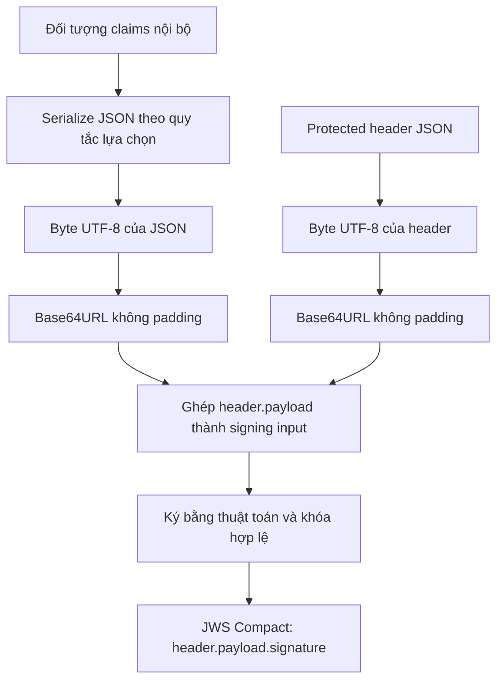
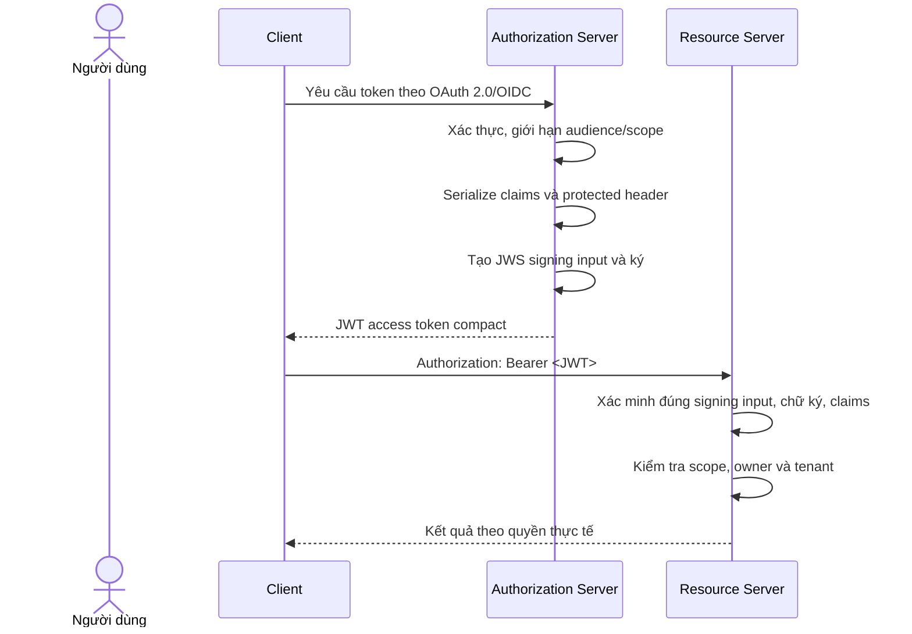

# Canonical representation trước khi ký

Trong bảo mật token, **chữ ký số áp dụng lên một chuỗi byte xác định**, không áp dụng trực tiếp lên “ý nghĩa” của một đối tượng JSON. Hai văn bản JSON có thể biểu diễn cùng dữ liệu nhưng có thứ tự thuộc tính, khoảng trắng hoặc cách biểu diễn ký tự khác nhau. Khi đưa chúng vào hàm ký, chúng thường tạo ra **thông điệp ký khác nhau**. Vì thế, bên phát hành và bên xác minh phải thống nhất chính xác **byte nào được ký và byte nào được kiểm tra**.

**Canonical representation** (biểu diễn chuẩn tắc) là cách định nghĩa quy tắc biến dữ liệu thành một biểu diễn duy nhất, ổn định để ký, băm, đối chiếu hoặc truyền qua nhiều ngôn ngữ lập trình. Tuy nhiên, có một phân biệt quyết định trong bảo mật JWT: **JWS/JWT đã định nghĩa signing input theo các byte được truyền trong token; tiêu chuẩn JWS không bắt buộc JSON phải được canonicalize**. Canonical JSON là một cơ chế bổ sung khi hệ thống thật sự cần các bản JSON có cùng nội dung tạo ra cùng byte.

Bài thuộc chương **Token format**, module **SECURITY_TOKEN_SECURITY_FUNDAMENTALS**. Trong phạm vi tổng thể của module, người học cần hiểu vòng đời và mô hình tin cậy của JWT, opaque token, access/refresh token, xác thực và phân quyền trong OAuth 2.0/OIDC; đồng thời kiểm tra đúng claims, scope, audience, lưu trữ, thu hồi và chống token bị đánh cắp hoặc phát lại. Chủ đề ở đây đi sâu vào **ranh giới từ dữ liệu có cấu trúc sang thông điệp được ký**.

## 1. Mục tiêu học tập

Sau bài này, bạn có thể:

1. Phân biệt **JSON object về mặt ngữ nghĩa**, **chuỗi JSON đã serialize**, **byte UTF-8**, **base64url** và **JWS signing input**.
2. Giải thích vì sao đổi thứ tự key hoặc khoảng trắng có thể thay đổi chữ ký, dù ứng dụng đọc ra cùng các claims.
3. Nêu đúng quy tắc của JWS Compact Serialization: ký các **đoạn base64url gốc** của protected header và payload, ngăn bằng dấu chấm; **không tự canonicalize lại JWT khi xác minh**.
4. Biết khi nào cần canonical JSON, và mô tả các ràng buộc quan trọng của **JSON Canonicalization Scheme (JCS, RFC 8785)**.
5. Nhận diện lỗi do Unicode, kiểu số, duplicate keys, thời gian, cách encode và khác biệt giữa thư viện/ngôn ngữ.
6. Thiết kế pipeline phát hành token và kiểm thử liên thông Java với các client/resource server khác.
7. Phân biệt lỗi định dạng/chữ ký với lỗi phân quyền ở cấp issuer, audience, scope và tài nguyên.

## 2. Tại sao “cùng JSON” có thể khác byte?

Xét hai payload biểu diễn cùng hai trường, nhưng thuộc tính xuất hiện theo thứ tự khác nhau:

```json
{"sub":"user-42","aud":"orders-api"}
```

```json
{"aud":"orders-api","sub":"user-42"}
```

Sau khi parse thành một cấu trúc key-value thông thường, ứng dụng có thể xem hai payload này tương đương về nội dung. Tuy nhiên **mảng byte UTF-8 của chúng khác nhau** vì vị trí các chuỗi `sub` và `aud` khác nhau. Một chữ ký được tạo cho chuỗi thứ nhất không phải chữ ký của chuỗi thứ hai.

Khoảng trắng cũng làm thay đổi byte:

```json
{"sub":"user-42","aud":"orders-api"}
```

```json
{
  "sub": "user-42",
  "aud": "orders-api"
}
```

Một số khác biệt khác:

| Khác biệt | Hai biểu diễn có thể cùng giá trị sau khi parse? | Byte trước khi ký có thể khác? |
| --- | --- | --- |
| Thứ tự thuộc tính JSON | Có, với đối tượng không có duplicate key | Có |
| Khoảng trắng, xuống dòng, indentation | Có | Có |
| Chuỗi `"A"` và `"\u0041"` | Có, sau unescape JSON | Có |
| Chuỗi `"é"` và `"\u00e9"` | Có, khi biểu diễn cùng code point | Có |
| Số `1` và `1.0` | Có thể được xem tương đương về số, tùy tầng xử lý | Có |
| Dấu phân cách, encoding khác UTF-8 | Có thể giải thích khác hoặc bị từ chối | Có |
| Duplicate key, ví dụ `{"role":"user","role":"admin"}` | **Không có một nghĩa an toàn duy nhất giữa các parser** | Có |

Đối với token, việc phân biệt **byte** với **nghĩa** có hai hệ quả:

- Bên ký phải xác định chính xác chuỗi byte gửi vào thuật toán chữ ký.
- Bên xác minh phải kiểm tra đúng **thông điệp được định nghĩa bởi định dạng chữ ký**, sau đó mới tin các claims và thực thi policy.

**Canonicalization không phải thuật toán mật mã**. Nó chỉ quy định cách biểu diễn dữ liệu. Tính xác thực và toàn vẹn vẫn phải đến từ cơ chế ký/MAC đã được chuẩn hóa, khóa được bảo vệ và quy trình xác minh đúng.

## 3. Phân biệt bốn lớp dữ liệu

Một chuỗi xử lý điển hình:



Ở đây:

1. **Đối tượng nội bộ**: map, record, DTO hoặc mô hình claims. Ngôn ngữ lập trình có thể chưa xác định byte.
2. **JSON serialization**: chọn thứ tự trường, escape, số, khoảng trắng và các quy tắc cụ thể để tạo chuỗi JSON.
3. **UTF-8**: biến chuỗi JSON thành byte. Trong JWT/JWS, phần protected header được biểu diễn theo quy tắc JOSE, không dùng encoding tùy ý.
4. **Base64url và ký**: ký một thông điệp được quy định chính xác bởi JWS, sau đó nối thành token compact.

Nếu một hệ thống tự tạo chữ ký cho một JSON ngoài JOSE, cần thêm một quy ước canonicalization vào **hợp đồng giao thức**. Nếu dùng thư viện JWS/JWT tiêu chuẩn, hãy **để thư viện xử lý signing input theo JWS**.

## 4. Quy tắc cốt lõi: JWS không yêu cầu canonical JSON

### 4.1. Signing input của JWS Compact Serialization

Đối với trường hợp JWS compact thông dụng với payload được base64url-encode (đây là cách JWT hoạt động), JWS Signing Input là:

```text
ASCII(
    BASE64URL(UTF8(JWS Protected Header))
    + "."
    + BASE64URL(JWS Payload bytes)
)
```

Trong JWT ký số thông dụng, payload chính là byte UTF-8 của JSON claims. Ba phần compact là:

```text
BASE64URL(protected-header).BASE64URL(payload).BASE64URL(signature)
```

**Bên xác minh JWS dùng hai đoạn đầu của token đúng như nhận được** (theo quy tắc định dạng), ghép bằng dấu chấm và xác minh chữ ký trên signing input đó. Không parse payload thành map rồi tự serialize lại bằng một JSON library khác để kiểm tra chữ ký.

Ví dụ tưởng tượng:

```text
Issuer ký UTF-8 của JSON A:
    {"sub":"user-42","aud":"orders-api"}

API parse thành map rồi serialize JSON B:
    {"aud":"orders-api","sub":"user-42"}

JSON A và B có ý nghĩa tương đương nhưng byte khác nhau.
Nếu API kiểm chữ ký trên JSON B => không đúng JWS Signing Input ban đầu.
```

Thực tế, API không cần tái tạo bất kỳ JSON nào. Nó cần **giữ các đoạn compact đã nhận**, dùng thư viện JOSE xác minh trực tiếp và chỉ giải nghĩa payload sau khi xác minh thành công.

### 4.2. Người phát hành có thể serialize JSON theo nhiều cách

JWS cho phép header và payload có cách serialize JSON hợp lệ khác nhau, miễn chữ ký áp dụng đúng byte của biểu diễn được phát hành. Ví dụ:

- Issuer A tạo JSON compact và key theo thứ tự `iss`, `sub`, `aud`.
- Issuer B tạo JSON có khoảng trắng hoặc key theo thứ tự khác.
- Cả hai có thể tạo **JWS hợp lệ**, nếu chữ ký đúng và người nhận được cấu hình tin cậy.

Nói “JWT bắt buộc canonicalize JSON theo thứ tự key alphabet trước khi ký” là **không đúng với JWS/JWT nói chung**. Một ứng dụng có thể áp dụng serialization ổn định như **quy tắc nội bộ khi phát hành**, nhưng không được đặt điều kiện không thuộc token profile lên mọi JWT và không được tự thay signing input khi verify.

### 4.3. Vậy canonical representation dùng ở đâu?

Nó hữu ích khi yêu cầu đặt ra là **nhiều bên tạo cùng một thông điệp ký từ cùng dữ liệu trừu tượng**. Ví dụ:

- Hai dịch vụ khác ngôn ngữ cùng ký một “chứng từ JSON” theo cùng giao thức tự định nghĩa.
- Cần tính digest ổn định cho một đối tượng JSON sau khi lưu/tải.
- Cần so sánh chữ ký trên một cấu trúc dữ liệu được tạo ở các môi trường khác nhau.
- Một giao thức được chuẩn hóa **quy định rõ** dùng một dạng canonical cụ thể.

**Không tự thêm bước canonical JSON vào quá trình verify JWT hiện hữu.** Hãy phân biệt quy tắc canonical của ứng dụng với thuật toán JWS đã được tiêu chuẩn hóa.

> Ghi chú chuyên sâu: JWS có tùy chọn **unencoded payload** theo RFC 7797. Nó thay đổi cách tạo signing input cho một số trường hợp JWS nói chung, nhưng không phải cách biểu diễn thông dụng của JWT compact access token. Nếu một giao thức dùng tùy chọn này, phải tuân thủ chính xác profile tương ứng, không tự sửa công thức JWT nêu trên.

## 5. JSON Canonicalization Scheme (JCS — RFC 8785)

Khi **thực sự cần** canonical JSON trong một giao thức có cấu trúc JSON, **JCS (RFC 8785)** là một tiêu chuẩn có thể lựa chọn. JCS quy định cách biến dữ liệu JSON hợp lệ thành **một biểu diễn byte UTF-8 xác định**, dựa trên các quy tắc serialization của ECMAScript và thứ tự thuộc tính được xác định rõ.

### 5.1. Những quy tắc đáng nhớ của JCS

1. **Đầu vào tuân thủ ràng buộc I-JSON**: tránh duplicate property names, dữ liệu Unicode không hợp lệ và các biểu diễn số không thể giữ chính xác theo mô hình xử lý.
2. **Không thêm khoảng trắng dư thừa** giữa các token JSON.
3. **Thuộc tính object được sắp xếp đệ quy** theo quy tắc so sánh **UTF-16 code units** của tên thuộc tính, không phải tùy tiện theo locale, ASCII, hay byte UTF-8.
4. **String được serialize nhất quán** theo cách escape của JCS/ECMAScript. **JCS không thực hiện Unicode normalization** như NFC/NFD.
5. **Number được serialize theo quy tắc số của ECMAScript (IEEE 754 double)**. Các giá trị như NaN, Infinity không phải số JSON hợp lệ; số nguyên vượt miền an toàn hoặc số cần độ chính xác tuyệt đối phải có thiết kế dữ liệu riêng, thường dùng chuỗi.
6. **Thứ tự các phần tử array được giữ nguyên**. Việc sort array tùy ý có thể làm đổi nghĩa.
7. **Kết quả cuối cùng được mã hóa thành byte UTF-8** để băm hoặc ký theo giao thức đã chỉ định.

Ví dụ:

```json
{
  "z": 10,
  "name": "Linh",
  "a": { "two": 2, "one": 1 }
}
```

Biểu diễn canonical JCS tương ứng:

```json
{"a":{"one":1,"two":2},"name":"Linh","z":10}
```

Trong ví dụ này, JCS sắp key của cả object ngoài lẫn object lồng bên trong và bỏ khoảng trắng không cần thiết.

**Cảnh báo thực hành:** gọi hàm sort key rồi `JSON.stringify` hoặc bật một tùy chọn sắp xếp của Jackson **chưa đủ để tự nhận là JCS-compliant**. Những vấn đề về số, escape, Unicode, nested structures và thứ tự UTF-16 phải trùng chuẩn. Hãy dùng thư viện canonicalization đã kiểm chứng và test vectors RFC tương ứng.

### 5.2. Unicode: giống mắt nhìn chưa chắc giống byte

Ví dụ chữ `é` có thể được biểu diễn bằng:

- Một code point được dựng sẵn: U+00E9.
- Hai code points: U+0065 (`e`) + U+0301 (dấu sắc kết hợp).

Người dùng có thể thấy hai chuỗi giống nhau, nhưng chúng **không có cùng dãy code points**; JCS **không** tự chuẩn hóa chúng thành một. Nếu hệ thống nghiệp vụ muốn coi chúng tương đương, phải có quy tắc chuẩn hóa miền dữ liệu được công bố rõ và áp dụng **trước** bước canonicalization ở nơi thích hợp. Không được chuẩn hóa ngầm một claim đã được ký rồi coi chữ ký vẫn bảo vệ dữ liệu vừa thay đổi.

Đặc biệt, tên property JSON có ký tự Unicode có thể có thứ tự khác giữa bộ so sánh theo **UTF-16 code units** và bộ so sánh theo **UTF-8 bytes**. Nếu nhiều ngôn ngữ cùng ký một đối tượng, dùng đúng thuật toán JCS, không dùng sort mặc định theo locale.

### 5.3. Số: phân biệt ý nghĩa nghiệp vụ và số JSON

Hãy xem các biểu diễn:

```text
1
1.0
1e0
```

Chúng có thể tương đương về mặt giá trị số, nhưng byte văn bản khác nhau. JCS quy định serialization theo ECMAScript để đưa các giá trị số biểu diễn được về một dạng xác định.

Một số nguyên như `9007199254740993` (vượt giới hạn số nguyên an toàn của IEEE 754 double) **không nên** được chuyển vào rồi ra khỏi kiểu số double nếu cần giữ chính xác. ID giao dịch, số tài khoản, số tiền độ chính xác cao hoặc số nguyên lớn thường nên biểu diễn bằng **chuỗi có quy tắc rõ ràng**, hoặc dùng giao thức biểu diễn chính xác được thống nhất ở cả hai bên.

Trong JWT, `exp`, `iat` và `nbf` là **NumericDate** theo JWT, biểu diễn thời điểm theo giây tính từ epoch. Cần thống nhất đơn vị và chính sách chấp nhận phân số nếu profile có yêu cầu; không dùng nhầm millisecond trong một hệ thống mong đợi giây. Canonicalization không thể sửa lỗi chọn sai đơn vị thời gian.

### 5.4. Duplicate JSON keys là vấn đề bảo mật, không chỉ định dạng

Payload sau là ví dụ nguy hiểm:

```json
{"role":"viewer","role":"admin"}
```

Các parser khác nhau có thể:

- Giữ giá trị đầu tiên.
- Giữ giá trị cuối cùng.
- Báo lỗi.

Nếu bên ký, gateway và API giải thích khác nhau, một đối tượng có thể được “đồng ý” trên các giả định khác nhau. Trong hợp đồng token bảo mật, nên **từ chối JSON có duplicate keys** và kiểm thử cả header lẫn payload. RFC 7519 yêu cầu claim names phải duy nhất và cho phép một số hành vi parser cụ thể đối với duplicate claims; cách an toàn, ít bất ngờ nhất của hệ thống là **reject**.

Khi cần JCS, đầu vào có duplicate property names không thỏa tiền đề hợp lệ; không được giải quyết bằng cách tùy ý chọn một giá trị.

## 6. Chọn cơ chế ký đúng ngữ cảnh

| Tình huống | Signing input phải tuân theo | Có canonical JSON không? |
| --- | --- | --- |
| **JWT access token dạng JWS** | Quy tắc JWS: các đoạn protected header và payload đã encode, nối dấu chấm | **Không bắt buộc**; issuer có thể chọn serialization ổn định |
| **OIDC ID token dạng JWS** | Quy tắc JWS và profile xác minh OIDC | **Không bắt buộc** |
| **JWT được mã hóa bằng JWE** | Quy tắc JWE về mã hóa, AAD và tính toàn vẹn | Không tự canonicalize thay cho xử lý JWE |
| **Thông điệp JSON ký tùy chỉnh** | Quy tắc signing input do giao thức thống nhất | **Nên xác định rõ**, có thể dùng JCS |
| **Chữ ký cho HTTP message** | Signature base theo tiêu chuẩn HTTP Message Signatures nếu áp dụng | Dùng quy tắc chuẩn của giao thức đó, không mặc định JCS toàn HTTP |
| **Opaque token tra cứu** | Không có payload JSON/JWS để client tự xác minh | Canonical JSON thường không phải vấn đề chính tại resource server |

**Đừng lấy cách verify của giao thức này áp sang giao thức khác.** Đặc biệt, không parse JWT rồi chuyển về JCS để “kiểm cho chặt”: việc đó đổi đối tượng chữ ký so với JWS gốc.

## 7. Pipeline phát hành JWT đúng cách

Một pipeline an toàn trong OAuth 2.0/OIDC:

1. **Quyết định cấp quyền**: authorization server (AS) xác thực/ủy quyền theo grant hợp lệ, chọn đúng client, audience, scopes được phê duyệt.
2. **Tạo claims tối thiểu**: `iss`, `sub`, `aud`, `iat`, `exp`, `jti`/`scope` khi profile cần. Không sao chép mật khẩu, password hash, refresh token hoặc toàn bộ entity người dùng.
3. **Xác định token profile**: access token JWT cho API nào, ID token cho OIDC client nào; cấu hình `typ`/claims khi profile yêu cầu.
4. **Serialize bằng thư viện JOSE/JWT tin cậy**: thư viện tạo protected header, JSON payload, byte UTF-8 và đoạn base64url theo chuẩn.
5. **Ký signing input** bằng khóa phù hợp với thuật toán đã cấu hình. Private signing key chỉ nằm ở nơi có thẩm quyền phát hành.
6. **Phát hành qua TLS** đến đúng client, ghi metadata phục vụ audit nhưng không ghi nguyên token vào log.
7. **Resource server xác minh JWS gốc** trước khi dùng claims cho phân quyền.



Không nên xây signing input hoặc thuật toán ký số thủ công trong production khi đã có thư viện JOSE tiêu chuẩn. Nếu có yêu cầu **đầu vào canonical của nghiệp vụ** trước khi đóng gói vào JWT, hãy ghi rõ nó phục vụ mục đích gì và giữ tách biệt khỏi bước JWS.

### 7.1. Ví dụ Java với thư viện JWT

Ví dụ sau dùng API của **Nimbus JOSE + JWT** để phát hành JWS compact. Các biến như `privateKey`, `keyId` được cấp từ kho khóa đã kiểm soát. Đây là mã minh họa thành phần phát hành; hệ thống thực tế cần chọn thuật toán/khóa, cấu hình profile, thời gian và vòng đời khóa phù hợp.

```java
// Minh họa: privateKey là RSAPrivateKey được quản lý an toàn.
JWTClaimsSet claims = new JWTClaimsSet.Builder()
    .issuer("https://auth.example.test")
    .subject("user-42")
    .audience("orders-api")
    .issueTime(new Date())
    .expirationTime(Date.from(Instant.now().plusSeconds(600)))
    .claim("scope", "orders:read")
    .jwtID(UUID.randomUUID().toString())
    .build();

JWSHeader header = new JWSHeader.Builder(JWSAlgorithm.RS256)
    .type(new JOSEObjectType("at+jwt"))
    .keyID(keyId)
    .build();

SignedJWT jwt = new SignedJWT(header, claims);
jwt.sign(new RSASSASigner(privateKey));
String compact = jwt.serialize();
```

Ở đây, thư viện thực hiện serialization và tính JWS signing input. **Không** làm điều sau sau khi ký:

```text
1. Decode token
2. Parse JSON thành map
3. Sort key hoặc pretty-print payload
4. Encode lại payload và giữ nguyên signature cũ
   => Chữ ký không còn tương ứng với byte đã sửa.
```

Mỗi lần phát hành có thể có `iat`, `exp` hoặc `jti` mới; vì vậy ngay cả khi dùng canonical JSON, toàn bộ token **không nhất thiết giống nhau giữa các lần phát hành**. Ngoài ra, một số thuật toán chữ ký có yếu tố ngẫu nhiên trong quá trình ký, nên không được lấy việc chuỗi signature giống hệt nhau làm thước đo canonicalization.

### 7.2. Java minh họa byte khác nhau mà không tự ký

Đoạn Java dưới đây dùng digest SHA-256 **chỉ để quan sát sự khác nhau về byte**; digest **không thay thế chữ ký số** hoặc MAC:

```java
import java.nio.charset.StandardCharsets;
import java.security.MessageDigest;
import java.util.Arrays;
import java.util.HexFormat;

class SerializationDemo {
    static String sha256Hex(String text) throws Exception {
        byte[] bytes = text.getBytes(StandardCharsets.UTF_8);
        return HexFormat.of().formatHex(
            MessageDigest.getInstance("SHA-256").digest(bytes)
        );
    }

    public static void main(String[] args) throws Exception {
        String a = "{\"sub\":\"user-42\",\"aud\":\"orders-api\"}";
        String b = "{\"aud\":\"orders-api\",\"sub\":\"user-42\"}";

        byte[] aBytes = a.getBytes(StandardCharsets.UTF_8);
        byte[] bBytes = b.getBytes(StandardCharsets.UTF_8);

        System.out.println(Arrays.equals(aBytes, bBytes)); // false
        System.out.println(sha256Hex(a));
        System.out.println(sha256Hex(b)); // Khác digest của a
    }
}
```

Mục tiêu là chứng minh **byte không giống nhau**. Hai JSON này có thể tạo cùng đối tượng khi parse; điều đó không khiến hai JWS signing input tự trở nên tương đương.

## 8. Xác minh JWT: không canonicalize lại rồi mới verify

API bảo vệ tài nguyên nên thực hiện theo thứ tự:

1. Nhận token tại vị trí cho phép, điển hình là `Authorization: Bearer ...`, giới hạn kích thước và không log nguyên token.
2. Dùng JWT/JWS verifier đã được cấu hình với **issuer và JWKS tin cậy**, danh sách thuật toán ký được cho phép.
3. Xác minh chữ ký dựa trên signing input từ **chính token compact đã nhận**; không parse/sort/re-serialize payload.
4. Sau khi xác minh chữ ký, kiểm tra `iss`, `aud`, `exp`, `nbf`, token type, `client_id`/`azp` và các claims profile bắt buộc khi áp dụng.
5. Kiểm tra `scope` được cấp có đủ cho hành động, sau đó kiểm tra quyền thực tế với resource ID/owner/tenant tại nguồn dữ liệu có thẩm quyền.
6. Xem xét trạng thái thu hồi/phiên nếu kiến trúc có yêu cầu; từ chối token thiếu quyền hoặc không thể xác định tính hợp lệ theo chính sách.

#### Vì sao vẫn phải đọc header trước khi xác minh?

Thư viện có thể cần đọc `alg` hoặc `kid` để biết cách xử lý chữ ký. Những giá trị này **chưa đáng tin** tại thời điểm parse, nên chỉ được dùng trong giới hạn đã cấu hình:

- `alg` phải thuộc allowlist thuật toán hợp lệ cho issuer/profile; không cho token tự chọn `none` hoặc thay thuật toán đối xứng/bất đối xứng.
- `kid` chỉ để chọn **một khóa trong JWKS/tập khóa đã tin cậy**; không cho phép `jku` hoặc `x5u` trỏ tới máy chủ tùy ý.
- Parser nên **từ chối duplicate header parameters** và duplicate claim names theo chính sách nghiêm ngặt để tránh khác biệt cách diễn giải.

Canonicalization không thay thế được các lớp kiểm tra này.

### 8.1. Mã giả cho resource server

```text
handleApiRequest(request):
    raw = extractAccessToken(request.Authorization)
    if raw is missing:
        return 401

    # Thư viện verifier xử lý nguyên văn JWS compact signing input.
    result = trustedVerifier.verifyCompactJws(
        rawToken = raw,
        issuer = configuredIssuer,
        jwks = configuredTrustedJwks,
        algorithms = approvedAlgorithms,
        tokenProfile = expectedAccessTokenProfile
    )
    if result invalid:
        return 401

    claims = result.verifiedClaims
    require claims.aud includes configuredResourceServerAudience
    require claims.exp and claims.nbf valid by bounded clock policy

    if !hasApprovedScope(claims, request.operation):
        return 403
    if !resourcePolicyAllows(claims, request.resourceId):
        return 403

    return performAuthorizedOperation()
```

Đây là logic mô tả, không phải hàm verify tự viết. Với opaque access token, API dùng introspection/lookup tin cậy thay vì kỳ vọng một chuỗi JSON/JWS để canonicalize.

## 9. Canonical JSON trong giao thức tự thiết kế: làm thế nào cho đúng?

Nếu thật sự có nghiệp vụ ký một chứng từ JSON ngoài JWS/JWT, cả bên phát và bên nhận phải thống nhất **trước khi triển khai**:

| Thành phần hợp đồng | Điều cần quy định |
| --- | --- |
| **Đối tượng ký** | Chính xác trường nào, loại dữ liệu nào, có bao gồm metadata/version không |
| **Schema và loại số** | Phân biệt số nguyên, số thập phân, string, boolean; không làm tròn số tiền/ID |
| **Canonicalization** | Tên tiêu chuẩn và phiên bản, ví dụ RFC 8785 JCS |
| **Encoding** | UTF-8; không BOM; quy tắc xử lý JSON/Unicode không hợp lệ |
| **Signature input** | Ký trực tiếp canonical bytes hay thêm context/domain separation |
| **Algorithm và key management** | Thuật toán đã duyệt, khóa, key ID, thời hạn/rotation |
| **Verifier** | Kiểm tra input canonical và chữ ký theo đúng hợp đồng trước khi tin dữ liệu |
| **Replay protection** | Message ID/nonce/timestamp và lưu trạng thái khi cần |
| **Authorization** | Quyền sử dụng chứng từ sau khi chữ ký hợp lệ |

Ví dụ giả định một giao thức riêng tuyên bố:

```text
canonicalBytes = UTF8(JCS(document))
signature = approvedSigner.sign(canonicalBytes)
transmit(document, signature, algorithmId, keyId)
```

Bên xác minh phải parse theo quy tắc nghiêm ngặt, kiểm tra schema, lấy canonical bytes theo **cùng chuẩn**, xác minh chữ ký bằng khóa tin cậy và kiểm tra metadata/replay/policy. Nếu giao thức yêu cầu chữ ký gắn với một loại tài liệu cụ thể, nên có **domain separation** hoặc trường purpose/version được ký để tránh một chữ ký hợp lệ bị sử dụng sai loại nghiệp vụ.

**Không được áp dụng công thức này để thay thế JWS verification**. Với JWT, JWS Compact định nghĩa signing input riêng, nên verifier phải xác minh các byte đã được truyền theo JOSE.

### 9.1. Ví dụ “chỉ sort key” không tương đương RFC 8785

Trong Java, các tuỳ chọn serializer như:

```java
ObjectMapper mapper = new ObjectMapper()
    .configure(MapperFeature.SORT_PROPERTIES_ALPHABETICALLY, true)
    .configure(SerializationFeature.ORDER_MAP_ENTRIES_BY_KEYS, true);
```

có thể giúp serialization ổn định **trong một phạm vi cấu hình cụ thể**, nhưng **không được mặc nhiên xem là triển khai JCS**. Việc sắp xếp key không giải quyết đầy đủ những khác biệt về Unicode, number formatting, escape hay nested serialization theo RFC 8785. Nếu giao thức yêu cầu JCS, hãy dùng implementation tương thích chuẩn và kiểm thử chính thức.

### 9.2. Ranh giới giữa canonicalization và dữ liệu nghiệp vụ

Ví dụ `scope` trong OAuth 2.0 thường là danh sách token scope được biểu diễn bằng chuỗi cách nhau bởi khoảng trắng. **Không được tự ý sort chuỗi scope** hoặc đổi chữ hoa/chữ thường chỉ vì muốn canonical JSON. JCS xử lý **định dạng JSON**, không quyết định tính tương đương nghiệp vụ của nội dung chuỗi.

Tương tự:

- `aud` có thể là chuỗi hoặc danh sách theo quy tắc profile; không tự ép kiểu hay đổi thứ tự array nếu chưa có hợp đồng.
- `iss` và `sub` là định danh cần so khớp đúng quy tắc; canonical JSON không chứng minh issuer tin cậy.
- `exp`, `iat`, `nbf` yêu cầu cách diễn giải thời gian đúng; canonical JSON không kéo dài hiệu lực token.
- Thứ tự các phần tử array có thể có nghĩa, nên không được sort array trừ khi schema tự quy định điều đó.

## 10. Những lỗi triển khai thường gặp

| Lỗi | Hậu quả | Biện pháp |
| --- | --- | --- |
| Ký payload compact rồi pretty-print JSON sau khi ký | Token mang byte khác signing input → chữ ký sai | Không sửa segment JWS sau khi ký |
| Verify bằng cách parse JSON rồi serialize lại | Token hợp lệ có thể bị từ chối; sai hợp đồng JWS | Dùng thư viện JOSE trên compact token nguyên bản |
| Tự giả định JWT phải sort key alphabet | Từ chối token JWS hợp lệ do issuer khác | Phân biệt serializer của issuer với điều kiện chuẩn JWS |
| Hai service có JSON serializer khác nhau khi ký custom JSON | Chữ ký không tương thích | Định nghĩa canonicalization chung (ví dụ JCS), test vectors |
| Sort key theo locale hoặc UTF-8 thay vì JCS UTF-16 | Canonical output sai với ký tự Unicode | Dùng thư viện RFC 8785 chuẩn |
| Normalize Unicode ngầm sau ký | Byte và ý nghĩa token có thể thay đổi | Xác định chính sách normalize trước ký; không rewrite token đã ký |
| Đưa số nguyên lớn qua double | Mất độ chính xác của ID/giá trị | Dùng kiểu/string theo schema và canonical chuẩn |
| Chấp nhận duplicate claims/header fields | Parser các tầng có thể hiểu khác nhau | Reject input trùng key và kiểm thử |
| Xem chữ ký đúng là đã có quyền | Token có thể sai audience, thiếu scope, sai chủ đơn | Kiểm tra issuer/audience/type/lifetime và policy tài nguyên |
| Tin `alg` hoặc URL khóa từ header chưa verify | Algorithm/key confusion | Allowlist thuật toán và JWKS gắn issuer |
| Dùng canonical JSON để “làm kín” dữ liệu | Claims có thể lộ trong JWS payload | Không nhúng bí mật; khi cần kín dùng thiết kế mã hóa chuẩn |
| Token hợp lệ nhưng quyền đã bị thu hồi | Claims cũ có thể tiếp tục được dùng | TTL ngắn, kiểm tra quyền/thu hồi hoặc denylist phù hợp |

## 11. Kiểm thử byte, chữ ký và nghĩa

Mỗi lớp cần một kiểu kiểm thử riêng:

### 11.1. Kiểm thử serialization

| Trường hợp | Điều cần khẳng định |
| --- | --- |
| JSON giống nghĩa, đổi thứ tự key | Byte nguồn khác; JCS đưa về canonical bytes giống nhau nếu cả hai đầu vào hợp lệ |
| JSON có khoảng trắng hoặc xuống dòng khác | JCS loại bỏ khác biệt định dạng không cần thiết |
| JSON có nested objects | Mọi object lồng đều sort theo JCS |
| JSON có array | Thứ tự array được giữ nguyên |
| Unicode escaped vs literal cùng code point | JCS tạo dạng chuẩn nhất quán |
| Unicode composed vs decomposed | Không tự coi là giống nhau nếu code points khác |
| Số `1`, `1.0`, `1e0` | Nếu dữ liệu được hiểu là cùng Number theo JCS, kết quả serialization nhất quán |
| Số nguyên vượt giới hạn an toàn | Không được làm mất độ chính xác; áp dụng schema/string |
| Duplicate key | Reject theo quy tắc nghiêm ngặt |
| NaN, Infinity, surrogate không hợp lệ | Reject; không tạo canonical bytes tùy tiện |

### 11.2. Kiểm thử JWT/JWS signing input

1. Phát hành token thử nghiệm bằng thư viện JOSE; xác minh bằng cùng thư viện và một thư viện độc lập được cấu hình chính xác.
2. Phát hành hai JWT có cùng claim về nghĩa nhưng JSON serialization khác nhau; **cả hai phải được chấp nhận nếu mỗi token có chữ ký hợp lệ** và claims đáp ứng profile.
3. Thay đổi một byte trong payload compact **mà giữ nguyên signature**; việc xác minh phải thất bại.
4. Tạo lại token với payload đã thay đổi và ký lại bằng khóa thử nghiệm hợp lệ; chữ ký có thể xác minh thành công, **nhưng** API vẫn phải kiểm tra issuer, audience, loại token và scope.
5. Đưa token có `alg` không thuộc allowlist, `kid` lạ, duplicate key, sai `iss`, sai `aud`, hết `exp` hoặc dùng ID token thay access token; phải từ chối đúng nguyên nhân.
6. Dùng scope `orders:read` để truy cập đơn của người khác; phải bị chặn bởi quyền tài nguyên ngay cả khi token hợp lệ.
7. Mô phỏng token bị thu hồi và JWKS cache/key rotation để kiểm tra giới hạn hiệu lực thực tế.

Đặc biệt, test số 2 giúp bắt lỗi **verifier tự canonicalize lại JSON**. Nếu hai JWS ký đúng với hai serialization hợp lệ cùng nghĩa nhưng một token bị từ chối chỉ vì thứ tự key, cần kiểm tra xem verifier có đang sửa signing input trước khi xác minh không.

### 11.3. Golden vectors liên ngôn ngữ

Với canonical JSON custom protocol, giữ bộ dữ liệu thử nghiệm gồm:

- Input JSON nguyên văn.
- Canonical JSON dự kiến (byte UTF-8 hoặc hex/base64url rõ ràng).
- SHA-256 digest của canonical bytes làm mốc kiểm tra **serialization**, không phải chữ ký bảo mật.
- Chữ ký test bằng khóa test, thuật toán và key ID xác định nếu cần.
- Kết quả verify từ Java, JavaScript và ngôn ngữ client khác.

Khi thay serializer hoặc phiên bản thư viện, chạy lại bộ vectors. Không sử dụng token/khóa production trong test vectors công khai.

## 12. Tình huống thực tế: lỗi chỉ xuất hiện giữa hai ngôn ngữ

Một authorization server viết bằng Java phát JWT. Resource server viết bằng JavaScript đôi lúc báo “invalid signature”. Developer phát hiện ở lớp JavaScript có đoạn:

```text
decodedPayload = JSON.parse(base64urlDecode(token.payload))
normalizedPayload = JSON.stringify(decodedPayload)
verifySignature(base64urlEncode(normalizedPayload))
```

Lỗi ở đây **không phải** “Java ký sai JSON” mà là verifier JavaScript đã thay payload ban đầu bằng một serialization mới. Nếu thứ tự thuộc tính, khoảng trắng hoặc cách serialize số khác nhau, thông điệp ký đã thay đổi.

**Sửa đúng cách:** đưa **JWT compact ban đầu** vào thư viện verify JWS phù hợp; xác minh chữ ký trên signing input được định nghĩa bởi token, sau đó mới dùng claims đã xác minh. Không cần ép Java và JavaScript dùng cùng JSON serializer chỉ để verify JWS.

Ngược lại, nếu hai service đang cùng ký **một chứng từ JSON tùy chỉnh không dùng JWS**, chúng phải thống nhất byte ký; trong trường hợp đó có thể cần **JCS RFC 8785** và bộ golden vectors liên ngôn ngữ.

## 13. Liên hệ với thu hồi, lưu trữ và chống replay

Canonical representation chỉ xử lý tính nhất quán của byte; nó **không** quyết định token có được quyền sử dụng hay không.

- **Access token** JWT có thể xác minh cục bộ nhưng vẫn cần kiểm tra audience/scope/policy. Với opaque access token, API thường introspection để lấy trạng thái và metadata.
- **Refresh token** dùng tại token endpoint để xin access token mới; không đưa refresh token vào payload access/ID token và không dùng cho API nghiệp vụ.
- **ID token** OIDC thường là JWT; chính OIDC client là bên cần xác minh token để biết kết quả xác thực. API nghiệp vụ không nhận ID token thay access token.
- **Thu hồi:** JWT tự chứa có thể còn được chấp nhận đến `exp` nếu không có denylist, tra cứu phiên hoặc cơ chế tương đương. Canonical JSON không làm cập nhật quyền tự động.
- **Đánh cắp/replay:** với bearer token, kẻ giữ token có thể xuất trình lại trong thời hạn và phạm vi hiệu lực. `jti` và canonicalization tự chúng không ngăn replay; có thể cân nhắc sender-constrained token như DPoP/mTLS trong bối cảnh phù hợp.
- **Lưu trữ:** dùng TLS, không gửi token trong URL, không ghi token nguyên dạng vào log; bảo vệ token theo kiến trúc BFF, web, mobile hoặc backend. Chữ ký/JCS không mã hóa payload.

Một hệ thống an toàn có thể có signing input hoàn toàn đúng, nhưng vẫn gặp lỗi phân quyền nếu nhận token sai audience hoặc cho người dùng xem tài nguyên của tenant khác.

## 14. Bài thực hành

### Bài A — Byte và ngữ nghĩa

Cho ba JSON:

```json
{"sub":"u-7","aud":"inventory-api"}
```

```json
{ "aud": "inventory-api", "sub": "u-7" }
```

```json
{"aud":"inventory-api","sub":"u-8"}
```

Hãy giải thích:

1. Cặp nào có thể tương đương về ngữ nghĩa JSON?
2. Cặp nào có byte khác nhau khi dùng trực tiếp UTF-8?
3. Nếu hai JSON đầu được ký như **hai JWS khác nhau**, API có phải từ chối một token chỉ do khác cách serialize không?
4. Nếu dùng JCS cho **custom JSON signature**, kết quả canonical của hai JSON đầu có giống nhau không?

**Gợi ý:** hai JSON đầu cùng nghĩa về object nhưng byte khác nhau; sau JCS có cùng canonical bytes. JWS verifier phải kiểm tra đúng signing input của **từng token**, không giả định một dạng JSON duy nhất.

### Bài B — Xác định lỗi trong pipeline

Hệ thống có pipeline:

```text
1. AS tạo JWT từ JSON payload.
2. AS ký token và gửi cho client.
3. Gateway decode JWT, sắp key alphabet, encode lại.
4. Gateway chuyển JWT đã sửa cùng signature cũ đến API.
5. API xác minh chữ ký và từ chối.
```

Hãy sửa quy trình để gateway thực hiện kiểm tra/audit mà **không sửa bất kỳ segment nào** của JWT đã ký. Nếu gateway muốn thêm thông tin nội bộ, có thể truyền qua ngữ cảnh phía server được bảo vệ, không nhúng tự ý vào payload rồi giữ chữ ký cũ.

**Tiêu chí đạt:** gateway không reserialize JWT; API verify token nguyên bản; thông tin do gateway gắn thêm có ranh giới tin cậy riêng và không bị client giả mạo.

### Bài C — Thiết kế ký JSON riêng

Bạn cần ký biên bản phê duyệt:

```json
{
  "documentId": "inv-9007199254740993",
  "amountMinorUnits": "12345678901234567890",
  "approved": true,
  "parties": ["A", "B"]
}
```

Hãy định nghĩa: schema, quy tắc JCS, các trường bắt buộc, cách xử lý số lớn, byte ký, thuật toán và key ID, message ID để chống replay, quyền phê duyệt, và bộ test liên ngôn ngữ.

**Tiêu chí đạt:** ID và số tiền lớn không bị làm tròn; thứ tự `parties` không tự đổi; duplicate key bị reject; không dùng khóa do dữ liệu chưa xác minh tự chỉ định.

### Bài D — Nhầm lẫn JWT type và quyền

Client gửi một ID token OIDC có chữ ký hợp lệ cho `orders-api`. Token có `sub` và thời hạn còn hiệu lực, nhưng `aud` là client ID, không phải `orders-api`. Hãy nêu các bước từ chối và lý do canonicalization không giải quyết vấn đề.

**Tiêu chí đạt:** phân biệt chữ ký đúng với token đúng **loại và audience**; không dùng ID token thay access token; API tiếp tục áp dụng scope và quyền tài nguyên khi có access token hợp lệ.

## 15. Checklist dành cho developer và reviewer

- [ ] Xác định **giao thức ký**: JWS/JWT, JWE hay chữ ký JSON tùy chỉnh; không trộn quy tắc signing input.
- [ ] Với JWT/JWS, dùng thư viện JOSE để tạo và xác minh **compact token nguyên bản**; không decode/re-serialize trước khi verify.
- [ ] Nếu custom JSON signature cần canonicalization, định nghĩa chuẩn cụ thể như **RFC 8785 JCS** và test vectors.
- [ ] Đã kiểm tra duplicate keys, Unicode hợp lệ, giới hạn kích thước, số lớn và kiểu dữ liệu đầu vào.
- [ ] Không xem “sort keys + JSON.stringify” hay một tùy chọn Jackson đơn lẻ là tương đương triển khai JCS.
- [ ] Khóa ký được bảo vệ; verifier chỉ tin issuer/JWKS và thuật toán cấu hình sẵn, không tin URL khóa từ token.
- [ ] Claims JWT có đúng `iss`, `aud`, `exp`, loại token, scope và yêu cầu profile; không chứa mật khẩu/bí mật không cần thiết.
- [ ] API kiểm tra policy resource/tenant sau khi xác minh chữ ký; **không coi chữ ký hợp lệ là đủ quyền**.
- [ ] Token được truyền qua TLS, không bị gateway sửa payload, không lộ nguyên dạng trong log hoặc URL.
- [ ] Đã kiểm thử token thay một byte, serialization khác nhau, token sai issuer/audience, duplicate JSON, expiry và token type.
- [ ] Đã có chính sách thu hồi, refresh, thời hạn, xoay khóa và chống replay độc lập với canonicalization.

## 16. Câu hỏi ôn tập nhanh

**1. Cùng nội dung JSON nhưng thứ tự key khác nhau có luôn cho cùng JWS signature không?** Không. Signing input được tạo từ byte của từng payload đã serialize. Ngay cả khi JSON có nghĩa giống nhau, byte có thể khác; ngoài ra kết quả signature có thể phụ thuộc đặc tính thuật toán ký.

**2. JWT có bắt buộc áp dụng RFC 8785 trước khi ký không?** Không. JWS/JWT có quy tắc signing input riêng, không bắt buộc canonical JSON.

**3. Resource server có nên sort key trước khi verify JWT không?** Không. Resource server cần xác minh chữ ký trên đúng JWS signing input đã truyền.

**4. Vì sao canonical JSON có ích cho chữ ký JSON tự thiết kế?** Vì nó giúp những bên tạo thông điệp từ cùng dữ liệu hợp lệ có cùng byte ký theo một quy tắc được thống nhất.

**5. JCS có tự chuyển chuỗi Unicode từ NFD sang NFC không?** Không. JCS giữ nguyên dữ liệu Unicode, chỉ quy định cách serialize; normalization nghiệp vụ phải được thiết kế riêng.

**6. Sắp key alphabet trong Jackson có đủ để tuân thủ RFC 8785 không?** Không. JCS còn quy định escape, số, Unicode, nested objects và thứ tự theo UTF-16 code units.

**7. Token có chữ ký hợp lệ nhưng `aud` không phải API hiện tại thì sao?** Phải từ chối; signing input đúng không chứng minh token được cấp cho API này.

**8. Canonicalization có ngăn JWT bị sao chép và replay không?** Không. Cần giới hạn TTL, audience/scope, cơ chế thu hồi và khi thích hợp là sender constraint.

## 17. Tài liệu tiêu chuẩn liên quan

- **RFC 7515 — JSON Web Signature (JWS):** định nghĩa cấu trúc JWS và signing input.
- **RFC 7519 — JSON Web Token (JWT):** claims, NumericDate và cách JWT sử dụng JOSE.
- **RFC 8785 — JSON Canonicalization Scheme (JCS):** biểu diễn JSON chuẩn tắc phục vụ băm/ký khi giao thức lựa chọn.
- **RFC 7797 — JWS Unencoded Payload Option:** tùy chọn đặc thù của JWS tổng quát, cần phân biệt với JWT compact thông dụng.
- **RFC 8725 — JWT Best Current Practices:** phòng ngừa nhầm thuật toán/khóa, token substitution và sai bối cảnh xác minh.
- **RFC 9068 — JWT Profile for OAuth 2.0 Access Tokens:** profile JWT access token dành cho OAuth 2.0.
- **OpenID Connect Core 1.0:** kiểm tra ID token ở client và các claims xác thực.

**Nguyên tắc cốt lõi:** trước khi ký, phải xác định chính xác **byte nào được ký**. Với **JWT/JWS**, hãy tuân thủ signing input của JOSE và giữ nguyên token trong lúc verify. Với **JSON ký theo giao thức riêng**, hãy định nghĩa canonicalization có tiêu chuẩn và kiểm thử liên thông. Sau khi chữ ký hợp lệ, vẫn phải kiểm tra **issuer, audience, thời hạn, loại token, scope và quyền đối với tài nguyên thực tế**.
