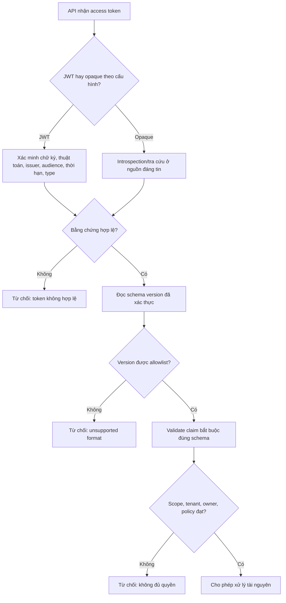
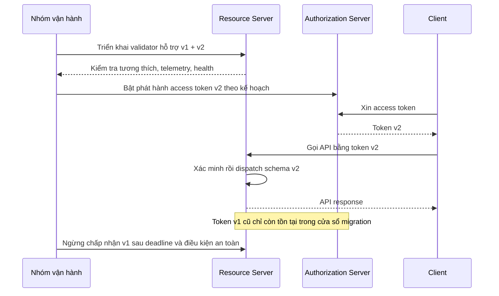

# Token format version: quản lý phiên bản định dạng token

Khi hệ thống xác thực và phân quyền phát triển, cấu trúc token có thể phải thay đổi: một claim bị đổi tên, audience được tách theo API, dữ liệu tenant được bổ sung, hoặc access token chuyển từ chuỗi opaque sang JWT. Nếu **authorization server** đã phát hành dạng mới nhưng **resource server** vẫn đọc theo dạng cũ, người dùng có thể bị từ chối truy cập hoặc, nguy hiểm hơn, hệ thống có thể hiểu sai quyền.

**Token format version** là cách xác định, quản lý và nâng cấp **hợp đồng định dạng/ý nghĩa của token** giữa nơi phát hành và nơi tiêu thụ. Khái niệm này không đồng nhất với phiên bản của OAuth 2.0, JWT hay thuật toán ký. Trong module **SECURITY_TOKEN_SECURITY_FUNDAMENTALS**, việc hiểu phiên bản token giúp thiết kế đúng vòng đời phát hành, xác minh claims, scope, audience, lưu trữ, thu hồi, chống đánh cắp và phát lại token trong OAuth 2.0/OpenID Connect (OIDC).

Bài học thuộc chương **Token format**. Trọng tâm là câu hỏi: **Khi token v1 và v2 cùng tồn tại, làm sao API hiểu đúng từng phiên bản mà không mở đường cho token giả mạo, token sai mục đích hoặc hành vi hạ cấp bảo mật?**

## 1. «Phiên bản token» thực chất là phiên bản của điều gì?

Một token có nhiều lớp. Trước khi viết trường `version`, cần xác định **lớp nào đang được version hóa**:

| Lớp | Ví dụ | Ý nghĩa của thay đổi |
| --- | --- | --- |
| **Mã hóa/serialization** | Compact JWS, Compact JWE, chuỗi opaque | Bên nhận phải biết cách đọc biểu diễn trên đường truyền |
| **Cơ chế bảo vệ (JOSE)** | JWS được ký bằng thuật toán cho phép; JWE được mã hóa | Quy tắc xác minh chữ ký/giải mã và quản lý khóa có thể thay đổi |
| **Token profile** | JWT access token theo RFC 9068; OIDC ID token | Quy định loại token, header/claim bắt buộc và bên nhận |
| **Schema ứng dụng** | `tenant_id`, `permissions`, `token_format_version` | Hợp đồng giữa issuer và API về tên, kiểu, ý nghĩa của claims |
| **Chính sách truy cập** | Phải kiểm tra tenant, scope, owner, trạng thái tài nguyên | Có thể đổi **mà không cần phát hành phiên bản token mới** |

Ví dụ: từ `"scope": "orders:read"` sang `"permissions": ["orders.read"]` là thay đổi **schema và ngữ nghĩa**, có thể phá tương thích. Thêm một claim chỉ phục vụ audit mà mọi API đều được phép bỏ qua thường có thể tương thích. Thay khóa ký theo quy trình **key rotation** không mặc nhiên là nâng phiên bản schema.

**Không có claim `ver` hoặc `token_format_version` bắt buộc trong JWT chuẩn (RFC 7519).** Nếu hệ thống tự thêm claim này thì đó là **hợp đồng riêng** giữa issuer và consumer, phải định nghĩa rõ kiểu dữ liệu, các giá trị hợp lệ và hành vi khi thiếu/không nhận diện.

### 1.1. Phiên bản giao thức, phiên bản định dạng và phiên bản token cụ thể

Ba khái niệm dễ nhầm:

- **OAuth 2.0/OIDC** là bộ giao thức và quy tắc trao đổi token. Phiên bản/profile giao thức không quyết định một token ứng dụng mang `tenant_id` hay `org_id`.
- **Format/profile version** mô tả cách bên nhận giải thích token. Hệ thống có thể hỗ trợ schema nội bộ v1/v2 mà vẫn tuân thủ cùng một profile OAuth/OIDC.
- **ID/giá trị token cụ thể**, ví dụ `jti`, phân biệt từng token để theo dõi/thu hồi/chống phát lại. `jti` không phải số phiên bản schema.

Với **refresh token rotation**, mỗi lần làm mới có thể phát hành giá trị refresh token mới; đó là thay đổi **phiên bản trong chuỗi credential** theo nghĩa vòng đời, **không đương nhiên** là thay đổi token format version.

## 2. Vì sao phải có chiến lược versioning?

Một hệ thống ban đầu chỉ có `orders-api`. Access token v1 mang `scope` và `sub`; khi phát triển thành nhiều tenant, nhóm thiết kế bổ sung `tenant_id` và tách `aud` theo từng API. Đến thời điểm triển khai:

1. Một số RS đã hiểu v2; các RS khác vẫn chỉ hiểu v1.
2. Người dùng đang giữ access token v1 chưa hết hạn.
3. Client vẫn có phiên/refresh token và cần xin access token mới.
4. Các node trong cụm có thể được nâng cấp lần lượt.

Nếu AS phát v2 ngay khi RS chưa sẵn sàng, request hợp lệ có thể lỗi. Nếu RS «đoán» dạng token rồi chuyển sang parser ít kiểm tra hơn khi parse thất bại, kẻ tấn công có thể lợi dụng hành vi **downgrade** để vượt điều kiện mới.

Versioning nhằm bảo đảm:

- **Tương thích có kiểm soát:** mỗi RS biết chính xác các phiên bản được chấp nhận cho từng issuer và audience.
- **Phân biệt ý nghĩa claims:** không hiểu nhầm `role` v1 thành quyền cao hơn hoặc bỏ qua `tenant_id` bắt buộc ở v2.
- **Nâng cấp từng phần:** RS có thể sẵn sàng trước, AS phát hành sau, token cũ được xử lý trong thời hạn dự kiến.
- **Kết thúc hỗ trợ rõ ràng:** có thời điểm chặn v1 và xử lý token chưa hết hạn theo chính sách.
- **Kiểm toán:** biết bản ghi quyết định dựa trên profile/schema nào, mà không cần log token nguyên vẹn.

Không phải thay đổi nào cũng cần tạo v2. Nếu mọi consumer được phép bỏ qua một claim tùy chọn mới và ý nghĩa trường cũ giữ nguyên, có thể duy trì version hiện tại. Khi thay đổi **kiểu dữ liệu, cách tính quyền, audience, độ tin cậy hoặc trường bắt buộc**, nên xem xét schema version mới với quy tắc tương thích tường minh.

## 3. JWT, opaque token và cách nhận diện version

### 3.1. JWT: token có cấu trúc nhưng không tự an toàn

JWT thường được biểu diễn bằng JWS compact gồm ba phần `header.payload.signature`; JWE compact có năm phần. Có thể tồn tại JWT lồng nhau, ví dụ payload đã ký được mã hóa tiếp. Một chuỗi có dấu chấm **chưa đủ** để khẳng định đó là token đáng tin.

Trong JWT, header JOSE có những trường liên quan nhưng **khác ý nghĩa với format version**:

| Header/claim | Dùng để làm gì? | Có phải số phiên bản schema không? |
| --- | --- | --- |
| `alg` | Chỉ rõ thuật toán JOSE được tuyên bố | **Không**; validator phải giới hạn thuật toán được phép |
| `kid` | Gợi ý chọn khóa trong tập khóa đáng tin cậy | **Không**; phục vụ key rotation, không phải schema |
| `typ` | Gợi ý loại/profile token để tránh nhầm loại | **Không**; ví dụ `at+jwt` cho JWT access token theo RFC 9068 |
| `cty` | Chỉ kiểu nội dung, hữu ích với token lồng nhau | **Không** |
| `iss` | Issuer phát hành token | **Không**; xác định nguồn tin cậy |
| `aud` | Bên nhận mà token được dành cho | **Không**; hạn chế token được dùng sai API |
| `jti` | Định danh riêng của token | **Không**; có thể phục vụ thu hồi/replay |
| `token_format_version` | Claim do ứng dụng thống nhất để phân biệt schema | **Có thể**, nếu hệ thống định nghĩa và kiểm tra |

Với JWT access token theo **RFC 9068**, `typ` trong header được dùng để xác định loại access token theo profile (ví dụ `at+jwt`), giúp tách với JWT có mục đích khác. Với **OIDC ID token**, bên nhận và hợp đồng kiểm tra là **client/Relying Party**, không phải resource server. **Đừng dùng ID token làm access token**, kể cả khi claim version, issuer hoặc chữ ký trông tương tự.

Header `alg`, `kid`, `typ` và claim version đều là **dữ liệu do bên gửi cung cấp cho tới khi chữ ký/nguồn phát hành được xác minh**. Không dùng `alg`/`kid` hoặc URL trong header để tự mở rộng thuật toán hay danh sách khóa đáng tin.

### 3.2. Opaque token: version nằm ở server hoặc một prefix theo hợp đồng

Opaque token là chuỗi mà resource server **không tự giải nghĩa**. AS có thể lưu:

```text
digest(token) -> {
  issuer,
  token_type,
  token_schema_version: 2,
  audience,
  subject,
  scopes,
  expires_at,
  revoked_at
}
```

RS có thể gọi **token introspection** (RFC 7662) qua kênh và cơ chế xác thực phù hợp để lấy trạng thái/metadata. Phản hồi có thể mang thuộc tính version **nếu AS và RS đã thỏa thuận**; đây không phải trường bắt buộc của introspection chuẩn.

Một số hệ thống đặt prefix như `ot_v2_...` vào opaque token để định tuyến tới kho tra cứu. Prefix giúp vận hành nhưng **không phải bằng chứng xác thực**: bất kỳ client nào cũng có thể gửi chuỗi bắt đầu bằng `ot_v2_`. RS/AS vẫn phải kiểm tra token thực, trạng thái hoạt động, audience, scope và chính sách; prefix không được tự cấp quyền.

### 3.3. Bảng lựa chọn

| Tiêu chí | JWT access token | Opaque access token |
| --- | --- | --- |
| Thông tin version | Có thể là claim đã được ký theo hợp đồng issuer–RS | Trong bản ghi phía AS, hoặc metadata introspection |
| Kiểm tra tính hợp lệ | Xác minh chữ ký/khóa/claim và policy | Kiểm tra trạng thái với nguồn đáng tin |
| Thu hồi trước khi hết hạn | Cần cơ chế bổ sung nếu RS tự xác minh offline | Có thể phản ánh qua introspection, tùy cache |
| Di trú schema | RS cần hiểu song song từng schema trong thời hạn chuyển đổi | AS có thể che giấu schema lưu trữ và cung cấp metadata thống nhất |
| Rủi ro nếu chỉ nhìn version | Claim có thể bị giả nếu chưa xác minh chữ ký | Prefix có thể bị giả nếu chưa xác minh token |

**Versioning không biến một định dạng thành an toàn hơn**. Chất lượng xác minh, quản lý khóa/trạng thái, audience, scope và quyền trên tài nguyên mới là những hàng rào chính.

## 4. Thiết kế contract cho token format version

Giả sử `inventory-api` nhận JWT access token được phát hành từ `https://auth.example.test`. Ta thiết kế hai schema nội bộ:

- **v1 (legacy):** claim `scope` dạng chuỗi phân tách bằng dấu cách, `sub` là principal, chưa có `tenant_id`. API v1 chỉ được dùng trong ngữ cảnh đơn tenant đã biết.
- **v2:** bổ sung `token_format_version: 2`, `tenant_id` bắt buộc với user token và quy tắc đối chiếu tenant cụ thể; giữ `scope` theo chuẩn của access token.

Hai payload minh họa:

```json
{
  "iss": "https://auth.example.test",
  "sub": "user-123",
  "aud": "inventory-api",
  "client_id": "warehouse-web",
  "scope": "inventory:read inventory:write",
  "iat": 1893456000,
  "exp": 1893456900
}
```

```json
{
  "iss": "https://auth.example.test",
  "sub": "user-123",
  "aud": "inventory-api",
  "client_id": "warehouse-web",
  "scope": "inventory:read inventory:write",
  "tenant_id": "tenant-a",
  "token_format_version": 2,
  "iat": 1893456000,
  "exp": 1893456900
}
```

Đây là **payload ví dụ**, chưa phải JWT thật và các mốc thời gian chỉ minh họa. Khi dùng RFC 9068, issuer phải tuân thủ các claim/header bắt buộc của profile, trong đó có `typ` phù hợp; các trường như `tenant_id` và `token_format_version` là thỏa thuận ứng dụng. Không suy diễn v2 chỉ vì thấy `tenant_id`: **giá trị version phải khớp chính xác hợp đồng**.

### 4.1. Quy tắc chấp nhận phải được định nghĩa

Contract nên ghi rõ:

| Khía cạnh | v1 | v2 |
| --- | --- | --- |
| Issuer đáng tin | `https://auth.example.test` | Như v1 |
| Audience | `inventory-api` | `inventory-api` |
| Token type | JWT **access token** theo profile được cấu hình | Như v1 |
| Version | **Thiếu claim** chỉ được xem là v1 trong giai đoạn tương thích đã quy định | `token_format_version` **số nguyên chính xác** `2` |
| Tenant | Chỉ chấp nhận nếu policy legacy an toàn đã cấu hình; không dùng cho endpoint đa tenant | `tenant_id` bắt buộc ở những trường hợp hợp đồng quy định |
| Scope | `scope` dạng chuỗi | `scope` dạng chuỗi; các quyền được kiểm tra riêng |
| Thời điểm ngừng chấp nhận | Ngày cutover/TTL rõ ràng | Tiếp tục hỗ trợ sau cutover |

Lưu ý: v1 thiếu claim version chỉ là một **ngoại lệ di trú có giới hạn**, không phải quy tắc lâu dài rằng «thiếu version = hợp lệ». Sau khi ngừng hỗ trợ v1, token thiếu version phải bị từ chối theo chính sách.

Nếu muốn thay đổi kiểu dữ liệu `scope` thành danh sách hoặc đổi `aud`, cần một **profile/contract được thiết kế rõ**. Với JWT access token theo RFC 9068, không nên tự ý phá quy ước claim mà profile yêu cầu. Có thể bổ sung claim ứng dụng khác, hoặc thay đổi profile/định dạng bằng hợp đồng riêng và validator tương ứng.

### 4.2. Dùng số hay chuỗi cho version?

Có thể chọn `2`, `"2"` hoặc `"v2"` tùy hợp đồng. Quan trọng là **nhất quán kiểu**:

```json
{"token_format_version": 2}
```

Không tự động coi `"2"`, `2.0`, `true` hoặc `null` như `2`. Một parser tự ép kiểu có thể tạo đường vòng mà người viết policy không ngờ tới. Nếu schema dùng số nguyên, chỉ chấp nhận đúng số nguyên trong miền cho phép, không chấp nhận số âm/giá trị không nhận diện.

Không nên đưa version thành trường tin cậy duy nhất. **Schema version chỉ chọn quy tắc kiểm tra**, còn issuer, audience, type, thời hạn, scope và quyền nghiệp vụ vẫn phải kiểm tra cho từng token.

## 5. Quy trình xác minh an toàn khi hỗ trợ nhiều version

Để tránh nhầm loại token hoặc hạ cấp, resource server nên có quy trình:

1. **Xác định trước tập issuer, audience, token type và thuật toán được phép** dựa trên cấu hình của API. Không lấy danh sách issuer/URL JWKS tùy ý từ token.
2. **Xác minh bằng cơ chế phù hợp**: với JWT là chữ ký, khóa từ issuer đáng tin, thuật toán được cho phép, các điều kiện JWT; với opaque là introspection/tra cứu trạng thái đáng tin. Header/claim version chỉ được sử dụng làm thông tin đáng tin **sau bước này**.
3. **Chống token type confusion**: RS chỉ nhận access token theo profile đã đăng ký; ID token và refresh token không đi vào cùng luồng phân quyền API.
4. **Đối chiếu `iss`, `aud`, `exp`, `nbf` và ràng buộc khác** như token binding nếu có. Đồng hồ server có sai lệch cho phép được giới hạn.
5. **Đọc version đã xác thực, chọn validator đúng schema** theo allowlist. Nếu không hỗ trợ, thiếu khi bắt buộc, sai kiểu hoặc mâu thuẫn, **từ chối**.
6. **Kiểm tra claim bắt buộc và quan hệ giữa claims** theo đúng schema. Không bỏ qua tenant, resource, client hoặc token purpose chỉ vì một parser khác có thể đọc.
7. **Áp dụng authorization nghiệp vụ hiện hành**: scope chỉ là điều kiện cấp quyền cơ bản; API vẫn kiểm tra owner, tenant, trạng thái và chính sách đối với tài nguyên thật.
8. **Ghi telemetry an toàn**: loại token/profile/schema được chấp nhận, issuer, audience đã chuẩn hóa, kết quả kiểm tra và lý do từ chối; **không log raw token**.



### 5.1. Pseudocode Java: dispatch sau khi token đã được xác minh

Đây là **mã định hướng thiết kế**, không phải API có sẵn của một thư viện. `jwtVerifier` phải sử dụng thư viện JOSE/JWT phù hợp và nguồn khóa đã được cấu hình; `verified` đại diện cho token mà thư viện đã kiểm tra đầy đủ.

```java
AuthorizationPrincipal validateAccessToken(String rawBearerToken) {
    // Validator được cấu hình cho issuer, audience, thuật toán,
    // khóa tin cậy, type=access token, exp/nbf và token binding nếu có.
    VerifiedAccessJwt verified = jwtVerifier.verify(
        rawBearerToken,
        "https://auth.example.test",
        "inventory-api"
    );

    // Chỉ truy cập các claim đã được xác minh.
    Object rawVersion = verified.claim("token_format_version");
    int version;
    if (rawVersion == null && legacyV1Window.isStillAllowed()) {
        version = 1; // Ngoại lệ migration, không phải fallback mặc định.
    } else if (rawVersion instanceof Integer && ((Integer) rawVersion) == 2) {
        version = 2;
    } else {
        throw invalidToken("Unknown or invalid token format version");
    }

    AuthorizationPrincipal principal;
    switch (version) {
        case 1:
            principal = schemaV1.validate(verified);
            // Legacy v1 chỉ dùng trong phạm vi tài nguyên cho phép.
            if (!legacyPolicy.isSafeForThisEndpoint(principal)) {
                throw insufficientScope("Legacy token not allowed");
            }
            break;
        case 2:
            principal = schemaV2.validateRequiredClaims(verified);
            break;
        default:
            throw invalidToken("Unsupported token version");
    }

    if (!principal.hasScope("inventory:write")) {
        throw insufficientScope("Missing required scope");
    }
    // Caller vẫn phải kiểm tra quyền và tenant trên tài nguyên thực.
    return principal;
}
```

Đoạn minh họa chủ ý **không cho phép v1 nếu token có một version khác**. Ví dụ, `token_format_version=3` không được «thử v2, thất bại thì thử v1». Một phiên bản không biết phải bị từ chối và ghi nhận theo chính sách, tránh việc token mới có field bắt buộc bị bỏ qua.

Trong triển khai thật, mapper JSON có thể biểu diễn số nguyên bằng `Long` hoặc loại số khác; khi đó validator phải chuyển đổi **có kiểm soát, giữ đúng ngữ nghĩa số nguyên và giới hạn miền**, thay vì gắn cứng kiểm tra lớp Java như pseudocode. Cũng cần xử lý claim trùng khóa, JSON bất thường và các trường bắt buộc theo cách thống nhất giữa các thư viện.

### 5.2. Tại sao không đoán version từ thuật toán ký?

Giả sử v1 dùng RS256 và v2 dùng ES256. Một lập trình viên có thể viết «RS256 là v1, ES256 là v2». Đây là cách buộc **cryptographic agility** vào **schema migration**, làm tăng rủi ro:

- Một lần xoay thuật toán hợp lệ có thể khiến token bị đọc nhầm schema.
- Validator có thể chấp nhận thuật toán không còn được cho phép cho một trường hợp đặc biệt.
- Một header `alg` chưa được xác minh có thể ảnh hưởng trực tiếp đến đường phân tích cú pháp.

Thuật toán ký phải được chọn/giới hạn theo issuer và token profile đã cấu hình; schema version phải được xác định độc lập theo hợp đồng, sau khi đã xác minh token. **`kid` phục vụ chọn khóa tin cậy, không dùng để đánh số schema.**

## 6. Nâng cấp v1 → v2 mà không làm gián đoạn hệ thống

Trong hệ thống triển khai phân tán, **resource server cần hiểu v2 trước khi authorization server phát hành v2**; token v1 có thể còn lưu tại client tới khi hết hạn hoặc bị thu hồi.



Một kế hoạch triển khai thực tế:

1. **Định nghĩa contract v2:** ghi rõ token type, issuer, audience, claim name/type, bắt buộc/tùy chọn, semantics, dữ liệu chuẩn và trường hợp phải từ chối.
2. **Triển khai validator mới tại RS:** có đường xử lý v1/v2 tường minh. Giới hạn legacy v1 đến nơi có thể bảo đảm an toàn; không tự cho phép v1 gọi endpoint cần tenant mà v1 không thể chứng minh.
3. **Kiểm thử trước khi cấp token:** tạo bộ token kiểm thử hợp lệ/không hợp lệ cho từng version, bao gồm signature/issuer/audience/type, khác kiểu dữ liệu, unknown version và sai quyền.
4. **Bật issuer phát hành v2 có kiểm soát:** triển khai theo môi trường, client, resource hoặc tỉ lệ nhỏ nếu chính sách cho phép. Không phát v2 cho một RS chưa hỗ trợ.
5. **Giám sát:** đo lượng token v1/v2 hợp lệ, lỗi `unsupported_version`, lỗi `invalid_token`, ảnh hưởng đến ứng dụng; thống kê không ghi nguyên token.
6. **Kết thúc phát hành v1:** AS ngừng phát v1, ghi nhận mốc cuối cùng; RS chỉ giữ tương thích trong cửa sổ cần thiết của token đã cấp.
7. **Ngừng chấp nhận v1:** sau khi thỏa giới hạn TTL, chính sách thu hồi và khả năng xử lý token cũ, loại bỏ logic legacy và cập nhật tài liệu/kiểm thử.

Nếu token v1 là bearer token có hạn 15 phút, thời gian RS cần chấp nhận v1 sau khi ngừng phát thường liên quan tới **thời gian sống tối đa còn lại**, thêm sai lệch đồng hồ/cache phù hợp. **Không mặc định rằng chờ 15 phút là đủ** nếu AS còn có thể tiếp tục phát v1 từ một node cũ hoặc có cơ chế gia hạn tạo ra v1.

### 6.1. Ma trận tương thích

| RS hỗ trợ | Token v1 | Token v2 | Token v3 không biết |
| --- | --- | --- | --- |
| **RS cũ chỉ hiểu v1** | Chỉ cho phép theo policy v1 | **Từ chối**, không đoán cấu trúc | Từ chối |
| **RS migration v1 + v2** | Chỉ trong phạm vi/time window v1 được phép | Cho phép nếu xác minh và policy đạt | Từ chối |
| **RS mới chỉ v2** | Từ chối | Cho phép nếu xác minh và policy đạt | Từ chối |

Các ô «cho phép» trong bảng chỉ nghĩa là **token có thể đi tiếp vào bước phân quyền**, không phải mọi request đều được cấp quyền. Scope, tenant, owner và trạng thái tài nguyên vẫn có thể khiến request bị từ chối.

### 6.2. Rollback và tương thích ngược

Nếu v2 gây lỗi và phải rollback:

- Trước khi bật issuer v2, cần biết RS cũ có chấp nhận v2 không. Thông thường **không thể rollback RS về v1-only ngay** khi client đang giữ token v2.
- Có thể ngừng **phát hành v2 mới** nếu kế hoạch cho phép, nhưng vẫn cần RS xử lý token v2 còn hiệu lực hoặc thu hồi chúng theo quy trình đã thiết kế.
- Rollback phải tính đến refresh token, phiên đăng nhập, cache JWKS/introspection và các node AS chưa cập nhật.
- Nếu v2 sửa một **lỗ hổng quyền nghiêm trọng**, việc tiếp tục nhận v1 vì tương thích có thể không an toàn; khi đó ưu tiên cơ chế thu hồi/bắt đăng nhập lại hoặc chỉ cho phép quyền tối thiểu theo quyết định bảo mật.

**Không nên bảo đảm rollback đơn giản bằng cách mặc định validator cho phép mọi token thiếu hoặc sai version.** Cách đó chính là đường hạ cấp bảo mật.

## 7. Khi chuyển JWT ↔ opaque hoặc đổi token profile

Một thay đổi lớn hơn là chuyển **JWT access token** sang **opaque token**, hoặc từ opaque sang JWT. Khi đó «version» có thể cần được xử lý ở **lớp protocol/transport và validator**, chứ không chỉ thêm một claim.

Ví dụ kiến trúc:

```text
Client
  |
  | Authorization: Bearer <access_token>
  v
Resource Server
  |--- JWT mode được cho phép: kiểm tra JWS, issuer, aud, typ, exp ...
  |
  +--- Opaque mode được cho phép: introspection với AS,
                                kiểm tra active, aud, scope ...
```

RS cần cấu hình rõ chế độ nào được phép theo issuer/audience/profile. Có thể sử dụng đặc điểm định dạng để **định tuyến kỹ thuật** tới validator, nhưng không được coi «có 2 dấu chấm» hoặc prefix như bằng chứng hợp lệ. Dù token đi nhánh nào, quyết định cuối cùng vẫn dựa vào **xác minh tin cậy** và cùng chính sách quyền trên tài nguyên.

Đối với OIDC, **ID token** có profile dành cho client. Việc cả ID token và access token đều là JWT **không** có nghĩa có thể dùng chung một validator không phân biệt mục đích. Nếu ID token có `aud=client-id`, resource server không được chấp nhận nó chỉ vì chữ ký/issuer hợp lệ. Nên sử dụng validator và contract tách biệt cho từng token type.

### 7.1. Refresh token và migration

Refresh token thường được gửi tới **authorization server**, không phải resource server. Có thể có nhiều thế hệ refresh token trong thời gian migration; AS phải nhận diện và bảo vệ chúng theo chính sách phát hành/rotation/revocation.

- **Refresh token rotation** xử lý việc token cũ không được dùng lại sau khi đổi thành công; phát hiện reuse có thể dẫn đến thu hồi chuỗi token.
- **Refresh token format version** nói về cách AS giải thích credential đã cấp (ví dụ cấu trúc lưu trữ hoặc envelope). Hai cơ chế độc lập nhưng cần phối hợp khi nâng cấp.
- Nếu refresh token tồn tại lâu hơn access token, lộ trình ngừng hỗ trợ legacy có thể phải kéo dài hoặc có cách **chuyển đổi sang thế hệ mới tại lần refresh hợp lệ**.
- Không gửi refresh token hoặc ID token cho RS để RS «tự hiểu v1/v2»; mỗi token chỉ đi tới bên nhận được thiết kế cho nó.

## 8. Những lỗi bảo mật thường gặp khi version hóa

| Sai lầm | Hậu quả | Cách phòng tránh |
| --- | --- | --- |
| Tin `token_format_version=2` trước khi xác minh chữ ký | Attacker sửa payload để chọn parser dễ dãi | Xác minh bằng issuer/khóa/thuật toán đáng tin trước khi tin claims |
| `try parse v2; catch -> parse v1` | Token v2 sai điều kiện có thể bị xử lý như legacy v1 | Dispatch theo version đã xác minh, reject unknown/invalid |
| Xem `kid` hoặc `alg` như phiên bản schema | Nhầm key rotation với thay đổi quyền; mở rộng thuật toán ngoài chính sách | Tách lựa chọn khóa/thuật toán khỏi schema version |
| `typ` và `aud` không được kiểm tra | ID token hoặc token cho API khác có thể được dùng sai | Token type, issuer, audience và profile phải được xác minh |
| Thiếu version luôn cho phép v1 | Legacy parser tồn tại vô thời hạn | Chỉ cho phép token v1 trong migration đã định nghĩa, có ngày kết thúc |
| v2 đổi semantics của `scope` nhưng không version/contract | Resource server hiểu sai quyền | Giữ chuẩn profile; định nghĩa claim mới và validator tương ứng |
| v1 không có tenant nhưng API v2 suy tenant từ client input | Đọc/sửa dữ liệu tenant khác | Từ chối legacy trên endpoint cần tenant hoặc có cơ chế xác minh đáng tin |
| Không kiểm soát parser JSON và kiểu claim | Duplicate keys, ép kiểu, claim bất thường được chấp nhận khác nhau | Schema validation nghiêm ngặt, kiểm thử parser, reject cấu trúc mơ hồ |
| RS ngừng hỗ trợ v1 trước khi ngừng cấp v1 | Request hợp lệ bị lỗi hàng loạt | Phối hợp rollout theo ma trận AS–RS và TTL |
| Cache/introspection trả schema cũ quá lâu | Thu hồi và thay đổi quyền chậm có hiệu lực | TTL/invalidation phù hợp và đánh giá policy động |
| Log toàn bộ JWT để phân tích version | Lộ bearer token hoặc thông tin định danh | Ghi metadata tối thiểu, không ghi raw token |
| Coi version mới tự chống replay | Bearer token v2 bị đánh cắp vẫn có thể được sử dụng | TTL, lưu trữ an toàn, revocation, DPoP/mTLS khi cần, policy chống replay |

Đặc biệt, đổi `token_format_version` không thay đổi đặc tính **bearer** của token. Nếu access token bị đánh cắp, kẻ nắm nó vẫn có thể thử dùng cho tới khi token hết hiệu lực hoặc bị từ chối theo cơ chế kiểm soát bổ sung. Những biện pháp như giảm lifetime, thu hồi, kiểm soát lưu trữ, chống XSS và **sender-constrained access token** (mTLS/DPoP) thuộc chiến lược bảo mật riêng, không thể thay bằng đánh số schema.

## 9. Bộ kiểm thử cần có cho v1/v2

Để kiểm tra một đợt migration, nên chuẩn bị bộ token kiểm thử có chữ ký/trạng thái hợp lệ lẫn bất thường. Các trường hợp quan trọng:

| Trường hợp | Kỳ vọng |
| --- | --- |
| v2 đúng issuer, audience, type, chữ ký, hạn và claims bắt buộc | Đi vào bước authorization v2 |
| v1 hợp lệ trong cửa sổ migration và đúng endpoint legacy | Đi vào bước authorization v1 có giới hạn |
| v1 sau cutover | Từ chối |
| `token_format_version=3` chưa được hỗ trợ | Từ chối; không fallback |
| Version thiếu khi v1 đã bị tắt | Từ chối |
| Version là `"2"`, `2.5`, `null` hoặc mảng | Từ chối theo schema số nguyên |
| Claim `tenant_id` thiếu trên v2 user token mà policy yêu cầu | Từ chối |
| Claim scope hợp lệ nhưng tenant sai | Không được truy cập tài nguyên |
| Chữ ký sai, thuật toán bị cấm, `kid` không có trong tập khóa tin cậy | Từ chối trước khi tin version |
| Issuer khác hoặc audience dành cho API khác | Từ chối |
| OIDC ID token bị gửi như API access token | Từ chối theo type/profile/audience |
| Token hết hạn hoặc chưa đến `nbf` | Từ chối |
| JWT có claim trùng khóa hoặc kiểu JSON bất thường | Từ chối nhất quán |
| Opaque token có prefix `ot_v2_` nhưng không tồn tại/đã thu hồi | Từ chối sau xác minh trạng thái |
| RS cũ nhận v2 | Từ chối an toàn, không cấp quyền sai |
| Rollback khi v2 vẫn còn hiệu lực | Hệ thống xử lý theo kế hoạch rõ ràng; không tự chấp nhận token tùy ý |
| Hai node RS khác phiên bản triển khai | Không xuất hiện phân quyền vượt mức; độ sẵn sàng theo ma trận triển khai |

Test nên chạy với **issuer/khóa kiểm thử**, dữ liệu giả và đồng hồ được kiểm soát. Một token payload tự tạo không có chữ ký **không đủ** để kiểm thử đầy đủ luồng xác minh JWT. Nếu hệ thống dùng introspection, kiểm thử cả AS không sẵn sàng, cache stale và trạng thái revoked.

## 10. Checklist thiết kế token format version

Trước khi phát hành token v2, hãy kiểm tra:

1. **Phạm vi:** đang version hóa schema ứng dụng, profile JWT, biểu diễn opaque hay cơ chế bảo vệ token? Đã ghi rõ quyết định chưa?
2. **Hợp đồng:** có định nghĩa tên claim version, kiểu dữ liệu, giá trị được phép, claim bắt buộc và semantics v1/v2, quy tắc khi thiếu/sai version?
3. **Trust boundary:** resource server chỉ tin version **sau khi** xác minh issuer, signature/introspection, audience, token type và thời hạn?
4. **Tách loại token:** ID token, access token, refresh token, authorization code có đúng bên nhận, đúng profile và validator riêng?
5. **Khả năng tương thích:** có ma trận AS phát hành/RS chấp nhận, thời hạn hỗ trợ legacy, kế hoạch rollout và rollback?
6. **Phân quyền:** validator v2 có kiểm tra tenant, scope, owner, trạng thái tài nguyên; legacy v1 có bị giới hạn khỏi những endpoint thiếu bằng chứng?
7. **Key rotation:** `kid`, JWKS và allowlist thuật toán được quản lý độc lập với schema version?
8. **Vòng đời:** TTL, gia hạn, revocation, introspection/cache và refresh token rotation có được tính tới khi kết thúc hỗ trợ v1?
9. **Giám sát:** có chỉ số phiên bản được chấp nhận/từ chối và lý do nhưng không log token gốc?
10. **Kiểm thử an toàn:** đã test unknown/invalid version, downgrade fallback, type confusion, claim sai kiểu, sai audience, token hết hạn và trường hợp rollback?

## Tổng kết

**Token format version là hợp đồng giữa nơi phát hành và nơi sử dụng về cách đọc và hiểu token.** Nó có thể là claim ứng dụng trong JWT, metadata phía authorization server cho opaque token hoặc thay đổi ở cấp profile/định dạng. Phiên bản **không thay thế** chữ ký, introspection, audience, scope, thời hạn, thu hồi hay phân quyền trên tài nguyên. Khi nâng cấp, hãy thiết kế schema rõ ràng, xác minh token trước khi tin version, chấp nhận song song các phiên bản trong cửa sổ có giới hạn, từ chối phiên bản không biết và ngừng hỗ trợ legacy có kiểm soát.

**Tài liệu tham khảo:** RFC 7519 (JSON Web Token); RFC 7515 (JSON Web Signature); RFC 7516 (JSON Web Encryption); RFC 8725 (JWT Best Current Practices); RFC 9068 (JWT Profile for OAuth 2.0 Access Tokens); RFC 7662 (OAuth 2.0 Token Introspection); RFC 7009 (OAuth 2.0 Token Revocation); RFC 9700 (OAuth 2.0 Security Best Current Practice); OpenID Connect Core.
