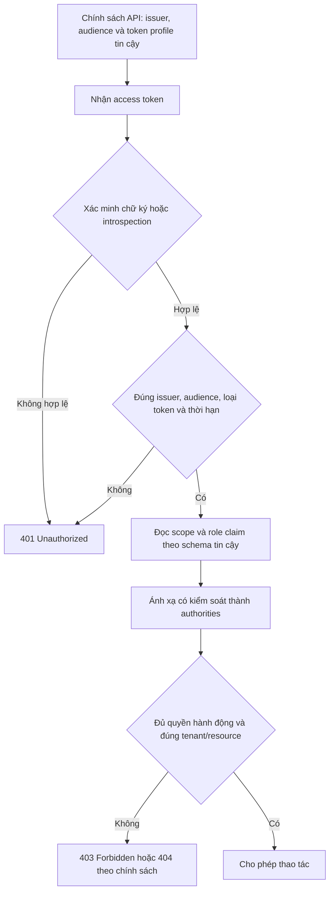
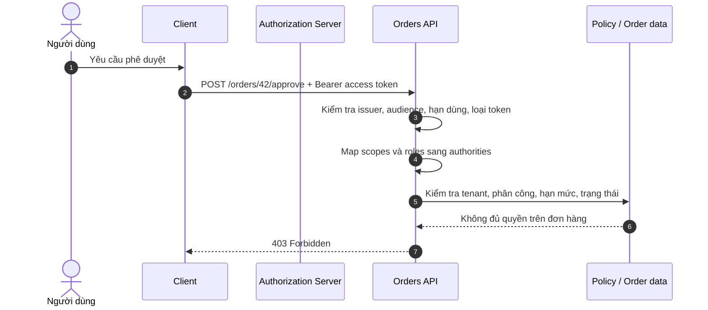

# Role hoặc authority claim

Một resource server nhận access token có chữ ký hợp lệ và claim `"roles": ["ADMIN"]`. API có nên cho phép người gọi xóa mọi đơn hàng? **Không.** Trước hết API phải kiểm tra token đúng nguồn phát hành, đúng đối tượng nhận và còn hiệu lực. Tiếp theo, API phải hiểu claim `roles` theo một hợp đồng đáng tin cậy, ánh xạ nó sang quyền của ứng dụng và kiểm tra chính sách trên **hành động cùng tài nguyên cụ thể**.

Bài thuộc chương **Claims** của module `SECURITY_TOKEN_SECURITY_FUNDAMENTALS`. Nội dung tập trung vào cách diễn giải **role claim** và **authority claim** trong JWT/opaque access token, phân biệt chúng với `scope` của OAuth 2.0, xây dựng quy tắc ủy quyền an toàn trong OAuth 2.0/OIDC và Spring Security, đồng thời xử lý quyền thay đổi, token bị lấy cắp hoặc phát lại.

## 1. Claim là lời khẳng định, chưa phải quyết định cho phép

**Claim** là một cặp tên và giá trị mang thông tin về chủ thể, token hoặc ngữ cảnh. Trong JWT, claims nằm trong payload; ví dụ `iss` (issuer), `sub` (subject), `aud` (audience), `exp` (expiration time) và các claims liên quan quyền.

Các claim như `roles` hoặc `authorities` có thể mô tả quyền gắn với principal, nhưng chỉ có ý nghĩa khi **bên phát hành và bên nhận thống nhất cách hiểu**. Không thể suy ra một người được phép thực hiện mọi hành động chỉ vì payload có chuỗi `ADMIN`.

Giả sử token sau đã được phát hành cho API đơn hàng:

```json
{
  "iss": "https://id.example.test",
  "sub": "user-123",
  "aud": "orders-api",
  "iat": 1795410000,
  "exp": 1795410900,
  "scope": "orders.read",
  "roles": ["ORDER_MANAGER"],
  "tenant_id": "tenant-vn"
}
```

Đây là **payload minh họa**, chưa phải JWT đầy đủ có chữ ký; `roles` và `tenant_id` là những claims theo quy ước của hệ thống giả định. Một API cần trả lời riêng ba câu hỏi:

1. **Token có đáng tin cậy và dành cho API này không?** Xác minh chữ ký hoặc trạng thái introspection, `iss`, `aud`, `exp` và loại token.
2. **Claim mang ý nghĩa gì?** `ORDER_MANAGER` có vai trò gì trong `orders-api`, trong tenant nào, do ai cấp và còn được tin dùng ở thời điểm này không?
3. **Hành động cụ thể có được phép không?** `orders.read`, role phù hợp và quan hệ sở hữu/tenant/chính sách của bản ghi có đồng thời thỏa mãn hay không?

**Authentication thành công không kéo theo authorization thành công.** Token có thể hợp lệ nhưng principal không được đọc đơn hàng của người khác hoặc không được phê duyệt giao dịch vượt hạn mức.

## 2. Phân biệt role, authority, permission và scope

Bốn từ thường xuất hiện cùng nhau nhưng không đồng nhất:

| Khái niệm | Ý nghĩa | Ví dụ | Điểm cần nhớ |
|---|---|---|---|
| **Role** | Nhóm trách nhiệm/quyền theo mô hình RBAC của tổ chức hoặc ứng dụng. | `ORDER_MANAGER`, `SUPPORT_AGENT` | Tên role và phạm vi áp dụng do hệ thống định nghĩa. |
| **Permission** | Khả năng thực hiện hành động cụ thể theo mô hình quyền. | `orders.approve`, `invoices.export` | Có thể được cấp thông qua role hoặc trực tiếp theo chính sách. |
| **Authority** | Khái niệm một quyền/đặc tính đã ánh xạ để framework ra quyết định. | `ROLE_ORDER_MANAGER`, `SCOPE_orders.read` | Trong Spring Security, thường là `GrantedAuthority`; có thể đại diện role, scope hoặc quyền khác. |
| **OAuth 2.0 scope** | Phạm vi truy cập mà authorization server cấp cho client/token theo luồng OAuth. | `orders.read` | Scope không nhất thiết phản ánh toàn bộ quyền nghiệp vụ trên từng bản ghi. |

**Role** thường nói về **vai trò của principal**; **scope** thường giới hạn **quyền truy cập được cấp cho client/token**. Ví dụ nhân viên có role `ORDER_MANAGER` nhưng client chỉ được cấp `orders.read` thì không thể tự suy ra token hiện tại được phép thực hiện `orders.approve`.

Ngược lại, client được cấp scope `orders.approve` cũng không có nghĩa mọi người dùng của client đều là quản lý được phê duyệt đơn hàng. API có thể yêu cầu **cả scope và role**, sau đó kiểm tra tenant, hạn mức, trạng thái đơn hàng và quyền trên đối tượng.

Trong Java/Spring Security, `GrantedAuthority` là một biểu diễn quyền mà framework dùng để đánh giá. Nó **không phải claim JWT tiêu chuẩn bắt buộc phải có tên `authorities`**. Việc ánh xạ claim nào sang `GrantedAuthority` là một quyết định cấu hình của resource server.

## 3. Role claim có được chuẩn hóa trong OAuth 2.0/OIDC không?

**OAuth 2.0 không bắt buộc access token phải là JWT** và không quy định mọi nhà phát hành đều phải có trường `role` hay `authorities`. Với JWT access token, profile **RFC 9068** cho phép sử dụng những claims biểu diễn thông tin về nhóm, vai trò và quyền lợi như `groups`, `roles`, `entitlements` trong các trường hợp thích hợp, nhưng bên nhận vẫn phải xác định ngữ nghĩa và chính sách xử lý cụ thể.

**OIDC** dùng **ID token** để thông báo kết quả xác thực danh tính cho **client**. Một ID token có thể chứa claims mở rộng tùy hệ thống, nhưng OIDC Core không định nghĩa một danh sách role/authority đa dụng bắt buộc cho mọi ứng dụng. **Không gửi ID token đến resource API để thay access token**, dù nó có chứa `roles` hoặc có chữ ký hợp lệ.

Tên và định dạng có thể khác nhau theo issuer hoặc sản phẩm:

| Biểu diễn | Ví dụ | Cách xử lý đúng |
|---|---|---|
| Mảng roles cấp cao nhất | `"roles": ["ORDER_MANAGER"]` | Chỉ đọc khi token profile và issuer được cấu hình hỗ trợ. |
| Mảng authorities | `"authorities": ["orders:approve"]` | Phải có bảng ánh xạ/ngữ nghĩa phù hợp, không mặc định là chuẩn chung. |
| Nhóm | `"groups": ["team-finance"]` | Group membership không tự tương đương permission nếu chưa có chính sách mapping. |
| Quyền cụ thể | `"permissions": ["orders.read"]` | Là claim mở rộng của hệ thống, phải kiểm tra nguồn và phạm vi. |
| Cấu trúc role lồng nhau | `resource_access.orders-api.roles` | Chỉ giải mã theo schema đã thỏa thuận với issuer/nhà cung cấp. |

Ví dụ **cấu trúc kiểu nhà cung cấp**, không phải dạng bắt buộc cho mọi JWT:

```json
{
  "realm_access": {
    "roles": ["offline_access", "user"]
  },
  "resource_access": {
    "orders-api": {
      "roles": ["ORDER_MANAGER"]
    }
  }
}
```

Nếu API dùng vai trò dành riêng cho `orders-api` thì việc lấy mọi role ở `realm_access`, `resource_access` của client khác rồi gộp thành quyền admin tại API là không an toàn. Cần chọn đúng namespace, đối tượng nhận và profile đã cấu hình. Không cố tự đoán cấu trúc claim từ một token bất kỳ.

## 4. Nguồn gốc claim và chuỗi tin cậy

Một chuỗi kiểm tra an toàn có dạng:



Với **JWT access token**, API phải xác minh chữ ký bằng khóa được ràng buộc với issuer tin cậy, dùng danh sách thuật toán được cho phép, kiểm tra `iss`, `aud`, `exp`, `nbf` nếu có và ngữ nghĩa **loại token**. Việc giải mã Base64URL rồi đọc `roles` **không phải xác minh token**. Nếu dùng JWT access token theo RFC 9068, `typ` như `at+jwt` có thể giúp phân biệt loại token theo profile; không giả định mọi nhà cung cấp đều phát hành header giống nhau.

Với **opaque access token**, API không có payload JWT để đọc trực tiếp. API thường xác nhận token bằng **OAuth 2.0 Token Introspection** (RFC 7662) của authorization server đã tin cậy:

```json
{
  "active": true,
  "sub": "user-123",
  "client_id": "orders-web",
  "aud": "orders-api",
  "scope": "orders.read",
  "exp": 1795410900,
  "roles": ["ORDER_MANAGER"]
}
```

`roles` trong phản hồi trên là **trường mở rộng minh họa**, không phải trường bắt buộc của RFC 7662. API phải kiểm tra `active`, nguồn phản hồi, audience và quyền; nếu metadata quan trọng không có thì không tự suy diễn quyền. Introspection phải dùng HTTPS, cơ chế xác thực resource server phù hợp và chính sách bảo vệ endpoint.

Một claim có chữ ký hợp lệ chỉ chứng minh nó do **nguồn đã xác minh** đưa ra. Nếu authorization server lấy role từ thuộc tính hồ sơ mà người dùng tự sửa được, chữ ký đúng vẫn không khiến role đó trở thành quyền đáng tin. Do vậy, quản lý **nguồn cấp role** tại IdP/AS và danh sách các claim được phép chuyển thành authority quan trọng không kém chữ ký.

## 5. Quy tắc ánh xạ claim thành authority

Một hệ thống nên có **hợp đồng ánh xạ rõ ràng** giữa issuer và API. Ví dụ:

| Đầu vào đã xác minh | Chuyển thành authority ở `orders-api` | Điều kiện |
|---|---|---|
| Scope `orders.read` | `SCOPE_orders.read` | Scope được phát hành cho access token có `aud = orders-api`. |
| Scope `orders.approve` | `SCOPE_orders.approve` | Client/token được cấp phạm vi thao tác phê duyệt. |
| Role `ORDER_MANAGER` | `ROLE_ORDER_MANAGER` | Role nằm trong claim đã phê duyệt cho issuer và resource này. |
| Role `SUPPORT_AGENT` | `ROLE_SUPPORT_AGENT` | Có định nghĩa quyền hỗ trợ và giới hạn tenant/đối tượng. |
| Role không nhận diện được | **Không ánh xạ thành quyền đặc biệt** | Default deny với quyền không được định nghĩa. |

Quy tắc mapping phải xác định **kiểu dữ liệu** (mảng chuỗi hay chuỗi cách dấu cách), **chữ hoa/thường**, **tiền tố authority**, **không gian tên** và cách xử lý giá trị không hợp lệ. Không tự động tạo authority cao nhất cho mọi chuỗi trong một mảng tùy ý.

Một số lỗi thường xảy ra:

- Gắn tiền tố `ROLE_` hai lần: claim đã chứa `ROLE_ADMIN` nhưng converter lại biến thành `ROLE_ROLE_ADMIN`.
- Dùng `hasRole("ADMIN")` trong khi chỉ phát `SCOPE_admin`. Hai authority này khác nhau.
- Coi `groups=["admin"]` từ một nhà phát hành bất kỳ là tương đương `ROLE_ADMIN` của ứng dụng.
- Xóa tiền tố hoặc hạ chữ hoa/chữ thường một cách tùy tiện làm hai quyền khác nhau trùng tên.
- Gộp role của **nhiều client, API hoặc tenant** thành một tập quyền toàn cục không có ranh giới.
- Nếu claim bị thiếu, tạo role mặc định có quyền nhạy cảm để “giữ tương thích”.

**Nguyên tắc mặc định:** claim lạ, định dạng sai hoặc role chưa được định nghĩa **không được tự cấp quyền**. Một số ứng dụng có thể cấp quyền cơ bản cho principal đã xác thực dựa trên chính sách riêng, nhưng không nên suy ra quyền nâng cao từ dữ liệu thiếu hoặc sai.

## 6. Scope và role phối hợp trong một quyết định authorization

Xét tình huống người dùng `user-an` có role `ORDER_MANAGER` nhưng token chỉ có scope `orders.read`. Khi gọi `POST /orders/42/approve`, API có thể đặt điều kiện:

```text
Yêu cầu phê duyệt đơn hàng:
  - Token là access token hợp lệ, aud = orders-api.
  - Token được cấp scope orders.approve.
  - Principal có role ORDER_MANAGER trong tenant đích.
  - Đơn hàng nằm trong phạm vi người quản lý được phụ trách.
  - Đơn hàng đang ở trạng thái được phép phê duyệt.
  - Số tiền không vượt hạn mức duyệt của principal.
```

Chỉ có role sẽ không đủ nếu **grant hiện tại không cho phép scope phê duyệt**. Chỉ có scope cũng không đủ khi **principal thiếu role/quyền nghiệp vụ**. Chủ thể phải vượt qua tất cả các điều kiện mà chính sách thực sự yêu cầu.



Đối với thao tác đọc, có thể áp dụng RBAC kết hợp ABAC hoặc ReBAC:

- **RBAC:** role `ORDER_READER` hoặc `SUPPORT_AGENT` cho phép xét đến quyền đọc.
- **ABAC:** chỉ được đọc nếu `order.tenantId` thuộc tenant hợp lệ và `order.status` cho phép.
- **ReBAC:** người quản lý được đọc đơn hàng của thành viên trong nhóm do mình phụ trách.

**Không dùng role ở mức route làm thay thế hoàn toàn kiểm tra quyền theo đối tượng.** Lỗi phổ biến là API xác minh `ROLE_SUPPORT_AGENT` rồi gọi truy vấn `findById(orderId)` mà không giới hạn tenant hoặc quan hệ sở hữu. Đây có thể là lỗ hổng truy cập sai đối tượng (BOLA/IDOR).

## 7. Ví dụ ánh xạ claim trong Spring Security

Trong Spring Security, `Authentication` thường chứa principal và một tập `GrantedAuthority`. Với OAuth2 Resource Server JWT, converter mặc định thường ánh xạ claim `scope`/`scp` thành các authority dạng `SCOPE_<scope>`. Một claim `roles` riêng **không tự được hiểu thành `ROLE_...`** nếu ứng dụng chưa cấu hình converter tương ứng.

Giả sử issuer tin cậy phát hành mảng `roles` như ví dụ đầu bài. Cấu hình minh họa sau giữ cả scope và roles:

```java
@Configuration
@EnableMethodSecurity
public class TokenAuthoritiesConfig {

    @Bean
    JwtAuthenticationConverter jwtAuthenticationConverter() {
        JwtGrantedAuthoritiesConverter scopeConverter =
                new JwtGrantedAuthoritiesConverter();

        JwtGrantedAuthoritiesConverter roleConverter =
                new JwtGrantedAuthoritiesConverter();
        roleConverter.setAuthoritiesClaimName("roles");
        roleConverter.setAuthorityPrefix("ROLE_");

        JwtAuthenticationConverter converter =
                new JwtAuthenticationConverter();
        converter.setJwtGrantedAuthoritiesConverter(jwt -> {
            List<GrantedAuthority> authorities = new ArrayList<>();
            authorities.addAll(scopeConverter.convert(jwt));
            authorities.addAll(roleConverter.convert(jwt));
            return authorities;
        });
        return converter;
    }

    @Bean
    SecurityFilterChain securityFilterChain(
            HttpSecurity http,
            JwtAuthenticationConverter jwtConverter) throws Exception {

        http.authorizeHttpRequests(requests -> requests
                .requestMatchers("/orders/**").authenticated()
                .anyRequest().denyAll());

        http.oauth2ResourceServer(oauth2 -> oauth2.jwt(
                jwt -> jwt.jwtAuthenticationConverter(jwtConverter)));

        return http.build();
    }
}
```

Mã trên minh họa **phần cấu hình** theo Spring Security 6.x (các `import` không được liệt kê), giả định các lớp phụ thuộc đã có và resource server đã được cấu hình issuer/JWK đáng tin cậy. **Audience `orders-api` phải được kiểm tra theo cấu hình validator của ứng dụng**; không mặc nhiên cho rằng cấu hình mặc định đã kiểm tra audience mong muốn. Nếu dự án dùng opaque token, cần cơ chế introspection và mapping authorities phù hợp thay vì converter JWT trong ví dụ.

Khi token đã được xác minh và mapping thành công, các authority có thể gồm:

```text
scope = "orders.read"          -> SCOPE_orders.read
roles = ["ORDER_MANAGER"]      -> ROLE_ORDER_MANAGER

hasAuthority("SCOPE_orders.read")  -> kiểm tra scope đã ánh xạ
hasRole("ORDER_MANAGER")           -> kiểm tra ROLE_ORDER_MANAGER
```

Trong Spring Security, `hasRole("ORDER_MANAGER")` mặc định tìm authority `ROLE_ORDER_MANAGER`, còn `hasAuthority("ORDER_MANAGER")` tìm chính xác `ORDER_MANAGER`. Đó là **ngữ nghĩa của framework**, không phải quy định về định dạng JWT.

Ví dụ method security phân tách quyền thao tác và quyền theo tài nguyên:

```java
@Service
public class OrderService {
    private final OrderRepository repository;

    public OrderService(OrderRepository repository) {
        this.repository = repository;
    }

    @PreAuthorize("hasAuthority('SCOPE_orders.read')")
    public OrderView getOrder(UUID id, JwtAuthenticationToken auth) {
        String subject = auth.getToken().getSubject();
        // Truy vấn phải giới hạn theo principal và tenant đã xác minh.
        Order order = repository.findReadableByIdAndSubject(id, subject)
                .orElseThrow(() ->
                    new ResponseStatusException(HttpStatus.NOT_FOUND));
        return OrderView.from(order);
    }

    @PreAuthorize(
        "hasAuthority('SCOPE_orders.approve') and hasRole('ORDER_MANAGER')")
    public void approveOrder(UUID id, JwtAuthenticationToken auth) {
        // Còn phải kiểm tra tenant, trách nhiệm quản lý, hạn mức
        // và trạng thái đơn hàng bên trong transaction nghiệp vụ.
        // Chỉ sau khi được phép mới thực hiện approve.
    }
}
```

Đây là ví dụ minh họa với `OrderRepository`, `OrderView` và `Order` giả định; phương thức `approveOrder` cố ý chỉ nêu vị trí thực thi kiểm tra, **chưa phải một nghiệp vụ phê duyệt hoàn chỉnh**. Trong sản phẩm, cần hiện thực đầy đủ kiểm tra đối tượng và chính sách, tránh hiểu comment như một cơ chế bảo vệ đang hoạt động. Nếu dùng nhiều issuer hoặc nhiều tenant, không nên đối chiếu mỗi `sub` mà thiếu ràng buộc với issuer hoặc định danh principal nội bộ đáng tin cậy.

## 8. Role claim trong hệ thống đa tenant và nhiều issuer

Một người có thể là `ADMIN` của **tenant A** nhưng chỉ là thành viên bình thường ở **tenant B**. Nếu token có:

```json
{
  "iss": "https://id.example.test",
  "sub": "user-123",
  "aud": "orders-api",
  "roles": ["ADMIN"],
  "tenant_id": "tenant-a"
}
```

API không được suy ra quyền quản trị toàn hệ thống. Các câu hỏi cần làm rõ:

1. `ADMIN` là **role toàn cục hay role theo tenant**?
2. `tenant_id` là claim đáng tin từ issuer hay là tham số người gọi có thể đổi?
3. Nếu request đi tới tài nguyên tenant B, API có chặn truy cập chéo tenant không?
4. Vai trò này áp dụng cho `orders-api` hay cho client/ứng dụng khác?
5. Nếu có nhiều issuer, `user-123` của issuer A có phải cùng một tài khoản với `user-123` của issuer B không?

Trong nhiều hệ thống, cặp **(issuer, subject)** được sử dụng làm cơ sở nhận diện, sau đó ánh xạ sang principal nội bộ và phạm vi tenant. Với dữ liệu đa tenant, API nên kiểm tra tenant ở cả tầng policy **và** truy vấn tài nguyên, ví dụ `findByIdAndTenantId(...)` cùng các điều kiện ownership/relationship cần thiết.

Một mô hình roles được cấu trúc theo resource/tenant có thể giúp giảm nhầm lẫn, nhưng chỉ khi token profile, nguồn dữ liệu và quy tắc mapping được kiểm soát. Tránh ánh xạ mọi claim chứa chuỗi `admin` thành quyền `ROLE_ADMIN` không phân biệt namespace.

## 9. Service account và client credentials

Không phải mọi access token đều đại diện cho người dùng. Luồng OAuth 2.0 `client_credentials` thường dùng giữa các dịch vụ; principal có thể là **client/service**. Nếu một token mang `roles=["ORDER_PROCESSOR"]`, API cần biết đây là role được cấp cho **service client** và giới hạn đúng audience, endpoint và nghiệp vụ của service.

Ví dụ chính sách:

| Principal | Scope của token | Role/authority | Thao tác nên được xét |
|---|---|---|---|
| Người dùng `user-123` | `orders.read` | `ROLE_ORDER_READER` | Đọc đơn hàng trong phạm vi được phép. |
| Service `shipping-worker` | `orders.shipment.update` | `ROLE_SHIPPING_SERVICE` | Cập nhật trạng thái vận chuyển theo hợp đồng dịch vụ. |
| Service `billing-worker` | `invoices.write` | `ROLE_BILLING_SERVICE` | Ghi hóa đơn thuộc phạm vi xử lý. |

Role của service **không được tự hiểu là role của người dùng**. Khi dịch vụ gọi thay mặt người dùng, cần phân biệt **actor** (dịch vụ thực hiện) và **subject** (người được đại diện) theo token profile/hợp đồng ủy quyền đang dùng. Không tự gắn role của client vào user hoặc ngược lại.

## 10. Role và quyền thay đổi sau khi token được phát hành

Một JWT access token có thể chứa role tại thời điểm phát hành:

- 09:00: `user-123` có `ROLE_ORDER_MANAGER`, access token được cấp hiệu lực 15 phút.
- 09:05: quản trị viên thu hồi role quản lý.
- 09:07: token vẫn còn hạn và vẫn mang claim role cũ.
- 09:15: token hết hạn, nhưng đó **không phải cơ chế thu hồi tức thời**.

Nếu API chỉ kiểm tra chữ ký và role trong JWT, quyết định authorization lúc 09:07 có thể dựa vào **ảnh chụp quyền cũ**. Những chiến lược có thể áp dụng tùy mức độ nhạy cảm:

| Cách tiếp cận | Tác dụng | Giới hạn |
|---|---|---|
| Access token thời hạn ngắn | Giới hạn thời gian quyền cũ tồn tại trong token. | Không bảo đảm cập nhật tức thời. |
| Tra role/ACL hiện hành khi xét tác vụ nhạy cảm | Phản ánh thay đổi quyền gần thời điểm thực thi hơn. | Tăng phụ thuộc nguồn dữ liệu chính sách và độ trễ. |
| Opaque token/introspection | AS có thể trả trạng thái/quyền theo chính sách hiện tại. | Tính mới phụ thuộc nội dung phản hồi, cache và cấu hình AS. |
| Denylist/versioning/token introspection bổ sung | Hỗ trợ vô hiệu nhanh trong một số kiến trúc. | Cần quản lý trạng thái phân tán và chi phí vận hành. |
| Thu hồi/rotation refresh token | Ngăn hoặc hạn chế phát access token mới. | Không mặc định vô hiệu mọi access token đã cấp. |

Authorization cần xem **quyền hiện tại tại tài nguyên**, không chỉ role tại thời điểm login. Với tác vụ nhạy cảm, kiểm tra role mới nhất, trạng thái tài nguyên và khả năng người dùng còn được ủy quyền có thể quan trọng hơn việc token vẫn chưa hết hạn.

## 11. Rủi ro bảo mật và cách phòng tránh

| Lỗi thiết kế | Nguy cơ | Cách bảo vệ |
|---|---|---|
| Đọc `roles` từ JWT chưa xác minh. | Kẻ tấn công sửa payload thành `ADMIN`. | Kiểm tra chữ ký/issuer/audience/loại token trước khi tin claims. |
| Dùng ID token làm access token vì ID token có role. | Nhầm audience, vượt ranh giới xác thực và ủy quyền. | Client dùng ID token; API chỉ nhận access token phù hợp. |
| Tin role từ nguồn profile do user tự chỉnh. | Leo thang quyền dù token có chữ ký đúng. | Kiểm soát quy trình cấp role ở IdP/AS và nguồn claim đáng tin. |
| Gộp role của nhiều API hoặc nhiều tenant. | Quyền của tài nguyên A được dùng tại B. | Namespace theo resource/tenant, map rõ ràng và kiểm tra audience. |
| Chỉ kiểm tra `ROLE_ADMIN` mà không xét owner/tenant. | BOLA/IDOR, truy cập trái phép bản ghi. | Policy cấp tài nguyên và ràng buộc truy vấn dữ liệu. |
| Không xử lý role bị thu hồi. | Quyền cũ tồn tại đến khi token hết hạn/cache cập nhật. | Giảm TTL và kiểm tra chính sách mới tại các điểm rủi ro. |
| Ghi nguyên bearer token để debug role. | Credential bị lộ qua log, có thể bị phát lại. | Chỉ log mã quyết định, issuer/subject tham chiếu và phiên bản policy cần thiết. |
| Giả định người cầm bearer token là chủ tài khoản. | Token bị đánh cắp vẫn có thể gọi API. | HTTPS, bảo vệ nơi lưu, scope tối thiểu, token ngắn hạn, sender constraint DPoP/mTLS khi phù hợp. |

**Entropy và chữ ký không tự chống replay.** Dù JWT có chữ ký hợp lệ hay opaque token rất khó đoán, người lấy được bearer token vẫn có thể sử dụng lại khi token còn hiệu lực. Role claim càng rộng thì thiệt hại tiềm năng càng lớn; vì vậy ưu tiên đặc quyền tối thiểu, audience hẹp, bảo vệ token và cơ chế phát hiện bất thường.

## 12. Kiểm tra hành vi, mã lỗi và audit

Với API dùng Bearer token, một số tình huống thường dẫn đến:

| Tình huống | Kết quả thông thường | Ghi chú |
|---|---|---|
| Không có token tại endpoint bắt buộc xác thực. | `401 Unauthorized` | Không xác thực được principal. |
| Token sai chữ ký, issuer, audience, loại token hoặc hết hạn. | `401 Unauthorized` | Không chấp nhận credential cho API này. |
| Access token hợp lệ nhưng thiếu scope. | `403 Forbidden` | Có thể dùng `insufficient_scope` theo RFC 6750. |
| Token hợp lệ, scope phù hợp nhưng thiếu role bắt buộc. | `403 Forbidden` | Principal được xác thực nhưng bị từ chối thao tác. |
| Scope và role đủ nhưng tài nguyên thuộc tenant khác. | `403` hoặc `404` theo chính sách | Không tiết lộ bản ghi nếu cần che giấu sự tồn tại. |
| Role/nguồn policy đang lỗi và không thể đánh giá. | Từ chối theo chính sách an toàn | Không mặc định `PERMIT` khi lỗi. |

Khi kiểm thử mapping trong Spring Security, nên xác minh các trường hợp có ý nghĩa:

1. Token chỉ có `scope=orders.read` tạo `SCOPE_orders.read` nhưng **không** tự tạo `ROLE_ORDER_MANAGER`.
2. Token có `roles=["ORDER_MANAGER"]` từ issuer tin cậy tạo `ROLE_ORDER_MANAGER` và `hasRole("ORDER_MANAGER")` hoạt động theo cấu hình.
3. Token thiếu `roles`, có role lạ hoặc định dạng roles không hợp lệ không được cấp quyền nhạy cảm.
4. Token đúng chữ ký nhưng sai `aud` bị từ chối **trước** khi ánh xạ role.
5. User là quản lý tenant A nhưng truy cập bản ghi tenant B bị từ chối.
6. Token bị thu hồi/quyền thay đổi cho thấy độ trễ theo chiến lược cache/token đã định; không giả định cập nhật tức thì.
7. Service account không được gán quyền của người dùng cuối vì có claim `roles`.
8. Quy trình ghi log/audit **không xuất raw access token, refresh token hoặc ID token**.

Đối với audit authorization, ghi tối thiểu **issuer và subject tham chiếu đã kiểm chứng**, loại principal, action, loại tài nguyên, tenant cần thiết, policy/version, quyết định `PERMIT`/`DENY` và mã lý do. Phân biệt rõ role lấy từ token với role tra từ chính sách hiện hành; ghi toàn bộ JWT hoặc dữ liệu cá nhân không cần thiết chỉ làm tăng rủi ro.

## 13. Tình huống áp dụng và tự đánh giá

**Tình huống A — token hợp lệ nhưng không đủ quyền:** Nhân viên có `roles=["ORDER_MANAGER"]`, access token chỉ có scope `orders.read` và gọi `POST /orders/42/approve`. Nếu chính sách yêu cầu cả `orders.approve` và role quản lý, API phải **từ chối** dù role hợp lệ.

**Tình huống B — claim thuộc client khác:** JWT có `resource_access.billing-api.roles=["ADMIN"]`. API đơn hàng không được map role của `billing-api` thành quyền quản trị đơn hàng chỉ vì cùng issuer.

**Tình huống C — quyền trên bản ghi:** Token có scope `orders.read` và role `SUPPORT_AGENT` nhưng đơn hàng thuộc tenant khác; policy chỉ cho phép support trong tenant của mình. API phải **từ chối** trừ khi có quy tắc liên tenant được phê duyệt rõ ràng.

**Tình huống D — ID token có role:** Client nhận ID token sau khi đăng nhập, bên trong có `roles=["ORDER_MANAGER"]`. Client không được gửi ID token tới resource API như access token; API phải kiểm tra loại và audience của token.

**Tình huống E — role bị thu hồi:** Role quản lý bị xóa tại 09:05, JWT còn hạn tới 09:15. Hãy giải thích vì sao xác minh chữ ký thành công chưa đủ để bảo đảm quyền hiện hành, và đề xuất chính sách cho một giao dịch phê duyệt giá trị lớn.

Tự trả lời:

1. Role khác authority trong Spring Security ở điểm nào? `hasRole("ADMIN")` tìm authority tên gì?
2. Vì sao `scope=orders.read` không tự đồng nghĩa với `ROLE_ORDER_MANAGER`?
3. Khi nào `roles` là nguồn tin cậy và khi nào đó chỉ là dữ liệu chưa được xác minh?
4. Tại sao phải kiểm tra `aud` và loại token trước khi dùng role claim?
5. API đa tenant cần kiểm tra thêm gì bên cạnh role `ADMIN`?
6. Vì sao giảm thời gian sống của access token không giải quyết triệt để việc bearer token bị đánh cắp?

## 14. Ghi nhớ

- **Role** mô tả vai trò; **permission** mô tả hành động; **scope** ràng buộc quyền được cấp qua OAuth; **authority** là biểu diễn dùng khi framework đánh giá authorization.
- Claim `roles`, `authorities` hay `permissions` **không có ý nghĩa thống nhất giữa mọi nhà phát hành**. Hãy xác định token profile, nguồn cấp và quy tắc ánh xạ.
- Chỉ dùng claims sau khi **access token** đã được xác minh đúng nguồn, audience, loại token và thời hạn. **ID token** dành cho OIDC client, không phải giấy phép gọi API.
- **Scope và role không thay thế authorization cấp đối tượng**: còn phải kiểm tra owner, tenant, trạng thái và hạn mức theo chính sách.
- **Role có vòng đời**: quyền có thể thay đổi trước khi token hết hạn; cần chọn chiến lược cập nhật/thu hồi và kiểm tra lại phù hợp rủi ro.
- Một bearer token bị lộ vẫn có thể bị **phát lại** dù role claim hợp lệ; áp dụng đặc quyền tối thiểu, HTTPS, lưu trữ an toàn và cơ chế ràng buộc người gửi khi phù hợp.

### Tài liệu tham khảo

- [RFC 6749 — The OAuth 2.0 Authorization Framework](https://www.rfc-editor.org/rfc/rfc6749): scope, access token, refresh token và ủy quyền truy cập.
- [RFC 9068 — JWT Profile for OAuth 2.0 Access Tokens](https://www.rfc-editor.org/rfc/rfc9068): access token JWT, audience, scopes và các claims về quyền khi thích hợp.
- [RFC 7662 — OAuth 2.0 Token Introspection](https://www.rfc-editor.org/rfc/rfc7662): trạng thái và metadata của opaque/access token.
- [OpenID Connect Core 1.0](https://openid.net/specs/openid-connect-core-1_0.html): ID token, xác thực danh tính và các quy tắc kiểm tra.
- [RFC 9700 — Best Current Practice for OAuth 2.0 Security](https://www.rfc-editor.org/rfc/rfc9700): bảo mật cấp phát, sử dụng, thu hồi và phòng chống token bị đánh cắp/phát lại.
- [Spring Security — OAuth 2.0 Resource Server JWT](https://docs.spring.io/spring-security/reference/servlet/oauth2/resource-server/jwt.html) và [Method Security](https://docs.spring.io/spring-security/reference/servlet/authorization/method-security.html): ánh xạ JWT sang `GrantedAuthority` và kiểm tra quyền truy cập.
