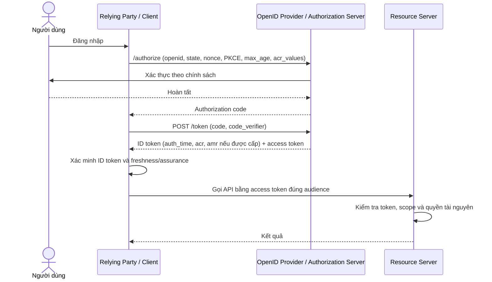
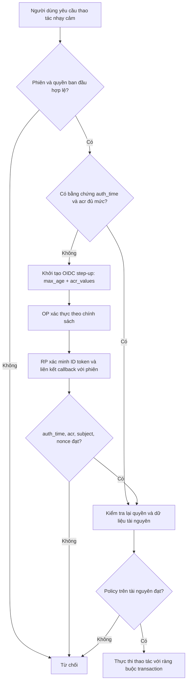

# Authentication time và authentication method

Khi ứng dụng nhận được một ID token sau luồng đăng nhập OpenID Connect (OIDC), việc biết **người dùng là ai** chưa đủ cho mọi quyết định bảo mật. Một thao tác đổi mật khẩu, phê duyệt thanh toán hoặc cấp khóa API có thể yêu cầu thêm hai loại bằng chứng: **người dùng đã được xác thực cách đây bao lâu** và **đã sử dụng phương thức xác thực nào**.

Trong nhóm **Claims** của module **SECURITY_TOKEN_SECURITY_FUNDAMENTALS**, các thông tin này chủ yếu được biểu diễn bằng `auth_time` (*authentication time*) và `amr` (*Authentication Methods References*). Claim `acr` (*Authentication Context Class Reference*) thường đi cùng để thể hiện lớp bảo đảm xác thực. Bài học phân tích chính xác ý nghĩa, giới hạn và cách xác minh các claim này trong OAuth 2.0/OIDC; đồng thời liên hệ với vòng đời JWT, opaque token, access token, refresh token và nguy cơ token bị đánh cắp hoặc phát lại.

**Nguyên tắc xuyên suốt:** thời gian và phương thức xác thực chỉ là dữ liệu có ý nghĩa bảo mật khi được phát hành bởi nguồn có thẩm quyền, xuất hiện trong token/ngữ cảnh đã được xác minh và được đánh giá cùng chính sách phân quyền của ứng dụng.

## 1. Authentication time và authentication method giải quyết bài toán gì?

Giả sử người dùng đăng nhập vào cổng quản trị lúc 08:00 bằng mật khẩu. Đến 11:00, trình duyệt vẫn duy trì phiên SSO và ứng dụng được cấp một ID token mới. Người dùng muốn xóa API key của tổ chức.

Ứng dụng cần trả lời ít nhất bốn câu hỏi độc lập:

1. **Identity:** đây có đúng tài khoản đang đăng nhập không?
2. **Freshness:** lần xác thực gần nhất có đủ mới cho việc xóa khóa không?
3. **Method/assurance:** bằng chứng đăng nhập có đáp ứng lớp bảo đảm mà chính sách yêu cầu không?
4. **Authorization:** tài khoản có được phép xóa **API key cụ thể thuộc tenant đó** không?

Một ID token có chữ ký hợp lệ và chưa hết hạn có thể trả lời câu hỏi định danh theo phạm vi OIDC, nhưng **không tự chứng minh** cả tính mới, mức bảo đảm hay quyền xóa khóa. Đó là lý do cần hiểu từng claim.

| Claim/thuộc tính | Trả lời câu hỏi | Ví dụ | Giới hạn |
| --- | --- | --- | --- |
| `sub` | Chủ thể nào đã được xác thực? | `user-123` | Không thể hiện người dùng được làm gì |
| `auth_time` | Người dùng được OP xác thực khi nào? | `1893456000` | Không nói phương thức hay quyền truy cập |
| `amr` | OP ghi nhận phương thức xác thực nào? | `["pwd", "otp"]` | Không tự bảo đảm mức độ mạnh, tính mới hoặc quyền |
| `acr` | OP khẳng định lớp ngữ cảnh xác thực nào? | `urn:example:assurance:strong` | Ý nghĩa phụ thuộc định nghĩa/hợp đồng với OP |
| `iat` | Token được phát hành khi nào? | `1893459000` | Không phải thời điểm người dùng vừa đăng nhập |
| `exp` | Token có hạn đến khi nào? | `1893462600` | Token còn hạn không chứng minh xác thực còn mới |
| `scope` của access token | Token được cấp phạm vi truy cập API nào? | `keys:delete` | Không thay thế phân quyền theo tài nguyên/tenant |

Trong bảng này, `auth_time`, `amr` và `acr` được hiểu theo **ngữ cảnh xác thực của OIDC**, thông thường qua **ID token** dành cho client/Relying Party (RP). Các hệ thống có thể truyền thông tin assurance tới resource server qua **access token/introspection** theo hợp đồng riêng, nhưng không được mặc định rằng mọi access token đều chứa ba claim này.

## 2. Claim `auth_time`: thời điểm **xác thực**, không phải thời điểm phát hành token

OIDC định nghĩa `auth_time` là thời điểm xảy ra sự kiện xác thực người dùng. Giá trị là một **NumericDate**, tức số giây kể từ mốc Unix Epoch `1970-01-01T00:00:00Z`, không phải mili giây.

Ví dụ một payload ID token **minh họa**, chưa phải token được ký:

```json
{
  "iss": "https://login.example.test",
  "sub": "user-123",
  "aud": "admin-web",
  "iat": 1893459000,
  "exp": 1893462600,
  "auth_time": 1893456000,
  "amr": ["pwd"],
  "acr": "urn:example:assurance:basic",
  "nonce": "request-bound-random-value"
}
```

Ba mốc quan trọng ở đây:

- `auth_time = 1893456000`: OP xác thực người dùng tại thời điểm này.
- `iat = 1893459000`: OP phát hành ID token **3.000 giây sau lần xác thực**.
- `exp = 1893462600`: ID token hết hạn sau thời điểm phát hành 3.600 giây.

Tại thời điểm `now = 1893459300`, ID token mới được phát hành **300 giây trước** nhưng người dùng đã được xác thực **3.300 giây trước** (55 phút). Nếu ứng dụng yêu cầu xác thực trong vòng 5 phút, token này **không đáp ứng** mặc dù `exp` vẫn còn xa.

### 2.1. Phân biệt với `iat`, `nbf`, `exp`

| Claim | Thuộc về vòng đời nào? | Ý nghĩa bảo mật |
| --- | --- | --- |
| `auth_time` | Sự kiện xác thực tại OP | Đánh giá độ mới của xác thực, khi OP có cam kết ngữ nghĩa tương ứng |
| `iat` | Phát hành JWT | Kiểm tra thời điểm phát hành hợp lý hoặc chính sách tuổi token |
| `nbf` | Hiệu lực JWT | Token chưa được chấp nhận trước thời điểm này |
| `exp` | Hiệu lực JWT | Token không được chấp nhận tại hoặc sau thời điểm hết hạn |

**Không sử dụng `iat` để giả lập `auth_time` khi claim bị thiếu.** Một OP có thể phát hành nhiều ID token mới dựa trên một phiên đăng nhập cũ. Tương tự, dùng `exp - iat` để suy ra «thời gian phiên đăng nhập» là sai vì đó chỉ là tuổi thọ token được phát hành.

`auth_time` cũng **không phải** timestamp client click vào nút đăng nhập, timestamp tạo cookie phiên RP hay lúc resource server nhận request. Những mốc này phục vụ các quy trình khác nhau.

### 2.2. Đơn vị, định dạng và sai lệch đồng hồ

Một lỗi phổ biến trong JavaScript/Java là nhầm giây với mili giây:

```java
// auth_time trong OIDC là số giây Unix, không phải mili giây.
long authenticationTimeSeconds = 1893456000L;
Instant authenticatedAt = Instant.ofEpochSecond(authenticationTimeSeconds);

// Sai nếu dùng ofEpochMilli(authenticationTimeSeconds).
Instant wrong = Instant.ofEpochMilli(authenticationTimeSeconds);
```

Validator nên kiểm tra giá trị là NumericDate hợp lệ, không chấp nhận chuỗi tùy ý, `null`, giá trị âm/vô lý theo chính sách, và không tin timestamp quá xa trong tương lai. Hệ thống phân tán cần đồng bộ giờ máy chủ và chỉ cho phép **clock skew có giới hạn**. Sai lệch đồng hồ không được dùng như cơ chế hợp thức hóa một phiên xác thực cũ quá lâu.

## 3. Claim `amr`: phương thức xác thực được OP ghi nhận

`amr` (*Authentication Methods References*) là mảng các chuỗi mô tả phương thức được OP sử dụng trong sự kiện xác thực người dùng. Một số giá trị được đăng ký tại **RFC 8176**:

| Giá trị | Ý nghĩa khái quát | Điều **không** thể suy ra chỉ từ mã |
| --- | --- | --- |
| `pwd` | Xác thực bằng mật khẩu | Mật khẩu có chống phishing, có bị lộ hoặc được dùng cùng yếu tố khác không |
| `otp` | Sử dụng one-time password | Đây là TOTP, HOTP, OTP phần cứng hay kênh vận chuyển cụ thể nào |
| `sms` | Phương thức liên quan SMS | SMS đủ bảo đảm chống chiếm SIM/phishing không |
| `pin` | Sử dụng mã PIN | PIN dùng để mở khóa local hay là yếu tố được OP kiểm chứng từ xa |
| `hwk` | Sử dụng khóa mật mã bảo vệ bằng phần cứng | Triển khai có thực sự đáp ứng mức bảo đảm của tổ chức không |
| `swk` | Sử dụng khóa mật mã trong phần mềm | Khóa có được bảo vệ tương đương phần cứng không |
| `mfa` | OP xác nhận quy trình xác thực đa yếu tố | Những yếu tố đó độc lập, đủ mạnh, chống phishing hay còn đủ mới không |

Ví dụ `"amr": ["pwd", "otp"]` là tuyên bố OP đã ghi nhận mật khẩu và OTP. **Không đếm số phần tử của `amr` để kết luận đã có hai yếu tố độc lập.** Các giá trị chỉ có ý nghĩa chính xác trong định nghĩa và triển khai của issuer.

Các danh mục phương thức có thể thay đổi hoặc được mở rộng theo thỏa thuận. Nếu RP phụ thuộc một giá trị AMR mở rộng như `"urn:example:method:passkey"`, RP cần hợp đồng với OP về cách phát hành và kiểm tra giá trị này. Một chuỗi tự đặt không mang theo mức bảo đảm chuẩn toàn cầu.

### 3.1. Phương thức nào đã được dùng, phương thức nào đang có sẵn?

`amr` nói về **phương thức OP ghi nhận cho sự kiện xác thực**, không phải danh sách các yếu tố đã đăng ký trong hồ sơ người dùng.

Giả sử tài khoản đã đăng ký:

- Một mật khẩu.
- Một ứng dụng TOTP.
- Một passkey.

Nếu người dùng vừa đăng nhập chỉ bằng passkey, không thể kết luận `amr` phải có `pwd` hoặc `otp` chỉ vì tài khoản sở hữu các phương thức đó. Ngược lại, OP có thể sử dụng nhiều lớp xác thực SSO hoặc phương thức kết hợp theo chính sách của mình. RP cần hiểu **ngữ nghĩa report** của OP thay vì cố tự xây dựng lịch sử xác thực từ AMR.

### 3.2. Tại sao `amr` không đủ để chứng minh «MFA mạnh»?

Mức bảo đảm còn liên quan tới nhiều đặc tính:

1. **Tính độc lập của yếu tố**: mật khẩu + mã từ cùng một bí mật không nhất thiết là hai yếu tố độc lập.
2. **Khả năng chống phishing**: OTP nhập trên website giả có thể bị chuyển tiếp; một số phương thức xác thực bằng khóa ràng buộc origin có thể cung cấp bảo vệ tốt hơn.
3. **Chất lượng đăng ký/khôi phục**: phương thức mạnh có thể bị suy yếu bởi quy trình khôi phục tài khoản quá dễ.
4. **Thời điểm sử dụng**: MFA từ nhiều giờ trước có thể chưa đủ cho hành động yêu cầu xác thực mới.
5. **Mô hình thiết bị và session**: OP có thể dựa trên phiên SSO hiện có hoặc đánh giá rủi ro theo chính sách.

Do đó, nếu yêu cầu «đạt lớp assurance X», nên kiểm tra **`acr` theo hợp đồng OP–RP** cùng `auth_time`, thay vì chỉ dựa trên tập `amr`. AMR có thể hữu ích cho giải thích, kiểm toán hoặc chính sách đã được tổ chức định nghĩa riêng.

## 4. Claim `acr` hỗ trợ diễn giải `amr` như thế nào?

`acr` (*Authentication Context Class Reference*) là định danh cho một **lớp ngữ cảnh xác thực**. Một lớp có thể mô tả yêu cầu kết hợp nhiều yếu tố như phương thức, cách enrollment, bảo vệ khóa, các quy trình khôi phục và mức bảo đảm đã cam kết.

Ví dụ tổ chức **tự quy ước**:

| Claim | Giá trị minh họa | Giải thích |
| --- | --- | --- |
| `acr` | `urn:example:assurance:basic` | Lớp xác thực cơ bản do tổ chức định nghĩa |
| `acr` | `urn:example:assurance:strong` | Lớp xác thực mạnh hơn theo hợp đồng OP–RP |
| `amr` | `["pwd", "otp"]` | Phương thức được OP ghi nhận trong sự kiện |
| `auth_time` | `1893456000` | Mốc thời gian xác thực do OP ghi nhận |

**`urn:example:assurance:strong` chỉ là giá trị ví dụ**, không phải mức bảo đảm mặc định của OIDC. Ứng dụng không được kết luận một token «chống phishing» chỉ vì `acr` chứa từ `strong`, `mfa` hoặc `high`. Phải biết OP đã định nghĩa lớp đó ra sao và hỗ trợ điều kiện gì.

Điểm khác biệt quan trọng:

- `auth_time`: **khi nào** người dùng được xác thực?
- `amr`: **phương thức nào** đã tham gia?
- `acr`: OP xác nhận sự kiện đáp ứng **lớp ngữ cảnh nào**?

Một `acr` đủ mạnh nhưng `auth_time` quá cũ có thể vẫn phải step-up. Một `auth_time` mới nhưng `acr` chưa đủ cũng phải step-up hoặc từ chối. Cả hai không thay thế **phân quyền trên tài nguyên**.

## 5. Ngữ cảnh các claim được phát hành: OIDC khác OAuth 2.0

**OAuth 2.0** chủ yếu quy định luồng ủy quyền và cách client nhận quyền gọi resource server. **OIDC** bổ sung lớp xác thực danh tính và **ID token** dành cho client/Relying Party (RP).



**ID token** thường là JWT được ký, có `iss` (issuer), `sub` (subject), `aud` (client_id), `iat` và `exp`. RP là bên kiểm tra ID token cho mục đích xác thực người dùng.

**Access token** có thể là JWT hoặc opaque token. Resource server phải chấp nhận access token dành cho **chính API đó**, với issuer, audience, scope và ràng buộc token phù hợp. **Không gửi ID token cho resource server như bearer access token**, kể cả khi ID token có `auth_time` hoặc `amr` rất hữu ích.

Nếu API cần thông tin độ mới/MFA, kiến trúc phải cung cấp **bằng chứng có nguồn tin cậy** cho API, ví dụ thông qua:

- Claim assurance được AS phát hành trong **access token dành cho RS**, theo profile/hợp đồng rõ ràng;
- Metadata được AS cung cấp qua **token introspection** cho opaque token, với RS xác thực tới introspection endpoint;
- Quyết định từ backend/PDP đáng tin, gắn với đúng phiên/chủ thể và request theo kiến trúc nội bộ.

Không đưa `auth_time`, `amr` hoặc `acr` từ localStorage, JSON body hoặc một header do client tự nhập rồi coi đó là kết quả xác thực.

## 6. Làm thế nào yêu cầu xác thực mới bằng `max_age`?

OIDC cho phép client gửi tham số **`max_age`** trong authorization request để đặt giới hạn tối đa cho thời gian đã trôi qua kể từ lần xác thực người dùng tại OP.

Ví dụ ứng dụng yêu cầu xác thực **không quá 300 giây trước**:

```http
GET /authorize?response_type=code
  &client_id=admin-web
  &redirect_uri=https%3A%2F%2Fadmin.example.test%2Foidc%2Fcallback
  &scope=openid
  &state=<random-state>
  &nonce=<random-nonce>
  &code_challenge=<pkce-challenge>
  &code_challenge_method=S256
  &max_age=300 HTTP/1.1
Host: login.example.test
```

Đoạn trên chỉ minh họa các tham số; khi gọi thật cần chuẩn hóa URL, mã hóa các giá trị và sinh `state`, `nonce`, `code_verifier` an toàn. Trong authorization code flow với PKCE, client đối chiếu `state`, dùng `code_verifier` khi đổi code; RP xác minh ID token và `nonce` nếu đã gửi.

Khi có yêu cầu `max_age`, OP phải đưa **`auth_time`** vào ID token được cấp để RP kiểm tra độ mới. Nếu OP thấy phiên xác thực hiện có quá cũ, nó phải thực hiện xác thực lại theo quy tắc OIDC thay vì âm thầm coi thời điểm phát hành token là thời điểm xác thực.

`max_age=0` yêu cầu xác thực lại, nhưng **không có nghĩa bắt buộc MFA**: người dùng có thể chỉ được yêu cầu nhập lại mật khẩu nếu chính sách OP quy định như vậy. Muốn yêu cầu một lớp bảo đảm cụ thể, cần chính sách assurance riêng và xác minh `acr` tương ứng.

### 6.1. `prompt=login` có thay thế `max_age` không?

`prompt=login` là gợi ý/yêu cầu OP thực hiện bước đăng nhập lại; bản thân việc thấy trang login **không phải bằng chứng có thể kiểm tra bằng claim** rằng người dùng xác thực trong ngưỡng thời gian ứng dụng cần. Với hành động có yêu cầu freshness rõ ràng, nên dùng `max_age`, kiểm tra `auth_time` và định nghĩa chính sách cho OP không đáp ứng.

RP có thể sử dụng `prompt` trong trải nghiệm đăng nhập, nhưng **quyết định bảo mật dựa vào claim đã xác minh và hợp đồng với OP**, không dựa trên giao diện mà trình duyệt vừa hiển thị.

## 7. Yêu cầu phương thức hoặc lớp bảo đảm bằng `acr_values` và `claims`

Đối với mức bảo đảm, client có thể truyền `acr_values` với danh sách lớp ACR ưu tiên:

```text
acr_values=urn:example:assurance:strong
```

Đây là **yêu cầu của client**, không phải chứng nhận OP chắc chắn đã đáp ứng. RP phải kiểm tra claim `acr` thực tế trong ID token và so sánh với policy, dựa trên nghĩa của lớp đã thống nhất với OP.

OIDC còn cho phép yêu cầu claims cụ thể qua tham số `claims` (nếu OP hỗ trợ), chẳng hạn:

```json
{
  "id_token": {
    "auth_time": { "essential": true },
    "acr": {
      "essential": true,
      "values": ["urn:example:assurance:strong"]
    },
    "amr": { "essential": true }
  }
}
```

Lưu ý:

1. JSON trên là **nội dung tham số `claims`**, cần URL encode khi gửi trong authorization request và tùy khả năng OP.
2. `essential` biểu thị mức độ cần thiết của claim đối với client; **RP vẫn phải kiểm tra claim đã nhận**. Nếu thiếu hoặc không đáp ứng điều kiện nghiệp vụ bắt buộc, RP từ chối hoặc bắt đầu luồng mới theo thiết kế.
3. `acr` và `amr` là claim tùy chọn trong OIDC Core. `auth_time` bắt buộc khi có `max_age`; đừng mặc định cả ba luôn được phát hành ở mọi lần đăng nhập.
4. Nếu ứng dụng cần một **phương thức cụ thể** (ví dụ chứng minh người dùng đã dùng một authenticator đáp ứng chính sách chống phishing), danh mục `amr` và cách OP ánh xạ `acr` phải được thỏa thuận rõ. Chỉ gửi `acr_values` không thể tự biến một OP không hỗ trợ thành OP bảo đảm cao.

## 8. Tính độ mới từ `auth_time` một cách an toàn

Ví dụ chính sách: **cho phép thay đổi email khôi phục khi người dùng xác thực không quá 5 phút trước**, với OP được tin cậy.

Một predicate minh họa:

```text
fresh(now, auth_time, maxAge)
  = auth_time có mặt và hợp lệ
    AND auth_time <= now + allowedClockSkew
    AND now - auth_time <= maxAge + allowedClockSkew
```

Đối với hệ thống nhạy cảm, cần định nghĩa chính xác có cho phép thêm `clock skew` vào ngưỡng thời gian nghiệp vụ hay không. Trong mọi trường hợp, không chấp nhận timestamp ở tương lai quá mức lệch cho phép, không tự thay thế giá trị thiếu bằng `iat`, và không lấy `now` do frontend gửi.

### 8.1. Ví dụ Java kiểm tra claim sau khi ID token đã được xác minh

Đoạn code là **pseudocode gần cú pháp Java**, không đại diện cho một API thư viện cụ thể. `oidcVerifier.verifyIdToken` phải là validator OIDC thực sự, đã cấu hình issuer, keys/JWKS, thuật toán, audience, thời hạn, quy tắc `nonce` và các điều kiện giao thức tương ứng.

```java
VerifiedIdToken idToken = oidcVerifier.verifyIdToken(
    rawIdToken,
    "https://login.example.test", // OP/issuer được tin cậy
    "admin-web",                  // client_id / audience dự kiến
    expectedNonce
);

Instant now = clock.instant(); // Đồng hồ của backend
Instant authenticatedAt = idToken.authTime(); // Có thể null
Duration maxAge = Duration.ofMinutes(5);
Duration clockSkew = Duration.ofSeconds(30);

if (authenticatedAt == null) {
    return stepUpOrDeny("Thiếu auth_time");
}
if (authenticatedAt.isAfter(now.plus(clockSkew))) {
    return deny("auth_time nằm quá xa trong tương lai");
}
if (authenticatedAt.isBefore(now.minus(maxAge).minus(clockSkew))) {
    return stepUpOrDeny("Xác thực đã quá cũ");
}

// Nếu nghiệp vụ bắt buộc lớp assurance mạnh,
// chỉ chấp nhận lớp đã thống nhất với OP.
if (!"urn:example:assurance:strong".equals(idToken.acr())) {
    return stepUpOrDeny("Chưa đạt lớp xác thực yêu cầu");
}

// Vẫn phải gắn với đúng subject/phiên và kiểm tra quyền nghiệp vụ.
if (!pendingAction.subject().equals(idToken.subject())
        || !pendingAction.matchesCurrentSession()) {
    return deny("Không khớp chủ thể hoặc phiên đang chờ");
}
if (!authorization.canChangeRecoveryEmail(
        idToken.subject(), pendingAction.accountId())) {
    return forbidden();
}
return changeRecoveryEmail(pendingAction);
```

**Điều kiện quan trọng:** `auth_time` chỉ trả lời *mới đến đâu*, `acr` trả lời *mức nào*, còn `authorization` trả lời *có quyền thực hiện thay đổi này hay không*. Cả ba điều kiện phải cùng đạt.

Trong triển khai sản xuất, nên ràng buộc một thao tác đang chờ với **transaction ID/challenge**, kiểm tra thông tin nghiệp vụ chưa thay đổi và hạn chế sử dụng lại bằng chứng step-up cho những hành động mới ngoài phạm vi chính sách.

### 8.2. Thời điểm nào cần kiểm tra?

Nếu RP kiểm tra freshness lúc hiển thị form nhưng người dùng để form mở 20 phút mới bấm lưu, `auth_time` có thể đã quá ngưỡng. Vì vậy **đánh giá lại tính mới tại backend khi thực thi thao tác nhạy cảm**. Trong luồng bất đồng bộ, cần định nghĩa thời điểm ủy quyền có hiệu lực và thời điểm kiểm tra trước khi job thật sự chạy.

Không để frontend tự gửi cờ `recentlyAuthenticated=true` hoặc timestamp `lastLogin` làm căn cứ. Dữ liệu trình duyệt có thể bị sửa, còn cờ session phía server phải có nguồn gốc từ kết quả OIDC được xác minh và có giới hạn vòng đời.

## 9. Step-up authentication kết hợp phương thức và thời gian

**Step-up authentication** là yêu cầu người dùng đáp ứng điều kiện xác thực mới hoặc mạnh hơn cho hành động có rủi ro cao, kể cả khi phiên SSO hiện tại vẫn hợp lệ.

Giả sử ứng dụng quản trị quy định:

| Hành động | Điều kiện đăng nhập | Điều kiện phân quyền |
| --- | --- | --- |
| Xem dashboard | Phiên hợp lệ theo chính sách | Có quyền xem dashboard |
| Xem chi tiết hóa đơn | Phiên hợp lệ, có thể yêu cầu assurance cơ bản | Đúng tenant và quyền đọc hóa đơn |
| Đổi mật khẩu | Xác thực không quá 5 phút, lớp assurance theo chính sách | Đúng người dùng/chủ sở hữu |
| Cấp API key có quyền ghi | Xác thực không quá 2 phút và ACR mạnh | Vai trò quản trị, đúng tenant, policy cho phép |



Mỗi callback OIDC phải gắn với đúng request khởi tạo bằng `state`, `nonce` theo luồng và binding với phiên. Không chấp nhận kết quả step-up của user A để nâng mức phiên user B. Chỉ thêm trường `mfa` vào session của client hoặc URL không tạo ra bước xác thực đáng tin.

Khi OP báo không đáp ứng được ACR, ứng dụng phải xử lý như một kết quả **không đủ bảo đảm**. Tránh redirect lặp vô hạn; có thể trả về thông báo về phương thức xác thực được hỗ trợ hoặc không cho phép thao tác theo chính sách.

## 10. Phương thức xác thực trong access token và resource server

Một sai lầm phổ biến là thấy ID token có `amr`/`auth_time` rồi **gửi ID token thẳng cho API**. ID token có `aud` là client, không phải API. Resource server chỉ chấp nhận **access token** dành cho nó (JWT hoặc opaque) và xác minh issuer, audience, scope, thời hạn, token type cùng ràng buộc sender nếu có.

### 10.1. Đưa assurance vào access token đúng cách

Nếu API `payments-api` cần biết xác thực đã đủ mới và mạnh, authorization server có thể phát hành **JWT access token theo hợp đồng được thống nhất**, trong đó có các claim ứng dụng liên quan assurance:

```json
{
  "iss": "https://auth.example.test",
  "sub": "user-123",
  "aud": "payments-api",
  "client_id": "payments-web",
  "scope": "payments:approve",
  "auth_time": 1893456000,
  "acr": "urn:example:assurance:strong",
  "amr": ["pwd", "otp"],
  "iat": 1893456060,
  "exp": 1893456660
}
```

Đây là **payload minh họa**, không phải JWT hoàn chỉnh. Claim xác thực trong access token **không mặc định được quy định để có ở mọi OAuth access token**; chỉ sử dụng nếu issuer/RS thống nhất semantics. Với JWT access token theo RFC 9068, issuer còn phải tuân thủ các yêu cầu profile tương ứng, bao gồm header/token type.

RS chỉ được tin các claim sau khi xác minh đúng nguồn phát hành và token dành cho chính RS. Dù đã thỏa `acr` và `auth_time`, API vẫn phải kiểm tra **scope, tenant, quyền trên giao dịch cụ thể, trạng thái và hạn mức**. Một người xác thực rất mạnh vẫn không có quyền duyệt tiền của tổ chức khác.

Đối với opaque token, RS có thể dùng **introspection** từ AS để biết token đang hoạt động và các metadata được thỏa thuận. Độ mới của thông tin phụ thuộc vào thời hạn lưu cache và cách phản ánh việc thu hồi token. Không suy diễn rằng opaque token tự có `amr` hoặc JWT tự có `auth_time`.

### 10.2. Token dùng theo client credentials

Access token cấp qua `client_credentials` thường đại diện cho **client/dịch vụ**, không phải sự kiện người dùng đăng nhập. Vì vậy không thể mặc định `sub` là user ID hoặc áp dụng `auth_time` của người dùng cho token dịch vụ. Nếu dịch vụ gọi API thay mặt người dùng, cần **cơ chế delegation/token exchange** và hợp đồng mang ngữ cảnh người dùng theo cách được AS bảo đảm.

## 11. Nguy cơ bảo mật khi sử dụng các claim xác thực

| Sai lầm | Vì sao nguy hiểm? | Biện pháp |
| --- | --- | --- |
| Chỉ decode JWT để đọc `auth_time` hoặc `amr` | Kẻ tấn công có thể tự tạo JSON chưa ký/đã sửa | Xác minh chữ ký, khóa, issuer, audience, thời hạn, token type trước khi tin |
| Coi `iat` là lần đăng nhập gần nhất | Token mới có thể được phát hành từ phiên SSO cũ | Dựa vào `auth_time`, yêu cầu `max_age` khi cần |
| Chỉ dựa `exp` để kết luận vừa xác thực | Token có thể còn hạn rất lâu sau khi người dùng xác thực | Kiểm tra ngưỡng freshness riêng |
| Bỏ qua `auth_time` khi đã yêu cầu `max_age` | Không biết OP có đáp ứng độ mới hay không | Từ chối/khởi động lại luồng nếu thiếu hoặc không hợp lệ |
| Đếm `amr` để kết luận MFA mạnh | Các giá trị có thể không biểu diễn hai yếu tố độc lập | Dùng `acr` và chính sách assurance được thống nhất |
| Coi tên `acr=strong` là bảo đảm phổ quát | Ý nghĩa ACR không phải chuẩn toàn cầu | Làm rõ hợp đồng và quy trình của OP/IdP |
| Tin `mfa=true` hoặc `lastLogin` từ frontend | Client tự khai quyền hoặc thời gian | Chỉ nhận dữ liệu từ token/session/PDP đáng tin |
| Dùng ID token làm access token cho RS | Nhầm audience và mục đích token | Phân biệt validator và token type; kiểm tra `aud` |
| Tin `amr` từ identity broker nhưng không biết cách mapping | Broker có thể chuyển đổi phương thức upstream không đúng nghĩa | Thỏa thuận và kiểm thử quy tắc mapping/bảo đảm |
| Không bind kết quả step-up với phiên/transaction | Dùng kết quả xác thực của phiên/người khác | Kiểm tra `state`, `nonce`, subject và request đang chờ |
| Lưu ID token vào log/URL | Rò thông tin định danh, metadata đăng nhập và bearer credential | Giảm thiểu logging, che token, bảo vệ kênh và storage |
| Cho phép thao tác nhạy cảm dựa trên claim cũ | Quyền tài nguyên hoặc trạng thái có thể đã đổi | Kiểm tra authorization mới nhất khi thực thi |

Một ID token có chữ ký thường là **JWS**, tức payload có thể đọc được sau khi Base64URL decode; chữ ký **không mã hóa** nội dung. Nếu cần bảo mật claim trước bên không có quyền, phải thiết kế bảo vệ dữ liệu phù hợp, có thể bao gồm JWE và chính sách lưu trữ/transport. Tránh đưa lịch sử phương thức xác thực hoặc thông tin cá nhân không cần thiết vào token phát cho client.

**Bearer token bị đánh cắp** có thể bị dùng lại trong thời gian còn hiệu lực; thêm `amr` hoặc `auth_time` không chống replay. Các biện pháp tương ứng gồm HTTPS, giảm tuổi token, bảo vệ lưu trữ, thu hồi, phát hiện bất thường và cân nhắc **DPoP/mTLS** để ràng buộc token với bên sử dụng khi cần. Với refresh token, việc bảo vệ/rotation và phát hiện reuse là vấn đề riêng của vòng đời token, không thể thay bằng việc chỉ kiểm tra các claim đăng nhập.

## 12. Ví dụ tình huống: duyệt giao dịch ngân hàng

Một ứng dụng yêu cầu:

- User có quyền `payments:approve`, đúng tenant, giao dịch đang `PENDING`.
- Giao dịch trên một hạn mức nhất định đòi hỏi `acr` tương ứng lớp xác thực mạnh do ngân hàng đã thống nhất với OP.
- Lần xác thực phải xảy ra trong vòng **300 giây** trước khi phê duyệt.

Giả sử hệ thống đã xác minh token và nhận được các tình huống sau:

| Tình huống | `auth_time` | `acr`/`amr` | Quyết định |
| --- | --- | --- | --- |
| Người dùng mới nhập mật khẩu 1 phút trước | Mới | `acr=basic`, `amr=["pwd"]` | Chưa đạt assurance, cần step-up |
| Người dùng hoàn tất MFA mạnh 20 phút trước | Quá cũ | `acr=strong`, `amr=["pwd","otp"]` | Cần xác thực mới |
| Người dùng vừa đạt lớp strong 30 giây trước | Mới | `acr=strong` | Chuyển tiếp kiểm tra quyền/tài nguyên |
| User vừa đạt strong nhưng giao dịch thuộc tenant khác | Mới | `acr=strong` | Từ chối phân quyền |
| Token không có `auth_time` khi policy yêu cầu | Không có | Có thể có AMR | Không đủ bằng chứng, từ chối/step-up |
| `auth_time` có giá trị nằm xa trong tương lai | Không hợp lệ | Bất kỳ | Từ chối bằng chứng |
| `amr` cho thấy OTP nhưng OP không cung cấp ACR được thỏa thuận | Tùy | Không đủ contract assurance | Không tự kết luận đã đạt lớp strong |

Ở đây **xác thực** và **phân quyền** là hai tầng riêng. Có thể một bước step-up thành công nhưng giao dịch vẫn bị từ chối vì sai tenant hoặc vượt hạn mức.

## 13. Bộ kiểm thử cần thiết

| Kiểm thử | Kỳ vọng |
| --- | --- |
| `auth_time` cách `now` đúng 300 giây, ngưỡng tối đa 300 giây | Chấp nhận freshness nếu policy dùng biên bao gồm |
| `auth_time` cách `now` 301 giây, không có clock skew hoặc điều kiện bù | Không đạt freshness |
| `auth_time` có mili giây thay giây | Bị phát hiện không hợp lệ theo policy |
| `auth_time` là chuỗi hoặc thiếu khi bắt buộc | Không tự ép sang `iat`; từ chối/step-up |
| `auth_time` ở tương lai vượt giới hạn clock skew | Từ chối |
| Token mới `iat` vừa tạo nhưng `auth_time` cũ | Không nhầm thành recent login |
| `max_age` được gửi nhưng ID token không có `auth_time` | RP từ chối kết quả không đáp ứng |
| `acr_values` yêu cầu strong nhưng ID token trả về basic | RP không cho qua thao tác cần strong |
| `amr=["pwd","otp"]` nhưng chính sách cần lớp ACR riêng | Không tự coi là đủ bảo đảm |
| JWT không có chữ ký đúng hoặc sai `iss`/`aud` | Bị từ chối trước khi đọc claims làm quyết định |
| ID token của client A được đưa cho client B | Bị từ chối do audience/nonce/phiên không khớp |
| ID token được gửi vào resource server thay access token | Resource server từ chối |
| Callback của user A cố gắn vào phiên user B | Từ chối vì subject/transaction không khớp |
| Form hiển thị khi auth còn mới nhưng submit sau ngưỡng | Backend yêu cầu lại bằng chứng mới |
| Claim có AMR không biết hoặc bị sai kiểu | Xử lý theo contract; không tự suy diễn thành assurance mạnh |
| Claim từ IdP upstream được broker ánh xạ sang OP | Kiểm tra theo chính sách tin cậy và cấu hình broker |
| Dữ liệu user có quyền sai tenant dù auth rất mạnh | Vẫn từ chối |

Đối với test thời gian, nên inject `Clock` cố định và dùng ví dụ ở đúng biên, tránh test phụ thuộc thời gian thực rồi `sleep`. Đối với test OIDC, cần cả bộ token **đã ký đúng bằng khóa thử nghiệm** và token giả mạo/sai audience, cùng test callback `state`, `nonce`, PKCE khi luồng yêu cầu.

## 14. Checklist triển khai

Trước khi dùng `auth_time` hoặc `amr` trong một quyết định quan trọng:

1. **Đúng loại token:** đang dùng ID token để xác thực client/RP hay access token để gọi RS? Có kiểm tra đúng issuer/audience/type?
2. **Nguồn phát hành:** chữ ký JWT hoặc introspection và khóa/issuer đã được tin cậy? Có giới hạn thuật toán/metadata, tránh tự lấy khóa từ URL token khai?
3. **Freshness:** chính sách cần xác thực trong bao lâu? Có dùng `max_age` và xác minh `auth_time` nếu cần?
4. **Đơn vị thời gian:** xử lý NumericDate theo giây, kiểm soát clock skew, không lấy `iat` thay `auth_time`?
5. **Phương thức:** hiểu ý nghĩa `amr` theo OP và RFC 8176, không đếm mã để tự suy ra MFA độc lập/chống phishing?
6. **Assurance:** có định nghĩa lớp `acr` với OP và kiểm tra giá trị thực sự được phát hành nếu nghiệp vụ yêu cầu?
7. **Step-up:** callback OIDC có `state`/`nonce`/PKCE phù hợp, gắn đúng subject, phiên và transaction không?
8. **Phân quyền:** sau khi authentication context đạt, còn kiểm tra scope, owner, tenant, trạng thái và giới hạn giao dịch?
9. **Lưu trữ/vòng đời:** tránh log raw token, bảo vệ access/refresh/ID token theo đúng bên nhận; có TTL, revocation và replay protection phù hợp?
10. **Thử nghiệm:** đã test claim thiếu, sai kiểu, mốc biên, issuer/audience sai, ACR không đáp ứng và form gửi muộn?

## Tổng kết

**`auth_time`** cho biết lần xác thực người dùng xảy ra **khi nào**; **`amr`** cho biết OP ghi nhận **phương thức** nào; và **`acr`** mô tả **lớp ngữ cảnh/bảo đảm xác thực** theo hợp đồng giữa các bên. Các claim này giúp thực thi chính sách «xác thực đủ mới và đủ mạnh» nhưng **không thay thế** việc xác minh ID token, access token hay phân quyền tài nguyên. Muốn dùng chúng an toàn, ứng dụng cần kiểm tra đúng nguồn tin cậy, so sánh mốc thời gian bằng đồng hồ backend, hiểu đúng ngữ nghĩa của OP và gắn quyết định step-up với đúng người dùng, phiên, hành động.

**Tài liệu tham khảo:** OpenID Connect Core 1.0 (ID Token, `auth_time`, `acr`, `amr`, `max_age` và `claims`); RFC 8176 (Authentication Method Reference Values); RFC 7519 (JSON Web Token); RFC 7636 (Proof Key for Code Exchange); RFC 8725 (JWT Best Current Practices); RFC 9068 (JWT Profile for OAuth 2.0 Access Tokens); RFC 7662 (Token Introspection); RFC 9700 (OAuth 2.0 Security Best Current Practice); RFC 9470 (OAuth 2.0 Step Up Authentication Challenge Protocol).
