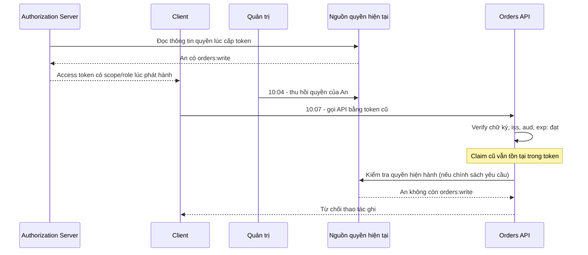
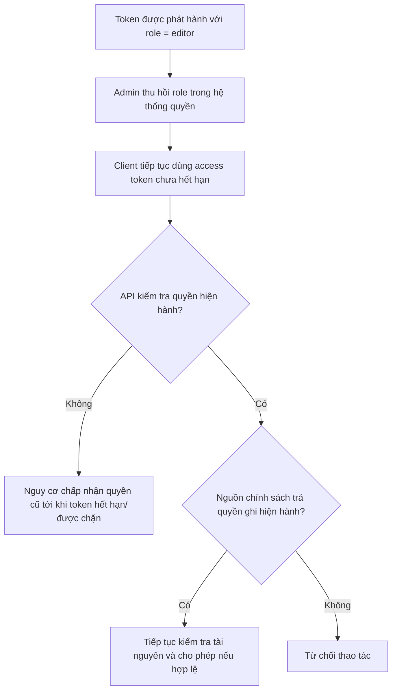

# Không coi claim là dữ liệu luôn mới nhất

## 1. Tình huống mở đầu: token còn hạn, quyền đã bị thu hồi

Giả sử hệ thống quản lý đơn hàng có một authorization server và Orders API. Lúc **10:00**, nhân viên An đăng nhập và nhận access token chứa:

```json
{
  "iss": "https://auth.example.com",
  "sub": "employee-123",
  "aud": "https://orders-api.example.com",
  "iat": 1900000000,
  "exp": 1900000900,
  "scope": "orders:read orders:write",
  "roles": ["order-editor"]
}
```

Các giá trị timestamp chỉ minh họa cho khoảng hiệu lực **15 phút**, không nhằm biểu diễn chính xác các mốc đồng hồ trong câu chuyện. Đến **10:04**, quản trị viên thu hồi vai trò `order-editor` của An vì An được chuyển sang bộ phận khác. Lúc **10:07**, ứng dụng vẫn trình access token ban đầu để sửa đơn hàng.

Nếu Orders API chỉ kiểm tra **chữ ký, `iss`, `aud`, `exp` và `scope` nằm trong token**, nó có thể vẫn thấy `orders:write` và chấp nhận thao tác. Chữ ký vẫn đúng; token chưa hết hạn; nhưng quyền **hiện tại** của An đã thay đổi.

Đây là cốt lõi của bài học:

> **Claim hợp lệ về mặt mật mã không đồng nghĩa claim đang phản ánh trạng thái mới nhất của hệ thống.** Token mô tả một thông tin hoặc quyết định được đưa vào token tại thời điểm phát hành/ghi nhận. Muốn biết thông tin nào còn đúng ngay bây giờ, hệ thống phải có **nguồn sự thật và cơ chế cập nhật/kiểm tra phù hợp**.

Bài thuộc chương **Claims** của module `SECURITY_TOKEN_SECURITY_FUNDAMENTALS`. Nó nối mô hình tin cậy của token với JWT, opaque token, access/refresh token, OAuth 2.0/OIDC, kiểm tra claims, `scope`, `audience`, thời hạn, lưu trữ, thu hồi và giảm tác hại khi token bị lấy cắp hoặc phát lại.

## 2. Claim là gì và vì sao có thể cũ?

**Claim** là một khẳng định hoặc thuộc tính gắn với token hay một đối tượng bảo mật. Trong JWT, claims thường nằm trong JSON payload. Ví dụ:

- `iss`: bên phát hành token.
- `sub`: chủ thể được token nói đến, theo ngữ nghĩa của issuer và loại token.
- `aud`: bên nhận mà token hướng đến.
- `iat`: thời điểm phát hành.
- `nbf`: thời điểm sớm nhất được chấp nhận.
- `exp`: thời điểm token hết hạn.
- `scope`, `roles`, `groups`, `tenant_id`: các thuộc tính/quyền do hệ thống hoặc token profile quy định.

Không phải claim nào cũng có cùng ý nghĩa. `iss`, `sub`, `aud`, `iat`, `nbf` và `exp` là các JWT registered claim names. Các trường như `roles` hoặc `tenant_id` là **claim ứng dụng/profile**; OAuth 2.0 không mặc định định nghĩa một cấu trúc `roles` chung cho mọi hệ thống. `scope` có ngữ nghĩa theo OAuth và có thể được biểu diễn trong access token hoặc metadata introspection tùy profile.

Một JWT được ký số bảo vệ **tính toàn vẹn của thông điệp đã phát hành** và cho phép xác minh bên ký theo cấu hình tin cậy. Chữ ký **không có đường dây tự động** tới cơ sở dữ liệu nhân sự, nhóm người dùng, hồ sơ khách hàng hoặc trạng thái tài nguyên.



Trạng thái của token và trạng thái của nghiệp vụ là **hai thứ có thể thay đổi độc lập**. Một số claim là thuộc tính khá ổn định; số khác thay đổi liên tục. Độ mới cần thiết phải được xác định theo **mức độ rủi ro của quyết định sử dụng claim**, không chỉ theo hình thức JWT hay opaque.

## 3. Phân biệt bốn kiểm tra thường bị trộn lẫn

| Kiểm tra | Câu hỏi thực sự | Ví dụ | Có chứng minh quyền hiện tại không? |
| --- | --- | --- | --- |
| **Tính xác thực/toàn vẹn** | Token có đúng do issuer tin cậy cấp và chưa bị sửa không? | Chữ ký JWT hợp lệ; opaque token được introspect | **Không** |
| **Hiệu lực thời gian** | Token đã đến lúc dùng và chưa hết hạn chưa? | `nbf <= now < exp` | **Không** |
| **Đúng nơi, đúng loại** | Token được cấp cho API này và có đúng chức năng không? | `aud` là Orders API, token là access token | **Không** |
| **Quyền và trạng thái hiện tại** | Chủ thể/client còn quyền làm việc này với tài nguyên này không? | Quyền `orders:write` chưa bị thu hồi, đúng tenant | **Có thể**, nếu kiểm tra nguồn đủ mới và đáng tin |

API cần đi qua **tất cả những điều kiện phù hợp** trước khi cho phép truy cập. Việc xác minh claim cũ không được phép tự “nâng” quyền.

### 3.1. `iat`, `nbf` và `exp` không phải đồng hồ cập nhật hồ sơ

- `iat` (*issued at*) nói **khi nào token được phát hành**, không phải lần cuối hồ sơ/role được đồng bộ.
- `nbf` (*not before*) giới hạn thời điểm sớm nhất được sử dụng, không bảo đảm role mới nhất.
- `exp` (*expiration*) giới hạn thời điểm chấp nhận token; token **có thể bị vô hiệu sớm hơn** hoặc một claim nghiệp vụ có thể đã cũ từ trước khi `exp` đến.
- `auth_time` trong OIDC, khi có, cho biết thời điểm xác thực người dùng theo định nghĩa OIDC, **không phải thời điểm kiểm tra gần nhất mọi quyền hoặc thuộc tính hồ sơ**.
- `jti` nếu có chỉ định danh token theo profile, **không tự động** biểu thị trạng thái thu hồi. Muốn dùng `jti` trong denylist phải có dữ liệu và quy trình kiểm tra tương ứng.

**Token có `exp` còn 30 phút không đảm bảo claims còn đúng trong 30 phút đó.** Nó chỉ đặt một giới hạn thời gian chấp nhận token theo quy tắc xác minh.

### 3.2. Scope không đồng nghĩa vai trò luôn hiện hành

`scope` thường thể hiện **phạm vi truy cập được cấp cho client/token**, không phải bản sao hoàn chỉnh của hệ thống quyền người dùng. Một token có `orders:write` không mặc nhiên cho phép sửa mọi đơn hàng. API còn phải kiểm tra quyền trên đối tượng, tenant, trạng thái tài khoản và các ràng buộc nghiệp vụ.

Nếu tổ chức thu hồi quyền của An **sau khi token được cấp**, giá trị `scope` trong token đã ký thường **không tự thay đổi**. Cách dùng an toàn cho API yêu cầu quyền hiện hành là:

```text
Quyền hiệu lực tại API
  = quyền nằm trong giới hạn token đã được cấp
  ∩ quyền/chính sách hiện tại áp dụng cho chủ thể và tài nguyên
```

Đây là một **mô hình tư duy**; phép tính thực tế có thể dựa trên policy engine, RBAC, ABAC hoặc quy tắc phức tạp. Mấu chốt là quyền hiện tại có thể **giảm** so với quyền trong token, và API không lấy claim tự khai của client để bổ sung quyền.

## 4. Những claim nào dễ trở nên lỗi thời?

| Claim/thuộc tính | Điều gì có thể thay đổi sau phát hành? | Rủi ro khi tin bản cũ | Hướng xử lý |
| --- | --- | --- | --- |
| `roles`, `groups` | Người dùng bị thêm/xóa khỏi vai trò, nhóm | Tiếp tục có quyền quản trị hoặc thao tác nhạy cảm | Kiểm tra quyền hiện hành cho tác vụ rủi ro cao; cơ chế invalidation/version khi phù hợp |
| `scope` | Chính sách cấp quyền hoặc grant bị thu hồi | Token tiếp tục được chấp nhận theo phạm vi cũ | Access token ngắn hạn, revocation và/hoặc policy check tùy mức cần hiệu lực ngay |
| `tenant_id`, membership | Người dùng rời tenant, chuyển tổ chức | Truy cập chéo tenant | Kiểm tra tenant/resource từ nguồn có thẩm quyền, tách namespace định danh |
| `email`, `name`, `picture` | Hồ sơ được cập nhật | Hiển thị sai; gửi liên hệ tới email cũ | Lấy hồ sơ mới từ API/profile source khi cần; không dùng email làm khóa ủy quyền |
| `account_status` | Tài khoản bị khóa, vô hiệu hóa, yêu cầu reset | Người dùng bị chặn vẫn tiếp tục truy cập | Kiểm tra trạng thái hiện hành hoặc thu hồi token/phiên đúng hạn |
| `plan`, `subscription` | Thuê bao hết hạn/đổi gói | Dùng tính năng đã mất quyền | Kiểm tra dữ liệu thuê bao hiện hành tại điểm thực hiện |
| `risk_level`, `device_trust` | Rủi ro/thiết bị thay đổi | Bỏ qua yêu cầu xác thực tăng cường | Dùng risk engine hoặc tín hiệu hiện hành; policy bước tăng cường |
| `iss`, `aud` | Chính sách tin cậy/cấu hình resource thay đổi | Token dùng sai issuer/resource | Xác minh theo cấu hình tin cậy hiện hành; không thay bằng dữ liệu request |

Một số thuộc tính như `sub` là **định danh ổn định trong ngữ cảnh issuer** và phù hợp để liên kết tới bản ghi hiện hành. Tuy nhiên, không được đồng nhất một `sub` giữa các issuer; cặp **(`iss`, `sub`)** thường là điểm xuất phát an toàn hơn cho việc tìm chủ thể. Với client credentials, access token có thể đại diện cho **client/workload**, nên quy tắc kiểm tra cần dùng đúng loại principal, không mặc định đó là người dùng.

## 5. Vòng đời khiến claim bị cũ: ví dụ theo dòng thời gian

Xét JWT access token đã ký, chỉ được Orders API chấp nhận và có thời hạn 15 phút:

| Thời điểm | Sự kiện | Trạng thái access token | Trạng thái quyền hiện hành |
| --- | --- | --- | --- |
| 10:00 | AS cấp token có `orders:write` | Mới phát hành, còn hạn | Có quyền |
| 10:04 | Admin thu hồi `orders:write` | Các byte token cũ **không đổi** | Không còn quyền |
| 10:07 | Client gửi token cũ tới Orders API | Chữ ký vẫn hợp lệ, chưa hết hạn | Không còn quyền |
| 10:15 | Token đến `exp` | Hết hạn và phải bị từ chối | Không còn quyền |

Nếu API **chỉ** kiểm tra JWT tại chỗ và quyền lấy từ claims trong token, thì trong ví dụ có thể có cửa sổ khoảng **11 phút** từ lúc quyền bị thu hồi đến lúc token hết hạn. Đó là thời gian tối đa còn lại của token **trong kịch bản giả định**; không phải bảo đảm chung cho mọi hệ thống.

Nếu client còn refresh token và authorization server vẫn dựa trên **nguồn quyền cũ**, token mới cũng có thể tiếp tục mang quyền sai. Vì vậy **thời hạn access token ngắn chỉ giới hạn khoảng sống của từng token**, không bảo đảm quyết định cấp quyền sau này đã được cập nhật.



## 6. JWT, opaque token và introspection: khác nhau ở độ mới như thế nào?

### 6.1. JWT tự chứa (*self-contained*)

Một API có thể kiểm tra chữ ký JWT và claims **tại chỗ**, không cần gọi AS trên mỗi request. Ưu điểm là hiệu năng, tính độc lập trước sự cố mạng. Đánh đổi: token có thể tiếp tục được chấp nhận cho đến `exp` nếu API **không có cơ chế kiểm tra thay đổi chính sách hoặc thu hồi bổ sung**.

Chữ ký JWT hợp lệ chỉ chứng minh **bản khẳng định chưa bị sửa so với nội dung đã ký**. Nó không chứng minh hệ thống cấp quyền chưa thay đổi từ lúc ký.

### 6.2. Opaque token và tra cứu trạng thái

Opaque access token thường là một chuỗi client/API không tự diễn giải. Resource server có thể gọi **OAuth 2.0 Token Introspection** (RFC 7662) hoặc cơ chế tra cứu đáng tin cậy để biết token có `active` không, audience nào, scope nào và các metadata khác.

Phản hồi minh họa:

```json
{
  "active": true,
  "iss": "https://auth.example.com",
  "sub": "employee-123",
  "aud": "https://orders-api.example.com",
  "scope": "orders:read",
  "exp": 1900000900
}
```

**`active: true` không đồng nghĩa tất cả thuộc tính người dùng, role hay quyền trên từng bản ghi đều mới nhất.** Kết quả phụ thuộc vào cách AS duy trì trạng thái, policy mà introspection áp dụng và **caching** ở AS, API gateway hoặc resource server. Nếu introspection trả thông tin cũ từ bộ đệm, opaque token cũng có thể dẫn đến quyết định cũ.

Ngược lại, JWT cũng có thể dùng **denylist/token version/kiểm tra quyền hiện hành** để phản ánh thay đổi kịp thời. Vì vậy:

> **JWT không mặc định luôn cũ hơn opaque; opaque không mặc định luôn cập nhật tức thời.** Độ mới là đặc tính của **kiến trúc xác minh, nguồn dữ liệu, chính sách thu hồi và cache**, không chỉ của hình thức token.

### 6.3. Khi introspection không sẵn sàng

Nếu API cần introspection/policy check để cho phép truy cập mà dịch vụ này gặp sự cố, API **không được tự xem token là hợp lệ chỉ vì muốn duy trì lưu lượng**. Với thao tác nhạy cảm, áp dụng nguyên tắc **fail closed**: không cho phép khi không đủ bằng chứng hiện hành. Có thể trả lỗi dịch vụ tạm thời phù hợp, ví dụ `503`, thay vì mạo nhận token chắc chắn sai bằng `401 invalid_token`.

Cần thiết kế khả dụng và caching có giới hạn **trước** khi xảy ra sự cố; không tắt kiểm tra bảo mật khi dependency gặp lỗi.

## 7. Khi nào cần lấy dữ liệu mới từ nguồn có thẩm quyền?

Không phải claim nào cũng phải truy vấn database trên **mọi** request. Thay vào đó, phân loại theo **tính biến động và mức thiệt hại nếu dữ liệu cũ**.

| Quyết định | Ví dụ | Nhu cầu độ mới thường phù hợp |
| --- | --- | --- |
| Hiển thị tên/avatar ở UI | Header “Xin chào An” | Có thể chấp nhận tạm thời dữ liệu profile cũ, sau đó làm mới |
| Đọc dữ liệu ít nhạy cảm | Danh sách công khai/đọc giới hạn | Token thời hạn ngắn và policy cache giới hạn có thể đủ |
| Sửa/xóa dữ liệu của tenant | Sửa đơn hàng, chuyển chủ sở hữu | Kiểm tra quyền hiện hành và quyền với bản ghi theo yêu cầu hệ thống |
| Quyền quản trị hoặc tài chính | Hoàn tiền, xóa tài khoản, tăng hạn mức | Cần kiểm tra chặt trạng thái quyền và rủi ro tại thời điểm thực hiện |
| Khóa tài khoản/ứng cứu sự cố | Thiết bị bị mất, lộ token, nhân viên nghỉ việc | Cần cơ chế thu hồi/invalidating phiên hoặc token có hiệu lực theo mục tiêu thời gian rõ |
| Truy cập dữ liệu có phân loại cao | Dữ liệu sức khỏe, tài chính, nội bộ nhạy cảm | Nguồn chính sách tin cậy, thời gian cache nhỏ hoặc xác minh hiện hành khi cần |

Cần phân biệt **yêu cầu tính mới** với **nguồn gốc tin cậy**. Ngay cả dữ liệu mới vừa gửi từ client cũng **không** phải nguồn ủy quyền đáng tin. Quyền truy cập phải dựa trên token đã xác minh và nguồn chính sách/tài nguyên do hệ thống kiểm soát.

## 8. Cách thiết kế phân quyền không phụ thuộc quyền cũ trong token

Một cách tư duy thực dụng là để access token cung cấp **ngữ cảnh có thể xác minh** (issuer, principal, audience, phạm vi tối đa, hạn dùng) rồi thực hiện **quyết định nhạy cảm theo trạng thái hiện hành** tại API hoặc authorization service.

### 8.1. Tách xác thực token khỏi quyết định quyền nghiệp vụ

Ví dụ request:

```http
PATCH /orders/42 HTTP/1.1
Host: orders-api.example.com
Authorization: Bearer <access_token>
Content-Type: application/json

{"status":"SHIPPED"}
```

Pseudo-code khái niệm:

```text
function updateOrder(request, orderId):
    token = validateAccessToken(
        request.Authorization,
        trustedIssuer = AUTH_ISSUER,
        expectedAudience = ORDERS_API,
        expectedType = ACCESS_TOKEN
    )
    if token.invalid: reject401("invalid_token")

    # Token chỉ giới hạn phạm vi ĐÃ CẤP, không chứng minh quyền hiện hành.
    if not token.scopes.contains("orders:write"):
        reject403("insufficient_scope")

    principal = resolvePrincipal(token.issuer, token.subject, token.client)
    current = policyStore.getCurrentPrincipalState(principal)

    if current.unavailable:
        failClosedWithServiceError()
    if current.disabled or current.revokedSince(token.issuedAt):
        rejectAccess()

    order = ordersRepository.load(orderId)
    if order.notFound:
        reject404()

    if not policyEngine.canWriteOrder(
        principal = principal,
        currentMembership = current.membership,
        currentPermissions = current.permissions,
        order = order
    ):
        reject403("forbidden")

    persistChangeWithAppropriateConcurrencyControls(order, request.body)
    return success()
```

Đây là **pseudo-code minh họa**, không phải middleware production. Việc dùng `revokedSince(token.issuedAt)` chỉ hợp lệ khi nguồn thời điểm thu hồi **được thiết kế đáng tin, có chính sách đồng hồ và đồng bộ phù hợp**. Hệ thống có thể dùng `tokenVersion` thay thế. Kiểm tra thực tế còn phải bao gồm `iss`, `aud`, `exp`, `nbf`, chữ ký hoặc introspection, thuật toán, loại token và các giới hạn profile.

Điểm quan trọng: **vừa cần quyền trong token, vừa cần quyền hiện hành** nếu chính sách đòi cả hai. Không được bỏ qua `scope` vì database mới cho biết người dùng có quyền rộng hơn; cũng không được tin `scope` cũ khi database đã thu hồi quyền.

### 8.2. Đọc quyền hiện hành cùng tài nguyên

Với hệ thống nhiều tenant, phân quyền có thể phụ thuộc vào trạng thái **của chính đối tượng**:

- Đơn hàng đã chuyển sang tenant khác?
- Đơn hàng đã khóa và không cho sửa?
- Quyền nhóm của người dùng đã thay đổi?
- Hợp đồng/thuê bao của tenant hiện có cho phép tính năng này?

API nên kiểm tra những điều kiện này ở **thời điểm quyết định hoặc ghi thay đổi**. Với hành động có rủi ro tranh chấp (*race condition*), có thể cần giao dịch dữ liệu, điều kiện cập nhật có version hoặc policy enforcement tại database. Đọc quyền trước rồi để một khoảng dài mới thực hiện thao tác có thể tạo lỗ hổng **time-of-check to time-of-use (TOCTOU)**.

### 8.3. Không lấy trực tiếp quyền từ giao diện

Các nguồn sau **không được** dùng làm bằng chứng duy nhất để cấp quyền:

```text
X-Role: admin
?tenantId=other-tenant
{"isAdmin": true}
localStorage.role = "editor"
```

Dữ liệu client tự gửi có thể hữu ích để **chọn chế độ hiển thị hoặc lọc yêu cầu**, nhưng API phải xác minh token rồi áp dụng quyền và trạng thái dữ liệu từ nguồn do server tin cậy.

## 9. Các chiến lược giảm độ trễ khi quyền thay đổi

Không có một cơ chế duy nhất phù hợp mọi ứng dụng. Có thể phối hợp các phương án:

| Chiến lược | Cách hoạt động | Ưu điểm | Giới hạn |
| --- | --- | --- | --- |
| **Access token sống ngắn** | `exp` gần thời điểm phát hành | Giới hạn thời gian dùng một token cũ | Không thu hồi ngay; refresh mới có thể tiếp tục chứa quyền cũ nếu AS chưa cập nhật |
| **Policy check trực tiếp** | API hỏi nguồn quyền tại điểm truy cập | Phản ánh thay đổi theo nguồn hiện hành | Tăng độ trễ/phụ thuộc; phải xử lý sự cố và race |
| **Introspection/trạng thái tập trung** | API hỏi AS về token và metadata | Có thể kiểm tra thu hồi tập trung | Cache và replication vẫn tạo khoảng trễ |
| **Token denylist / `jti` revocation** | Resource server tra danh sách token bị chặn | Chặn token cụ thể trước `exp` | Cần kho trạng thái, phân phối và dọn mục hết hạn |
| **`tokenVersion`/security stamp** | AS gắn version, API so với version hiện hành | Có thể vô hiệu hóa nhóm token cũ của tài khoản/client | **Phải truy vấn hoặc cache version hiện hành**; chỉ ghi version trong JWT chưa đủ |
| **Event-driven invalidation** | Thay đổi quyền phát sự kiện xóa cache/đánh dấu phiên | Giảm truy vấn liên tục | Event trễ, mất hoặc xử lý sai thứ tự có thể để lại khoảng cũ |
| **Phiên server-side/BFF** | Backend giữ trạng thái phiên và token | Quản lý đăng xuất/phiên tập trung dễ hơn ở một số kiến trúc | Phiên và policy cache vẫn cần invalidation và phân quyền từng yêu cầu |
| **Step-up authentication** | Yêu cầu xác thực bổ sung cho thao tác nhạy cảm | Tăng mức bảo đảm người dùng trong bối cảnh rủi ro | **Không thay thế** kiểm tra quyền hiện hành |

### 9.1. TTL và giới hạn “cũ” phải được định nghĩa

Giả sử:

- Access token sống tối đa **10 phút**.
- Bộ đệm quyền của API có TTL **60 giây**.
- Sự kiện thu hồi được đẩy tới các node, nhưng có thể trễ.

Không thể kết luận đơn giản “cửa sổ cũ chắc chắn chỉ 60 giây” nếu cache có thể được tái điền từ một replica chưa đồng bộ hoặc event bị mất. **Cửa sổ cũ thực tế** phụ thuộc vào thời điểm token được cấp, khi nào chính sách được cập nhật, vòng đời cache, replication, sự cố và các đường kiểm tra cụ thể.

Hệ thống nên định nghĩa **mục tiêu tối đa cho khoảng trễ thu hồi** (*revocation propagation objective*) theo rủi ro. Nếu tổ chức yêu cầu ngắt quyền quản trị gần như ngay lập tức, một JWT không có kiểm tra trạng thái và chỉ dựa vào `exp` dài là lựa chọn không phù hợp.

### 9.2. Token version và thời điểm “không cấp trước”

Một mẫu thường gặp:

```json
{
  "iss": "https://auth.example.com",
  "sub": "employee-123",
  "aud": "https://orders-api.example.com",
  "iat": 1900000000,
  "exp": 1900000600,
  "security_version": 7
}
```

Cơ sở dữ liệu hiện hành ghi `security_version = 8` sau khi khóa tài khoản hoặc thay đổi nhạy cảm. API có thể từ chối token version 7 **nếu** nó kiểm tra version trong nguồn hiện hành/đệm có chính sách đồng bộ đáng tin.

**Chỉ thêm claim `security_version` vào JWT mà không so với trạng thái hiện hành không tạo khả năng thu hồi.** Khi dùng thời điểm `tokens_valid_after`, phải xét đồng hồ, so sánh mốc thời gian và tính nhất quán; version tăng đơn điệu thường giúp tránh một số lỗi đồng hồ nhưng vẫn cần quản trị state.

### 9.3. Khi sự kiện thu hồi đến trong lúc request đang chạy

Với giao dịch tài chính hoặc thao tác thay quyền, có thể xuất hiện:

1. API kiểm tra quyền tại thời điểm A.
2. Admin thu hồi quyền tại thời điểm B.
3. API ghi dữ liệu tại thời điểm C.

Nếu B nằm giữa A và C, chỉ “check quyền trước request” chưa đủ để bảo đảm quyết định phản ánh B. Hệ thống cần định nghĩa rõ **điểm tuyến tính hóa của quyết định quyền** và sử dụng giao dịch, khóa, version hoặc kiểm tra lại trước commit khi nghiệp vụ yêu cầu. Không nên hứa “thu hồi tức thì” khi không có thiết kế đồng bộ cụ thể chứng minh được điều đó.

## 10. OAuth 2.0/OIDC và từng loại token

### 10.1. Access token

Access token cho client quyền truy cập **resource server được chỉ định**, theo `scope`, `aud` và các ràng buộc khác. Resource server phải xác minh token theo profile. Nếu endpoint đòi **quyền hiện hành**, nó không thể mặc định coi mọi claim quyền trong token vẫn mới.

- Access token JWT có thể được xác minh cục bộ nhưng cần biện pháp bổ sung khi quyền thay đổi phải có hiệu lực sớm.
- Access token opaque có thể introspect, nhưng phải biết AS có phản ánh trạng thái hiện hành không và phản hồi có bị cache không.
- Với OAuth **client credentials**, token có thể mô tả quyền **ứng dụng/workload**; thay đổi quyền client cũng có vấn đề độ mới tương tự quyền người dùng.

### 10.2. Refresh token

Refresh token được gửi tới **authorization server**, không được dùng làm access token tại API nghiệp vụ. Khi client xin access token mới, AS phải thực hiện các kiểm tra theo grant/client, chính sách, ràng buộc và trạng thái phù hợp.

Thu hồi hoặc rotation refresh token giúp hạn chế việc tiếp tục cấp token. Tuy nhiên:

- **Thu hồi refresh token không tự động vô hiệu mọi access token đã cấp**, nhất là JWT được resource server xác minh độc lập.
- Một access token mới chỉ phản ánh quyền mới nếu AS thực sự **đọc/chấp hành nguồn quyền hiện hành** khi cấp.
- Refresh token reuse detection cần phản ứng an toàn khi có dấu hiệu bị đánh cắp; tính đúng đắn của việc cấp quyền vẫn cần được kiểm soát riêng.

### 10.3. ID token trong OIDC

ID token phục vụ **OIDC client** xác minh sự kiện xác thực. Nó có thể chứa `name`, `email` hoặc các claims hồ sơ khác tùy phạm vi và issuer. Những thông tin này là ảnh chụp theo luồng xác thực/cấp token, **không phải dữ liệu profile trực tuyến cập nhật tự động**.

Khi ứng dụng cần email hiện tại để liên hệ, nó nên lấy qua API/profile source có thẩm quyền với quy tắc cấp quyền và cache phù hợp. Không dùng ID token làm access token của API. Không coi `email_verified` trong một ID token cũ là bằng chứng rằng email hiện tại chưa thay đổi; ngữ nghĩa của nó phụ thuộc chính giá trị email và trạng thái ở thời điểm claim được tạo.

OIDC có `auth_time` và khả năng yêu cầu xác thực mới (ví dụ `max_age` trong ngữ cảnh phù hợp). **Xác thực lại danh tính không tự chứng minh quyền nghiệp vụ chưa bị thu hồi**; đây là hai kiểm tra khác nhau.

### 10.4. Logout và trạng thái phiên

Đăng xuất có thể xóa cookie/session phía ứng dụng hoặc yêu cầu thu hồi refresh token. Việc này **không bảo đảm** tất cả bearer access token đã bị sao chép đều vô hiệu tức thì. Nhiều hệ thống cần phối hợp session revocation, access token TTL, introspection/denylist và chính sách kiểm tra account status.

Sender-constrained token như DPoP/mTLS giảm khả năng dùng lại **chỉ riêng giá trị token bị lấy cắp**, nhưng nếu quyền của chủ thể đã bị thu hồi thì token PoP vẫn có thể mang claims cũ. **PoP không giải quyết bản chất stale claim.**

## 11. Cache claims và authorization: tối ưu có kiểm soát

Cache có thể xuất hiện ở:

- Authorization server khi tổng hợp nhóm/quyền từ identity store.
- Resource server khi introspection.
- API gateway khi xác minh token hoặc lưu authorization decision.
- Policy engine/permission service khi tra vai trò, tenant và ACL.
- UI khi hiển thị profile.

Một cache an toàn nên có ít nhất các quyết định được viết thành chính sách:

| Câu hỏi | Ví dụ kiểm soát |
| --- | --- |
| **Cache cái gì?** | Public key JWKS, kết quả introspection, nhóm, role hay quyết định có quyền? |
| **Khóa cache?** | Issuer, token/session identity, audience, principal, tenant, resource, hành động và policy version khi phù hợp |
| **TTL?** | Dựa trên rủi ro, không vượt hiệu lực token/trạng thái liên quan |
| **Invalidation?** | Thu hồi token, khóa tài khoản, đổi role, chuyển tenant, thay policy |
| **Lỗi mạng?** | Có tiếp tục dựa cache còn hợp lệ hay phải từ chối? Xác định theo chính sách |
| **Quan sát?** | Theo dõi hit, age, invalidation lag, sự kiện thất bại |

**Đặc biệt:** Không cache kết quả “An được sửa *đơn hàng 42*” rồi dùng cho **mọi đơn hàng** hoặc tenant khác. Cache key phải chứa đầy đủ **ngữ cảnh quyền**; tránh nhầm dữ liệu giữa user/tenant/resource.

Dù cache có TTL đúng, một authorization decision có thể cũ **ngay sau** khi vừa được lưu. Với hành động nhạy cảm, cân nhắc kiểm tra tại điểm sử dụng hoặc thiết kế đồng bộ chặt hơn, thay vì chỉ giảm TTL.

## 12. Ví dụ thực tế: chuyển vai trò trong hệ thống nhiều tenant

Hệ thống SaaS có hai tenant: **Alpha** và **Beta**. An từng là quản trị viên Alpha. JWT access token cấp lúc 09:00 chứa:

```json
{
  "iss": "https://auth.example.com",
  "sub": "employee-123",
  "aud": "https://billing-api.example.com",
  "exp": 1900003600,
  "scope": "invoices:read invoices:approve",
  "tenant_id": "alpha",
  "roles": ["billing-admin"]
}
```

09:05, An bị gỡ khỏi tenant Alpha. 09:07, client gửi:

```http
POST /tenants/alpha/invoices/456/approve HTTP/1.1
Host: billing-api.example.com
Authorization: Bearer <still_unexpired_access_token>
```

Một API an toàn cần phân biệt:

1. **Token hợp lệ?** Kiểm tra issuer, audience là Billing API, loại token, chữ ký/introspection, hạn dùng và các quy tắc liên quan.
2. **Token được cấp đủ scope?** `invoices:approve` là giới hạn cần nhưng chưa đủ.
3. **An hiện còn membership/permission tại Alpha không?** Hỏi nguồn chính sách thích hợp. Nếu đã bị gỡ, **từ chối**.
4. **Hóa đơn 456 thực sự thuộc Alpha, ở trạng thái được phép duyệt không?** Kiểm tra dữ liệu hiện hành; không tin `tenant_id` do client gửi.
5. **Quyết định có nhất quán khi ghi?** Với yêu cầu nhạy cảm, áp dụng giao dịch/conditional update hoặc thiết kế chống race thích hợp.

Nếu chỉ xét `roles` trong JWT, thao tác có thể tiếp tục thành công sau khi An đã bị thu hồi quyền. Nếu chỉ xét dữ liệu database mà bỏ `scope`, API có thể vô tình cho client làm việc mà token chưa từng được cấp phép. Cần cả hai.

Đối với việc hiển thị tên tenant ở giao diện, việc trễ vài giây có thể không nghiêm trọng. Đối với duyệt hóa đơn hoặc xuất dữ liệu Alpha, độ mới là yêu cầu an ninh quan trọng.

## 13. Rủi ro bảo mật khi tin claim đã cũ

| Lỗi thiết kế | Hậu quả có thể xảy ra | Biện pháp |
| --- | --- | --- |
| Coi chữ ký JWT đúng = quyền hiện hành | Người bị thu hồi role vẫn thao tác | Kiểm tra trạng thái/quyền hiện hành khi cần |
| Chỉ kiểm tra `exp` | Đợi đến khi hết hạn mới ngắt quyền | TTL hợp lý + thu hồi/denylist/policy checks |
| Coi `scope` là quyền vĩnh viễn | Không phản ánh grant/permission bị thu hồi | Kết hợp token scope với policy hiện hành |
| Coi introspection `active=true` = mọi role mới nhất | Không phát hiện source/cache cũ | Rõ hợp đồng introspection và cache; kiểm tra quyền dữ liệu |
| Đổi role trong DB nhưng không invalidating cache | Cửa sổ truy cập trái phép kéo dài | Event/version và mục tiêu propagation có giám sát |
| Đưa role hiện hành từ request body/header | Client giả mạo quyền | Chỉ tin issuer và nguồn policy server-side |
| Dùng email từ ID token cũ làm khóa authorization | Sai danh tính khi email đổi/tái sử dụng | Dùng định danh subject ổn định theo issuer |
| Refresh token bị thu hồi nhưng access token cũ vẫn sống | Tiếp tục gọi API khi sự cố | Chặn access token theo chính sách hoặc giới hạn tuổi thọ |
| Khóa user nhưng policy service lỗi thì tự cho qua | Fail open | Từ chối khi thiếu bằng chứng bắt buộc |
| Kiểm tra quyền một lần rồi commit muộn | TOCTOU trong giao dịch nhạy cảm | Chốt quyết định gần thời điểm ghi, version/giao dịch khi cần |
| PoP token được xem là “quyền luôn đúng” | Claim quyền cũ vẫn được dùng từ thiết bị hợp lệ | Phân tách xác minh khóa và kiểm tra ủy quyền hiện hành |

## 14. Kiểm thử: thay đổi quyền trong khi token còn hạn

Giả định Orders API nhận access token `aud = Orders API` và cần `orders:write` cho endpoint ghi. Các ca sau dùng **token thử nghiệm** và nguồn policy có thể điều khiển trong môi trường kiểm thử:

| Ca kiểm thử | Kết quả mong đợi | Điều cần chứng minh |
| --- | --- | --- |
| Token hợp lệ, scope đúng, user đang có quyền ghi | **Cho phép** nếu quyền trên đối tượng cũng đạt | Các lớp xác minh phối hợp đúng |
| Token hợp lệ, scope đúng; quyền bị thu hồi sau phát hành | **Từ chối** nếu endpoint yêu cầu quyền hiện hành | Không coi role/scope cũ là nguồn sự thật duy nhất |
| Token hợp lệ nhưng `aud` là Payments API | **Từ chối** | Freshness không thay thế audience |
| Token đã hết hạn nhưng policy DB nói user có quyền | **Từ chối** | Quyền hiện hành không hợp thức hóa token sai |
| Token còn hạn nhưng user bị khóa sau phát hành | **Từ chối** theo chính sách | Kiểm tra account state hoặc revocation |
| User có quyền rộng hơn token scope | **Từ chối thao tác ngoài scope** | Không vượt phạm vi đã cấp |
| User chuyển tenant; token còn `tenant_id` cũ | **Từ chối truy cập tenant cũ** | Tenant membership hiện hành |
| Hóa đơn chuyển chủ sở hữu sau khi token cấp | **Từ chối nếu không còn quyền** | Phân quyền dựa tài nguyên hiện hành |
| JWT có `security_version=7`, state hiện hành = 8 | **Từ chối** nếu dùng version guard | Guard phải đối chiếu trạng thái |
| Token đã revoke, nhưng introspection cache trả `active=true` | **Không được cho phép vượt chính sách độ mới** | Cache invalidation và TTL đáp ứng yêu cầu |
| Policy service tạm không truy cập được | **Fail closed** khi policy check bắt buộc | Sự cố không hạ chuẩn xác minh |
| Quyền bị thu hồi giữa check và commit | Kết quả theo chính sách giao dịch đã định nghĩa | Tránh TOCTOU ở thao tác nhạy cảm |
| DPoP proof hợp lệ nhưng quyền đã bị thu hồi | **Từ chối** | Sở hữu khóa không chứng minh quyền mới nhất |

Có thể bổ sung kiểm thử độ trễ thực tế: cập nhật quyền tại nguồn chính, quan sát đến khi **mọi** node API bắt đầu từ chối, đo thời gian và so với mục tiêu bảo mật. Test nên bao gồm gateway, replica, cache, đa khu vực và trường hợp event bị trì hoãn; không kết luận chỉ từ một node.

## 15. Checklist trước khi dùng claims trong quyết định bảo mật

1. **Nêu rõ ý nghĩa claim:** `iss`, `sub`, `aud`, `exp`, `scope`, `roles` và metadata ứng dụng được định nghĩa theo issuer/profile nào?
2. **Xác minh token:** Resource server đã kiểm tra chữ ký hoặc introspection, issuer, audience, hạn dùng và loại token chưa?
3. **Đặt câu hỏi về độ mới:** Claim nào có thể đổi trong vòng đời token và rủi ro nếu nó cũ là gì?
4. **Xác định nguồn sự thật:** Quyền hiện hành, trạng thái tài khoản, tenant và quyền trên tài nguyên đến từ đâu?
5. **Kết hợp giới hạn:** Access token có đủ `scope` nhưng API vẫn kiểm tra quyền nghiệp vụ phù hợp không?
6. **Thiết kế thu hồi:** Việc khóa tài khoản/đổi role/đăng xuất có cần vô hiệu access token trước `exp` không? Bằng cách nào?
7. **Kiểm soát cache:** TTL, key, invalidation, version và replication có đáp ứng mục tiêu độ mới không?
8. **Không fail open:** Khi policy/introspection bắt buộc không sẵn sàng, API từ chối an toàn chứ?
9. **Bảo vệ dữ liệu:** Không đưa claims nhạy cảm và token vào log; không để client tự bổ sung claim quyền.
10. **Chống race:** Thao tác quan trọng có kiểm tra quyền gần thời điểm ghi và kiểm soát cạnh tranh cần thiết không?
11. **Kiểm thử thay đổi giữa phiên:** Có thử khóa user, đổi tenant, thu hồi role/grant khi token còn hạn và khi có refresh không?
12. **Quan sát:** Có đo thời gian từ sự kiện thu hồi đến khi mọi dịch vụ từ chối và điều tra được lỗi cache/replication không?

**Kết luận:** Claim là **khẳng định trong một ngữ cảnh và thời điểm**, không phải bảo đảm rằng hệ thống nguồn chưa thay đổi. `iat`, `nbf` và `exp` giúp kiểm soát thời gian của token; chữ ký, `iss` và `aud` giúp kiểm tra nguồn tin cậy và nơi token được chấp nhận; `scope` giới hạn phạm vi được cấp. Với hành động phụ thuộc **quyền hoặc dữ liệu hiện hành**, resource server còn phải áp dụng cơ chế **policy check, thu hồi, version, introspection và cache phù hợp**. Chính việc phân biệt **token còn hợp lệ** với **quyền vẫn còn hợp lệ** mới ngăn được lỗi bảo mật do stale claims.

## Tài liệu chuẩn để tìm hiểu thêm

- **RFC 7519 — JSON Web Token (JWT):** các registered claims `iat`, `nbf`, `exp`, `iss`, `sub`, `aud` và `jti`.
- **RFC 9068 — JWT Profile for OAuth 2.0 Access Tokens:** mô hình claims, xác minh JWT access token tại resource server.
- **RFC 7662 — OAuth 2.0 Token Introspection:** trạng thái và metadata token được resource server tra cứu.
- **RFC 7009 — OAuth 2.0 Token Revocation:** cơ chế yêu cầu thu hồi token tại authorization server và các giới hạn liên quan.
- **RFC 6749 — The OAuth 2.0 Authorization Framework:** access token, refresh token và phạm vi ủy quyền.
- **RFC 9700 — Best Current Practice for OAuth 2.0 Security:** hướng dẫn bảo vệ access/refresh token và xử lý rủi ro OAuth.
- **OpenID Connect Core:** ID token, `auth_time`, `max_age` và các ngữ nghĩa xác thực OIDC.
