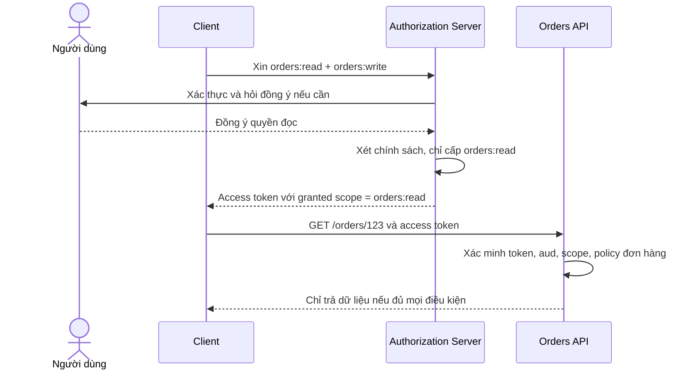
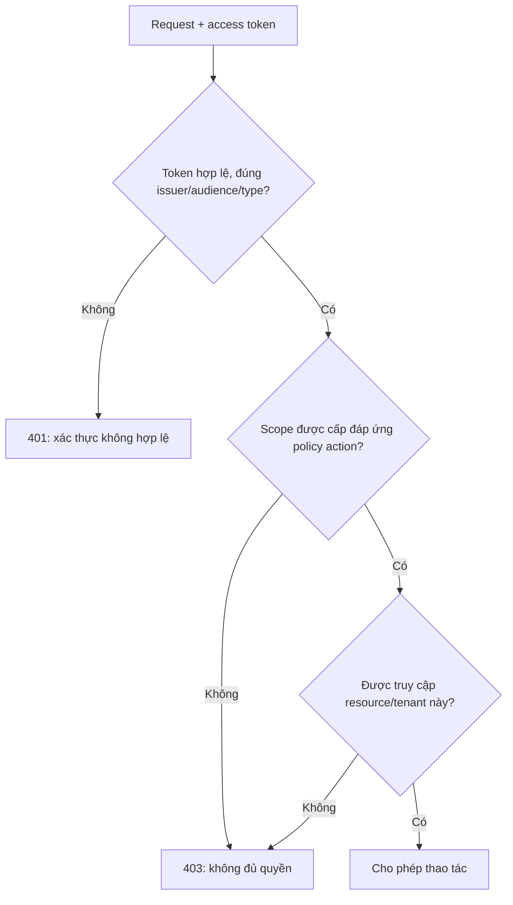

# Scope biểu diễn quyền được cấp

Trong OAuth 2.0, **scope** là cách mô tả **phạm vi quyền truy cập** mà authorization server cấp cho client thông qua một access token. Ví dụ, một token mang scope `orders:read` có thể được dùng để yêu cầu **đọc** tài nguyên đơn hàng trong phạm vi API mà token được cấp. Scope này **không tự động** cho phép sửa đơn hàng, đọc hóa đơn ở API khác hoặc xem đơn hàng thuộc người dùng khác.

Điểm quan trọng nhất của bài: **scope xuất hiện trong access token đáng tin là quyền đã được cấp theo chính sách của authorization server; scope mà client yêu cầu mới chỉ là đề nghị**. Sau khi xác minh token, resource server vẫn phải kiểm tra scope có phù hợp với thao tác, audience có đúng API và policy có cho phép truy cập tài nguyên cụ thể hay không.

Bài nằm trong chương **Scope**, thuộc module **SECURITY_TOKEN_SECURITY_FUNDAMENTALS**: nắm mô hình tin cậy và vòng đời token bảo mật; phân biệt JWT, opaque token, access token và refresh token trong xác thực, phân quyền và OAuth 2.0/OIDC; hiểu cách phát hành, kiểm tra claims, audience, lưu trữ, thu hồi và phòng chống token bị đánh cắp hoặc phát lại. Nội dung tập trung vào ý nghĩa của scope, cách nó được cấp, vận chuyển và thực thi an toàn.

## 1. Mục tiêu học tập

Sau bài này, bạn có thể:

1. Phân biệt **requested scope**, **granted scope** và **required scope** tại API.
2. Giải thích ai có quyền quyết định cấp scope và tại sao client không thể tự nâng quyền bằng cách khai báo scope.
3. Đọc scope từ **access token đã xác minh** hoặc kết quả introspection đáng tin cậy, đồng thời kiểm tra issuer, audience và thời hạn.
4. Hiểu scope hỗ trợ phân quyền nhưng **không thay thế** kiểm tra chủ sở hữu, tenant, vai trò hoặc chính sách nghiệp vụ.
5. Thiết kế scope theo nguyên tắc quyền tối thiểu, rõ hành động và tài nguyên.
6. Áp dụng kiểm tra scope ở Spring Security và bổ sung policy ở tầng service.
7. Viết test ngăn scope escalation, token confusion, truy cập sai audience và BOLA/IDOR.
8. Xử lý thay đổi quyền, làm mới và thu hồi token mà không dựa vào những claims đã lỗi thời.

## 2. Scope nằm ở đâu trong mô hình tin cậy?

Trong hệ thống OAuth 2.0, các vai trò thường gồm:

- **Resource owner**: chủ thể có quyền đối với dữ liệu, thường là người dùng.
- **Client**: ứng dụng muốn gọi API thay mặt người dùng hoặc bằng quyền của chính client.
- **Authorization server (AS)**: nơi xét yêu cầu ủy quyền và phát hành access token.
- **Resource server (RS)**: API bảo vệ dữ liệu, xác minh access token và quyết định có thực thi thao tác không.

Client có thể **xin** một tập scope. AS quyết định có cấp toàn bộ, cấp một phần hoặc từ chối dựa trên client, chủ thể, chính sách, loại grant và các điều kiện liên quan. Khi RS nhận access token, nó kiểm tra scope thực sự **được cấp**, không dựa vào các scope mà client từng xin.



Sơ đồ là một tình huống minh họa, **không phải mọi OAuth flow đều yêu cầu màn hình đồng ý**. Ví dụ Client Credentials có thể cấp scope cho dịch vụ không gắn với người dùng; consent có thể đã được lưu hoặc không áp dụng.

### 2.1. Requested, granted và required scope

| Khái niệm | Ai quy định? | Ví dụ | Ý nghĩa |
| --- | --- | --- | --- |
| **Requested scope** | Client gửi đến AS | `orders:read orders:write` | Client muốn những quyền này |
| **Granted scope** | AS quyết định sau khi xét chính sách | `orders:read` | Phạm vi thực sự được cấp cho access token |
| **Required scope** | API/policy cho từng hành động | `orders:write` đối với cập nhật đơn | Điều kiện phải có để thực hiện action |
| **Effective permission** | RS kết hợp token, policy và ngữ cảnh tài nguyên | Chỉ sửa đơn thuộc tenant phù hợp, còn trạng thái cho phép | Quyền thực tế của yêu cầu cụ thể |

Các tập trên **không nhất thiết bằng nhau**. AS có thể giới hạn quyền thấp hơn yêu cầu; API có thể yêu cầu quyền mà token không có; và kể cả token đủ scope, policy đối tượng vẫn có thể từ chối.

Về mặt khái niệm:

```text
RequestedScopes = những quyền client đề nghị
GrantedScopes   = AS quyết định cấp trong token
RequiredScopes  = policy của action tại Resource Server

Để cho phép:
  token phải hợp lệ và đúng audience/loại token
  AND policy scope của action được đáp ứng bởi GrantedScopes
  AND điều kiện về user/client/resource/tenant/trạng thái là đúng
```

**Không có scope tương ứng không phải một lệnh cho phép ngầm định.** Với endpoint cần quyền, thiếu scope hoặc policy phải dẫn đến từ chối theo nguyên tắc *default deny*.

### 2.2. Scope không đồng nghĩa với đăng nhập

**Authentication** trả lời ai đang đăng nhập hoặc client nào đang xác thực; **authorization** trả lời họ được làm gì. Một access token có `sub=user-42` và `scope=orders:read` không đủ chứng minh user-42 sở hữu đơn hàng đang truy vấn. Tương tự, JWT được ký hợp lệ chỉ cho biết claims đến từ issuer đáng tin và chưa bị sửa, không khẳng định mọi quyền nghiệp vụ vẫn còn hiệu lực.

## 3. Biểu diễn scope trong OAuth 2.0

### 3.1. Scope là chuỗi các scope token

Trong OAuth 2.0, tham số `scope` thường có dạng **danh sách các scope token phân tách bằng dấu cách**:

```text
scope=orders:read orders:write
```

Ví dụ thường dùng:

- `orders:read` — đọc dữ liệu đơn hàng.
- `orders:create` — tạo đơn hàng.
- `orders:cancel` — yêu cầu hủy đơn hàng.
- `reports:export` — xuất báo cáo.

Tên scope ở đây là **quy ước của hệ thống**. OAuth 2.0 không quy định sẵn rằng `orders:write` phải cho phép những HTTP method nào hoặc `admin` có nghĩa gì. Hệ thống cấp phát và resource server cần thống nhất chính xác hợp đồng quyền tương ứng từng scope.

Theo OAuth 2.0, tên scope có phân biệt chữ hoa và chữ thường; **`orders:read` khác `Orders:Read`**. Dấu hai chấm trong ví dụ là cách đặt tên phổ biến, không phải cấu trúc bắt buộc của tiêu chuẩn.

### 3.2. So khớp chính xác, không dùng substring

Đoạn kiểm tra sau **không an toàn**:

```java
// SAI: nếu scope là "orders:read:any", câu lệnh này vẫn trả true.
boolean allowed = scopeString.contains("orders:read");
```

Phải xem scope như **các token riêng biệt** và kiểm tra membership chính xác:

```java
Set<String> granted = Arrays.stream(scopeString.trim().split("\\s+"))
    .filter(s -> !s.isEmpty())
    .collect(Collectors.toSet());

boolean allowed = granted.contains("orders:read");
```

Đây là minh họa xử lý một chuỗi đã được lấy từ **token được xác minh** hoặc introspection tin cậy. Không tự đọc `scope` từ query parameter do người gọi gửi rồi coi đó là quyền. Với API dùng framework, ưu tiên bộ chuyển đổi authority/claim đã được cấu hình và kiểm thử.

Nếu endpoint cần **tất cả** các scope `orders:read` và `reports:export`, chính sách cần AND rõ ràng. Nếu chấp nhận **một trong** các scope, chính sách cần OR rõ ràng. Không suy ra AND/OR từ cách đặt tên hoặc thứ tự scope trong chuỗi.

### 3.3. Thứ tự và biểu diễn không mang quyền ưu tiên

Ví dụ:

```text
orders:read orders:create
orders:create orders:read
```

Hai chuỗi trên có cùng tập scope nếu không có quy tắc profile đặc biệt. **Thứ tự scope không đại diện cho độ ưu tiên** và không được dùng để so khớp mơ hồ kiểu `startsWith`.

Nếu nhà cung cấp dùng claim `scp` dạng mảng (một số hệ sinh thái triển khai như vậy), API phải xử lý theo **hợp đồng của issuer**. Không mặc định mọi access token đều có field `scope` dạng chuỗi và cũng không tự ép một token từ issuer khác về định dạng mình đoán.

## 4. Scope được cấp như thế nào?

### 4.1. Luồng Authorization Code + PKCE

Một ứng dụng có người dùng tương tác thường xin quyền qua Authorization Code + PKCE. Ví dụ yêu cầu ủy quyền đã rút gọn:

```http
GET /authorize?response_type=code&client_id=storefront
    &redirect_uri=https%3A%2F%2Fapp.example.test%2Fcallback
    &scope=orders%3Aread%20orders%3Awrite
    &state=opaque-csrf-state
    &code_challenge=example-s256-challenge
    &code_challenge_method=S256 HTTP/1.1
Host: auth.example.test
```

Các dòng được xuống dòng để dễ đọc; khi gửi thực tế, query string phải là URL hợp lệ, với giá trị `state` và PKCE challenge được sinh ngẫu nhiên đúng quy tắc. Nếu là đăng nhập OIDC, ứng dụng thường đưa thêm `openid` vào yêu cầu và áp dụng các kiểm tra OIDC tương ứng.

Authorization server xét **client có được xin scope đó không**, người dùng hoặc tổ chức có quyền gì, consent khi áp dụng và chính sách tài nguyên. Sau khi client đổi authorization code thành token, token response có thể phản ánh phạm vi **đã cấp**:

```json
{
  "access_token": "ACCESS_TOKEN_MINH_HOA",
  "token_type": "Bearer",
  "expires_in": 900,
  "scope": "orders:read"
}
```

Theo OAuth 2.0, token response phải cung cấp `scope` khi scope được cấp **khác** scope client đã yêu cầu; khi hai bên giống nhau, field này có thể được lược bỏ. Client cần xử lý đúng theo giao thức, không giả định mọi quyền đã xin đều được cấp.

Một nguyên tắc thiết kế: **client không thể cấp quyền cho chính nó**. Client gửi `orders:write` không khiến quyền này xuất hiện hợp lệ trong token nếu AS không phê duyệt.

### 4.2. Client Credentials không nhất thiết có người dùng

Trong OAuth 2.0 Client Credentials, dịch vụ có thể xin access token để gọi API bằng quyền của **client**, không đại diện một người đang đăng nhập:

```text
Client: nightly-report-job
Grant: client_credentials
Requested scope: reports:generate
AS policy: client này chỉ được reports:generate
Granted access token audience: reports-api
```

Resource server không nên giả định mọi token đều có `userId` hoặc chủ sở hữu người dùng. Policy có thể kiểm tra client identity, service role và phạm vi dữ liệu được ủy quyền. Dùng một access token máy để thực hiện hành động “thay mặt người dùng A” cần mô hình delegation rõ ràng; không tự gán quyền của user vào client token.

### 4.3. AS phải kiểm soát giới hạn cấp phát

Ví dụ client được đăng ký với danh sách scope tối đa `orders:read` và `orders:create`. Người dùng chỉ có quyền đọc. Khi client xin `orders:cancel`:

- AS không được cấp scope này chỉ vì client gửi yêu cầu.
- AS có thể từ chối yêu cầu với lỗi phù hợp (chẳng hạn `invalid_scope` theo ngữ cảnh) hoặc cấp một tập hạn chế theo giao thức và chính sách.
- RS chỉ đánh giá **quyền đã cấp và được xác minh**, không nhìn vào requested scope làm căn cứ.

Trong hệ thống nhiều tổ chức, AS có thể phải ràng buộc quyền với tenant, client, audience và phiên đăng nhập. Việc cấp scope chỉ giải quyết **một phần** quyết định; quyền trên bản ghi tại API vẫn phải được xét khi request diễn ra.

## 5. Scope trong JWT và opaque access token

### 5.1. JWT access token

Một access token tự chứa có thể mang claims như sau (**payload minh họa**, không phải token đã được ký):

```json
{
  "iss": "https://auth.example.test",
  "sub": "user-42",
  "aud": "orders-api",
  "client_id": "storefront",
  "iat": 1800000000,
  "exp": 1800000900,
  "jti": "token-example-7",
  "scope": "orders:read orders:create"
}
```

API không được đọc payload Base64URL rồi tin ngay. Với JWT ký số (JWS), resource server cần xác minh **chữ ký** bằng khóa tin cậy, kiểm tra `iss`, `aud`, thời hạn, loại token/profile và những claims bắt buộc. JWT dạng JWS thường **không mã hóa payload**; không đưa mật khẩu, bản băm hoặc bí mật khác vào token.

Sau khi qua lớp xác minh, API có thể so sánh tập scope **được cấp** với điều kiện của endpoint. Tuy nhiên API vẫn phải kiểm tra chính sách theo chủ sở hữu/tenant và trạng thái tài nguyên. Scope được cấp tại thời điểm phát hành là một **thông tin có thể cũ** nếu quyền nghiệp vụ thay đổi sau đó.

### 5.2. Opaque access token và introspection

Opaque token thường là chuỗi không mang nội dung để API có thể tự giải mã. Resource server có thể gọi **OAuth 2.0 Token Introspection** qua kênh tin cậy để kiểm tra hiệu lực và metadata:

```json
{
  "active": true,
  "client_id": "storefront",
  "sub": "user-42",
  "aud": "orders-api",
  "scope": "orders:read",
  "exp": 1800000900
}
```

Đây là phản hồi ví dụ, không phải kết quả một introspection endpoint thực. Resource server phải xác thực với endpoint introspection theo cơ chế triển khai, kiểm tra `active` và các thuộc tính cần thiết; **chỉ tin metadata từ phản hồi đã được xác thực**.

Opaque access token cũng có thể mang scope được cấp. Khác biệt chính nằm ở **cách API nhận và xác minh thông tin**, không nằm ở ý nghĩa cơ bản của scope. Cache introspection phải có TTL phù hợp để hạn chế khoảng trễ khi quyền hoặc trạng thái token bị thu hồi.

### 5.3. Audience và scope trả lời hai câu hỏi khác nhau

| Thuộc tính | Câu hỏi | Ví dụ |
| --- | --- | --- |
| `aud` | **Token dành cho API/bên nhận nào?** | `orders-api` |
| `scope` | **Token có thể đề nghị thực hiện những thao tác nào?** | `orders:read` |
| `sub` / client identity | **Ai hoặc client nào là chủ thể ngữ cảnh?** | `user-42` / `storefront` |
| Policy tài nguyên | **Chủ thể này có quyền trên chính tài nguyên đó không?** | Chỉ đơn của user-42 thuộc tenant A |

Token có `scope=orders:read` nhưng `aud=billing-api` **không thể dùng** để gọi `orders-api`: sai audience. Token đúng audience nhưng thiếu scope cho action cũng bị từ chối. Token đúng cả audience và scope có thể vẫn bị từ chối nếu sai chủ sở hữu.

Trong các hệ thống lớn, có thể dùng **resource indicators** hoặc token exchange theo thiết kế OAuth 2.0 để yêu cầu token cho API phù hợp. Không nên phát hành access token có audience chung cho mọi dịch vụ nếu không có nhu cầu và chính sách bảo vệ tương xứng.

## 6. Scope của OIDC khác scope quyền nghiệp vụ ở API

OpenID Connect (OIDC) xây dựng trên OAuth 2.0 nhằm xác thực người dùng. Một số scope quen thuộc của OIDC:

| Scope | Ý nghĩa theo OIDC | Có tự cấp quyền gọi API nghiệp vụ không? |
| --- | --- | --- |
| `openid` | Yêu cầu luồng OIDC để client nhận thông tin xác thực | **Không** |
| `profile` | Xin quyền truy cập bộ thông tin hồ sơ tiêu chuẩn theo OIDC và ngữ cảnh cấp quyền | **Không** |
| `email` | Xin thông tin email tiêu chuẩn theo OIDC | **Không** |
| `address` | Xin thông tin địa chỉ theo OIDC | **Không** |
| `phone` | Xin thông tin số điện thoại theo OIDC | **Không** |
| `offline_access` | Yêu cầu quyền truy cập offline theo cơ chế/chính sách OIDC, thường liên quan refresh token | **Không** |

Các scope OIDC liên quan yêu cầu xác thực/claims và quyền sử dụng thông tin định danh theo đặc tả; chúng **không đồng nghĩa** với scope `orders:read` hoặc `payments:approve` của API nghiệp vụ. Khi client yêu cầu `openid profile email`, không thể suy ra nó có quyền đọc mọi dữ liệu người dùng của hệ thống.

**ID token** là JWT cung cấp thông tin xác thực cho OIDC client. **Access token** được dùng với resource server theo audience và scope của API. Không đưa ID token vào header `Authorization: Bearer` để gọi API nghiệp vụ chỉ vì ID token có chữ ký hợp lệ và claim `sub`.

**Refresh token** dùng để xin access token mới tại token endpoint. Nó có thể được ràng buộc với tập scope đã được cấp và chính sách AS; client không đưa refresh token cho API nghiệp vụ. Tại lần làm mới, AS có thể tiếp tục giới hạn scope theo phạm vi đã được cấp và chính sách áp dụng. Refresh không mặc nhiên cho phép **mở rộng quyền**.

## 7. Scope là một điều kiện cần, không phải quyết định phân quyền cuối cùng

### 7.1. Ba lớp kiểm tra độc lập

Khi API nhận một request, phân quyền an toàn thường diễn ra qua ba lớp:

1. **Xác minh token:** chữ ký JWT hoặc introspection; issuer, audience, expiry, token type/profile hợp lệ.
2. **Kiểm tra quyền tổng quát:** scope của access token đáp ứng điều kiện của endpoint/action.
3. **Kiểm tra quyền trên tài nguyên cụ thể:** chủ sở hữu, tenant, trạng thái, vai trò và quy tắc nghiệp vụ.



**Scope không chống được BOLA/IDOR** (Broken Object Level Authorization / Insecure Direct Object Reference) nếu API chỉ kiểm tra scope rồi trả tài nguyên bất kỳ theo ID do client đưa vào.

### 7.2. Tình huống đơn hàng thuộc người khác

Token của user A:

```text
sub   = user-A
aud   = orders-api
scope = orders:read
```

Tài nguyên:

```text
order 100: owner=user-A, tenant=tenant-1
order 200: owner=user-B, tenant=tenant-1
order 300: owner=user-A, tenant=tenant-2
```

Giả sử policy chỉ cho phép user đọc đơn của chính mình **trong tenant được phép**:

| Request | Có scope `orders:read`? | Qua policy sở hữu/tenant? | Kết quả |
| --- | --- | --- | --- |
| A đọc đơn 100 thuộc tenant-1 | Có | Có | Cho phép |
| A đọc đơn 200 của B | Có | Không | Từ chối |
| A đọc đơn 300 tại tenant-2 mà A không có quyền | Có | Không | Từ chối |
| A hủy đơn 100, yêu cầu `orders:cancel` | Không | Không cần xét tiếp để cho phép | Từ chối |

Đặc biệt với tenant, **không tin `tenantId` do người dùng tự gửi** trong body hoặc query chỉ vì nó trùng đường dẫn. Phải đối chiếu ngữ cảnh danh tính đã được xác minh với dữ liệu tài nguyên từ nguồn có thẩm quyền.

### 7.3. Scope, role và permission khác nhau

| Khái niệm | Thể hiện | Ví dụ | Nơi thường kiểm tra |
| --- | --- | --- | --- |
| **Scope** | Phạm vi quyền access token được AS cấp | `orders:read` | Resource server theo từng API/action |
| **Role** | Vai trò của chủ thể trong tổ chức/hệ thống | `support-agent`, `finance-approver` | Policy nội bộ/RBAC |
| **Permission** | Quyền cụ thể trên hành động hoặc tài nguyên | Phê duyệt invoice thuộc team X | Policy engine/ABAC/RBAC |
| **Audience** | Nơi token được phép sử dụng | `billing-api` | Lớp xác minh token |

Một role có thể được AS dùng để quyết định **cấp scope nào**, hoặc RS có thể kết hợp role và scope trong policy. Nhưng không nên tạo mối quan hệ một-một mặc định giữa “role=admin” và “scope=*”. Hai hệ thống có thể dùng cùng tên role nhưng ý nghĩa khác nhau.

## 8. Thiết kế scope theo nguyên tắc quyền tối thiểu

### 8.1. Đặt tên theo tài nguyên và hành động

Một cách phổ biến là `resource:action`:

```text
orders:read
orders:create
orders:cancel
payments:read
payments:refund
reports:export
```

Tuy nhiên đây chỉ là **quy ước**. Cần định nghĩa rõ mỗi scope cho phép những endpoint/action nào, áp dụng cho audience nào, những điều kiện nghiệp vụ nào **luôn phải kiểm tra thêm** và ai có quyền xin scope.

Ví dụ bảng hợp đồng scope:

| Scope | Audience | Hành động API | Điều kiện ngoài scope |
| --- | --- | --- | --- |
| `orders:read` | `orders-api` | `GET /orders/{id}` | Đúng owner/tenant; trường trả về theo policy |
| `orders:create` | `orders-api` | `POST /orders` | Tenant còn hoạt động, quota và input hợp lệ |
| `orders:cancel` | `orders-api` | `POST /orders/{id}/cancel` | Quyền đối với đơn, trạng thái cho phép hủy |
| `payments:refund` | `payments-api` | `POST /payments/{id}/refund` | Quyền hoàn tiền, hạn mức, kiểm soát phê duyệt |
| `reports:export` | `reports-api` | `POST /reports/export` | Đúng dữ liệu được phép, giới hạn xuất dữ liệu |

**Tránh scope quá rộng** như `all`, `root`, `admin:*` hoặc `read:everything` nếu chúng có thể được cấp cho client thông thường. Nếu nghiệp vụ bắt buộc có quyền rộng, phải định nghĩa và xét cấp quyền rõ ràng với audit, thời hạn, yếu tố xác thực hoặc phê duyệt bổ sung.

### 8.2. Thiết kế scope theo ranh giới API

Một danh sách dài scope dùng chung giữa mọi resource server làm tăng rủi ro:

- Client mang token của API A tới API B và API B bỏ qua `aud`.
- Scope có tên giống nhau nhưng ý nghĩa khác nhau giữa các dịch vụ.
- Một token bị lộ cho phép truy cập nhiều API hơn mức cần thiết.

Nên ràng buộc access token với **audience hẹp** và scope phù hợp từng API. Bên cạnh đó, tránh nhồi hàng nghìn record ID vào chuỗi scope; quyền theo từng bản ghi thường cần được xử lý bởi policy và dữ liệu nghiệp vụ, không phải các tên scope tự sinh khổng lồ.

### 8.3. Không tin client cung cấp quyền trong token

Thiết kế sai:

```text
Client gửi: desiredScopes = ["orders:read", "payments:refund"]
AS tạo access token với cùng danh sách mà không xét policy
```

Thiết kế đúng:

```text
requested = parseClientScopeRequest()
allowedByClientRegistration = configuredScopesForClient()
allowedBySubjectOrGrant = evaluateSubjectAndGrantPolicy()
allowedByAudience = allowedScopesForTargetResource()

granted = serverDecides(
    requested,
    allowedByClientRegistration,
    allowedBySubjectOrGrant,
    allowedByAudience,
    otherPolicyContext
)

issueAccessToken(granted, trustedIssuer, targetAudience, limitedLifetime)
```

Đoạn trên là **mã giả**; cách xử lý trường hợp yêu cầu scope không được phép phải tuân thủ grant/protocol và chính sách AS. Điều cốt lõi là chỉ AS có thẩm quyền quyết định **granted scope**.

## 9. Thực thi scope ở API Java với Spring Security

### 9.1. Kiểm tra scope tại HTTP layer

Spring Security Resource Server có thể ánh xạ claim `scope` hoặc `scp` từ JWT đã xác minh thành các authority có tiền tố `SCOPE_` theo cấu hình mặc định phù hợp. Ví dụ `orders:read` thường thành authority `SCOPE_orders:read`.

```java
@Configuration
@EnableMethodSecurity
public class SecurityConfig {

    @Bean
    SecurityFilterChain apiSecurity(HttpSecurity http) throws Exception {
        http
            .authorizeHttpRequests(auth -> auth
                .requestMatchers(HttpMethod.GET, "/api/orders/{orderId}")
                    .hasAuthority("SCOPE_orders:read")
                .requestMatchers(HttpMethod.POST, "/api/orders")
                    .hasAuthority("SCOPE_orders:create")
                .requestMatchers(
                    HttpMethod.POST,
                    "/api/orders/{orderId}/cancel"
                ).hasAuthority("SCOPE_orders:cancel")
                .anyRequest().denyAll()
            )
            .oauth2ResourceServer(oauth ->
                oauth.jwt(Customizer.withDefaults())
            );
        return http.build();
    }
}
```

Trong ứng dụng thật cần cấu hình `JwtDecoder` tin cậy để xác minh chữ ký, issuer, audience, thời hạn và access-token profile; ví dụ trên chỉ minh họa **quy tắc kiểm tra scope** ở HTTP layer. Nếu issuer dùng cấu trúc `scp` đặc biệt hoặc các authorities không theo quy ước mặc định, cần cấu hình converter và kiểm thử tường minh.

Chốt `anyRequest().denyAll()` giúp route mới **không tự được mở** khi chưa có rule. Cẩn trọng với các rule bao quát như `anyRequest().authenticated()`: chỉ đăng nhập là chưa đủ xác định quyền với mọi hành động nghiệp vụ.

### 9.2. Kiểm tra quyền sở hữu tại tầng service

Giả sử đã áp dụng rule `SCOPE_orders:read` ở HTTP layer, ta vẫn cần kiểm tra chủ sở hữu đơn hàng:

```java
@RestController
@RequestMapping("/api/orders")
class OrderController {
    private final OrderService orderService;

    OrderController(OrderService orderService) {
        this.orderService = orderService;
    }

    @GetMapping("/{orderId}")
    @PreAuthorize("@orderPolicy.canRead(authentication, #orderId)")
    OrderDto get(@PathVariable Long orderId) {
        return orderService.getOrder(orderId);
    }
}
```

Ví dụ policy:

```java
@Component("orderPolicy")
class OrderPolicy {
    private final OrderRepository orders;

    OrderPolicy(OrderRepository orders) {
        this.orders = orders;
    }

    public boolean canRead(Authentication auth, Long orderId) {
        if (!(auth instanceof JwtAuthenticationToken jwtAuth)
                || !auth.isAuthenticated()
                || orderId == null) {
            return false;
        }

        boolean hasScope = auth.getAuthorities().stream()
            .anyMatch(a -> "SCOPE_orders:read".equals(a.getAuthority()));
        if (!hasScope) {
            return false;
        }

        Jwt jwt = jwtAuth.getToken(); // Đã qua JwtDecoder tin cậy.
        String ownerId = jwt.getSubject();
        String tenantId = jwt.getClaimAsString("tenant_id");
        if (ownerId == null || tenantId == null) {
            return false;
        }

        return orders.existsByIdAndOwnerIdAndTenantId(
            orderId, ownerId, tenantId
        );
    }
}
```

Các class/bean/repository trong ví dụ phải được định nghĩa theo dự án. Đây là **minh họa vị trí áp dụng policy**, không phải mã có thể chạy độc lập. Nếu ứng dụng cũng hỗ trợ opaque token, policy nên dựa trên abstraction danh tính đã được xác thực và thuộc tính chuẩn hóa tương ứng thay vì gắn cứng với `JwtAuthenticationToken`.

Với thao tác ghi nhạy cảm, có thể cần kiểm tra điều kiện trong cùng transaction hoặc cập nhật cơ sở dữ liệu có điều kiện để tránh trạng thái/thông tin quyền thay đổi giữa bước **kiểm tra** và bước **thực hiện**.

### 9.3. Đừng tạo scope từ header do client tự khai

Ví dụ không an toàn:

```java
// SAI: X-Scope là header mà client có thể tùy ý điền.
String scope = request.getHeader("X-Scope");
if (scope.contains("orders:read")) {
    return orderRepository.findAll();
}
```

Thay vào đó, lấy các authority được framework xây dựng **sau khi JWT/introspection đã được xác minh**, rồi xét quyền tài nguyên và kết quả trả về. Tên scope của một token chưa tin cậy không thể tự biến thành quyền.

## 10. Phân biệt lỗi xác thực, thiếu scope và thiếu quyền trên tài nguyên

Các tình huống có thể dẫn đến mã HTTP khác nhau:

| Tình huống | Phản hồi thường phù hợp | Ý nghĩa |
| --- | --- | --- |
| Không có access token ở endpoint bắt buộc xác thực | `401 Unauthorized` | Thiếu thông tin xác thực |
| Token sai chữ ký, hết hạn, sai issuer/audience | `401 Unauthorized` | Token không hợp lệ |
| Token hợp lệ nhưng thiếu scope của action | `403 Forbidden` | Không đủ phạm vi quyền |
| Token đủ scope nhưng tài nguyên thuộc người khác | `403 Forbidden` hoặc `404` để tránh lộ sự tồn tại | Policy dữ liệu từ chối |
| Hệ thống policy không thể đánh giá do lỗi | Chặn thao tác; có thể trả `503` tùy hợp đồng API | Không được fail open |

Theo cách xử lý Bearer token của OAuth 2.0, khi thiếu quyền có thể trả:

```http
HTTP/1.1 403 Forbidden
WWW-Authenticate: Bearer error="insufficient_scope", scope="orders:cancel"
```

Header trên là ví dụ hợp lệ về cách gợi ý scope cần thiết; server nên giới hạn thông tin tiết lộ theo rủi ro và không trả chi tiết policy nhạy cảm. Với token không hợp lệ, thông báo `invalid_token` thường đi kèm phản hồi 401. **Trả 403 không tự bảo vệ tài nguyên** nếu trước đó ứng dụng đã thực hiện side effect hoặc trả dữ liệu.

Một lỗi khác là coi “scope không có trong JWT” mặc định tương đương “toàn quyền”. Với endpoint bắt buộc quyền, thiếu scope phải bị từ chối hoặc được diễn giải đúng theo token profile đã xác định, **không suy diễn thêm quyền**.

## 11. Scope thay đổi trong vòng đời token

### 11.1. Scope trong access token đã phát hành

Giả sử AS cấp access token lúc 09:00:

```text
aud   = payments-api
scope = payments:refund
exp   = 09:15
```

Lúc 09:05, quản trị viên thu hồi quyền hoàn tiền của nhân viên. Nếu `payments-api` chỉ kiểm tra chữ ký JWT, `exp` và scope, token cũ vẫn có thể được chấp nhận cho đến khi hết hạn. **Scope đã được cấp là thông tin tại thời điểm phát hành; nó không tự cập nhật khi quyền trong database đổi.**

Các biện pháp lựa chọn tùy yêu cầu:

- **TTL ngắn** cho access token để hạn chế khoảng thời gian quyền cũ còn tồn tại.
- **Tra cứu policy/quyền hiện tại** ở API cho thao tác có rủi ro cao.
- **Denylist theo `jti`**, session version hoặc cơ chế vô hiệu hóa trạng thái token.
- **Introspection** hoặc nguồn quyết định có kiểm soát để kiểm tra token/phiên theo ngữ cảnh.
- **Sender-constrained token** như mTLS/DPoP khi cần giảm nguy cơ người khác phát lại bearer token bị đánh cắp.

Khi dùng cache kết quả quyền hoặc introspection, phải xác định TTL, cách invalidation và **độ trễ thu hồi tối đa chấp nhận được**. Không được trả Permit khi dịch vụ bắt buộc để xác minh quyền đang lỗi mà không có căn cứ tin cậy.

### 11.2. Refresh token không cho phép tự mở rộng scope

Refresh token được AS phát hành theo chính sách, có thể gắn với tập phạm vi ban đầu. Khi xin access token mới, client không thể tự thêm `payments:refund` nếu quyền đó chưa được cấp. Theo OAuth 2.0, scope của yêu cầu refresh (nếu được gửi) **không được bao gồm scope chưa được cấp ban đầu**; AS vẫn phải thực thi chính sách.

Refresh token rotation có thể giảm nguy cơ refresh token bị sử dụng lặp lại sau đánh cắp, nhưng **không tự thu hồi JWT access token cũ**. Cần tách riêng chính sách refresh, access token và session.

### 11.3. Đăng xuất, đổi vai trò và thu hồi

Ba hành động sau có hiệu lực khác nhau:

1. **Logout**: kết thúc phiên tại client/AS theo thiết kế.
2. **Thu hồi refresh token**: chặn client lấy thêm access token bằng refresh token đó.
3. **Vô hiệu hóa access token hiện có**: cần cơ chế riêng nếu muốn chặn sớm trước `exp`.

Đặc biệt với quyền quản trị hoặc hành động tài chính, không nên chỉ trông chờ scope được phát hành từ nhiều phút trước. Kiểm tra quyền hiện tại có thể bắt buộc ngay tại thao tác.

## 12. Scope và token bị đánh cắp hoặc phát lại

Scope giúp **giới hạn hậu quả** nếu access token bị lộ: token chỉ nên có đủ scope cho công việc hiện tại, đúng audience và thời hạn ngắn. Tuy nhiên, với bearer access token, người nắm giữ token có thể thử dùng token trong phạm vi còn hiệu lực, dù không phải người dùng ban đầu.

| Rủi ro | Giới hạn bằng scope | Biện pháp cần thêm |
| --- | --- | --- |
| Token chỉ cần đọc nhưng được cấp quyền sửa | Cấp `orders:read` thay vì `orders:write` | Policy cấp quyền tối thiểu, audit |
| Token dành một API bị gửi sang API khác | Không giải quyết nếu API bỏ qua `aud` | Kiểm tra audience nghiêm ngặt |
| Token đọc đơn bị dùng để xem đơn của người khác | Scope `orders:read` là chưa đủ | Kiểm tra owner/tenant tại RS |
| Token bị copy và replay | Giới hạn hành động kẻ tấn công làm được | TLS, bảo vệ lưu trữ, TTL, revocation, DPoP/mTLS khi phù hợp |
| Scope bị rút trong khi JWT còn hạn | Scope trong JWT có thể cũ | Kiểm tra quyền động/denylist/introspection |
| Refresh token bị lộ | Scope có thể giới hạn token mới do AS cấp | Rotation, reuse detection, thu hồi refresh token |

Giảm nguy cơ lộ bằng cách không gửi token trong URL, không log nguyên token, bảo vệ kho lưu token ở client/backend, dùng HTTPS/TLS và xử lý XSS/CSRF đúng theo kiến trúc. JWT ký số không mã hóa claims; token có thể bị đọc payload nếu người khác lấy được chuỗi.

## 13. Lỗi thiết kế scope thường gặp

| Sai lầm | Vì sao nguy hiểm | Sửa như thế nào |
| --- | --- | --- |
| Xem requested scope là granted scope | Client tự nâng quyền bằng tham số gửi đi | Chỉ tin AS và access token đã xác minh |
| Dùng `contains("read")` để kiểm tra scope | Khớp nhầm scope khác | Parse thành các token riêng và so khớp chính xác |
| Không kiểm tra `aud` | Token API khác bị dùng nhầm | Ràng buộc audience với RS |
| Xem `openid` là quyền API | Nhầm xác thực OIDC với ủy quyền nghiệp vụ | Access token riêng với scope của API |
| Dùng ID token gọi resource server | Token confusion; sai người nhận | API chỉ chấp nhận đúng access token profile |
| Scope `admin`/`*` được cấp rộng rãi | Tăng thiệt hại khi token bị lộ | Quyền tối thiểu, cấp hẹp theo action/AS policy |
| Coi scope đủ để bỏ qua owner/tenant | BOLA/IDOR | Kiểm tra policy trên tài nguyên |
| Tự động cho phép nếu thiếu claim scope | Mở quyền khi cấu hình sai | Default deny cho endpoint yêu cầu quyền |
| Dùng role nội bộ thay scope mà không có hợp đồng | Các bên hiểu khác tên quyền | Định nghĩa mapping role → scope → permission |
| Không kiểm soát TTL/thu hồi | Quyền cũ tiếp tục tồn tại | Thiết kế revocation và kiểm tra quyền hiện tại |
| Log nguyên JWT hoặc refresh token | Token bị đánh cắp và replay | Redaction, audit bằng metadata tối thiểu |
| Ghép scope của nhiều API vào một token | Token bị lộ có vùng ảnh hưởng rộng | Audience hẹp, token riêng theo tài nguyên |

### 13.1. “Cấp càng nhiều scope cho tiện” gây gì?

Một client đọc đơn hàng để hiển thị giao diện chỉ cần `orders:read`. Nếu AS cấp thêm `orders:cancel` và `payments:refund` vì “sau này có thể dùng”, một token bị lộ tại trang danh sách đơn có thể dẫn đến thao tác nguy hiểm hơn nhiều. Quyền nên được cấp **đúng thời điểm, đúng audience, đúng nhu cầu**; với chức năng nhạy cảm có thể cần luồng xin quyền bổ sung và tái xác thực theo chính sách.

### 13.2. “Có quyền trong scope” chưa chắc có quyền ngoài đời thực

Một nhân viên có token `reports:export` nhưng vừa bị chuyển khỏi phòng tài chính. Nếu policy không tra quyền hiện tại và chỉ tin claim cũ, họ vẫn có thể xuất báo cáo trong khi token còn hạn. Scope phản ánh **ủy quyền tại thời điểm cấp**, còn policy vận hành có thể yêu cầu những điều kiện phải đúng **ngay lúc thực hiện**.

## 14. Kiểm thử scope và kiểm soát truy cập

### 14.1. Ma trận kiểm thử tối thiểu

| Case | Token / policy | Kết quả mong đợi |
| --- | --- | --- |
| Đọc đơn hợp lệ | Đúng issuer/audience, `orders:read`, đúng owner/tenant | Cho phép |
| Thiếu token | Endpoint cần access token | 401 |
| JWT sai chữ ký | `scope` đúng nhưng chữ ký sai | 401, không tin claims |
| Sai audience | Token `aud=billing-api` gọi `orders-api` | 401 hoặc từ chối xác thực phù hợp |
| Sai token type | ID token gửi vào API | Từ chối |
| Token hết hạn | `exp` quá hạn | 401 |
| Scope thiếu | Có `orders:create`, gọi GET cần `orders:read` | 403 |
| Scope gần giống | Có `orders:read:any` nhưng yêu cầu `orders:read` | 403 |
| Scope sai chữ hoa/thường | Có `Orders:Read` | 403 |
| Scope khác thứ tự | `orders:create orders:read` | Không bị từ chối chỉ do thứ tự nếu đúng tập quyền |
| Scope đủ nhưng sai owner | User A truy vấn đơn user B | 403/404, không trả dữ liệu |
| Scope đủ nhưng sai tenant | Token tenant A truy vấn tenant B | Từ chối |
| Requested nhưng không granted | Client xin `orders:cancel`, AS chỉ cấp `orders:read` | API không cho cancel |
| Opaque không active | Introspection `active: false` | 401/từ chối |
| AS/PDP lỗi | Không thể xác minh quyền bắt buộc | Fail closed |
| Scope đã bị rút | Token JWT còn hạn nhưng quyền hiện tại bị thu hồi | Theo chính sách chặn sớm đã chọn |

### 14.2. Kiểm thử Spring MockMvc (minh họa)

Ví dụ nếu ứng dụng dùng Spring Security Test:

```java
@Test
void readRequiresExactScope() throws Exception {
    mockMvc.perform(get("/api/orders/100")
            .with(jwt().authorities(
                new SimpleGrantedAuthority("SCOPE_orders:create"))))
        .andExpect(status().isForbidden());
}

@Test
void similarScopeMustNotMatch() throws Exception {
    mockMvc.perform(get("/api/orders/100")
            .with(jwt().authorities(
                new SimpleGrantedAuthority("SCOPE_orders:read:any"))))
        .andExpect(status().isForbidden());
}
```

Các test trên chỉ kiểm tra **lớp authorization** khi đưa authentication đã được mô phỏng vào Spring Security; helper `jwt()` của test **không chứng minh** chữ ký JWT production đã được kiểm chứng. Cần thêm test tích hợp với JWT có chữ ký thử nghiệm/opaque introspection và `JwtDecoder` thật để kiểm tra issuer, audience, thời gian, profile và mapping scope.

Ngoài kết quả HTTP, cần xác nhận **service/repository không chạy thao tác bị cấm**. Một controller có thể trả 403 nhưng đã gọi service tạo side effect trước đó; đây vẫn là lỗi phân quyền.

### 14.3. Kiểm thử cấp phát ở Authorization Server

Kiểm thử cả phía AS, không chỉ API:

1. Client chỉ được đăng ký scope đọc nhưng xin scope hoàn tiền → không cấp quyền hoàn tiền.
2. Người dùng không có quyền cấp một scope → AS từ chối hoặc thu hẹp theo hợp đồng.
3. Token response phản ánh granted scope theo quy tắc OAuth.
4. Refresh request xin scope ngoài tập đã cấp → không được mở rộng quyền.
5. Client Credentials không có user → token và policy không giả định quyền người dùng.
6. Một token dành cho audience A → API B từ chối.
7. Khi quyền bị thu hồi → token mới không mang scope cũ; access token còn hạn được xử lý theo chính sách đã công bố.

## 15. Bài thực hành tổng hợp

### Bài A — Phân biệt quyền xin và quyền được cấp

Client xin:

```text
orders:read orders:create orders:cancel
```

AS chỉ cấp:

```text
orders:read orders:create
```

Hãy xác định kết quả khi client gọi `GET /orders/100`, `POST /orders` và `POST /orders/100/cancel`; nêu thêm điều kiện chủ sở hữu/tenant của từng thao tác.

**Định hướng:** GET và POST chỉ có khả năng qua bước scope tương ứng; vẫn phải kiểm tra policy. Hủy đơn không được phép vì thiếu `orders:cancel` dù client đã từng xin nó.

### Bài B — JWT đúng chữ ký nhưng sai audience

Token có:

```json
{
  "iss": "https://auth.example.test",
  "sub": "user-42",
  "aud": "orders-api",
  "scope": "orders:read",
  "exp": 1800000900
}
```

Client gửi token đến `billing-api`. Vì sao `billing-api` phải từ chối dù cùng issuer và token có scope hợp lệ? Hãy chỉ ra token nào cần được cấp nếu muốn đọc hóa đơn và thông tin nào trong token không nên dùng thay audience.

**Định hướng:** audience là điều kiện độc lập với scope. Cần access token cho billing với quyền billing phù hợp, không chuyển token dành cho orders sang API khác.

### Bài C — Scope và BOLA

Người dùng A có `orders:read`. Họ thay `/orders/100` thành `/orders/200` để truy cập đơn của B. Hãy thiết kế policy và truy vấn dữ liệu sao cho API không trả đơn của B. Mô phỏng thêm một request đổi tenant ID trong query và giải thích vì sao không tin tham số đó.

**Định hướng:** xác minh subject/tenant từ ngữ cảnh tin cậy, kiểm tra owner/tenant từ kho dữ liệu; scope chỉ là điều kiện cần. Không dựa vào ID do client gửi làm quyết định cho phép.

### Bài D — Quyền bị thu hồi khi token vẫn còn hạn

Quản trị viên xóa quyền `payments:refund` của nhân viên lúc 10:00, nhưng access token của người đó còn hạn tới 10:20. Yêu cầu nghiệp vụ: không được hoàn tiền sau thời điểm bị thu hồi.

Hãy chọn denylist, kiểm tra policy động, introspection hoặc phiên bản quyền; xác định độ trễ cache tối đa và viết test cho **ngay trước thu hồi**, **ngay sau thu hồi**, **khi dịch vụ quyền lỗi**.

**Định hướng:** chỉ kiểm tra `exp` và scope trong JWT là chưa đáp ứng yêu cầu chặn ngay. Lựa chọn phải ngăn tác vụ khi không thể xác minh điều kiện bắt buộc.

## 16. Checklist thiết kế scope cho sản phẩm

- [ ] Danh sách scope có **tên và ngữ nghĩa rõ ràng**; xác định API/audience và action tương ứng.
- [ ] Chỉ AS có quyền xét và phát hành granted scope; client không tự nâng quyền từ requested scope.
- [ ] Quyền được cấp tuân thủ đăng ký client, grant, user/client policy và audience.
- [ ] Resource server chỉ đọc scope từ JWT **đã xác minh** hoặc introspection đáng tin cậy.
- [ ] Kiểm tra issuer, audience, thời hạn, loại token và những claims/profile bắt buộc **trước khi** cho phép dựa trên scope.
- [ ] So khớp scope **chính xác, phân biệt chữ hoa/thường**; không dùng substring hoặc dựa vào thứ tự.
- [ ] Endpoint mặc định từ chối khi không có policy/scope cần thiết; endpoint công khai được khai báo chủ động.
- [ ] Có kiểm tra chủ sở hữu, tenant, trạng thái và quy tắc nghiệp vụ ngay cả khi scope đủ.
- [ ] Phân biệt OAuth API scope với OIDC `openid`/`profile`/`email` và ID token.
- [ ] Mỗi access token được ràng buộc audience phù hợp; scope được cấp theo nguyên tắc **least privilege**.
- [ ] Có chính sách TTL, refresh, thu hồi, kiểm tra quyền hiện tại và độ trễ cache cho thao tác nhạy cảm.
- [ ] Token, đặc biệt bearer token, được bảo vệ khi truyền/lưu; không xuất hiện nguyên dạng trong URL/log.
- [ ] Đã có test sai chữ ký/audience/token type, thiếu scope, scope gần giống, BOLA/tenant và quyền bị thu hồi.
- [ ] Logs/audit ghi reason code, route/action, policy version và metadata phù hợp mà không lộ token/credential.

## 17. Câu hỏi tự kiểm tra

**1. Client yêu cầu `payments:refund` thì scope đó đã được cấp chưa?** Chưa. AS phải xét chính sách và quyết định có cấp hay không. Requested scope không phải granted scope.

**2. Scope `orders:read` có bảo đảm được đọc mọi đơn hàng không?** Không. API vẫn phải kiểm tra quyền trên đơn cụ thể và ranh giới tenant.

**3. JWT có chữ ký đúng và scope đúng nhưng `aud` sai có được nhận không?** Không. Token phải dành cho resource server đang xử lý.

**4. `openid profile` có phải quyền gọi `orders-api` không?** Không. Đây là các scope OIDC phục vụ xác thực/claims, không tự cấp quyền nghiệp vụ đơn hàng.

**5. Access token và refresh token dùng scope giống nhau theo cách nào?** Access token biểu diễn quyền gọi API đã cấp; refresh token được dùng tại token endpoint để xin token mới trong giới hạn đã cho phép. Không dùng refresh token trực tiếp ở API nghiệp vụ.

**6. Vì sao không nên dùng `scopeString.contains("orders:read")`?** Vì có thể khớp nhầm `orders:read:any` hoặc một scope khác. Phải tách thành scope tokens rồi so khớp chính xác.

**7. Nếu không có field `scope` trên token, API có được mặc định cho phép không?** Không. Với endpoint yêu cầu scope, thiếu quyền đã xác minh phải bị từ chối, trừ khi một profile được định nghĩa rõ có cơ chế quyền khác tương đương.

**8. Role và scope có phải một không?** Không. Role là vai trò của chủ thể, scope là phạm vi quyền của token do AS cấp. Chúng có thể liên quan qua policy nhưng không tự đồng nhất.

**9. Đổi role người dùng có tự sửa scope của JWT đã cấp không?** Không. JWT đã cấp chứa claims tại thời điểm phát hành; cần chiến lược TTL, tra quyền động hoặc thu hồi sớm để áp dụng thay đổi.

**10. Scope có chặn được bearer token bị đánh cắp không?** Scope giới hạn hành động mà token bị lộ có thể thực hiện, nhưng không chứng minh người đang giữ token là client ban đầu. Cần bảo vệ token, giới hạn lifetime và cân nhắc cơ chế sender-constrained khi phù hợp.

## 18. Tài liệu chuẩn để tìm hiểu sâu

- **RFC 6749 — The OAuth 2.0 Authorization Framework:** khái niệm scope, quyền được yêu cầu và được cấp, cách mô tả scope trong yêu cầu/token response.
- **RFC 6750 — OAuth 2.0 Bearer Token Usage:** cách gửi bearer access token và phản hồi `insufficient_scope`.
- **RFC 7662 — OAuth 2.0 Token Introspection:** phản hồi trạng thái/metadata, gồm scope cho opaque token khi áp dụng.
- **RFC 8707 — Resource Indicators for OAuth 2.0:** cơ chế chỉ định resource server và hỗ trợ giới hạn phạm vi token.
- **RFC 9068 — JWT Profile for OAuth 2.0 Access Tokens:** profile access token JWT và các claims phù hợp.
- **RFC 9700 — Best Current Practice for OAuth 2.0 Security:** các khuyến nghị bảo mật OAuth hiện đại liên quan quyền, token và grant.
- **OpenID Connect Core 1.0:** các scope tiêu chuẩn của OIDC và vai trò của ID token.

**Điều cần nhớ:** scope là **phạm vi quyền được authorization server cấp cho một access token**, không phải lời khẳng định tự tạo của client, cũng không phải giấy phép truy cập vô hạn. Một API chỉ nên cho phép khi **token hợp lệ, đúng audience, đúng loại, đủ scope và đáp ứng policy trên chính tài nguyên cần thao tác**.
