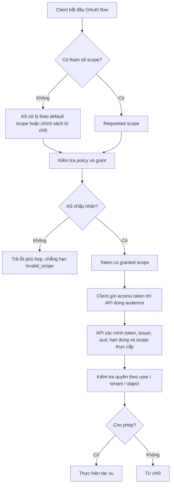
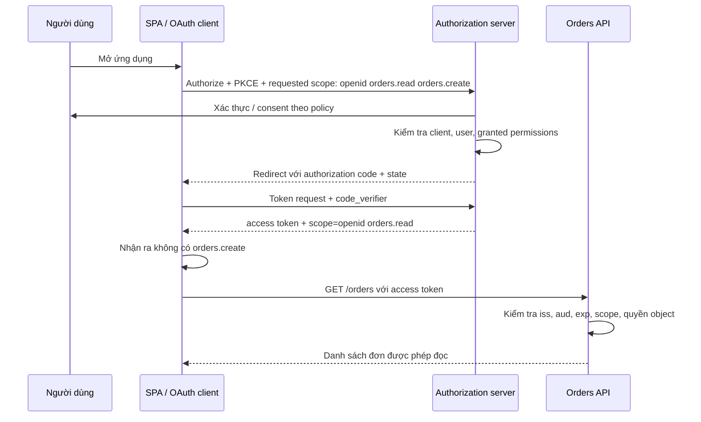
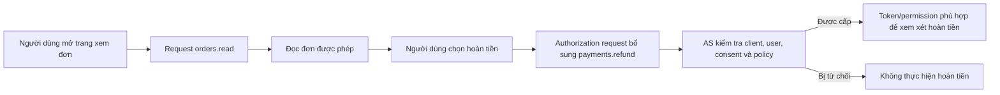
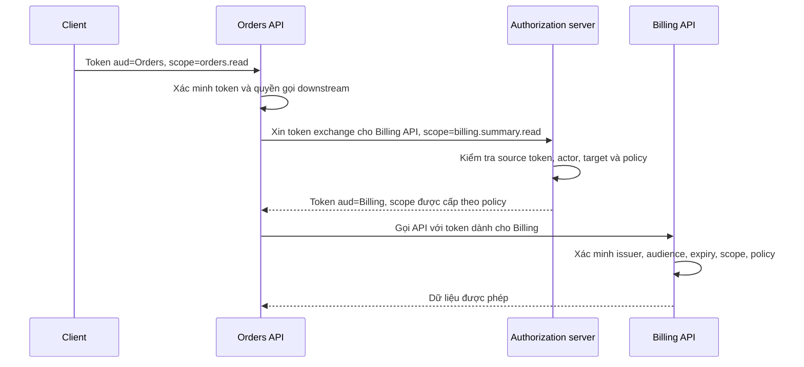

# Scope mặc định và scope yêu cầu

Một ứng dụng quản lý đơn hàng gọi authorization server để xin access token. Khi gửi yêu cầu, ứng dụng muốn có `orders.read` và `orders.write`, nhưng token nhận về chỉ được cấp `orders.read`. Ở một luồng khác, ứng dụng không gửi tham số `scope` mà vẫn được cấp quyền đọc theo cấu hình mặc định. Nếu client mặc định rằng mọi quyền đã xin đều được cấp, hoặc API mặc định rằng token luôn có quyền đọc/ghi, hệ thống có thể phân quyền sai.

Bài học này thuộc chương **Scope** của module **SECURITY_TOKEN_SECURITY_FUNDAMENTALS**. Trọng tâm là phân biệt **scope mặc định (default scope)**, **scope yêu cầu (requested scope)** và **scope thực sự được cấp (granted scope)** trong OAuth 2.0/OpenID Connect (OIDC), cũng như các ranh giới tin cậy khi phát hành, kiểm tra và sử dụng access token. Đây là một phần của vòng đời token bảo mật bên cạnh định dạng JWT/opaque, access/refresh token, claims, audience, lưu trữ, thu hồi và phòng chống token bị đánh cắp hoặc phát lại.

Sau bài này, bạn có thể:

- Giải thích ý nghĩa và nguồn cấu hình của default scope, requested scope và granted scope.
- Xác định chính xác hành vi khi client **không gửi** `scope`, gửi scope hợp lệ, scope không được phép hoặc yêu cầu nhiều quyền hơn được cấp.
- Phân biệt scope với **audience/resource**, role, quyền trên đối tượng và yêu cầu xác thực người dùng.
- Đọc và kiểm tra trường `scope` trong phản hồi token, JWT access token hoặc phản hồi introspection của opaque token.
- Thiết kế scope tối thiểu cho web, mobile, service-to-service và các tác vụ cần cấp quyền tăng dần.
- Kiểm thử trường hợp token thiếu scope, scope bị giảm, scope bị thu hồi hoặc client sử dụng nhầm scope đã yêu cầu thay vì scope đã được cấp.

## 1. Scope là gì và tại sao cần tách các trạng thái?

Trong OAuth 2.0, **scope** là một cơ chế để giới hạn phạm vi quyền truy cập mà client xin và được cấp. Một chuỗi scope có thể mô tả khả năng nghiệp vụ như `orders.read`, `orders.create`, `payments.refund` hoặc tên chuẩn/nhà cung cấp khác. **Ý nghĩa của từng giá trị scope do authorization server và resource server thống nhất qua hợp đồng**; OAuth không quy định một bộ scope nghiệp vụ dùng chung cho mọi ứng dụng.

Ba khái niệm chính:

| Khái niệm | Câu hỏi trả lời | Nguồn hình thành |
| --- | --- | --- |
| **Default scope** | Nếu yêu cầu không chỉ rõ `scope`, hệ thống có bộ quyền mặc định nào để xử lý không? | Cấu hình và chính sách của authorization server (AS), có thể theo client, grant, resource, user |
| **Requested scope** | Client đang **xin** những quyền nào? | Tham số `scope` của yêu cầu ủy quyền hoặc token, theo grant |
| **Granted scope** | AS thực sự **cấp** những quyền nào cho token/grant? | Quyết định của AS sau kiểm tra client, chủ thể, consent, policy, resource và ngữ cảnh |

Không được đồng nhất ba giá trị này:

> **Yêu cầu cấp quyền chỉ là một đề nghị; quyền được sử dụng phải dựa trên kết quả đã cấp và kiểm tra cuối cùng tại API.**

Ví dụ, `seller-web` xin hai scopes `orders.read orders.refund`. Chính sách chỉ cho `seller-web` scope `orders.read`. AS có thể cấp scope ít hơn theo profile/chính sách hoặc từ chối yêu cầu. Trong mọi trường hợp, client không được “tự xem” `orders.refund` là đã có chỉ vì nó xuất hiện trong request.

Scope **không thay thế** quá trình đăng nhập. Authentication trả lời ai đã xác thực; OAuth authorization xác định client được truy cập tài nguyên nào với quyền nào. Một người dùng đã hoàn thành MFA vẫn có thể không được phép cấp `payments.refund`.

## 2. Vòng đời scope từ yêu cầu đến API



Các thành phần có trách nhiệm riêng:

1. **Client** chọn phạm vi cần cho tính năng, gửi yêu cầu và kiểm tra kết quả cấp quyền.
2. **Authorization server** xác thực client theo loại client/grant, kiểm tra chính sách, lấy consent khi cần và quyết định cấp hoặc từ chối scopes.
3. **Resource server** kiểm tra access token được phát hành cho **chính API đó** và yêu cầu có scope phù hợp; tiếp tục kiểm tra quyền nghiệp vụ trên tài nguyên.
4. **Người dùng/resource owner** có thể đồng ý cấp một số quyền khi chính sách yêu cầu, nhưng sự đồng ý không tự làm người dùng có thêm quyền mà họ vốn không sở hữu.

**Default**, **requested** và **granted** là các giai đoạn khác nhau của quyết định ủy quyền, không phải ba loại token.

## 3. Cú pháp và cách gửi requested scope

Mục 3.3 của RFC 6749 quy định tham số `scope` của OAuth là **danh sách các giá trị scope phân tách bằng dấu cách**. Giá trị scope **phân biệt chữ hoa/chữ thường** và ngữ nghĩa cụ thể phụ thuộc authorization server.

Ví dụ logic:

```text
scope = "orders.read orders.create"
```

Trong URL, dấu cách cần được mã hóa, thường thành `%20` (hoặc cách mã hóa form phù hợp). Một authorization request rút gọn:

```http
GET /authorize?response_type=code
    &client_id=orders-web
    &redirect_uri=https%3A%2F%2Fapp.example.com%2Fcallback
    &scope=orders.read%20orders.create
    &state=random-unpredictable-state
    &code_challenge=derived-challenge
    &code_challenge_method=S256 HTTP/1.1
Host: auth.example.com
```

Đoạn HTTP được xuống dòng để dễ đọc, không phải request-line có thể dán chạy nguyên dạng. Trong triển khai thật, client cần dùng thư viện OAuth phù hợp, URL-encode đúng, quản lý `state`, `redirect_uri` và PKCE. **PKCE không phải một scope**: nó bảo vệ quá trình đổi authorization code và không làm token được cấp nhiều quyền hơn.

Một token request cho service-to-service có thể dùng `scope` trong body:

```http
POST /oauth2/token HTTP/1.1
Host: auth.example.com
Content-Type: application/x-www-form-urlencoded

grant_type=client_credentials&scope=prices.read
```

Ví dụ lược bỏ cơ chế **xác thực client**: authorization server vẫn phải xác thực workload/client theo chính sách như mTLS, private-key JWT, workload identity hoặc credential thích hợp trước khi cấp token. Chỉ gửi `grant_type` và `scope` không đủ.

### 3.1. Mỗi tên scope là một giá trị trọn vẹn

Nếu API định nghĩa `orders.read`, việc yêu cầu `orders` không tự tạo quyền `orders.read`. Hai giá trị `orders.read` và `orders.read.all` cũng không có quan hệ phân cấp mặc định. **Không được cấp quyền bằng so khớp tiền tố** như `scope.startsWith("orders")`, `scope.includes("read")` hoặc dùng từ khóa wildcard khi hệ thống chưa định nghĩa chính thức.

Ví dụ parse chuỗi scope:

```text
grantedScopes = parseSpaceDelimitedScopes("orders.read orders.update")

require(grantedScopes.contains("orders.read"))  // Kiểm tra khớp giá trị đầy đủ
// Không dùng "orders.read" in rawString bằng kiểm tra substring mơ hồ
```

Scope `Orders.Read` **khác** `orders.read` khi tên scope được quy định phân biệt hoa/thường. Khi xử lý chuỗi, hệ thống nên dùng parser theo hợp đồng và giới hạn độ dài/số scope để tránh đầu vào bất thường.

## 4. Scope mặc định là gì?

**Default scope** là bộ scopes mà authorization server có thể áp dụng khi request **bỏ qua tham số `scope`**. Theo mục 3.3 của RFC 6749, nếu client bỏ qua tham số này, AS **phải** xử lý bằng một giá trị mặc định được xác định trước **hoặc** từ chối request nếu không có default phù hợp.

Điểm quan trọng: **OAuth 2.0 không định nghĩa một bộ default scopes cố định cho mọi sản phẩm.** Giá trị mặc định do AS triển khai và cấu hình, có thể khác theo client, resource, loại grant, người dùng, tenant hoặc chính sách tổ chức.

Giả sử AS có cấu hình minh họa:

| Client | Resource | Default scope nếu bỏ qua `scope` | Scope tối đa client có thể xin |
| --- | --- | --- | --- |
| `seller-web` | Orders API | `orders.read` | `orders.read`, `orders.create` |
| `reporting-service` | Reporting API | `reports.read` | `reports.read` |
| `payment-admin` | Billing API | Không thiết lập | `payments.read`, `payments.refund` theo policy bổ sung |

Khi `seller-web` không gửi `scope`, AS có thể dùng `orders.read`. Nếu `payment-admin` bỏ qua `scope` mà không có default, AS có thể từ chối và yêu cầu client nêu quyền cụ thể. Đây là **giả định cấu hình của ví dụ**, không phải mặc định của mọi nhà cung cấp OAuth.

### 4.1. Mặc định ở đâu? Phải xem chính sách AS

Một AS có thể xác định default theo nhiều lớp:

- **Client-level default**: mỗi client được cấu hình scope mặc định khác nhau.
- **Grant-level default**: luồng có user hoặc `client_credentials` có chính sách cấp quyền khác nhau.
- **Resource-level default**: token cho Orders API khác token cho Billing API.
- **User/tenant policy**: cùng client nhưng quyền được phép còn tùy vai trò và tenant của chủ thể.
- **Policy tổ chức**: một số scope nhạy cảm không được cấp nếu không có yêu cầu rõ ràng, consent hoặc phê duyệt.

Client **không nên suy ra default** bằng cách thử gọi API hoặc tin rằng nó luôn là tập quyền rộng nhất. Nếu nhà cung cấp có default khác nhau theo phiên bản hoặc tenant, tích hợp cần ghi nhận hợp đồng và kiểm tra **granted scope thực tế**.

### 4.2. Mặc định không phải quyền tối thiểu một cách tự động

Default scope **cũng có thể bị cấu hình quá rộng**. Ví dụ một ứng dụng báo cáo chỉ cần `orders.read` nhưng default lại bao gồm `orders.write payments.refund`. Nếu client quên tham số `scope`, access token có thể nhận quyền quá mức.

Nguyên tắc an toàn là **default phù hợp nhu cầu phổ biến, không nhạy cảm hoặc từ chối khi không có scope rõ ràng**, tùy kiến trúc. Với tác vụ có quyền cao, yêu cầu scope cụ thể và kiểm tra chính sách riêng thường dễ audit hơn.

## 5. Requested scope: client muốn gì, AS có thể quyết định gì?

Requested scope là các giá trị client **đề nghị** tại authorization endpoint hoặc token endpoint theo loại grant. AS phải quyết định request hợp lệ theo:

1. Client được đăng ký và đủ điều kiện xin scope đó không?
2. Grant type và resource đích có hỗ trợ scope đó không?
3. Người dùng/chủ thể có quyền cấp hoặc sử dụng quyền đó không?
4. Có cần consent, mức xác thực hoặc điều kiện rủi ro bổ sung không?
5. Scope đó có phù hợp audience/resource đã yêu cầu không?
6. Chính sách hiện tại có cho phép cấp toàn bộ, một phần, hoặc yêu cầu từ chối không?

Ví dụ `seller-web` gửi:

```text
requested_scope = {"orders.read", "orders.create", "orders.refund"}
allowed_for_client = {"orders.read", "orders.create"}
allowed_for_user = {"orders.read"}
allowed_for_resource = {"orders.read", "orders.create", "orders.cancel"}

potential_grant = requested_scope
                  INTERSECT allowed_for_client
                  INTERSECT allowed_for_user
                  INTERSECT allowed_for_resource
# => {"orders.read"}
```

Đây chỉ là **mô hình minh họa** cho giao quyền tối thiểu, **không phải thuật toán bắt buộc của OAuth**. AS có thể cấp subset được cho phép hoặc từ chối hoàn toàn theo chính sách/đặc tả triển khai. Một số AS trả lỗi `invalid_scope` khi scope không hợp lệ, không được phép hoặc nằm ngoài policy. Client phải xử lý cả trường hợp bị từ chối lẫn trường hợp chỉ được cấp một phần.

### 5.1. Unknown, invalid và unauthorized scope

| Request | Tình huống | Kết quả cần chuẩn bị |
| --- | --- | --- |
| `orders.read` | Scope tồn tại và client có quyền xin | Có thể được cấp nếu policy đáp ứng |
| `orders.read orders.write` | Client chỉ có quyền đọc | Có thể bị từ chối hoặc chỉ được cấp `orders.read` theo policy |
| `orders.fly` | Scope không được AS định nghĩa | Từ chối, thường là lỗi scope không hợp lệ |
| `payments.refund` | Scope nhạy cảm, client chưa được đăng ký | Từ chối theo chính sách, không cấp chỉ vì client xin |
| Không có `scope` | AS có default phù hợp | Có thể cấp default |
| Không có `scope` | AS không có default phù hợp | Từ chối |

**Không được tự ý thêm scope ngoài requested/default và chính sách** chỉ để làm client hoạt động. Nếu client thiếu quyền cần thiết, nó phải yêu cầu lại qua luồng hợp lệ hoặc điều chỉnh chức năng/UX; resource server không nên bỏ qua scope.

## 6. Granted scope: nguồn sự thật để xác định quyền đã cấp

**Granted scope** là tập scopes AS quyết định cấp cho token/grant. Nó có thể bằng requested scope, ít hơn requested scope hoặc tương ứng default khi client không yêu cầu cụ thể. Một AS có thể còn giới hạn bởi audience, thời hạn, client, user, tenant và loại token.

Trong OAuth 2.0 token response, trường `scope` có quy tắc quan trọng theo mục 5.1 của RFC 6749:

> Trường `scope` trong token response là **tùy chọn nếu giống phạm vi client đã yêu cầu**; **bắt buộc nếu phạm vi được cấp khác phạm vi đã yêu cầu**.

Ví dụ AS cấp ít quyền hơn:

```json
{
  "access_token": "<opaque-or-jwt-access-token>",
  "token_type": "Bearer",
  "expires_in": 900,
  "scope": "orders.read"
}
```

Client ban đầu xin `orders.read orders.create` nhưng nhận `scope=orders.read`. Client phải coi thao tác tạo đơn là **chưa được ủy quyền** và không nên cố tình sử dụng quyền ghi bằng access token đó.

Nếu client xin `orders.read` và AS cấp đúng `orders.read`, AS có thể bỏ `scope` trong response nếu tuân thủ RFC 6749. Client nên theo dõi request ban đầu và hợp đồng nhà cung cấp để hiểu trường hợp này, nhưng **không được suy ra “toàn quyền” hoặc “scope mặc định rộng nhất” chỉ vì response không có trường `scope`**.

Khi request ban đầu **không gửi `scope`**, một AS dùng default phải có cách phản ánh phạm vi thực cấp theo quy tắc response/profile. Client không được giả định default bằng những quyền đoán từ cấu hình cũ.

### 6.1. Vì sao token response và payload token có thể khác?

Không phải mọi access token đều là JWT; token opaque có thể là chuỗi bất kỳ, nên client **không đọc được claims** từ chuỗi. Khi dùng JWT access token, cấu trúc `scope` và các claims do profile/hợp đồng token quy định, ví dụ RFC 9068. Resource server phải kiểm tra token và scope theo profile đáng tin.

Client có thể dựa vào **token response** để biết tính năng nào được phép yêu cầu; **resource server** mới là bên thực thi quyền dựa vào access token hợp lệ (hoặc introspection) và policy dữ liệu. Client ẩn nút `Create Order` để cải thiện UX **không phải là biện pháp bảo mật API**.

### 6.2. Nguyên tắc hạn chế: granted scope không phải quyền tối đa của user

Người quản lý có quyền tạo và hủy đơn nhưng access token dành cho chức năng báo cáo chỉ có `orders.read`. API phải từ chối yêu cầu xóa đơn bằng token đó, kể cả khi người dùng có role `manager`. Ngược lại, token có `orders.read` không tự cho người dùng đọc đơn thuộc tenant khác. Quyền thực tế là kết quả từ **token scope + quyền chủ thể + quyền object/tenant + policy ngữ cảnh**.

## 7. Ví dụ end-to-end: từ hai scope xin đến một scope được cấp

Giả sử một SPA quản lý đơn hàng đăng nhập người dùng qua Authorization Code + PKCE. Client gửi `scope=openid orders.read orders.create`, nhưng AS chỉ cho người dùng quyền đọc.



Trong ví dụ có `openid` để dùng OIDC, `orders.read` là quyền API, và `orders.create` đã được xin nhưng **không được cấp**. Nếu client gửi `POST /orders`, API phải từ chối vì token thiếu scope ghi. Không nên viết code cho rằng màn hình đăng nhập thành công đồng nghĩa tất cả scopes đều được cấp.

**Lưu ý về tương thích AS:** khả năng cấp một phần scopes trong tình huống có cả OIDC và API phụ thuộc vào provider và hợp đồng. Một nhà cung cấp cũng có thể từ chối hoàn toàn authorization request nếu scope nhạy cảm không được phép.

## 8. Scope và audience là hai giới hạn độc lập

Scope trả lời **được làm gì**; audience/resource trả lời **được trình token ở đâu**.

| Token | Audience | Scope | Hành vi hợp lệ |
| --- | --- | --- | --- |
| A | Orders API | `orders.read` | Chỉ yêu cầu đọc tại Orders API, theo policy |
| B | Orders API | `orders.create` | Chỉ yêu cầu tạo tại Orders API, theo policy |
| C | Pricing API | `prices.read` | Chỉ yêu cầu đọc giá tại Pricing API |
| D | Billing API | `payments.refund` | Chỉ Billing API, theo điều kiện hoàn tiền |

Không được chấp nhận token D ở Orders API dù nó có scope nhạy cảm hoặc chữ ký hợp lệ. API phải xác minh `iss`, `aud`, `exp`, `nbf` và profile token ngoài việc kiểm tra scope.

Trong OAuth 2.0, **Resource Indicators** (RFC 8707) cho phép client chỉ định tài nguyên đích bằng tham số `resource` nếu AS hỗ trợ. Ví dụ:

```http
GET /authorize?response_type=code
    &client_id=orders-web
    &scope=orders.read
    &resource=https%3A%2F%2Fapi.example.com%2Forders
    &state=random-state
    &code_challenge=derived-challenge
    &code_challenge_method=S256 HTTP/1.1
Host: auth.example.com
```

AS quyết định cách ánh xạ tài nguyên yêu cầu thành `aud`, không bắt buộc sao chép nguyên URL. Không nên dùng scope như `orders.read` thay kiểm tra `aud` hoặc dựa vào `aud` mà bỏ qua scope.

## 9. Default/requested scopes trong OIDC có khác OAuth không?

OIDC là lớp xác thực danh tính xây trên OAuth 2.0. Trong OIDC, **scope `openid` có ý nghĩa đặc biệt**: client dùng giá trị này trong authorization request để yêu cầu xử lý theo OIDC. Các scope chuẩn như `profile`, `email`, `address` và `phone` mô tả yêu cầu một nhóm thông tin người dùng theo OIDC; chúng **không tự biến thành quyền đọc/ghi dữ liệu nghiệp vụ của API**.

Ví dụ:

```text
scope = "openid profile email orders.read"
```

| Scope | Ý nghĩa thường gặp | Không được giả định |
| --- | --- | --- |
| `openid` | Kích hoạt yêu cầu xác thực OIDC, nhận danh tính theo luồng phù hợp | Cấp quyền gọi mọi API |
| `profile` | Yêu cầu các claims hồ sơ chuẩn theo OIDC và policy | Đọc tất cả dữ liệu khách hàng nghiệp vụ |
| `email` | Yêu cầu claims liên quan email theo OIDC | Email luôn được xác minh hoặc đủ làm khóa phân quyền |
| `offline_access` | Yêu cầu khả năng truy cập khi người dùng không hiện diện, theo chính sách OIDC/AS | Chắc chắn được refresh token |
| `orders.read` | Scope nghiệp vụ do Orders API định nghĩa | Đọc được mọi đơn của mọi tenant |

**`openid` không được coi là default OAuth phổ quát**. Nếu AS tự thêm `openid` do cấu hình riêng, đó là hợp đồng sản phẩm cụ thể. Client muốn sử dụng OIDC đúng chuẩn cần gửi request theo quy tắc OIDC, không phụ thuộc vào suy đoán default scopes.

### 9.1. `offline_access` và refresh token

OIDC định nghĩa `offline_access` để yêu cầu khả năng nhận refresh token cho truy cập ngoại tuyến theo policy. Tuy nhiên việc xin `offline_access` **không bảo đảm** AS sẽ cấp refresh token: còn phụ thuộc consent, loại client, grant, cấu hình và bảo vệ refresh token. Một số nhà cung cấp có cách cấp refresh token riêng.

**Refresh token không phải access token**, không gửi tới resource server và không dùng để chứng minh đã đăng nhập lại bằng MFA. Khi client gia hạn access token, quyền mới vẫn phải nằm trong giới hạn grant/chính sách được cấp.

## 10. Default/requested scopes cho các loại client

### 10.1. Web có backend hoặc BFF

Backend-for-frontend (BFF) có thể lưu OAuth access/refresh token ở phía server, browser dùng session cookie `Secure`, `HttpOnly` và `SameSite` phù hợp. BFF nên yêu cầu scopes theo tính năng: báo cáo cần `orders.read`, thao tác tạo cần `orders.create` theo chính sách. **Đừng xin tập quyền rộng chỉ để dự phòng** cho các trang có thể không được dùng.

Nếu BFF phụ thuộc vào default scope không được ghi rõ, một thay đổi cấu hình AS có thể vô tình mở rộng quyền. Hợp đồng và kiểm tra token response giúp phát hiện thay đổi.

### 10.2. Single-page application (SPA)

SPA là **public client**, không thể giấu client secret an toàn trong JavaScript. Nó nên dùng Authorization Code + PKCE, yêu cầu scope tối thiểu cho đúng API. Access token trong browser có nguy cơ bị XSS đọc/lạm dụng; giữ token trong memory hoặc dùng BFF khi phù hợp và hạn chế scope/TTL để giảm hậu quả.

Nếu AS trả scope bị giảm, SPA điều chỉnh UI để không mời người dùng thực hiện thao tác thiếu quyền, **đồng thời API vẫn phải kiểm tra thật**.

### 10.3. Mobile

Ứng dụng Android/iOS cũng là public client, thường dùng Authorization Code + PKCE với trình duyệt hệ thống. Refresh token nếu được cấp cần lưu bằng Keychain/Keystore và chính sách phù hợp. Client phải theo dõi granted scopes, không dùng scopes trong request ban đầu để suy ra quyền còn hiệu lực sau khi refresh hoặc thay đổi policy.

### 10.4. Service-to-service

Trong `client_credentials`, service là chủ thể kỹ thuật được AS xác thực theo cơ chế thích hợp. Default scopes có thể khác mỗi service và resource. Ví dụ `inventory-service` chỉ cần `prices.read`, không nên được cấp mặc định `prices.write` hoặc `users.admin`.

```text
client_id = inventory-service
requested_scope = "prices.read"
resource = pricing-api
granted_scope = "prices.read"  # nếu policy cho phép
```

Với Client Credentials, thường không cần refresh token: service xác thực để xin access token mới. Cache token theo **client, audience, scope và expiry**, tránh dùng access token của API A cho API B.

## 11. Incremental authorization: chỉ xin thêm quyền khi cần

Một ứng dụng ban đầu chỉ hiển thị đơn hàng, sau đó mới bật chức năng hoàn tiền. Thay vì xin `orders.read payments.refund` ngay khi người dùng đăng nhập, client có thể **xin thêm scope** khi người dùng thật sự bắt đầu chức năng hoàn tiền, nếu AS hỗ trợ mô hình này.



**Xin thêm scope không đồng nghĩa được cấp thêm quyền.** Có thể cần consent, xác thực lại, MFA hoặc phê duyệt. Sau khi nhận token mới, API vẫn kiểm tra scope và quyền trên giao dịch: người dùng có được hoàn đơn hàng đó không, số tiền có đúng giới hạn không, trạng thái đơn có cho phép không.

Khi đổi quyền nâng cao, tránh gộp tất cả thành một token có audience quá rộng. Có thể dùng access token riêng cho API nhạy cảm, scope riêng theo hành động, thời hạn ngắn và cơ chế token exchange/delegation thích hợp.

## 12. Scope khi refresh token và token exchange

### 12.1. Gia hạn bằng refresh token

Theo mục 6 của RFC 6749 về OAuth 2.0, khi dùng refresh token, client **có thể** gửi tham số `scope` để yêu cầu phạm vi nhỏ hơn. Scope được yêu cầu không được bao gồm quyền ngoài những gì resource owner đã cấp ban đầu; nếu client không chỉ định `scope`, phạm vi được xem là phạm vi đã được cấp ban đầu theo quy tắc chuẩn, còn AS vẫn phải tuân thủ chính sách hiện hành.

Ví dụ minh họa:

```http
POST /oauth2/token HTTP/1.1
Host: auth.example.com
Content-Type: application/x-www-form-urlencoded

grant_type=refresh_token&refresh_token=<refresh-token>&scope=orders.read
```

Trong triển khai thật, refresh token phải được bảo vệ và **client phải được xác thực khi policy yêu cầu**; ví dụ đã lược bỏ chi tiết này. AS có thể cấp access token phạm vi hẹp hơn theo cơ chế được hỗ trợ, không thể dùng refresh token để âm thầm xin `payments.refund` nếu scope đó chưa được cấp qua luồng hợp lệ. Việc hỗ trợ downscoping và hành vi lỗi còn phụ thuộc provider; client phải kiểm tra kết quả.

Nếu user bị gỡ role, refresh token vẫn còn trong thiết bị **không có nghĩa** AS nên cấp lại quyền cũ. Policy hiện hành, thu hồi grant và giới hạn phiên cần được áp dụng khi phát hành.

### 12.2. Token exchange giữa các dịch vụ

Khi service A nhận token dành cho A rồi cần gọi service B, A không nên chuyển nguyên token sai audience cho B. OAuth 2.0 Token Exchange (RFC 8693) có thể được dùng khi AS hỗ trợ để xin token mới với target audience/resource và scope phù hợp, theo cơ chế delegation hoặc impersonation được quản lý.



Token exchange **không tự bảo đảm** token đầu ra luôn bị giảm quyền. AS phải xác minh request và policy chặt chẽ. Đặc biệt, service có token kỹ thuật nhiều quyền vẫn phải kiểm tra quyền người dùng gốc và đối tượng dữ liệu để tránh **confused deputy**.

## 13. Scope trong JWT access token và opaque token

### 13.1. JWT access token

Nếu AS dùng JWT access token theo profile phù hợp, payload có thể như sau:

```json
{
  "iss": "https://auth.example.com",
  "sub": "user-42",
  "aud": "https://api.example.com/orders",
  "client_id": "orders-web",
  "scope": "orders.read",
  "iat": 1795000000,
  "nbf": 1795000000,
  "exp": 1795000900
}
```

Đây là ví dụ **payload đã giải mã**, không phải token có thể tin khi chưa xác minh mật mã. Resource server phải kiểm tra chữ ký bằng khóa của issuer đáng tin, thuật toán cho phép, `iss`, `aud`, `exp`, `nbf` và loại token/profile, rồi mới sử dụng `scope` theo hợp đồng.

JWT ký thường có payload Base64URL **đọc được**, không được mã hóa bảo mật. Tránh đưa secrets, PII không cần thiết hay quyền quá rộng vào token; hạn chế TTL và bảo vệ token khi truyền/lưu trữ.

### 13.2. Opaque access token

Opaque token không để client hoặc API đọc claims trực tiếp từ chuỗi. API có thể dùng endpoint **token introspection** của AS (RFC 7662) hoặc cơ chế tra cứu đáng tin để xác định trạng thái, scope, client, audience và thời hạn.

Ví dụ phản hồi introspection minh họa:

```json
{
  "active": true,
  "scope": "orders.read",
  "client_id": "orders-web",
  "sub": "user-42",
  "aud": "https://api.example.com/orders",
  "exp": 1795000900
}
```

API phải kiểm tra `active`, audience, scope và các điều kiện policy, đồng thời bảo vệ kênh introspection. Cache kết quả có thể tăng tốc nhưng tạo khoảng trễ khi thu hồi hoặc thay đổi quyền. **Không tự suy ra default scope chỉ vì opaque token có trạng thái active.**

### 13.3. Scope là điều kiện cần, không phải toàn bộ phân quyền

Ví dụ token có `scope=orders.read` nhưng người dùng xin `GET /orders/9001` thuộc tenant khác. API phải từ chối vì token không cho phép bỏ qua quyền theo owner/tenant. Nếu API nhận `scope=orders.create` nhưng trạng thái tài khoản đã khóa, AS/resource server cần áp dụng chính sách trạng thái phù hợp.

## 14. Triển khai kiểm tra scope ở resource server

Một API nên thực hiện **deny by default**: chỉ cho phép khi credential hợp lệ, đúng audience và có đủ quyền cho thao tác cụ thể.

Pseudocode cho đọc đơn:

```text
token = readBearerToken(request.headers.Authorization)

claims = verifyAccessToken(
    token,
    trustedIssuer = "https://auth.example.com",
    expectedAudience = "https://api.example.com/orders",
    allowedAlgorithms = ["RS256"],
    trustedJwks = configuredIssuerJwks
)
if claims is invalid:
    return 401 Unauthorized

grantedScopes = parseSpaceDelimitedScopes(claims.scope)
if "orders.read" not in grantedScopes:
    return 403 Forbidden

order = loadOrder(request.orderId)
if order is missing:
    return 404 Not Found

if !policy.canReadOrder(claims.sub, order.tenantId, order):
    return 403 Forbidden  # hoặc 404 để tránh lộ sự tồn tại

return 200 OK with allowedFields(order)
```

Đây là mã giả; hệ thống thực tế cần dùng thư viện xác minh access token, parser scope, chính sách owner/tenant và kiểm tra token type đúng theo nhà cung cấp. **Không đọc claims từ một JWT chưa xác minh rồi quyết định quyền**, cũng không tự động chấp nhận ID token OIDC thay access token.

### 14.1. Phân biệt 401 và 403

- **401 Unauthorized** thường dùng khi thiếu token, token không hợp lệ, hết hạn, sai audience hoặc không thể xác thực credential.
- **403 Forbidden** thường dùng khi đã xác thực nhưng không đủ scope/quyền nghiệp vụ. Với Bearer Token theo RFC 6750, API có thể dùng `WWW-Authenticate` và lỗi `insufficient_scope` theo giao thức.
- **404 Not Found** có thể dùng theo policy để tránh tiết lộ sự tồn tại của đối tượng mà user không được xem.

Ví dụ phản hồi cho access token thiếu scope:

```http
HTTP/1.1 403 Forbidden
WWW-Authenticate: Bearer error="insufficient_scope", scope="orders.create"
```

Đây là ví dụ về báo lỗi theo OAuth Bearer; việc tiết lộ chính xác scope cần thiết trong phản hồi phải phù hợp chính sách bảo mật và tài liệu API.

## 15. Sai lầm phổ biến với default và requested scopes

| Sai lầm | Hậu quả | Cách thiết kế đúng |
| --- | --- | --- |
| Bỏ qua `scope` vì nghĩ AS không cấp quyền nếu thiếu | AS có thể cấp default rộng ngoài mong muốn | Chủ động yêu cầu phạm vi tối thiểu và biết chính sách default |
| Nghĩ requested scopes luôn được granted | Client thực hiện tính năng thiếu quyền, có thể xử lý lỗi sai | Kiểm tra token response và quyền được cấp thực tế |
| Nghĩ trường `scope` vắng trong token response là toàn quyền | Nâng quyền do diễn giải sai | Áp dụng quy tắc RFC/profile, lưu requested scope, không suy ra quyền |
| So khớp scope bằng chuỗi con/prefix | `orders.read.all` bị hiểu nhầm thành `orders.read` | Parse tập scope và so sánh giá trị đầy đủ, phân biệt hoa/thường |
| Gộp mọi resource vào một default token | Token dùng được ở nhiều API không cần thiết | Giới hạn audience và scope theo từng API |
| Dùng ID token để gọi API | Sai mục đích và audience | Chỉ resource server chấp nhận access token đúng profile |
| Role `admin` bỏ qua kiểm tra scope | Token bị mở rộng vượt grant đã cấp | Kiểm tra đồng thời scope, user role và quyền trên đối tượng |
| Có scope đọc nên xem được mọi dữ liệu | BOLA/IDOR, rò dữ liệu tenant khác | Kiểm tra owner, tenant và dữ liệu hiện hành |
| Refresh token luôn đổi thành token quyền cao hơn | Leo thang quyền qua token renewal | Giới hạn grant và AS policy; chỉ nâng quyền qua luồng hợp lệ |
| Logout hoặc đổi role làm mọi JWT hết hiệu lực ngay | Token cũ vẫn có thể dùng đến `exp` | TTL phù hợp, cơ chế thu hồi/policy check |

## 16. Case study: scope mặc định làm lộ quyền ngoài ý muốn

Giả sử AS cấu hình default cho `sales-dashboard` là:

```text
default = {"orders.read", "customers.read", "orders.cancel"}
```

Dashboard chỉ cần xem thống kê đơn hàng, nhưng client lại bỏ hẳn tham số `scope`. AS dùng default; access token được cấp cả quyền hủy đơn. Nếu token bị XSS lấy, kẻ tấn công có thêm khả năng gọi endpoint hủy (dù API vẫn cần kiểm tra quyền người dùng trên từng đơn).

**Cách cải thiện:** đặt default tối thiểu hoặc yêu cầu client khai báo scope khi tác vụ có rủi ro; dashboard gửi `scope=orders.read` và chỉ sử dụng token dành cho Orders API. API vẫn kiểm tra `aud`, `scope` và owner/tenant. Điều này không triệt tiêu XSS, nhưng **giảm hậu quả của token bị đánh cắp**.

### Thử năm biến thể

| Biến thể request | Kết quả giả định của AS | Client/API cần làm |
| --- | --- | --- |
| Không gửi `scope` | Default `orders.read` | Xác nhận grant thực tế; chỉ đọc nếu policy cho phép |
| Xin `orders.read` | Cấp đúng `orders.read` | Client có thể hiển thị chức năng xem; API kiểm tra |
| Xin `orders.read orders.cancel` | Chỉ cấp `orders.read` | Client không coi `orders.cancel` là đã được cấp |
| Xin `orders.cancel` khi không được phép | Từ chối bằng lỗi scope/policy | Xử lý thất bại, không tự bỏ qua permission |
| Xin `orders.read` cho Billing API | AS từ chối hoặc policy riêng | Không dùng scope của Orders API cho Billing API |

Đây là **giả định mô phỏng** một AS; thực tế còn phụ thuộc grant, resource, policy và cách nhà cung cấp báo lỗi. Những tình huống này phải được kiểm thử trên tích hợp cụ thể.

## 17. Kế hoạch kiểm thử và giám sát

Để tránh hồi quy khi thay đổi chính sách scope, nên kiểm thử:

1. **Không gửi `scope`** khi AS có default và khi không có default; xác nhận cả nội dung token response và quyền thực cấp.
2. **Scope hợp lệ/hợp đồng**: client xin một quyền và được cấp đúng quyền đó; API cho phép thao tác phù hợp.
3. **Scope vượt policy**: thử yêu cầu quyền ngoài danh sách client/user được phép; AS phải từ chối hoặc cấp subset theo hợp đồng.
4. **Scope lạ/sai hoa–thường**: không được hiểu nhầm thành tên hợp lệ.
5. **Granted ít hơn requested**: client không thực hiện chức năng bị từ chối; API cũng chặn request thiếu scope.
6. **Token response thiếu `scope`** khi quyền đúng bằng request: client hiểu đúng quy tắc chuẩn và hợp đồng provider.
7. **Sai audience**: token có scope đúng nhưng dành cho API khác vẫn phải bị từ chối.
8. **Đúng scope, sai owner/tenant**: API phải từ chối, kể cả truy vấn danh sách, export hoặc thao tác hàng loạt.
9. **Refresh với scope hẹp hơn**: chỉ thành công nếu AS hỗ trợ theo quy tắc; không được nâng quyền ngoài grant.
10. **Thay đổi role/khóa tài khoản/thu hồi grant**: hành vi của access token và refresh token theo TTL/revocation đã thiết kế.
11. **Token bị sao chép/phát lại**: giới hạn rủi ro bằng HTTPS, lưu trữ an toàn, TTL, phát hiện bất thường hoặc sender-constrained token.

Nên theo dõi audit có kiểm soát về **client ID, resource/audience, requested scope, granted scope, issuer, kết quả cấp quyền hoặc từ chối, endpoint và lý do chính sách**. Không ghi access token/refresh token nguyên dạng hoặc các dữ liệu cá nhân không cần thiết. Các sai khác liên tục giữa requested và granted có thể là dấu hiệu cấu hình sai hoặc policy thay đổi.

## 18. Checklist cho người thiết kế OAuth/OIDC

Trước khi đưa vào production, hãy trả lời:

1. **Default scope là gì và nằm ở đâu?** Có phụ thuộc client, grant, resource, user/tenant không? Ai chịu trách nhiệm thay đổi?
2. **Không gửi `scope` thì sao?** AS cấp default hay từ chối? Có tài liệu và test cụ thể không?
3. **Requested scopes có tối thiểu không?** Client chỉ xin quyền cho tính năng đang dùng hay xin mọi quyền để dự phòng?
4. **Granted scopes được xác định thế nào?** Client xử lý trường `scope` trong token response và phản hồi cấp một phần đúng chưa?
5. **Có tách scope với audience không?** API chỉ nhận token dành cho mình và đúng quyền thao tác chưa?
6. **Tên scope có hợp đồng rõ chưa?** Các tên có phân biệt hoa/thường, được parse theo danh sách, không so khớp tiền tố không?
7. **Có kiểm tra quyền trên object không?** Scope đọc không bỏ qua owner, tenant, field-level hoặc trạng thái nghiệp vụ.
8. **OIDC dùng đúng mục đích không?** `openid`, `profile`, `email` khác quyền API; `offline_access` không bảo đảm refresh token.
9. **Refresh và delegated access bị giới hạn ra sao?** AS không cho phép tăng scope ngoài grant/policy và token downstream có audience phù hợp?
10. **Chính sách thay đổi khi token còn hạn thế nào?** TTL, introspection, revoke, refresh rotation và xử lý JWT tự chứa có phù hợp?
11. **Lộ token thì sao?** Scope và audience đủ hẹp, có biện pháp chống token theft/replay và khả năng phát hiện/thu hồi không?

**Điều cần ghi nhớ:** `scope` mà client **yêu cầu** chưa phải scope được **cấp**; scope **mặc định** chỉ tồn tại theo cấu hình của authorization server và không có một bộ giá trị OAuth phổ quát. API chỉ nên dựa trên access token được xác minh đúng issuer, audience, thời hạn và scope thực cấp, rồi tiếp tục kiểm tra quyền của chủ thể đối với tài nguyên cụ thể. Thiết kế này duy trì nguyên tắc **least privilege** suốt vòng đời token.

## Tài liệu tham khảo

- [RFC 6749 — The OAuth 2.0 Authorization Framework](https://www.rfc-editor.org/rfc/rfc6749): mục 3.3 về scope, mục 5.1 về token response, mục 6 về refresh token.
- [RFC 6750 — OAuth 2.0 Bearer Token Usage](https://www.rfc-editor.org/rfc/rfc6750): `insufficient_scope` và xử lý yêu cầu API.
- [RFC 8707 — Resource Indicators for OAuth 2.0](https://www.rfc-editor.org/rfc/rfc8707): yêu cầu resource/audience.
- [RFC 8693 — OAuth 2.0 Token Exchange](https://www.rfc-editor.org/rfc/rfc8693): trao đổi và delegation token.
- [RFC 9068 — JWT Profile for OAuth 2.0 Access Tokens](https://www.rfc-editor.org/rfc/rfc9068): các claims của JWT access token.
- [RFC 7662 — OAuth 2.0 Token Introspection](https://www.rfc-editor.org/rfc/rfc7662): metadata và scope của opaque token.
- [RFC 7009 — OAuth 2.0 Token Revocation](https://www.rfc-editor.org/rfc/rfc7009): thu hồi token/grant.
- [RFC 7636 — Proof Key for Code Exchange (PKCE)](https://www.rfc-editor.org/rfc/rfc7636): bảo vệ authorization code.
- [RFC 9700 — Best Current Practice for OAuth 2.0 Security](https://www.rfc-editor.org/rfc/rfc9700): thực hành bảo mật hiện đại cho OAuth.
- [OpenID Connect Core 1.0](https://openid.net/specs/openid-connect-core-1_0.html): `openid`, các scope yêu cầu claims và `offline_access`.
