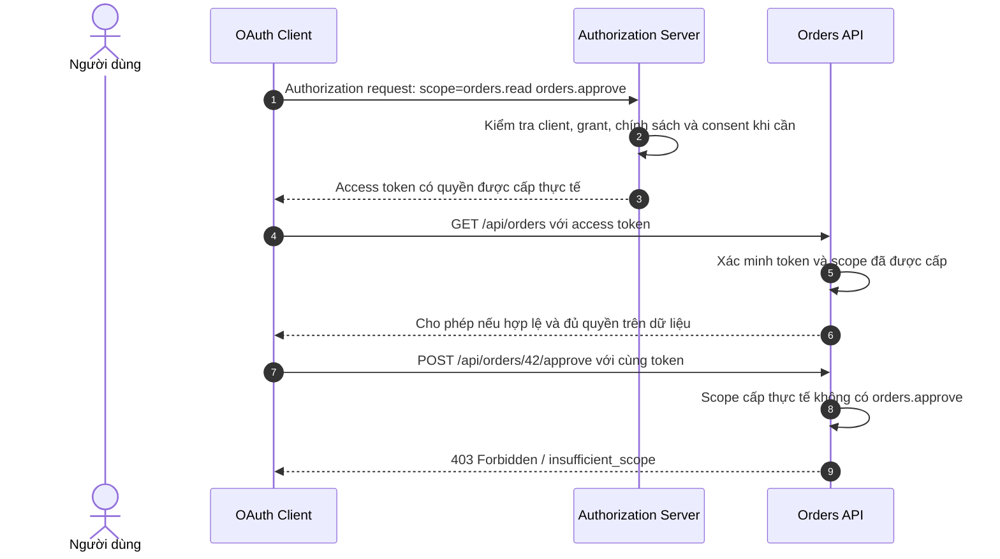
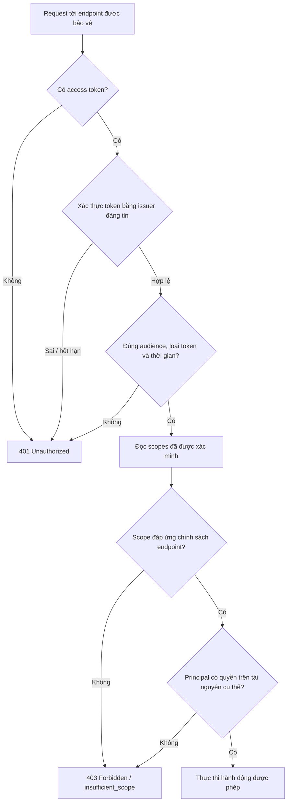

# Kiểm tra scope tại endpoint

Một client đã đăng nhập thành công và gửi access token đến API đơn hàng. Token có scope `orders.read`, nhưng client gọi `POST /api/orders/42/approve` để phê duyệt đơn hàng. Chữ ký token đúng, token chưa hết hạn và người dùng cũng đã được xác thực. API có được phép thực hiện hành động này không? **Không**, nếu endpoint yêu cầu scope `orders.approve` mà token không có. Kiểm tra scope là một phần của quyết định **authorization** dành cho **mỗi endpoint và hành động cụ thể**.

Bài thuộc chương **Scope** của module `SECURITY_TOKEN_SECURITY_FUNDAMENTALS`. Trọng tâm là cách resource server kiểm tra scope của access token trong OAuth 2.0/OIDC, phân biệt scope được yêu cầu và scope thực sự được cấp, kết hợp issuer, audience, claims, role và quyền cấp tài nguyên; đồng thời xử lý lỗi 401/403, thu hồi, cache và nguy cơ token bị đánh cắp hoặc phát lại.

## 1. Scope kiểm soát điều gì tại một endpoint?

**Scope** là một chuỗi định danh phạm vi truy cập trong OAuth 2.0. Authorization server (AS) quyết định scope nào được cấp cho client/token dựa trên yêu cầu, grant, client, người dùng hoặc chính sách hệ thống. Resource server (RS/API) dùng scope đã được xác minh để xem token có đáp ứng **điều kiện quyền ở mức API** không.

Ví dụ ứng dụng đơn hàng định nghĩa các scope riêng:

- `orders.read`: được yêu cầu thao tác đọc đơn hàng trong phạm vi chủ thể được phép.
- `orders.write`: được yêu cầu tạo hoặc chỉnh sửa đơn hàng theo chính sách.
- `orders.approve`: được yêu cầu thao tác phê duyệt đơn hàng.
- `orders.delete`: được yêu cầu xóa đơn hàng khi thỏa các điều kiện nghiệp vụ bổ sung.

Các tên trên là **quy ước của API giả định**, không phải một bộ scope chuẩn của OAuth 2.0. Một scope như `orders.read` chỉ mang ý nghĩa mà bên cấp quyền và API đã thống nhất.

**Có scope ≠ được truy cập mọi tài nguyên.** Token có `orders.read` có thể vượt qua kiểm tra scope cho `GET /api/orders/42`, nhưng API vẫn phải kiểm tra người gọi có quyền xem **đơn hàng 42** theo tenant, owner, nhóm hoặc quan hệ ủy quyền hay không.

| Điều kiện | Câu hỏi | Ví dụ |
|---|---|---|
| **Authentication/token validation** | Token có đáng tin, còn hạn, đúng loại và dành cho API này không? | `iss` hợp lệ, `aud = orders-api`, chữ ký đúng hoặc introspection hợp lệ. |
| **Scope authorization** | Token đã được cấp phạm vi cần cho thao tác của endpoint chưa? | `orders.read` cho GET, `orders.approve` cho thao tác phê duyệt. |
| **Resource-level authorization** | Chủ thể có quyền trên bản ghi/tenant/hành động cụ thể không? | Người dùng chỉ được đọc đơn hàng mình được phép xem. |

Ba lớp này bổ sung cho nhau. Nếu bỏ lớp token validation, kẻ tấn công có thể tự thêm scope vào JWT giả; nếu bỏ kiểm tra scope, một token chỉ được cấp quyền đọc có thể gọi chức năng ghi; nếu bỏ kiểm tra quyền cấp bản ghi, kẻ tấn công có thể truy cập dữ liệu người khác bằng ID.

## 2. Thiết kế ma trận scope cho API trước khi viết middleware

Resource server cần xác định rõ **hành động nào yêu cầu scope nào**, rồi áp dụng tại điểm thực thi phù hợp. Ví dụ:

| Method | Endpoint | Scope yêu cầu | Kiểm tra bổ sung |
|---|---|---|---|
| `GET` | `/api/orders` | `orders.read` | Chỉ trả danh sách đơn hàng trong phạm vi tenant/owner/quan hệ được phép. |
| `GET` | `/api/orders/{id}` | `orders.read` | Kiểm tra quyền đọc đơn hàng `id`. |
| `POST` | `/api/orders` | `orders.write` | Kiểm tra chủ thể có quyền tạo đơn trong tenant đích. |
| `PATCH` | `/api/orders/{id}` | `orders.write` | Kiểm tra quyền sửa, trạng thái đơn và trường được phép sửa. |
| `POST` | `/api/orders/{id}/approve` | `orders.approve` | Kiểm tra role/người phê duyệt, hạn mức và trạng thái. |
| `DELETE` | `/api/orders/{id}` | `orders.delete` | Kiểm tra chính sách xóa, quan hệ sở hữu và điều kiện nghiệp vụ. |

**Ma trận trên là chính sách minh họa.** Một hệ thống có thể tách thêm `orders.create` và `orders.update` hoặc hạn chế API phê duyệt cho client chuyên biệt. Điều cốt lõi là không gộp một scope rộng như `orders.all` vào mọi route theo thói quen nếu quyền của từng thao tác khác nhau.

Lưu ý:

1. **HTTP method quan trọng**: `GET /api/orders/{id}` và `DELETE /api/orders/{id}` phải có chính sách khác nhau dù chung đường dẫn.
2. **Đường dẫn và method phải được chuẩn hóa nhất quán** giữa gateway, security filter, router và controller để tránh route bị bỏ qua.
3. **Endpoint chưa khai báo chính sách** phải có hành vi mặc định an toàn, thường là từ chối truy cập (*default deny*).
4. **Nhiều điểm thực thi** có thể cùng kiểm tra quyền: gateway cho phép qua không bảo đảm service hoặc dữ liệu phía sau luôn an toàn.
5. **Scope ở mức API** có thể kết hợp với role, relationship, attribute và chính sách người dùng; không nên biến scope thành phương án duy nhất cho mọi luật nghiệp vụ.

## 3. Scope được yêu cầu khác scope thực sự được cấp

Quy trình OAuth 2.0 thường gồm:



Client **có thể yêu cầu** `orders.read orders.approve`, nhưng AS có thể chỉ cấp `orders.read`. Với token response theo RFC 6749, trường `scope` cần được trả khi phạm vi cấp khác phạm vi client yêu cầu; nếu giống nhau, trường này có thể được lược bỏ theo chuẩn. Client không nên tự cho rằng một scope đã được cấp chỉ vì từng đưa nó vào authorization request.

Ví dụ phản hồi token endpoint khi AS giới hạn quyền:

```json
{
  "access_token": "AT_OPAQUE_EXAMPLE",
  "token_type": "Bearer",
  "expires_in": 900,
  "scope": "orders.read"
}
```

Access token ở đây là placeholder, không phải token hoạt động. **Resource server đánh giá quyền theo access token và thông tin kiểm chứng từ AS**, không theo giá trị `scope` do client tự khai trong request gọi API.

Trong OIDC, những scope như `openid`, `profile`, `email` có tác dụng theo ngữ nghĩa xác thực và yêu cầu claims của OIDC. **`openid` không tự cấp quyền đọc một business API**. API nên quy định riêng scope của tài nguyên, ví dụ `orders.read`.

Với OAuth 2.0 Resource Indicators (RFC 8707), client có thể chỉ rõ resource dự kiến nhận token. Phạm vi được cấp và audience cùng giúp ràng buộc token với tài nguyên, nhưng **scope và audience có vai trò khác nhau**: một bên biểu diễn quyền, bên kia xác định nơi token dự định được nhận.

## 4. Scope nằm trong access token dưới dạng nào?

OAuth 2.0 không quy định access token phải có định dạng JWT. Bên phát hành có thể dùng JWT hoặc opaque token; resource server phải kiểm tra đúng cơ chế.

### 4.1. JWT access token

Payload ví dụ theo hợp đồng của API:

```json
{
  "iss": "https://id.example.test",
  "sub": "user-123",
  "aud": "orders-api",
  "iat": 1795410000,
  "exp": 1795410900,
  "scope": "orders.read orders.write",
  "client_id": "orders-web"
}
```

Các con số thời gian chỉ minh họa một token sống 900 giây. Claim `scope` dạng **chuỗi các scope phân tách bằng dấu cách** là cách thể hiện của JWT access token profile RFC 9068. Một số nhà cung cấp có thể dùng claim `scp` với định dạng khác, chẳng hạn mảng chuỗi:

```json
{
  "scp": ["orders.read", "orders.write"]
}
```

Đây là ví dụ **provider-specific**, không phải lời khẳng định mọi AS đều phải phát hành `scp`. API phải biết profile của issuer và không tùy tiện gộp các claim quyền không rõ nguồn.

JWT có thể đọc được phần payload do cách biểu diễn Base64URL; **đọc payload chưa phải xác minh chữ ký và claims**. Phải kiểm tra thuật toán cho phép, chữ ký bằng khóa issuer tin cậy, `iss`, `aud`, `exp`, `nbf` nếu có và loại token trước khi dùng `scope`.

### 4.2. Opaque access token

Khi token là chuỗi opaque, API không thể tự giải mã scope. Một lựa chọn phổ biến là gọi **OAuth 2.0 Token Introspection** tới AS được cấu hình tin cậy. Ví dụ phản hồi minh họa:

```json
{
  "active": true,
  "iss": "https://id.example.test",
  "sub": "user-123",
  "client_id": "orders-web",
  "aud": "orders-api",
  "scope": "orders.read",
  "exp": 1795410900
}
```

Resource server phải xác minh nguồn introspection, kênh truyền và quyền gọi endpoint, rồi kiểm tra `active` cùng các thuộc tính cần thiết. RFC 7662 có trường `scope`, nhưng không bắt buộc mọi AS đều trả đầy đủ tất cả metadata tùy chọn. Nếu API không thể xác nhận scope cần thiết, **không được mặc định cấp quyền**.

**Không gửi refresh token hoặc ID token đến resource API để thay access token.** Refresh token dành cho token endpoint của AS; ID token trong OIDC dành cho client xác nhận kết quả xác thực.

## 5. Quy trình kiểm tra scope tại endpoint

Một cách triển khai rõ ràng là chia thành hai pha: **xác minh credential** và **ra quyết định quyền**.



**Bước A — Đối chiếu token với trust model.** Chỉ nhận token thuộc issuer cho phép, dành cho resource server hiện tại. Một token có scope `orders.read` nhưng `aud = payments-api` phải bị từ chối tại `orders-api` ngay cả khi chữ ký đúng.

**Bước B — Xác định chính sách endpoint.** Lấy scope yêu cầu từ cấu hình bảo mật đáng tin cậy như `orders.read` cho GET hoặc `orders.approve` cho approve. Không nhận “required scope” do client gửi trong header tùy ý.

**Bước C — So khớp scope đã cấp.** Phân tích scope theo profile token đã biết, so sánh **chính xác từng scope**, và áp dụng điều kiện **tất cả** hoặc **ít nhất một** scope nếu chính sách thực sự quy định.

**Bước D — Kiểm tra quyền nghiệp vụ.** Có đủ scope mới chỉ qua cửa đầu. API còn phải kiểm tra owner, tenant, hạn mức, trạng thái đơn hàng và các điều kiện khác.

**Bước E — Thực thi và ghi audit an toàn.** Ghi mã lý do phù hợp như `INVALID_TOKEN`, `MISSING_SCOPE`, `CROSS_TENANT` hoặc `PERMIT`, nhưng không ghi token gốc.

## 6. So khớp scope chính xác: tránh lỗi chuỗi con

Theo OAuth 2.0, scope là danh sách các giá trị có phân biệt chữ hoa/thường và được phân tách bằng dấu cách khi biểu diễn thành một chuỗi. Các scope là **giá trị nguyên tử theo hợp đồng**, không phải các đường dẫn có quan hệ phân cấp ngầm định.

Ví dụ token có `orders.read-all`:

```text
Scope trong token:  "orders.read-all orders.export"
Endpoint yêu cầu:  "orders.read"

Sai:
  scopes.contains("orders.read")      -> true (vì khớp chuỗi con)

Đúng:
  parse thành tập {"orders.read-all", "orders.export"}
  so sánh tập có phần tử "orders.read" -> false
```

Không nên tự suy diễn `orders.*` đồng nghĩa toàn bộ `orders.read`, `orders.write` và `orders.approve` trừ khi chính sách API **chủ động định nghĩa** cơ chế mở rộng tương ứng và kiểm soát chặt. Tương tự, `orders.Read` không tự bằng `orders.read`.

Có thể mô tả quy tắc bằng tập hợp:

- Yêu cầu **tất cả**: `required ⊆ granted`.
- Yêu cầu **ít nhất một**: `required ∩ granted ≠ ∅`.

Ví dụ endpoint xuất dữ liệu cần **cả** `orders.read` và `orders.export`. Chỉ có `orders.export` thì không đủ nếu chính sách đã quy định điều kiện **AND**.

```java
// Minh họa phần kiểm tra sau khi token đã được xác minh.
// 'granted' là tập scope chuẩn hóa theo token profile đáng tin cậy.
static boolean hasAllScopes(Set<String> granted, Set<String> required) {
    return granted != null && granted.containsAll(required);
}

static boolean hasAnyScope(Set<String> granted, Set<String> alternatives) {
    return granted != null
            && alternatives.stream().anyMatch(granted::contains);
}
```

Phương thức này **chỉ kiểm tra tập scope**, không xác minh token hay quyền nghiệp vụ. Ở môi trường thật phải đảm bảo tập scope lấy từ thông tin đã xác thực, dùng giới hạn độ dài/định dạng phù hợp và chính sách rõ ràng với tập `required` rỗng. Với route nhạy cảm, không biến việc thiếu cấu hình thành “không cần scope”.

## 7. Triển khai kiểm tra scope tại route trong Spring Security

Trong **Spring Security OAuth2 Resource Server** dùng JWT, một `JwtAuthenticationConverter` phù hợp có thể ánh xạ scope từ claim `scope` hoặc `scp` thành `GrantedAuthority` mang tiền tố `SCOPE_`. Khi token có `scope = "orders.read orders.write"`, principal thường có các authority:

```text
SCOPE_orders.read
SCOPE_orders.write
```

Các authority này là **quy ước của Spring Security**, không phải tên scope gốc mà RFC OAuth 2.0 bắt buộc phải thêm tiền tố. Với ứng dụng dùng converter riêng hoặc opaque-token introspection, phải kiểm tra cách mapping của cấu hình thực tế.

Ví dụ bảo vệ theo HTTP method và đường dẫn:

```java
@Configuration
@EnableMethodSecurity
public class ApiSecurityConfig {

    @Bean
    SecurityFilterChain apiSecurity(HttpSecurity http) throws Exception {
        http
            .authorizeHttpRequests(auth -> auth
                .requestMatchers(HttpMethod.GET,
                    "/api/orders", "/api/orders/*")
                    .hasAuthority("SCOPE_orders.read")
                .requestMatchers(HttpMethod.POST, "/api/orders")
                    .hasAuthority("SCOPE_orders.write")
                .requestMatchers(HttpMethod.PATCH, "/api/orders/*")
                    .hasAuthority("SCOPE_orders.write")
                .requestMatchers(HttpMethod.POST,
                    "/api/orders/*/approve")
                    .hasAuthority("SCOPE_orders.approve")
                .requestMatchers(HttpMethod.DELETE, "/api/orders/*")
                    .hasAuthority("SCOPE_orders.delete")
                .anyRequest().denyAll()
            )
            .oauth2ResourceServer(oauth2 ->
                oauth2.jwt(Customizer.withDefaults()));

        return http.build();
    }
}
```

Đoạn cấu hình minh họa theo Spring Security 6.x và lược bỏ các `import`; ứng dụng thật cần cấu hình JWT decoder/issuer, **kiểm tra audience `orders-api`**, thuật toán tin cậy, cách xử lý CORS/CSRF và chuỗi filter phù hợp với kiến trúc. Trong ví dụ, những endpoint chưa được nêu bị chặn bởi `denyAll()`; điều này phù hợp với chính sách bảo vệ API đang minh họa, không phải cấu hình chung cho mọi ứng dụng.

**Không coi `issuer-uri` là tự động đủ để xác minh audience mong muốn.** Resource server cần áp dụng validator audience theo token profile và yêu cầu của API. Có thể cấu hình một `JwtDecoder` bổ sung validator, ví dụ:

```java
// Minh họa cấu hình decoder: bổ sung imports tương ứng với
// Spring Security OAuth2 Resource Server / OAuth2 Core.
@Bean
JwtDecoder jwtDecoder() {
    String trustedIssuer = "https://id.example.test";

    NimbusJwtDecoder decoder =
        NimbusJwtDecoder.withIssuerLocation(trustedIssuer).build();

    OAuth2TokenValidator<Jwt> standard =
        JwtValidators.createDefaultWithIssuer(trustedIssuer);

    OAuth2TokenValidator<Jwt> audience =
        new JwtClaimValidator<List<String>>(
            JwtClaimNames.AUD,
            values -> values != null && values.contains("orders-api")
        );

    decoder.setJwtValidator(
        new DelegatingOAuth2TokenValidator<>(standard, audience));

    return decoder;
}
```

Decoder trên là ví dụ về **ràng buộc issuer và audience**; còn yêu cầu kiểm tra loại token, các header, thuật toán và claims khác phải tuân theo profile và mức bảo đảm triển khai. Đường dẫn issuer và audience đều là placeholder của hệ thống giả định. Cấu hình thực tế nên lấy từ nguồn cấu hình được bảo vệ, thay vì hardcode nhiều môi trường. Phải kiểm tra khả năng tương thích của mã với phiên bản Spring Security đang dùng.

### Kết hợp method security với kiểm tra quyền theo đối tượng

Dù lớp route đã yêu cầu `SCOPE_orders.read`, service vẫn cần kiểm tra phạm vi truy cập dữ liệu:

```java
@Service
public class OrderQueryService {

    private final OrderRepository repository;

    public OrderQueryService(OrderRepository repository) {
        this.repository = repository;
    }

    @PreAuthorize("hasAuthority('SCOPE_orders.read')")
    public OrderView findOrder(UUID orderId,
                               JwtAuthenticationToken authentication) {
        String subject = authentication.getToken().getSubject();

        return repository.findVisibleToSubject(orderId, subject)
            .map(OrderView::from)
            .orElseThrow(() ->
                new ResponseStatusException(HttpStatus.NOT_FOUND));
    }
}
```

Đây là **ví dụ cơ chế bảo vệ**, với `OrderRepository`, `OrderView` và phương thức `findVisibleToSubject` do ứng dụng định nghĩa. Nếu có nhiều issuer hoặc tenant, chỉ dùng `sub` thường chưa đủ: nên ánh xạ principal theo nguồn tin cậy và ràng buộc tenant/relationship trong truy vấn. Một service cũng có thể được gọi từ background job hoặc nội bộ mà không đi qua đường HTTP; lớp method/data authorization giúp tránh phụ thuộc hoàn toàn vào middleware ở gateway.

## 8. Khi nào trả 401, khi nào trả 403?

Với OAuth 2.0 Bearer Token, **RFC 6750** quy định cách báo lỗi thông qua `WWW-Authenticate`. Hai nhóm lỗi cần tách:

| Trường hợp | Mã thường dùng | Giải thích |
|---|---|---|
| Không có credential cho endpoint yêu cầu xác thực. | `401 Unauthorized` | Yêu cầu thiếu thông tin xác thực. |
| Token hết hạn, giả mạo, sai issuer/audience hoặc sai loại. | `401 Unauthorized` | API không thể chấp nhận access token. |
| Yêu cầu bearer token sai cú pháp hoặc dùng nhiều cách truyền không hợp lệ. | Có thể là `400 Bad Request` với `invalid_request` theo RFC 6750. | Sai cấu trúc request, khác trường hợp token hợp lệ nhưng thiếu quyền. |
| Token hợp lệ nhưng thiếu scope bắt buộc. | `403 Forbidden` | Có thể trả `insufficient_scope`. |
| Có scope nhưng không được phép trên tài nguyên cụ thể. | `403` hoặc `404` theo chính sách | Không tiết lộ sự tồn tại bản ghi nếu cần. |

Ví dụ token hết hạn:

```http
HTTP/1.1 401 Unauthorized
WWW-Authenticate: Bearer realm="orders-api", error="invalid_token"
```

Ví dụ token hợp lệ nhưng không có `orders.approve`:

```http
HTTP/1.1 403 Forbidden
WWW-Authenticate: Bearer realm="orders-api", error="insufficient_scope", scope="orders.approve"
```

Trường `scope` trong challenge `insufficient_scope` **có thể** giúp client biết scope cần bổ sung, nhưng API cần cân nhắc việc tiết lộ tên quyền nhạy cảm ra bên ngoài. Với yêu cầu **không có bất kỳ credential**, challenge thông thường không nên tự thêm chi tiết `invalid_token` vì chưa có token để xác minh.

**403 không tự động có nghĩa client chỉ cần đăng nhập lại.** Nếu không đủ scope, client có thể cần xin quyền bổ sung qua luồng cấp quyền thích hợp, hoặc bị chính sách cấm dù người dùng đã đăng nhập. Client không được sửa scope trong access token hoặc tạo một claim mới để tự nâng quyền.

## 9. Scope và role cần được kết hợp thế nào?

Scope không nhất thiết thay thế role. Ví dụ để phê duyệt đơn hàng, chính sách của `orders-api` quy định:

```text
Có access token hợp lệ:
  aud = orders-api
  scope chứa orders.approve

Và principal đáp ứng:
  role ORDER_MANAGER trong tenant của đơn hàng
  thuộc nhóm/đơn vị được giao phê duyệt
  hạn mức cho phép >= giá trị đơn
  trạng thái đơn hàng cho phép phê duyệt
```

Trong Spring Security, điều kiện ở method có thể viết:

```java
@PreAuthorize(
    "hasAuthority('SCOPE_orders.approve') and hasRole('ORDER_MANAGER')"
)
public void approveOrder(UUID orderId) {
    // Còn phải kiểm tra quyền trên đơn hàng/tenant/hạn mức
    // tại thời điểm thực thi transaction.
}
```

Đây là vị trí minh họa cho method authorization, **không phải một phương thức nghiệp vụ hoàn chỉnh**. Role `ORDER_MANAGER` chỉ có hiệu lực khi resource server đã ánh xạ claim role từ issuer tin cậy sang authority `ROLE_ORDER_MANAGER`; Spring Security không tự hiểu mọi trường `roles` trong JWT. Cần cả kiểm tra dữ liệu nghiệp vụ, không dừng ở annotation.

Một số hệ thống sử dụng scope thay cho permission ở route, một số dùng policy engine quyết định quyền phức tạp. Thiết kế nào cũng phải làm rõ nơi nhận scope đã được kiểm chứng và nơi thực thi chính sách trên tài nguyên.

## 10. Multi-tenant, nhiều issuer và service-to-service

### Nhiều tenant

Một access token có `orders.read` có thể dùng để đọc đơn hàng trong **tenant A**, nhưng không được đọc tenant B. Ngay cả nếu JWT chứa `tenant_id`, API vẫn phải xác minh nguồn claim và ràng buộc tài nguyên thực tế. Không chấp nhận tenant do client tự đổi trên header làm nguồn quyền đáng tin cậy.

Ví dụ:

| Request | Scope token | Quyền dữ liệu | Kết quả |
|---|---|---|---|
| User A đọc đơn hàng thuộc tenant A được phép xem. | `orders.read` | Có | Cho phép. |
| User A đọc đơn hàng thuộc tenant B. | `orders.read` | Không | Từ chối theo chính sách. |
| User A phê duyệt đơn thuộc tenant A. | Chỉ `orders.read` | Có thể có role quản lý | Từ chối do thiếu `orders.approve`. |
| User A phê duyệt đơn thuộc tenant A. | `orders.approve` | Không có role/hạn mức | Từ chối do quyền nghiệp vụ. |

### Nhiều authorization server

Với nhiều issuer, resource server chỉ tin những issuer được **cấu hình cho phép**, mỗi issuer phải được ràng buộc với nguồn khóa hoặc introspection đúng. Hai token cùng có scope string `orders.read` **không nhất thiết** mang cùng quyền nếu issuer, audience hay hợp đồng scope khác nhau.

Không tải JWKS bất kỳ theo `iss` trong token chưa xác minh rồi tự chấp nhận scope. Đó là lỗi mở rộng trust anchor ra ngoài ý muốn.

### Client credentials

Trong luồng `client_credentials`, access token thường đại diện cho client/service chứ không phải người dùng tương tác. Ví dụ `inventory-worker` có scope `orders.read` để tra đơn hàng liên quan giao vận. API vẫn phải kiểm tra client có được phép gọi endpoint, audience phù hợp và điều kiện dữ liệu. Không mặc định `sub` là user hoặc áp dụng owner policy của user cho service account mà không có quy tắc ủy quyền rõ ràng.

## 11. Scope thay đổi, thu hồi token và tính cập nhật của quyền

Scope của JWT access token thường phản ánh **phạm vi tại thời điểm phát hành**. Nếu quản trị viên thu hồi quyền lúc token vẫn còn hạn, resource server tự kiểm tra JWT có thể tiếp tục nhìn thấy scope cũ đến khi token hết hạn.

Một số chiến lược vận hành:

| Cơ chế | Tác dụng | Giới hạn |
|---|---|---|
| Access token có thời hạn ngắn | Giảm thời gian token mang quyền cũ còn được dùng. | Không bảo đảm thu hồi ngay lập tức. |
| Kiểm tra ACL/policy hiện hành | Áp dụng quyền nghiệp vụ ở thời điểm request. | Có thêm truy vấn/độ trễ, cần quản lý lỗi nguồn quyền. |
| Opaque token và introspection | Có thể nhận trạng thái token cập nhật từ AS. | Cache introspection có thể giữ kết quả cũ. |
| Thu hồi hoặc denylist | Vô hiệu token theo chính sách bảo mật. | Cần đồng bộ giữa AS, gateway và các API. |
| Thu hồi/rotation refresh token | Hạn chế việc tiếp tục cấp access token mới. | Không tự vô hiệu mọi access token đã phát hành. |

Nếu cache kết quả introspection, TTL cần không vượt quá thời hạn token còn lại và phải phù hợp với độ trễ thu hồi chấp nhận được. Khi introspection timeout, API **không được tự đặt `active=true`** để tiếp tục phục vụ. Có dùng cache đã được xác minh còn hợp lệ hay từ chối phải theo chính sách rủi ro.

Một token đã bị lấy cắp nhưng chưa hết hạn vẫn có thể được dùng khi là **Bearer token**. Scope tối thiểu giúp giảm phạm vi thiệt hại; tuy nhiên chỉ có `scope=orders.read` không ngăn kẻ tấn công đọc những dữ liệu mà token thực sự được phép đọc. Cần kết hợp TLS, bảo vệ nơi lưu token, không ghi token vào log/URL, phát hiện bất thường và **sender-constrained tokens** như DPoP hoặc mTLS khi kiến trúc phù hợp.

## 12. Thiết kế scope đủ nhỏ nhưng dễ vận hành

Một chiến lược đặt tên tốt cần cân bằng **nguyên tắc đặc quyền tối thiểu** với **khả năng hiểu và bảo trì**:

1. Đặt tên dễ hiểu, dựa trên tài nguyên và hành động, ví dụ `orders.read`, `orders.write`, `orders.approve`.
2. Định nghĩa tài liệu cho từng scope: endpoint nào yêu cầu, hành động nào được cấp, các điều kiện nghiệp vụ bổ sung.
3. Tránh scope bao quát quá rộng như `admin` cho mọi API nếu điều đó biến quyền của một tài nguyên thành quyền tài nguyên khác.
4. Không tạo một scope cho **mỗi bản ghi đơn hàng** khi authorization cấp đối tượng có thể xử lý bằng owner/tenant/relationship; tránh số lượng scope tăng vô hạn.
5. Tách scope của API độc lập nếu cần để tránh dùng nhầm token: token cấp cho `billing-api` không được chấp nhận tại `orders-api` chỉ vì trùng chuỗi quyền.
6. Quản lý thay đổi chính sách: khi đổi tên hoặc bỏ scope, cập nhật authorization server, client, API, tài liệu và kiểm tra hồi quy.
7. Ưu tiên **deny by default** với endpoint mới; tránh vô tình công khai route vì quên thêm matcher.
8. Cân nhắc endpoint nhạy cảm yêu cầu **kết hợp điều kiện AND** (scope và role/quyền dữ liệu), không mặc nhiên cho rằng một scope cấp quyền tuyệt đối.

Đối với API nhiều phiên bản, cần kiểm tra thay đổi route và mapping scope cùng nhau. Ví dụ tách `POST /orders/approve` sang `POST /orders/{id}/approve` không được vô tình khiến điểm mới bỏ qua kiểm tra `orders.approve`.

## 13. Kiểm thử và audit quyết định scope

Kiểm thử scope không dừng ở trường hợp “JWT có `orders.read` thì GET thành công”. Các kịch bản hữu ích:

| Kịch bản | Kết quả mong đợi | Lý do |
|---|---|---|
| GET với token có `orders.read`, đúng issuer/audience, được quyền xem bản ghi. | Cho phép. | Đủ cả token, scope và chính sách dữ liệu. |
| POST approve với token chỉ có `orders.read`. | 403. | Thiếu `orders.approve`. |
| Token có `orders.read-all`, endpoint yêu cầu `orders.read`. | Từ chối nếu không có chính sách tương đương rõ ràng. | Chống so khớp chuỗi con. |
| Token có `orders.read` nhưng `aud=payments-api`. | 401. | Token không dành cho resource server này. |
| ID token có claim `scope` giống tên scope API. | 401. | ID token không phải access token API chấp nhận. |
| Token hợp lệ, đúng scope nhưng bản ghi tenant khác. | 403/404 theo chính sách. | Scope không thay kiểm tra quyền dữ liệu. |
| Token có hai scope, endpoint yêu cầu cả hai nhưng chỉ có một. | 403. | Kiểm tra đúng điều kiện AND. |
| Access token hết hạn, `scope` có đầy đủ. | 401. | Scope không cứu được credential không hợp lệ. |
| Introspection trả `active=false`. | 401. | Không chấp nhận token bị vô hiệu. |
| Endpoint mới chưa được định nghĩa chính sách. | Từ chối theo default deny. | Tránh bỏ sót route. |
| `client_credentials` gọi endpoint chỉ dành cho người dùng. | Từ chối nếu chính sách yêu cầu user principal. | Phân biệt ngữ nghĩa subject/client. |

### Nên ghi gì trong audit?

Đối với một quyết định, có thể ghi:

- `trace_id`/`decision_id`, thời điểm UTC, service/endpoint và HTTP method;
- principal tham chiếu đã xác minh (issuer + subject hoặc client), audience đã xác nhận;
- tên **scope yêu cầu** và **scope được cấp cần thiết để giải thích quyết định**, nếu chính sách dữ liệu cho phép;
- kết quả `PERMIT`/`DENY`, mã nguyên nhân `MISSING_SCOPE`, `INVALID_TOKEN`, `CROSS_TENANT`, version của policy khi hữu ích.

**Không ghi nguyên access token, refresh token, ID token, authorization code, header `Authorization` hoặc payload JWT không cần thiết.** Nếu cần liên kết các yêu cầu có cùng credential, dùng mã tham chiếu an toàn theo thiết kế kiểm toán, không biến log thành nguồn phát lại token.

### Bài tập tình huống

Cho ma trận scope ở mục 2 và access token:

```json
{
  "iss": "https://id.example.test",
  "aud": "orders-api",
  "sub": "user-a",
  "scope": "orders.read orders.write",
  "exp": 1795410900
}
```

Giả sử token còn hạn, được ký hợp lệ và người dùng thuộc tenant A. Hãy dự đoán:

1. `GET /api/orders/100` khi đơn 100 thuộc tenant A và user có quyền đọc.
2. `POST /api/orders` khi user được phép tạo đơn ở tenant A.
3. `POST /api/orders/100/approve` khi user có role quản lý nhưng token thiếu `orders.approve`.
4. `GET /api/orders/200` khi đơn 200 thuộc tenant B.
5. Cùng token đó được gửi tới một API khác có audience `payments-api`.

Kết quả cần phân biệt **scope thiếu**, **quyền dữ liệu thiếu** và **sai audience**; không chỉ dựa vào việc người dùng đã đăng nhập thành công.

## 14. Ghi nhớ

- **Scope của access token được kiểm tra theo từng endpoint, HTTP method và hành động**, dựa trên chính sách do resource server kiểm soát.
- **Chỉ tin scope đã được xác minh** từ JWT access token hợp lệ hoặc introspection từ authorization server tin cậy. `scope` mà client yêu cầu không đồng nghĩa scope thực sự được cấp.
- **Audience khác scope:** `aud` xác định API nào có quyền nhận token; scope xác định phạm vi truy cập trong ngữ cảnh đó.
- **So khớp scope theo giá trị nguyên vẹn**, có phân biệt chữ hoa/thường; không dùng tìm chuỗi con hay tự suy diễn wildcard.
- **401** thường dành cho credential thiếu/không hợp lệ; **403** thường dành cho token hợp lệ nhưng thiếu scope/quyền.
- **Scope không thay role hoặc quyền cấp tài nguyên**: owner, tenant, hạn mức và trạng thái nghiệp vụ vẫn phải được kiểm tra.
- **Vòng đời token ảnh hưởng quyền thực tế**: quyền có thể thay đổi sau phát hành, token có thể bị thu hồi hoặc bị đánh cắp. Thiết kế cần giảm quyền, bảo vệ nơi lưu và có biện pháp chống phát lại phù hợp.

### Tài liệu chuẩn tham khảo

- [RFC 6749 — The OAuth 2.0 Authorization Framework](https://www.rfc-editor.org/rfc/rfc6749): định nghĩa scope, yêu cầu và phạm vi thực sự được cấp.
- [RFC 6750 — Bearer Token Usage](https://www.rfc-editor.org/rfc/rfc6750): `WWW-Authenticate`, `invalid_token` và `insufficient_scope`.
- [RFC 7662 — OAuth 2.0 Token Introspection](https://www.rfc-editor.org/rfc/rfc7662): kiểm tra trạng thái/metadata của opaque token.
- [RFC 8707 — Resource Indicators for OAuth 2.0](https://www.rfc-editor.org/rfc/rfc8707): xác định resource dự kiến nhận token.
- [RFC 9068 — JWT Profile for OAuth 2.0 Access Tokens](https://www.rfc-editor.org/rfc/rfc9068): `aud`, `scope` và cách xác minh JWT access token.
- [RFC 9700 — Best Current Practice for OAuth 2.0 Security](https://www.rfc-editor.org/rfc/rfc9700): bảo mật token, hạn chế quyền và chống replay.
- [OpenID Connect Core 1.0](https://openid.net/specs/openid-connect-core-1_0.html): phạm vi OIDC và vai trò ID token.
- [Spring Security — OAuth 2.0 Resource Server JWT](https://docs.spring.io/spring-security/reference/servlet/oauth2/resource-server/jwt.html) và [Authorize HTTP Requests](https://docs.spring.io/spring-security/reference/servlet/authorization/authorize-http-requests.html): xử lý scope thành `GrantedAuthority` và bảo vệ route.
