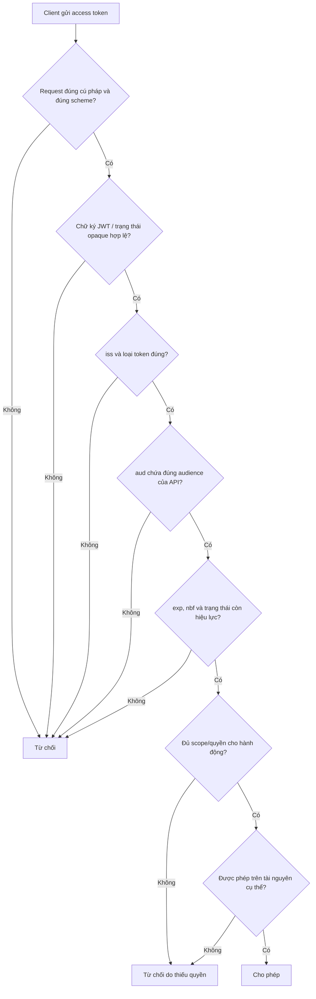
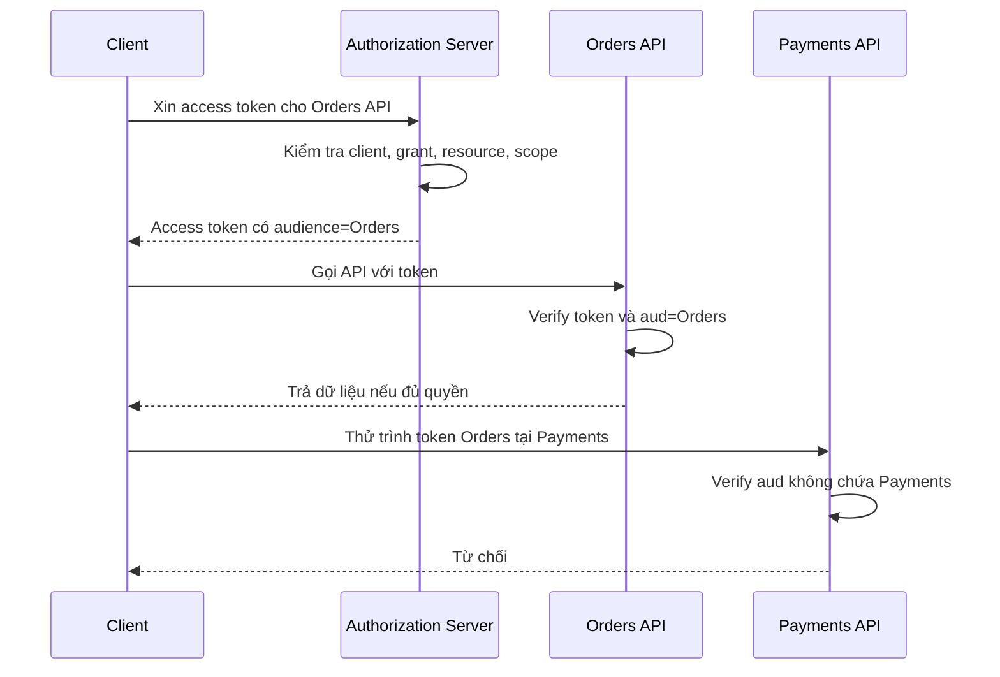

# Audience validation

## 1. Vì sao phải xác minh audience?

Giả sử một hệ thống có ba API: **Orders API**, **Payments API** và **Reports API**. Cả ba cùng tin cậy authorization server `https://auth.example.com`. Client được cấp một access token để xem đơn hàng. Kẻ tấn công hoặc một client cấu hình sai gửi token đó tới Payments API:

```http
GET /payments/42 HTTP/1.1
Host: payments-api.example.com
Authorization: Bearer <access_token_danh_cho_orders>
```

Payments API kiểm tra chữ ký, `iss` và `exp` thấy đều hợp lệ. **Như vậy vẫn chưa đủ**: token có thể được phát hành hợp lệ nhưng **không dành cho Payments API**. Nếu API bỏ qua điều kiện đối tượng nhận, nó có thể chấp nhận nhầm token của dịch vụ khác.

**Audience validation** là bước resource server kiểm tra token được phát hành **cho chính resource server hoặc nhóm tài nguyên được phép**. Trong JWT, audience thường được biểu diễn bằng claim `aud`. Với opaque token, audience có thể đến từ metadata introspection hoặc hợp đồng ràng buộc tài nguyên đã được authorization server bảo đảm.

> **Quy tắc an toàn:** Một token đúng chữ ký, đúng issuer và còn hạn vẫn phải bị **từ chối** nếu không chứng minh được rằng nó dành cho resource server hiện tại theo profile được áp dụng.

Bài thuộc chương **Audience** của module `SECURITY_TOKEN_SECURITY_FUNDAMENTALS`. Chủ đề là **kiểm tra audience trong thực tế**, từ xác minh claim, cấu hình dịch vụ, xử lý JWT/opaque access token tới OAuth 2.0/OIDC, gateway, token exchange và kiểm thử. Audience là một lớp trong hệ thống tin cậy và vòng đời token; nó không thay thế kiểm tra `scope`, quyền trên dữ liệu, trạng thái thu hồi hay phòng chống token bị đánh cắp/phát lại.

## 2. Audience là một định danh, không nhất thiết là URL để gọi

**Audience** biểu diễn một hoặc nhiều **bên nhận dự kiến** của token. Trong JWT (RFC 7519), claim `aud` có thể là:

- Một giá trị **chuỗi** khi có một audience.
- Một **mảng các chuỗi** khi có nhiều audiences.

Ví dụ payload access token JWT (chưa có chữ ký):

```json
{
  "iss": "https://auth.example.com",
  "sub": "user-123",
  "aud": "https://orders-api.example.com",
  "iat": 1900000000,
  "exp": 1900000900,
  "scope": "orders:read"
}
```

Đây là dữ liệu minh họa. Giá trị `aud` cho biết token nhắm đến Orders API; **không** có nghĩa resource server phải thực hiện một HTTP request đến URL đó. Hệ thống có thể dùng định danh URI, URI tài nguyên logic hoặc tên được chuẩn hóa theo hợp đồng giữa authorization server (AS) và resource server (RS).

Ví dụ một hệ thống có thể dùng:

```text
orders-api
urn:example:api:orders
https://orders-api.example.com
```

Ba chuỗi trên **không tự động tương đương**. Chúng chỉ là ba cách đặt tên. AS và Orders API phải thống nhất **giá trị chính xác** nào được cấp và được chấp nhận.

### 2.1. Bốn câu hỏi cần tách riêng

| Claim hoặc điều kiện | Câu hỏi | Ví dụ | Vì sao không thể thay audience? |
| --- | --- | --- | --- |
| `iss` | Ai phát hành token? | `https://auth.example.com` | Một issuer có thể cấp token cho nhiều API |
| `aud` | Token dành cho bên nhận nào? | `https://orders-api.example.com` | Đây là điều kiện đang kiểm tra |
| `scope` | Token được cấp phạm vi quyền nào? | `orders:read` | Tên quyền không bảo đảm token dành cho API này |
| `sub` | Token nói về chủ thể nào? | `user-123` | Cùng chủ thể có token cho nhiều API |
| `exp` / `nbf` | Token có nằm trong khoảng hiệu lực không? | Unix timestamp | Token còn hạn vẫn có thể sai audience |
| Quyền trên tài nguyên | Chủ thể có được xem đơn 42 không? | Tenant, owner, ACL | Token đúng API vẫn có thể bị cấm xem đơn cụ thể |

Không suy luận “token có `orders:read` nên chắc chắn dành cho Orders API”. Tên scope có thể được cấp theo hợp đồng riêng, có thể trùng nhau giữa các API hoặc không đủ để xác định bên nhận.

## 3. Quy tắc xác minh `aud` trong JWT

Theo RFC 7519, `aud` là một registered claim name. **JWT nói chung không bắt buộc mọi JWT đều có `aud`**, nhưng **JWT Profile for OAuth 2.0 Access Tokens (RFC 9068)** yêu cầu claim này, và resource server thuộc profile đó phải kiểm tra audience chứa định danh của mình.

Với API dùng profile yêu cầu audience, validator nên **fail closed** nếu `aud` thiếu, sai kiểu, rỗng hoặc không khớp. Không đoán audience từ tên route, `Host` header hay tên `scope`.

### 3.1. So khớp chính xác với chuỗi

Giả sử cấu hình Orders API:

```yaml
trusted_issuer: "https://auth.example.com"
expected_audience: "https://orders-api.example.com"
token_profile: "oauth2-jwt-access-token"
```

Các trường hợp:

| `aud` trong access token | Qua kiểm tra audience? | Lý do |
| --- | --- | --- |
| `"https://orders-api.example.com"` | **Có** | Bằng đúng định danh đã cấu hình |
| `"https://payments-api.example.com"` | **Không** | Token dành cho API khác |
| `"https://orders-api.example.com/"` | **Không** | Thêm dấu `/` cuối tạo chuỗi khác |
| `"HTTPS://orders-api.example.com"` | **Không** | Không tự chuẩn hóa chữ hoa/thường |
| `"https://orders-api.example.com/v2"` | **Không** | Đường dẫn khác không mặc nhiên là cùng audience |
| `"https://orders-api.example.com.evil.invalid"` | **Không** | Chỉ giống tiền tố, không bằng đúng |
| `"orders-api"` | **Không** nếu không được cấu hình cho phép | Tên logic không tự đồng nghĩa với URI |
| Không có `aud` | **Không** theo profile yêu cầu audience | Không có bằng chứng token dành cho API |

Theo ngữ nghĩa `StringOrURI` của JWT, so sánh thường dùng **bằng đúng chuỗi, phân biệt chữ hoa/chữ thường, không áp dụng chuẩn hóa URI mặc định**. Không dùng `startsWith`, `endsWith`, `contains`, so khớp domain suffix hoặc wildcard tự tạo.

### 3.2. So khớp với mảng audience

Một JWT có thể chỉ định nhiều bên nhận:

```json
{
  "iss": "https://auth.example.com",
  "aud": [
    "https://orders-api.example.com",
    "https://reports-api.example.com"
  ],
  "scope": "orders:read reports:read",
  "exp": 1900000900
}
```

Orders API được phép **qua bước audience** nếu một phần tử chuỗi trong mảng **bằng đúng** audience đã cấu hình. Các điều kiện khác vẫn cần xác minh.

| Giá trị `aud` | Kết quả ở Orders API |
| --- | --- |
| Chuỗi đúng `"https://orders-api.example.com"` | Qua bước audience |
| Mảng chứa chuỗi đúng này | Qua bước audience |
| Mảng chỉ chứa Payments và Reports | Từ chối |
| Mảng rỗng `[]` | Từ chối |
| Mảng có số, object hoặc phần tử `null` | Từ chối theo validator/profile nghiêm ngặt |
| `null`, `42`, object | Từ chối |
| Mảng có giá trị bắt đầu giống audience nhưng không bằng đúng | Từ chối |

Không mặc định rằng **multi-audience là lựa chọn tốt nhất**. Càng nhiều API chấp nhận cùng access token, phạm vi tác động khi token bị lộ càng lớn. Chỉ phát hành multi-audience nếu nhu cầu nghiệp vụ và chính sách tin cậy thực sự cho phép.

### 3.3. Tránh lỗi ép kiểu và chuẩn hóa ngầm

Một số thư viện trình bày audience đã parse dưới dạng `List<String>` dù JWT gốc chứa chuỗi. Cách biểu diễn trong thư viện là chi tiết triển khai; validator vẫn phải bảo đảm **token đầu vào được parse theo profile một cách nghiêm ngặt**.

Các thao tác dễ gây lỗi:

- Chấp nhận `aud: 123` bằng cách biến số thành chuỗi `"123"`.
- Ghép mảng audience thành chuỗi rồi dùng `contains("orders")`.
- Lowercase audience URI trước khi so khớp.
- Coi `https://api.example.com` và `https://api.example.com/` tương đương dù không có quy định tương ứng.
- Dựa vào suffix `.example.com` để chấp nhận mọi dịch vụ nội bộ.
- Bỏ qua duplicate JSON claim names như hai khóa `aud` với giá trị khác nhau mà không có chính sách parser thống nhất.

**Xác minh định dạng và tính hợp lệ mật mã trước khi sử dụng claims cho quyết định bảo mật.** Nếu parser xử lý duplicate claim names không nhất quán, các thành phần có thể hiểu token khác nhau; cần dùng thư viện tuân thủ JWT/profile với chính sách rõ ràng.

## 4. Audience validation nằm ở bước nào trong quy trình xác thực?

Một resource server nhận access token cần kiểm tra toàn bộ các điều kiện theo hợp đồng token.



Sơ đồ minh họa các **điều kiện cần có**, không áp đặt thứ tự gọi hàm của mọi thư viện. Một thư viện JWT có thể kiểm tra thời hạn và issuer trong cùng hàm với chữ ký. Điều bắt buộc là **không sử dụng claims chưa được xác minh** để ra quyết định cho phép truy cập.

Quy trình khái niệm đối với **JWT access token ký số**:

1. Nhận chuỗi token đúng vị trí của HTTP authentication scheme đã cấu hình, thường `Authorization: Bearer`.
2. Parse theo profile an toàn: giới hạn kích thước, đúng cấu trúc và đúng loại token; không nhận thuật toán không được phép.
3. Xác minh chữ ký với **khóa của issuer tin cậy** từ cấu hình/JWKS đã được bảo vệ, không tùy tiện tin URL khóa do token tự cung cấp.
4. Kiểm tra `iss` thuộc issuer đã cấu hình cho API.
5. Kiểm tra `aud` có đúng audience hoặc tập audience được chấp nhận **theo cấu hình server**.
6. Kiểm tra thời gian `exp`, `nbf` và các claims/profile bắt buộc; kiểm tra trạng thái thu hồi nếu kiến trúc yêu cầu.
7. Kiểm tra `scope` hoặc claims quyền phù hợp, sau đó kiểm tra **quyền trên tài nguyên cụ thể**.

Với JWT access token theo RFC 9068, các quy tắc về `typ`, issuer, audience và các claims bắt buộc cần tuân theo profile. Không chấp nhận một JWT bất kỳ chỉ vì thư viện cho biết chữ ký đúng.

## 5. Ví dụ xử lý audience trong Java

Đoạn Java sau chỉ minh họa **kiểm tra giá trị claim sau khi token đã được xác minh bởi thư viện bảo mật**. Nó không phải trình xác minh JWT hoàn chỉnh và không thay thế bước xác thực chữ ký, issuer hoặc thời hạn.

```java
import java.util.List;

public final class AudienceValidator {
    private AudienceValidator() {
    }

    // aud là giá trị đã parse từ JWT được thư viện xác minh.
    // expectedAudience đến từ cấu hình server đáng tin cậy.
    public static boolean containsExpectedAudience(
            Object aud,
            String expectedAudience
    ) {
        if (expectedAudience == null || expectedAudience.isBlank()) {
            throw new IllegalArgumentException(
                    "Expected audience must be configured"
            );
        }

        if (aud instanceof String value) {
            return expectedAudience.equals(value);
        }

        if (aud instanceof List<?> values) {
            if (values.isEmpty()) {
                return false;
            }

            for (Object value : values) {
                // Fail closed: mọi phần tử phải là chuỗi đúng kiểu.
                if (!(value instanceof String)) {
                    return false;
                }
            }

            return values.contains(expectedAudience);
        }

        return false; // thiếu aud, null hoặc sai kiểu
    }
}
```

Ví dụ gọi validator ở tầng nghiệp vụ sau khi sử dụng **JWT decoder đã được cấu hình kiểm tra mật mã**:

```java
Object verifiedAudClaim = verifiedClaims.get("aud");

if (!AudienceValidator.containsExpectedAudience(
        verifiedAudClaim,
        configuredOrdersApiAudience
)) {
    throw new InvalidAccessTokenException("invalid_token");
}

// Chỉ sau đó tiếp tục các bước scope và quyền trên dữ liệu.
// Đây là phần minh họa: verifiedClaims được giả định đã xác minh.
```

Lưu ý: một số SDK cung cấp hàm validator chuẩn tích hợp trực tiếp với JwtDecoder/middleware. Nên **cấu hình validator có sẵn** thay vì copy đoạn minh họa vào production. Ứng dụng phải bảo đảm thư viện thực thi tất cả kiểm tra cần thiết theo profile, bao gồm chữ ký, thuật toán, issuer, hạn dùng và kiểu token.

**Không nhận `expectedAudience` từ query parameter, body hoặc header do client tự đặt**. API phải biết audience mà mình phục vụ từ cấu hình tin cậy. Nếu triển khai nhiều audience có chủ đích, dùng **allowlist rõ ràng** gắn với đúng route/resource và tránh mở rộng theo wildcard.

### 5.1. Lỗi phổ biến trong mã kiểm tra

**Sai — kiểm tra bằng tiền tố:**

```java
// KHÔNG dùng cho audience validation:
boolean accepted = audString.startsWith("https://orders-api.example.com");
```

Token có audience `https://orders-api.example.com.evil.invalid` hoặc `https://orders-api.example.com/other` có thể vượt qua kiểm tra sai này.

**Đúng — đối chiếu chuỗi đã được định nghĩa:**

```java
boolean accepted = "https://orders-api.example.com".equals(audString);
```

Bước so khớp chính xác này chỉ đúng với **trường hợp `aud` kiểu chuỗi**. Khi nhận mảng audience, cần kiểm tra từng phần tử chuỗi chính xác như phương thức đã minh họa.

## 6. Audience validation với opaque access token

Opaque token thường không cho resource server thấy trực tiếp `aud`. Thay vì giải mã theo phỏng đoán, API kiểm tra token qua một **nguồn có thẩm quyền** như OAuth 2.0 Token Introspection (RFC 7662).

Ví dụ phản hồi introspection minh họa:

```json
{
  "active": true,
  "iss": "https://auth.example.com",
  "sub": "user-123",
  "aud": "https://orders-api.example.com",
  "scope": "orders:read",
  "exp": 1900000900
}
```

Resource server vẫn phải xác định:

- Phản hồi có đến từ **introspection endpoint được tin cậy** không, qua kênh bảo vệ và cơ chế xác thực resource server phù hợp?
- `active` có xác nhận token đang hoạt động theo contract không?
- Metadata `aud` hoặc **ràng buộc audience tương đương** có chứng minh token dành cho API hiện tại không?
- Token có còn hợp lệ về thời hạn, chủ thể/client, scope và các ràng buộc khác không?
- Dữ liệu introspection có bị cache quá lâu so với yêu cầu thu hồi token hay không?

**`active: true` không có nghĩa “hợp lệ ở mọi API”.** Giá trị đó phải được diễn giải trong ngữ cảnh authorization server và resource server cụ thể. Nếu hợp đồng của API yêu cầu `aud` mà phản hồi không mang được ràng buộc tin cậy tương đương, API phải từ chối theo chính sách, không mặc định đây là token đa dụng.

Một số AS có thể **giới hạn introspection theo danh tính của resource server** và chỉ trả trạng thái active cho token mà bên gọi được phép dùng. Khi đó sự ràng buộc audience có thể do AS thực thi thay vì một trường `aud` trực tiếp. Điều kiện là hợp đồng triển khai phải rõ ràng, được kiểm thử và không thể bị client giả mạo.

### JWT và opaque khác nhau ở đâu?

| Đặc điểm | JWT access token ký số | Opaque access token |
| --- | --- | --- |
| Audience được nhận diện | Thường từ claim `aud` đã xác minh | Từ introspection/metadata hoặc xác nhận theo resource server |
| Phụ thuộc mạng khi xác minh | Có thể kiểm tra cục bộ | Thường tra cứu hoặc introspection |
| Rủi ro nếu bỏ audience check | Token hợp lệ cho API A bị dùng ở API B | Tương tự nếu introspection không ràng buộc API |
| Thu hồi | Có thể cần denylist/trạng thái bổ sung | Có thể phản ánh qua nguồn tập trung, phụ thuộc cache |
| Bài học | Xác minh cả chữ ký và audience | Xác minh cả active và audience/ràng buộc tương đương |

Audience validation là **điều kiện bảo mật**, không phải thao tác chỉ dành riêng cho JWT.

## 7. OAuth 2.0: cấp token cho đúng resource server

Trong OAuth 2.0, client nhận **access token** để truy cập tài nguyên được bảo vệ. Một authorization server có thể cấp token cho nhiều resource servers. Vì thế, việc **phát hành có ràng buộc audience phù hợp** và **xác minh đúng tại API** là hai đầu của cùng một hợp đồng.

### 7.1. Resource Indicators (RFC 8707)

RFC 8707 định nghĩa tham số `resource` để client có thể chỉ ra tài nguyên dự kiến nhận token. Ví dụ trong token request (chỉ thể hiện tham số liên quan):

```http
POST /token HTTP/1.1
Host: auth.example.com
Content-Type: application/x-www-form-urlencoded

grant_type=client_credentials&resource=https%3A%2F%2Forders-api.example.com&scope=orders%3Aread
```

Authorization server phải xác thực client theo quy định của nó và kiểm tra chính sách, rồi mới quyết định cấp access token cho resource được đề nghị. **Client đưa `resource` không có nghĩa có quyền tự quyết định `aud`**.

RFC 8707 không buộc mọi authorization server dùng cùng cách biểu diễn audience trong token; hệ thống phải thống nhất mapping theo profile. Các nhà cung cấp không hỗ trợ tham số `resource` có thể dùng cơ chế cấu hình audience khác. Không tự giả định token đã được ràng buộc vì client có gửi một tham số mà AS bỏ qua.

### 7.2. Cần bảo vệ cả lúc phát hành lẫn lúc kiểm tra

Một flow đúng về mặt khái niệm:



Nếu AS vô tình cấp token cho audience quá rộng, việc resource server kiểm tra chính xác chỉ phát hiện được khi audience **không chứa** API hiện tại. Nếu token có chủ đích chứa nhiều audience, những API ấy có thể chấp nhận token; vì vậy **chính sách cấp audience tối thiểu** rất quan trọng.

## 8. OIDC: audience của ID token khác access token

Một lỗi thiết kế nguy hiểm là dùng cùng validator cho **ID token** và **access token**.

Trong **OpenID Connect (OIDC)**:

- **ID token** cung cấp thông tin về kết quả xác thực cho OIDC client. Audience của ID token phải bao gồm **client ID** của bên nhận theo OIDC.
- **Access token** phục vụ resource server và phải được kiểm tra theo audience/profile mà resource server chấp nhận.

Ví dụ ID token có payload:

```json
{
  "iss": "https://auth.example.com",
  "sub": "user-123",
  "aud": "web-portal-client",
  "exp": 1900000900
}
```

Orders API có audience `https://orders-api.example.com` **không được** nhận ID token này làm thông tin xác thực API. ID token có thể mang chữ ký của cùng issuer, nhưng nó nhắm đến **OIDC client**, không phải Orders API.

### 8.1. `azp` trong OIDC

Một ID token có nhiều audiences có thể liên quan đến claim `azp` (*authorized party*) theo quy tắc OIDC. OIDC client cần thực hiện xác minh audience và `azp` theo điều kiện của giao thức.

Tuy nhiên, `azp` **không thay thế `aud`** và không biến ID token thành access token. Không dùng `azp`, `client_id` hoặc `sub` để “suy ra” audience của access token tại API nếu profile không định nghĩa cơ chế ấy.

### 8.2. Cross-JWT confusion

Một hệ thống có thể dùng JWT cho access token, ID token, logout token hoặc assertion khác. Nếu mọi nơi chỉ kiểm tra chữ ký bằng một tập khóa và bỏ qua **đúng loại token, issuer, audience và profile**, một JWT hợp lệ cho mục đích này có thể bị hiểu nhầm cho mục đích khác.

Vì thế resource server cần validator **riêng cho access token**, theo profile của nó. Với JWT access token theo RFC 9068, sử dụng quy tắc định dạng và các trường bắt buộc của profile, kết hợp audience check.

## 9. Multi-audience, gateway và API gọi API khác

### 9.1. Multi-audience cần chủ đích

Giả sử AS cấp:

```json
{
  "iss": "https://auth.example.com",
  "aud": [
    "https://orders-api.example.com",
    "https://payments-api.example.com"
  ],
  "scope": "orders:read payments:read",
  "exp": 1900000900
}
```

Cả Orders API và Payments API có thể **qua bước audience**. Nhưng nếu token bị đánh cắp, kẻ tấn công có thể thử trình ở **cả hai API** nếu các lớp bảo vệ khác không ngăn được.

Khi thiết kế, cần hỏi:

- Có thật sự cần một token dùng ở hai resource servers không?
- Những API này có cùng miền tin cậy và mức nhạy cảm không?
- Từng API có kiểm tra **scope và quyền trên dữ liệu riêng** không?
- Khi có sự cố, có thu hồi hoặc giảm ảnh hưởng ở cả hai nơi không?
- Có thể cấp **token riêng cho từng resource** thay vì multi-audience không?

### 9.2. API Gateway

Gateway có thể xác minh token rồi chuyển request tới nhiều backend. Đây là nơi dễ xuất hiện **nhầm ranh giới audience**.

Ví dụ:

```text
Client -> Gateway -> Orders Service
                  -> Payments Service
```

Hai mô hình cần phân biệt:

1. **Gateway là điểm thực thi bảo mật duy nhất của nhóm resource** đã được thiết kế rõ. Backend chỉ truy cập được từ gateway/mesh đáng tin, nhận context xác thực qua kênh bảo vệ, không chấp nhận header giả mạo trực tiếp từ Internet.
2. **Mỗi backend là resource server độc lập.** Backend phải tự kiểm tra access token/audience thích hợp hoặc nhận một bằng chứng ủy quyền đã được tạo ở ranh giới tin cậy có thể kiểm chứng.

Không nên cấu hình gateway chấp nhận **mọi token từ cùng issuer** rồi định tuyến đến bất kỳ backend nào. Bản thân gateway và backend cần thống nhất **audience ứng với tuyến/resource**.

Nếu một endpoint backend có thể được gọi trực tiếp mà không qua gateway, việc chỉ kiểm tra ở gateway là thiếu. Nếu API nhận context từ gateway qua các header, phải xóa header tương ứng do client bên ngoài gửi và bảo vệ kênh nội bộ.

### 9.3. Service-to-service và token exchange

Orders API nhận access token `aud=Orders` rồi muốn gọi Payments API. Token ban đầu không tự biến thành token cho Payments. **Payments phải từ chối nếu không có audience phù hợp**.

Các phương án phù hợp có thể là:

- Orders API dùng **access token riêng cho Payments API** đại diện cho workload của chính Orders API.
- Nếu cần bảo toàn ngữ cảnh người dùng, dùng một cơ chế **on-behalf-of/token exchange** được AS hỗ trợ, ví dụ OAuth 2.0 Token Exchange (RFC 8693), để cấp token downstream có audience và quyền đúng.
- Hệ thống áp dụng mô hình ủy quyền nội bộ đã được thiết kế rõ, bảo vệ các bằng chứng chuyển tiếp và không cho vượt quyền.

**Không** để Orders API tự sửa payload JWT rồi ký bằng khóa ứng dụng của mình để làm token Payments, trừ khi Orders API thật sự là issuer được Payments tin cậy theo một thiết kế riêng đã công bố. Cần phân biệt trách nhiệm issuer với client/resource server.

### 9.4. Nhiều môi trường và tenant

Các môi trường `dev`, `staging` và `prod` nên có ranh giới issuer, khóa, client và audience đủ rõ để token của môi trường yếu hơn không được chấp nhận ở production.

Audience cũng không tự thay thế **tenant isolation**. Token đúng Billing API vẫn phải bị từ chối nếu chủ thể không có quyền trên hóa đơn của tenant đang truy cập, kể cả token chứa `tenant_id`. Tenant, resource và hành động cần được kiểm tra theo chính sách hiện hành.

## 10. Quy tắc bảo mật cho cấu hình audience

Audience validation thường thất bại vì **cấu hình** hơn là vì hàm so sánh chuỗi phức tạp.

### 10.1. Cấu hình an toàn

Một mẫu cấu hình khái niệm:

```yaml
security:
  token_validation:
    expected_token_type: "access_token"
    trusted_issuer: "https://auth.example.com"
    expected_audience: "urn:example:orders-api"
    allowed_signature_algorithms:
      - "RS256"
    key_source: "https://auth.example.com/.well-known/jwks.json"
```

**Giải thích:**

- `trusted_issuer` phải là **issuer tin cậy theo cấu hình**; không suy ra từ token chưa kiểm chứng.
- `expected_audience` là **định danh của API** do deployment/policy quyết định.
- `allowed_signature_algorithms` và `key_source` phải gắn với issuer và profile đã tin cậy; không nhận `alg:none` hoặc nguồn khóa tùy ý từ header.
- Cấu hình có thể cần nhiều issuer/khóa hoặc nhiều audiences nếu hợp đồng thực sự yêu cầu, nhưng mỗi quan hệ issuer–audience–resource phải được xác định rõ.
- Phải thay các giá trị ví dụ bằng config thật; đây **không phải** file cấu hình chạy trực tiếp trên framework cụ thể.

### 10.2. Thay đổi audience trong lúc chuyển hệ thống

Giả sử hệ thống chuyển định danh từ `orders-api` sang `urn:example:orders-api`. Việc chuyển đổi cần chính sách cụ thể, chẳng hạn:

1. Xác định issuer/profile nào đang cấp audience cũ và mới.
2. Cập nhật AS để cấp token theo định danh mới đúng quyền.
3. Nếu cần thời gian chuyển tiếp, cấu hình **allowlist hữu hạn** audience cũ/mới cho **đúng API**, đồng thời đặt mốc dừng audience cũ.
4. Kiểm thử không có dịch vụ khác vô tình chấp nhận token.
5. Sau khi token cũ hết hiệu lực hoặc được thu hồi, bỏ audience cũ.

Không giải quyết migration bằng `startsWith("orders")` hoặc `aud="*"`. Cấu hình chấp nhận quá rộng có thể tạo lỗ hổng dài hạn và khó phát hiện.

### 10.3. Đồng bộ và quan sát cấu hình

Trong hệ thống nhiều node, một số instance có thể đang chấp nhận audience cũ trong khi node khác chỉ chấp nhận audience mới. Việc này dẫn đến lỗi ngắt quãng hoặc cửa sổ tin cậy không mong muốn. Cần theo dõi **phiên bản cấu hình**, rollout có kiểm soát và kiểm thử trên mọi gateway/backend liên quan.

Khi ghi log lỗi audience, giữ thông tin chẩn đoán ở **kênh nội bộ có quyền truy cập** và không ghi raw access token. Với client, phản hồi chuẩn `invalid_token` thường đủ; không cần tiết lộ danh sách audiences được chấp nhận.

## 11. Xử lý lỗi khi audience không khớp

Trong resource server dùng OAuth 2.0 Bearer token, token sai audience nên được xem là **access token không hợp lệ cho tài nguyên hiện tại**, thường phản hồi HTTP `401 Unauthorized` với challenge phù hợp theo RFC 6750.

```http
HTTP/1.1 401 Unauthorized
WWW-Authenticate: Bearer realm="orders-api", error="invalid_token"
Cache-Control: no-store
Content-Type: application/json

{"error":"invalid_token","message":"Thông tin xác thực không hợp lệ."}
```

Phản hồi này giúp client xử lý theo giao thức mà không công bố metadata bảo mật không cần thiết.

So sánh các loại lỗi:

| Điều kiện | Mã HTTP thường phù hợp | Ý nghĩa |
| --- | --- | --- |
| Không có access token | `401` và `WWW-Authenticate: Bearer` | Cần thông tin xác thực |
| Access token sai `aud` | `401 invalid_token` | Token không hợp lệ đối với API này |
| Access token đúng `aud` nhưng chữ ký sai/hết hạn | `401 invalid_token` | Token không hợp lệ |
| Token đúng `aud`, hợp lệ nhưng thiếu `scope` | `403 insufficient_scope` khi áp dụng Bearer | Không đủ phạm vi quyền |
| Token đúng `aud` và `scope` nhưng không được xem bản ghi | `403` hoặc `404` theo chính sách | Thiếu quyền trên tài nguyên |
| Không truy cập được introspection service | Từ chối truy cập; mã `5xx` thích hợp | Không xác minh được do phụ thuộc lỗi |

Không trả `403` chỉ vì audience không khớp rồi mô tả đây là “thiếu quyền của user”: lỗi audience là **token gửi đến sai bên nhận**, một sai phạm về xác thực token.

Nếu sử dụng DPoP hoặc mTLS sender-constrained access token, resource server còn phải xác minh **bằng chứng sở hữu khóa**. Proof hợp lệ không biến token sai audience thành hợp lệ; token đúng audience cũng không bù được proof không khớp khóa.

## 12. Những lỗi thường gặp khi lập trình audience validation

| Lỗi | Vì sao nguy hiểm? | Cách sửa |
| --- | --- | --- |
| Chỉ kiểm tra chữ ký và `exp` | Token dành cho API khác vẫn có thể qua validator | Luôn kiểm tra issuer và audience theo profile |
| Cùng issuer là chấp nhận tất cả | Một AS phục vụ nhiều API | Ràng buộc issuer **và** audience riêng cho API |
| Kiểm tra `aud` bằng `contains` trên chuỗi | Nhầm chuỗi chỉ có tiền tố/hậu tố giống | So khớp chính xác |
| Chấp nhận `aud` rỗng/thiếu | Không chứng minh token nhắm đến API hiện tại | Từ chối trong profile yêu cầu audience |
| Tự suy luận audience từ request host | Request `Host`/routing có thể bị thao túng hoặc không trùng định danh | Dùng audience đã cấu hình, tin cậy |
| Để client gửi `expected_audience` | Client tự giảm mức kiểm tra | Không nhận policy từ request |
| Chấp nhận ID token như access token | Nhầm token có `aud` là client ID | Validator riêng theo token type/profile |
| Bỏ qua kiểu `aud`, ép object/số thành chuỗi | Parser khác nhau có thể hiểu khác | Kiểm tra kiểu hợp lệ, fail closed |
| Dùng wildcard mọi domain nội bộ | Token chéo dịch vụ bị dùng sai | Allowlist danh tính resource cụ thể |
| Opaque introspection chỉ xét `active` | Active không chứng minh token dành cho API hiện tại | Kiểm tra metadata/ràng buộc resource server |
| Chấp nhận multi-audience cho tiện | Mở rộng nơi token lộ có thể hoạt động | Giới hạn audience ngay khi cấp token |
| Gateway check nhưng backend có đường public riêng | Có thể bỏ qua điểm kiểm soát | Kiểm tra ở đúng ranh giới, chặn đường vượt gateway |
| Token đúng audience nên bỏ authorization | Truy cập dữ liệu người khác cùng API | Kiểm tra scope, tenant và quyền bản ghi |
| JWT được decode nhưng chưa verify vẫn đọc `aud` | Kẻ tấn công tự viết claims | Chỉ tin verified claims/metadata |
| Sau migration không bỏ audience cũ | Kéo dài phạm vi chấp nhận ngoài dự tính | Quy định thời hạn tương thích và loại bỏ |

## 13. Ma trận kiểm thử audience validation

Giả định **Orders API**:

```yaml
trusted_issuer: "https://auth.example.com"
expected_audience: "urn:example:orders-api"
required_scope_for_read: "orders:read"
```

Token trong các trường hợp bên dưới được coi là có chữ ký/hạn dùng hợp lệ **trừ khi có ghi riêng**. Kết quả “qua kiểm tra audience” chưa có nghĩa request được phép truy cập dữ liệu.

| Ca thử | Kết quả mong đợi | Điều xác minh |
| --- | --- | --- |
| `aud = "urn:example:orders-api"` | Qua audience | Khớp chuỗi chính xác |
| `aud = ["urn:example:orders-api", "urn:example:reports-api"]` | Qua audience | Xử lý mảng đúng |
| `aud = "urn:example:payments-api"` | Từ chối | Token của API khác |
| `aud = "urn:example:orders-api-v2"` | Từ chối | Không khớp tiền tố |
| `aud = "URN:example:orders-api"` | Từ chối | Không tự đổi chữ hoa/thường |
| `aud = []` | Từ chối | Mảng rỗng |
| Không có claim `aud` | Từ chối theo profile | Claim bắt buộc cho access token theo hợp đồng |
| `aud = 123` hoặc object | Từ chối | Sai kiểu |
| `aud = ["urn:example:orders-api", 123]` | Từ chối với parser nghiêm ngặt | Mảng sai kiểu |
| `aud` đúng, `iss` sai | Từ chối | Audience không thay issuer |
| `aud` đúng, chữ ký sai/hết hạn | Từ chối | Toàn bộ token phải hợp lệ |
| `aud` đúng, thiếu `orders:read` | Từ chối thao tác | Scope là kiểm tra riêng |
| `aud` đúng, scope đúng, khác tenant | Từ chối thao tác | Quyền cấp tài nguyên vẫn cần |
| ID token của cùng AS, `aud` là client ID | Từ chối | Không nhận sai loại token |
| Opaque token `active=true` nhưng resource khác | Từ chối | Introspection phải ràng buộc audience |
| DPoP proof hợp lệ nhưng token sai audience | Từ chối | PoP không thay audience |
| Chạy cùng một token ở API khác | API khác phải từ chối nếu không nằm trong audience | Ngăn cross-service token replay |
| Gateway chấp nhận nhưng backend không phải audience đích | Từ chối hoặc bảo vệ theo hợp đồng gateway được chứng minh | Kiểm tra ranh giới thực |
| Thay đổi cấu hình audience trong rollout | Đúng allowlist tạm thời, sau đó loại giá trị cũ | Không để migration mở rộng lâu dài |

Ngoài các test unit đối với hàm so khớp `aud`, cần **test tích hợp** với AS, middleware, introspection, gateway và backend. Một validator Java trả `true` không đủ chứng minh an toàn nếu route bảo vệ chưa sử dụng validator đó.

### 13.1. Ví dụ kiểm thử có ý nghĩa

Kịch bản kiểm thử hai API:

1. Phát hành **Token A** cho Orders API với `scope=orders:read`.
2. Gọi Orders API bằng A và xác minh request hợp lệ tiếp tục qua các bước quyền.
3. Gọi Payments API bằng **chính Token A** và xác minh bị từ chối do audience.
4. Phát hành **Token B** cho Payments API và kiểm tra Orders API từ chối B.
5. Đọc response, log đã ẩn bí mật và đường đi qua gateway để bảo đảm không API nào ghi hoặc chấp nhận raw token sai mục đích.

Không dùng access token production trong test, ảnh chụp màn hình, log hoặc issue tracker. Phản hồi lỗi không được tiết lộ các khóa, claims nhạy cảm hay toàn bộ token.

## 14. Checklist khi review cấu hình và mã nguồn

1. **Định danh resource:** Audience chính xác nào đại diện cho API? Do ai quản lý và AS phát hành theo chính sách nào?
2. **Phân biệt loại token:** Validator có chỉ nhận access token đúng profile, tách biệt ID token và refresh token không?
3. **Issuer/khóa:** API có dùng issuer và nguồn khóa được cấu hình tin cậy không?
4. **So khớp:** Xử lý chuỗi/mảng đúng kiểu, bằng đúng giá trị, không normalize tùy tiện?
5. **Thiếu/sai kiểu:** API có fail closed khi claim `aud` không đủ hoặc sai profile?
6. **Opaque token:** Introspection có cung cấp hoặc thực thi resource binding đáng tin không?
7. **Nhiều audiences:** Có nhu cầu được phê duyệt, phạm vi tối thiểu và chính sách thu hồi phù hợp không?
8. **Gateway/backend:** Tất cả đường truy cập có kiểm tra audience hoặc dựa vào chứng nhận nội bộ thật sự tin cậy không?
9. **Service-to-service:** Token downstream có audience, subject/actor và scope phù hợp, không chuyển tiếp token tùy tiện?
10. **Phân quyền:** Sau audience, có kiểm tra scope, tenant, role và quyền bản ghi theo trạng thái hiện hành không?
11. **Vận hành:** Thay audience có rollout, thời hạn tương thích, giám sát cấu hình và test cross-service không?
12. **Ứng cứu:** Nếu bearer token bị lộ, audience nào có thể nhận nó? Có TTL, revocation và sender-constraining khi cần không?

**Kết luận:** Audience validation xác định **resource server nào được phép nhận và chấp nhận token**. Cấu trúc `aud` có thể là chuỗi hoặc mảng, nhưng phép so khớp phải dựa trên **định danh đã cấu hình tin cậy, chính xác và theo đúng profile**. JWT cần xác minh mật mã và claim; opaque token cần nguồn kiểm tra có thẩm quyền cùng ràng buộc audience. Trong OAuth 2.0/OIDC, access token và ID token có **bên nhận khác nhau**. Thực thi đúng audience tại từng ranh giới, cộng với issuer, token type, scope, quyền dữ liệu, vòng đời và phòng chống replay, giúp ngăn việc dùng token hợp lệ ở **sai dịch vụ**.

## Tài liệu chuẩn để tham khảo

- **RFC 7519 — JSON Web Token (JWT):** định nghĩa claim `aud`, kiểu chuỗi/mảng và quy tắc so sánh `StringOrURI`.
- **RFC 9068 — JWT Profile for OAuth 2.0 Access Tokens:** claims và validation dành cho JWT access token.
- **RFC 8707 — Resource Indicators for OAuth 2.0:** cách yêu cầu access token cho resource dự định.
- **RFC 8725 — JSON Web Token Best Current Practices:** khuyến nghị về tách loại token, kiểm tra issuer/audience và chống nhầm lẫn JWT.
- **RFC 7662 — OAuth 2.0 Token Introspection:** metadata `active`, `aud` và bối cảnh tin cậy cho opaque token.
- **RFC 6750 — OAuth 2.0 Bearer Token Usage:** Bearer challenge, `invalid_token` và `insufficient_scope`.
- **RFC 8693 — OAuth 2.0 Token Exchange:** trao đổi token trong luồng dịch vụ và ràng buộc resource đích.
- **OpenID Connect Core:** audience và validation của ID token đối với OIDC client.
