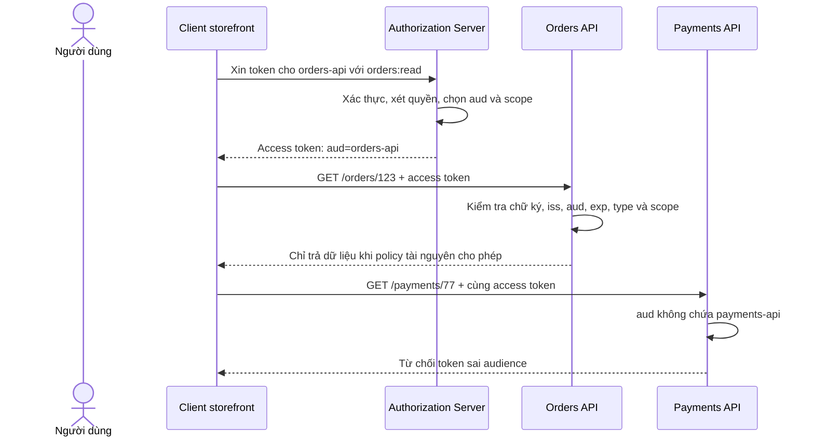
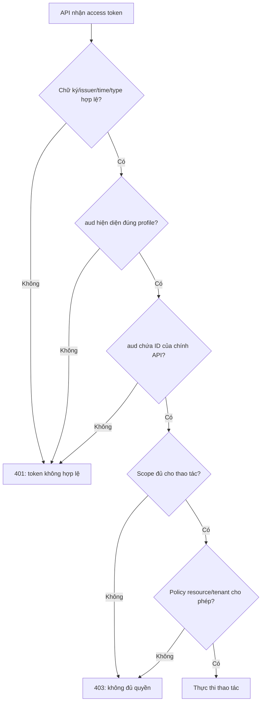

# Audience thiếu hoặc không khớp

Trong xác thực và phân quyền bằng token, **audience** xác định **token được phát hành cho bên nhận nào**. Với một access token dành cho API đơn hàng, bên nhận dự kiến có thể là `orders-api`; API thanh toán `payments-api` **không được chấp nhận token đó** chỉ vì chữ ký đúng, token còn hạn và có một scope hợp lệ. Ngược lại, token **không có thông tin audience bắt buộc** khiến API không xác định được token có thực sự được cấp cho mình hay không.

Nguyên tắc của bài là: **resource server phải xác minh token được cấp cho chính resource server ấy** theo hợp đồng token đã cấu hình. Nếu audience bị thiếu trong một profile bắt buộc audience, hoặc không có giá trị nào khớp API hiện tại, kết quả là **từ chối**. Không lấy `iss`, `sub`, `client_id`, `scope` hay chữ ký hợp lệ để suy diễn thay audience.

Bài nằm trong chương **Audience** của module **SECURITY_TOKEN_SECURITY_FUNDAMENTALS**, thuộc phạm vi mô hình tin cậy và vòng đời JWT, opaque token, access token, refresh token trong OAuth 2.0/OIDC; phát hành, kiểm tra claims, scope, audience, lưu trữ, thu hồi và chống token bị đánh cắp hoặc phát lại. Trọng tâm ở đây là cách xử lý **audience thiếu hoặc không khớp** ở cả bên cấp token và bên nhận token.

## 1. Mục tiêu học tập

Sau bài này, bạn có thể:

1. Giải thích claim `aud` và phân biệt nó với issuer, subject, client ID, authorized party và scope.
2. Nêu rõ khi nào `aud` là bắt buộc theo **loại token và profile**, thay vì coi mọi JWT đều có cùng quy tắc.
3. Kiểm tra `aud` dạng chuỗi hoặc mảng bằng **so khớp chính xác** với audience tin cậy được cấu hình tại resource server.
4. Thiết kế hành vi **fail closed** khi `aud` thiếu, rỗng, sai, không thể diễn giải hoặc không được ràng buộc rõ ràng theo hợp đồng token.
5. Hiểu khác biệt audience của **JWT access token**, **OIDC ID token** và **opaque access token**.
6. Cấu hình kiểm tra audience ở Java/Spring Security cùng với chữ ký, issuer, expiry và scope.
7. Phát hiện lỗi **token substitution**, **cross-service token reuse** và **confused deputy** do bỏ qua audience.
8. Kiểm thử cả đường đi thành công lẫn lỗi và biết cách điều tra sự cố mismatch khi vận hành.

## 2. Audience trả lời câu hỏi nào?

Mỗi token được cấp trong một ngữ cảnh tin cậy cụ thể. Với access token, những thông tin quan trọng gồm:

| Thuộc tính | Câu hỏi cần trả lời | Ví dụ |
| --- | --- | --- |
| `iss` — issuer | **Ai phát hành token?** | `https://auth.example.test` |
| `aud` — audience | **Token được phát hành cho API/bên nhận nào?** | `https://api.example.test/orders` |
| `sub` — subject | **Token nói về chủ thể nào?** | `user-42` |
| `client_id` hoặc thông tin client tương ứng | **Client nào nhận hoặc sử dụng quyền được cấp?** | `storefront` |
| `scope` | **Những phạm vi thao tác nào được cấp?** | `orders:read` |
| `exp`, `nbf` | **Token còn nằm trong cửa sổ hiệu lực?** | Các mốc NumericDate |
| Policy tài nguyên | **Chủ thể này có quyền trên bản ghi cụ thể không?** | Chủ đơn hàng, tenant, trạng thái |

Những thuộc tính này có nhiệm vụ **độc lập**. Access token của user A có scope `orders:read` và audience `orders-api` không thể dùng tại `billing-api`, dù cả hai API tin cùng một authorization server.

Một ví dụ dễ nhầm:

```text
iss       = https://auth.example.test
sub       = user-42
client_id = storefront
aud       = orders-api
scope     = orders:read
```

Các giá trị `iss`, `sub` và `client_id` có thể hoàn toàn đúng khi gửi token đến `payments-api`. Tuy nhiên **`payments-api` phải từ chối** vì nó không nằm trong audience hợp lệ. Chỉ kiểm tra issuer và chữ ký sẽ làm mất ranh giới giữa các API.

### 2.1. Audience khác scope

**Audience** giới hạn *nơi* token được sử dụng; **scope** giới hạn *quyền thao tác* đã được cấp trong ngữ cảnh đó. Cần thỏa đồng thời:

```text
token đã được xác minh
AND issuer được tin cậy
AND audience bao gồm resource server hiện tại
AND thời gian và token type hợp lệ
AND scope đủ cho action
AND policy cho phép trên resource/tenant cụ thể
```

Vì vậy, thêm `payments:refund` vào một token có `aud=orders-api` **không** biến token thành access token của payments. Tương tự, một token đúng audience nhưng thiếu scope cho thao tác vẫn bị từ chối.

### 2.2. Audience khác địa chỉ client

Trong OAuth 2.0, **client** dùng access token để gọi API, còn **resource server** là bên nhận access token. Do đó audience của access token thường nhận diện **resource server**, không phải tên ứng dụng đã đăng nhập.

Với **OIDC ID token**, ngữ cảnh khác: ID token được phát hành cho **OIDC client**, nên audience của ID token phải chứa **`client_id`** của client theo quy tắc OIDC. Nếu một API nghiệp vụ chấp nhận ID token chỉ vì nó có chữ ký của cùng issuer, đó là lỗi **nhầm loại token và nhầm audience**.

## 3. `aud` có bắt buộc với mọi JWT không?

Đây là điểm cần phân biệt theo tiêu chuẩn:

1. **JWT tổng quát (RFC 7519):** `aud` là một claim đã đăng ký nhưng **không bắt buộc hiện diện trong mọi JWT**. Nếu claim `aud` có mặt, bên xử lý phải tự nhận diện mình trong audience; nếu không thì phải từ chối. Một profile ứng dụng vẫn có thể bắt buộc audience.
2. **JWT access token theo RFC 9068:** profile này yêu cầu audience để resource server xác định token có được cấp cho nó. Resource server triển khai profile **phải từ chối** access token thiếu audience hợp lệ.
3. **OIDC ID token:** `aud` là claim bắt buộc; client kiểm tra audience chứa `client_id` của mình, cùng các điều kiện OIDC khác, chẳng hạn `azp` khi áp dụng.
4. **Opaque access token:** client/RS không tự đọc một `aud` trong chuỗi opaque. Resource server dựa trên introspection hoặc hợp đồng xác minh tin cậy để kiểm tra token có dành cho mình hay không; trường `aud` trong phản hồi introspection tùy profile triển khai.

Vì thế, câu nói **“mọi JWT thiếu `aud` đều sai chuẩn JWT”** là không chính xác. Cách nói đúng là: **khi hợp đồng token của resource server yêu cầu ràng buộc audience — đặc biệt với JWT access token theo RFC 9068 — thiếu audience phải dẫn đến từ chối**.

### 3.1. Ma trận quyết định theo loại token

| Loại token và ngữ cảnh | Người nhận dự kiến | `aud` thiếu hoặc sai | Cách xử lý |
| --- | --- | --- | --- |
| JWT access token theo RFC 9068 | Resource server được khai báo | Thiếu, hoặc không chứa ID của RS | Từ chối |
| JWT access token theo profile riêng yêu cầu `aud` | Resource server | Thiếu, hoặc không khớp | Từ chối |
| JWT tổng quát không dùng làm access token, profile không yêu cầu `aud` | Bên nhận theo hợp đồng riêng | Thiếu | Xử lý đúng profile; **không** suy diễn nó là access token được phép gọi API |
| OIDC ID token | OIDC client | Thiếu hoặc không chứa `client_id` của client | Client từ chối |
| Opaque access token với introspection trả audience | Resource server được cấp quyền | Không chứa RS hiện tại | Từ chối |
| Opaque access token không có `aud` trong introspection | RS xác minh theo hợp đồng AS | Không có dữ liệu ràng buộc RS đáng tin khác | Từ chối; chỉ dùng cơ chế thay thế nếu AS/RS đã định nghĩa và thực thi rõ ràng |
| Refresh token | Token endpoint của AS | Không so sánh như một access token tại API | API nghiệp vụ phải từ chối refresh token |

**Không tự tạo ngoại lệ “token cũ không có aud nên cứ cho qua”**. Nếu có token legacy cần hỗ trợ, hệ thống phải có cơ chế thay thế **có chứng cứ ràng buộc resource server**, được định nghĩa ở issuer/token profile và được kiểm thử. Tránh cho một JWT không xác định nơi nhận tự do lưu thông giữa các API.

## 4. `aud` có thể là chuỗi hoặc mảng

Theo RFC 7519, claim `aud` có thể được biểu diễn bằng:

- **Chuỗi đơn** khi chỉ có một audience.
- **Mảng chuỗi** khi có nhiều audience.

Ví dụ một audience:

```json
{
  "iss": "https://auth.example.test",
  "sub": "user-42",
  "aud": "orders-api",
  "scope": "orders:read",
  "exp": 1800000900
}
```

Ví dụ nhiều audience:

```json
{
  "iss": "https://auth.example.test",
  "sub": "user-42",
  "aud": ["orders-api", "inventory-api"],
  "scope": "orders:read inventory:read",
  "exp": 1800000900
}
```

Đây chỉ là **payload minh họa**, không phải token có chữ ký hay quyền truy cập thật.

Khi `orders-api` kiểm tra token thứ hai, nó có thể thấy mình trong danh sách audience. Nhưng chỉ thế **chưa** đủ: phải kiểm tra token profile, phạm vi quyền được cấp và policy ứng dụng. Khi `billing-api` kiểm tra token đó, kết quả **không khớp audience**, nên phải từ chối.

### 4.1. So khớp chính xác, không so khớp gần đúng

Các cách sau có thể gây lỗi nghiêm trọng:

```java
// SAI: token có aud="orders-api-admin" cũng có thể lọt điều kiện này.
boolean accepted = audienceString.contains("orders-api");

// SAI: chấp nhận audience cùng tiền tố mà không cần khớp chính xác.
accepted = audienceString.startsWith("https://api.example.test");

// SAI: chỉ kiểm tra claim tồn tại, không xác minh RS thuộc tập được nhận.
accepted = audienceClaim != null;
```

Với danh sách audience đã được parser hợp lệ và thư viện JWT **xác minh**, kiểm tra membership **chính xác**:

```java
String expectedAudience = "orders-api";  // Cấu hình phía API.
List<String> verifiedAudiences = verifiedJwt.getAudience();

boolean accepted = verifiedAudiences != null
    && verifiedAudiences.contains(expectedAudience);
```

Quy tắc này phải chạy **sau** khi chữ ký/JWT được xác minh, và parser phải xử lý đúng dạng chuỗi hoặc mảng theo profile. Không nhận audience do client gửi riêng qua query/header làm giá trị `expectedAudience`.

### 4.2. Định danh audience có phân biệt chính tả

Giả sử API được cấu hình:

```text
expectedAudience = https://api.example.test/orders
```

Những giá trị sau **không mặc nhiên tương đương**:

```text
https://api.example.test/orders/
https://API.example.test/orders
https://api.example.test/orders?version=1
http://api.example.test/orders
orders-api
```

Định danh audience phải được so sánh theo **hợp đồng/token profile**; với `StringOrURI` theo JWT, so sánh chuỗi có phân biệt chữ hoa/thường và không tự áp dụng canonicalization URI. Không tự bỏ dấu `/`, chuyển chữ hoa/thường hoặc chấp nhận URL cùng host. Nếu hệ thống muốn đổi identifier, hãy cập nhật AS và RS theo quy trình có kiểm soát, có giai đoạn chuyển đổi và bộ kiểm thử.

Đặc biệt, **audience là định danh**, không nhất thiết phải là URL có thể truy cập được. `orders-api` có thể là identifier hợp lệ nếu issuer và resource server thống nhất và cấu hình phù hợp.

### 4.3. Nhiều audience có thực sự cần thiết?

Token nhiều audience có thể hợp lệ theo profile và chủ đích cấp phát, nhưng làm tăng số bên chấp nhận một bản sao token. Nếu bearer token bị đánh cắp, kẻ tấn công có thể thử sử dụng tại **tất cả** audience mà token được cấp.

Thiết kế ưu tiên:

- Cấp token đúng **resource server cần truy cập**.
- Scope tương ứng audience cụ thể; tránh đồng nhất tên scope giữa các API với nghĩa khác nhau.
- Nếu một client cần gọi hai API, cân nhắc **access token riêng** hoặc cơ chế cấp đổi/token exchange có kiểm soát.
- Chỉ dùng nhiều audience khi có nhu cầu cụ thể và cả AS lẫn RS xác minh được ranh giới quyền của từng audience.

**Không tạo `aud=["*"]` hay coi `aud=all-services` là mặc định an toàn.** Nếu một identifier chung được sử dụng, ý nghĩa và phạm vi tin cậy phải được định nghĩa nghiêm ngặt; thông thường nên ưu tiên audience hẹp.

## 5. Luồng tin cậy khi audience được phát hành và kiểm tra

Một ví dụ có ba dịch vụ:

- **AS:** `https://auth.example.test` phát hành access token.
- **Orders API:** identifier `orders-api`, chỉ nhận token dành cho orders.
- **Payments API:** identifier `payments-api`, chỉ nhận token dành cho payments.



Kết luận: **chữ ký từ cùng AS không tạo quyền sử dụng token tại mọi API**. AS có thể là điểm phát hành chung, nhưng từng resource server phải bảo vệ ranh giới riêng.

### 5.1. Authorization server chịu trách nhiệm cấp đúng audience

AS nên quyết định audience dựa trên:

1. Client đã được đăng ký và được phép truy cập resource server nào.
2. Resource mà request thật sự yêu cầu, theo giao thức và chính sách.
3. Grant, danh tính chủ thể và consent nếu áp dụng.
4. Scope đã được phê duyệt **trong phạm vi resource đó**.
5. Token profile, thời hạn và chính sách bảo vệ cần thiết.

**Client không thể tự điền audience tùy ý rồi đòi AS ký ngay**. Giá trị resource/audience do client yêu cầu phải được xác thực và đối chiếu với chính sách. Ngược lại, không nên ép mọi resource server phải chấp nhận một audience quá rộng chỉ vì AS chỉ phát hành một loại token.

### 5.2. Resource Indicators và Token Exchange

Khi một client gọi nhiều API, có thể dùng các cơ chế OAuth phù hợp để xin token đúng nơi nhận:

- **RFC 8707 — Resource Indicators for OAuth 2.0**: client gửi tham số `resource` để chỉ định tài nguyên dự kiến; AS áp dụng chính sách khi phát hành access token và ràng buộc token với resource thích hợp.
- **RFC 8693 — OAuth 2.0 Token Exchange**: trong kiến trúc được hỗ trợ, một thành phần có thể yêu cầu đổi token sang token mới với audience/resource/scope được phép theo chính sách AS.

Tham số `resource` và `audience` trong các giao thức liên quan là **đề nghị để AS xét**, không phải bằng chứng resource server phải tin. API chỉ tin kết quả nằm trong **access token đã được xác minh** hoặc metadata introspection đáng tin.

Một flow đúng khi `storefront` gọi orders rồi cần payments:

```text
1. Client được AS cấp access token A cho orders-api.
2. Client gọi orders-api bằng token A.
3. Khi cần payments, client xin hoặc đổi token B cho payments-api.
4. Payments API xác minh aud của token B là payments-api.
5. Payments API vẫn kiểm tra scope và quyền giao dịch cụ thể.
```

Không chuyển tiếp nguyên token A sang payments rồi yêu cầu payments **bỏ qua audience** để hoạt động.

## 6. Audience thiếu hoặc không khớp tạo ra rủi ro nào?

### 6.1. Cross-service token reuse

Một ứng dụng đọc đơn hàng dùng access token có `aud=orders-api`. Nếu `billing-api` chỉ kiểm tra chữ ký và `exp`, nó có thể vô tình chấp nhận token đó. Khi client hoặc token bị xâm nhập, kẻ tấn công có thể dùng quyền vốn chỉ được cấp cho orders để tấn công billing.

Vấn đề trở nên nghiêm trọng khi hai API:

- Dùng chung issuer và bộ khóa công khai.
- Có cùng tên scope `read` hoặc `admin` nhưng ý nghĩa khác nhau.
- Bỏ qua claim `aud` vì nghĩ chữ ký đúng là đủ.
- Cho phép token tự chọn cách diễn giải scope theo endpoint nhận.

**Cách ngăn:** kiểm tra audience của **từng API** trước scope và policy nghiệp vụ, đồng thời đặt namespace scope rõ ràng.

### 6.2. Confused deputy

*Confused deputy* xảy ra khi một thành phần có quyền cao hơn vô tình dùng quyền của mình để phục vụ yêu cầu không được cấp đúng ngữ cảnh. Trong hệ thống token, một API nhận nhầm token được phát hành cho nơi khác có thể thực thi hành động ngoài ủy quyền dự kiến.

Ví dụ `reporting-api` tin token có `aud=orders-api` do cùng issuer ký, rồi dùng quyền nội bộ của nó để đọc báo cáo nhạy cảm. Client chỉ có token để đọc orders, nhưng hệ thống báo cáo đã nhầm token đó với chứng cứ ủy quyền cho mình.

**Kiểm tra `aud` là một lớp chống nhầm đích**, phải kết hợp kiểm tra scope và phân quyền mức tài nguyên. Không có một claim nào tự ngăn mọi biến thể confused deputy.

### 6.3. ID token substitution

Khi đăng nhập OIDC, client nhận **ID token** có audience là `client_id`. Nếu API chấp nhận ID token này như access token, có thể tạo lỗ hổng bởi:

- ID token được thiết kế để client kiểm tra kết quả xác thực, **không phải** để API cấp quyền.
- `aud` trong ID token hướng tới client, khác đối tượng nhận access token.
- ID token có thể không có scope cho API hoặc không có profile access token.

**API phải từ chối ID token** ngay cả khi chữ ký, `iss`, `sub` và thời hạn đều hợp lệ. Ngoài audience, cần kiểm tra **token type/profile** để chặn token substitution.

## 7. Xử lý JWT access token: không được tin claims trước khi verify

Với JWT dạng JWS, phần payload có thể được đọc bằng Base64URL mà không cần khóa. Nhưng **đọc được `aud` không có nghĩa claim đáng tin**: attacker có thể tự tạo JSON tùy ý rồi gắn vào một chuỗi trông giống JWT.

Luồng xác minh an toàn:

1. **Nhận token** tại vị trí cho phép, thường là header `Authorization: Bearer ...`; không lấy `aud` từ query/header riêng do client tự gửi.
2. **Xác minh loại token và chữ ký** bằng thư viện JOSE đáng tin. Cấu hình issuer, thuật toán và JWKS tin cậy; không cho token chưa xác minh tự chỉ định nơi lấy khóa.
3. **Xác minh issuer, audience và thời gian** theo profile. Nếu thiếu `aud` bắt buộc, không khớp hoặc có kiểu dữ liệu không được profile hỗ trợ thì từ chối.
4. **Kiểm tra scope và client/subject context** tương ứng action.
5. **Kiểm tra quyền trên đối tượng cụ thể** từ dữ liệu có thẩm quyền: owner, tenant, trạng thái, policy.
6. **Áp dụng thu hồi nếu được thiết kế**: denylist, trạng thái phiên, policy động hoặc cơ chế khác; không mặc định JWT còn chữ ký nghĩa là vẫn còn quyền.



### 7.1. Không tin algorithm, key URL từ token

Một JWT có protected header chứa `alg` và `kid`, đôi khi có tham số như `jku`. Đây vẫn là dữ liệu **chưa đáng tin** trước khi xác minh. Resource server cần:

- **Allowlist thuật toán** phù hợp token profile; không chấp nhận `alg=none` nếu token phải có chữ ký.
- Lấy JWKS từ **issuer cấu hình trước**, không tải tùy tiện URL khóa do token tự đưa vào.
- Chỉ dùng `kid` để chọn khóa trong tập đã tin cậy, kiểm tra loại khóa/thuật toán tương ứng.
- Xử lý JWKS cache, xoay khóa và lỗi network an toàn; **không bỏ qua xác minh** khi hệ thống khóa gặp sự cố.

Audience hợp lệ **không bù** được chữ ký sai. Ngược lại, chữ ký đúng **không bù** được audience sai.

### 7.2. JWT với `aud` mảng

Tạo JWT có `aud=["orders-api","inventory-api"]` không có nghĩa nó phải được chấp nhận tại bất kỳ hệ thống nào có tên gần giống. Resource server:

1. Parse claim theo token profile bằng thư viện có kiểm tra kiểu dữ liệu.
2. So sánh danh sách audience đã xác minh với identifier **cấu hình cục bộ**.
3. Từ chối nếu danh sách rỗng, không chứa identifier đó hoặc token không đáp ứng ràng buộc audience khác của profile.
4. Kiểm tra scope và chính sách resource sau khi audience đã qua.

**Không so sánh cả danh sách với một chuỗi bằng phép chuyển đổi `toString()`** hay so sánh dấu phẩy bằng substring.

## 8. Ví dụ Java Spring Security: xác minh issuer và audience

Spring Security Resource Server hỗ trợ xác minh JWT với `JwtDecoder`. Ví dụ sau cấu hình issuer/JWKS được tin cậy và audience riêng của `orders-api`. Đây là **mẫu kiến trúc**; phải thay các giá trị ví dụ bằng thông tin thực tế và hoàn chỉnh token profile validation theo hệ thống.

```java
@Configuration
@EnableWebSecurity
@EnableMethodSecurity
class OrdersSecurityConfig {

    private static final String ISSUER = "https://auth.example.test";
    private static final String JWKS_URI =
        "https://auth.example.test/.well-known/jwks.json";
    private static final String EXPECTED_AUDIENCE = "orders-api";

    @Bean
    JwtDecoder jwtDecoder() {
        NimbusJwtDecoder decoder = NimbusJwtDecoder
            .withJwkSetUri(JWKS_URI)
            .jwsAlgorithm(SignatureAlgorithm.RS256)
            .build();

        OAuth2TokenValidator<Jwt> issuerAndTime =
            JwtValidators.createDefaultWithIssuer(ISSUER);

        OAuth2TokenValidator<Jwt> audience = jwt -> {
            boolean matches = jwt.getAudience() != null
                && jwt.getAudience().contains(EXPECTED_AUDIENCE);

            return matches
                ? OAuth2TokenValidatorResult.success()
                : OAuth2TokenValidatorResult.failure(
                    new OAuth2Error(
                        "invalid_token",
                        "Access token audience is missing or invalid",
                        null
                    )
                );
        };

        decoder.setJwtValidator(
            new DelegatingOAuth2TokenValidator<>(
                issuerAndTime,
                audience
            )
        );
        return decoder;
    }

    @Bean
    SecurityFilterChain filterChain(HttpSecurity http) throws Exception {
        http
            .authorizeHttpRequests(auth -> auth
                .requestMatchers(HttpMethod.GET, "/api/orders/**")
                    .hasAuthority("SCOPE_orders:read")
                .anyRequest().denyAll()
            )
            .oauth2ResourceServer(oauth ->
                oauth.jwt(Customizer.withDefaults())
            );
        return http.build();
    }
}
```

Ý nghĩa từng lớp:

- **`JwtDecoder`** kiểm tra chữ ký theo khóa và thuật toán đã cấu hình.
- **`JwtValidators.createDefaultWithIssuer`** kiểm tra issuer và những thuộc tính chuẩn liên quan thời gian theo phiên bản thư viện.
- **Audience validator** từ chối token thiếu `aud` hoặc không chứa `orders-api`.
- **HTTP authorization** yêu cầu scope đọc; mặc định route khác đều bị từ chối.
- **Tầng nghiệp vụ** phải kiểm tra thêm chủ đơn hàng và tenant.

**Lưu ý về profile:** nếu triển khai JWT access token theo RFC 9068, cần kiểm tra thêm những thuộc tính bắt buộc của profile, bao gồm **phân biệt access token với ID token** theo cách quy định bởi issuer/profile. Không xem đoạn code trên là một profile validator hoàn chỉnh. Các import, cấu hình issuer, JWK endpoint và phiên bản Spring Security phải tương thích dự án thực tế.

### 8.1. Không hardcode audience bằng dữ liệu của request

Ví dụ sai:

```java
// SAI: mọi client có thể chọn một audience mà mình muốn kiểm tra.
String expectedAudience = request.getHeader("X-Expected-Audience");
boolean accepted = jwt.getAudience().contains(expectedAudience);
```

Nếu cả token và `X-Expected-Audience` do attacker lựa chọn, phép so sánh vô nghĩa. `EXPECTED_AUDIENCE` phải đến từ **cấu hình tin cậy của API hoặc mapping route/resource đã được phê duyệt**, không lấy trực tiếp từ dữ liệu chưa đáng tin.

### 8.2. Kiểm tra policy đối tượng sau khi audience đúng

Giả sử `orders-api` nhận JWT hợp lệ với `aud=orders-api`, `scope=orders:read`. Khi client gọi `GET /api/orders/501`, phải kiểm tra đơn 501 có thuộc chủ thể và tenant đã được phép không.

```java
boolean canReadOrder(
    Jwt verifiedJwt,
    Order order,
    String requiredTenant
) {
    String subject = verifiedJwt.getSubject();
    String tokenTenant = verifiedJwt.getClaimAsString("tenant_id");

    return subject != null
        && tokenTenant != null
        && tokenTenant.equals(requiredTenant)
        && tokenTenant.equals(order.getTenantId())
        && subject.equals(order.getOwnerId());
}
```

Đoạn minh họa giả định JWT **đã được xác minh** và có một lớp khác kiểm tra scope `orders:read`. `requiredTenant` phải được lấy từ ngữ cảnh đáng tin, không chỉ từ tham số tùy ý do client gửi. Trong thực tế, nên đặt policy gần nơi truy vấn/thao tác dữ liệu để tránh bỏ sót caller khác ngoài HTTP.

## 9. Opaque token: audience được xác minh ra sao?

Opaque token không có cấu trúc mà RS có thể diễn giải trực tiếp. Resource server thường kiểm tra token qua **introspection endpoint** của AS theo OAuth 2.0:

```json
{
  "active": true,
  "iss": "https://auth.example.test",
  "sub": "user-42",
  "client_id": "storefront",
  "aud": "orders-api",
  "scope": "orders:read",
  "exp": 1800000900
}
```

Đây là phản hồi **minh họa**, không phải token hay introspection response thực. Theo RFC 7662, `aud` trong introspection là trường có thể được cung cấp; tập trường phản hồi và cách AS ràng buộc resource server phụ thuộc profile/triển khai.

Để RS sử dụng an toàn:

1. Gọi **introspection endpoint đáng tin**, xác thực RS theo cơ chế triển khai và dùng TLS.
2. Chỉ dựa trên phản hồi đã được xác thực, kiểm tra `active` và các thuộc tính bắt buộc theo hợp đồng.
3. Nếu nhận `aud`, kiểm tra nó chứa **resource server hiện tại**.
4. Nếu không nhận `aud`, chỉ chấp nhận khi tồn tại **cơ chế ràng buộc resource server khác được AS và RS định nghĩa rõ, kiểm chứng được**, ví dụ metadata/kiểm tra riêng từ một endpoint introspection được AS giới hạn cho RS đang gọi. Không coi `active: true` tự động có nghĩa token dùng được ở mọi API.
5. Tiếp tục kiểm tra scope và policy trên tài nguyên.
6. Xử lý lỗi introspection theo hướng **fail closed**; không tự gán audience khi thiếu dữ liệu.

### 9.1. Introspection có thể bị cache, cần giới hạn độ trễ

Cache có thể giảm số lượt hỏi AS, nhưng tạo khoảng thời gian trước khi việc thu hồi token/audience/quyền được nhìn thấy tại RS. Chọn TTL theo rủi ro nghiệp vụ, giới hạn cache theo token/RS và không sử dụng dữ liệu introspection của **API A** như bằng chứng token hợp lệ tại **API B** nếu không có kiểm soát audience tương ứng.

### 9.2. Refresh token không phải access token của API

Refresh token được gửi đến token endpoint của AS để lấy access token mới trong giới hạn chính sách. Một API nghiệp vụ không được chấp nhận refresh token để “bù” cho access token thiếu audience. Khi refresh, AS cần cấp access token có **audience và scope đúng yêu cầu hiện tại đã được phê duyệt**; refresh không cho phép client tự mở rộng quyền.

## 10. Audience ở OIDC ID token

OIDC ID token thường có payload minh họa:

```json
{
  "iss": "https://id.example.test",
  "sub": "user-42",
  "aud": "web-client-123",
  "exp": 1800000900,
  "iat": 1800000000,
  "nonce": "example-nonce"
}
```

Ở đây **`web-client-123` là OIDC client ID**, không phải API. OIDC client phải xác minh ID token theo đặc tả: chữ ký/issuer, `aud` chứa client ID, thời gian và các điều kiện như `nonce`, `azp` khi áp dụng.

Hai sai lầm đối xứng:

- **Client OIDC nhận ID token có audience của client khác:** phải từ chối, dù token ký hợp lệ.
- **Orders API nhận ID token có audience của web-client:** phải từ chối, vì ID token không phải access token dành cho orders.

Claim `azp` (authorized party) trong OIDC có vai trò riêng theo quy tắc ID token. Không được lấy `azp` thay `aud` để chấp nhận ID token ở client hoặc access token ở API khi audience thiếu/sai. Các chi tiết kiểm tra `azp` phải dựa trên ngữ cảnh và điều kiện của đặc tả/profile.

## 11. Audience sai: phân biệt 401, 403 và sự cố cấu hình

Với bearer-protected API:

| Tình huống | Mã phản hồi thường phù hợp | Cách hiểu |
| --- | --- | --- |
| Không có token | `401 Unauthorized` | Không có credential bắt buộc |
| Token sai chữ ký, issuer, audience hoặc thời hạn | `401 Unauthorized` | Token không hợp lệ cho API |
| Token là ID token/refresh token thay access token | `401 Unauthorized` hoặc từ chối xác thực tương ứng | Sai loại token |
| Token hợp lệ nhưng thiếu scope cho action | `403 Forbidden` | Không đủ phạm vi quyền |
| Token đúng audience/scope nhưng sai owner/tenant | `403 Forbidden` hoặc `404` theo chính sách che giấu tài nguyên | Quyền đối tượng không đáp ứng |
| JWKS/introspection không sẵn sàng | Không cho truy cập; mã lỗi theo hợp đồng, có thể `503` | Không được bỏ qua xác minh |

Một phản hồi cho audience sai có thể là:

```http
HTTP/1.1 401 Unauthorized
WWW-Authenticate: Bearer error="invalid_token"
```

Không trả toàn bộ `aud`, token, claims nhạy cảm hoặc chi tiết nội bộ policy cho client trong lỗi production. Thông điệp lỗi phía client nên đủ để xử lý mà không tiết lộ thông tin giúp dò cấu hình. Ở log bảo mật nội bộ có thể dùng reason code `invalid_audience` để chẩn đoán chính xác hơn.

**Audience mismatch không phải một lỗi thiếu scope.** Đừng trả gợi ý “hãy xin `orders:read`” cho token vốn được phát hành để gọi payments; client cần một **access token đúng resource** chứ không chỉ scope bổ sung.

## 12. Trường hợp thực tế: token dành cho API A bị gửi tới API B

Giả sử:

```text
Authorization Server: https://auth.example.test
Client:               storefront
Access token:
  iss   = https://auth.example.test
  sub   = user-42
  aud   = orders-api
  scope = orders:read
  exp   = còn hạn

Nơi request đến: payments-api
Hành động:        POST /payments/501/refund
```

**Phương án sai:** `payments-api` chỉ kiểm tra chữ ký, issuer, thời hạn rồi tìm một claim role chung để cho phép hoàn tiền. Nó đã nhận token do cùng AS ký nhưng **không dành cho payments**.

**Phương án đúng:** `payments-api` kiểm tra `aud` chứa `payments-api`; điều kiện sai nên chặn trước khi đánh giá scope hay thực thi nghiệp vụ. Nếu cần hoàn tiền, client phải được AS cấp token dành cho payments với scope và quyền phù hợp. Sau đó payments tiếp tục kiểm tra policy/tenant/hạn mức trên payment 501.

Nếu một tổ chức vận hành nhiều microservice, đây là dạng lỗi có thể lan rộng khi các API sao chép cấu hình chỉ xác minh `iss` mà không kiểm tra `aud` riêng.

### 12.1. Cùng issuer không có nghĩa cùng audience

Hai API cùng tin `https://auth.example.test` để xác minh chữ ký là hợp lý. Tuy nhiên:

```text
orders-api  -> expectedAudience = orders-api
payments-api -> expectedAudience = payments-api
reports-api -> expectedAudience = reports-api
```

Mỗi RS cần validator audience riêng. Không dùng một giá trị mặc định chung kiểu `aud=all` chỉ vì muốn chia sẻ cấu hình decoder.

### 12.2. API gateway kiểm tra audience rồi backend có cần kiểm tra nữa?

Nếu backend **có thể được gọi trực tiếp** (mạng nội bộ, job, RPC, message consumer, endpoint khác), chỉ dựa vào gateway sẽ tạo đường vòng bảo mật. Cần bảo vệ theo **ranh giới tin cậy thực sự**. Cách triển khai có thể gồm:

- Resource server xác minh JWT/audience trực tiếp.
- Gateway xác minh và truyền **ngữ cảnh danh tính được bảo vệ** đến backend qua kênh đáng tin, trong khi backend chỉ tin gateway sau xác thực dịch vụ và kiểm soát network.
- Những tác vụ không qua gateway dùng cơ chế danh tính/authorization tương đương.

Không chuyển header `X-Audience-Verified: true` do client có thể tự đặt rồi cho backend tin một cách mặc định. Phải thiết kế **chuỗi bảo đảm** giữa các thành phần, tránh bỏ kiểm tra ở một đường truy cập.

## 13. Chẩn đoán audience mismatch khi vận hành

Khi API liên tục trả `invalid_audience`, nguyên nhân không nhất thiết là tấn công. Có thể là lỗi cấu hình:

| Triệu chứng | Nguyên nhân có thể | Cách xác minh và sửa |
| --- | --- | --- |
| Mọi token bị từ chối sau deployment | AS đổi audience identifier nhưng RS chưa cập nhật | Đối chiếu hợp đồng issuer/resource với cấu hình RS; triển khai đồng bộ |
| Chỉ một API báo lỗi | Client gửi token cấp cho API khác | Kiểm tra flow xin token và resource indicator |
| Token có `aud` mảng nhưng RS từ chối | Validator chỉ hỗ trợ chuỗi hoặc so sánh sai | Dùng parser/validator hỗ trợ dạng string/array theo profile |
| Identifier gần giống nhưng lệch dấu `/` | AS và RS khác định danh | Thống nhất **exact identifier**, tránh chuẩn hóa tùy tiện |
| ID token bị gửi vào API | Client chọn nhầm token từ OIDC login | Gửi đúng access token theo audience/API |
| `aud` trống/thiếu với JWT access token mới | AS phát hành sai profile hoặc client dùng flow khác | Sửa AS, không nới lỏng kiểm tra tại API |
| Opaque introspection không có audience | Response/profile không cung cấp thông tin ràng buộc | Rà soát hợp đồng AS-RS; bổ sung binding rõ ràng |
| Lỗi sau xoay khóa | RS không xác minh được chữ ký trước khi xét audience | Kiểm tra JWKS cache và `kid`; không nhầm với audience |

Khi gỡ lỗi:

1. Ghi **request ID**, tên API, reason code và phiên bản cấu hình; tránh log nguyên bearer token.
2. Trên môi trường an toàn, dùng **token thử nghiệm** để xem issuer, audience, loại token và thời hạn; không dán token production vào website giải mã công khai.
3. Đối chiếu **giá trị audience được AS cam kết phát hành** với expected audience của RS, gồm cả kiểu chuỗi/mảng.
4. Kiểm tra luồng client xin token: nó đã chọn đúng resource chưa, có nhầm ID token với access token không?
5. Chỉ sửa **hợp đồng cấp token hoặc cấu hình RS có kiểm soát**; không sửa thành `skipAudienceValidation=true` để hết lỗi nhanh.
6. Thêm test hồi quy và theo dõi số lỗi audience trước/sau khi triển khai.

Nên phân biệt các mã lỗi nội bộ như `missing_audience`, `audience_mismatch`, `invalid_signature`, `expired_token` và `token_type_mismatch`. Điều này giúp chẩn đoán mà không tiết lộ dữ liệu nhạy cảm trong response.

## 14. Quan hệ với thời hạn, thu hồi và replay

Audience là một **giới hạn đích nhận**, nhưng không tự bảo đảm token luôn an toàn:

- **Hết hạn:** `exp` giới hạn thời gian token được chấp nhận. Token đúng audience nhưng hết hạn vẫn bị từ chối.
- **Thu hồi:** JWT access token đã ký có thể tiếp tục hợp lệ tới `exp` nếu RS không có denylist, tra cứu phiên hoặc cơ chế thu hồi sớm. Audience không xử lý vấn đề quyền bị thu hồi.
- **Refresh:** refresh token dùng ở AS để xin access token mới; AS phải cấp token đúng audience/scope được phép ở thời điểm đó.
- **Đánh cắp và replay:** bearer token bị đánh cắp vẫn có thể được dùng tại audience hợp lệ trong cửa sổ thời gian còn hiệu lực. Giới hạn audience làm **giảm phạm vi lạm dụng**, nhưng không ngăn toàn bộ replay.
- **Sender-constrained token:** mTLS/DPoP có thể ràng buộc token với khóa bên gửi để giảm khả năng sao chép sử dụng từ nơi khác; **không thay thế kiểm tra audience**.
- **Lưu trữ:** dùng TLS, tránh token trong URL và log, bảo vệ cookie/secret store theo loại client; JWT ký số thông thường không mã hóa payload.

Một thiết kế tốt cần **audience hẹp + scope tối thiểu + token lifetime hợp lý + kiểm tra tài nguyên + cơ chế thu hồi và chống lộ phù hợp**.

## 15. Ma trận kiểm thử audience

### 15.1. Trường hợp JWT access token

Giả sử RS có:

```text
trustedIssuer    = https://auth.example.test
expectedAudience = orders-api
tokenProfile     = JWT access token
requiredScope    = orders:read
```

| Ca kiểm thử | `aud` hoặc tình huống | Kết quả mong đợi |
| --- | --- | --- |
| Token hợp lệ | `"orders-api"` | Qua bước audience; vẫn kiểm tra scope/policy |
| Mảng gồm RS | `["orders-api","inventory-api"]` theo profile cho phép | Qua bước audience; vẫn kiểm tra giới hạn khác |
| Không có claim | `aud` bị thiếu | **Từ chối** theo JWT access-token profile |
| Chuỗi rỗng | `""` | **Từ chối** |
| Mảng rỗng | `[]` | **Từ chối** |
| Audience khác | `"payments-api"` | **Từ chối** |
| Mảng không chứa RS | `["payments-api","billing-api"]` | **Từ chối** |
| Tiền tố gần giống | `"orders-api-admin"` | **Từ chối** |
| Sai chữ hoa/thường | `"Orders-API"` | **Từ chối** nếu expected ID là `orders-api` |
| ID dạng URI lệch `/` | `"https://api.example.test/orders/"` so với ID không có `/` | **Từ chối** nếu hợp đồng dùng exact matching |
| Kiểu dữ liệu sai | `aud: 123` hoặc object | **Từ chối** theo schema/profile |
| Duplicate `aud` | Hai property `aud` trong JSON claims | Nên từ chối input mơ hồ theo parser nghiêm ngặt |
| Header do client chọn | `X-Expected-Audience: payments-api` | Không ảnh hưởng expected audience của RS |
| Sai chữ ký nhưng `aud` đúng | Token bị sửa | **Từ chối** trước khi tin claims |
| Sai issuer nhưng `aud` đúng | AS không được tin cậy | **Từ chối** |
| Token quá hạn nhưng `aud` đúng | `exp` đã qua | **Từ chối** |
| ID token có `aud` client ID | Sai loại token | **Từ chối** tại API |
| Scope thiếu nhưng `aud` đúng | Không có `orders:read` | **Từ chối** ở bước quyền |
| Scope đủ, resource sai owner | Đơn hàng thuộc user khác | **Từ chối** ở policy tài nguyên |
| Scope đủ nhưng token bị thu hồi | Theo cơ chế AS/RS đã thiết kế | Không truy cập trái chính sách thu hồi |

### 15.2. Test mô phỏng validator trong Spring Security

Ví dụ test unit kiểm tra logic audience, không thay kiểm thử chữ ký thực tế:

```java
@Test
void rejectsJwtWithoutAudience() {
    Jwt jwt = Jwt.withTokenValue("test-only")
        .header("alg", "RS256")
        .issuer("https://auth.example.test")
        .subject("user-42")
        .claim("scope", "orders:read")
        .build();

    assertThat(audienceValidator.validate(jwt).hasErrors()).isTrue();
}

@Test
void rejectsJwtForAnotherResourceServer() {
    Jwt jwt = Jwt.withTokenValue("test-only")
        .header("alg", "RS256")
        .issuer("https://auth.example.test")
        .audience(List.of("payments-api"))
        .build();

    assertThat(audienceValidator.validate(jwt).hasErrors()).isTrue();
}

@Test
void acceptsAudienceMembershipButNotOtherAuthorizations() {
    Jwt jwt = Jwt.withTokenValue("test-only")
        .header("alg", "RS256")
        .issuer("https://auth.example.test")
        .audience(List.of("orders-api", "inventory-api"))
        .build();

    assertThat(audienceValidator.validate(jwt).hasErrors()).isFalse();
    // Bước scope/policy vẫn phải được kiểm tra riêng.
}
```

Đây là **mã minh họa**: `audienceValidator` là bean/đối tượng cần lấy từ code dự án, imports/phiên bản thư viện phải được bổ sung. Các test xây `Jwt` trực tiếp chỉ kiểm tra validator **sau parse**, không chứng minh token production có chữ ký hợp lệ. Cần test tích hợp với `JwtDecoder`, bộ khóa thử nghiệm và token thực sự được ký.

### 15.3. Test tích hợp qua các resource server

Với khóa ký **thử nghiệm** và API kiểm thử:

1. AS giả lập cấp JWT đúng issuer, đúng audience `orders-api` và scope `orders:read`. Orders API cho qua bước xác minh, sau đó xét owner/tenant.
2. Gửi **chính token đó** sang Payments API. Phải nhận từ chối do `aud` không chứa `payments-api`.
3. Phát hành JWT cùng issuer, cùng scope nhưng **bỏ `aud`**. Orders API phải từ chối theo profile.
4. Phát hành token có `aud=["orders-api","payments-api"]` nếu policy cho phép; xác minh từng API áp dụng đúng scope và policy, không cấp phép chéo.
5. Phát hành ID token cho `web-client-123` rồi gửi vào Orders API: bị từ chối do sai loại/audience.
6. Mô phỏng opaque token `active:true` nhưng audience không chứa RS; API từ chối.
7. Mô phỏng introspection trả trạng thái mà không có bất kỳ resource binding đáng tin nào; không cho qua bằng cách gán audience mặc định.
8. Mô phỏng lỗi JWKS/introspection, token hết hạn và quyền bị thu hồi; hệ thống không mở quyền chỉ vì không thể xác minh.

Kiểm thử cần xác nhận **không có service/repository nhạy cảm bị gọi** khi token sai audience. Trả `401` sau khi đã xử lý nghiệp vụ là quá muộn.

## 16. Bài thực hành

### Bài A — Đọc token và chọn API được phép nhận

Cho payload:

```json
{
  "iss": "https://auth.example.test",
  "sub": "user-15",
  "aud": ["catalog-api", "orders-api"],
  "scope": "catalog:read orders:read",
  "exp": 1800000900
}
```

Giả sử chữ ký, issuer và thời gian đã được xác minh thành công. Hãy lập bảng:

- `catalog-api` có thể vượt qua bước audience không?
- `orders-api` có thể vượt qua bước audience không?
- `billing-api` có thể vượt qua bước audience không?
- Với `GET /orders/200`, điều kiện nào ngoài audience và scope còn phải kiểm tra?

**Đáp án định hướng:** catalog và orders nằm trong tập audience, billing không nằm trong đó. Việc xem đơn 200 còn cần policy chủ sở hữu/tenant và các điều kiện nghiệp vụ khác.

### Bài B — Tìm lỗi khi “chung issuer thì dùng chung token”

Ba microservice sử dụng cùng AS. Security configuration chỉ khai báo issuer và ký số, không có audience validator. Developer đề nghị:

```text
if (signatureValid && !expired) {
    authorizeByScope(token.scope);
}
```

Hãy chỉ ra rủi ro token substitution và confused deputy; viết lại chính sách sao cho mỗi API yêu cầu đúng `aud`, đúng type, scope và quyền tài nguyên. Mô phỏng một token của orders gửi sang payments để chứng minh bản sửa đã chặn được.

**Tiêu chí đạt:** audience của API được lấy từ cấu hình tin cậy; không được phép lấy từ client request; sai audience bị chặn **trước** thao tác.

### Bài C — Chuyển đổi audience identifier

AS hiện phát hành `aud=orders-api`, còn RS mới cấu hình `aud=https://api.example.test/orders`. Sau deployment, tất cả request bị từ chối. Đề xuất kế hoạch chuyển đổi:

1. Chọn identifier đích và công bố hợp đồng dùng chung AS/RS.
2. Nếu buộc hỗ trợ cả cũ và mới trong giai đoạn ngắn, cấu hình **allowlist rõ ràng** và giới hạn thời gian chuyển đổi; không dùng so khớp tiền tố.
3. Bảo đảm AS chỉ cấp từng identifier cho đúng resource, không mở rộng quyền ngoài chủ đích.
4. Đo số token cũ còn hạn, thử các ca audience sai và loại bỏ alias cũ sau khi hoàn tất.

**Tiêu chí đạt:** trong cả giai đoạn chuyển đổi, không có token dành cho API khác được chấp nhận nhầm.

### Bài D — Opaque introspection thiếu `aud`

`payments-api` nhận một opaque token. Introspection trả:

```json
{
  "active": true,
  "scope": "payments:read",
  "client_id": "storefront",
  "exp": 1800000900
}
```

Hãy trả lời:

1. Có đủ căn cứ kết luận token được cấp cho `payments-api` chưa?
2. AS/RS cần thống nhất những thông tin hoặc cơ chế ràng buộc tài nguyên nào?
3. Phải xử lý request thế nào khi chưa có cơ chế ràng buộc đã được kiểm chứng?

**Đáp án định hướng:** `active:true` và đúng scope không đủ chứng minh audience; cần binding theo profile đáng tin. Nếu không thể xác định token dành cho payments, phải từ chối.

### Bài E — Sự cố token bị lộ

Một access token `aud=["orders-api","inventory-api"]` còn hạn 12 phút bị ghi vào log gateway. Hãy đánh giá vùng ảnh hưởng, khả năng replay tại hai API, tác động của scope và biện pháp thu hồi token/phiên; chỉ ra vì sao audience **giới hạn bề mặt lạm dụng** nhưng không tự vô hiệu hóa token bị đánh cắp.

**Tiêu chí đạt:** phân biệt audience với TTL, scope và sender constraint; không đưa nguyên bearer token bị lộ vào báo cáo.

## 17. Checklist trước khi triển khai

- [ ] Mỗi resource server có **identifier audience rõ ràng**, được thống nhất với authorization server.
- [ ] JWT access token theo profile yêu cầu audience bị **từ chối** nếu `aud` thiếu, rỗng, sai kiểu hoặc không chứa RS hiện tại.
- [ ] Validator xử lý được `aud` dạng chuỗi hoặc mảng theo profile, dùng **so khớp chính xác**, không substring/prefix.
- [ ] Identifier audience lấy từ **cấu hình đáng tin**, không lấy từ header, body hoặc query do client tự khai báo.
- [ ] Kiểm tra issuer/chữ ký/JWKS/algorithm, expiry và token type/profile cùng với audience.
- [ ] Không dùng `iss`, `sub`, `client_id`, `azp` hay scope làm vật thay thế cho audience.
- [ ] API nghiệp vụ không chấp nhận OIDC ID token hoặc refresh token thay access token.
- [ ] Với opaque token, introspection hoặc cơ chế tin cậy khác phải ràng buộc token với resource server; `active:true` riêng lẻ chưa đủ.
- [ ] Khi có nhiều audience, AS và RS hiểu rõ phạm vi quyền, rủi ro sao chép bearer token và chính sách cho từng API.
- [ ] Chỉ chấp nhận scope đã được AS cấp, tiếp tục kiểm tra quyền theo owner, tenant, trạng thái và policy.
- [ ] Token được truyền/lưu an toàn, không ghi nguyên token trong log hoặc URL; có TTL và chính sách thu hồi.
- [ ] Đã test audience thiếu/sai/chuỗi/mảng, ID token, sai chữ ký, sai issuer, expiry, BOLA và opaque introspection.
- [ ] Đã định nghĩa cách chẩn đoán `missing_audience` và `audience_mismatch` mà không lộ dữ liệu nhạy cảm.
- [ ] Những thay đổi identifier `aud` được triển khai cùng AS/RS có kế hoạch alias và loại bỏ alias cũ.

## 18. Câu hỏi tự kiểm tra

**1. API nhận JWT có chữ ký đúng nhưng `aud` là API khác. Có cho phép không?** Không. Resource server phải tự nhận diện mình trong audience theo hợp đồng token.

**2. Mọi JWT không có `aud` đều vi phạm RFC 7519 phải không?** Không. JWT tổng quát không bắt buộc `aud` trong mọi trường hợp; tuy nhiên JWT access token theo RFC 9068 và những profile yêu cầu audience thì **phải từ chối** khi thiếu.

**3. `aud=["orders-api","payments-api"]` có thể hợp lệ không?** Có thể nếu AS và profile chủ đích cho nhiều resource server; từng RS vẫn phải kiểm tra scope, policy và các điều kiện khác.

**4. Có được dùng `audienceString.contains("orders-api")` không?** Không. `orders-api-admin` cũng có thể khớp. Cần so khớp chính xác với một phần tử audience hợp lệ.

**5. Vì sao `scope=orders:read` không đủ khi token gửi sang `orders-api`?** Phải có audience đúng, chữ ký/issuer/thời hạn/type hợp lệ, rồi kiểm tra quyền trên tài nguyên cụ thể.

**6. `client_id` có thể thay cho `aud` không?** Không. Client ID nhận diện client; audience nhận diện bên được quyền xử lý token. Với ID token OIDC, `aud` thường chứa client ID theo quy tắc dành cho ID token, nhưng không vì thế mà API dùng client ID thay audience.

**7. Opaque token có `active:true` và scope đúng nhưng không có audience. API có cho qua được không?** Chỉ khi hợp đồng AS-RS có một cơ chế **ràng buộc tài nguyên tin cậy khác** được thực thi. Nếu không xác định được token dành cho API, phải từ chối.

**8. Token audience sai nên trả 401 hay 403?** Thường là **401** vì token không hợp lệ cho resource server; **403** phù hợp hơn khi token đã xác thực đúng nhưng thiếu quyền cho thao tác.

**9. JWT access token và OIDC ID token có cùng cách hiểu audience không?** Không. Audience access token hướng đến resource server; audience ID token hướng đến OIDC client theo profile.

**10. Audience đúng có ngăn bearer token bị đánh cắp và replay không?** Không hoàn toàn. Nó giới hạn nơi token được nhận; vẫn cần bảo vệ token, giới hạn scope/TTL, thu hồi và khi thích hợp dùng sender constraint.

## 19. Tài liệu tiêu chuẩn liên quan

- **RFC 7519 — JSON Web Token (JWT):** `aud`, các dạng biểu diễn và quy tắc xử lý audience của JWT tổng quát.
- **RFC 9068 — JWT Profile for OAuth 2.0 Access Tokens:** profile access token JWT, ràng buộc audience và token type.
- **RFC 6749 — OAuth 2.0 Authorization Framework:** vai trò authorization server, client, resource server và quyền được cấp.
- **RFC 6750 — OAuth 2.0 Bearer Token Usage:** cách gửi bearer access token và trả lỗi `invalid_token`/`insufficient_scope`.
- **RFC 7662 — OAuth 2.0 Token Introspection:** cơ chế xác minh trạng thái/metadata opaque token, trong đó có audience khi áp dụng.
- **RFC 8707 — Resource Indicators for OAuth 2.0:** lựa chọn tài nguyên dự kiến trong yêu cầu ủy quyền/token.
- **RFC 8693 — OAuth 2.0 Token Exchange:** cơ chế cấp đổi token sang audience/resource khác theo chính sách.
- **RFC 8725 — JWT Best Current Practices:** phòng chống nhầm loại token, kiểm tra audience và thuật toán/khóa.
- **OpenID Connect Core 1.0:** các quy tắc `aud` và `azp` khi client xác minh ID token.

**Nguyên tắc kết thúc bài:** token chỉ có giá trị trong **ngữ cảnh mà nó được phát hành**. Nếu audience bắt buộc bị thiếu hoặc không khớp, resource server phải **từ chối**, dù chữ ký đúng và scope có vẻ đủ. Chỉ khi **issuer, audience, thời hạn, token type, scope và policy trên tài nguyên cụ thể** đều đạt yêu cầu, API mới được thực hiện thao tác.
