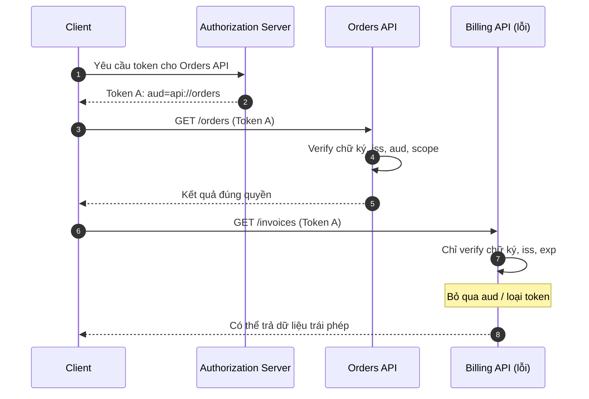
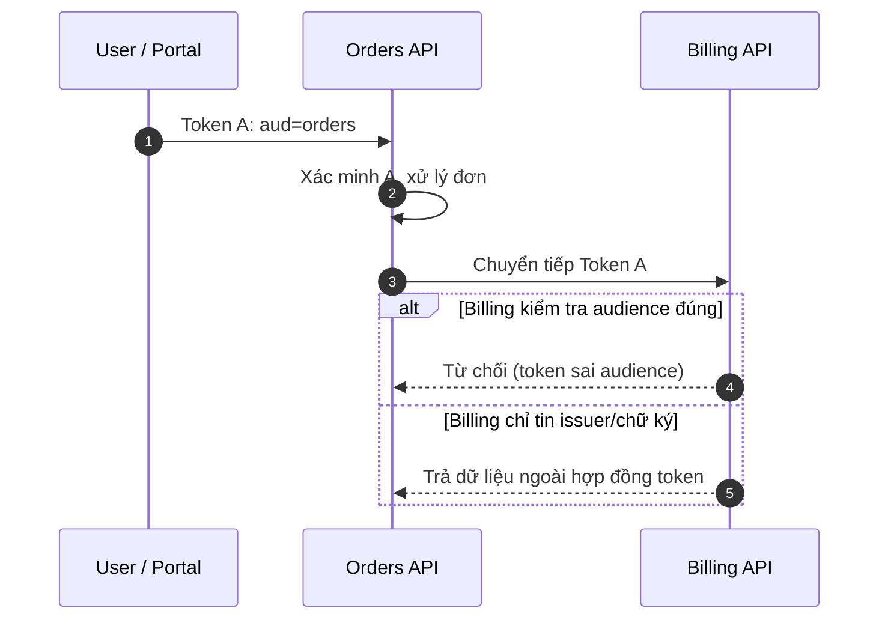
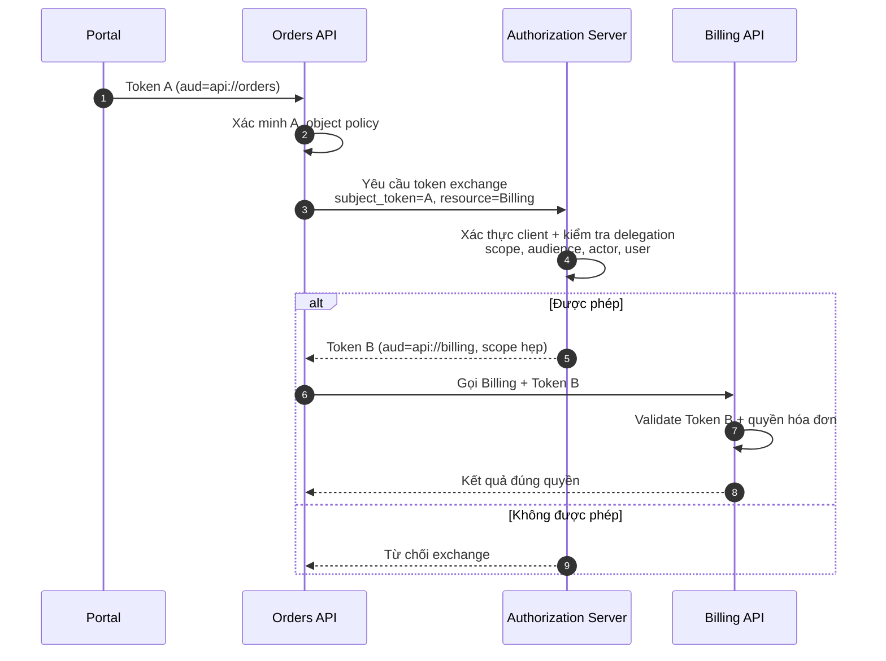
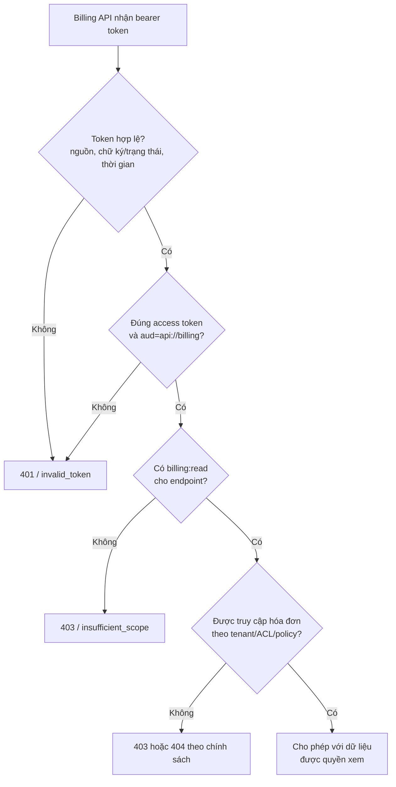

# Token substitution giữa hai API

## Mục tiêu học tập

Trong module **SECURITY_TOKEN_SECURITY_FUNDAMENTALS**, access token là bằng chứng cấp quyền mà một **Resource Server** (API) dùng để quyết định có phục vụ yêu cầu hay không. Bài này tập trung vào một lỗi thiết kế quan trọng trong hệ thống có nhiều API: **dùng token được cấp cho API A để thay thế token lẽ ra phải được cấp cho API B**, thường gọi là *token substitution* hoặc *cross-resource token confusion*.

Học xong bài, bạn có thể:

- Giải thích vì sao token có **issuer và chữ ký hợp lệ** vẫn phải bị từ chối khi `aud` không dành cho API nhận.
- Phân biệt *audience*, *scope*, *issuer*, *subject*, *client* và quyền trên từng đối tượng.
- Phân tích các cách token bị dùng sai ngữ cảnh: client cố ý thay token, API trung gian chuyển tiếp bearer token, hoặc Resource Server chấp nhận ID Token thay access token.
- Thiết kế luồng cấp **token riêng cho API đích**, dùng OAuth Resource Indicators hoặc Token Exchange khi được hệ thống hỗ trợ.
- Kiểm chứng JWT, opaque token và sender-constrained token theo đúng ranh giới tin cậy.
- Xây dựng kiểm thử phủ định giúp ngăn token substitution, privilege escalation và *confused deputy*.

## 1. Token substitution là gì?

**Token substitution giữa hai API** xảy ra khi một bên trình **token X**, vốn được phát hành cho một bên nhận hoặc mục đích **khác**, để truy cập API đang yêu cầu **token Y** phù hợp với mình. Mối nguy xuất hiện khi API đích chỉ kiểm tra chữ ký/issuer/hạn dùng mà **không kiểm tra đúng audience và loại token**.

Giả sử hệ thống có một Authorization Server (AS) và hai Resource Server:

```text
Authorization Server: https://identity.example.com

Orders API:
  audience = api://orders
  scope    = orders:read

Billing API:
  audience = api://billing
  scope    = billing:read, billing:approve
```

Một client xin access token để gọi Orders API:

```json
{
  "iss": "https://identity.example.com",
  "sub": "user-42",
  "client_id": "sales-portal",
  "aud": "api://orders",
  "scope": "orders:read",
  "iat": 1800000000,
  "exp": 1800000600
}
```

Đây chỉ là **payload JWT minh họa**, không phải token hoàn chỉnh. Giả định token đã được AS ký đúng, chưa hết hạn và người gọi có quyền xem một số đơn hàng. Client **được phép dùng nó tại Orders API**, nhưng **không được dùng nó tại Billing API**. Nếu Billing API chấp nhận token vì chỉ kiểm tra `iss` và chữ ký, nó đã mở một đường dùng sai token xuyên ranh giới tài nguyên.

> **Quy tắc cốt lõi:** “Được AS tin cậy phát hành” không đồng nghĩa “được cấp cho mọi API cùng tin AS đó”. Mỗi API phải trả lời thêm câu hỏi **“Token này có dành cho chính mình không?”** thông qua `aud` hoặc bằng chứng audience tương đương theo hợp đồng xác thực token.

### So sánh với những vấn đề gần giống

| Vấn đề | Chuyện gì xảy ra? | Kiểm soát trọng tâm |
| --- | --- | --- |
| **Token substitution** | Token dành cho API/mục đích A bị sử dụng ở API/mục đích B. | Kiểm tra audience, token type, issuer, scope và hợp đồng cấp token. |
| **Replay attack** | **Cùng một token** được sử dụng lại, thường sau khi bị đánh cắp. | TTL, bảo vệ bearer token, thu hồi, mTLS/DPoP nếu được hỗ trợ. |
| **Token forgery** | Token bị sửa claims hoặc được ký bằng khóa giả. | Verify chữ ký/MAC với khóa được tin cậy, thuật toán allowlist. |
| **Privilege escalation** | Người gọi đạt được quyền vượt thẩm quyền, có thể qua token substitution. | AS giới hạn quyền phát hành; Resource Server thực thi policy. |
| **Confused deputy** | Một service có đặc quyền bị lợi dụng dùng quyền của nó phục vụ bên ít quyền hơn. | Gắn ngữ cảnh actor/subject, kiểm tra delegation, audience và object policy. |

Các lỗi này có thể kết hợp: token bị đánh cắp ở Orders API rồi được *substitute* vào Billing API nếu Billing cấu hình yếu.

## 2. Audience khác scope và issuer thế nào?

Trong JWT, `aud` (*audience*) xác định **bên nhận mà token hướng đến**. Theo RFC 7519, giá trị có thể là một chuỗi hoặc mảng chuỗi; bên xử lý JWT phải kiểm tra mình thuộc tập audience của token. Trong hệ thống OAuth, Resource Server dùng audience để ràng buộc access token với API được cấp quyền.

| Claim/thuộc tính | Câu hỏi | Ví dụ | Điều không thể suy ra |
| --- | --- | --- | --- |
| `iss` | **Ai cấp token?** | `https://identity.example.com` | Cùng issuer thì mọi API đều được nhận. |
| `aud` | **Token dành cho ai?** | `api://orders` | Đúng audience thì có mọi scope và quyền dữ liệu. |
| `scope` | **Được yêu cầu loại thao tác nào?** | `orders:read` | Có scope đọc thì được xem mọi tenant hoặc API khác. |
| `sub` | **Token nói về chủ thể nào?** | `user-42` hoặc `billing-worker` | Chủ thể là admin hoặc người dùng cuối trong mọi trường hợp. |
| `client_id` | **Client nào tham gia xin token?** | `sales-portal` | Client hợp lệ thì được dùng token của resource khác. |
| `exp`/`nbf` | **Token hợp lệ khi nào?** | NumericDate | Còn hạn đồng nghĩa token đúng mục đích hoặc chưa bị thu hồi. |
| `typ` (header JOSE) | **Token thuộc profile/kiểu nào?** | `at+jwt` | Header chưa verify là bằng chứng được API chấp nhận. |

**Audience và scope là hai ranh giới độc lập**. Billing API không được chấp nhận token `aud=api://orders` ngay cả khi payload bất ngờ có chuỗi `billing:read`. Ngược lại, token `aud=api://billing` vẫn không được phép phê duyệt hóa đơn nếu thiếu `billing:approve` hoặc không đáp ứng quyền trên hóa đơn đó.

### Tại sao chỉ kiểm tra chữ ký vẫn sai?

Hai API có thể dùng **cùng issuer và cùng JWKS** để kiểm chứng JWT. Một token dành cho Orders và một token dành cho Billing vì vậy **đều có chữ ký hợp lệ đối với khóa AS**. Nếu Billing chỉ kiểm tra chữ ký, token Orders dễ bị coi là hợp lệ cho Billing dù AS chưa hề ủy quyền nó cho mục đích đó.

Chữ ký JWS bảo vệ **tính toàn vẹn** và nguồn ký theo khóa được tin; **không tự cho phép mọi cách sử dụng token**. Việc diễn giải `aud`, `scope` và token type là trách nhiệm của Resource Server.

## 3. Diễn biến một cuộc tấn công token substitution

Giả định một client có thể dễ dàng nhận access token với scope `orders:read`, nhưng việc nhận token có quyền Billing đòi chính sách nghiêm ngặt hơn. Billing API mắc lỗi **không kiểm tra audience**.



Điểm sai không nằm ở việc AS đã cấp token Orders: token đó có thể hoàn toàn đúng. **Billing API đã nhận nhầm bằng chứng ủy quyền**. Nếu Billing còn dựa vào claim chung như `read`, hoặc không kiểm tra đủ scope và object policy, hậu quả càng nghiêm trọng.

**Luồng đúng:** Billing API từ chối token `aud=api://orders` ngay trong lớp authentication/token validation. Client muốn truy cập Billing phải nhận **access token được cấp cho Billing** và có scope phù hợp theo policy của AS.

### Một biến thể: API A chuyển tiếp token sang API B

Không chỉ client độc hại mới gây lỗi. Trong kiến trúc microservices, **Orders API có thể vô tình chuyển nguyên `Authorization` header của request đến Billing API**:



Đây là lỗi thiết kế *token forwarding* hoặc *token relay*. Token được cấp cho **Orders API** không phải credential có thể tự động sử dụng tại **Billing API** chỉ vì hai API thuộc cùng tổ chức. Nếu service A cần gọi B, phải xác định **quyền của ai đang được thực hiện** rồi chọn cách nhận token đúng cho B.

## 4. Hợp đồng audience giữa AS, client và Resource Server

Một kiến trúc an toàn nên trả lời rõ các câu hỏi:

1. **Ai định danh API đích?** Có thể dùng identifier như `api://orders` hoặc URI tài nguyên như `https://api.example.com/orders`; giá trị phải được đăng ký/thống nhất giữa AS và RS.
2. **Client được xin token cho những API nào?** AS kiểm tra đăng ký client, grant, user/consent và chính sách resource; client không được tùy chọn audience vượt thẩm quyền.
3. **AS đặt `aud` thế nào?** Có thể là một chuỗi hoặc tập audience theo hợp đồng, nhưng nên giới hạn đúng nhu cầu.
4. **RS xác minh `aud` nào?** Mỗi API có **expected audience** riêng. Không dùng một cấu hình trống hoặc “tin tất cả token từ issuer này”.
5. **Scope/permission của token thuộc resource nào?** `orders:read`, `billing:read` phải có ngữ nghĩa rõ, không coi chuỗi `read` chung là quyền trên tất cả API.
6. **Khi API A gọi B, nguồn ủy quyền là gì?** Quyền của user, quyền service principal hay một delegation/token exchange đã được AS cho phép?

### Audience string và array

Các ví dụ JWT:

```json
{"aud": "api://orders"}
```

```json
{"aud": ["api://orders", "api://billing"]}
```

Theo RFC 7519, cả hai cách biểu diễn `aud` đều có thể hợp lệ. Resource Server cần kiểm tra **thành viên chính xác** theo hợp đồng, không chuyển mảng thành chuỗi rồi dùng `contains("orders")`.

Token đa audience **không tự sai chuẩn**. Tuy nhiên, nếu token được dùng ở hai API không liên quan, phạm vi sử dụng và hậu quả khi lộ token mở rộng. Để áp dụng *least privilege*, nên phát hành token có audience hẹp hoặc một tập recipient được thiết kế và kiểm soát đặc biệt. **Không thêm Billing vào audience của mọi token Orders để “chữa” lỗi 401.**

### Audience không nhất thiết bằng URL endpoint

Các chuỗi `api://orders` và `https://api.example.com/orders` có thể cùng dùng để định danh Orders API trong **những hợp đồng khác nhau**. Resource Server không nên tự suy rằng chúng tương đương; cần khớp **giá trị audience được AS và API thống nhất**.

Với JWT, yêu cầu so khớp chuỗi có ý nghĩa rõ ràng. Không dùng substring, tiền tố URL, tên miền hoặc tách path để mở rộng audience ngoài hợp đồng. Việc kiểm tra redirect URL, CORS origin và `aud` là **ba bài toán khác nhau**; một API có CORS cho phép một origin không có nghĩa chấp nhận token dành cho origin/API đó.

## 5. AS phát hành đúng token đích: OAuth Resource Indicators

**RFC 8707 — Resource Indicators for OAuth 2.0** định nghĩa tham số `resource` để client mô tả **tài nguyên/Resource Server dự kiến** khi yêu cầu ủy quyền hoặc token, nếu AS hỗ trợ profile này.

Ví dụ một confidential client yêu cầu token chỉ cho Orders:

```http
POST /oauth2/token HTTP/1.1
Host: identity.example.com
Authorization: Basic <encoded-client-credentials>
Content-Type: application/x-www-form-urlencoded

grant_type=client_credentials&scope=orders%3Aread&resource=https%3A%2F%2Fapi.example.com%2Forders
```

AS phải kiểm tra client có được sử dụng `client_credentials`, có quyền xin `orders:read` và được truy cập resource này không. Ví dụ phản hồi:

```json
{
  "access_token": "<orders-access-token>",
  "token_type": "Bearer",
  "expires_in": 900,
  "scope": "orders:read"
}
```

Access token thực tế có thể là JWT hoặc opaque. Nếu là JWT, `aud` có thể được ánh xạ thành `api://orders` theo cấu hình của AS; không có quy tắc chung rằng nó **bắt buộc** phải là chuỗi `resource` trong request. Với opaque token, RS dựa vào hợp đồng/introspection để chứng minh audience tương đương.

**`resource` là yêu cầu có kiểm soát, không phải quyền tự cấp audience.** Nếu client gửi `resource=https://api.example.com/billing` nhưng không được phép dùng Billing, AS phải từ chối hoặc xử lý theo chính sách cấp quyền thích hợp, chứ không phát hành token chỉ vì URL có hình thức hợp lệ.

### Tách audience và quyền truy cập đối tượng

Token có `aud=api://orders` là cần thiết để gọi Orders API, nhưng API vẫn phải giới hạn:

```text
Access token: aud=api://orders, scope=orders:read

GET /orders/order-101 -> kiểm tra tenant/owner/ACL, có thể cho phép
GET /orders/order-202 -> kiểm tra tenant/owner/ACL, có thể từ chối
POST /orders          -> cần quyền ghi riêng, phải từ chối token read-only
```

Audience hạn chế **API đích**, scope hạn chế **loại thao tác**, còn authorization theo object/tenant hạn chế **dữ liệu cụ thể**. Các lớp không thay thế nhau.

## 6. API A cần gọi API B: các cách cấp token đúng

Khi API A xử lý một request và cần gọi B, trước tiên cần phân biệt **hai ngữ nghĩa truy cập**.

| Nhu cầu | Nguồn quyền | Phương án có thể phù hợp |
| --- | --- | --- |
| Orders API gọi Billing theo **quyền riêng của service**, ví dụ job đồng bộ hệ thống. | Danh tính và permission của `orders-service`. | Confidential client xin token cho Billing bằng Client Credentials, nếu AS cho phép. |
| Orders API gọi Billing **thay mặt user** để xem đúng hóa đơn user được quyền xem. | User + client/actor + chuỗi ủy quyền. | Delegation/on-behalf-of hoặc OAuth Token Exchange nếu AS hỗ trợ và đã cấu hình chính sách. |
| Orders API chỉ cần một vài trường Billing để trả báo cáo. | Quyền giới hạn theo nhiệm vụ và tài nguyên. | Xin token downscoped: `aud` Billing, scope hẹp, TTL phù hợp; kiểm tra quyền dữ liệu tại Billing. |
| Client ban đầu có token Orders nhưng cần gọi trực tiếp Billing. | Quyền user/client đối với Billing. | Client nhận access token **riêng cho Billing** bằng luồng OAuth phù hợp, không tái sử dụng token Orders. |

### 6.1. Token Exchange: đổi token, không “đổi chữ `aud`”

**RFC 8693 — OAuth 2.0 Token Exchange** cung cấp khung để một client trình token đầu vào và xin token đầu ra cho resource/audience khác, theo **chính sách của AS**. Không phải mọi AS đều hỗ trợ hoặc bật tính năng này.



Token A **không bị chỉnh sửa**. AS phát hành **Token B mới** nếu policy cho phép, với audience/claim/credential binding phù hợp. Các trường như `subject_token` và `actor_token` trong Token Exchange có thể giúp mô tả user và actor theo profile cụ thể. AS phải kiểm tra client có quyền exchange, được trao quyền gì và có được xin scope/resource đó không.

Không được giả định token exchange luôn bảo toàn toàn bộ quyền user, cũng không tự động cho phép service nhận token mạnh hơn token đầu vào. Nếu luồng yêu cầu quyền của user, **dùng Client Credentials của service để bỏ qua user authorization** có thể biến service thành *confused deputy*.

### 6.2. Luồng Client Credentials không thay ngữ cảnh người dùng

Một access token theo `grant_type=client_credentials` thường đại diện **quyền của ứng dụng**, không có xác thực/ủy quyền của người dùng cuối trong grant này.

Ví dụ `orders-service` có quyền kỹ thuật `billing:read` để đọc thông tin thanh toán nội bộ. Khi user không được xem hóa đơn nhạy cảm, Orders API **không thể chỉ dựa vào token service để trả dữ liệu đó cho user**. Nó phải kiểm tra chính sách truy cập của user và dữ liệu cụ thể trước khi đưa kết quả trở lại caller.

Đúng audience là điều kiện cần, nhưng **không chữa được lỗi lạm dụng service credential**.

## 7. Resource Server xác minh audience thế nào?

### 7.1. JWT access token

Giả sử Billing API cấu hình:

```yaml
trustedIssuer: "https://identity.example.com"
expectedAudience: "api://billing"
acceptedTokenProfile: "JWT access token"
acceptedAlgorithms: ["RS256"]
requiredScopeForRead: "billing:read"
```

Đây là **cấu hình minh họa**, không phải schema có thể chép trực tiếp vào framework cụ thể.

Một pipeline kiểm chứng:

1. **Lấy token đúng vị trí** (thường `Authorization: Bearer` qua HTTPS), kiểm tra cú pháp/giới hạn kích thước.
2. **Chọn issuer tin cậy** từ cấu hình. Chỉ dùng `iss` chưa xác minh làm *hint* chọn một issuer trong allowlist đã cấu hình nếu cần đa issuer; không tin claim này ngay.
3. **Xác minh JWS signature/MAC** bằng khóa được liên kết với issuer và thuật toán được phép. `kid` chỉ chọn key trong tập khóa đáng tin; không lấy JWKS từ URL tùy ý trong header.
4. **Kiểm tra claims đã xác minh:** `iss` khớp chính xác, `exp`/`nbf` và loại token đúng profile, `aud` chứa đúng `api://billing`.
5. **Kiểm tra permission:** scope `billing:read` cho endpoint đọc, quyền theo tenant/owner/ACL, trạng thái hóa đơn và user/client context.
6. **Áp dụng trạng thái thu hồi/quyền động** nếu yêu cầu nghiệp vụ cần độ mới cao hơn TTL của JWT.

Pseudocode Java minh họa:

```java
VerifiedAccessToken authenticateBilling(HttpRequest request) {
    String raw = extractBearerToken(request);

    // Verifier có cấu hình issuer, allowed algorithms và key set tin cậy.
    VerifiedJwt jwt = trustedJwtVerifier.verify(raw);

    requireExactIssuer(jwt, "https://identity.example.com");
    requireAudienceMember(jwt.audiences(), "api://billing");
    requireValidTokenTimes(jwt, clock.now());
    requireExpectedAccessTokenType(jwt);
    requireScope(jwt, "billing:read");

    return toVerifiedAccessToken(jwt);
}

Invoice getInvoice(String invoiceId, HttpRequest request) {
    VerifiedAccessToken token = authenticateBilling(request);
    Invoice invoice = invoiceRepository.findById(invoiceId);
    authorization.requireCanReadInvoice(token, invoice);
    return renderAllowedInvoiceFields(invoice);
}
```

Đây là **pseudocode**, không phải API có sẵn của Spring Security. Trong Spring Security Resource Server, cấu hình issuer/JWK có thể hỗ trợ việc xác minh token; **audience validator và object-level authorization phải được cấu hình/kiểm tra phù hợp phiên bản framework**. Không suy rằng chỉ đặt `issuer-uri` là đủ để áp dụng expected audience của mỗi API.

**Ví dụ chống lỗi:** Không kiểm tra `jwt.getAudience().toString().contains("billing")`; hãy so sánh **phần tử audience chính xác**. Nếu token có `aud=api://billing-test` hoặc `aud=https://billing.attacker.example`, substring có thể dẫn đến nhận nhầm.

### 7.2. Opaque access token

Opaque token không có hợp đồng để Resource Server tự giải mã `aud`. Billing API sử dụng **introspection endpoint được cấu hình tin cậy** (RFC 7662). Phản hồi có thể như:

```json
{
  "active": true,
  "client_id": "sales-portal",
  "sub": "user-42",
  "aud": "api://billing",
  "scope": "billing:read",
  "exp": 1800000600
}
```

Điều kiện `active=true` **không đủ**. API phải chứng minh token đang active **và** dành cho Billing, có scope/quyền hợp lệ. Nếu AS không trả `aud` trong introspection, cần có **hợp đồng thay thế đáng tin cậy** (ví dụ introspection riêng cho resource được kiểm soát và thông tin xác nhận audience theo thiết kế); không tự suy rằng mọi token active đều hợp lệ cho Billing.

Không gửi opaque token đến hàng loạt AS để đoán bên nào nhận. Điều này vừa làm lộ token, vừa phá ranh giới trust/issuer của Resource Server.

### 7.3. ID Token của OIDC không thay thế access token API

**OIDC ID Token** là JWT dành cho **OIDC client/Relying Party**; `aud` của nó thường chứa `client_id`, không phải resource identifier của Billing API. API không được chấp nhận ID Token làm access token chỉ vì ID Token có chữ ký từ cùng OP và còn hạn.

Với JWT access token theo **RFC 9068**, kiểu header `typ=at+jwt` và profile kiểm chứng riêng giúp giảm rủi ro *cross-JWT confusion*. Xác minh đúng `aud`, token type và claims bắt buộc để token dành cho **client** không bị dùng ở API dành cho **resource**.

Refresh token cũng không được gửi như bearer access token tới API: nó là credential để client xin token mới tại AS, có vòng đời và chính sách bảo vệ khác.

## 8. Hai API cùng issuer, cùng tên scope: vẫn cần ràng buộc resource

Một trường hợp dễ bỏ sót là hai API sử dụng scope chung:

```text
Analytics API: aud=api://analytics, scope=read
Admin API:     aud=api://admin,     scope=read
```

Nếu Admin API chỉ kiểm tra `scope=read` và xác minh chữ ký cùng issuer, token Analytics sẽ bị chấp nhận sai. Nên đặt tên scope có ngữ cảnh rõ, chẳng hạn `analytics:read` và `admin:read`, **nhưng thay tên scope vẫn không thay thế kiểm tra audience**.

Một kịch bản khác:

```json
{
  "iss": "https://identity.example.com",
  "aud": ["api://analytics", "api://admin"],
  "scope": "read",
  "exp": 1800000600
}
```

Token đa audience có thể hợp lệ theo chuẩn JWT, nhưng **hợp đồng scope và quyền giữa các API trở nên mơ hồ**. Nếu thực sự cần token dùng được ở nhiều API, phải thiết kế chính sách từng resource, giới hạn quyền và xác minh rõ ý nghĩa scope ở mỗi API. Với tác vụ nhạy cảm, token riêng theo resource thường dễ kiểm soát và giảm thiệt hại hơn.

## 9. Multi-tenant và nhiều Authorization Server

Một API có thể phục vụ nhiều tenant hoặc tin nhiều issuer. Điều này làm token substitution phức tạp hơn:

- **Sai issuer:** token của staging/tenant khác không được tin chỉ vì cùng nhà cung cấp Identity hoặc dùng `kid` giống nhau.
- **Sai audience:** token thuộc issuer đúng nhưng dành cho resource khác vẫn phải từ chối.
- **Sai tenant:** token đúng issuer và audience chưa mặc nhiên cho phép truy cập tenant/record khác.
- **Sai subject semantics:** `sub` của Client Credentials có thể đại diện service principal, không phải người dùng cuối. Không tự ánh xạ sang quyền người dùng.
- **Key confusion:** một `kid` chỉ có ý nghĩa trong tập khóa gắn với issuer đúng; không cache key toàn cục chỉ theo `kid` rồi bỏ qua issuer.

Ví dụ API dùng hai issuer được **cho phép tường minh**:

```yaml
trustedIssuers:
  - issuer: "https://id.example.com/realms/tenant-a"
    expectedAudience: "api://orders"
    keySource: "jwks-from-configured-tenant-a-issuer"
  - issuer: "https://id.example.com/realms/tenant-b"
    expectedAudience: "api://orders"
    keySource: "jwks-from-configured-tenant-b-issuer"
```

Đây chỉ là cấu hình minh họa. Cho dù hai issuer cùng audience `api://orders`, Orders API vẫn phải thực thi **tenant isolation** trên dữ liệu; việc cùng audience không đồng nghĩa toàn bộ data cùng một miền quyền.

Trong trường hợp nhiều AS, đọc `iss` chưa verify chỉ nên dùng để **chọn cấu hình issuer trong allowlist**, sau đó xác minh chữ ký bằng khóa issuer đó và kiểm tra lại `iss`. Không tự tải metadata theo bất kỳ URL `iss` do token đưa vào: cách đó có thể khiến attacker tự ký token cho issuer do họ vận hành, thậm chí mở đường SSRF.

## 10. Token bị đánh cắp, phát lại và giới hạn audience

**Audience không phải biện pháp chống phát lại hoàn chỉnh.** Nó ngăn một token được sử dụng tại **API không nằm trong audience**, nhưng nếu bearer token bị đánh cắp, kẻ cầm token có thể thử dùng nó ở **chính API hợp lệ** cho tới khi token bị từ chối.

Các lớp bảo vệ bổ sung:

| Lớp | Mục tiêu | Giới hạn cần hiểu |
| --- | --- | --- |
| **Audience hẹp** | Token dùng đúng API cần thiết; giảm khả năng thay token giữa các resource. | Không ngăn kẻ đánh cắp dùng token tại API đúng audience. |
| **Scope hẹp + object policy** | Chỉ thao tác và dữ liệu được phép. | Scope rộng hoặc kiểm tra đối tượng yếu vẫn gây lạm dụng. |
| **TTL ngắn, `exp`/`nbf`** | Thu hẹp thời gian token có thể dùng. | Token vẫn có thể bị dùng trong thời gian hiệu lực. |
| **HTTPS, lưu trữ và log an toàn** | Tránh rò bearer token qua truyền tải, URL, observability. | Không thay thế token validation hoặc phân quyền. |
| **mTLS certificate-bound token** (RFC 8705) | Ràng buộc token với chứng chỉ/khóa của bên gửi. | RS phải kiểm tra bằng chứng sở hữu khóa và liên kết của token. |
| **DPoP** (RFC 9449) | Ràng buộc token với khóa và proof của request. | Cần AS/RS cùng hỗ trợ và kiểm chứng proof phù hợp. |
| **Introspection/thu hồi/chính sách động** | Phản ánh trạng thái token và quyền đã thay đổi. | Cache dài hoặc API không kiểm tra trạng thái vẫn có độ trễ thu hồi. |

Thay `client_secret` khi sự cố xảy ra **không mặc nhiên vô hiệu hóa JWT access token đã phát hành**. Cần xem xét token đang lưu hành, khả năng thu hồi, denylist, TTL, trạng thái user/client và quyền trên dữ liệu.

## 11. Mẫu chính sách kiểm tra và phản hồi lỗi

Giả sử các quy tắc của Billing API:

```text
Expected issuer:  https://identity.example.com
Expected audience: api://billing
Expected token:   OAuth access token
For GET /invoices/{id}: scope billing:read
Object policy:    user/client được phép xem invoice theo tenant
```

Quyết định có thể biểu diễn:

```text
allow(request) =
    tokenValidAndTrusted
    AND tokenIsAccessToken
    AND issuerMatchesConfiguredAS
    AND audienceIncludesApiBilling
    AND tokenWithinValidityWindow
    AND requiredScopePresent
    AND principalMayAccessRequestedInvoice
```



Với OAuth Bearer Token Usage (RFC 6750), lỗi token không hợp lệ thường được trả `401 Unauthorized` và `WWW-Authenticate` phù hợp, còn thiếu scope thường dẫn đến `403 Forbidden`, có thể kèm `insufficient_scope`. Lựa chọn `403` hay `404` cho đối tượng không được quyền xem tùy chính sách tránh tiết lộ sự tồn tại. Không trả raw token, claims nhạy cảm hay chi tiết khóa trong thông báo lỗi.

**Không “sửa nhanh” bằng cách bỏ audience validator** khi service A nhận `401` từ B. Cách sửa là xem lại token service A gửi, grant/resource yêu cầu, đăng ký scope và chính sách AS để cấp **token B đúng mục đích**.

## 12. Kịch bản kiểm thử bảo mật

Thiết lập:

```text
Issuer duy nhất: https://identity.example.com
Orders API:     aud=api://orders,  scope=orders:read
Billing API:    aud=api://billing, scope=billing:read
Admin API:      aud=api://admin,   scope=admin:manage
```

Tất cả các JWT trong bảng được giả định còn hạn, trừ trường hợp nêu rõ.

| Token / request | Kỳ vọng tại Billing API | Lý do |
| --- | --- | --- |
| JWT `aud=api://billing`, chữ ký/issuer/loại token đúng, `billing:read`, quyền trên hóa đơn hợp lệ. | **Cho phép** theo policy. | Đúng audience, thao tác và tài nguyên. |
| JWT `aud=api://orders`, chữ ký/issuer đúng, `orders:read`. | **Từ chối**. | Token được cấp cho Orders API. |
| JWT `aud=api://orders` nhưng payload có thêm `billing:read`. | **Từ chối**. | Scope không thay audience. |
| JWT `aud=api://billing-test` hoặc `api://billing-old`. | **Từ chối**. | Không được so khớp audience theo tiền tố/substring. |
| JWT `aud=["api://orders","api://billing"]`, scope Billing đúng, policy cho phép token đa audience. | **Có thể cho phép** sau toàn bộ kiểm tra. | Audience dạng array hợp lệ nếu hợp đồng cho phép và quyền đủ. |
| JWT `aud=api://billing` nhưng thiếu `billing:read`. | **Từ chối**. | Không đủ scope. |
| JWT `aud=api://billing`, scope đủ, nhưng hóa đơn thuộc tenant khác. | **Từ chối**. | Phân quyền object/tenant vẫn bắt buộc. |
| JWT do issuer lạ ký hợp lệ với khóa riêng của issuer lạ. | **Từ chối**. | Chữ ký không đến từ nguồn được tin cậy. |
| ID Token OIDC có `aud=sales-portal`, issuer/ chữ ký hợp lệ. | **Từ chối**. | Sai token type/purpose và audience. |
| Opaque token introspection `active=true` nhưng không chứng minh audience của Billing theo hợp đồng. | **Từ chối / chưa đủ chứng cứ cấp quyền**. | `active` không bằng `aud` hợp lệ. |
| JWT cũ của Billing đã hết hạn dù scope đủ. | **Từ chối**. | Token không còn thời gian hiệu lực. |
| JWT của Billing bị sao chép và dùng lại tại Billing, vẫn còn hạn. | **Có nguy cơ bị chấp nhận nếu chỉ là bearer**. | Audience đúng không tự chống replay; cần bảo vệ/binding/thu hồi. |

### Bài tập suy luận

**Câu 1.** Vì sao Billing API phải từ chối Token A dành cho Orders ngay cả khi cả hai API dùng chung AS và xác minh bằng cùng public key?

**Câu 2.** Một lập trình viên đề xuất thêm `api://billing` vào mảng `aud` của tất cả token Orders để khỏi phải xin token mới. Thiết kế này có tác động bảo mật gì?

**Câu 3.** Khi Orders API gọi Billing **nhân danh người dùng**, vì sao dùng Client Credentials của Orders có quyền Billing cao hơn người dùng có thể là lỗi?

**Câu 4.** `resource` trong RFC 8707 và `aud` trong JWT liên quan với nhau thế nào? Client có được tự chọn resource tùy ý không?

**Câu 5.** Nếu `aud` đúng nhưng `scope` thiếu, hoặc `scope` đủ nhưng tài nguyên thuộc tenant khác, API phải xử lý ra sao?

**Câu 6.** Một opaque token `active=true` không có `aud` trong kết quả introspection. API nên làm gì để tránh token substitution?

**Câu 7.** Vì sao DPoP hoặc mTLS không thay thế bước kiểm tra audience?

**Gợi ý trả lời:**

1. Chữ ký chứng minh token do đúng AS ký, còn audience xác định **API đích**; hai API không có quyền hoán đổi token.
2. Mở rộng phạm vi sử dụng và hậu quả khi token lộ, làm mơ hồ scope/policy giữa các API; nên cấp token riêng đúng nhu cầu.
3. Token service phản ánh **quyền ứng dụng**, không tự chứng minh user được phép truy cập Billing. Cần delegation/token exchange đúng chính sách và object-level authorization.
4. `resource` là tham số client yêu cầu resource, AS kiểm tra quyền rồi có thể ánh xạ sang audience theo hợp đồng; client không được tự cấp.
5. **Từ chối** khi thiếu bất kỳ điều kiện; scope và quyền dữ liệu là các lớp độc lập.
6. Dùng hợp đồng introspection/resource binding đáng tin cậy để xác định token dành cho API; nếu thiếu bằng chứng cần thiết, **không chấp nhận dựa vào `active` đơn thuần**.
7. Sender-constraining chứng minh bên gửi sở hữu khóa liên kết với token; không quyết định token được cấp cho **API nào** hoặc quyền nào.

## 13. Checklist triển khai

- [ ] Mỗi Resource Server có **expected audience rõ ràng** và kiểm tra audience trên mọi access token.
- [ ] AS giới hạn client được xin resource/audience và scope nào; token được cấp chỉ cho mục đích cần thiết.
- [ ] Với JWT, xác minh issuer, chữ ký, thuật toán, thời hạn, token type, audience và scope theo hợp đồng.
- [ ] So sánh audience **theo phần tử chính xác**, hỗ trợ string/array đúng profile; không dùng substring hoặc tên miền gần giống.
- [ ] Với opaque token, dùng introspection nguồn tin cậy và bảo đảm có bằng chứng về audience/resource phù hợp.
- [ ] Không dùng ID Token, refresh token hoặc client assertion làm OAuth access token của API.
- [ ] Không chuyển tiếp bearer token API A sang API B theo mặc định; xin token cho B bằng grant hoặc token exchange hợp lệ.
- [ ] Khi dùng delegated access, giữ đúng ngữ cảnh user và actor; không nâng quyền bằng credential service.
- [ ] Thực thi scope, tenant, owner/ACL và quyền trên từng object ngoài việc kiểm tra audience.
- [ ] Giới hạn TTL, phạm vi token, nơi lưu và nơi ghi log; cân nhắc mTLS/DPoP cho môi trường rủi ro cao.
- [ ] Kiểm thử sai audience, audience gần giống, issuer khác, token khác loại, scope thiếu, object sai tenant và token bị phát lại.
- [ ] Ghi audit nguồn token, client/subject, audience và quyết định từ chối mà **không lưu raw token hoặc credential**.

## Tài liệu nền tảng

- **RFC 6749 — The OAuth 2.0 Authorization Framework:** AS, Resource Server, client, access token và scope.
- **RFC 6750 — OAuth 2.0 Bearer Token Usage:** trình token tại API, `invalid_token` và `insufficient_scope`.
- **RFC 7519 — JSON Web Token (JWT):** `aud`, `iss`, claims thời gian và dạng string/array của audience.
- **RFC 7662 — OAuth 2.0 Token Introspection:** xác nhận opaque token và metadata `active`, `aud`, `scope` khi áp dụng.
- **RFC 8707 — Resource Indicators for OAuth 2.0:** yêu cầu token cho resource đích.
- **RFC 8693 — OAuth 2.0 Token Exchange:** trao đổi token và ràng buộc ủy quyền giữa dịch vụ.
- **RFC 9068 — JWT Profile for OAuth 2.0 Access Tokens:** phân biệt token type và kiểm tra JWT access token.
- **RFC 8725 — JWT Best Current Practices:** chống nhầm lẫn thuật toán, issuer và token type.
- **RFC 8705 / RFC 9449:** mTLS certificate-bound access token và DPoP để hạn chế lạm dụng bearer token bị đánh cắp.

**Ghi nhớ:** Token được cấp cho **API A** không trở thành credential hợp lệ cho **API B** chỉ vì chữ ký đúng, cùng issuer hoặc có scope mang tên quen thuộc. **Audience là ranh giới đối tượng nhận token**, scope là giới hạn thao tác, còn quyền trên object/tenant phải do API thực thi. Muốn gọi API B, hãy xin **token đúng cho B** theo chính sách AS và kiểm tra toàn bộ điều kiện trước khi sử dụng.
