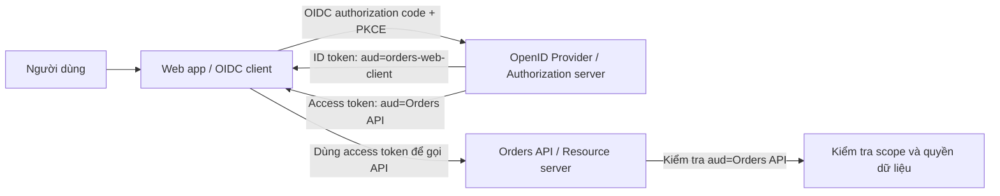
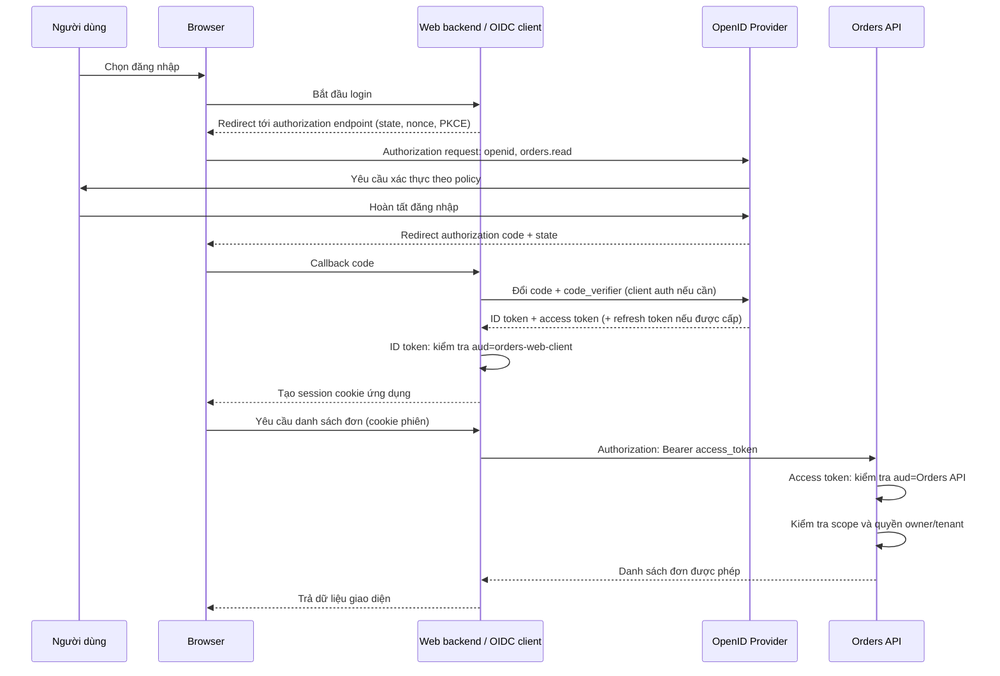
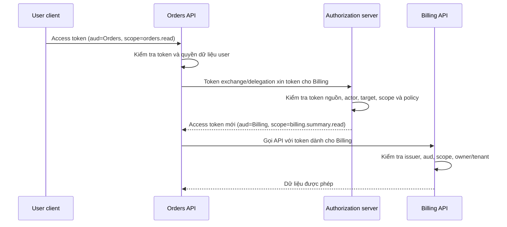

# Audience của identity token khác access token

Trong một lần đăng nhập bằng OpenID Connect (OIDC), ứng dụng có thể nhận **ID token** và **access token** từ cùng một authorization server. Hai token có thể đều là JWT, đều mang `iss`, `sub`, `exp` và cùng nói về một người dùng. Tuy vậy, **chúng được phát hành cho những bên nhận khác nhau**: ID token nhằm giúp **OIDC client** xác minh kết quả đăng nhập; access token nhằm giúp **resource server/API** quyết định có chấp nhận yêu cầu truy cập tài nguyên hay không.

Đây là khác biệt cốt lõi của **audience** (claim `aud`). Nếu API chỉ kiểm tra chữ ký rồi chấp nhận cả ID token, kẻ tấn công có thể dùng một credential dành cho ứng dụng để yêu cầu quyền ở dịch vụ khác. Nếu frontend lấy access token làm bằng chứng đăng nhập thay ID token hoặc phiên đã được xác minh, ứng dụng cũng có thể hiểu sai danh tính/ngữ cảnh xác thực.

Bài thuộc chương **Audience** của module **SECURITY_TOKEN_SECURITY_FUNDAMENTALS**. Trọng tâm là mô hình tin cậy, OAuth 2.0/OIDC, JWT và opaque token, mục đích/claims/scope/audience của token, phát hành và xác minh, bảo vệ lưu trữ, thu hồi và phòng ngừa token substitution hoặc replay.

**Kết quả học tập:** sau bài này, bạn có thể:

- Giải thích tại sao `aud` của **OIDC ID token** thường là **OAuth/OIDC client ID**, còn `aud` của **OAuth access token** theo JWT access-token profile là **định danh API/resource server**.
- Vẽ được ranh giới xác minh giữa OIDC client, authorization server và API.
- Thiết kế hai bộ kiểm tra token tách biệt, không chấp nhận nhầm ID token thành access token.
- Hiểu cách `azp`, `iss`, `sub`, `scope`, `client_id` và `typ` bổ trợ nhưng **không thay thế** `aud`.
- Xử lý token có nhiều audiences, opaque token/introspection, Resource Indicators và token exchange giữa nhiều API.
- Kiểm thử tình huống cross-JWT confusion, token substitution, sai audience và các lỗi phân quyền owner/tenant.

## 1. Audience là gì?

Trong JWT, `aud` (audience) chỉ định **bên nhận mà JWT được phát hành hướng tới**. Theo RFC 7519, mỗi bên định xử lý JWT phải **xác nhận mình thuộc audience phù hợp** theo hợp đồng; nếu JWT có `aud` nhưng bên xử lý không nằm trong audience, nó phải từ chối. Giá trị `aud` có thể là một chuỗi hoặc một mảng chuỗi khi có nhiều bên nhận.

Ví dụ minh họa:

```json
{
  "iss": "https://login.example.com",
  "sub": "user-42",
  "aud": "orders-web-client",
  "exp": 1795000900
}
```

Giá trị `orders-web-client` có thể là client ID của ứng dụng đăng nhập. Nó **không tự nói** token thuộc loại ID token hay access token; **loại token, issuer, audience và profile** phải được hiểu cùng nhau.

### Đừng nhầm các câu hỏi trong token

| Trường/khái niệm | Câu hỏi được trả lời | Ví dụ |
| --- | --- | --- |
| `iss` — issuer | **Ai phát hành/khẳng định token?** | `https://login.example.com` |
| `sub` — subject | **Token nói về chủ thể nào?** | `user-42` hoặc workload tùy profile |
| `aud` — audience | **Token được phát hành cho bên nhận nào?** | Client ID hoặc resource/API identifier |
| `client_id` | **OAuth client nào đã nhận/yêu cầu quyền?** | `orders-web-client` |
| `azp` — authorized party (OIDC) | **Bên được ủy quyền là client nào theo ngữ cảnh ID token?** | `orders-web-client` |
| `scope` | **Access token mang phạm vi quyền nào?** | `orders.read` |
| `exp`, `nbf`, `iat` | **Khi nào token hết hạn, bắt đầu hiệu lực, được phát hành?** | NumericDate dạng giây Unix |

**Issuer không phải audience.** Một issuer có thể phát hành ID token cho nhiều ứng dụng và access token cho nhiều API. Cùng issuer và cùng người dùng **không** khiến token được dùng thay thế nhau.

**Scope không phải audience.** Scope mô tả khả năng truy cập, chẳng hạn đọc đơn hàng; audience chỉ ra API nào được xử lý token. Một access token chứa `orders.read` nhưng `aud=billing-api` không thể được Orders API chấp nhận chỉ nhờ chuỗi scope có chữ “orders”.

## 2. Ba vai trò trong OIDC/OAuth và nơi token được đưa tới

Hãy xét hệ thống có:

- **OpenID Provider (OP)/authorization server** tại `https://login.example.com`: xác thực người dùng và cấp token.
- **OIDC client** là ứng dụng web `orders-web-client` tại `https://shop.example.com`: muốn biết người dùng đã đăng nhập là ai và tạo phiên ứng dụng.
- **Resource server** là Orders API với resource identifier `https://api.example.com/orders`: xử lý dữ liệu đơn hàng.



**Bên nhận của ID token** là **client đang thực hiện đăng nhập**. **Bên nhận của access token** là **API được trao quyền truy cập**. Client có thể giữ access token để gửi tiếp cho API, nhưng việc client **sở hữu** token không khiến client trở thành resource server hay audience mặc định của access token.

OAuth 2.0 là khuôn khổ **ủy quyền**; OIDC xây thêm lớp **xác thực danh tính** và ID token. OAuth không bắt buộc mọi access token đều có định dạng JWT hoặc trường `aud` đọc được ở phía client; điều này phụ thuộc token profile và hợp đồng của authorization server/resource server. Ngược lại, **OIDC ID token là JWT**, có các claims bắt buộc theo quy tắc OIDC.

## 3. Audience của ID token: OIDC client ID

**ID token** cho phép OIDC client xác minh một kết quả xác thực danh tính từ OP tin cậy. Theo OIDC Core, ID token phải có claim `aud` chứa **OAuth 2.0 client_id của Relying Party (RP)/client**. Một ID token không liệt kê chính client đó trong audience **phải bị client từ chối**.

Ví dụ payload ID token:

```json
{
  "iss": "https://login.example.com",
  "sub": "user-42",
  "aud": "orders-web-client",
  "iat": 1795000000,
  "exp": 1795000900,
  "auth_time": 1794999900,
  "nonce": "random-nonce-bound-to-login"
}
```

Trong ví dụ:

- `iss` là OP đã cấu hình và được client tin.
- `aud=orders-web-client` có nghĩa **ID token dành cho OIDC client này**.
- `sub` định danh người dùng trong không gian của OP; client không nên dùng email làm subject ổn định thay thế.
- `iat` là thời điểm ID token được phát hành, còn `auth_time` (nếu có) là thời điểm xác thực người dùng.
- `nonce` ràng buộc ID token với yêu cầu đăng nhập theo quy tắc OIDC khi client đã gửi nonce.

Nếu cùng OP phát hành ID token cho `admin-portal-client`, ứng dụng `orders-web-client` **không** được nhận token đó để tạo phiên người dùng, dù `sub` giống nhau và chữ ký hợp lệ. Audience ở đây có tác dụng ngăn **đưa ID token của ứng dụng A sang ứng dụng B**.

### 3.1. ID token có thể có nhiều audiences

OIDC `aud` có thể là mảng chuỗi:

```json
{
  "aud": ["orders-web-client", "trusted-secondary-audience"],
  "azp": "orders-web-client"
}
```

OIDC client phải xác nhận client ID của mình xuất hiện trong audience **và** không chấp nhận những audience bổ sung mà client không tin. OIDC Core quy định rằng khi ID token có nhiều audiences, client **nên xác minh có `azp`**; khi `azp` tồn tại, client **nên xác minh giá trị bằng client ID của mình**, theo profile và chính sách. `azp` giúp xác định authorized party trong trường hợp thích hợp; nó **không cho phép bỏ qua `aud`**.

Không nên tự tạo nhiều audiences “cho tiện” khi không có nhu cầu và hợp đồng rõ ràng. Mỗi bên nhận bổ sung làm phạm vi một token có thể được chấp nhận rộng hơn.

### 3.2. ID token KHÔNG phải bearer credential cho Orders API

Một resource server không được thực hiện logic kiểu:

```text
JWT signature valid?
sub exists?
=> Allow API
```

Logic trên bỏ qua **mục đích** và **audience** của token. Một ID token dành cho `orders-web-client` không phải access token dành cho `https://api.example.com/orders`. API phải yêu cầu access token theo hợp đồng OAuth, không dùng token đăng nhập làm bằng chứng đã cấp quyền API.

## 4. Audience của access token: resource server/API

**OAuth access token** được phát hành để client trình cho resource server khi yêu cầu truy cập tài nguyên. Trong mô hình resource-bound token, audience của access token chính là **định danh resource server hoặc API đích**.

Ví dụ JWT access token cho Orders API (theo profile/hợp đồng minh họa):

```json
{
  "iss": "https://login.example.com",
  "sub": "user-42",
  "aud": "https://api.example.com/orders",
  "client_id": "orders-web-client",
  "scope": "orders.read",
  "iat": 1795000000,
  "nbf": 1795000000,
  "exp": 1795000600,
  "jti": "example-order-token-001"
}
```

Với token này:

- **Orders API** kiểm tra `aud=https://api.example.com/orders` theo đúng resource identifier mà nó đã cấu hình.
- **OIDC client** là `orders-web-client` nhưng **không phải audience** của access token trong ví dụ; client chỉ nắm và gửi token cho API.
- Claim `client_id` (theo profile liên quan) cho biết OAuth client nhận quyền, **không thay thế `aud`**.
- `scope=orders.read` diễn tả quyền mà access token được cấp, **không thay thế policy phân quyền trên từng đơn hàng**.
- `jti` là JWT identifier, **không tự ngăn token bị phát lại**.

### 4.1. Các access token không phải lúc nào cũng là JWT

OAuth 2.0 không quy định access token phải có định dạng JWT. Hệ thống có thể dùng **opaque access token**, ví dụ chuỗi ngẫu nhiên khó đọc; khi đó API phải dựa vào authorization server hoặc cơ chế tra cứu/introspection đáng tin để xác định token còn hiệu lực và được cấp cho tài nguyên nào.

**RFC 9068** mô tả **JWT Profile for OAuth 2.0 Access Tokens**; khi sử dụng profile này, `aud` trong JWT access token xác định resource server intended recipient, và resource server phải xác minh audience cùng các điều kiện token khác. Nếu dùng định dạng/nhà cung cấp khác, **cần hợp đồng rõ ràng về cách ràng buộc tài nguyên**; không giả định mọi access token trên thế giới đều mang JWT `aud` có thể decode.

### 4.2. Cùng `sub` không có nghĩa cùng quyền

Một người dùng có thể nhận:

| Token | Subject | Audience | Mục đích |
| --- | --- | --- | --- |
| ID token | `user-42` | `orders-web-client` | Client xác nhận sự kiện đăng nhập |
| Access token A | `user-42` | Orders API | Yêu cầu `orders.read` |
| Access token B | `user-42` | Billing API | Yêu cầu `billing.summary.read` |
| Access token C | `user-42` | Shipping API | Yêu cầu `shipments.track` |

Ba access token có thể cùng issuer và subject nhưng có **tài nguyên đích và quyền khác nhau**. Billing API phải từ chối access token A của Orders API; Orders API cũng phải từ chối access token B.

## 5. So sánh ID token và access token theo từng tiêu chí

| Tiêu chí | ID token (OIDC) | Access token (OAuth 2.0) |
| --- | --- | --- |
| Câu hỏi chính | “OP xác thực người dùng nào cho client này?” | “Client đang mang quyền truy cập nào tới API này?” |
| Bên nhận cần xác minh | **OIDC client/Relying Party** | **Resource server/API** |
| `aud` điển hình | **OAuth client ID** | **Resource identifier/API audience** |
| Token có luôn là JWT? | **Có**, theo OIDC | **Không**; JWT hoặc opaque theo AS |
| `sub` | Thường là người dùng đã xác thực | User hoặc client/workload tùy grant/profile |
| `scope` | Không phải cơ sở phân quyền API từ ID token | Dùng trong token/metadata cấp quyền theo profile |
| `nonce` | Có thể dùng để ràng buộc yêu cầu OIDC | Không phải claim chung bắt buộc của OAuth access token |
| `auth_time`, `amr`, `acr` | Mô tả ngữ cảnh xác thực theo OIDC | Không mặc nhiên có; phụ thuộc hợp đồng và policy |
| Bên không được tự ý dùng | API không dùng ID token làm Bearer access token | OIDC client không dùng access token thay ID token khi cần xác minh đăng nhập OIDC |
| Cách sử dụng điển hình | Client kiểm tra, xác lập ngữ cảnh đăng nhập và phiên ứng dụng | Client gửi tới API qua `Authorization: Bearer ...` hoặc cơ chế sender-constrained |

**ID token không tự cấp quyền gọi mọi API. Access token không mặc nhiên chứng minh người dùng vừa đăng nhập hoặc vừa hoàn thành MFA.** Khi cả hai xuất hiện trong cùng một OAuth/OIDC token response, phải tách luồng xác minh và mục đích sử dụng.

## 6. Ví dụ thực tế: Authorization Code + PKCE trả về hai token

Giả sử website `https://shop.example.com` là OIDC client `orders-web-client` và muốn gọi Orders API. Website bắt đầu luồng Authorization Code + PKCE với OP.



Với kiến trúc **Backend-for-Frontend (BFF)**, backend giữ OAuth token phía server và trả browser session cookie với `Secure`, `HttpOnly`, `SameSite` thích hợp. Browser không phải cầm cả access token và ID token để hiển thị từng trang. Với SPA gọi API trực tiếp, client có thể giữ access token theo kiến trúc được chọn nhưng vẫn phải bảo vệ trước XSS và không thay ID token cho API.

### 6.1. Authorization request với scope và resource

Ví dụ request được xuống dòng để dễ đọc, khi triển khai phải URL-encode và tuân thủ đăng ký redirect URI:

```http
GET /authorize?response_type=code
    &client_id=orders-web-client
    &redirect_uri=https%3A%2F%2Fshop.example.com%2Fcallback
    &scope=openid%20orders.read
    &resource=https%3A%2F%2Fapi.example.com%2Forders
    &state=unguessable-state
    &nonce=unguessable-nonce
    &code_challenge=challenge-value
    &code_challenge_method=S256 HTTP/1.1
Host: login.example.com
```

- `client_id` chỉ ra **OIDC client**; ID token phải liệt kê client này trong `aud`.
- `resource` là **Resource Indicator** (RFC 8707) khi AS hỗ trợ, dùng để yêu cầu access token cho Orders API; AS quyết định token `aud` cuối cùng theo hợp đồng.
- `scope=openid orders.read` gồm lớp định danh OIDC và quyền nghiệp vụ; scope **không thay audience**.
- `state` gắn response với yêu cầu và chống một số rủi ro CSRF/mix-up khi triển khai đúng; `nonce` liên kết ID token với lần đăng nhập theo quy tắc OIDC; PKCE ràng buộc code với bên bắt đầu yêu cầu.

Không phải mọi AS hỗ trợ `resource` hoặc ánh xạ nó thành `aud` giống nhau. Client phải dùng giá trị resource identifier đã đăng ký và API phải so khớp audience thực cấp; **đừng tự suy ra audience từ URL endpoint** nếu hợp đồng định danh của AS khác.

### 6.2. Token response mẫu

```json
{
  "token_type": "Bearer",
  "access_token": "<access-token-for-orders-api>",
  "id_token": "<id-token-for-orders-web-client>",
  "expires_in": 600,
  "scope": "openid orders.read"
}
```

Các chuỗi trong dấu ngoặc nhọn chỉ là placeholder. Mặc dù phản hồi chứa cả hai token, **chúng không hoán đổi được**. Client cần đọc scope **đã được cấp** thay vì giả định mọi scope xin đều được phê duyệt. API không nhận trường `id_token` trong Bearer header.

## 7. Hai bộ quy tắc validation riêng biệt

Một lỗi kiến trúc phổ biến là dùng chung hàm `verifyJwt()` chỉ kiểm tra chữ ký và `exp`, rồi áp dụng kết quả cho cả đăng nhập lẫn API. Chữ ký hợp lệ chỉ chứng minh token được ký bằng khóa được chấp nhận; **nó không chứng minh token dành cho bên nhận hiện tại**.

### 7.1. OIDC client xác minh ID token

Theo OIDC Core và flow đang sử dụng, OIDC client cần tối thiểu:

1. **Nguồn OP:** xác minh `iss` chính xác là issuer đã cấu hình/được khám phá an toàn, chọn khóa và thuật toán đáng tin theo metadata và chính sách.
2. **Chữ ký/thuật toán:** kiểm tra chữ ký ID token và quy tắc thuật toán tương ứng, không chấp nhận khóa/thuật toán tự phát do token chưa tin tự đề nghị.
3. **Audience:** `aud` phải chứa **client_id của chính client**; nếu có audiences bổ sung thì chỉ chấp nhận đối tượng đã tin. Kiểm tra `azp` khi cần theo quy tắc OIDC.
4. **Thời gian:** kiểm tra `exp` và `iat` theo OIDC/profile; áp dụng clock skew nhỏ có cấu hình.
5. **Ràng buộc login:** kiểm tra `nonce` nếu nonce đã được gửi, bảo đảm gắn với đúng lần đăng nhập; bảo vệ `state` và authorization code/PKCE đúng quy trình.
6. **Ngữ cảnh nếu yêu cầu:** kiểm tra `auth_time`, `acr`, `amr` theo hợp đồng và policy khi cần xác thực đủ mới/đủ mạnh.
7. **Xử lý danh tính:** dùng `sub` trong phạm vi issuer và kết hợp chính sách liên kết tài khoản; không tin email chưa được xác minh để tự động nối tài khoản.

Mã giả minh họa:

```text
function handleLoginCallback(code, state, savedLoginRequest):
    assertStateMatches(state, savedLoginRequest.state)
    tokenResponse = exchangeCodeWithPkce(
        code,
        savedLoginRequest.codeVerifier,
        registeredRedirectUri
    )

    idClaims = verifyOidcIdToken(
        tokenResponse.id_token,
        trustedIssuer = "https://login.example.com",
        trustedKeys = configuredOpKeys,
        expectedAudience = "orders-web-client",
        nonce = savedLoginRequest.nonce,
        allowedAlgorithms = configuredIdTokenAlgorithms
    )
    if idClaims INVALID:
        return rejectLogin()

    session = createOwnApplicationSession(idClaims.iss, idClaims.sub)
    storeAccessTokenServerSide(
        session,
        tokenResponse.access_token,
        tokenResponse.scope
    )
    return secureSessionCookie(session)
```

Đây là pseudocode, không phải mã thư viện OIDC hoàn chỉnh. Trong môi trường thực tế, hãy dùng SDK/framework OIDC đã được kiểm thử để xử lý discovery, token endpoint, `state`, PKCE, `nonce` và tất cả điều kiện của flow/profile.

### 7.2. Resource server xác minh access token

Orders API cần chính sách **khác**:

1. **Đúng loại token:** chỉ nhận OAuth access token của profile được cấu hình, không chấp nhận ID token/refresh token.
2. **Nguồn hợp lệ:** issuer tin cậy, chữ ký và thuật toán an toàn nếu JWT; hoặc introspection đáng tin nếu opaque.
3. **Audience:** token phải chứng minh được nó **dành cho Orders API** theo resource identifier/configuration của API.
4. **Thời gian và trạng thái:** `exp`, `nbf`, trạng thái `active` (nếu introspection), cơ chế thu hồi và yêu cầu TTL.
5. **Quyền:** `scope`/permissions theo hợp đồng; tiếp tục đánh giá user/service, owner, tenant, object và trạng thái nghiệp vụ.
6. **Proof-of-possession khi áp dụng:** xác minh DPoP proof hoặc mTLS certificate binding chứ không chỉ tin claim `cnf`.

```text
function getOrder(request):
    token = getBearerAccessToken(request.Authorization)

    claims = verifyAccessToken(
        token,
        trustedIssuer = "https://login.example.com",
        resourceAudience = "https://api.example.com/orders",
        acceptedTokenProfile = "at+jwt",
        trustedKeys = configuredAsKeys,
        allowedAlgorithms = ["RS256"]
    )
    if claims INVALID:
        return 401 Unauthorized

    scopes = parseScopeAccordingToProfile(claims.scope)
    if "orders.read" not in scopes:
        return 403 Forbidden

    order = database.getOrder(request.orderId)
    if order missing:
        return 404 Not Found
    if !policy.canReadOrder(claims.sub, order, currentTenantMembership):
        return 403 Forbidden

    return 200 OK with allowedFields(order)
```

Một `401` thường biểu thị thiếu hoặc không có credential hợp lệ; `403` thường dùng khi token hợp lệ nhưng thiếu quyền. Với OAuth Bearer, API có thể trả `WWW-Authenticate` và `insufficient_scope` theo RFC 6750. Kết quả cuối cùng tùy quy tắc API và yêu cầu không tiết lộ sự tồn tại của object.

### 7.3. Bảng cấu hình so sánh verifier

| Kiểm tra | OIDC client kiểm tra ID token | Orders API kiểm tra access token |
| --- | --- | --- |
| Trusted issuer | `https://login.example.com` | `https://login.example.com` |
| Expected audience | `orders-web-client` | `https://api.example.com/orders` |
| Token profile | OIDC ID token | JWT access token `at+jwt` hoặc opaque/introspection |
| `nonce` | Kiểm tra nếu đã yêu cầu và token chứa theo hợp đồng OIDC | Không dùng làm điều kiện chung cho access token |
| `azp` | Xử lý theo điều kiện OIDC khi có | Không dùng thay `aud` |
| `scope` | Không dùng ID token làm nguồn quyền API | Kiểm tra scope dành cho endpoint |
| Object policy | Tạo phiên client, liên kết account đúng cách | Kiểm tra owner/tenant/role trên dữ liệu thực |

Hai verifier có thể dùng chung thư viện chữ ký/JSON/JWKS, nhưng **không nên dùng chung cấu hình audience, token type và quyết định authorization**.

## 8. Cross-JWT confusion: vì sao nhầm audience rất nguy hiểm?

**Cross-JWT confusion** xảy ra khi một ứng dụng chấp nhận JWT hợp lệ nhưng **không thuộc loại hoặc mục đích mà ứng dụng đó chờ đợi**. Token có thể được phát hành bởi cùng issuer, ký cùng khóa, có `sub` giống nhau, nhưng dành cho client hoặc API khác.

### 8.1. Tấn công dùng ID token làm access token

Giả sử API viết:

```text
if verifySignature(jwt) and jwt.exp > now:
    user = jwt.sub
    return privateOrdersOf(user)
```

Attacker có một ID token thật do OP cấp cho ứng dụng có `aud=some-other-client`. Vì API không kiểm tra audience và token type, API có thể nhận token ấy làm Bearer credential. **Sai lầm:** chữ ký hợp lệ bị nhầm thành quyền gọi API. **Khắc phục:** xác minh token profile, `iss`, `aud` đúng API, scope và chính sách dữ liệu.

### 8.2. Dùng access token của API A tại API B

Một access token có `aud=orders-api`, `scope=orders.read`. Nếu Billing API chỉ xác minh chữ ký và đọc `sub`, nó có thể chấp nhận token không dành cho mình. Đây là **token substitution** giữa tài nguyên. Đặc biệt nguy hiểm nếu API nội bộ có những tên scope trùng hoặc role chung.

### 8.3. Dùng ID token của ứng dụng A đăng nhập ứng dụng B

Ứng dụng B chấp nhận ID token ký hợp lệ có `aud=application-A` chỉ vì cùng OP. Attacker có thể sử dụng token không được phát hành cho B để tạo phiên trên B. OIDC client B phải kiểm tra audience chứa **client ID của B** và các điều kiện OIDC khác.

### 8.4. Đưa token vào sai endpoint

Refresh token được gửi đến authorization server để gia hạn, **không gửi tới resource server**. ID token không dành cho `Authorization: Bearer` của API. Session cookie thuộc phiên ứng dụng và không đồng nghĩa với cả ID token lẫn access token. **Cấu trúc giống JWT không khiến các loại credential tương đương**.

## 9. Vì sao `typ`, `azp` và `client_id` không thay thế `aud`?

| Claim/header | Nơi thường thấy | Vai trò | Không thay thế được |
| --- | --- | --- | --- |
| `typ` trong JOSE header | JWT/JWS, ví dụ `at+jwt` theo RFC 9068 | Phân biệt profile/loại JWT theo hợp đồng | Không cho biết bên nhận thay `aud` |
| `azp` trong ID token | OIDC, nhất là bối cảnh có nhiều audiences | Xác định authorized party theo quy tắc OIDC | Không biến API khác thành audience hợp lệ |
| `client_id` trong JWT access token | OAuth JWT access-token profile | Định danh OAuth client đã được cấp quyền | Không có nghĩa API đích là client đó |
| `sub` | JWT nói chung | Chủ thể token | Không cho biết token được phép dùng tại API nào |
| `scope` | OAuth access token/metadata | Khả năng truy cập được cấp | Không sửa được audience sai |

Ví dụ header JWT access token theo RFC 9068:

```json
{
  "alg": "RS256",
  "typ": "at+jwt",
  "kid": "example-signing-key"
}
```

`typ` và `kid` là **JOSE header parameters**, không phải payload claims. Header chưa được xác minh không thể tự tạo sự tin cậy. Resource server phải dùng danh sách thuật toán, issuer và khóa đã cấu hình; `kid` chỉ hỗ trợ chọn khóa **trong tập khóa đáng tin**, không cho phép tải khóa từ địa chỉ tùy ý do token gợi ý.

**RFC 8725 — JWT Best Current Practices** nhấn mạnh cần có quy tắc xác minh **loại token, issuer và audience** đủ tách biệt để tránh nhầm giữa các JWT phục vụ mục đích khác nhau. Thêm `typ` có ích cho profile nhưng không thể thay việc kiểm tra `aud`.

## 10. Access token có nhiều audiences: khi nào nên tránh?

Theo RFC 7519, JWT `aud` có thể là một chuỗi hoặc mảng. Một access token có thể được thiết kế có nhiều audience nếu AS và các resource server cùng có hợp đồng chấp nhận.

```json
{
  "iss": "https://login.example.com",
  "sub": "user-42",
  "aud": [
    "https://api.example.com/orders",
    "https://api.example.com/shipping"
  ],
  "scope": "orders.read shipments.track",
  "exp": 1795000600
}
```

Tuy nhiên, nhiều audience có thể làm tăng **phạm vi sử dụng lại bản sao bearer token**. Nếu token bị lấy cắp, nó có thể được đem tới **nhiều API** thay vì một. Các API còn cần thống nhất cách hiểu scope, token profile và policy.

Thường nên ưu tiên:

- Phát hành **access token riêng cho từng resource** khi kiến trúc cho phép.
- Chỉ dùng nhiều audiences nếu có nhu cầu kỹ thuật rõ ràng, mô hình đe dọa được đánh giá và các bên nhận đã tin cậy lẫn nhau theo chính sách.
- Khi API A cần gọi API B, cân nhắc **token exchange** hoặc nhận token cho audience B đúng cách, thay vì chuyển một token quá rộng.
- Không coi mọi API dưới cùng một domain hoặc gateway là cùng audience nếu hệ thống có ranh giới quyền riêng.

Một cổng API (API gateway) có thể kiểm tra token tại biên, nhưng downstream vẫn cần cơ chế xác thực danh tính/ủy quyền đáng tin và phân chia tài nguyên hợp lý. Việc gateway chấp nhận một token **không cấp phép cho mọi microservice** phía sau.

## 11. Resource Indicators: chỉ định API đích từ yêu cầu OAuth

**RFC 8707 — Resource Indicators for OAuth 2.0** định nghĩa tham số `resource` để client chỉ định tài nguyên đích cho authorization/token request khi AS hỗ trợ. Ví dụ:

```text
client_id = orders-web-client
requested_scope = "orders.read"
requested_resource = "https://api.example.com/orders"
```

AS quyết định có phát hành token cho resource đó không dựa trên client, user, scope, grant, consent và policy. Nếu được cấp JWT access token theo profile phù hợp, `aud` sẽ phản ánh resource server intended recipient theo quy tắc profile/hợp đồng.

**Giá trị `resource` trong yêu cầu không có nghĩa client được tự đặt `aud` trong token.** Resource server phải xác minh audience từ token đã được AS phát hành và xác minh. Nếu AS từ chối resource hoặc scope không hợp lệ, client xử lý lỗi; không sửa request để xin một resource rộng hơn mà vượt quyền.

### 11.1. Resource URI có nhất thiết là URL endpoint thật?

Không phải lúc nào cũng vậy. `aud` là **identifier** của resource server theo hợp đồng; nó có thể giống URL gốc của API hoặc là một identifier logic. Không được so khớp bằng cách lấy hostname/đường dẫn request và “ước lượng” audience nếu AS đã quy định resource identifier khác. Ví dụ `https://api.example.com/orders` là ID logic của Orders API, không yêu cầu HTTP GET tới địa chỉ đó để kiểm tra token.

### 11.2. Scope và audience phải được cấp cùng nhau

| Request | Audience thực cấp | Scope thực cấp | API có thể xem xét? |
| --- | --- | --- | --- |
| Client xin đọc Orders | Orders API | `orders.read` | Orders API, nếu các điều kiện khác hợp lệ |
| Client xin đọc Orders | Billing API | `orders.read` | **Orders API từ chối** vì audience sai |
| Client xin hoàn tiền | Billing API | `payments.refund` | Billing API còn phải kiểm tra quyền giao dịch |
| Client xin mọi API | AS từ chối vì không có quyền | Không có token | Không API nào được cấp quyền |

**Audience trả lời “gửi token đến đâu”; scope trả lời “được yêu cầu thao tác nào”.** API phải thực thi cả hai cùng quyền trên object.

## 12. API A gọi API B: đừng chuyển nguyên access token sai audience

Tình huống phổ biến trong microservices:

1. Browser/ứng dụng gọi **Orders API A** bằng token `aud=Orders API`.
2. Orders API cần thông tin thanh toán từ **Billing API B**.
3. Orders API gửi nguyên token người dùng cho B.
4. Billing API có hai lựa chọn: **từ chối đúng** vì audience sai hoặc **chấp nhận sai** nếu chỉ kiểm tra chữ ký/subject.

Để không rơi vào trường hợp (4), A cần cách xin token dành cho B:



**RFC 8693 — OAuth 2.0 Token Exchange** mô tả cơ chế trao đổi token khi được AS hỗ trợ. Nhưng **token exchange không tự bảo đảm downscoping**: AS phải định nghĩa ai được trao đổi, được dùng audience nào, quyền nào, chủ thể/actor và điều kiện delegation.

Nếu service A gọi B **bằng danh tính workload của chính A** (ví dụ đồng bộ số liệu định kỳ), Client Credentials và audience riêng có thể phù hợp. Nhưng nếu B cần đánh giá quyền **người dùng gốc**, chỉ có token service có thể không đủ; cần mô hình on-behalf-of/delegation đã được kiểm soát và chính sách chống confused deputy.

## 13. Opaque access token và introspection: xác minh audience như thế nào?

Với opaque token, client/API không thể giải mã ra `aud` bằng việc tách chuỗi JWT. Resource server có thể dùng **token introspection** (RFC 7662) hoặc cơ chế tra cứu an toàn từ AS.

Ví dụ phản hồi introspection minh họa:

```json
{
  "active": true,
  "iss": "https://login.example.com",
  "sub": "user-42",
  "client_id": "orders-web-client",
  "aud": "https://api.example.com/orders",
  "scope": "orders.read",
  "exp": 1795000600
}
```

Đây là ví dụ **theo hợp đồng hệ thống**. RFC 7662 không bắt buộc mọi AS đều trả `aud` trong mọi phản hồi introspection. Nếu response **không có `aud`**, resource server không được suy ra token dành cho mình chỉ vì `active=true`; phải có **ràng buộc tài nguyên đáng tin theo cấu hình AS**, ví dụ introspection đặc thù cho resource, metadata/token policy hoặc cơ chế khác có thể kiểm chứng.

Quy trình API:

1. Xác thực/kết nối an toàn tới introspection endpoint theo quy tắc AS.
2. Xác minh `active` và các metadata cần thiết.
3. Xác định token **dành cho API hiện tại** bằng audience/resource binding đáng tin.
4. Kiểm tra scope, chủ thể, thời hạn, tenant và quyền nghiệp vụ.
5. Giới hạn TTL cache introspection để kiểm soát độ trễ thu hồi.

Một opaque token không có định dạng JWT vẫn có thể được cấp **quá rộng audience** nếu AS cấu hình sai; việc chuỗi token khó đọc không tự bảo đảm audience restriction.

## 14. ID token, session cookie và chuyện đăng nhập ở frontend

**OIDC client xác minh ID token để nhận kết quả xác thực**, sau đó có thể tạo **session riêng** cho ứng dụng. Việc browser giữ session cookie không đồng nghĩa cookie ấy là ID token hoặc access token.

Với BFF/backend web:

- Backend kiểm tra ID token, xác định user và tạo phiên theo policy.
- Browser nhận cookie với `Secure`, `HttpOnly`, `SameSite` phù hợp; ứng dụng vẫn phải chống XSS, CSRF và session fixation.
- Backend giữ access/refresh token phía server, chỉ gửi access token dành đúng audience tới API cần gọi.
- Tác vụ nhạy cảm có thể yêu cầu re-authentication/step-up bằng OIDC `auth_time`, `acr` và policy, chứ không chỉ nhìn access token vừa được refresh.

Với mobile/native client:

- Dùng Authorization Code + PKCE qua trình duyệt hệ thống, bảo vệ redirect URI và lưu refresh credential nếu được cấp qua Keychain/Keystore.
- ID token có `aud` là **client ID của mobile app**, còn access token cho API có **audience resource server** theo hợp đồng.
- Không nhúng client secret cố định rồi coi ứng dụng mobile là confidential client. Không sử dụng ID token làm Bearer credential cho các API.

Với SPA:

- Có thể sử dụng OIDC SDK để quản lý xác minh ID token và trạng thái đăng nhập; bearer access token gửi tới API phải đúng audience.
- Token lưu trong browser có rủi ro XSS, kể cả khi JWT có chữ ký hợp lệ. Cần giảm quyền, giới hạn tuổi thọ, chống XSS và cân nhắc BFF khi phù hợp.

**Không kết luận người dùng vẫn còn quyền API chỉ vì session UI đang hiển thị “đã đăng nhập”.** Quyền API phụ thuộc access token/grant, trạng thái phiên và policy hiện hành.

## 15. Audience và vòng đời token: logout, refresh, thu hồi

Audience là ràng buộc **ai được sử dụng token**; nó không đảm bảo token **còn hiệu lực hay còn quyền**. Cần kiểm tra các chiều độc lập:

| Điều kiện | ID token | Access token |
| --- | --- | --- |
| Token đúng mục đích và audience | OIDC client ID | API/resource identifier |
| Thời hạn `exp`/`nbf` | Theo OIDC/profile | Theo profile access token |
| Quyền/phạm vi | ID token không dùng làm quyền API | Scope/permissions và policy object-level |
| Gia hạn | ID token mới có thể được phát hành theo luồng/phiên tương ứng | Access token mới có thể được cấp qua refresh token/grant |
| Thu hồi | Chủ yếu quản lý phiên OIDC/client theo kiến trúc | Thu hồi grant/refresh token, introspection, denylist hoặc TTL ngắn |

**Refresh token** được trình tại **authorization server/token endpoint**, không phải access token dành cho API. Gia hạn access token có thể tạo `iat` mới nhưng không mặc nhiên tạo một sự kiện MFA mới (`auth_time`). Khi AS cấp token mới, cần kiểm soát audience/scope đúng chính sách; client không được dùng refresh token của Orders API để tự yêu cầu quyền Billing API không được cấp.

Với JWT access token **tự chứa được xác minh offline**, logout hoặc thu hồi refresh token **không tự động vô hiệu** access token đã phát hành trước `exp`. Nếu hệ thống cần chặn ngay khi user bị khóa, tài khoản bị chiếm hoặc quyền bị thu hồi, resource server phải có chiến lược như introspection, session/credential version, denylist, TTL ngắn hoặc policy state lookup. Việc có đúng audience không làm mất nhu cầu này.

### 15.1. DPoP và mTLS không thay audience

**Sender-constrained access token** dùng DPoP hoặc mTLS để ràng buộc việc sử dụng token với khóa/chứng chỉ của client. Cơ chế này có thể giảm việc kẻ khác chỉ lấy được **bản sao bearer token** rồi sử dụng. Nhưng API vẫn phải:

1. Kiểm tra token dành cho đúng audience/resource server.
2. Xác minh proof/chứng chỉ liên kết với token theo profile và chống replay.
3. Kiểm tra scope, thời hạn và quyền nghiệp vụ.

Proof-of-possession **không biến token của API A thành token dành cho API B**, cũng không chứng minh người dùng đã hoàn thành MFA gần đây.

## 16. Chống lộ token và token substitution trong vận hành

| Tình huống | Vì sao nguy hiểm? | Phòng vệ |
| --- | --- | --- |
| API không kiểm tra `aud` | Token của client/API khác có thể bị chấp nhận | Audience restriction và verifier theo từng API |
| API chỉ kiểm tra chữ ký, không kiểm tra token type | ID token bị nhận làm access token | Tách profile ID/access token, kiểm tra `typ` khi profile yêu cầu |
| Client nhận ID token của client khác | Tạo phiên sai bên nhận | `aud` chứa client ID; xử lý `azp`/additional audiences |
| Access token nhiều audiences không cần thiết | Token bị lộ có thể dùng tại nhiều API | Token riêng từng API, least privilege, TTL hợp lý |
| Downstream nhận token sai audience | Confused deputy/token substitution giữa service | Token exchange/delegation hoặc service credential đúng audience |
| Client dùng ID token trong `Authorization` | API suy nhầm token đăng nhập là quyền truy cập | Chỉ dùng OAuth access token cho API |
| Access token bị lộ từ browser | Attacker có thể gọi đúng audience trong TTL | Chống XSS, BFF khi phù hợp, lưu trữ an toàn, ngắn hạn, sender constraint |
| Quyền/role bị thu hồi nhưng JWT chưa hết hạn | Token vẫn được chấp nhận nếu chỉ kiểm chữ ký | Session/policy lookup, introspection hoặc TTL/denylist |
| Token trong log/query string | Bí mật dễ bị sao chép và phát lại | Không log token thô; HTTPS; tránh query strings |

**Audience restriction giảm mức độ token có thể bị lợi dụng, không ngăn mọi hình thức token theft.** Khi attacker lấy được bearer token hợp lệ dành đúng Orders API, họ vẫn có thể thử gọi Orders API trước khi token hết hạn. Vì vậy cần bảo vệ token khỏi bị lộ, kiểm tra quyền dữ liệu, cân nhắc DPoP/mTLS theo mô hình đe dọa và có kế hoạch ứng phó sự cố.

## 17. Bốn bài toán phân tích audience

### Tình huống A: cùng issuer, cùng subject, khác audience

`orders-web-client` nhận ID token có `aud=orders-web-client`. Orders API nhận access token có `aud=orders-api`. Đội phát triển thấy cả hai có `iss=https://login.example.com` và `sub=user-42`, nên dùng chung `verifyJwt` không kiểm audience.

**Sai ở đâu?** Họ đánh đồng xác thực chữ ký với xác minh **mục đích token**. **Cách xử lý:** tách verifier theo ID token và access token, cấu hình expected audience và accepted token type riêng.

### Tình huống B: token Billing được chấp nhận ở Orders

Một user sở hữu token `aud=billing-api`, `scope=payments.read`. Orders API dùng quy tắc “issuer tin cậy + user có tồn tại” rồi cho xem đơn.

**Sai ở đâu?** API không xác minh token dành cho Orders API. **Cách xử lý:** yêu cầu access token `aud=orders-api` và `scope=orders.read`; vẫn kiểm tra owner/tenant trước khi trả dữ liệu.

### Tình huống C: microservice chuyển tiếp token người dùng

Orders API nhận token `aud=orders-api` rồi chuyển nguyên sang Shipping API. Shipping API từ chối.

**Đó có phải lỗi của Shipping API?** Không; việc từ chối **là đúng**. Orders API phải dùng grant/delegation/token exchange phù hợp để xin token dành cho Shipping API hoặc dùng danh tính service theo chính sách nghiệp vụ.

### Tình huống D: client ID trong `client_id` nhưng audience vẫn sai

Access token có `client_id=orders-web-client` nhưng `aud=billing-api`. Orders API thấy client là ứng dụng quen thuộc nên cho phép.

**Sai ở đâu?** `client_id` nói ai được cấp quyền; `aud` nói resource server đích. API phải kiểm đúng `aud`, không suy rằng client đáng tin thì token dành cho mọi API.

## 18. Ma trận kiểm thử audience

Hãy xây dựng negative tests cho OIDC client và mỗi resource server, không chỉ kiểm tra luồng thành công.

| Ca kiểm thử | Bên kiểm tra | Kỳ vọng |
| --- | --- | --- |
| ID token `aud=orders-web-client`, đúng issuer/chữ ký/nonce | OIDC client `orders-web-client` | Chấp nhận nếu các điều kiện OIDC khác hợp lệ |
| ID token `aud=another-client` | OIDC client `orders-web-client` | **Từ chối** |
| ID token có audiences bổ sung không tin cậy | OIDC client | **Từ chối** |
| ID token có `azp` sai client ID theo chính sách OIDC | OIDC client | **Từ chối** |
| ID token đúng client ID nhưng `nonce` sai khi đã yêu cầu | OIDC client | **Từ chối** |
| ID token đúng chữ ký nhưng được gửi làm bearer token | Orders API | **Từ chối** vì sai loại/audience |
| JWT access token `aud=Orders API`, `scope=orders.read` | Orders API | Xem xét quyền sau khi token và policy hợp lệ |
| JWT access token `aud=Billing API` | Orders API | **Từ chối** dù cùng issuer |
| JWT access token đúng audience nhưng thiếu `orders.read` | Orders API | **403** hoặc lỗi `insufficient_scope` theo giao thức |
| Access token đúng audience/scope nhưng order thuộc tenant khác | Orders API | **403/404**, không trả dữ liệu |
| Access token hết hạn, chữ ký sai hoặc issuer lạ | Orders API | **Từ chối** |
| Opaque token `active=true` nhưng không chứng minh audience đích | Orders API | **Không tự cho phép**; cần ràng buộc resource đáng tin |
| JWT chứa `aud` là mảng theo profile cho phép | OIDC client/API | Kiểm đúng dạng, chỉ chấp nhận identifier của mình và policy bổ sung |
| Token bị thu hồi hoặc mất quyền trong phiên | Orders API | Hành vi theo chính sách TTL/introspection/thu hồi đã thiết kế |

### 18.1. Cách đọc kết quả

Nếu một negative test “đúng chữ ký, sai audience” vẫn được chấp nhận, đó là lỗi nghiêm trọng: verifier đang tin **issuer** nhưng bỏ qua **đích cấp token**. Nếu test “đúng audience, thiếu scope” được chấp nhận, đó là lỗi **authorization**. Nếu test “đúng audience/scope, sai owner” được chấp nhận, đó là lỗi **object-level authorization**. Ba loại cần được sửa ở lớp phù hợp.

Audit nên ghi kết quả xác minh `iss`, expected audience, loại token, client/service, endpoint, scope và lý do từ chối ở mức vừa đủ — **không ghi nguyên token, session cookie, refresh token hoặc dữ liệu nhạy cảm không cần thiết**.

## 19. Checklist review hệ thống trước production

1. **ID token dành cho ai?** OIDC client đã kiểm `aud` chứa chính client ID và xử lý `azp`/audiences bổ sung theo quy tắc chưa?
2. **Access token dành cho ai?** Mỗi API có expected resource identifier/audience rõ ràng không?
3. **Có tách token type?** API không thể nhận ID token hoặc refresh token như OAuth access token?
4. **Có tách verifier?** OIDC client kiểm ID token; API kiểm JWT/opaque access token theo profile riêng?
5. **Có tin đúng issuer và khóa?** `iss` exact match, chữ ký/thuật toán allowlist, JWKS cấu hình an toàn?
6. **Scope có được kiểm tra riêng?** Có ngăn token đúng audience nhưng thiếu quyền thao tác?
7. **Object policy có đầy đủ?** Tenant, owner, role, trạng thái nghiệp vụ và quyền theo trường được áp dụng?
8. **Resource Indicators và token exchange có hợp đồng?** AS cấp audience hợp lệ, token downstream không bị mở rộng quyền vô cớ?
9. **Opaque token có resource binding?** Không xem `active=true` là đủ khi thiếu bằng chứng dành cho API?
10. **Có xử lý nhiều audiences đúng?** Không nhận token có bên nhận ngoài tập đáng tin và tránh audience quá rộng?
11. **Các phiên/credential được quản lý?** JWT TTL, refresh token, logout, revoke, role thay đổi, phát hiện lộ token và replay được giải quyết?
12. **Kiểm thử âm tính đủ chưa?** Sai issuer, sai audience, sai token type, sai nonce, thiếu scope, sai tenant, hết hạn, token lộ và token bị thu hồi?

**Kết luận:** Audience không phải “ai tạo token” hay “người dùng nào ở trong token”, mà là **bên được phép nhận và xử lý token theo mục đích phát hành**. Trong OIDC, **ID token được phát hành cho OIDC client và được kiểm bằng client ID**; trong OAuth, **access token dùng để truy cập resource server, phải được ràng buộc với API/resource đích theo profile/hợp đồng**. Kiểm tra audience đúng cách, tách token type và thực thi scope/object authorization là các lớp bắt buộc để ngăn token substitution và giới hạn thiệt hại khi token bị lộ.

## Tài liệu tham khảo

- [RFC 7519 — JSON Web Token (JWT)](https://www.rfc-editor.org/rfc/rfc7519): định nghĩa và cách kiểm tra `aud`, `iss`, `sub`, `exp`.
- [OpenID Connect Core 1.0](https://openid.net/specs/openid-connect-core-1_0.html): `aud` của ID token, `azp`, `nonce` và quy tắc xác minh ID token.
- [RFC 6749 — The OAuth 2.0 Authorization Framework](https://www.rfc-editor.org/rfc/rfc6749): authorization server, client, resource server, access/refresh token và scope.
- [RFC 8707 — Resource Indicators for OAuth 2.0](https://www.rfc-editor.org/rfc/rfc8707): cách chỉ định resource đích trong OAuth request.
- [RFC 9068 — JWT Profile for OAuth 2.0 Access Tokens](https://www.rfc-editor.org/rfc/rfc9068): JWT access token, audience resource server và `typ=at+jwt`.
- [RFC 8725 — JWT Best Current Practices](https://www.rfc-editor.org/rfc/rfc8725): token type, audience/issuer validation và cross-JWT confusion.
- [RFC 7662 — OAuth 2.0 Token Introspection](https://www.rfc-editor.org/rfc/rfc7662): phản hồi trạng thái và metadata của opaque/access token.
- [RFC 8693 — OAuth 2.0 Token Exchange](https://www.rfc-editor.org/rfc/rfc8693): trao đổi token cho tài nguyên đích và delegation.
- [RFC 6750 — OAuth 2.0 Bearer Token Usage](https://www.rfc-editor.org/rfc/rfc6750): cách trình access token và phản hồi lỗi.
- [RFC 9449 — OAuth 2.0 Demonstrating Proof of Possession (DPoP)](https://www.rfc-editor.org/rfc/rfc9449): ràng buộc token với khóa bên gửi.
- [RFC 9700 — Best Current Practice for OAuth 2.0 Security](https://www.rfc-editor.org/rfc/rfc9700): biện pháp bảo mật OAuth 2.0 và giảm thiểu lạm dụng token.
