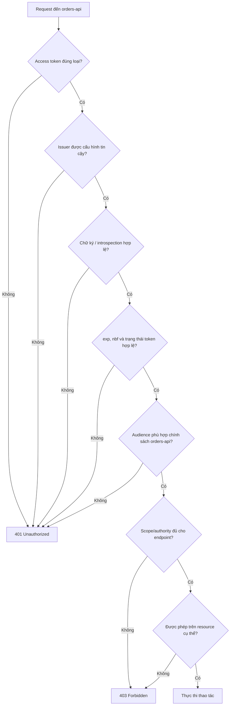
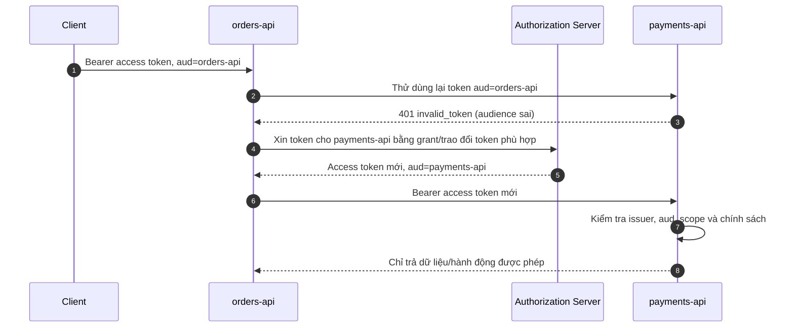

# Kiểm thử đúng, sai và nhiều audience

Một API đơn hàng nhận access token do authorization server tin cậy ký, chưa hết hạn và có scope `orders.read`. Tuy nhiên, payload ghi `"aud": "payments-api"`. API đơn hàng có được chấp nhận token này không? **Không.** Chữ ký đúng xác nhận nguồn phát hành; scope mô tả phạm vi quyền; còn **audience** cho biết **bên nhận mà token được dự định cấp cho**. Nếu `orders-api` chấp nhận token chỉ dành cho `payments-api`, hệ thống đã phá vỡ một ranh giới tin cậy quan trọng.

Bài học thuộc chương **Audience** của module `SECURITY_TOKEN_SECURITY_FUNDAMENTALS`. Mục tiêu là xây dựng các ca kiểm thử **đúng, sai và nhiều audience** trong OAuth 2.0/OpenID Connect (OIDC), hiểu cách kiểm tra `aud` với JWT và opaque access token, phân biệt audience của ID token, kết hợp kiểm tra issuer, scope, thời hạn và quyền nghiệp vụ, đồng thời phát hiện lỗi dùng token của API này tại API khác.

## 1. Audience là gì và vì sao phải kiểm thử?

Trong JSON Web Token (JWT), claim `aud` (*audience*) xác định những bên nhận mà JWT dự định được sử dụng. Theo RFC 7519, một principal xử lý JWT phải tự xác định mình có thuộc audience cho phép hay không; nếu không, phải **từ chối JWT**. `aud` có thể là **một chuỗi** hoặc **mảng chuỗi**. Các giá trị dạng StringOrURI được so sánh phân biệt chữ hoa/thường và thông thường **không áp dụng chuẩn hóa ngầm**.

Ví dụ với resource server `orders-api`:

```json
{
  "iss": "https://id.example.test",
  "sub": "user-123",
  "aud": "orders-api",
  "scope": "orders.read",
  "iat": 1795410000,
  "exp": 1795410900
}
```

Đây là **payload minh họa**, chưa phải JWT đã ký; các mốc thời gian chỉ mô tả token có hiệu lực 15 phút. Trong hệ thống thật, API chỉ đọc claims để ra quyết định **sau khi** xác minh nguồn token và tính hợp lệ của nó.

| Khái niệm | Trả lời câu hỏi | Ví dụ |
|---|---|---|
| `iss` — issuer | Ai phát hành token và có được API tin cậy không? | `https://id.example.test` |
| `aud` — audience | Token dành cho bên nhận nào? | `orders-api` |
| `sub` — subject | Chủ thể của token là ai? | `user-123` hoặc một service principal tùy luồng |
| `scope` | Token được cấp những phạm vi truy cập nào? | `orders.read` |
| `exp` / `nbf` | Token còn hiệu lực tại thời điểm này không? | Thời điểm hết hạn và bắt đầu hợp lệ |
| Chính sách API | Chủ thể có được làm hành động này trên tài nguyên cụ thể không? | Chỉ đọc đơn hàng trong tenant được phép |

**Audience không phải scope, client ID hay role.** Client ID có thể xuất hiện trong những claims khác; ở access token, audience thường hướng đến **resource server**, trong khi ID token của OIDC có audience là **client**. Không dùng `aud` để thay thế kiểm tra `scope` hoặc quyền sở hữu dữ liệu.

## 2. Trước khi test: xác định hợp đồng audience của API

Không thể kết luận một token đúng hay sai audience nếu chưa định nghĩa **giá trị audience kỳ vọng** và **chính sách xử lý mảng audience**. Giả sử hệ thống minh họa có:

| Thành phần | Định danh | Chức năng |
|---|---|---|
| Authorization Server / OpenID Provider | `https://id.example.test` | Phát hành và quản lý token |
| OAuth client | `orders-web` | Ứng dụng người dùng truy cập |
| Resource Server 1 | `orders-api` | Đọc, sửa và duyệt đơn hàng |
| Resource Server 2 | `payments-api` | Thanh toán |
| Resource Server 3 | `reports-api` | Báo cáo |

Cấu hình mô hình:

```yaml
trusted_issuer: "https://id.example.test"
expected_audience: "orders-api"
accepted_token_kind: "access_token"
multi_audience_policy: "contains_expected"
required_scope_for_get_order: "orders.read"
```

Các tên khóa trên là **cấu hình ví dụ**, không phải một schema chuẩn. Điều cần thống nhất giữa AS và API:

1. **Audience canonical:** `orders-api` là chuỗi định danh logic hay một URI resource, ví dụ `https://api.example.test/orders`? Chỉ chọn giá trị theo hợp đồng, không tự suy từ hostname của request.
2. **Kiểu dữ liệu:** token có `aud` là chuỗi đơn, mảng chuỗi hoặc cả hai tùy hồ sơ JWT? RFC 7519 hỗ trợ hai biểu diễn; bộ xác minh phải có quy tắc chuyển đổi đáng tin.
3. **Chính sách nhiều audience:** token có cả `orders-api` và `reports-api` được chấp nhận hay cần dành riêng một audience?
4. **Nguồn tin cậy:** issuer nào được phép cấp token cho `orders-api`, dùng khóa ký/introspection nào và token profile gì?
5. **Quyền đi kèm:** scope nào dành cho API này; có cần role, tenant, owner, xác thực mạnh hoặc điều kiện nghiệp vụ bổ sung không?

**Không lấy expected audience từ `aud` của token do bên gọi gửi.** Giá trị kỳ vọng phải xuất phát từ cấu hình bảo mật của resource server hoặc hợp đồng tin cậy đã được phê duyệt.

## 3. Ba nhóm kiểm thử: đúng, sai và nhiều audience

Với cấu hình `expected_audience = orders-api`, có hai chính sách thường gặp:

- **Chính sách A — chứa audience kỳ vọng:** chấp nhận nếu tập `aud` hợp lệ **chứa chính xác** `orders-api`, kể cả khi có thêm audience khác, và tất cả các kiểm tra bảo mật còn lại đều đạt.
- **Chính sách B — chỉ một audience:** chỉ chấp nhận `aud` có **đúng một phần tử** và phần tử đó là `orders-api`. Chính sách này giảm việc tái sử dụng một token cho nhiều resource server nhưng phải phù hợp hợp đồng phát hành của AS.

Một token nhiều audience **không mặc định sai theo chuẩn JWT**, song API vẫn có quyền áp dụng chính sách B nếu kiến trúc yêu cầu tách biệt tài nguyên. Ngược lại, không tự cho rằng token nhiều audience là an toàn chỉ vì có tên API mình trong mảng: vẫn cần xét scope, loại token, issuer và nguy cơ sử dụng token chéo giữa các API.

### Ma trận kiểm thử lõi

Giả định các token trong bảng **đều có chữ ký/nguồn tin cậy hợp lệ, chưa hết hạn và đúng loại access token**, trừ khi ca kiểm thử nói khác. Kết quả dưới đây chỉ đánh giá **bước audience**:

| ID | Claim `aud` trong token | Chính sách A: chứa `orders-api` | Chính sách B: đúng một `orders-api` | Lý do |
|---|---|---|---|---|
| A01 | `"orders-api"` | PASS | PASS | Chuỗi khớp chính xác. |
| A02 | `["orders-api"]` | PASS | PASS | Mảng một phần tử hợp lệ. |
| A03 | `"payments-api"` | FAIL | FAIL | Token dành cho API khác. |
| A04 | `["payments-api", "reports-api"]` | FAIL | FAIL | Không chứa audience kỳ vọng. |
| A05 | `["orders-api", "reports-api"]` | PASS | FAIL | Nhiều audience, trong đó có API đích. |
| A06 | `["reports-api", "orders-api"]` | PASS | FAIL | Thứ tự mảng không làm thay đổi tập bên nhận. |
| A07 | `["orders-api", "payments-api", "reports-api"]` | PASS | FAIL | Nhiều bên nhận; cần chính sách rõ. |
| A08 | **Thiếu `aud`** | FAIL | FAIL | Không chứng minh được token dành cho API. |
| A09 | `[]` | FAIL | FAIL | Mảng rỗng không chứa audience kỳ vọng. |
| A10 | `""` | FAIL | FAIL | Audience rỗng. |
| A11 | `"orders-api-v2"` | FAIL | FAIL | Không so khớp bằng tiền tố/chuỗi con. |
| A12 | `"ORDERS-API"` | FAIL | FAIL | Không tự đổi chữ hoa/thường. |
| A13 | `"orders-api/"` | FAIL | FAIL | Không tự cắt dấu `/` cuối. |
| A14 | `"https://api.example.test/orders"` | FAIL* | FAIL* | Giá trị URI khác `orders-api`; chỉ PASS nếu hợp đồng đổi expected audience đúng URI này. |
| A15 | `["orders-api", "orders-api"]` | PASS** | FAIL | Trùng audience không cấp thêm quyền; có thể từ chối theo chính sách dữ liệu chặt hơn. |
| A16 | `123` hoặc `[123, "orders-api"]` | FAIL | FAIL | Kiểu dữ liệu không hợp lệ theo profile; decoder phải từ chối, không tự ép kiểu số thành chuỗi. |

**\*** Với A14, điều kiện FAIL phụ thuộc đúng cấu hình `expected_audience = orders-api` của bài. Nếu AS và API **thống nhất audience là URI**, giá trị expected phải tương ứng và phép so khớp vẫn là so khớp chính xác.

**\*\*** Với A15, kết quả PASS ở chính sách A chỉ là kết quả phép kiểm tra thành viên của mảng; hệ thống có thể **từ chối token malformed/duplicate theo quy tắc profile cứng hơn**. Không nên phát hành duplicate audience.

Nếu issuer, chữ ký, thời hạn hoặc token type không hợp lệ thì **toàn bộ request phải bị từ chối**, dù ma trận audience báo PASS.

## 4. JWT mô tả nhiều audience như thế nào?

RFC 7519 cho phép hai dạng biểu diễn `aud`:

```json
{
  "aud": "orders-api"
}
```

```json
{
  "aud": ["orders-api", "reports-api"]
}
```

Khi có nhiều phần tử, API cần kiểm tra **có ít nhất một phần tử khớp chính xác** với giá trị kỳ vọng nếu dùng chính sách A. Không kiểm tra một chuỗi JSON do ứng dụng tự nối hoặc sử dụng `String.contains("orders-api")` trên payload.

Ví dụ sai:

```java
// Sai: nhận nhầm "orders-api-v2" và có thể nhận dữ liệu tùy ý.
boolean accepted = rawJsonPayload.contains("orders-api");
```

Ví dụ đúng ở **tầng so khớp audience**:

```java
static boolean containsExpectedAudience(
        List<String> audiences,
        String expectedAudience) {
    return audiences != null
            && audiences.stream()
                .anyMatch(expectedAudience::equals);
}

static boolean requiresSingleExpectedAudience(
        List<String> audiences,
        String expectedAudience) {
    return audiences != null
            && audiences.size() == 1
            && expectedAudience.equals(audiences.get(0));
}
```

Hai phương thức chỉ nhận **dữ liệu đã được decoder kiểm tra kiểu và nguồn tin cậy**. Chúng không tự xác minh chữ ký hay trạng thái token. Nếu ứng dụng chọn chính sách B, dùng phép `requiresSingleExpectedAudience`. Dùng API của thư viện JWT để chuyển đổi claim theo quy tắc RFC 7519 và hồ sơ token đã cấu hình.

**Không mặc định wildcard:** `aud="*"`, `aud="https://api.example.test/*"`, `aud="orders-*"` không có ngữ nghĩa wildcard theo JWT chuẩn. Nếu hệ thống tự thêm cơ chế pattern matching, rất dễ mở rộng quyền ngoài ý định; nên dùng một audience cụ thể được AS/RS thống nhất.

## 5. Kiểm thử audience phải nằm sau xác minh token

Một token tự tạo cũng có thể ghi `aud="orders-api"`. Việc audience khớp **chưa đủ** để cho phép truy cập.



Quá trình xử lý thực tế của thư viện có thể không theo đúng thứ tự nút; đây là **mô hình điều kiện bắt buộc**, không phải hướng dẫn tự viết thuật toán xác minh chữ ký.

Trong JWT:

- **`iss`:** phải trùng issuer tin cậy, không tự tải JWKS từ URL `iss` chưa được cho phép.
- **Chữ ký/thuật toán:** khóa xác minh được ràng buộc với issuer, thuật toán phải có trong allowlist; không tin `alg`, `jku` hoặc `x5u` do token tự gợi ý nếu chưa được chính sách cho phép.
- **`exp`, `nbf`:** kiểm tra thời hạn và thời điểm hiệu lực, với dung sai đồng hồ nếu được chính sách chấp nhận.
- **Token type/profile:** tránh dùng ID token, refresh token hoặc JWT cho mục đích khác thay access token; profile JWT access token RFC 9068 có quy tắc về `typ` và claims.
- **`aud`:** token được phát hành cho chính resource server.
- **`scope` và chính sách nghiệp vụ:** kiểm tra quyền thực tế sau khi token được chấp nhận.

Một JWT có chữ ký đúng nhưng `aud` sai là **credential không hợp lệ cho API đang nhận**, thường trả `401 Unauthorized`. Ngược lại, JWT hợp lệ và đúng audience nhưng thiếu scope thường trả `403 Forbidden`.

## 6. Không nhầm audience của access token và ID token

Trong OIDC, **ID token** là JWT dành cho **client** (relying party). Claim `aud` của ID token phải chứa **client ID** của ứng dụng nhận. **Access token** dùng để gọi **resource server** và cần audience phù hợp với tài nguyên đó.

Ví dụ cùng một lần đăng nhập có:

| Token | Audience minh họa | Bên xử lý đúng |
|---|---|---|
| ID token | `"orders-web"` | Client `orders-web` xác minh theo OIDC. |
| Access token | `"orders-api"` | API `orders-api` xác minh và phân quyền. |
| Access token đa audience | `["orders-api", "reports-api"]` | Chỉ API có audience được chỉ định và chính sách cho phép. |
| Refresh token | Định dạng và thông tin liên kết do AS quyết định | AS/token endpoint khi client yêu cầu làm mới token. |

**Không dùng ID token làm Bearer token cho API.** Chữ ký có thể do cùng một OP phát hành và các claims như `sub`, `exp` trông giống nhau, nhưng mục đích và đối tượng nhận khác nhau.

Đối với ID token có **nhiều audience**, client OIDC còn phải xử lý claim `azp` (*authorized party*) theo các quy tắc OIDC áp dụng; client ID phải thuộc `aud`. Đây là bài toán **ID token validation tại client**, không phải lý do để API bỏ qua `aud` của access token. Không dùng `azp` làm vật thay thế mặc định cho việc kiểm tra `aud` của resource server.

## 7. Nhiều audience: lợi ích và rủi ro cần test

Token nhiều audience có thể xuất hiện trong những kiến trúc mà một quyền được cấp có mục đích dùng tại nhiều resource server. Ví dụ:

```json
{
  "iss": "https://id.example.test",
  "sub": "user-123",
  "aud": ["orders-api", "reports-api"],
  "scope": "orders.read reports.read",
  "exp": 1795410900
}
```

**Không suy rằng** `orders-api` được phép dùng `reports.read` hoặc ngược lại chỉ vì hai audience xuất hiện. Mỗi API vẫn cần kiểm tra scope của **chính mình** và chính sách trên tài nguyên. Nếu các scope không có namespace hoặc token có quyền rất rộng, token đa audience có thể làm khó việc cô lập phạm vi quyền.

| Kịch bản | Rủi ro | Kiểm thử/biện pháp |
|---|---|---|
| Token cho hai API với scopes chung | API diễn giải scope của API kia thành quyền của mình. | Đặt tên/hợp đồng scope rõ ràng, kiểm tra audience và chính sách endpoint. |
| Token bị đánh cắp | Một bearer token có thể dùng tại nhiều API trong khi còn hiệu lực. | Giới hạn audience, thời hạn, scope; sender-constrained token khi khả thi. |
| API A gọi API B bằng token chỉ có `aud=A` | Cross-service token replay hoặc confused deputy. | B phải từ chối; A xin token dành cho B theo luồng thích hợp. |
| API chọn chính sách B nhưng AS cấp `[A,B]` | Lỗi tích hợp vì từ chối token có audience phụ. | Thống nhất hợp đồng trước khi phát hành; test cả policy phát hành và validator. |
| Một issuer cấp token cho nhiều tenant | Audience đúng nhưng dữ liệu tenant khác vẫn có thể bị lộ. | Thêm kiểm tra principal/tenant/resource. |

### Khi API A cần gọi API B

Giả sử `orders-api` gọi `payments-api`:



A chỉ được thực hiện bước xin token cho B **nếu** được ủy quyền và cơ chế phù hợp đã được triển khai, ví dụ một grant service-to-service hoặc token exchange theo RFC 8693 khi AS hỗ trợ. Không được đổi chuỗi `aud` trong JWT rồi ký lại bằng khóa tự tạo để vượt qua kiểm tra. Ngay cả token đa audience hợp lệ cũng phải tuân theo chính sách của từng API.

## 8. Tạo bộ test cho JWT audience validator trong Spring Security

Spring Security Resource Server có thể xác minh JWT bằng `JwtDecoder`. Việc cấu hình issuer **không thay thế** yêu cầu kiểm tra audience của API. Ví dụ một decoder cho chính sách A — chấp nhận khi `aud` chứa `orders-api`:

```java
@Configuration
public class JwtResourceServerConfig {

    @Bean
    JwtDecoder jwtDecoder() {
        String issuer = "https://id.example.test";
        String audience = "orders-api";

        NimbusJwtDecoder decoder =
                NimbusJwtDecoder.withIssuerLocation(issuer).build();

        OAuth2TokenValidator<Jwt> defaults =
                JwtValidators.createDefaultWithIssuer(issuer);

        OAuth2TokenValidator<Jwt> audienceValidator = token -> {
            List<String> audiences = token.getAudience();
            boolean accepted = audiences != null
                    && audiences.contains(audience);
            if (accepted) {
                return OAuth2TokenValidatorResult.success();
            }
            return OAuth2TokenValidatorResult.failure(
                    new OAuth2Error(
                            "invalid_token",
                            "Invalid audience",
                            null));
        };

        decoder.setJwtValidator(
                new DelegatingOAuth2TokenValidator<>(
                        defaults, audienceValidator));
        return decoder;
    }
}
```

Đây là đoạn cấu hình **minh họa** cho ứng dụng Spring Security (bỏ qua các `import`). Cần bổ sung cấu hình security filter chain, phương án kiểm tra JWT access-token profile/loại token và danh sách thuật toán cho phép theo kiến trúc. `issuer`/`audience` là giá trị giả định. Thư viện phải đảm nhận kiểm tra cấu trúc JWT, chữ ký và chuyển đổi claim; logic `audienceValidator` chỉ quyết định audience trong tập đã chuyển đổi.

Nếu API muốn **chính sách B**, thay điều kiện:

```java
boolean accepted = audiences != null
        && audiences.size() == 1
        && audience.equals(audiences.get(0));
```

Không đồng thời gắn hai chính sách mâu thuẫn. Khi đổi policy phải cập nhật tài liệu hợp đồng phát hành, cả test của authorization server và resource server.

### Kiểm thử logic audience độc lập

Ví dụ JUnit 5 tập trung vào hàm so khớp, không tạo chữ ký JWT thật:

```java
import static org.junit.jupiter.api.Assertions.*;
import java.util.List;
import org.junit.jupiter.api.Test;

class AudiencePolicyTest {

    static boolean accepts(List<String> aud, String expected) {
        return aud != null && aud.contains(expected);
    }

    @Test
    void acceptsExactSingleOrMultiAudience() {
        assertTrue(accepts(List.of("orders-api"), "orders-api"));
        assertTrue(accepts(
            List.of("reports-api", "orders-api"), "orders-api"));
    }

    @Test
    void rejectsWrongAndLookalikeAudience() {
        assertFalse(accepts(List.of("payments-api"), "orders-api"));
        assertFalse(accepts(List.of("orders-api-v2"), "orders-api"));
        assertFalse(accepts(List.of("ORDERS-API"), "orders-api"));
        assertFalse(accepts(List.of("orders-api/"), "orders-api"));
        assertFalse(accepts(List.of(), "orders-api"));
        assertFalse(accepts(null, "orders-api"));
    }

    @Test
    void policyCanRequireExactlyOneAudience() {
        List<String> multi = List.of("orders-api", "reports-api");
        assertTrue(accepts(multi, "orders-api"));
        assertFalse(multi.size() == 1
            && "orders-api".equals(multi.get(0)));
    }
}
```

Các test này kiểm tra **quy tắc so khớp thuần túy**, chưa thay thế kiểm thử của bộ giải mã và resource server. Cần thêm kiểm thử thực tế với token được ký bằng **khóa thử nghiệm** và cấu hình decoder tin khóa đó để xác minh trường hợp `aud` là chuỗi hoặc mảng và các lỗi xác minh khác. Không cần hoặc không được sử dụng khóa sản xuất để tạo token kiểm thử.

## 9. Kiểm thử tích hợp: không chỉ thay `aud` trong payload

Trong bài test tích hợp, có thể dùng authorization server giả lập hoặc bộ phát hành JWT kiểm thử có **khóa ký riêng cho môi trường test**, đồng thời cấu hình API tin JWKS/issuer test. Ký mỗi fixture đúng cách để kiểm tra **điều kiện audience**, thay vì sửa payload Base64URL rồi vẫn mong chữ ký cũ hợp lệ.

Một bộ fixture tối thiểu:

1. **T01 — đúng chuỗi:** token ký hợp lệ, `aud="orders-api"`, scope và quyền đầy đủ → qua kiểm tra audience và được phép ở endpoint tương ứng.
2. **T02 — đúng mảng một phần tử:** `aud=["orders-api"]` → qua kiểm tra audience nếu profile cho phép.
3. **T03 — sai API:** `aud="payments-api"` → bị từ chối ở tầng token, thường `401`.
4. **T04 — mảng không chứa API:** `aud=["payments-api","reports-api"]` → `401`.
5. **T05 — nhiều audience có API:** `aud=["orders-api","reports-api"]` → theo chính sách A thì qua audience; theo chính sách B thì bị từ chối.
6. **T06 — sai kiểu/thiếu:** không có `aud`, mảng rỗng, `aud` kiểu số → bị từ chối đúng quy tắc hồ sơ.
7. **T07 — gần giống nhưng không bằng:** `orders-api-v2`, khác chữ hoa hoặc khác dấu `/` → từ chối.
8. **T08 — chữ ký sai:** ngay cả `aud="orders-api"` cũng từ chối.
9. **T09 — issuer lạ:** JWT do issuer không có trong allowlist ký, dù `aud` khớp → từ chối.
10. **T10 — token hết hạn hoặc chưa hiệu lực:** audience đúng nhưng `exp`/`nbf` sai → từ chối.
11. **T11 — nhầm loại token:** ID token có audience là client, hoặc một JWT sai token profile → API từ chối.
12. **T12 — thiếu scope:** token hợp lệ, đúng audience, thiếu `orders.approve` → `403 insufficient_scope` khi gọi approve.
13. **T13 — thiếu quyền bản ghi:** đúng audience và scope nhưng đơn hàng khác tenant → từ chối theo chính sách, có thể `403`/`404`.
14. **T14 — token của service account:** audience đúng nhưng principal dạng client không thỏa điều kiện endpoint dành riêng người dùng → từ chối theo chính sách.
15. **T15 — nhiều resource server:** `orders-api` chấp nhận token riêng của mình nhưng `payments-api` phải từ chối chính token đó nếu không nằm trong audience.
16. **T16 — thay đổi cấu hình audience:** AS chuyển sang resource URI mới trong khi API giữ tên cũ → test hợp đồng phát hiện lỗi trước triển khai.

Khi kiểm thử API, nên xác minh **HTTP status**, thông tin `WWW-Authenticate` nếu sử dụng Bearer, **không có thay đổi dữ liệu sau khi từ chối**, và audit ghi đúng mã nguyên nhân. Một test chỉ so sánh mã `401` không đủ nếu request vẫn làm thay đổi dữ liệu ở tầng sau do kiểm tra quá muộn.

### Kết quả HTTP theo nguyên nhân

| Nguyên nhân | HTTP thông thường | Ghi chú |
|---|---|---|
| Không có access token ở endpoint bảo vệ | `401 Unauthorized` | Có thể có `WWW-Authenticate: Bearer`. |
| JWT không hợp lệ, hết hạn hoặc `aud` không khớp | `401 Unauthorized` | Thường mô tả là `invalid_token`, không tiết lộ token thật. |
| Access token hợp lệ nhưng thiếu scope | `403 Forbidden` | `insufficient_scope` theo RFC 6750 khi thích hợp. |
| Access token đủ audience/scope nhưng thiếu quyền trên bản ghi | `403` hoặc `404` | Chính sách có thể che giấu sự tồn tại của tài nguyên. |
| Introspection không xác thực được token | `401` hoặc xử lý lỗi dịch vụ theo chính sách | Không mặc nhiên coi timeout là `active=true`. |

Ví dụ phản hồi với audience sai:

```http
HTTP/1.1 401 Unauthorized
WWW-Authenticate: Bearer realm="orders-api", error="invalid_token"
```

Ví dụ scope thiếu dù audience đúng:

```http
HTTP/1.1 403 Forbidden
WWW-Authenticate: Bearer realm="orders-api", error="insufficient_scope", scope="orders.approve"
```

Thông điệp phía client nên ngắn gọn, tránh tiết lộ cấu hình issuer/JWKS, policy nội bộ hoặc chi tiết credential nhạy cảm. Audit nội bộ nên phân loại `AUDIENCE_MISMATCH` và `MISSING_SCOPE` riêng để điều tra.

## 10. Opaque access token: kiểm thử audience từ introspection

Token dạng opaque không có JWT payload để API tự tách `aud`. Resource server có thể nhận metadata từ **OAuth 2.0 Token Introspection** (RFC 7662) qua endpoint của AS đã được tin cậy.

Phản hồi minh họa:

```json
{
  "active": true,
  "iss": "https://id.example.test",
  "client_id": "orders-web",
  "sub": "user-123",
  "aud": ["orders-api", "reports-api"],
  "scope": "orders.read",
  "exp": 1795410900
}
```

Với API `orders-api`, logic kiểm tra audience **vẫn giống** phần JWT nếu AS/RS đã thống nhất biểu diễn metadata. Tuy nhiên, `aud` là trường **tùy chọn** trong RFC 7662; API cần quy định rõ rằng audience là trường bắt buộc **đối với hợp đồng kiểm tra của API này**. Khi thông tin thiếu hoặc không đáng tin, **không tự suy ra audience hợp lệ** từ `client_id` hay scope.

Các kịch bản kiểm thử riêng:

| ID | Kết quả introspection | Kỳ vọng |
|---|---|---|
| O01 | `active=true`, `aud="orders-api"` | Qua kiểm tra audience nếu issuer/AS và các điều kiện khác phù hợp. |
| O02 | `active=true`, `aud=["orders-api","reports-api"]` | Theo chính sách đa audience đã lựa chọn. |
| O03 | `active=true`, `aud="payments-api"` | Từ chối. |
| O04 | `active=true`, **không có `aud`** | Từ chối khi hợp đồng API yêu cầu audience mà không có căn cứ khác đáng tin. |
| O05 | `active=false`, dù response có metadata cũ | Từ chối token không active. |
| O06 | Endpoint introspection không phải AS tin cậy | Không chấp nhận metadata. |
| O07 | Cache trước đó `active=true` nhưng token mới bị thu hồi | Đánh giá theo TTL/invalidation và yêu cầu độ mới trạng thái. |

Introspection cần được bảo vệ bằng HTTPS, xác thực resource server phù hợp, hạn chế thông tin trả về cho đúng bên được phép. Không dùng response từ endpoint do caller chỉ định.

## 11. Nhiều issuer, audience URI và thay đổi định danh

### Audience URI so với định danh logic

Hợp đồng có thể dùng `orders-api` hoặc URI như `https://api.example.test/orders`. Trong quy trình kiểm tra mặc định, đây là **hai giá trị khác nhau**:

```text
expected: "https://api.example.test/orders"

token aud: "https://api.example.test/orders"  -> MATCH
token aud: "https://api.example.test/orders/" -> NO MATCH
token aud: "http://api.example.test/orders"   -> NO MATCH
token aud: "https://API.example.test/orders"  -> NO MATCH
token aud: "orders-api"                        -> NO MATCH
```

Không dùng hàm chuẩn hóa URL theo quy tắc web (bỏ dấu `/`, đổi scheme/hostname, resolve redirect...) để “sửa” audience nếu hợp đồng không quy định. Audience mang giá trị **định danh**; yêu cầu của JWT là so khớp StringOrURI theo quy tắc áp dụng, không phải tìm hai URL có thể dẫn đến cùng máy chủ.

### Nhiều issuer

Hai issuer khác nhau có thể cùng dùng chuỗi `orders-api`, nhưng điều đó **không làm hai issuer có cùng quyền phát token**. API phải kiểm tra **issuer thuộc allowlist**, khóa/JWKS hoặc introspection gắn với issuer đó, loại token, audience và hợp đồng scope.

Không chấp nhận một JWT từ issuer lạ chỉ vì `aud` khớp. Ngược lại, khi issuer được tin cậy vẫn cần audience đúng cho từng API, không chấp nhận mọi token do issuer này phát hành.

### Khi thay đổi audience

Một API có thể đổi từ `orders-api` sang URI resource. Nên thực hiện có kiểm soát:

1. Thống nhất định danh canonical và chính sách chấp nhận trong tài liệu API/AS.
2. Cập nhật phía AS để phát hành audience theo hợp đồng mới.
3. Triển khai kiểm thử tương thích theo thời gian sống tối đa của token cũ, tránh chấp nhận cả hai định danh vô thời hạn.
4. Khi cần cửa sổ chuyển tiếp, cấu hình tường minh danh sách audience được phép và **ràng buộc từng giá trị với cùng một resource**; không mở rộng sang API không liên quan.
5. Sau khi chuyển đổi, bỏ định danh cũ và kiểm tra telemetry để phát hiện client/token chưa cập nhật.

Cho phép **nhiều giá trị audience thay thế trong cấu hình của một API** là vấn đề khác với **JWT có nhiều audience trong cùng một token**. Cần viết test riêng cho hai trường hợp và tránh trộn lẫn.

## 12. Audience không thay các biện pháp bảo vệ token

Ngay cả token đã có audience đúng vẫn có thể bị **đánh cắp hoặc phát lại**. Với bearer access token, người có bản sao token còn hiệu lực có thể thử dùng nó tại resource server thuộc audience phù hợp.

Các lớp bảo vệ bổ sung:

- **Thời hạn ngắn, scope tối thiểu:** giảm giá trị token bị lộ.
- **Bảo vệ khi truyền và lưu:** TLS, tránh token trong URL, log, analytics; với browser cân nhắc BFF/session cookie phù hợp; với native app dùng kho lưu bí mật của hệ điều hành.
- **Thu hồi và trạng thái:** refresh token rotation, revocation và introspection/denylist nếu yêu cầu cập nhật trạng thái nhanh; JWT tự xác minh có thể còn hiệu lực đến `exp` nếu không có cơ chế bổ sung.
- **Sender constraint:** DPoP hoặc mTLS khi hạ tầng hỗ trợ làm token khó bị sử dụng bởi bên không giữ khóa/chứng chỉ tương ứng.
- **Kiểm tra quyền cấp tài nguyên:** owner, tenant, quan hệ truy cập, hạn mức và trạng thái nghiệp vụ vẫn phải được kiểm tra.
- **Audit an toàn:** ghi issuer/audience đã xác minh, kết quả `PERMIT`/`DENY`, mã lỗi như `AUDIENCE_MISMATCH` hoặc `MISSING_SCOPE`, phiên bản policy và mã tương quan; **không ghi token gốc**.

Audience hạn chế **nơi token có thể được chấp nhận**, không tự ràng buộc bearer token với người đang cầm nó. Khi điều tra một request đã qua xác minh, không thể mặc định chủ tài khoản đã tự thực hiện nếu token có thể bị lộ.

## 13. Bài tập tình huống và đáp án gợi ý

Giả sử `orders-api` tin issuer `https://id.example.test`, dùng chính sách A (`aud` phải chứa `orders-api`), yêu cầu scope `orders.read` cho `GET /orders/{id}` và kiểm tra owner/tenant.

**Bài tập 1.** JWT được ký đúng, còn hạn, `aud=["payments-api","orders-api"]`, scope `orders.read`. Người dùng xem đơn hàng của chính mình. Token qua bước audience không?

> **Có**, theo chính sách A vì mảng chứa chính xác `orders-api`. API vẫn phải kiểm tra scope và quyền bản ghi. Theo chính sách B, token này **bị từ chối** vì có nhiều audience.

**Bài tập 2.** JWT có `aud="orders-api-v2"` và scope `orders.read`. API dùng `expected_audience="orders-api"`. Có chấp nhận không?

> **Không.** Đây là hai định danh khác nhau. Không được dùng so khớp tiền tố để nới quyền.

**Bài tập 3.** JWT có `aud="orders-api"`, nhưng issuer là một nhà phát hành chưa được tin cậy. Có chấp nhận không?

> **Không.** Audience đúng không chứng minh nguồn token. API phải từ chối ngay ở ranh giới issuer/chữ ký.

**Bài tập 4.** ID token do OP ký có `aud="orders-web"`, bên trong còn có `roles=["ADMIN"]`. Client gửi token đến API đơn hàng. Có được bỏ qua `aud` vì token do OP tin cậy ký không?

> **Không.** Đây là ID token dành cho client; API chỉ chấp nhận access token đúng profile/audience, sau đó mới xem xét quyền.

**Bài tập 5.** Opaque access token introspection trả `active=true` và `scope=orders.read`, nhưng không trả `aud` trong khi API yêu cầu audience rõ ràng. Có thể tự dùng scope để suy ra `aud` không?

> **Không.** API phải có căn cứ audience được tin cậy theo hợp đồng với AS; nếu không xác nhận được thì từ chối theo chính sách an toàn.

**Bài tập 6.** Token có audience đúng và scope `orders.read`, nhưng đơn hàng thuộc tenant khác. Có cho phép không?

> **Không.** Kiểm tra audience và scope chỉ vượt qua hai lớp điều kiện; kiểm tra quyền cấp tài nguyên vẫn phải từ chối nếu chủ thể không có quyền.

### Tự kiểm tra

1. Tại sao `aud` và `scope` không thể thay thế nhau?
2. Một JWT có `aud` dạng chuỗi và một JWT có `aud` mảng một phần tử giống nhau ở điều kiện nào?
3. Khi nào mảng audience có `orders-api` được chấp nhận, và khi nào phải từ chối?
4. Vì sao `String.contains()` trên toàn bộ payload là cách kiểm tra audience nguy hiểm?
5. API cần kiểm thử gì khi AS đổi định danh audience từ chuỗi logic sang URI?
6. Vì sao test audience PASS không chứng minh token chưa bị đánh cắp hoặc người gọi có quyền trên bản ghi?

## 14. Ghi nhớ

- **Audience xác định bên nhận token.** Resource server phải kiểm tra `aud` khớp giá trị kỳ vọng từ chính sách của mình; không lấy giá trị kỳ vọng từ token.
- **JWT cho phép `aud` là chuỗi hoặc mảng chuỗi.** Kiểm tra giá trị nguyên vẹn, phân biệt chữ hoa/thường, không suy diễn prefix, URL normalization hay wildcard.
- **Token có nhiều audience không mặc định đúng hoặc sai trong mọi triển khai**: chính sách A chấp nhận mảng chứa audience đích; chính sách B chỉ chấp nhận đúng một audience. Phải kiểm thử và thống nhất với AS.
- **Audience đúng chưa đủ:** còn phải xác minh issuer, chữ ký/trạng thái, token type, thời hạn, scope và quyền trên tài nguyên.
- **ID token của OIDC dành cho client**, access token dành cho resource server; không dùng ID token để vượt kiểm tra audience của API.
- **Opaque token cũng cần audience đáng tin cậy** nếu API yêu cầu; introspection `active=true` không thay việc kiểm tra phạm vi người nhận.
- **Bảo mật vòng đời vẫn quan trọng:** giới hạn audience giúp giảm tác động dùng sai API, nhưng không tự ngăn bearer token bị đánh cắp/phát lại.

### Tài liệu chuẩn tham khảo

- [RFC 7519 — JSON Web Token (JWT)](https://www.rfc-editor.org/rfc/rfc7519): định nghĩa `aud` và kiểu StringOrURI, chuỗi hoặc mảng.
- [RFC 9068 — JWT Profile for OAuth 2.0 Access Tokens](https://www.rfc-editor.org/rfc/rfc9068): quy tắc audience, token type và xác minh JWT access token.
- [RFC 8707 — Resource Indicators for OAuth 2.0](https://www.rfc-editor.org/rfc/rfc8707): cách client chỉ rõ resource dự kiến nhận access token.
- [RFC 7662 — OAuth 2.0 Token Introspection](https://www.rfc-editor.org/rfc/rfc7662): metadata token opaque, `active` và `aud`.
- [RFC 6750 — OAuth 2.0 Bearer Token Usage](https://www.rfc-editor.org/rfc/rfc6750): lỗi `invalid_token`, `insufficient_scope` và HTTP.
- [RFC 8693 — OAuth 2.0 Token Exchange](https://www.rfc-editor.org/rfc/rfc8693): cơ chế trao đổi token cho ngữ cảnh/bên nhận khác khi AS hỗ trợ.
- [RFC 9700 — Best Current Practice for OAuth 2.0 Security](https://www.rfc-editor.org/rfc/rfc9700): giảm nguy cơ token bị lạm dụng hoặc phát lại.
- [OpenID Connect Core 1.0](https://openid.net/specs/openid-connect-core-1_0.html): cách kiểm tra `aud` và `azp` trong ID token.
- [Spring Security — OAuth2 Resource Server JWT](https://docs.spring.io/spring-security/reference/servlet/oauth2/resource-server/jwt.html): cấu hình validator issuer/audience và xác minh JWT tại resource server.
