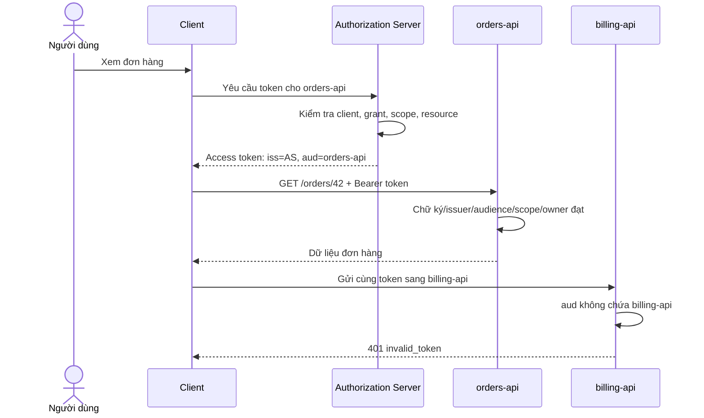
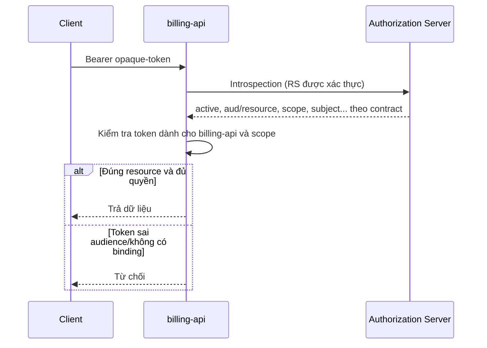
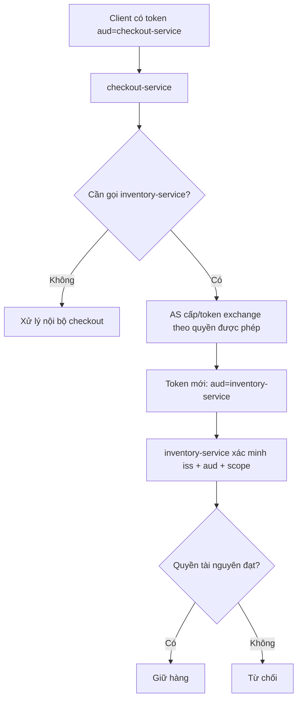

# Không dùng issuer thay cho audience

Giả sử một hệ thống có hai API: `orders-api` quản lý đơn hàng và `billing-api` quản lý thanh toán. Cả hai đều tin cùng một authorization server, `https://auth.example.test`. Một access token được phát hành **cho `orders-api`** có thể có chữ ký hợp lệ, chưa hết hạn và do đúng authorization server phát hành. Nếu `billing-api` chỉ kiểm tra **issuer** (`iss`) rồi chấp nhận token đó, token có thể bị sử dụng sai đích.

Đây là lỗi nhầm lẫn giữa **ai phát hành token** và **token được phát hành cho ai**. Hai câu hỏi phải được kiểm tra độc lập:

- **Issuer (`iss`):** nguồn phát hành token mà bên nhận đã cấu hình tin cậy.
- **Audience (`aud`):** bên nhận hoặc nhóm bên nhận mà token được dành cho.

Trong chương **Audience** của module **SECURITY_TOKEN_SECURITY_FUNDAMENTALS**, bài học làm rõ vì sao kiểm tra `iss` không bao giờ tự thay thế kiểm tra `aud`; cách áp dụng nguyên tắc này cho JWT, opaque token, access token, ID token trong OAuth 2.0/OpenID Connect (OIDC); cách bảo vệ API khỏi việc chuyển token giữa các dịch vụ, nhầm scope, đánh cắp token và phát lại.

> **Nguyên tắc:** Chỉ tin nguồn phát hành **và** chỉ chấp nhận token được cấp **cho đúng bên nhận**, đúng loại token, đúng quyền và còn hiệu lực. Một token hợp lệ trong ngữ cảnh A chưa chắc hợp lệ trong ngữ cảnh B.

## 1. Ý nghĩa chính xác của `iss` và `aud`

Trong JWT (RFC 7519), hai claim đều thuộc nhóm *registered claims*:

| Claim | Câu hỏi cần trả lời | Ví dụ giá trị | Kiểm tra ở bên nhận |
| --- | --- | --- | --- |
| `iss` — issuer | **Ai đã phát hành** JWT? | `https://auth.example.test` | So khớp chính xác với issuer được cấu hình tin cậy; xác minh token với khóa/cơ chế được gắn với issuer đó |
| `aud` — audience | **Token này dành cho ai?** | `orders-api` | Xác nhận chính API hoặc client đang xử lý thuộc tập đối tượng nhận được phép |
| `sub` — subject | Token nói về **chủ thể nào**? | `user-123` | Hiểu đúng user hay service principal theo profile, không nhầm với audience |
| `client_id` | OAuth client nào liên quan tới token/grant? | `shop-web` | Áp dụng chính sách client nếu cần, không coi client ID luôn là API đích |
| `scope` | Những phạm vi truy cập nào được cấp? | `orders:read` | Kiểm tra quyền hành động theo hợp đồng, sau khi đã xác minh token và audience |

Theo RFC 7519, `aud` có thể là **một chuỗi** hoặc **mảng các chuỗi**. `iss` là một chuỗi định danh issuer. Các giá trị được so sánh theo định danh và hợp đồng đã cấu hình; không được suy đoán quan hệ giữa hai claim chỉ vì cùng chứa tên miền hay URL.

Một issuer có thể phát hành token cho nhiều API, nhiều client và nhiều loại token. Do vậy:

```text
iss = https://auth.example.test
  |
  +--> access token, aud = orders-api
  +--> access token, aud = billing-api
  +--> access token, aud = reports-api
  +--> ID token OIDC, aud = shop-web (client_id)
```

**Cùng `iss` không làm bốn token này có thể thay thế nhau.** Bên nhận phải biết *đâu là token dành cho mình* và *token có mục đích gì*.

### 1.1. Không phải `iss` là khóa công khai, cũng không phải `aud` là scope

- `iss` định danh **bên phát hành**. Để xác minh JWT ký, validator dùng khóa đáng tin gắn với issuer đó, chẳng hạn JWKS thu được qua metadata đã xác thực. Chỉ nhìn thấy chuỗi `iss` trong payload không chứng minh token được phát hành thật.
- `aud` xác định **đối tượng nhận**. Nó không liệt kê các quyền hành động: một token có `aud=orders-api` vẫn có thể thiếu `orders:write`.
- `scope` biểu diễn **phạm vi quyền được cấp** theo hợp đồng API. Token có `scope=orders:read` nhưng `aud=billing-api` **không** được đưa sang `orders-api` chỉ vì tên scope chứa chữ `orders`.
- `client_id` là **định danh OAuth client**, thường là ứng dụng xin token, không mặc nhiên là resource server. Một client có thể gọi nhiều resource server bằng **các token dành đúng audience** tương ứng.

Ba hàng rào `iss`, `aud`, `scope` bổ sung cho nhau. Thường còn cần token type/profile, thời hạn, ràng buộc bên gửi và quyền trên tài nguyên thật.

## 2. Tình huống sai điển hình: kiểm tra issuer nhưng bỏ qua audience

Giả sử authorization server phát JWT access token có payload minh họa:

```json
{
  "iss": "https://auth.example.test",
  "sub": "user-123",
  "aud": "orders-api",
  "client_id": "shop-web",
  "scope": "orders:read",
  "iat": 1893456000,
  "exp": 1893456900
}
```

Token này **dành cho `orders-api`**. Nếu `billing-api` chỉ kiểm tra chữ ký, `iss` và `exp`, nó có thể chấp nhận token dù `aud` sai. Hệ quả là một token được cấp cho ngữ cảnh có quyền thấp hơn hoặc khác mục đích có thể bị sử dụng ở nơi không được phép.

Điều kiện kiểm tra **sai**:

```text
accept(token) =
    signature_valid(token)
    AND token.iss == "https://auth.example.test"
    AND now < token.exp
```

Điều kiện kiểm tra **đúng về mặt ranh giới cơ bản** cho `billing-api`:

```text
accept_for_billing(token) =
    signature_valid_with_trusted_issuer_key(token)
    AND token.iss == "https://auth.example.test"
    AND token.aud contains_exactly "billing-api"
    AND token_is_an_access_token_of_expected_profile(token)
    AND token_is_currently_valid(token)
    AND token_binding_is_valid_if_required(token)
    AND scope_and_business_authorization_are_satisfied(token)
```

Đây là công thức định hướng thiết kế. Với JWT access token theo profile RFC 9068, validator còn phải áp dụng các quy tắc header/claim bắt buộc của profile; với opaque token phải dùng cơ chế kiểm tra trạng thái và resource binding phù hợp.

### 2.1. Vì sao lỗ hổng xuất hiện dù chữ ký đúng?

Chữ ký hợp lệ chứng minh thông điệp không bị sửa và được ký bởi khóa được tin cậy **theo cách validator đã kiểm tra**. Chữ ký **không tự xác định** API nào được phép nhận token. Nếu một AS ký token cho nhiều API bằng cùng khóa, mọi API có khóa công khai xác minh đều có thể thấy chữ ký hợp lệ; chỉ `aud` và chính sách riêng của từng API mới giúp ngăn việc chấp nhận sai đích.

Đây là dạng **token substitution/cross-resource token confusion**: dùng một token hợp lệ ở ngữ cảnh khác. Việc chuyển sai token có thể xảy ra do kẻ tấn công hoặc do client/backend gửi nhầm. Không cần giả mạo chữ ký để khai thác một RS bỏ qua audience.

## 3. Ba ranh giới tin cậy trong OAuth 2.0

Sơ đồ sau minh họa một authorization server phục vụ hai resource server:



**Client → AS:** client có thể yêu cầu scope/resource, nhưng AS là bên quyết định có cấp token cho client và resource được yêu cầu hay không. `client_id` do public client gửi không phải bí mật xác thực; AS còn phải áp dụng PKCE, redirect URI, client authentication và chính sách theo grant khi phù hợp.

**AS → RS (thông qua token):** RS chỉ tin token từ issuer đã cấu hình và chỉ chấp nhận token dành cho RS. Với JWT, RS phải xác minh chữ ký bằng khóa đáng tin của issuer; với opaque token, RS dùng tra cứu/introspection an toàn theo hợp đồng.

**Client → RS:** token do client trình là **dữ liệu chưa được tin** cho tới khi RS xác minh. Client không thể tự cấp audience mới bằng header như `X-Audience: billing-api`, tham số `resource=billing-api` trong API request hoặc bằng việc sửa payload JWT.

Trong hệ thống có API gateway, gateway có thể xác minh một số điều kiện trước. Tuy nhiên, luồng tin cậy từ gateway sang RS phải được định nghĩa rõ: RS phải biết gateway nào được phép phát biểu danh tính/authorization, ngăn request trực tiếp giả mạo header và áp dụng chính sách tài nguyên còn thiếu.

## 4. Kiểm tra `aud` trong JWT access token

### 4.1. Chuỗi hoặc mảng: so khớp chính xác

JWT có thể biểu diễn `aud` theo hai cách:

```json
{
  "iss": "https://auth.example.test",
  "aud": "orders-api"
}
```

```json
{
  "iss": "https://auth.example.test",
  "aud": ["orders-api", "reports-api"]
}
```

Nếu RS là `orders-api`, nó phải chấp nhận giá trị audience đúng theo **hợp đồng đã cấu hình**. Không nên so sánh bằng substring:

```java
// SAI: "orders-api" là một phần của "orders-api-admin".
if (rawAudience.contains("orders-api")) {
    allow();
}
```

Nên dùng validator hiểu kiểu `aud` hợp lệ, rồi kiểm tra **tư cách thành viên theo chuỗi chính xác**:

```text
expectedAudience = "orders-api"

"orders-api"                      -> Match
["orders-api", "reports-api"]     -> Match (nếu policy cho phép multi-audience)
"orders-api-admin"                -> No match
"https://api.example.test/orders" -> No match nếu không phải định danh đã cấu hình
[] / null / sai kiểu              -> Reject theo profile
```

Không coi `orders-api`, `Orders-API` và `https://api.example.test/orders` là tương đương chỉ vì nhìn có vẻ cùng tên. Nếu hệ thống cần đổi định danh audience, phải có **kế hoạch migration được kiểm soát** và danh sách giá trị hợp lệ chính xác. Đừng bật so khớp wildcard, prefix, regex quá rộng hoặc tùy ý chuẩn hóa URL trong request.

### 4.2. Dạng JWT access token theo profile

Một JWT access token theo RFC 9068 có thể gồm JOSE header:

```json
{
  "alg": "RS256",
  "typ": "at+jwt",
  "kid": "key-2026-a"
}
```

và payload:

```json
{
  "iss": "https://auth.example.test",
  "sub": "user-123",
  "aud": ["orders-api"],
  "client_id": "shop-web",
  "scope": "orders:read",
  "jti": "f2b64b78-e7df-4e8e-9ef5-410d8ae1cbd1",
  "iat": 1893456000,
  "exp": 1893456900
}
```

Đây chỉ là hai **JSON minh họa**, không phải token được ký. Trong triển khai thật, AS phải phát token đúng profile; RS phải xác minh **chữ ký, thuật toán được phép, khóa issuer đáng tin, loại access token `typ`, issuer, audience và các claim/thời hạn bắt buộc**.

`kid` chỉ giúp chọn khóa trong **tập khóa đã tin cậy**, không cho phép tải khóa tùy ý từ URL trong header; `alg` không phải lệnh để validator tự mở rộng thuật toán được phép. Claim chưa xác minh, kể cả `iss` và `aud`, không được coi là bằng chứng tin cậy.

### 4.3. Một quy trình validator tối thiểu

Một RS nên:

1. **Cấu hình issuer đáng tin và audience của chính RS** từ cấu hình triển khai, không nhận «issuer được phép» hay «audience mong muốn» do client tự gửi.
2. **Xác định token profile và bộ validator phù hợp**; dùng thư viện JWT/OAuth tin cậy, thuật toán allowlist và nguồn khóa gắn với issuer đã cấu hình.
3. **Xác minh chữ ký hoặc trạng thái token** trước khi lấy claim làm quyết định phân quyền. Header có thể được dùng để định tuyến kỹ thuật nhưng không được tự mở rộng nguồn tin cậy.
4. **Kiểm tra `iss` đúng issuer** và **`aud` chứa audience chính xác của RS**. Nếu thiếu, sai kiểu hoặc không khớp theo profile thì từ chối.
5. **Kiểm tra `exp`, `nbf` nếu có và các mốc thời gian khác** theo profile; giới hạn sai lệch đồng hồ.
6. **Chặn nhầm loại token:** chỉ chấp nhận access token theo profile đã định, không chấp nhận OIDC ID token hoặc refresh token làm bearer credential của API.
7. **Kiểm tra scope/quyền và ràng buộc khác** như sender-constrained token, client principal, tenant, owner và trạng thái tài nguyên.

Một API có thể nhận **nhiều issuer tin cậy** theo cấu hình (ví dụ nhiều tenant), nhưng phải giữ ánh xạ **issuer → bộ khóa → các audience/profile được phép → chính sách** rõ ràng. Không cho phép token tự chỉ định một issuer bất kỳ để hệ thống «tìm khóa và thử». Các issuer có thể dùng cùng `sub` hoặc `client_id`; khi lập danh tính, cần xét cả issuer và ngữ cảnh phát hành.

## 5. Ví dụ Java: issuer và audience được kiểm tra riêng

Pseudocode dưới đây giả định ứng dụng sử dụng **một thư viện OAuth resource server/JWT chuyên dụng** đã được kiểm thử. `verifier.verifyAccessJwt` đại diện cho quy trình xác minh **đầy đủ** (chữ ký, khóa, thuật toán, token type, issuer, audience, thời hạn và những điều kiện profile áp dụng), không phải hàm chỉ giải mã Base64URL.

```java
public Response getOrder(String bearerToken, String orderId) {
    VerifiedAccessToken token = verifier.verifyAccessJwt(
        bearerToken,
        "https://auth.example.test",  // expectedIssuer
        "orders-api"                 // expectedAudience
    );

    // Các điều kiện phân quyền vẫn cần kiểm tra sau khi token hợp lệ.
    if (!token.scopes().contains("orders:read")) {
        return forbidden("insufficient_scope");
    }

    Order order = ordersRepository.findById(orderId);
    if (order == null) {
        return notFound();
    }

    if (!token.tenantId().equals(order.tenantId())) {
        return forbidden("cross_tenant");
    }
    if (!authorizationPolicy.canRead(
            token.subject(), token.clientId(), order)) {
        return forbidden("not_authorized_for_object");
    }

    return ok(order);
}
```

Trong code thực tế, cần xử lý lỗi verifier thành phản hồi HTTP phù hợp. Token không hợp lệ, sai issuer hoặc audience thường dẫn tới **401 Unauthorized** kèm `WWW-Authenticate: Bearer` và lỗi `invalid_token` theo cách áp dụng RFC 6750. Token đã hợp lệ nhưng thiếu scope có thể dẫn tới **403 Forbidden** và `insufficient_scope`; lỗi quyền đối tượng/tenant cũng phải được từ chối theo chính sách.

**Không được viết**:

```java
// SAI: bỏ qua audience; không kiểm tra token type.
Jwt jwt = jwtLibrary.verifySignature(bearerToken, trustedKey);
if (jwt.getIssuer().equals("https://auth.example.test")) {
    return runProtectedAction();
}
```

Đoạn sai này vẫn có thể chấp nhận token cấp cho ứng dụng khác, token quá hạn, thiếu scope hoặc thiếu quyền đối tượng. **Chữ ký đúng + issuer đúng chưa phải là quyết định cấp quyền.**

## 6. Access token và OIDC ID token có audience khác nhau

Trong OIDC, **ID token** được phát hành cho **client/Relying Party (RP)** để chứng minh kết quả xác thực người dùng. Với ID token, audience thường là **`client_id`** của RP.

Ví dụ client `shop-web` nhận ID token:

```json
{
  "iss": "https://auth.example.test",
  "sub": "user-123",
  "aud": "shop-web",
  "iat": 1893456000,
  "exp": 1893456900,
  "nonce": "request-bound-random-value"
}
```

Access token dùng gọi API lại có audience khác:

```json
{
  "iss": "https://auth.example.test",
  "sub": "user-123",
  "aud": "orders-api",
  "client_id": "shop-web",
  "scope": "orders:read",
  "iat": 1893456000,
  "exp": 1893456900
}
```

Cả hai cùng issuer, cùng subject và có thể đều là JWT ký bằng khóa của AS/OP. Nhưng:

| Thuộc tính | OIDC ID token | OAuth access token |
| --- | --- | --- |
| Mục đích | Xác thực danh tính người dùng cho client | Cho phép client trình quyền truy cập API |
| Bên nhận chính | RP/client có `client_id` trong `aud` | Resource server có audience phù hợp |
| Kiểm tra | Quy tắc ID token của OIDC: issuer, chữ ký, audience, thời hạn, nonce nếu áp dụng, các ràng buộc luồng | Quy tắc resource server/token profile: issuer, chữ ký hoặc introspection, audience/resource, scope, thời hạn, quyền |
| Claim nghiệp vụ | Có thể có `auth_time`, `acr`, `amr` và các claim định danh | Có thể có `scope`, client/resource/permission claims theo profile |
| Có dùng như bearer token gọi API? | **Không** | **Có**, nếu token phù hợp và RS xác minh đúng |

**Không đưa ID token vào `Authorization: Bearer` của API.** Nếu resource server bỏ qua audience và token type, nó có thể chấp nhận ID token chỉ vì issuer/chữ ký hợp lệ; đó là *cross-JWT confusion*. Việc dùng validator riêng cho ID token và access token, kiểm tra audience lẫn profile là hàng rào cốt lõi.

### 6.1. `azp` và `client_id` không thay thế `aud`

Trong OIDC, claim `azp` (*authorized party*) có thể xuất hiện trong **ID token**, đặc biệt khi audience có nhiều giá trị. RP phải tuân thủ các quy tắc xác minh ID token của OIDC, bao gồm kiểm tra `aud` chứa `client_id` của mình và kiểm tra `azp` khi được yêu cầu hoặc hiện diện theo quy tắc áp dụng.

`azp` **không tự cấp cho một API quyền nhận ID token**. Tương tự, access token có `client_id=shop-web` không có nghĩa `shop-web` là resource server hoặc `aud` có thể bỏ qua.

Ví dụ sai:

```text
if token.iss == trustedIssuer
   and token.client_id == "shop-web":
    accept_in_orders_api() // Sai: đây chỉ là client đã xin token.
```

Đúng là `orders-api` phải xác minh **`aud` dành cho orders-api** và những điều kiện khác. Client ID chỉ hỗ trợ chính sách **ai đã xin/có thể sử dụng token** theo profile, không phải **API nào được phép chấp nhận token**.

## 7. Opaque token: không có `aud` tự đọc được thì kiểm tra bằng gì?

Không phải mọi access token đều là JWT. **Opaque access token** là chuỗi mà RS không tự giải nghĩa. Một cơ chế thường dùng là **token introspection** (RFC 7662): RS xác thực với AS qua kênh bảo vệ và hỏi trạng thái/metadata của token.



Ví dụ phản hồi introspection **minh họa**:

```json
{
  "active": true,
  "iss": "https://auth.example.test",
  "sub": "user-123",
  "aud": "billing-api",
  "scope": "payments:read",
  "client_id": "shop-web",
  "exp": 1893456900
}
```

Theo RFC 7662, `aud` có thể được trả về nhưng **không phải mọi AS đều cung cấp cùng tập trường**. Cần phân biệt hai thiết kế:

1. **Introspection trả về audience/resource:** RS phải đối chiếu với định danh của mình theo hợp đồng.
2. **AS kiểm soát quyền introspection theo RS:** AS có thể từ chối hoặc trả `active: false` cho token không dành cho RS gọi introspection, nếu đây là cam kết được thiết kế và kiểm chứng. RS chỉ được dựa vào cơ chế này khi hợp đồng bảo đảm chặt chẽ về ràng buộc tài nguyên.

Nếu introspection chỉ trả `active: true` mà **không có audience/resource hoặc bảo đảm tương đương rằng token dành cho RS**, resource server **không có đủ bằng chứng** để coi token là quyền dành cho mình. Cần bổ sung contract với AS hoặc từ chối; không tự xem `iss` hoặc `active` là bằng chứng audience.

**`active: true` cho biết AS coi token đang hoạt động trong ngữ cảnh introspection, không tự chứng minh người gọi có quyền thực hiện mọi hành động.** RS vẫn phải kiểm tra scope, principal, quyền tài nguyên, tenant và các điều kiện khác. Cần kiểm soát cache introspection để thu hồi token và thay đổi quyền có hiệu lực theo mức rủi ro.

## 8. Resource indicators: yêu cầu token cho đúng API

OAuth 2.0 cung cấp **Resource Indicators** (RFC 8707) để client có thể chỉ định tài nguyên đích khi AS hỗ trợ. Ví dụ client muốn access token dành cho `orders-api`:

```http
GET /authorize?response_type=code
  &client_id=shop-web
  &redirect_uri=https%3A%2F%2Fshop.example.test%2Fcallback
  &scope=openid%20orders%3Aread
  &resource=https%3A%2F%2Fapi.example.test%2Forders
  &state=<random-state>
  &code_challenge=<pkce-challenge>
  &code_challenge_method=S256 HTTP/1.1
Host: auth.example.test
```

Đây là minh họa tham số, không phải request hoàn chỉnh có thể dùng trực tiếp; client phải tạo `state`/PKCE đúng cách và mã hóa URL đúng quy tắc. Sau khi xét client, grant, resource và scope, AS có thể cấp access token mang audience tương ứng với resource đã được phê duyệt:

```text
Resource được yêu cầu: https://api.example.test/orders
Audience trong access token: "orders-api"
```

Không có yêu cầu rằng **chuỗi `resource` luôn phải giống hệt chuỗi `aud`**; đó có thể là ánh xạ do AS/RS thống nhất. Client không được tự đoán mapping hoặc sửa claim `aud`. Authorization server phải quyết định token dành cho resource nào theo chính sách, không phải chấp nhận mọi resource URL do client chỉ định.

### 8.1. Nếu client cần gọi hai API?

Một client có thể xin token riêng cho từng resource nếu AS hỗ trợ:

```text
Access token A: iss=auth.example.test; aud=orders-api; scope=orders:read
Access token B: iss=auth.example.test; aud=billing-api; scope=payments:read
```

Đây thường là cách dễ giới hạn phạm vi sử dụng hơn một token chung nhiều audience. Trong thực tế, AS có thể hỗ trợ token đa audience theo chính sách, nhưng thiết kế đó mở rộng số nơi có thể trình token và làm phức tạp ngữ nghĩa scope/thu hồi. Việc dùng token riêng giúp giới hạn tác động khi token của một API bị lộ.

Nếu RS `billing-api` nhận token A, nó phải **từ chối**; nếu client cần token B, client phải thực hiện luồng được AS cho phép. Không cho phép client gửi token A kèm `resource=billing-api` trong request gọi API để «đổi audience».

## 9. Multi-audience: trường hợp cần kiểm soát kỹ

JWT cho phép:

```json
{
  "iss": "https://auth.example.test",
  "aud": ["orders-api", "reports-api"],
  "scope": "orders:read"
}
```

Một token có nhiều audience có thể được nhiều resource server chấp nhận **nếu profile, AS và chính sách của từng RS cho phép**. Vì vậy không phải mọi mảng `aud` đều sai. Tuy nhiên, điều này kéo theo các rủi ro:

- Khi token bị lộ từ một nơi, nó có thể được trình tới các audience khác trong tập.
- Một scope cùng tên có thể bị hiểu khác nhau bởi hai API; cần hợp đồng rõ về ý nghĩa tại từng resource.
- Thu hồi, cache, lifetime và ràng buộc sender có thể khó phối hợp giữa nhiều RS.
- Một API dễ mắc lỗi «bất kỳ audience nào trong mảng đều được» thay vì «audience của **chính API này** có xuất hiện không».

RS không nên tự yêu cầu `aud` chỉ có một phần tử nếu AS cố ý cấp multi-audience được phép; cũng không nên chấp nhận một multi-audience token quá rộng khi policy của chính RS chỉ cho phép token nhắm riêng tới nó. **Chính sách chấp nhận nhiều audience phải được thiết kế và kiểm thử tường minh.**

## 10. Microservice: token của service A không tự dùng được ở service B

Giả sử `checkout-service` nhận access token:

```text
iss = https://auth.example.test
aud = checkout-service
scope = checkout:place
```

Sau đó, checkout cần gọi `inventory-service` để giữ hàng. **Không chuyển tiếp mù quáng** token của checkout đến inventory. Ngay cả khi hai service cùng tin một issuer, `inventory-service` phải kiểm tra audience của chính mình và sẽ từ chối token chỉ có `aud=checkout-service`.

Các hướng triển khai phù hợp, tùy nghiệp vụ:

- **Service-to-service:** `checkout-service` dùng một access token dành cho `inventory-service` qua grant phù hợp như `client_credentials`, với scope dịch vụ và quyền tối thiểu. Token này đại diện service principal, không tự thể hiện người dùng cuối.
- **Gọi thay mặt người dùng:** dùng cơ chế delegation/token exchange được AS hỗ trợ (ví dụ RFC 8693) để nhận token mới cho audience `inventory-service` và giới hạn quyền theo ngữ cảnh được ủy quyền. Không tự «đổi» audience bằng cách chỉnh JWT hoặc copy subject.
- **Gateway phát token nội bộ:** nếu thiết kế có gateway làm trung gian, cần bảo đảm mỗi token nội bộ có issuer, audience, lifetime và kênh tin cậy phù hợp; backend không tin header danh tính do Internet tự gửi.



### 10.1. Sender-constrained token không thay thế audience

Các cơ chế **DPoP** hoặc **mTLS** có thể ràng buộc access token với khóa/chứng chỉ của bên sử dụng, hạn chế kẻ chỉ lấy được token từ nơi khác đem dùng lại. Tuy nhiên, một token bị ràng buộc với sender hợp lệ nhưng có `aud=checkout-service` **vẫn không được chấp nhận ở `inventory-service`**.

Ngược lại, token có audience đúng nhưng thuộc dạng bearer bị đánh cắp vẫn có thể bị trình lại trong thời hạn hiệu lực. Kiểm tra audience và chống token theft/replay là **hai lớp bảo vệ độc lập**.

## 11. Phân biệt issuer, audience, scope trong các tình huống

| Tình huống | `iss` | `aud` | `scope` | Quyết định của `orders-api` |
| --- | --- | --- | --- | --- |
| Token đúng đích, còn hạn và có quyền | AS được tin | `orders-api` | `orders:read` | Đi tiếp kiểm tra owner/tenant/tài nguyên |
| Token dành cho billing | AS được tin | `billing-api` | `orders:read` | **Từ chối** vì sai audience |
| Token từ AS khác | AS không được tin | `orders-api` | `orders:read` | **Từ chối** vì sai issuer/nguồn xác minh |
| Token thiếu audience trong profile bắt buộc | AS được tin | Thiếu | `orders:read` | **Từ chối**; không lấy issuer thay thế |
| Token của client khác nhưng audience đúng | AS được tin | `orders-api` | `orders:read` | Chỉ đi tiếp nếu client/principal được policy cho phép |
| ID token của shop-web | AS được tin | `shop-web` | Không phải quyền API | **Từ chối** vì sai loại token/audience |
| Token đúng audience nhưng thiếu scope | AS được tin | `orders-api` | `orders:write` | **Từ chối** quyền đọc |
| Token đúng audience/scope nhưng sai tenant | AS được tin | `orders-api` | `orders:read` | **Từ chối** quyền tài nguyên |
| Token đúng issuer/audience nhưng hết hạn | AS được tin | `orders-api` | `orders:read` | **Từ chối** token không còn hiệu lực |

Quyết định «đi tiếp» trong bảng **không phải cho phép tất cả request**: RS vẫn phải kiểm tra ràng buộc token, quyền trên đối tượng và các điều kiện chính sách khác.

## 12. Các anti-pattern dễ gây lỗi audience

| Anti-pattern | Vì sao sai? | Thiết kế đúng |
| --- | --- | --- |
| Chỉ check `iss` vì «mọi service cùng một AS» | Cùng issuer có thể phát token cho nhiều bên nhận | Mỗi RS cấu hình `expectedAudience` riêng |
| Lấy `iss` làm `expectedAudience` | Nhầm bên phát hành với bên tiêu thụ | Dùng định danh resource cụ thể được AS/RS thống nhất |
| Chỉ verify chữ ký và `exp` | Token của API khác vẫn có chữ ký/thời hạn hợp lệ | Xác minh issuer, audience, type, scope và quyền |
| Chấp nhận token nếu `aud` chứa substring tên API | Khớp nhầm `orders-api-admin`, path hoặc domain gần giống | So khớp exact string/member theo profile |
| Thiếu `aud` thì tự thêm giá trị mặc định từ `iss` | Tạo quyền nhận token mà AS không cấp | Reject nếu audience là điều kiện bắt buộc của contract |
| Lấy `client_id` làm audience của RS | Client xin token khác với API đích | Kiểm tra `aud` dành riêng cho RS |
| Dùng OIDC ID token để gọi API | ID token dành cho RP/client | Dùng access token đúng audience và token type |
| Opaque token introspection `active=true` là đủ | Trạng thái active không tự xác định RS đích | Kiểm tra aud/resource binding hoặc cam kết introspection theo RS |
| Gateway nhận mọi audience rồi forward raw token | Dịch vụ backend có thể bị dùng token của ứng dụng khác | Enforce audience theo từng resource hoặc dùng token nội bộ đúng audience |
| Mỗi service chấp nhận mọi issuer lấy từ payload | Kẻ tấn công có thể tự phát token và cung cấp issuer/khóa | Allowlist issuer/keys/profile đã cấu hình |
| Multi-audience dùng chung ở mọi API | Token bị lộ mở rộng phạm vi sử dụng; khó kiểm soát scope | Ưu tiên audience hẹp, hợp đồng riêng và TTL phù hợp |
| Token exchange không giới hạn audience/scope đích | Service có thể xin token mở rộng quyền | AS kiểm tra client, delegation, audience, scope và chính sách downscoping |

### 12.1. Giải pháp «chỉ cần HTTPS» có đủ không?

**Không.** HTTPS bảo vệ token trên đường truyền giữa các điểm kết nối, nhưng không chứng minh token được cấp đúng cho API. Token bị client gửi nhầm hoặc bị lộ từ một dịch vụ vẫn có thể có chữ ký hợp lệ. Resource server phải xác minh token và audience ở tầng ứng dụng theo kiến trúc tin cậy.

### 12.2. Đổi khóa ký có giải quyết nhầm audience không?

**Không hoàn toàn.** Mỗi API có thể dùng cấu hình khóa/issuer khác nhau để giảm phạm vi tin cậy, nhưng đó là thiết kế bổ sung. Khi nhiều API cùng một issuer, **kiểm tra audience vẫn là yêu cầu quan trọng** của hợp đồng. `kid` hoặc việc key rotation không phải cơ chế đánh dấu token dành cho API nào.

## 13. Vòng đời token, thu hồi và rủi ro replay

Audience được quyết định **khi phát hành** token. Trong vòng đời của token, những điều kiện khác có thể đổi:

1. **Phát hành:** AS xét client, grant, scope, resource; phát token chỉ cho audience được phép.
2. **Lưu giữ:** client bảo vệ access token; token dạng bearer bị lộ có thể bị sử dụng bởi bên sở hữu nó.
3. **Sử dụng:** RS xác minh issuer, audience, type, lifetime, token binding và quyền cho từng request.
4. **Gia hạn:** refresh token được gửi tới AS token endpoint, **không** gửi cho RS. Token mới có thể có audience/scope theo grant và chính sách được phép, không được tự mở rộng quyền.
5. **Thu hồi/hết hạn:** AS/RS cần cơ chế phù hợp để phản ánh token bị thu hồi và quyền thay đổi. JWT tự xác minh có thể còn được chấp nhận đến `exp` nếu RS không kiểm tra trạng thái bổ sung; opaque introspection có thể phản ánh thu hồi nhưng phụ thuộc cache.

**Audience không phải cơ chế chống replay.** Nếu một access token bearer bị đánh cắp, kẻ tấn công có thể thử dùng lại tại **đúng audience** của token cho tới khi token bị từ chối. Vì vậy, cùng với kiểm tra `aud`, cần HTTPS, bảo vệ storage, TTL phù hợp, khả năng thu hồi, giới hạn scope và các cơ chế sender-constrained khi có yêu cầu.

Nếu một token được trình tới **sai audience**, RS nên từ chối ngay cả khi token chưa bị đánh cắp, chưa hết hạn và có scope rộng. Không có lý do bảo mật để «nới audience» chỉ vì mục đích cải thiện trải nghiệm người dùng.

## 14. Bộ kiểm thử cho issuer và audience

| Kiểm thử | Đầu vào | Kỳ vọng ở `orders-api` |
| --- | --- | --- |
| Issuer và audience đúng | `iss=AS`, `aud=orders-api` | Đi tiếp kiểm tra token type/scope/owner |
| Đúng issuer, sai audience | `iss=AS`, `aud=billing-api` | Từ chối |
| Sai issuer, đúng audience | `iss=attacker-AS`, `aud=orders-api` | Từ chối; không tự lấy khóa của issuer mới |
| Thiếu audience | Không có `aud` trong JWT access token profile bắt buộc | Từ chối |
| Audience sai kiểu | `aud=123`, `aud={}`, `aud=null` | Từ chối theo JWT/profile |
| Mảng audience đúng | `aud=["orders-api","reports-api"]` | Chấp nhận audience nếu policy multi-audience cho phép |
| Mảng không chứa API hiện tại | `aud=["billing-api","reports-api"]` | Từ chối |
| Chuỗi gần giống | `aud="orders-api-admin"` | Từ chối, không substring match |
| Dạng URI khác alias | `aud="https://api.example.test/orders"` trong khi expected `orders-api` | Từ chối trừ khi đã được cấu hình cho migration |
| ID token của RP | `aud="shop-web"`, cùng issuer | Từ chối vì sai loại/audience |
| JWT header `typ` sai | Token có cùng issuer/audience nhưng profile không phải access token | Từ chối |
| JWT chữ ký sai | Payload `iss`/`aud` đúng nhưng chữ ký giả | Từ chối |
| JWT hết hạn | `exp <= now` | Từ chối |
| Token đúng audience nhưng thiếu scope | Có `aud=orders-api`, thiếu `orders:read` | Từ chối quyền |
| Token đúng scope nhưng truy cập tài nguyên tenant khác | Có `orders:read`, owner/tenant sai | Từ chối quyền đối tượng |
| Opaque token dành cho billing | Introspection trả active nhưng `aud=billing-api` | Từ chối |
| Opaque token không có ràng buộc audience | Active nhưng không có aud/contract resource binding | Từ chối hoặc lỗi tích hợp được xử lý an toàn |
| Client tự gửi `X-Audience: orders-api` | Token thực có `aud=billing-api` | Từ chối; bỏ qua header chưa đáng tin |
| Token của service A sang B | `aud=service-A`, gọi `service-B` | B từ chối; cần token đúng audience |
| Token bị dùng lại ở chính audience | Cùng bearer token được gửi nhiều lần | RS vẫn thực thi chính sách; chống replay là kiểm soát độc lập |

Khi kiểm thử JWT, cần cả token được ký thật bằng **khóa kiểm thử** và token giả chữ ký/sai issuer; không thể xác minh luồng an toàn chỉ bằng cách decode payload JSON. Với opaque token, kiểm thử introspection `active`, audience, cache, thu hồi và lỗi mạng. Nên kiểm thử cấu hình của **từng resource server**, kể cả node triển khai sau hoặc endpoint đi qua gateway.

## 15. Checklist áp dụng trước khi đưa API vào production

1. **Expected issuer:** RS có danh sách issuer đáng tin cố định, cùng ánh xạ khóa/JWKS hoặc introspection an toàn?
2. **Expected audience:** mỗi API có audience riêng theo hợp đồng với AS, được kiểm tra exact match/member, không suy từ `iss` hay `client_id`?
3. **Token type:** ID token, access token, refresh token và authorization code có validator/bên nhận riêng? RS chỉ chấp nhận access token đúng profile?
4. **JWT validation:** đã xác minh signature, thuật toán allowlist, issuer, audience, `exp`/`nbf` và profile claims, không tin header/claims trước khi xác minh?
5. **Opaque validation:** RS có thông tin audience/resource binding từ AS hoặc cam kết introspection hạn chế theo RS đủ mạnh?
6. **Scope và quyền:** sau khi kiểm tra audience, RS vẫn xét scope, principal, client, owner, tenant và trạng thái tài nguyên?
7. **Resource indicators:** nếu dùng RFC 8707, AS có kiểm soát resource client được xin và ánh xạ rõ sang audience token?
8. **Microservices:** mỗi hop dùng token đúng audience hoặc cơ chế delegation/token exchange được AS kiểm soát; không forward token mù quáng?
9. **Multi-audience:** nếu được phép, đã định nghĩa rõ từng RS, ngữ nghĩa scope, TTL, rủi ro lộ token và chính sách từ chối?
10. **Vòng đời:** storage, refresh, revocation, introspection cache, DPoP/mTLS nếu áp dụng được thiết kế độc lập với kiểm tra audience?
11. **Quan sát:** log và metric có phân biệt lỗi `invalid_issuer`/`invalid_audience` ở nội bộ, nhưng không ghi nguyên token hoặc thông tin nhạy cảm?
12. **Kiểm thử:** đã có test sai issuer, sai audience, audience thiếu, token type confusion, sai scope, cross-tenant và token bị phát lại?

## Tổng kết

**Issuer (`iss`) cho biết ai phát hành token; audience (`aud`) cho biết token dành cho ai.** Một authorization server có thể phát token cho nhiều API và nhiều client, nên xác minh chữ ký và issuer đúng **không đủ** để quyết định token có được sử dụng tại resource server hiện tại hay không. Với JWT, RS cần so khớp audience chính xác sau khi xác minh token; với opaque token, cần introspection/nguồn trạng thái có bảo đảm resource binding tương đương. Đối với OIDC, ID token có audience dành cho client, còn access token phải được dùng tại API có audience phù hợp. Sau khi `iss` và `aud` đều đạt, RS vẫn phải kiểm tra scope, lifetime, sender binding, tenant và quyền trên tài nguyên thực tế.

**Tài liệu tham khảo:** RFC 7519 (JSON Web Token, `iss` và `aud`); RFC 8725 (JSON Web Token Best Current Practices, token substitution và cross-JWT confusion); RFC 9068 (JWT Profile for OAuth 2.0 Access Tokens); RFC 8707 (Resource Indicators for OAuth 2.0); RFC 7662 (OAuth 2.0 Token Introspection); RFC 8693 (OAuth 2.0 Token Exchange); RFC 6750 (OAuth 2.0 Bearer Token Usage); RFC 9700 (OAuth 2.0 Security Best Current Practice); OpenID Connect Core 1.0.
