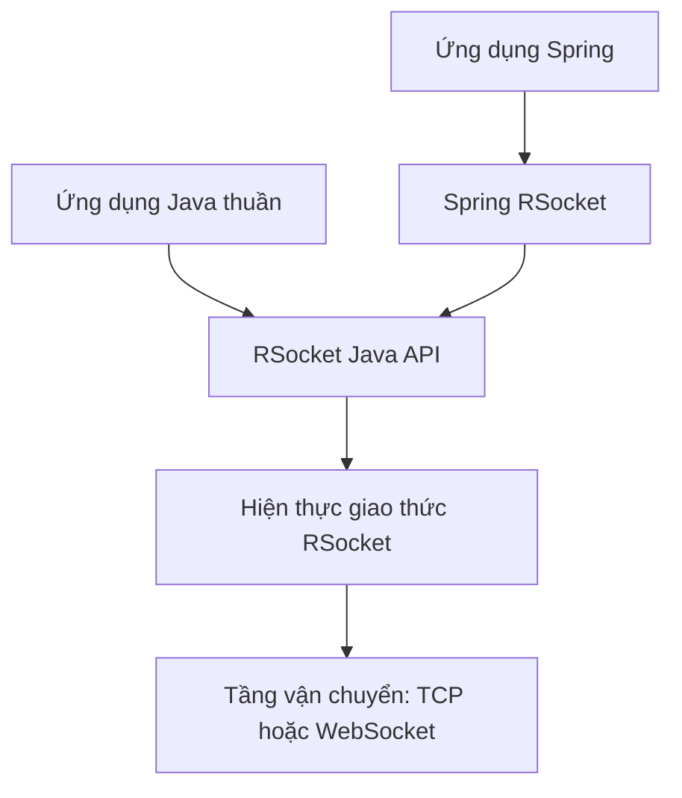

# Phân biệt giao thức RSocket, thư viện RSocket Java và hỗ trợ của Spring

Khi nói một ứng dụng “dùng RSocket”, cụm từ đó có thể chỉ ba thứ khác nhau: giao thức trao đổi dữ liệu trên đường truyền, thư viện hiện thực giao thức trong Java, hoặc lớp tích hợp của Spring giúp xây dựng endpoint và client thuận tiện hơn. Ba thứ này liên quan chặt chẽ nhưng không thay thế cho nhau.

Có thể hình dung luồng phụ thuộc như sau:



Giao thức quy định hai đầu kết nối trao đổi thông điệp như thế nào. RSocket Java cung cấp phần hiện thực và API Java để gửi, nhận các thông điệp đó. Spring xây dựng thêm mô hình lập trình quen thuộc của Spring Messaging trên RSocket Java. Hiểu đúng ranh giới này giúp chọn đúng dependency, xác định nơi cấu hình và xử lý sự cố ở đúng tầng.

## 1. Giao thức RSocket là gì?

RSocket là một giao thức ở tầng ứng dụng dành cho giao tiếp bất đồng bộ, hai chiều và có điều tiết luồng. Nó được thiết kế để hai bên có thể gửi thông điệp qua một kết nối lâu dài, đồng thời khởi tạo nhiều tương tác độc lập trên kết nối đó.

Giao thức mô tả cách thiết lập kết nối, đóng gói payload, biểu diễn các kiểu tương tác, truyền metadata, báo lỗi, hủy tương tác và điều tiết số lượng phần tử được gửi. Vì đây là đặc tả giao tiếp, RSocket không phụ thuộc vào ngôn ngữ lập trình hay framework cụ thể. Một client viết bằng Java có thể giao tiếp với server viết bằng ngôn ngữ khác nếu hai bên cùng hỗ trợ giao thức và thống nhất cách mã hóa dữ liệu.

### Bốn kiểu tương tác chính

RSocket định nghĩa bốn kiểu tương tác thường dùng:

| Kiểu tương tác | Dữ liệu gửi đi | Dữ liệu nhận về | Trường hợp phù hợp |
|---|---|---|---|
| Request-response | Một request | Tối đa một response | Lấy chi tiết đơn hàng, tra cứu trạng thái |
| Fire-and-forget | Một request | Không có response ở tầng tương tác | Gửi một tín hiệu hoặc sự kiện mà bên gửi không cần kết quả trả về trực tiếp |
| Request-stream | Một request | Một luồng gồm nhiều response | Theo dõi giá, trạng thái hoặc dữ liệu cập nhật liên tục |
| Request-channel | Một luồng request | Một luồng response | Trao đổi dữ liệu hai chiều liên tục, chẳng hạn phiên chat hoặc dữ liệu cảm biến |

Fire-and-forget chỉ có nghĩa là tương tác không chờ response. Nó không tự đảm bảo thông điệp đã được xử lý bền vững, được ghi vào cơ sở dữ liệu hay sẽ được gửi lại khi lỗi. Nếu nghiệp vụ cần xác nhận, retry hoặc lưu trữ đáng tin cậy, ứng dụng phải thiết kế các cơ chế đó ở tầng phù hợp.

### Payload và metadata

Một payload RSocket gồm phần data và phần metadata. Data thường chứa nội dung nghiệp vụ, ví dụ JSON hoặc dữ liệu nhị phân. Metadata mang thông tin bổ sung để bên nhận diễn giải hoặc định tuyến thông điệp, chẳng hạn route, MIME type hay thông tin phục vụ cơ chế xác thực.

Route là một quy ước ở tầng ứng dụng được truyền qua metadata. Giao thức hỗ trợ việc mang metadata, nhưng tên route như `stock.quote` hay `chat.room-1` là hợp đồng do hai ứng dụng thống nhất. Spring có thể dùng route đó để tìm phương thức `@MessageMapping`; bản thân giao thức không yêu cầu phải dùng annotation này.

### Điều tiết luồng và kết nối

Với các tương tác dạng stream hoặc channel, bên nhận có thể yêu cầu số lượng phần tử muốn nhận. Cơ chế demand này giúp điều tiết tốc độ phát dữ liệu, tránh để producer gửi vô hạn phần tử vượt quá khả năng xử lý của consumer. Khi lập trình bằng Reactive Streams, cơ chế này thường được thể hiện qua subscription và backpressure; ở tầng giao thức, nó được biểu diễn bằng các frame điều tiết yêu cầu.

RSocket cũng định nghĩa các thông điệp phục vụ thiết lập kết nối, keepalive, hủy tương tác và báo lỗi. Đặc tả có các cơ chế mở rộng như lease hoặc resume, nhưng khả năng sử dụng thực tế còn phụ thuộc vào thư viện, transport và cấu hình ở hai đầu. Chỉ chọn RSocket không có nghĩa ứng dụng tự động có retry, khôi phục phiên hay bảo đảm giao hàng.

### RSocket không phải TCP hay WebSocket

TCP và WebSocket là các lựa chọn ở tầng vận chuyển; RSocket là giao thức ứng dụng chạy phía trên một transport được hỗ trợ. Vì vậy, nói “RSocket qua WebSocket” không có nghĩa RSocket và WebSocket là cùng một giao thức. WebSocket cung cấp kênh truyền hai chiều, còn RSocket định nghĩa cách đóng khung payload và ngữ nghĩa request-response, stream, channel trên kênh đó.

Trong phạm vi ứng dụng Java và Spring, TCP và WebSocket là hai transport thường gặp. Việc chọn transport ảnh hưởng đến cách thiết lập kết nối, cấu hình mạng và bảo mật đường truyền; nó không làm thay đổi ý nghĩa của bốn kiểu tương tác RSocket.

## 2. RSocket Java là gì?

RSocket Java là thư viện Java hiện thực giao thức RSocket. Nó cung cấp API và các thành phần cần thiết để một chương trình Java đóng vai client, server hoặc cả hai. Ứng dụng có thể dùng thư viện này trực tiếp mà không cần Spring.

Ở tầng API, các tương tác thường được biểu diễn bằng những phương thức trên `RSocket`:

```java
import io.rsocket.RSocket;
import io.rsocket.Payload;
import io.rsocket.util.DefaultPayload;
import reactor.core.publisher.Flux;
import reactor.core.publisher.Mono;

// Giả sử socket đã được thiết lập và đang hoạt động.
RSocket socket = obtainConnectedRSocket();

// Một request, tối đa một response.
Mono<Payload> response = socket.requestResponse(
    DefaultPayload.create("order-123")
);

// Một request, nhiều response theo luồng.
Flux<Payload> updates = socket.requestStream(
    DefaultPayload.create("account-456")
);

// Gửi request mà không chờ response.
Mono<Void> sent = socket.fireAndForget(
    DefaultPayload.create("refresh-cache")
);
```

Các biến `Mono` và `Flux` ở đây là publisher lazy: request chỉ được thực thi khi có subscriber hoặc khi chúng được ghép vào một pipeline đã được subscribe. Chỉ tạo biến publisher chưa làm thông điệp được gửi đi. Quy tắc này cũng áp dụng cho các biến `quote` và `updates` trong ví dụ Spring bên dưới.

`obtainConnectedRSocket()` trong ví dụ là phần minh họa cho một kết nối đã được tạo; đây không phải API có sẵn của RSocket Java. Trong chương trình thực tế, phía client thường cấu hình connector cùng transport để kết nối tới server, còn phía server khởi tạo server và cung cấp responder xử lý các tương tác đến.

RSocket Java thường kết hợp với Reactor (`Mono` và `Flux`) để biểu diễn kết quả bất đồng bộ và luồng dữ liệu. Thư viện đảm nhiệm các chi tiết giao thức như payload, tương tác, truyền tải và điều tiết luồng. Lập trình viên vẫn cần định nghĩa hợp đồng dữ liệu, xử lý lỗi nghiệp vụ, quản lý vòng đời kết nối và quyết định chính sách retry hoặc phục hồi phù hợp.

Điểm quan trọng là RSocket Java không tự cung cấp mô hình controller của Spring. Nếu dùng trực tiếp, ứng dụng tự tổ chức việc phân phối request tới handler, chuyển đổi kiểu dữ liệu và quản lý các thành phần liên quan. Đổi lại, ứng dụng có quyền kiểm soát chi tiết hơn đối với cách tạo kết nối và xử lý tương tác.

## 3. Spring hỗ trợ RSocket như thế nào?

Spring Framework cung cấp lớp tích hợp RSocket dựa trên RSocket Java và các khái niệm của Spring Messaging. Lớp này giúp ứng dụng Spring định nghĩa endpoint bằng annotation, chuyển đổi payload sang đối tượng Java và gửi request bằng một API cấp cao hơn.

Một số thành phần thường gặp:

- `@MessageMapping`: ánh xạ route trong metadata tới phương thức xử lý thông điệp.
- `@ConnectMapping`: xử lý thông điệp ở giai đoạn thiết lập kết nối, khi ứng dụng cần trao đổi thông tin khởi tạo.
- `RSocketRequester`: API phía client để tạo request theo route, gửi dữ liệu và nhận kết quả dưới dạng kiểu Java.
- `RSocketStrategies`: tập hợp cấu hình chuyển đổi dữ liệu và metadata, bao gồm encoder, decoder và các thành phần liên quan.
- `RSocketMessageHandler`: thành phần của Spring Messaging phân phối thông điệp đến các phương thức handler đã khai báo.

Spring Boot có thể tự cấu hình một số thành phần RSocket dựa trên dependency và cấu hình ứng dụng. Chi tiết auto-configuration, thuộc tính cấu hình và cách khởi chạy server phụ thuộc phiên bản Spring Boot đang sử dụng; cần đối chiếu tài liệu đúng phiên bản khi cấu hình dự án.

### Ví dụ endpoint bằng `@MessageMapping`

```java
import org.springframework.messaging.handler.annotation.DestinationVariable;
import org.springframework.messaging.handler.annotation.MessageMapping;
import org.springframework.stereotype.Controller;
import reactor.core.publisher.Flux;
import reactor.core.publisher.Mono;

@Controller
public class StockController {

    private final StockService stockService;

    public StockController(StockService stockService) {
        this.stockService = stockService;
    }

    @MessageMapping("stock.quote")
    public Mono<Quote> quote(QuoteRequest request) {
        return stockService.findQuote(request.symbol());
    }

    @MessageMapping("stock.updates.{symbol}")
    public Flux<Quote> updates(@DestinationVariable String symbol) {
        return stockService.streamQuotes(symbol);
    }
}
```

Trong ví dụ, Spring đọc route từ metadata, tìm phương thức phù hợp và chuyển payload thành `QuoteRequest`. Kiểu trả về `Mono` biểu diễn một kết quả bất đồng bộ; `Flux` biểu diễn một luồng kết quả. Spring dựa trên hình dạng input/output của handler để tích hợp với kiểu tương tác RSocket tương ứng.

Route `stock.quote` và `stock.updates.{symbol}` là hợp đồng của ứng dụng. Client phải gửi đúng route và payload mà server mong đợi. Nếu client gửi sai route, hai bên vẫn có thể thiết lập kết nối RSocket thành công nhưng request không được ánh xạ tới handler mong muốn.

### Ví dụ client bằng `RSocketRequester`

```java
import org.springframework.messaging.rsocket.RSocketRequester;
import reactor.core.publisher.Flux;
import reactor.core.publisher.Mono;

RSocketRequester requester = RSocketRequester.builder()
    .connectTcp("localhost", 7000)
    .block();

Mono<Quote> quote = requester.route("stock.quote")
    .data(new QuoteRequest("ACME"))
    .retrieveMono(Quote.class);

Flux<Quote> updates = requester.route("stock.updates.ACME")
    .retrieveFlux(Quote.class);
```

Đoạn mã dùng `.block()` để làm ví dụ ngắn gọn về việc nhận `RSocketRequester` sau khi kết nối. Trong luồng xử lý reactive của ứng dụng, nên giữ kết quả dưới dạng `Mono` hoặc `Flux` và tránh chặn thread không cần thiết. Ví dụ cũng giả định server đang lắng nghe trên TCP tại cổng `7000` và đã đăng ký hai route tương ứng.

Spring đảm nhiệm phần tích hợp với hệ sinh thái Spring; RSocket Java vẫn là thư viện thực hiện giao tiếp bên dưới. Có thể dùng Spring ở phía server và một client không dùng Spring ở phía đối tác, miễn là hai bên thống nhất giao thức, route, metadata và định dạng payload.

## 4. So sánh ba khái niệm

| Tiêu chí | Giao thức RSocket | RSocket Java | Spring RSocket |
|---|---|---|---|
| Bản chất | Đặc tả giao tiếp | Thư viện hiện thực giao thức bằng Java | Lớp tích hợp của Spring trên RSocket Java |
| Trả lời câu hỏi | Hai đầu trao đổi dữ liệu theo quy tắc nào? | Chương trình Java gửi và nhận dữ liệu bằng API nào? | Ứng dụng Spring khai báo endpoint và gửi request ra sao? |
| Phạm vi | Frame, payload, metadata, kiểu tương tác, điều tiết luồng | Kết nối, requester/responder, payload và API reactive | Mapping route, handler, chuyển đổi dữ liệu, cấu hình Spring |
| Phụ thuộc Spring | Không | Không | Có |
| Có thể dùng độc lập? | Là hợp đồng để các implementation tương thích | Có, trong ứng dụng Java không dùng Spring | Cần nền tảng Spring và implementation RSocket bên dưới |
| Ví dụ đại diện | Request-stream, request-channel, metadata | `RSocket`, `Payload`, `Mono`, `Flux` | `@MessageMapping`, `RSocketRequester`, `RSocketStrategies` |

Một cách ghi nhớ ngắn gọn:

- **RSocket protocol** định nghĩa quy tắc trên đường truyền.
- **RSocket Java** hiện thực các quy tắc đó và cung cấp API cho Java.
- **Spring RSocket** giúp ứng dụng Spring sử dụng implementation Java theo mô hình Spring Messaging.

## 5. Chọn tầng nào khi triển khai?

Nếu mục tiêu là hiểu khả năng tương tác, framing, metadata, backpressure hoặc tính tương thích giữa các nền tảng, hãy bắt đầu từ giao thức RSocket. Đây là nơi xác định hai đầu phải tuân theo quy tắc nào, bất kể chúng được viết bằng Java, Kotlin hay ngôn ngữ khác.

Nếu ứng dụng Java cần kiểm soát trực tiếp connector, responder, transport hoặc vòng đời kết nối, có thể dùng RSocket Java. Cách này phù hợp khi không dùng Spring hoặc khi lớp tích hợp cấp cao không đáp ứng yêu cầu đặc thù.

Nếu ứng dụng đã dùng Spring và muốn khai báo endpoint theo route, dùng annotation, tận dụng message conversion và cấu hình theo hệ sinh thái Spring, hãy dùng Spring RSocket. Cách này giảm phần mã kết nối và dispatch mà ứng dụng phải tự tổ chức.

Ba tầng có thể xuất hiện cùng lúc trong một hệ thống. Ví dụ, một ứng dụng Spring dùng `@MessageMapping`; Spring chuyển yêu cầu qua RSocket Java; thư viện mã hóa và truyền các frame theo giao thức RSocket trên TCP. Ở phía đối tác, một chương trình Java thuần hoặc implementation của ngôn ngữ khác vẫn có thể giao tiếp với server đó.

## 6. Những nhầm lẫn thường gặp

**“RSocket là một thư viện Java.”** RSocket trước hết là giao thức. RSocket Java chỉ là một implementation. Các ngôn ngữ khác cũng có thể có implementation riêng.

**“Dùng RSocket thì bắt buộc phải dùng Spring.”** Không đúng. Có thể dùng RSocket Java trực tiếp hoặc dùng implementation khác. Spring chỉ là lựa chọn tích hợp dành cho ứng dụng trong hệ sinh thái Spring.

**“RSocket và WebSocket là hai tên gọi của cùng một thứ.”** Không đúng. WebSocket có thể làm transport cho RSocket. RSocket bổ sung ngữ nghĩa thông điệp và các kiểu tương tác ở tầng ứng dụng.

**“Fire-and-forget đảm bảo server đã xử lý xong.”** Không đúng. Kiểu tương tác này không trả response cho request. Nếu cần biết kết quả xử lý, hãy thiết kế acknowledgment hoặc một luồng xác nhận ở cấp ứng dụng.

**“Có `Flux` nghĩa là hệ thống tự động không bị quá tải.”** `Flux` là kiểu biểu diễn luồng trong Reactor. Backpressure chỉ phát huy tác dụng khi các tầng tham gia tôn trọng cơ chế demand và ứng dụng không vô tình tạo hàng đợi không giới hạn hoặc chặn luồng xử lý.

**“Kết nối thành công nghĩa là route đã đúng.”** Kết nối và định tuyến request là hai bước khác nhau. Hai bên có thể hoàn tất setup nhưng vẫn không thống nhất route, metadata hoặc schema payload. Cần kiểm thử cả quá trình gửi request tới đúng handler.

## 7. Kết luận

Khi thiết kế một hệ thống realtime bằng RSocket, hãy tách câu hỏi thành ba phần: hợp đồng giao tiếp do giao thức quy định, implementation chịu trách nhiệm thực thi hợp đồng, và framework cung cấp cách tổ chức mã ứng dụng. RSocket protocol trả lời phần thứ nhất; RSocket Java trả lời phần thứ hai trong môi trường Java; Spring RSocket trả lời phần thứ ba cho ứng dụng Spring.

Phân biệt được ba tầng giúp tránh nhầm lẫn giữa transport và protocol, giữa API thư viện và annotation framework, đồng thời giúp xác định chính xác nơi cần cấu hình khi xử lý route, payload, backpressure, bảo mật hoặc phục hồi kết nối.
