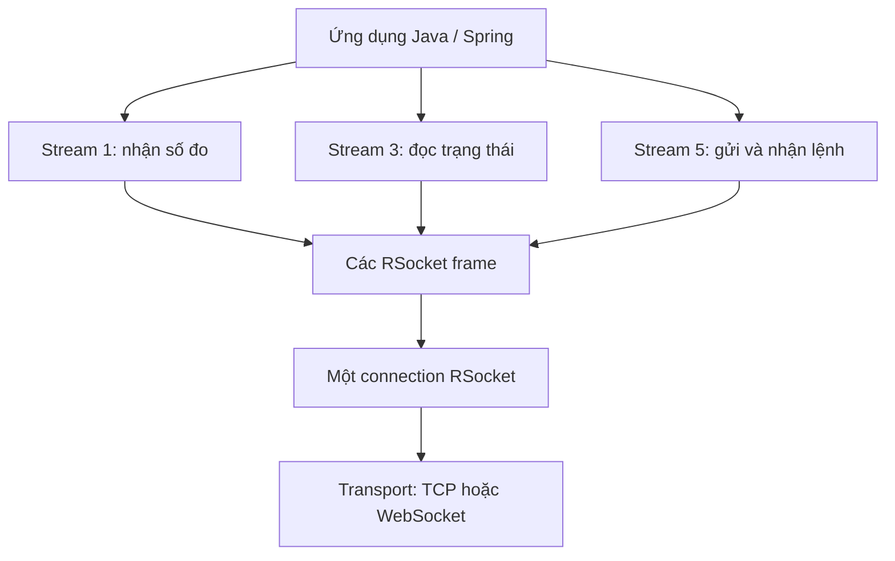
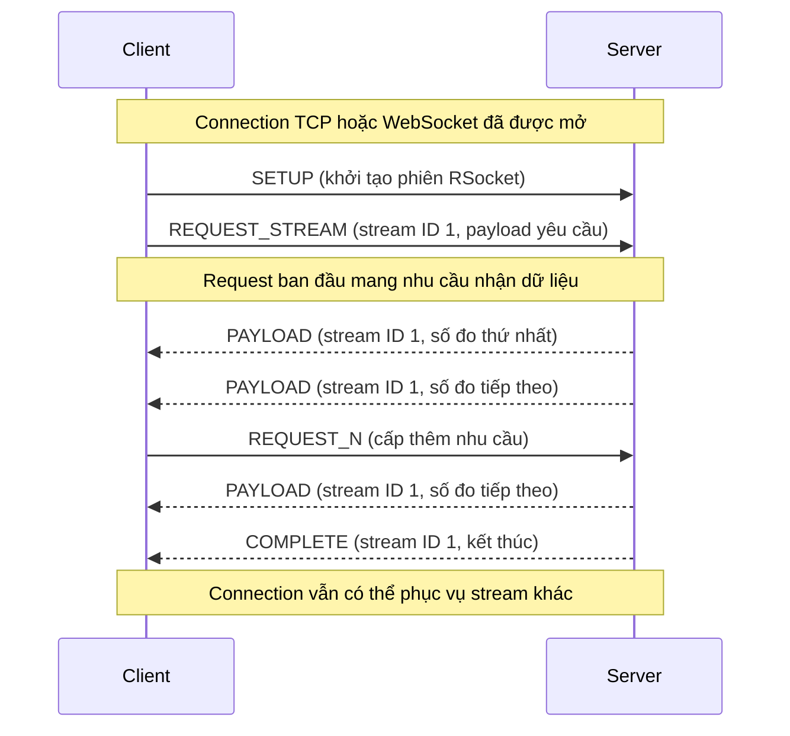

# Quan hệ giữa kết nối, luồng tương tác (stream), thông điệp và payload

RSocket cho phép nhiều tương tác bất đồng bộ cùng chạy trên một kết nối TCP hoặc WebSocket. Để thiết kế và gỡ lỗi ứng dụng realtime, cần phân biệt bốn khái niệm: **connection** là kênh giao tiếp ở tầng vận chuyển, **stream** là một tương tác logic độc lập, **frame** là đơn vị của giao thức RSocket, còn **payload** là dữ liệu ứng dụng được mang trong các frame. Một stream có thể trao đổi nhiều payload; nhiều stream có thể dùng chung một connection.

Bài học này đặt các khái niệm đó vào cùng một mô hình, giải thích vòng đời của chúng và minh họa cách Spring Boot biểu diễn các tương tác bằng `Mono` và `Flux`.

## Mục tiêu học tập

Sau bài học, người học có thể:

- Phân biệt connection, stream, frame, message và payload trong RSocket.
- Giải thích cách nhiều stream được multiplex trên cùng một kết nối TCP hoặc WebSocket.
- Nhận biết bốn kiểu tương tác `request-response`, `fire-and-forget`, `request-stream` và `request-channel`.
- Mô tả cách payload mang data và metadata, cũng như cách backpressure điều tiết việc gửi payload.
- Đọc và xây dựng ví dụ RSocket client/server trong Java với Spring Boot.
- Phân tích điều gì xảy ra với các stream đang hoạt động khi connection bị đóng hoặc mất.

## 1. Bản đồ các khái niệm

Hãy hình dung một ứng dụng giám sát thiết bị. Client mở một kết nối tới server, sau đó đồng thời yêu cầu trạng thái của một thiết bị, đăng ký nhận chuỗi số đo nhiệt độ và gửi một luồng lệnh điều khiển. Đây là ba tương tác logic khác nhau, nhưng chúng có thể cùng đi qua một connection.

| Khái niệm | Ý nghĩa trong RSocket | Phạm vi và vòng đời |
|---|---|---|
| **Connection** | Kênh giao tiếp giữa hai peer qua TCP, WebSocket hoặc một transport được hỗ trợ | Được thiết lập trước các tương tác; có thể tồn tại trong thời gian dài và mang nhiều stream |
| **Stream** | Một tương tác logic được phân biệt bằng `stream ID` | Bắt đầu khi một peer khởi tạo request; kết thúc khi hoàn tất, gặp lỗi hoặc bị hủy |
| **Frame** | Đơn vị nhị phân của giao thức RSocket, có loại frame và thông tin điều khiển tương ứng | Được truyền qua connection; có thể mở đầu, mang dữ liệu hoặc điều khiển một stream hay connection |
| **Payload** | Nội dung ứng dụng gồm data và metadata tùy chọn | Được mang trong request frame ban đầu hoặc các payload frame tiếp theo |
| **Message** | Cách gọi khái quát cho một đơn vị thông tin ứng dụng được trao đổi | Trong ngữ cảnh RSocket, cần nói rõ đó là một payload hay một chuỗi payload trên stream |

Mối quan hệ có thể tóm tắt như sau:



Sơ đồ thể hiện quan hệ logic, không phải mỗi stream có một socket riêng. Các frame thuộc những stream khác nhau được multiplex qua cùng connection. Mỗi frame mang `stream ID` để peer nhận biết frame đó thuộc tương tác nào; các frame điều khiển ở cấp connection có thể không gắn với một stream ứng dụng cụ thể.

## 2. Connection: nền tảng vận chuyển các tương tác

Connection là kênh hai chiều giữa hai peer. Trong các ứng dụng Java phổ biến, kênh này thường được tạo trên TCP hoặc WebSocket. RSocket định nghĩa giao thức trao đổi frame chạy trên transport đó, nhờ vậy tầng ứng dụng có thể sử dụng cùng mô hình tương tác dù transport bên dưới khác nhau.

Khi một connection RSocket được thiết lập, hai peer trao đổi thông tin khởi tạo bằng frame `SETUP`. Thông tin này có thể bao gồm các MIME type được dùng cho data và metadata, tham số keepalive và setup payload. Sau giai đoạn thiết lập, connection có thể chuyên chở nhiều tương tác đồng thời.

Connection cũng có các hoạt động ở cấp kết nối, chẳng hạn:

- `KEEPALIVE` giúp peer kiểm tra connection còn hoạt động.
- `SETUP` khởi tạo phiên RSocket trên transport.
- `RESUME` có thể tham gia khôi phục phiên khi cả hai phía và cấu hình triển khai hỗ trợ cơ chế resume.

Không nên đồng nhất connection với một request. Một request-response ngắn có thể hoàn tất trong khi connection vẫn tiếp tục phục vụ các stream khác. Tương tự, một stream dữ liệu realtime có thể chạy lâu hơn nhiều request khác nhưng vẫn chia sẻ cùng connection.

### Multiplexing trên một connection

Giả sử client có ba nhu cầu:

1. Đọc trạng thái thiết bị một lần.
2. Nhận số đo nhiệt độ liên tục.
3. Gửi các lệnh điều khiển và nhận xác nhận tương ứng.

RSocket có thể tạo ba stream với ba `stream ID` riêng. Frame của cả ba stream cùng được truyền trên một connection. Server dựa vào stream ID để ghép frame về đúng tương tác, vì vậy dữ liệu của stream nhận nhiệt độ không bị nhầm với phản hồi trạng thái.

Lợi ích của multiplexing là giảm nhu cầu tạo connection riêng cho từng tương tác, đồng thời hỗ trợ giao tiếp hai chiều và nhiều luồng độc lập. Tuy nhiên, nhiều stream dùng chung connection cũng có nghĩa là sự cố ở connection có thể ảnh hưởng đồng thời đến tất cả stream đang chạy trên connection đó.

## 3. Stream: một tương tác logic độc lập

Stream biểu diễn vòng đời của một tương tác RSocket. Một peer khởi tạo stream bằng cách gửi request frame phù hợp. Request frame này có `stream ID`, loại tương tác và payload ban đầu nếu kiểu tương tác yêu cầu. Sau đó, hai peer trao đổi các frame thuộc stream đó cho đến khi tương tác hoàn tất, lỗi hoặc bị hủy.

Trong ví dụ client gọi server, client thường là bên khởi tạo stream. RSocket cũng cho phép peer còn lại khởi tạo tương tác trên cùng connection; vì vậy không nên hiểu stream là một chiều cố định từ client tới server.

### Bốn kiểu tương tác tạo nên stream

| Kiểu tương tác | Dữ liệu khởi tạo | Kết quả từ peer nhận request | Ví dụ sử dụng |
|---|---|---|---|
| `request-response` | Một payload | Tối đa một payload phản hồi | Tra cứu trạng thái, lấy hồ sơ thiết bị |
| `fire-and-forget` | Một payload | Không có payload phản hồi trong tương tác đó | Gửi sự kiện hoặc lệnh không cần xác nhận trực tiếp |
| `request-stream` | Một payload | Một chuỗi gồm không hoặc nhiều payload | Theo dõi nhiệt độ, giá thị trường hoặc trạng thái tiến trình |
| `request-channel` | Một chuỗi payload; payload đầu tiên mở đầu tương tác | Một chuỗi payload phản hồi | Gửi liên tục dữ liệu cảm biến và nhận kết quả xử lý liên tục |

Các kiểu trên xác định hình dạng trao đổi dữ liệu, không quyết định connection phải sống bao lâu. Một connection có thể chứa nhiều stream thuộc nhiều kiểu khác nhau.

### `request-response`

Client gửi một payload và chờ tối đa một payload phản hồi. Đây là lựa chọn phù hợp khi ứng dụng cần một kết quả cho một yêu cầu, ví dụ truy vấn trạng thái thiết bị. Trong Spring, phía client thường nhận kết quả bằng `Mono<T>`.

### `fire-and-forget`

Client gửi một payload và không chờ payload phản hồi trên stream đó. Kiểu này phù hợp với sự kiện hoặc lệnh mà luồng nghiệp vụ không cần xác nhận trực tiếp. Vì không có phản hồi ứng dụng, không nên xem việc gửi `fire-and-forget` như bằng chứng rằng nghiệp vụ phía server đã xử lý thành công. Nếu cần xác nhận, hãy thiết kế một tương tác phản hồi riêng hoặc chọn kiểu request phù hợp hơn.

### `request-stream`

Client gửi một payload để mô tả yêu cầu, sau đó server phát ra một chuỗi payload. Ví dụ, client gửi mã thiết bị và khoảng thời gian cần theo dõi; server trả về các số đo mới khi chúng xuất hiện. Trong Spring, kết quả thường được biểu diễn bằng `Flux<T>`.

### `request-channel`

Hai phía có thể gửi chuỗi payload trong cùng một tương tác. Client mở channel bằng payload đầu tiên rồi tiếp tục gửi các payload tiếp theo; server cũng có thể phát chuỗi kết quả về client. Ví dụ, client gửi liên tục các lệnh hoặc mẫu dữ liệu cảm biến, trong khi server trả về xác nhận hay kết quả phân tích tương ứng.

`request-channel` hữu ích khi cả hai phía đều cần trao đổi dữ liệu theo dòng. Nếu chỉ một phía phát chuỗi dữ liệu còn phía kia không cần gửi chuỗi đầu vào, `request-stream` thường diễn đạt ý định rõ hơn.

## 4. Frame: đơn vị giao thức mang dữ liệu và điều khiển

RSocket truyền dữ liệu dưới dạng các frame nhị phân. Mỗi frame có loại và cấu trúc riêng. Với frame thuộc stream, `stream ID` giúp peer xác định tương tác liên quan. Một số loại frame thường gặp:

| Frame | Vai trò |
|---|---|
| `REQUEST_RESPONSE` | Mở một tương tác request-response và mang payload yêu cầu |
| `REQUEST_FNF` | Mở một tương tác fire-and-forget |
| `REQUEST_STREAM` | Mở một tương tác request-stream và mang nhu cầu ban đầu của bên nhận stream |
| `REQUEST_CHANNEL` | Mở một tương tác request-channel |
| `PAYLOAD` | Mang payload tiếp theo trên stream; có thể kèm cờ báo phần tử tiếp theo hoặc hoàn tất |
| `REQUEST_N` | Báo nhu cầu nhận thêm một số lượng payload trên stream |
| `CANCEL` | Yêu cầu dừng tương tác trên stream |
| `ERROR` | Báo lỗi liên quan đến stream hoặc connection tùy loại lỗi |
| `COMPLETE` | Báo hoàn tất hướng gửi dữ liệu trên stream |

Request frame đầu tiên có thể đồng thời chứa payload khởi tạo. Với tương tác dạng stream hoặc channel, các payload tiếp theo thường được chuyển trong những frame `PAYLOAD`. Không phải frame nào cũng chứa dữ liệu nghiệp vụ: `REQUEST_N`, `CANCEL` và các frame keepalive là thông tin điều khiển giao thức.

Do đó, **frame không đồng nghĩa với payload**. Frame là lớp bao của giao thức; payload là nội dung ứng dụng mà một số loại frame mang theo. Khi đọc log hoặc trace, cần nhìn cả loại frame, stream ID và nội dung payload đã được giải mã (nếu có) để hiểu đúng tương tác.

## 5. Payload: nội dung ứng dụng của một lần trao đổi

Payload trong RSocket gồm hai phần:

- **Data**: dữ liệu chính của ứng dụng, chẳng hạn JSON, Protobuf hoặc dữ liệu nhị phân.
- **Metadata**: thông tin mô tả hoặc định tuyến đi kèm, nếu tương tác cần dùng.

Metadata có thể chứa thông tin route, định dạng nội dung hoặc ngữ cảnh được thỏa thuận giữa hai peer. Ví dụ, ứng dụng Spring có thể định tuyến một request tới destination `devices.sensor.readings`; route này là thông tin định tuyến, còn data có thể là đối tượng `ReadingQuery` chứa khoảng thời gian cần truy vấn.

Phân biệt metadata ở cấp thiết lập connection với metadata gắn cùng payload:

- Setup metadata được trao đổi khi khởi tạo phiên và thường mô tả ngữ cảnh áp dụng cho connection.
- Metadata trong payload gắn với một lần trao đổi dữ liệu cụ thể, nhờ đó từng request hoặc payload có thể mang thông tin riêng.

Trong thực tế, routing metadata thường được dùng để chọn handler ở server. Metadata cũng có thể phục vụ nội dung hoặc cơ chế xác thực theo thiết kế hệ thống. Hai peer phải thống nhất MIME type và cách diễn giải metadata; việc một bên gửi chuỗi metadata không có nghĩa bên kia tự động hiểu nó.

Một stream có thể mang nhiều payload. Ví dụ, stream nhiệt độ có thể phát ra hàng trăm payload, mỗi payload chứa một số đo. Mỗi payload là một đơn vị dữ liệu ứng dụng; toàn bộ chuỗi payload cùng thuộc một tương tác logic.

## 6. Backpressure: điều tiết số payload trên stream

Với `request-stream` và `request-channel`, tốc độ phát dữ liệu có thể khác tốc độ tiêu thụ. Nếu server phát nhanh hơn khả năng xử lý của client, bộ đệm có thể tăng, độ trễ tăng và bộ nhớ bị tiêu hao. RSocket hỗ trợ flow control để bên nhận cho biết mình muốn nhận bao nhiêu payload.

Frame `REQUEST_N` thể hiện nhu cầu nhận thêm một số lượng payload. Khi mở `request-stream` hoặc `request-channel`, request ban đầu cũng mang thông tin nhu cầu ban đầu. Bên phát dữ liệu cần tuân thủ lượng nhu cầu mà bên nhận đã cấp; khi bên nhận xử lý thêm dữ liệu, nó có thể yêu cầu thêm.

Trong Spring WebFlux, `Flux` và Reactive Streams biểu diễn chuỗi dữ liệu có hỗ trợ backpressure. Khi client chỉ yêu cầu một phần tử mỗi lần, tầng RSocket có thể chuyển nhu cầu đó thành cơ chế flow control của giao thức. Vì vậy, không nên tự ý chuyển một nguồn dữ liệu vô hạn thành danh sách được giữ toàn bộ trong bộ nhớ trước khi trả về.

Ví dụ nguồn dữ liệu có thể phát theo nhu cầu:

```java
@MessageMapping("devices.{deviceId}.readings")
public Flux<Reading> readings(
        @DestinationVariable String deviceId,
        @Payload ReadingQuery query) {
    return telemetryService.readings(deviceId, query);
}
```

Ở đây, `Flux<Reading>` biểu diễn chuỗi kết quả. Khi client hủy subscription, việc hủy có thể được truyền xuống stream để dừng công việc không còn cần thiết. Backpressure giúp điều tiết lượng dữ liệu được gửi; nó không thay thế việc thiết kế giới hạn tài nguyên, timeout và xử lý lỗi cho nguồn dữ liệu.

## 7. Vòng đời: từ connection tới payload cuối cùng

Một luồng `request-stream` điển hình có thể diễn ra như sau:



Có thể chia vòng đời thành các bước:

1. **Mở transport và thiết lập phiên**: TCP hoặc WebSocket được mở, sau đó hai peer trao đổi `SETUP` để bắt đầu phiên RSocket.
2. **Khởi tạo tương tác**: một peer gửi request frame phù hợp và cấp stream ID cho tương tác. Request frame có thể chứa payload đầu tiên.
3. **Trao đổi payload**: các payload tiếp theo được gửi trong những frame thuộc cùng stream. Với stream dài, nhu cầu nhận dữ liệu được điều tiết bằng flow control.
4. **Kết thúc stream**: tương tác kết thúc bình thường, phát sinh lỗi hoặc bị hủy. Việc một stream kết thúc không bắt buộc connection phải đóng.
5. **Đóng connection**: khi connection đóng, các stream đang phụ thuộc vào connection đó bị ảnh hưởng. Connection có thể được đóng khi ứng dụng không còn cần dùng hoặc do lỗi transport.

### Khi connection bị mất thì stream ra sao?

Stream là tương tác chạy trên một connection cụ thể. Nếu connection bị mất, các stream đang hoạt động trên connection đó không thể tiếp tục trao đổi frame qua kênh cũ. Ứng dụng cần xử lý lỗi, quyết định có kết nối lại hay không và xác định tương tác nào có thể được khởi tạo lại an toàn.

RSocket có cơ chế resume trong những triển khai hỗ trợ và được cấu hình phù hợp. Resume không đồng nghĩa với việc mọi ứng dụng tự động khôi phục mọi request. Nếu chỉ mở một connection mới, các stream cũ không tự chuyển sang connection mới. Với thao tác có thể được gửi lại, ứng dụng nên cân nhắc tính idempotent, mã định danh yêu cầu và chính sách retry để tránh thực hiện nghiệp vụ hai lần.

## 8. Minh họa trong Java với Spring Boot

Spring hỗ trợ ánh xạ route RSocket tới handler bằng `@MessageMapping`. Ở phía client, `RSocketRequester` cung cấp API để tạo các kiểu tương tác và chuyển kết quả thành `Mono` hoặc `Flux`.

### Server: khai báo handler

```java
@Controller
public class DeviceRSocketController {

    private final TelemetryService telemetryService;
    private final DeviceService deviceService;

    public DeviceRSocketController(
            TelemetryService telemetryService,
            DeviceService deviceService) {
        this.telemetryService = telemetryService;
        this.deviceService = deviceService;
    }

    // request-stream: một query, nhiều Reading
    @MessageMapping("devices.{deviceId}.readings")
    public Flux<Reading> readings(
            @DestinationVariable String deviceId,
            @Payload ReadingQuery query) {
        return telemetryService.readings(deviceId, query);
    }

    // request-response: một command, một kết quả xác nhận
    @MessageMapping("devices.command")
    public Mono<CommandAck> command(@Payload DeviceCommand command) {
        return deviceService.execute(command);
    }

    // request-channel: nhận một chuỗi command, phát một chuỗi acknowledgement
    @MessageMapping("devices.commands")
    public Flux<CommandAck> commands(Flux<DeviceCommand> commands) {
        return commands.concatMap(deviceService::execute);
    }
}
```

Các kiểu `Reading`, `ReadingQuery`, `DeviceCommand`, `CommandAck` và các service là kiểu nghiệp vụ minh họa của ứng dụng. Cấu hình codec và kết nối server được lược bỏ để tập trung vào mối quan hệ giữa stream và payload.

### Client: chọn API theo hình dạng tương tác

Giả sử ứng dụng đã có một `RSocketRequester` được cấu hình để kết nối tới server:

```java
// request-response: nhận tối đa một DeviceStatus
Mono<DeviceStatus> status = requester
        .route("devices.status")
        .data(new StatusQuery("sensor-17"))
        .retrieveMono(DeviceStatus.class);

// fire-and-forget: gửi sự kiện, không nhận payload phản hồi trên stream này
Mono<Void> sent = requester
        .route("devices.event")
        .data(new DeviceEvent("sensor-17", "BATTERY_LOW"))
        .send();

// request-stream: một query, nhận nhiều Reading
Flux<Reading> readings = requester
        .route("devices.{deviceId}.readings", "sensor-17")
        .data(new ReadingQuery(/* khoảng thời gian */))
        .retrieveFlux(Reading.class);

// request-channel: gửi nhiều command và nhận nhiều acknowledgement
Flux<CommandAck> acknowledgements = requester
        .route("devices.commands")
        .data(commandFlux, DeviceCommand.class)
        .retrieveFlux(CommandAck.class);
```

`Mono<T>` phù hợp với kết quả đơn hoặc không có kết quả; `Flux<T>` phù hợp với chuỗi payload. Kiểu trả về ở tầng Spring giúp thể hiện hình dạng tương tác, còn RSocket đảm nhiệm việc đóng gói request, quản lý stream ID, truyền frame và điều tiết dữ liệu.

### Đọc ví dụ theo đúng tầng

- `requester.route(...)` chọn route cho tương tác; route thường được chuyển qua metadata.
- `.data(...)` cung cấp data của payload khởi tạo. Với channel, đối số là một publisher nên client có thể gửi nhiều phần tử.
- `.retrieveMono(...)` hoặc `.retrieveFlux(...)` khai báo cách client tiêu thụ kết quả từ stream.
- `@MessageMapping(...)` chọn handler phía server theo route.
- `Mono` hoặc `Flux` mà handler trả về quyết định server phát một kết quả hay một chuỗi kết quả.

Một đối tượng Java được serialize thành data của payload theo codec đã cấu hình. Nó không phải connection hay stream. Nhiều đối tượng được phát qua một `Flux` vẫn thuộc cùng stream nếu chúng là kết quả của cùng một request-stream.

## 9. Cách suy luận khi thiết kế và gỡ lỗi

Khi phân tích một luồng RSocket, hãy lần lượt đặt các câu hỏi sau:

1. **Connection nào đang mang tương tác?** Kiểm tra transport, trạng thái kết nối, setup và keepalive.
2. **Stream nào đang được nói tới?** Dùng stream ID để phân biệt các tương tác chạy đồng thời.
3. **Đây là kiểu request nào?** Xác định request-response, fire-and-forget, request-stream hay request-channel để biết số lượng và hướng payload mong đợi.
4. **Frame nào đang được trao đổi?** Phân biệt frame khởi tạo request, payload tiếp theo và frame điều khiển như `REQUEST_N`, `CANCEL`, `ERROR`.
5. **Payload chứa gì?** Kiểm tra data, metadata, MIME type và cách giải mã ở hai phía.
6. **Nhu cầu nhận dữ liệu ra sao?** Với stream dài, kiểm tra backpressure, tốc độ tiêu thụ và việc hủy subscription.

Một số triệu chứng thường gặp có thể được giải thích bằng mô hình này:

| Triệu chứng | Tầng nên kiểm tra trước |
|---|---|
| Không thể thiết lập phiên RSocket | Transport, địa chỉ/port, TLS nếu có, `SETUP` và MIME type |
| Connection hoạt động nhưng không vào đúng handler | Route trong metadata, `@MessageMapping` và cấu hình routing |
| Nhận được một kết quả nhưng mong đợi dữ liệu liên tục | Kiểu tương tác và kiểu trả về `Mono`/`Flux` |
| Stream dừng trước khi có đủ dữ liệu | `COMPLETE`, `ERROR`, `CANCEL`, nhu cầu `REQUEST_N` và lỗi nguồn dữ liệu |
| Nhiều request bị ảnh hưởng cùng lúc | Connection dùng chung, lỗi transport hoặc vòng đời của phiên |
| Server tiêu thụ nhiều bộ nhớ khi phát dữ liệu | Backpressure, bộ đệm và cách tạo nguồn `Flux` |

## 10. Nguyên tắc thiết kế cần ghi nhớ

- Dùng một connection ổn định để phục vụ nhiều stream khi mô hình triển khai cho phép; tránh tạo connection mới cho từng request ngắn nếu không có lý do vận hành cụ thể.
- Chọn interaction model theo số lượng và hướng dữ liệu. Dùng request-response cho kết quả đơn, request-stream cho chuỗi kết quả, request-channel khi cả hai phía cần phát chuỗi dữ liệu.
- Chỉ dùng fire-and-forget khi nghiệp vụ chấp nhận không có phản hồi trực tiếp trên stream đó.
- Giữ payload có cấu trúc và thống nhất codec, MIME type, route cùng quy ước metadata giữa client và server.
- Thiết kế nguồn `Flux` có backpressure, giới hạn tài nguyên và khả năng hủy khi không còn subscriber.
- Xử lý lỗi ở cả hai phạm vi: lỗi của một stream và lỗi làm hỏng connection. Đặt timeout và chính sách retry theo tính chất nghiệp vụ.
- Khi cần phục hồi sau mất kết nối, phân biệt reconnect với resume; xác định rõ request nào có thể phát lại an toàn.

## Kết luận

Connection cung cấp kênh vận chuyển cho phiên RSocket. Trên connection đó, các peer mở nhiều stream độc lập; mỗi stream được nhận diện bằng stream ID và tuân theo một interaction model. Các frame biểu diễn giao thức và điều khiển vòng đời stream, còn payload mang data cùng metadata của ứng dụng. Khi hiểu đúng thứ tự connection → stream → frame → payload, việc lựa chọn API Java, điều tiết luồng dữ liệu và phân tích sự cố realtime sẽ rõ ràng hơn.
