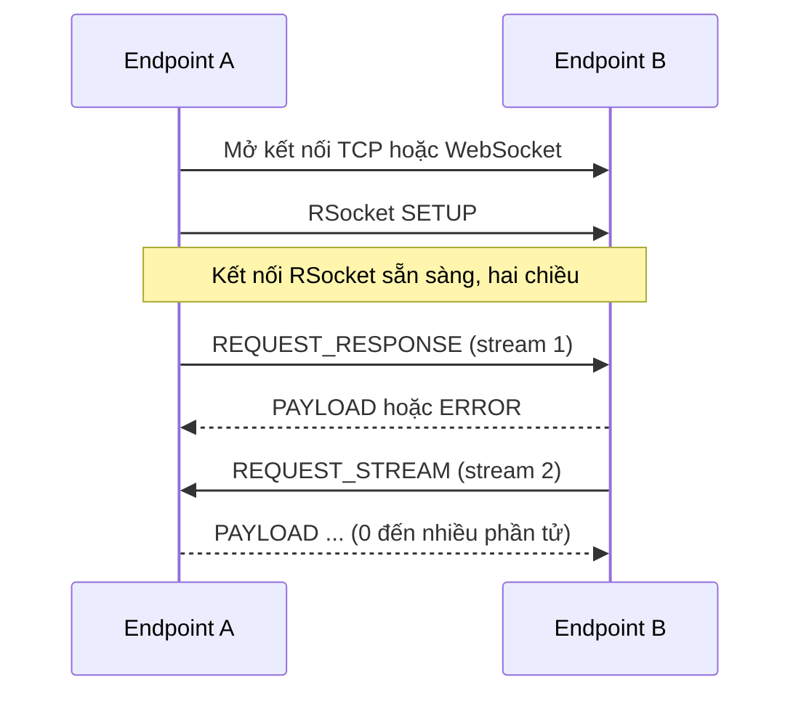

# Phân biệt bên mở kết nối với bên gửi yêu cầu và bên xử lý yêu cầu

Trong RSocket, một kết nối có thể được dùng cho nhiều tương tác đồng thời và dữ liệu có thể đi theo cả hai chiều. Vì vậy, cần phân biệt ba vai trò thường bị gọi lẫn là “client” và “server”:

- **Bên mở kết nối** (*connection initiator*) thiết lập kết nối ở tầng truyền tải, chẳng hạn TCP hoặc WebSocket.
- **Bên gửi yêu cầu** (*requester*) khởi tạo một tương tác RSocket cụ thể.
- **Bên xử lý yêu cầu** (*responder*) nhận tương tác đó và tạo phản hồi tương ứng.

Ba vai trò này mô tả những việc khác nhau. Bên mở kết nối thường chỉ được xác định khi thiết lập transport; requester và responder được xác định riêng cho từng stream. Sau khi kết nối RSocket sẵn sàng, cả hai đầu đều có thể khởi tạo yêu cầu. Một đầu có thể vừa là responder cho stream này, vừa là requester cho stream khác.

## 1. Bên mở kết nối: vai trò ở tầng truyền tải

Bên mở kết nối là endpoint chủ động tạo kết nối mạng ban đầu.

- Với **TCP**, ứng dụng phía client thường gọi kết nối tới địa chỉ và cổng mà server đang lắng nghe. Phía server chấp nhận socket đến.
- Với **WebSocket**, phía client thường bắt đầu HTTP handshake và yêu cầu nâng cấp kết nối lên WebSocket. Phía server chấp nhận handshake.
- Khi transport đã được thiết lập, RSocket thực hiện bước khởi tạo giao thức. Trong kết nối RSocket mới, bên khởi tạo gửi frame `SETUP` để thương lượng các tham số như phiên bản giao thức, thời gian keepalive, MIME type của metadata và dữ liệu.

Ở giai đoạn này, “initiator” và “acceptor” nói về quá trình tạo kết nối. Chúng không quyết định endpoint nào sẽ gửi mọi yêu cầu ứng dụng trong tương lai. Khi `SETUP` được chấp nhận và kết nối sẵn sàng, hai đầu có thể trao đổi các stream RSocket theo cả hai hướng.

## 2. Bên gửi yêu cầu: vai trò của một tương tác

**Requester** là endpoint khởi tạo một tương tác RSocket bằng cách gửi yêu cầu trên một stream. Yêu cầu có thể là lấy một kết quả, gửi một sự kiện, nhận một luồng dữ liệu hoặc mở một kênh trao đổi hai chiều.

Requester thường chịu trách nhiệm:

1. Chọn kiểu tương tác phù hợp với nhu cầu.
2. Gửi payload ban đầu và metadata cần thiết, chẳng hạn route hoặc thông tin ngữ cảnh.
3. Nhận kết quả, các phần tử của luồng phản hồi hoặc lỗi từ responder.
4. Quản lý việc tiêu thụ dữ liệu theo nhu cầu (*demand*) khi tương tác có dạng stream.

Requester không đồng nghĩa với client TCP hay bên mở WebSocket. Nếu server muốn yêu cầu client cung cấp trạng thái hoặc gửi một thông báo có phản hồi, server có thể trở thành requester trên chính kết nối đã được thiết lập.

## 3. Bên xử lý yêu cầu: vai trò đối ứng

**Responder** là endpoint nhận yêu cầu đầu tiên của một stream và xử lý tương tác đó. Tùy kiểu yêu cầu, responder có thể trả về một payload, không trả payload phản hồi, phát ra nhiều payload hoặc tham gia trao đổi dữ liệu hai chiều.

Responder thường thực hiện các công việc sau:

- Định tuyến yêu cầu tới handler phù hợp, ví dụ handler được ánh xạ bằng route trong Spring Boot.
- Kiểm tra metadata, dữ liệu đầu vào và quyền thực hiện thao tác.
- Tạo kết quả hoặc luồng dữ liệu phản hồi.
- Kết thúc stream hoặc phát tín hiệu lỗi khi không thể xử lý yêu cầu.

Responder không nhất thiết là server của kết nối TCP. Client có thể là responder khi nhận một yêu cầu do server khởi tạo trên cùng kết nối. Với `request-channel`, responder còn có thể phát dữ liệu liên tục về requester trong khi nhận dữ liệu từ requester.

## 4. So sánh ba vai trò

| Khía cạnh | Bên mở kết nối | Requester | Responder |
|---|---|---|---|
| Phạm vi | Một kết nối transport/RSocket | Một tương tác hoặc stream | Một tương tác hoặc stream |
| Thời điểm xác định | Khi thiết lập kết nối | Khi một endpoint khởi tạo yêu cầu | Khi endpoint kia nhận và xử lý yêu cầu |
| Việc chính | Mở TCP/WebSocket và khởi tạo RSocket | Gửi yêu cầu, tiêu thụ kết quả | Xử lý yêu cầu, phát kết quả |
| Có thể đổi vai trò? | Không đổi trong cùng lần thiết lập kết nối | Có thể là requester ở stream khác | Có thể là responder ở stream khác |
| Có nhất thiết là client/server? | Thường trùng với client ở tầng transport | Không | Không |

Một cách ghi nhớ hữu ích là: **initiator mở đường truyền; requester mở một tương tác; responder xử lý tương tác đó**. Từ “initiator” trong hai ngữ cảnh không nên được hiểu là cùng một vai trò.

## 5. Ví dụ: một kết nối, hai chiều yêu cầu

Giả sử endpoint A mở kết nối TCP tới endpoint B. A gửi `SETUP`, B chấp nhận và kết nối RSocket trở nên sẵn sàng. Sau đó:

1. A gửi yêu cầu `REQUEST_RESPONSE` tới B. Trong stream này, A là requester và B là responder.
2. B chủ động gửi một yêu cầu `REQUEST_STREAM` tới A trên cùng kết nối. Trong stream mới, B là requester và A là responder.

Vai trò mở kết nối vẫn thuộc về A, nhưng vai trò requester/responder đã đảo chiều ở tương tác thứ hai.



Sơ đồ cho thấy kết nối transport không bị tạo lại khi B khởi tạo stream thứ hai. RSocket có thể ghép kênh nhiều stream trên một kết nối, vì vậy hai đầu có thể xử lý nhiều tương tác độc lập và đồng thời.

## 6. Nhìn requester và responder qua bốn kiểu tương tác

| Kiểu tương tác | Requester gửi | Responder thực hiện | Kết quả ở phía requester |
|---|---|---|---|
| `request-response` | Một yêu cầu | Xử lý và trả tối đa một payload phản hồi | Một kết quả hoặc lỗi |
| `fire-and-forget` | Một payload yêu cầu | Nhận và xử lý theo khả năng của handler | Không có payload phản hồi thông thường |
| `request-stream` | Một yêu cầu ban đầu | Phát một luồng gồm không, một hoặc nhiều payload | Tiêu thụ các phần tử của luồng |
| `request-channel` | Một luồng payload | Nhận luồng đầu vào và có thể phát luồng đầu ra đồng thời | Gửi dữ liệu và nhận dữ liệu trên cùng tương tác |

Trong `request-channel`, tên requester và responder vẫn được xác định theo bên khởi tạo tương tác và bên nhận yêu cầu ban đầu. Việc cả hai bên đều gửi payload trong quá trình chạy không làm mất đi cách gọi đó. Đây là điểm quan trọng khi thiết kế chat, cập nhật trạng thái hoặc luồng sự kiện hai chiều.

## 7. Ví dụ với Spring Boot

Giả sử ứng dụng B chạy RSocket server qua TCP. Cấu hình server có thể khai báo cổng như sau:

```yaml
spring:
  rsocket:
    server:
      port: 7000
      transport: tcp
```

Handler phía B nhận route `greeting`:

```java
@Controller
public class GreetingController {

    @MessageMapping("greeting")
    public Mono<GreetingReply> greet(GreetingRequest request) {
        return Mono.just(
            new GreetingReply("Xin chào " + request.name())
        );
    }
}

public record GreetingRequest(String name) {}

public record GreetingReply(String message) {}
```

Phía A tạo kết nối và gửi yêu cầu:

```java
Mono<GreetingReply> reply = RSocketRequester.builder()
    .connectTcp("localhost", 7000)
    .flatMap(requester -> requester
        .route("greeting")
        .data(new GreetingRequest("Lan"))
        .retrieveMono(GreetingReply.class));
```

Trong ví dụ này:

- A là **bên mở kết nối** vì A gọi `connectTcp` tới B.
- A là **requester** của tương tác `greeting` vì A gửi yêu cầu tới route đó.
- B là **bên chấp nhận kết nối** ở tầng transport và là **responder** của tương tác `greeting` vì handler trên B xử lý yêu cầu.

Nếu B cần gọi một route trên A sau khi kết nối đã được thiết lập, B có thể dùng `RSocketRequester` gắn với peer A (chẳng hạn requester được cung cấp trong luồng xử lý `@ConnectMapping`) để khởi tạo tương tác mới. Khi đó B là requester và A cần có handler tương ứng để làm responder. Việc này sử dụng kết nối RSocket hiện có; không cần hiểu rằng B phải mở một kết nối TCP mới tới A.

Với `request-channel`, handler phía responder có thể nhận một `Flux` đầu vào và trả về một `Flux` phản hồi:

```java
@MessageMapping("chat")
public Flux<ChatEvent> chat(Flux<ChatEvent> incoming) {
    return incoming.map(this::process);
}
```

Requester gửi các sự kiện qua stream đầu vào và đồng thời tiêu thụ stream phản hồi. Dù dữ liệu đi theo cả hai chiều, endpoint khởi tạo `chat` vẫn là requester của tương tác đó.

## 8. Những nhầm lẫn thường gặp

**“Client luôn là requester, server luôn là responder.”** Không đúng. Cách gọi client/server thường mô tả cấu hình transport hoặc vai trò triển khai ứng dụng. Sau khi kết nối RSocket được thiết lập, mỗi peer đều có thể khởi tạo yêu cầu.

**“Bên mở kết nối sẽ gửi mọi yêu cầu.”** Không đúng. Bên mở kết nối chỉ khởi tạo transport và phiên RSocket ban đầu. Endpoint còn lại có thể chủ động tạo stream mới trên kết nối đó.

**“Một kết nối tương ứng với một yêu cầu.”** Không đúng. Một kết nối RSocket có thể mang nhiều stream độc lập, có thể chạy đồng thời và có thể được khởi tạo từ cả hai đầu.

**“Responder chỉ gửi phản hồi một lần.”** Chỉ đúng với `request-response`. Với `request-stream`, responder phát nhiều phần tử; với `request-channel`, hai đầu có thể gửi payload trong suốt thời gian stream hoạt động.

**“Đã có kết nối thì mọi peer đều được phép gọi mọi route.”** Không đúng. Khả năng giao tiếp hai chiều của giao thức không thay thế xác thực và phân quyền. Ứng dụng vẫn phải kiểm tra danh tính, metadata và quyền truy cập cho từng thao tác phù hợp.

## 9. Cách xác định vai trò khi thiết kế và debug

Khi đọc log hoặc thiết kế một luồng RSocket, hãy trả lời lần lượt ba câu hỏi:

1. **Ai mở transport?** Kiểm tra phía gọi TCP/WebSocket connect và phía đang lắng nghe/accept. Đây là thông tin của kết nối.
2. **Ai gửi yêu cầu đầu tiên của stream đang xét?** Endpoint gửi frame yêu cầu là requester của stream đó.
3. **Handler nào nhận yêu cầu và phát kết quả?** Endpoint xử lý stream là responder của tương tác đó.

Khi ghi log, nên gắn định danh kết nối, stream hoặc route, cùng endpoint gửi và endpoint nhận. Cách ghi này giúp phân biệt lỗi thiết lập kết nối với lỗi xử lý một yêu cầu cụ thể. Khi một endpoint gửi yêu cầu ngược lại, hãy ghi nhận đó là một tương tác mới với vai trò mới, không diễn giải nó thành một kết nối mới.

Cuối cùng, cần tách vai trò giao tiếp khỏi quyền bảo mật: requester là bên yêu cầu một thao tác, nhưng danh tính và quyền của bên đó phải được xác minh độc lập. Tư duy này giúp thiết kế RSocket đúng bản chất hai chiều, đồng thời làm cho log, xử lý lỗi và kiểm soát truy cập dễ hiểu hơn.
